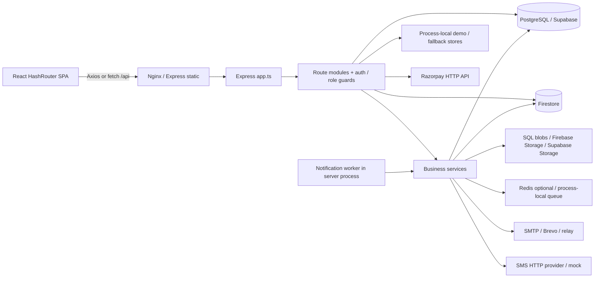
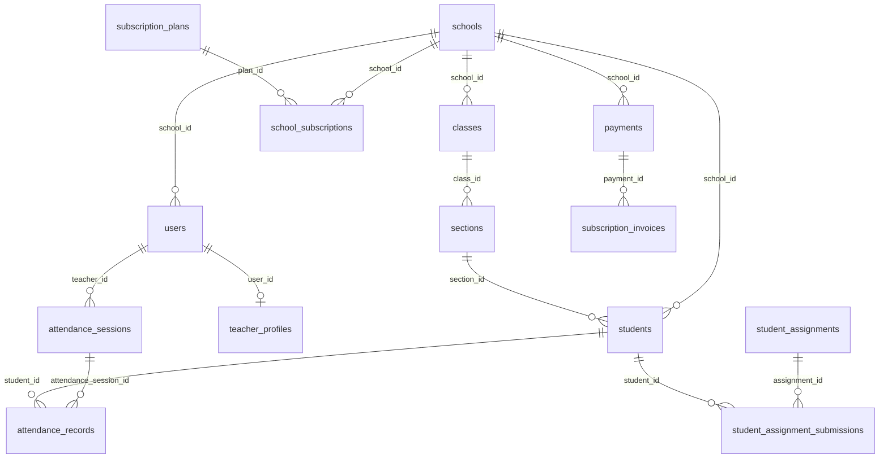
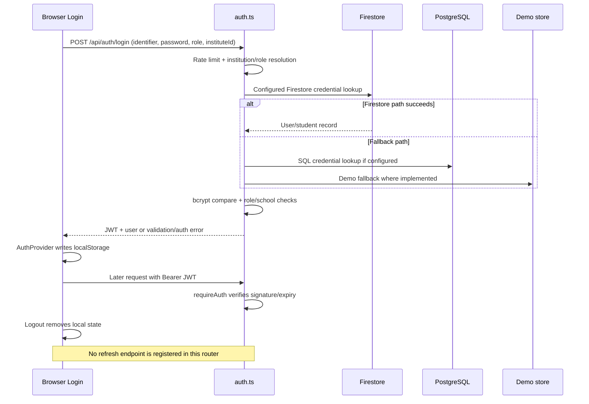
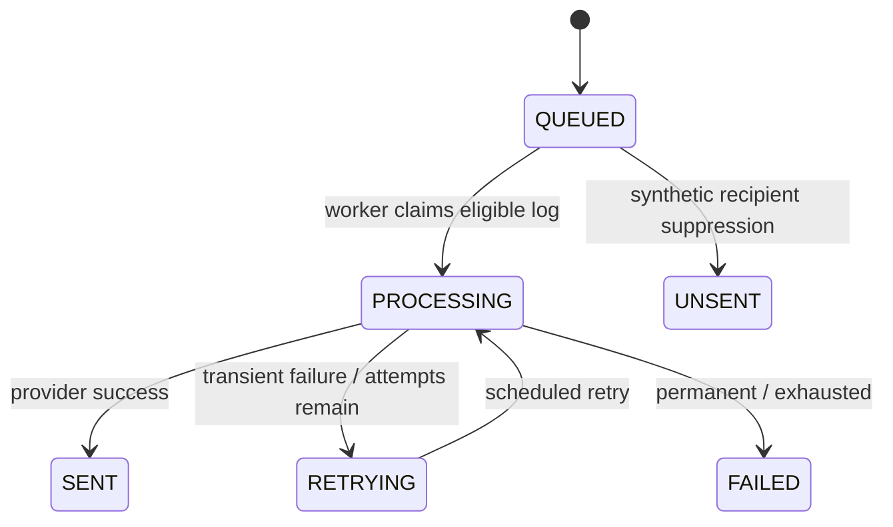
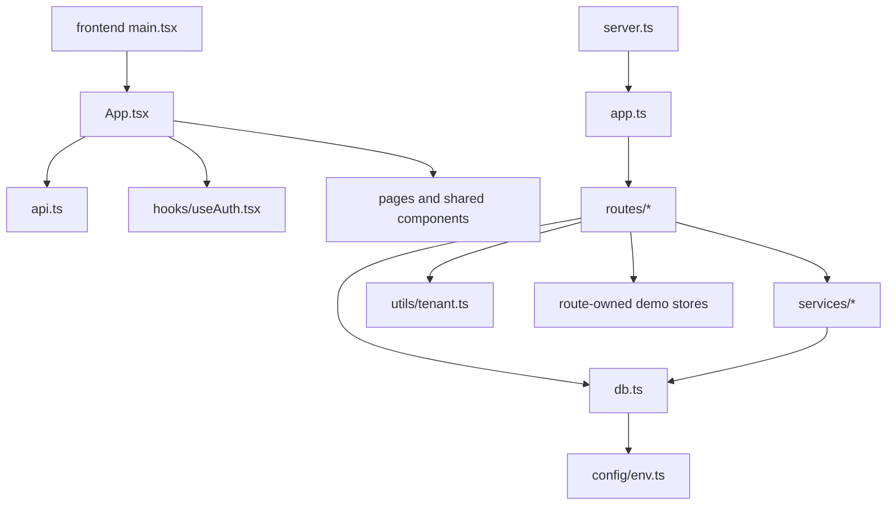

"Before changing anything: read §0, §13, §14, §15 and the relevant §17 playbook.
Follow existing conventions exactly. Do not touch 🚫 items without approval.
After a change, update this document's affected sections."

# PROJECT_CONTEXT — AttendoSchool

Audit date: 2026-11-08 (Asia/Calcutta). Scope: this local checkout. ✅ VERIFIED = directly present in source; 🔶 INFERRED = interpretation of cited evidence; ⚠️ UNKNOWN = requires owner/runtime verification. “Implemented” means code exists, not that production behavior passed a test. Sensitive values are deliberately omitted.

## 0. ⚡ AI Quick Start

✅ VERIFIED — AttendoSchool is a school attendance SaaS with five declared user roles. `package.json:5` `backend/src/middleware/auth.ts:5`
✅ VERIFIED — React 19 / Vite 7 frontend; Express 5 / TypeScript backend; raw PostgreSQL queries plus Firebase Admin. `frontend/package.json:11-23` `backend/package.json:35-57`
✅ VERIFIED — Install: `npm ci`, `npm --prefix backend ci`, `npm --prefix frontend ci`; start two terminals with `npm run dev:backend` and `npm run dev:frontend`. Root scripts delegate to separate packages. `package.json:6-15`
✅ VERIFIED — Configure env names from §6; backend port must match Vite’s proxy target (5002); credentials select persistence behavior. `frontend/vite.config.ts:19-22` `backend/src/db.ts:27-39`
✅ VERIFIED — Five orientation files: `backend/src/app.ts` (mounts), `backend/src/routes/schoolData.ts` (core CRUD), `frontend/src/App.tsx` (screens/routes), `backend/src/db.ts` (SQL mode), `database/schema.sql` (base DDL). `backend/src/app.ts:10-20` `frontend/src/App.tsx:19585` `database/schema.sql:7`
✅ VERIFIED — Rule 1: keep school scope in authorization and every tenant query; alias matching is specialized. `backend/src/utils/tenant.ts:95-113`
✅ VERIFIED — Rule 2: backend auth is authoritative; client guards only control rendering/navigation. `backend/src/middleware/auth.ts:51-67` `frontend/src/hooks/useAuth.tsx:109-117`
✅ VERIFIED — Rule 3: never edit applied migrations; checksum mismatch halts the runner. `backend/src/scripts/migrate.ts:398-404`
✅ VERIFIED — Rule 4: daily class-teacher attendance and temporary/class mentor authorization must stay aligned. `database/migrations/047_daily_class_teacher_attendance.sql:37` `backend/src/middleware/attendanceAuth.ts:18`
✅ VERIFIED — Rule 5: preserve cumulative file limits and transaction/cleanup ordering on submissions. `backend/src/services/studentService.ts:1643-1677`
✅ VERIFIED — Lookups: API §8; schema/history §7; screens §10; env §6; impact §14; exact task recipes §17; full file index §21. Module entry points follow mounts in `app.ts`. `backend/src/app.ts:144-199`
✅ VERIFIED — Browser URLs use `/#/...` because the app uses HashRouter. `frontend/src/main.tsx:24-36`

## 1. Project Identity

✅ VERIFIED — Package identity is `attendoschool-workspace`, version `0.11.0`, private; backend/frontend are separately installed packages rather than an npm workspaces declaration. `package.json:2-20`
✅ VERIFIED — The domain model centers on schools, users, students, class sections, attendance, subscriptions and payments. `database/schema.sql:7-23` `database/schema.sql:93-109` `database/schema.sql:143-158`

| Feature | Status (code-level) | Evidence |
| --- | --- | --- |
| Five-role login and institution selection | ✅ implemented; multi-store fallbacks | ✅ `backend/src/routes/auth.ts:280-295` |
| School/student/teacher administration | ✅ implemented | ✅ `backend/src/routes/schoolData.ts:1144` |
| Attendance / reattendance / audit | ✅ implemented | ✅ `backend/src/routes/teacher.ts:2651` `backend/src/routes/teacher.ts:1933` |
| Mentors / publishing permissions / temporary assignments | ✅ implemented | ✅ `backend/src/services/mentorService.ts:756` `backend/src/services/temporaryAssignmentService.ts:52` |
| Student assignments, attachments, grading, resubmission | ✅ implemented; schema capability checks | ✅ `backend/src/services/studentService.ts:1587` |
| Communication, mail/SMS processing | ✅ implemented; external deliverability unverified | ✅ `backend/src/services/notificationService.ts:2390` |
| Subscriptions / invoices / Razorpay | ✅ implemented; webhook risk in §16 | ✅ `backend/src/routes/razorpayWebhook.ts:9` |
| Backup restore test | 🟡 partial: registers test, does not restore DB | ✅ `backend/src/services/backupService.ts:41-50` |
| Uniqueness migration 050 | 🟡 partial: several constraints remain commented proposals | ✅ `database/migrations/050_enforce_student_and_teacher_uniqueness.sql:101-104` |
| Native mobile client | ⚠️ UNKNOWN; browser manifest/service-worker present | ✅ `frontend/public/manifest.webmanifest:1` `frontend/public/sw.js:1` |

## 2. Tech Stack

✅ VERIFIED — Versions below are exact **manifest strings**, including range operators; lockfiles were excluded by request, so installed/resolved versions are ⚠️ UNKNOWN. `backend/package.json:35` `frontend/package.json:11`

| Layer | Technology | Declared version | Dependency group | Evidence |
| --- | --- | --- | --- | --- |
| Workspace/tooling | @playwright/test | ^1.64.1 | devDependencies | ✅ `package.json:17` |
| Workspace/tooling | basic-ftp | ^5.0.5 | devDependencies | ✅ `package.json:18` |
| Backend | @google-cloud/firestore | ^9.3.1 | dependencies | ✅ `backend/package.json:36` |
| Backend | @types/cors | ^2.8.19 | dependencies | ✅ `backend/package.json:37` |
| Backend | @types/express | ^5.0.3 | dependencies | ✅ `backend/package.json:38` |
| Backend | @types/jsonwebtoken | ^9.0.10 | dependencies | ✅ `backend/package.json:39` |
| Backend | @types/node | ^24.3.0 | dependencies | ✅ `backend/package.json:40` |
| Backend | @types/pg | ^8.15.5 | dependencies | ✅ `backend/package.json:41` |
| Backend | bcryptjs | ^3.0.2 | dependencies | ✅ `backend/package.json:42` |
| Backend | compression | ^1.8.2 | dependencies | ✅ `backend/package.json:43` |
| Backend | cors | ^2.8.5 | dependencies | ✅ `backend/package.json:44` |
| Backend | dotenv | ^17.2.1 | dependencies | ✅ `backend/package.json:45` |
| Backend | express | ^5.1.0 | dependencies | ✅ `backend/package.json:46` |
| Backend | firebase-admin | ^14.4.0 | dependencies | ✅ `backend/package.json:47` |
| Backend | ioredis | ^6.0.0 | dependencies | ✅ `backend/package.json:48` |
| Backend | jsonwebtoken | ^9.0.2 | dependencies | ✅ `backend/package.json:49` |
| Backend | nodemailer | ^7.0.6 | dependencies | ✅ `backend/package.json:50` |
| Backend | pdfkit | ^0.16.0 | dependencies | ✅ `backend/package.json:51` |
| Backend | pg | ^8.16.3 | dependencies | ✅ `backend/package.json:52` |
| Backend | tsx | ^4.20.3 | dependencies | ✅ `backend/package.json:53` |
| Backend | typescript | ^5.9.2 | dependencies | ✅ `backend/package.json:54` |
| Backend | xlsx | ^0.18.5 | dependencies | ✅ `backend/package.json:55` |
| Frontend | autoprefixer | ^10.6.2 | dependencies | ✅ `frontend/package.json:12` |
| Frontend | axios | ^1.11.0 | dependencies | ✅ `frontend/package.json:13` |
| Frontend | gsap | ^3.15.0 | dependencies | ✅ `frontend/package.json:14` |
| Frontend | lucide-react | ^0.468.0 | dependencies | ✅ `frontend/package.json:15` |
| Frontend | postcss | ^8.5.32 | dependencies | ✅ `frontend/package.json:16` |
| Frontend | react | ^19.1.1 | dependencies | ✅ `frontend/package.json:17` |
| Frontend | react-dom | ^19.1.1 | dependencies | ✅ `frontend/package.json:18` |
| Frontend | react-router-dom | ^7.8.2 | dependencies | ✅ `frontend/package.json:19` |
| Frontend | tailwindcss | ^3.4.19 | dependencies | ✅ `frontend/package.json:20` |
| Frontend | xlsx | ^0.18.5 | dependencies | ✅ `frontend/package.json:21` |
| Frontend | @types/react | ^19.1.10 | devDependencies | ✅ `frontend/package.json:24` |
| Frontend | @types/react-dom | ^19.1.7 | devDependencies | ✅ `frontend/package.json:25` |
| Frontend | @vitejs/plugin-react | ^5.0.2 | devDependencies | ✅ `frontend/package.json:26` |
| Frontend | typescript | ^5.9.2 | devDependencies | ✅ `frontend/package.json:27` |
| Frontend | vite | ^7.1.3 | devDependencies | ✅ `frontend/package.json:7` |

| Layer | Implementation / version reality | Evidence |
| --- | --- | --- |
| Database / ORM | pg raw SQL; PostgreSQL server version not pinned here; no ORM abstraction in db.ts | ✅ `backend/src/db.ts:1-2` |
| Authentication | bcryptjs password hashes; jsonwebtoken HS256; Firebase Admin accesses data, not browser Firebase Auth | ✅ `backend/src/middleware/auth.ts:25` `backend/src/routes/auth.ts:385` |
| Object/file storage | Firebase/GCS + SQL attachment_blobs; separate Supabase REST helper | ✅ `backend/src/utils/firebaseStorage.ts:56-64` `backend/src/utils/supabaseStorage.ts:40` |
| Email | Nodemailer; Brevo HTTP and Apps Script relay code | ✅ `backend/src/services/notificationService.ts:1837` `backend/src/services/notificationService.ts:1942` |
| Hosting / CI | Node 20 in Actions; Hostinger VPS / PM2 reload via SSH; Nginx configs also exist | ✅ `.github/workflows/deploy.yml:80` `.github/workflows/deploy.yml:152` `deploy/cloudpanel/attendoschool.online.nginx.conf:1` |
| Testing | Custom tsx assertion scripts and Playwright; no coverage command in package scripts | ✅ `backend/package.json:18` `playwright.config.ts:1` |
| Styling | CSS + Tailwind/PostCSS; distinct student and super-admin styles | ✅ `frontend/src/main.tsx:9-11` `frontend/tailwind.config.js:1` |

## 3. System Architecture

🔶 INFERRED — Hybrid layered API: Express mounts route modules, routes call services/raw SQL, and some route modules own in-memory stores and runtime DDL. This is not a uniformly separated MVC implementation. `backend/src/app.ts:10-22` `backend/src/routes/peopleManagement.ts:4-7` `backend/src/routes/designations.ts:29-41`



✅ VERIFIED — Diagram edges: `frontend/src/api.ts:30-34` `backend/src/app.ts:10-32` `backend/src/routes/auth.ts:349-357` `backend/src/services/queueService.ts:84-96` `backend/src/server.ts:16` `backend/src/services/razorpayService.ts:16-24`

✅ VERIFIED — Configured production deployment uses `attendoschool.online`, checkout path `/home/attendoschool/htdocs/attendoschool.online`, and root `ecosystem.config.cjs`; actual DNS, active vhost and live process state are ⚠️ UNKNOWN. `.github/workflows/deploy.yml:137-159`
✅ VERIFIED — Database precedence varies by module: auth institute discovery is Firestore first, SQL only if no Firestore schools, then demo; DualDatabaseService executes the parameter named secondaryFn as SQL primary when SQL is configured. `backend/src/routes/auth.ts:28-93` `backend/src/services/dualDatabaseService.ts:31-57`

## 4. Annotated Folder Structure

✅ VERIFIED — Paths below are present in the coverage index (§21); ★ means an import hub or composition entry; 🚫 indicates generated artifacts or sensitive material. Each entry cites a representative file.

| Path (≤3 directory levels, key files shown) | Purpose | Evidence |
| --- | --- | --- |
| backend/src/app.ts | ★ HTTP composition / parsers / mounts | ✅ `backend/src/app.ts:1` |
| backend/src/server.ts | ★ HTTP listener / worker / shutdown | ✅ `backend/src/server.ts:1` |
| backend/src/db.ts | ★ SQL pool and disabled mode | ✅ `backend/src/db.ts:1` |
| backend/src/config/env.ts | ★ dotenv and normalized environment | ✅ `backend/src/config/env.ts:1` |
| backend/src/firebase.ts | ★ Admin initialization / collection references | ✅ `backend/src/firebase.ts:1` |
| backend/src/routes/ | HTTP handlers and some process-local stores | ✅ `backend/src/routes/academicYears.ts:1` |
| backend/src/services/ | Business workflows, persistence and integration helpers | ✅ `backend/src/services/academicYearService.ts:1` |
| backend/src/middleware/ | JWT / roles / limits / attendance / subscription guards | ✅ `backend/src/middleware/attendanceAuth.ts:1` |
| backend/src/utils/ | Tenant identity, validation, storage, cache | ✅ `backend/src/utils/cache.ts:1` |
| backend/src/scripts/ | Migrations, seeds, backup and diagnostic executables | ✅ `backend/src/scripts/audit_supabase_crud.ts:1` |
| backend/src/types/ | Firestore declarations and type shims | ✅ `backend/src/types/firestoreSchema.ts:1` |
| backend/src/workers/ | Notification, SMS, subscription and production loops | ✅ `backend/src/workers/notificationQueueWorker.ts:1` |
| backend/tests/ | Custom regression / integration scripts | ✅ `backend/tests/announcement-attachment-preview.test.ts:1` |
| database/schema.sql | ★ base SQL schema | ✅ `database/schema.sql:1` |
| database/migrations/ | incremental SQL history (007–050, duplicate numeric prefixes) | ✅ `database/migrations/007_payment_invoices.sql:1` |
| database/seed.sql | seed SQL; inspect identity safety before use | ✅ `database/seed.sql:1` |
| frontend/src/App.tsx | ★ large composition file / inline screens / route declarations | ✅ `frontend/src/App.tsx:1` |
| frontend/src/api.ts | ★ HTTP wrappers and retry/session behavior | ✅ `frontend/src/api.ts:1` |
| frontend/src/main.tsx | React root / providers / HashRouter | ✅ `frontend/src/main.tsx:1` |
| frontend/src/hooks/ | auth context and route guards | ✅ `frontend/src/hooks/useAuth.tsx:1` |
| frontend/src/pages/ | admin, auth, landing, parent, student, teacher screens | ✅ `frontend/src/pages/admin/AcademicYears.tsx:1` |
| frontend/src/components/ | shared widgets, preview, student layout | ✅ `frontend/src/components/AnnouncementDateFilter.tsx:1` |
| frontend/src/services/ | student / temporary assignment clients and offline queue | ✅ `frontend/src/services/offlineAttendanceQueue.ts:1` |
| frontend/src/super-admin/ | platform module, pages, styles and local types | ✅ `frontend/src/super-admin/AuditLogsViewer.tsx:1` |
| frontend/src/utils/ | formatters, gender, roman and password helpers | ✅ `frontend/src/utils/formatters.ts:1` |
| frontend/src/styles.css | ★ shared visual rules | ✅ `frontend/src/styles.css:1` |
| frontend/public/ | manifest, service worker, static hosting redirects and assets | ✅ `frontend/public/.htaccess:1` |
| scripts/ | deployment, smoke, DB/Firestore and backup utilities | ✅ `scripts/api-smoke.ts:1` |
| deploy/ | nginx, hostinger and cloudpanel configurations | ✅ `deploy/cloudpanel/attendoschool.online.nginx.conf:1` |
| tests/e2e/ | Playwright smoke / navigation tests | ✅ `tests/e2e/navigation-layout.spec.ts:1` |
| .github/workflows/ | CI, deploy, sync, FTP retirement | ✅ `.github/workflows/ci.yml:1` |
| .agents/rules/deployment.md | local deployment instruction; stale workflow reference | ✅ `.agents/rules/deployment.md:1` |
| backups/ | 🚫 sensitive runtime backups (contents excluded) | Coverage exclusion (§21) |
| supabase-export/ | 🚫 sensitive data exports (contents excluded) | Coverage exclusion (§21) |
| node_modules/ | 🚫 installed dependencies | Coverage exclusion (§21) |
| backend/dist/ | 🚫 compiled output | Coverage exclusion (§21) |
| frontend/dist/ | 🚫 generated Vite output | Coverage exclusion (§21) |

## 5. Setup, Run, Build, Test, Deploy

✅ VERIFIED — Actions selects Node 20. Vite proxy forwards `/api` to `http://localhost:5002`; root scripts launch separately installed frontend/backend packages. `.github/workflows/deploy.yml:80` `frontend/vite.config.ts:15-25` `package.json:6-15`

Fresh-clone recipe (🔶 INFERRED sequencing from manifests/config):

1. Install Node/npm compatible with the declared toolchain; run `npm ci`, `npm --prefix backend ci`, `npm --prefix frontend ci`. `.github/workflows/deploy.yml:86-112`
2. Copy relevant example env files to local `.env` locations; populate variable names listed in §6. Backend dotenv checks backend, root and cwd in that order without override. `backend/src/config/env.ts:5-7`
3. Select and provision intended persistence; blank SQL configuration produces DisabledPool, not a real SQL database. `backend/src/db.ts:37-51`
4. For a reviewed, disposable SQL database: `npm --prefix backend run build`, then `npm --prefix backend run db:migrate`; review §15/§16 before using real data. Seeding is separate. `backend/package.json:22-23` `backend/src/scripts/migrate.ts:479-482`
5. Run `npm run dev:backend` and `npm run dev:frontend` in separate terminals. Open Vite at its configured port 5173; navigate using `/#/login`. `package.json:9-10` `frontend/vite.config.ts:16` `frontend/src/main.tsx:24`

| Working directory manifest | npm script | Exact command | Evidence |
| --- | --- | --- | --- |
| package.json | test:firebase | npm --prefix backend run test:firebase | ✅ `package.json:7` |
| package.json | seed:firestore | npm --prefix backend run seed:firestore | ✅ `package.json:8` |
| package.json | dev:backend | npm --prefix backend run dev | ✅ `package.json:9` |
| package.json | dev:frontend | npm --prefix frontend run dev | ✅ `package.json:10` |
| package.json | build:backend | npm --prefix backend run build | ✅ `package.json:11` |
| package.json | build:frontend | npm --prefix frontend run build | ✅ `package.json:12` |
| package.json | build | npm --prefix backend run build && npm --prefix frontend run build | ✅ `package.json:13` |
| package.json | test | npm --prefix backend run test | ✅ `package.json:14` |
| backend/package.json | dev | tsx watch src/server.ts | ✅ `backend/package.json:6` |
| backend/package.json | prestart | npm run build | ✅ `backend/package.json:7` |
| backend/package.json | build | tsc | ✅ `backend/package.json:8` |
| backend/package.json | start | node dist/server.js | ✅ `backend/package.json:9` |
| backend/package.json | start:cluster | node dist/cluster.js | ✅ `backend/package.json:10` |
| backend/package.json | pm2:start | pm2 start ecosystem.config.js | ✅ `backend/package.json:11` |
| backend/package.json | pm2:reload | pm2 reload ecosystem.config.js | ✅ `backend/package.json:12` |
| backend/package.json | worker:notifications | node dist/workers/notificationQueueWorker.js | ✅ `backend/package.json:13` |
| backend/package.json | worker | tsx src/workers/smsWorker.ts | ✅ `backend/package.json:14` |
| backend/package.json | subscription-worker | tsx src/workers/subscriptionWorker.ts | ✅ `backend/package.json:15` |
| backend/package.json | notification-worker | tsx src/workers/notificationWorker.ts | ✅ `backend/package.json:16` |
| backend/package.json | worker:production | tsx src/workers/productionWorker.ts | ✅ `backend/package.json:17` |
| backend/package.json | test | tsx tests/comprehensive-test-suite.ts | ✅ `backend/package.json:18` |
| backend/package.json | test:student | tsx tests/student-portal-e2e.ts | ✅ `backend/package.json:19` |
| backend/package.json | test:integration-smoke | tsx ../scripts/integration-smoke.ts | ✅ `backend/package.json:20` |
| backend/package.json | test:api-smoke | tsx ../scripts/api-smoke.ts | ✅ `backend/package.json:21` |
| backend/package.json | db:migrate | node dist/scripts/migrate.js | ✅ `backend/package.json:22` |
| backend/package.json | db:seed | node dist/scripts/seed.js | ✅ `backend/package.json:23` |
| backend/package.json | seed:firestore | tsx src/scripts/seedFirestore.ts | ✅ `backend/package.json:24` |
| backend/package.json | test:firebase | tsx src/scripts/verifyFirebaseConnection.ts | ✅ `backend/package.json:25` |
| backend/package.json | test:dual-db | tsx src/scripts/testDualDatabase.ts | ✅ `backend/package.json:26` |
| backend/package.json | migrate:firebase-to-supabase | tsx src/scripts/migrateFirebaseToSupabase.ts | ✅ `backend/package.json:27` |
| backend/package.json | backup:firestore | tsx src/scripts/exportFullBackup.ts | ✅ `backend/package.json:28` |
| backend/package.json | backup:postgres | tsx src/scripts/backup_postgresql.ts | ✅ `backend/package.json:29` |
| backend/package.json | backup:watch | tsx src/scripts/backupWatcher.ts | ✅ `backend/package.json:30` |
| backend/package.json | db:clean | tsx src/scripts/clean_and_seed_greenwood.ts | ✅ `backend/package.json:31` |
| backend/package.json | emulator:firestore | npx --package=firebase-tools firebase emulators:start --only firestore | ✅ `backend/package.json:32` |
| backend/package.json | release:check | npm run build && npm run test:api-smoke | ✅ `backend/package.json:33` |
| frontend/package.json | dev | vite | ✅ `frontend/package.json:7` |
| frontend/package.json | build | tsc -b && vite build | ✅ `frontend/package.json:8` |
| frontend/package.json | preview | vite preview | ✅ `frontend/package.json:9` |

✅ VERIFIED — CI runs on developer branch pushes (excluding main/gh-pages) and manual dispatch, builds backend/tests/frontend, can create and merge PRs, then dispatch deploy for the merge SHA. Workflow-level behavior is evidence of configured automation, not proof of repository branch protection. `.github/workflows/ci.yml:7-19` `.github/workflows/ci.yml:401`
✅ VERIFIED — CD runs on main pushes or workflow_dispatch; deploy_sha must be an ancestor of origin/main; SSH step compiles on VPS and reloads PM2; no migration execution appears in that SSH script. `.github/workflows/deploy.yml:140-158`
✅ VERIFIED — Local deployment rule names `.github/workflows/ci-cd.yml`, whereas current automation files are `ci.yml` and `deploy.yml`; its automatic-push instruction applies to code changes, and this audit changes documentation only. `.agents/rules/deployment.md:4-6` `.github/workflows/deploy.yml:5`

## 6. Configuration & Environment

✅ VERIFIED — dotenv loads backend/.env, root/.env and then cwd defaults; existing process values win under dotenv defaults. cleanEnv trims and removes outer quotes; production JWT has length/default checks. `backend/src/config/env.ts:5-15` `backend/src/config/env.ts:54-66`

✅ VERIFIED — Complete statically recognized environment-name inventory follows. “Observed default” is a safe literal only; sensitive values are withheld. ⚠️ UNKNOWN requiredness means no centralized fail-fast validation was established for that variable. Example-only names do not imply active runtime support. References include all direct reads found; `env` property indirections resolve through `config/env.ts`.

| Variable | Purpose | Required? | Observed default | Environment / scope | Read in |
| --- | --- | --- | --- | --- | --- |
| APP_BASE_URL | Runtime or script configuration; read locations define scope | Conditional integration requirement; ⚠️ UNKNOWN universal requirement | Not established / value withheld | runtime/script | ✅ `backend/src/config/env.ts:131` |
| BACKUP_DIR | Runtime or script configuration; read locations define scope | Conditional integration requirement; ⚠️ UNKNOWN universal requirement | backups | runtime/script | ✅ `.env.production.example:10`; `backend/src/services/backupService.ts:9` |
| BACKUP_RETENTION_DAYS | Runtime or script configuration; read locations define scope | Conditional integration requirement; ⚠️ UNKNOWN universal requirement | Not established / value withheld | runtime/script | ✅ `.env.production.example:11`; `backend/src/workers/productionWorker.ts:16` |
| BASE_URL | Test runner configuration | Conditional integration requirement; ⚠️ UNKNOWN universal requirement | Not established / value withheld | runtime/script | ✅ `playwright.config.ts:1`; `scripts/api-smoke.ts:1`; `scripts/integration-smoke.ts:6`; `tests/e2e/smoke.spec.ts:2` |
| BREVO_API_KEY | Credential / secret configuration; value withheld | Conditional integration requirement; ⚠️ UNKNOWN universal requirement | Not established / value withheld | runtime/script | ✅ `.env:65`; `.env.example:65`; `backend/.env:72`; `backend/src/config/env.ts:127`; `backend/src/routes/health.ts:36`; `backend/src/routes/health.ts:79`; `backend/src/services/emailService.ts:13`; `backend/src/services/notificationService.ts:2030`; `backend/src/services/notificationService.ts:2285`; `backend/src/services/notificationService.ts:2670` |
| BREVO_SENDER_EMAIL | Runtime or script configuration; read locations define scope | Conditional integration requirement; ⚠️ UNKNOWN universal requirement | Not established / value withheld | runtime/script | ✅ `.env:66`; `.env.example:66`; `backend/.env:73`; `backend/src/config/env.ts:128` |
| BREVO_SENDER_NAME | Runtime or script configuration; read locations define scope | Conditional integration requirement; ⚠️ UNKNOWN universal requirement | AttendoSchool | runtime/script | ✅ `.env:67`; `.env.example:67`; `backend/.env:74`; `backend/src/config/env.ts:129` |
| COMPANY_ADDRESS | Runtime or script configuration; read locations define scope | Conditional integration requirement; ⚠️ UNKNOWN universal requirement | (empty) | runtime/script | ✅ `.env:40`; `.env.example:44`; `backend/.env:49`; `backend/.env.example:49`; `backend/src/config/env.ts:105` |
| COMPANY_GSTIN | Runtime or script configuration; read locations define scope | Conditional integration requirement; ⚠️ UNKNOWN universal requirement | (empty) | runtime/script | ✅ `.env:39`; `.env.example:43`; `backend/.env:48`; `backend/.env.example:48`; `backend/src/config/env.ts:104` |
| COMPANY_GST_RATE | Runtime or script configuration; read locations define scope | Conditional integration requirement; ⚠️ UNKNOWN universal requirement | 18 | runtime/script | ✅ `.env:42`; `.env.example:46`; `backend/.env:51`; `backend/.env.example:51`; `backend/src/config/env.ts:107` |
| COMPANY_NAME | Runtime or script configuration; read locations define scope | Conditional integration requirement; ⚠️ UNKNOWN universal requirement | AttendoSchool | runtime/script | ✅ `.env:38`; `.env.example:42`; `backend/.env:47`; `backend/.env.example:47`; `backend/src/config/env.ts:103` |
| COMPANY_PHONE | Runtime or script configuration; read locations define scope | Conditional integration requirement; ⚠️ UNKNOWN universal requirement | (empty) | runtime/script | ✅ `.env:41`; `.env.example:45`; `backend/.env:50`; `backend/.env.example:50`; `backend/src/config/env.ts:106` |
| CORS_ORIGIN | Runtime or script configuration; read locations define scope | Conditional integration requirement; ⚠️ UNKNOWN universal requirement | Not established / value withheld | runtime/script | ✅ `.env:9`; `.env.example:9`; `.env.production.example:9`; `backend/.env:9`; `backend/.env.example:9`; `backend/src/config/env.ts:94` |
| DATABASE_URL | Runtime or script configuration; read locations define scope | Conditional integration requirement; ⚠️ UNKNOWN universal requirement | Not established / value withheld | runtime/script | ✅ `.env:18`; `.env.example:18`; `backend/.env:18`; `backend/.env.example:18`; `backend/src/config/env.ts:92`; `backend/src/config/env.ts:133` |
| DB_DRIVER | Runtime or script configuration; read locations define scope | Conditional integration requirement; ⚠️ UNKNOWN universal requirement | firebase | runtime/script | ✅ `.env:16`; `.env.example:16`; `backend/.env:16`; `backend/.env.example:16`; `backend/src/config/env.ts:117` |
| DB_HOST | Runtime or script configuration; read locations define scope | Conditional integration requirement; ⚠️ UNKNOWN universal requirement | localhost | runtime/script | ✅ `.env.production.example:3`; `backend/src/services/backupService.ts:25` |
| DB_NAME | Runtime or script configuration; read locations define scope | Conditional integration requirement; ⚠️ UNKNOWN universal requirement | attendance | runtime/script | ✅ `.env.production.example:5`; `backend/src/services/backupService.ts:25` |
| DB_PASSWORD | Credential / secret configuration; value withheld | Conditional integration requirement; ⚠️ UNKNOWN universal requirement | Not established / value withheld | runtime/script | ✅ `.env.production.example:7`; `backend/src/services/backupService.ts:24` |
| DB_PORT | Runtime or script configuration; read locations define scope | Conditional integration requirement; ⚠️ UNKNOWN universal requirement | 5432 | runtime/script | ✅ `.env.production.example:4`; `backend/src/services/backupService.ts:25` |
| DB_USER | Runtime or script configuration; read locations define scope | Conditional integration requirement; ⚠️ UNKNOWN universal requirement | Not established / value withheld | runtime/script | ✅ `.env.production.example:6`; `backend/src/services/backupService.ts:25` |
| EMAIL_ENABLED | Runtime or script configuration; read locations define scope | Conditional integration requirement; ⚠️ UNKNOWN universal requirement | Not established / value withheld | runtime/script | ✅ `.env:61`; `.env.example:62`; `backend/.env:69`; `backend/.env.example:63`; `backend/src/config/env.ts:120`; `backend/src/routes/health.ts:80`; `backend/src/services/notificationService.ts:94`; `backend/src/services/notificationService.ts:232`; `backend/src/services/notificationService.ts:243`; `backend/src/services/notificationService.ts:276` |
| EMAIL_MAX_RETRIES | Runtime or script configuration; read locations define scope | Conditional integration requirement; ⚠️ UNKNOWN universal requirement | Not established / value withheld | runtime/script | ✅ `backend/src/config/env.ts:122` |
| EMAIL_RATE_LIMIT | Runtime or script configuration; read locations define scope | Conditional integration requirement; ⚠️ UNKNOWN universal requirement | Not established / value withheld | runtime/script | ✅ `backend/src/config/env.ts:121` |
| ENABLE_DUAL_DB_SYNC | Runtime or script configuration; read locations define scope | Conditional integration requirement; ⚠️ UNKNOWN universal requirement | false | runtime/script | ✅ `.env:21`; `.env.example:21`; `backend/.env:23`; `backend/src/config/env.ts:134` |
| FIREBASE_CLIENT_EMAIL | Runtime or script configuration; read locations define scope | Conditional integration requirement; ⚠️ UNKNOWN universal requirement | Not established / value withheld | runtime/script | ✅ `backend/.env.example:24`; `backend/src/config/env.ts:110` |
| FIREBASE_PRIVATE_KEY | Credential / secret configuration; value withheld | Conditional integration requirement; ⚠️ UNKNOWN universal requirement | Not established / value withheld | runtime/script | ✅ `backend/.env.example:25`; `backend/src/config/env.ts:111` |
| FIREBASE_PROJECT_ID | Runtime or script configuration; read locations define scope | Conditional integration requirement; ⚠️ UNKNOWN universal requirement | attendoschool-2d0fb | runtime/script | ✅ `backend/.env.example:23`; `backend/src/config/env.ts:109` |
| FIREBASE_SERVICE_ACCOUNT | Credential / secret configuration; value withheld | Conditional integration requirement; ⚠️ UNKNOWN universal requirement | (empty) | runtime/script | ✅ `backend/src/config/env.ts:113` |
| FIREBASE_SERVICE_ACCOUNT_KEY | Credential / secret configuration; value withheld | Conditional integration requirement; ⚠️ UNKNOWN universal requirement | Not established / value withheld | runtime/script | ✅ `backend/src/config/env.ts:113` |
| FIREBASE_SERVICE_ACCOUNT_PATH | Credential / secret configuration; value withheld | Conditional integration requirement; ⚠️ UNKNOWN universal requirement | (empty) | runtime/script | ✅ `backend/src/config/env.ts:112` |
| FIREBASE_STORAGE_BUCKET | Runtime or script configuration; read locations define scope | Conditional integration requirement; ⚠️ UNKNOWN universal requirement | (empty) | runtime/script | ✅ `backend/src/config/env.ts:115`; `backend/tests/firebase-storage-attachments.test.ts:153`; `backend/tests/firebase-storage-attachments.test.ts:154` |
| FIREBASE_STORAGE_EMULATOR_HOST | Runtime or script configuration; read locations define scope | Conditional integration requirement; ⚠️ UNKNOWN universal requirement | (empty) | runtime/script | ✅ `backend/src/config/env.ts:116`; `backend/src/utils/firebaseStorage.ts:105` |
| FIRESTORE_EMULATOR_HOST | Runtime or script configuration; read locations define scope | Conditional integration requirement; ⚠️ UNKNOWN universal requirement | (empty) | runtime/script | ✅ `backend/src/config/env.ts:114`; `backend/src/firebase.ts:74` |
| FRONTEND_URL | Runtime or script configuration; read locations define scope | Conditional integration requirement; ⚠️ UNKNOWN universal requirement | Not established / value withheld | runtime/script | ✅ `.env:10`; `.env.example:10`; `backend/.env:10`; `backend/.env.example:10`; `backend/src/config/env.ts:131`; `backend/src/routes/schoolData.ts:6602` |
| GCLOUD_PROJECT | Runtime or script configuration; read locations define scope | Conditional integration requirement; ⚠️ UNKNOWN universal requirement | attendoschool-2d0fb | runtime/script | ✅ `backend/src/config/env.ts:109` |
| GCS_BUCKET | Runtime or script configuration; read locations define scope | Conditional integration requirement; ⚠️ UNKNOWN universal requirement | (empty) | runtime/script | ✅ `backend/src/config/env.ts:115` |
| GMAIL_RELAY_URL | Runtime or script configuration; read locations define scope | Conditional integration requirement; ⚠️ UNKNOWN universal requirement | Not established / value withheld | runtime/script | ✅ `backend/src/config/env.ts:130`; `backend/src/services/emailService.ts:15`; `backend/src/services/notificationService.ts:2012`; `backend/src/services/notificationService.ts:2287`; `backend/src/services/notificationService.ts:2672` |
| GOOGLE_APPLICATION_CREDENTIALS | Runtime or script configuration; read locations define scope | Conditional integration requirement; ⚠️ UNKNOWN universal requirement | Not established / value withheld | runtime/script | ✅ `backend/src/firebase.ts:24` |
| GOOGLE_SCRIPT_URL | Runtime or script configuration; read locations define scope | Conditional integration requirement; ⚠️ UNKNOWN universal requirement | Not established / value withheld | runtime/script | ✅ `backend/src/config/env.ts:130`; `backend/src/services/notificationService.ts:2012` |
| HOSTINGER_FTP_PASSWORD | Credential / secret configuration; value withheld | Conditional integration requirement; ⚠️ UNKNOWN universal requirement | Not established / value withheld | runtime/script | ✅ `scripts/decommission-hostinger-ftp.js:8` |
| HOSTINGER_FTP_SERVER | Deployment/FTP retirement setting | Conditional integration requirement; ⚠️ UNKNOWN universal requirement | Not established / value withheld | runtime/script | ✅ `scripts/decommission-hostinger-ftp.js:6` |
| HOSTINGER_FTP_USERNAME | Deployment/FTP retirement setting | Conditional integration requirement; ⚠️ UNKNOWN universal requirement | Not established / value withheld | runtime/script | ✅ `scripts/decommission-hostinger-ftp.js:7` |
| HOSTINGER_SERVER_DIR | Deployment/FTP retirement setting | Conditional integration requirement; ⚠️ UNKNOWN universal requirement | Not established / value withheld | runtime/script | ✅ `scripts/decommission-hostinger-ftp.js:69`; `scripts/decommission-hostinger-ftp.js:69`; `scripts/decommission-hostinger-ftp.js:69`; `scripts/decommission-hostinger-ftp.js:70` |
| JWT_SECRET | Credential / secret configuration; value withheld | Required in production (security guard) | Not established / value withheld | runtime/script | ✅ `.env:13`; `.env.example:13`; `.env.production.example:8`; `backend/.env:13`; `backend/.env.example:13`; `backend/src/config/env.ts:55`; `backend/src/config/env.ts:75`; `backend/src/config/env.ts:83`; `backend/tests/announcement-attachment-preview.test.ts:10`; `backend/tests/security-audit-tests.ts:421`; `backend/tests/security-audit-tests.ts:436` |
| KEEP_ALIVE_URL | Runtime or script configuration; read locations define scope | Conditional integration requirement; ⚠️ UNKNOWN universal requirement | Not established / value withheld | runtime/script | ✅ `backend/src/config/env.ts:118`; `backend/src/services/keepAliveService.ts:10` |
| LOGIN_IP_RATE_LIMIT | Runtime or script configuration; read locations define scope | Conditional integration requirement; ⚠️ UNKNOWN universal requirement | Not established / value withheld | runtime/script | ✅ `backend/src/middleware/security.ts:39` |
| LOGIN_RATE_LIMIT | Runtime or script configuration; read locations define scope | Conditional integration requirement; ⚠️ UNKNOWN universal requirement | Not established / value withheld | runtime/script | ✅ `backend/src/middleware/security.ts:36` |
| NODE_ENV | Runtime or script configuration; read locations define scope | Conditional integration requirement; ⚠️ UNKNOWN universal requirement | development, test | runtime/script | ✅ `.env.production.example:1`; `backend/src/app.ts:279`; `backend/src/config/env.ts:56`; `backend/src/config/env.ts:74`; `backend/src/db.ts:55`; `backend/src/middleware/auth.ts:29`; `backend/src/middleware/security.ts:32`; `backend/src/routes/auth.ts:1342`; `backend/src/routes/health.ts:81`; `backend/src/services/notificationService.ts:183`; `backend/src/services/notificationService.ts:2367`; `backend/src/services/notificationService.ts:2752`; `backend/src/utils/firebaseStorage.ts:114`; `backend/src/utils/firebaseStorage.ts:124`; `backend/src/utils/firebaseStorage.ts:323`; `backend/src/utils/firebaseStorage.ts:328`; `backend/src/utils/firebaseStorage.ts:379`; `backend/src/utils/firebaseStorage.ts:399`; `backend/src/utils/firebaseStorage.ts:586`; `backend/src/utils/supabaseStorage.ts:271`; `backend/src/utils/supabaseStorage.ts:327`; `backend/src/utils/supabaseStorage.ts:341`; `backend/src/utils/supabaseStorage.ts:374`; `backend/src/utils/supabaseStorage.ts:414`; `backend/src/utils/supabaseStorage.ts:446`; `backend/tests/announcement-attachment-preview.test.ts:1`; `backend/tests/assignment-attachments-phase1.test.ts:1`; `backend/tests/assignment-attachments-phase1.test.ts:83`; `backend/tests/assignment-attachments-phase1.test.ts:86`; `backend/tests/assignment-attachments-phase1.test.ts:104`; `backend/tests/assignment-submission-enhancements.test.ts:1`; `backend/tests/comprehensive-test-suite.ts:1`; `backend/tests/comprehensive-test-suite.ts:1`; `backend/tests/firebase-storage-attachments.test.ts:1`; `backend/tests/firebase-storage-attachments.test.ts:131`; `backend/tests/firebase-storage-attachments.test.ts:140`; `backend/tests/general-assignment-management.test.ts:1`; `backend/tests/mentor-authorization-phase1.test.ts:1`; `backend/tests/mentor-subject-allocation-query.test.ts:1`; `backend/tests/phase2-admin-mentor-integration.test.ts:1`; `backend/tests/phase4-assignment-publishing-grading.test.ts:1`; `backend/tests/security-audit-tests.ts:420`; `backend/tests/storage-safety-fixes.test.ts:1`; `backend/tests/student-enhancements-targeted.test.ts:1`; `backend/tests/teacher-assignment-visibility.test.ts:1`; `DOCUMENTATION.md:1671` |
| PGPASSWORD | Credential / secret configuration; value withheld | Conditional integration requirement; ⚠️ UNKNOWN universal requirement | Not established / value withheld | runtime/script | ✅ `backend/src/services/backupService.ts:24` |
| PG_DUMP_PATH | Runtime or script configuration; read locations define scope | Conditional integration requirement; ⚠️ UNKNOWN universal requirement | pg_dump | runtime/script | ✅ `backend/src/services/backupService.ts:26` |
| PG_POOL_MAX | Runtime or script configuration; read locations define scope | Conditional integration requirement; ⚠️ UNKNOWN universal requirement | Not established / value withheld | runtime/script | ✅ `.env:22`; `.env.example:22`; `backend/src/db.ts:62` |
| PORT | Runtime or script configuration; read locations define scope | Conditional integration requirement; ⚠️ UNKNOWN universal requirement | 5002 | runtime/script | ✅ `.env:8`; `.env.example:8`; `.env.production.example:2`; `backend/.env:8`; `backend/.env.example:8`; `backend/src/config/env.ts:91`; `ecosystem.config.cjs:20`; `ecosystem.config.cjs:26` |
| RATE_LIMIT | Runtime or script configuration; read locations define scope | Conditional integration requirement; ⚠️ UNKNOWN universal requirement | Not established / value withheld | runtime/script | ✅ `backend/src/middleware/security.ts:30`; `backend/src/middleware/security.ts:31` |
| RAZORPAY_KEY_ID | Runtime or script configuration; read locations define scope | Conditional integration requirement; ⚠️ UNKNOWN universal requirement | Not established / value withheld | runtime/script | ✅ `.env:29`; `.env.example:33`; `.env.production.example:12`; `backend/.env:38`; `backend/.env.example:38`; `backend/src/config/env.ts:95`; `backend/src/routes/razorpaySchool.ts:26` |
| RAZORPAY_KEY_SECRET | Credential / secret configuration; value withheld | Conditional integration requirement; ⚠️ UNKNOWN universal requirement | Not established / value withheld | runtime/script | ✅ `.env:30`; `.env.example:34`; `.env.production.example:13`; `backend/.env:39`; `backend/.env.example:39`; `backend/src/config/env.ts:96` |
| RAZORPAY_WEBHOOK_SECRET | Credential / secret configuration; value withheld | Conditional integration requirement; ⚠️ UNKNOWN universal requirement | Not established / value withheld | runtime/script | ✅ `.env:31`; `.env.example:35`; `.env.production.example:14`; `backend/.env:40`; `backend/.env.example:40`; `backend/src/config/env.ts:97` |
| RBAC_ENFORCEMENT | RBAC/feature-control enforcement: `off` (no evaluation), `shadow` (default; compute + log would-be denials, never block), `enforce` (block) | Optional; default `shadow` | shadow | runtime (read per request) | ✅ `backend/src/rbac/accessService.ts` getEnforcementMode; `backend/src/config/env.ts` rbacEnforcement; `.env.example`; `.env.production.example`; `backend/.env.example` |
| REDIS_CACHE_URL | Runtime or script configuration; read locations define scope | Conditional integration requirement; ⚠️ UNKNOWN universal requirement | Not established / value withheld | runtime/script | ✅ `backend/src/utils/cache.ts:90` |
| REDIS_HOST | Runtime or script configuration; read locations define scope | Conditional integration requirement; ⚠️ UNKNOWN universal requirement | (empty) | runtime/script | ✅ `backend/src/services/queueService.ts:31`; `backend/src/utils/cache.ts:91` |
| REDIS_PASSWORD | Credential / secret configuration; value withheld | Conditional integration requirement; ⚠️ UNKNOWN universal requirement | Not established / value withheld | runtime/script | ✅ `backend/src/services/queueService.ts:55`; `backend/src/utils/cache.ts:115` |
| REDIS_PORT | Runtime or script configuration; read locations define scope | Conditional integration requirement; ⚠️ UNKNOWN universal requirement | Not established / value withheld | runtime/script | ✅ `backend/src/services/queueService.ts:54`; `backend/src/utils/cache.ts:114` |
| REDIS_QUEUE_URL | Runtime or script configuration; read locations define scope | Conditional integration requirement; ⚠️ UNKNOWN universal requirement | Not established / value withheld | runtime/script | ✅ `backend/src/services/queueService.ts:30` |
| REDIS_URL | Runtime or script configuration; read locations define scope | Conditional integration requirement; ⚠️ UNKNOWN universal requirement | Not established / value withheld | runtime/script | ✅ `backend/src/services/queueService.ts:30`; `backend/src/utils/cache.ts:90` |
| RESEND_API_KEY | Credential / secret configuration; value withheld | Conditional integration requirement; ⚠️ UNKNOWN universal requirement | Not established / value withheld | runtime/script | ✅ `backend/src/config/env.ts:125`; `backend/src/services/emailService.ts:14`; `backend/src/services/notificationService.ts:2052`; `backend/src/services/notificationService.ts:2286`; `backend/src/services/notificationService.ts:2671` |
| RESEND_FROM | Runtime or script configuration; read locations define scope | Conditional integration requirement; ⚠️ UNKNOWN universal requirement | Not established / value withheld | runtime/script | ✅ `backend/src/config/env.ts:126`; `backend/src/services/notificationService.ts:2056` |
| SECONDARY_DB | Runtime or script configuration; read locations define scope | Conditional integration requirement; ⚠️ UNKNOWN universal requirement | none | runtime/script | ✅ `.env:20`; `.env.example:20`; `backend/.env:22`; `backend/src/config/env.ts:135` |
| SENDINBLUE_API_KEY | Credential / secret configuration; value withheld | Conditional integration requirement; ⚠️ UNKNOWN universal requirement | Not established / value withheld | runtime/script | ✅ `backend/src/config/env.ts:127`; `backend/src/services/notificationService.ts:2030` |
| SKIP_SMTP_SYNC | Runtime or script configuration; read locations define scope | Conditional integration requirement; ⚠️ UNKNOWN universal requirement | Not established / value withheld | runtime/script | ✅ `backend/src/services/notificationService.ts:183`; `backend/tests/announcement-attachment-preview.test.ts:2`; `backend/tests/assignment-attachments-phase1.test.ts:2`; `backend/tests/assignment-submission-enhancements.test.ts:2`; `backend/tests/general-assignment-management.test.ts:2`; `backend/tests/mentor-authorization-phase1.test.ts:2`; `backend/tests/mentor-subject-allocation-query.test.ts:2`; `backend/tests/phase2-admin-mentor-integration.test.ts:2`; `backend/tests/phase4-assignment-publishing-grading.test.ts:2`; `backend/tests/storage-safety-fixes.test.ts:2`; `backend/tests/student-enhancements-targeted.test.ts:2`; `backend/tests/teacher-assignment-visibility.test.ts:2` |
| SMS_API_KEY | Credential / secret configuration; value withheld | Config/example declaration only; active consumption not found | Not established / value withheld | config/example only | ✅ `.env.production.example:21` |
| SMS_PROVIDER | Runtime or script configuration; read locations define scope | Config/example declaration only; active consumption not found | Not established / value withheld | config/example only | ✅ `.env:34`; `.env.example:38`; `.env.production.example:20`; `backend/.env:43`; `backend/.env.example:43` |
| SMS_PROVIDER_API_KEY | Credential / secret configuration; value withheld | Conditional integration requirement; ⚠️ UNKNOWN universal requirement | Not established / value withheld | runtime/script | ✅ `backend/src/services/smsService.ts:12` |
| SMS_PROVIDER_URL | Runtime or script configuration; read locations define scope | Conditional integration requirement; ⚠️ UNKNOWN universal requirement | Not established / value withheld | runtime/script | ✅ `backend/src/services/smsService.ts:11` |
| SMS_SENDER_ID | Runtime or script configuration; read locations define scope | Conditional integration requirement; ⚠️ UNKNOWN universal requirement | Not established / value withheld | runtime/script | ✅ `.env:35`; `.env.example:39`; `backend/.env:44`; `backend/.env.example:44`; `backend/src/services/smsService.ts:16` |
| SMTP_FROM | Runtime or script configuration; read locations define scope | Conditional integration requirement; ⚠️ UNKNOWN universal requirement | Not established / value withheld | runtime/script | ✅ `.env:58`; `.env.example:59`; `.env.production.example:19`; `backend/.env:66`; `backend/.env.example:60`; `backend/src/config/env.ts:102` |
| SMTP_FROM_NAME | Runtime or script configuration; read locations define scope | Conditional integration requirement; ⚠️ UNKNOWN universal requirement | Not established / value withheld | runtime/script | ✅ `.env:59`; `.env.example:60`; `backend/.env:67`; `backend/.env.example:61`; `backend/src/config/env.ts:124`; `backend/src/config/env.ts:129` |
| SMTP_HOST | Runtime or script configuration; read locations define scope | Conditional integration requirement; ⚠️ UNKNOWN universal requirement | smtp.gmail.com | runtime/script | ✅ `.env:54`; `.env.example:55`; `.env.production.example:15`; `backend/.env:62`; `backend/.env.example:56`; `backend/src/config/env.ts:98`; `backend/src/routes/health.ts:76` |
| SMTP_PASS | Credential / secret configuration; value withheld | Conditional integration requirement; ⚠️ UNKNOWN universal requirement | Not established / value withheld | runtime/script | ✅ `.env:57`; `.env.example:58`; `backend/.env:65`; `backend/.env.example:59`; `backend/src/config/env.ts:101`; `backend/src/routes/health.ts:78` |
| SMTP_PASSWORD | Credential / secret configuration; value withheld | Config/example declaration only; active consumption not found | Not established / value withheld | config/example only | ✅ `.env.production.example:18` |
| SMTP_PORT | Runtime or script configuration; read locations define scope | Conditional integration requirement; ⚠️ UNKNOWN universal requirement | 587 | runtime/script | ✅ `.env:55`; `.env.example:56`; `.env.production.example:16`; `backend/.env:63`; `backend/.env.example:57`; `backend/src/config/env.ts:99` |
| SMTP_REPLY_TO | Runtime or script configuration; read locations define scope | Conditional integration requirement; ⚠️ UNKNOWN universal requirement | Not established / value withheld | runtime/script | ✅ `.env:60`; `.env.example:61`; `backend/.env:68`; `backend/.env.example:62`; `backend/src/config/env.ts:123` |
| SMTP_USER | Runtime or script configuration; read locations define scope | Conditional integration requirement; ⚠️ UNKNOWN universal requirement | Not established / value withheld | runtime/script | ✅ `.env:56`; `.env.example:57`; `.env.production.example:17`; `backend/.env:64`; `backend/.env.example:58`; `backend/src/config/env.ts:100`; `backend/src/config/env.ts:128`; `backend/src/routes/health.ts:77` |
| SUPABASE_DATABASE_URL | Runtime or script configuration; read locations define scope | Conditional integration requirement; ⚠️ UNKNOWN universal requirement | Not established / value withheld | runtime/script | ✅ `.env:19`; `.env.example:19`; `backend/.env:19`; `backend/src/config/env.ts:133` |
| SUPABASE_SERVICE_ROLE_KEY | Credential / secret configuration; value withheld | Conditional integration requirement; ⚠️ UNKNOWN universal requirement | Not established / value withheld | runtime/script | ✅ `.env.example:26`; `backend/src/config/env.ts:138` |
| SUPABASE_URL | Runtime or script configuration; read locations define scope | Conditional integration requirement; ⚠️ UNKNOWN universal requirement | Not established / value withheld | runtime/script | ✅ `.env.example:25`; `backend/src/config/env.ts:137` |
| TEST_PORT | Test runner configuration | Conditional integration requirement; ⚠️ UNKNOWN universal requirement | Not established / value withheld | runtime/script | ✅ `backend/tests/comprehensive-test-suite.ts:250`; `backend/tests/comprehensive-test-suite.ts:250` |
| TZ | Runtime or script configuration; read locations define scope | Conditional integration requirement; ⚠️ UNKNOWN universal requirement | Not established / value withheld | runtime/script | ✅ `backend/tests/student-assignment-date-formatting.test.ts:135`; `backend/tests/student-assignment-date-formatting.test.ts:137`; `backend/tests/student-assignment-date-formatting.test.ts:143` |
| USE_POSTGRES | Runtime or script configuration; read locations define scope | Conditional integration requirement; ⚠️ UNKNOWN universal requirement | Not established / value withheld | runtime/script | ✅ `.env:17`; `.env.example:17`; `backend/.env:17`; `backend/.env.example:17`; `backend/src/routes/teacher.ts:846` |
| VITE_API_URL | Frontend build/browser setting | Conditional integration requirement; ⚠️ UNKNOWN universal requirement | Not established / value withheld | runtime/script | ✅ `.env:25`; `.env.example:29`; `backend/.env:34`; `backend/.env.example:34`; `frontend/.env:1`; `frontend/.env.example:1`; `frontend/.env.production:1`; `frontend/.env.production.example:2`; `frontend/src/api.ts:12`; `frontend/src/api.ts:21` |
| VITE_RAZORPAY_KEY_ID | Frontend build/browser setting | Config/example declaration only; active consumption not found | Not established / value withheld | config/example only | ✅ `.env:26`; `.env.example:30`; `backend/.env:35`; `backend/.env.example:35`; `frontend/.env:2`; `frontend/.env.example:3`; `frontend/.env.production:2`; `frontend/.env.production.example:4` |
| WEB_CONCURRENCY | Runtime or script configuration; read locations define scope | Conditional integration requirement; ⚠️ UNKNOWN universal requirement | (empty), max | runtime/script | ✅ `backend/ecosystem.config.js:6`; `backend/src/cluster.ts:11` |
| WHATSAPP_API_KEY | Credential / secret configuration; value withheld | Config/example declaration only; active consumption not found | Not established / value withheld | config/example only | ✅ `.env.production.example:23` |
| WHATSAPP_PROVIDER | Runtime or script configuration; read locations define scope | Config/example declaration only; active consumption not found | Not established / value withheld | config/example only | ✅ `.env.production.example:22` |

✅ VERIFIED — Flag and constant behavior: EMAIL_ENABLED disables by string `false`; ENABLE_DUAL_DB_SYNC enables only string `true`; DB_DRIVER is a declaration but SQL pool availability actually follows the URL; file limits are constants (10 MiB/file, 25 MiB total, five files); canonical test-school aliases are code constants. `backend/src/config/env.ts:120` `backend/src/config/env.ts:134` `backend/src/db.ts:27-36` `backend/src/utils/firebaseStorage.ts:38-41` `backend/src/utils/tenant.ts:12-24`

## 7. Data Model

✅ VERIFIED — SQL is maintained as base schema plus ordered migrations, and additional CREATE TABLE statements occur in runtime code. The following catalog retains **declared evolution**: a row with ADD/ALTER/DROP is a change event, not a second live field. Conditional IF NOT EXISTS statements and caught migration/DDL errors mean this checkout alone cannot prove a live database’s final schema. ⚠️ UNKNOWN: applied migration set and actual production catalog. `backend/src/scripts/migrate.ts:331-343` `backend/src/routes/designations.ts:33-45`

✅ VERIFIED — Latest migration filename is `050_enforce_student_and_teacher_uniqueness.sql`; numeric prefixes 040 and 042 each occur twice, and the runner sorts full filenames lexicographically. Checksums are SHA-256; each new migration runs in a transaction; established schema signatures can be adopted without executing their full SQL. `backend/src/scripts/migrate.ts:377-382` `backend/src/scripts/migrate.ts:391` `database/migrations/050_enforce_student_and_teacher_uniqueness.sql:86-89`



✅ VERIFIED — Diagram is the core relation subset; exact FK nullability, cascade actions and additional relations are in the complete DDL declarations below. `database/schema.sql:20-100` `database/schema.sql:132-164` `database/migrations/007_payment_invoices.sql:11-25` `database/migrations/029_student_role_and_portal.sql:46-61`

### `academic_years`

| Field / operation | Type | Nullable | Default | Exact declaration / constraints / evolution | Evidence |
| --- | --- | --- | --- | --- | --- |
| id | UUID | No | gen_random_uuid() | id UUID PRIMARY KEY DEFAULT gen_random_uuid() | ✅ `database/migrations/015_academic_years.sql:2-13` |
| school_id | UUID | No | — | school_id UUID NOT NULL REFERENCES schools(id) ON DELETE CASCADE | ✅ `database/migrations/015_academic_years.sql:2-13` |
| name | VARCHAR(30) | No | — | name VARCHAR(30) NOT NULL | ✅ `database/migrations/015_academic_years.sql:2-13` |
| start_date | DATE | No | — | start_date DATE NOT NULL | ✅ `database/migrations/015_academic_years.sql:2-13` |
| end_date | DATE | No | — | end_date DATE NOT NULL | ✅ `database/migrations/015_academic_years.sql:2-13` |
| is_active | BOOLEAN | No | FALSE | is_active BOOLEAN NOT NULL DEFAULT FALSE | ✅ `database/migrations/015_academic_years.sql:2-13` |
| is_archived | BOOLEAN | No | FALSE | is_archived BOOLEAN NOT NULL DEFAULT FALSE | ✅ `database/migrations/015_academic_years.sql:2-13` |
| created_at | TIMESTAMPTZ | No | NOW() | created_at TIMESTAMPTZ NOT NULL DEFAULT NOW() | ✅ `database/migrations/015_academic_years.sql:2-13` |
| updated_at | TIMESTAMPTZ | No | NOW() | updated_at TIMESTAMPTZ NOT NULL DEFAULT NOW() | ✅ `database/migrations/015_academic_years.sql:2-13` |
| CHECK | DDL event / table constraint | See declaration | — | CHECK (end_date &gt; start_date) | ✅ `database/migrations/015_academic_years.sql:2-13` |

### `admin_activity_logs`

| Field / operation | Type | Nullable | Default | Exact declaration / constraints / evolution | Evidence |
| --- | --- | --- | --- | --- | --- |
| id | UUID | No | gen_random_uuid() | id UUID PRIMARY KEY DEFAULT gen_random_uuid() | ✅ `database/migrations/018_permissions.sql:47-56` |
| school_id | UUID | No | — | school_id UUID NOT NULL REFERENCES schools(id) ON DELETE CASCADE | ✅ `database/migrations/018_permissions.sql:47-56` |
| user_id | UUID | No | — | user_id UUID NOT NULL REFERENCES users(id) | ✅ `database/migrations/018_permissions.sql:47-56` |
| action | VARCHAR(100) | No | — | action VARCHAR(100) NOT NULL | ✅ `database/migrations/018_permissions.sql:47-56` |
| resource_type | VARCHAR(80) | SQL permits NULL unless table constraint changes it | — | resource_type VARCHAR(80) | ✅ `database/migrations/018_permissions.sql:47-56` |
| resource_id | UUID | SQL permits NULL unless table constraint changes it | — | resource_id UUID | ✅ `database/migrations/018_permissions.sql:47-56` |
| metadata | JSONB | SQL permits NULL unless table constraint changes it | — | metadata JSONB | ✅ `database/migrations/018_permissions.sql:47-56` |
| created_at | TIMESTAMPTZ | No | NOW() | created_at TIMESTAMPTZ NOT NULL DEFAULT NOW() | ✅ `database/migrations/018_permissions.sql:47-56` |

### `analytics_daily_snapshots`

| Field / operation | Type | Nullable | Default | Exact declaration / constraints / evolution | Evidence |
| --- | --- | --- | --- | --- | --- |
| id | UUID | No | gen_random_uuid() | id UUID PRIMARY KEY DEFAULT gen_random_uuid() | ✅ `database/migrations/024_advanced_analytics.sql:2-16` |
| school_id | UUID | SQL permits NULL unless table constraint changes it | — | school_id UUID REFERENCES schools(id) ON DELETE CASCADE | ✅ `database/migrations/024_advanced_analytics.sql:2-16` |
| snapshot_date | DATE | No | — | snapshot_date DATE NOT NULL | ✅ `database/migrations/024_advanced_analytics.sql:2-16` |
| total_students | INTEGER | No | 0 | total_students INTEGER NOT NULL DEFAULT 0 | ✅ `database/migrations/024_advanced_analytics.sql:2-16` |
| active_students | INTEGER | No | 0 | active_students INTEGER NOT NULL DEFAULT 0 | ✅ `database/migrations/024_advanced_analytics.sql:2-16` |
| total_teachers | INTEGER | No | 0 | total_teachers INTEGER NOT NULL DEFAULT 0 | ✅ `database/migrations/024_advanced_analytics.sql:2-16` |
| attendance_sessions | INTEGER | No | 0 | attendance_sessions INTEGER NOT NULL DEFAULT 0 | ✅ `database/migrations/024_advanced_analytics.sql:2-16` |
| present_records | INTEGER | No | 0 | present_records INTEGER NOT NULL DEFAULT 0 | ✅ `database/migrations/024_advanced_analytics.sql:2-16` |
| absent_records | INTEGER | No | 0 | absent_records INTEGER NOT NULL DEFAULT 0 | ✅ `database/migrations/024_advanced_analytics.sql:2-16` |
| attendance_percentage | NUMERIC(6,2) | No | 0 | attendance_percentage NUMERIC(6,2) NOT NULL DEFAULT 0 | ✅ `database/migrations/024_advanced_analytics.sql:2-16` |
| active_subscription | BOOLEAN | No | FALSE | active_subscription BOOLEAN NOT NULL DEFAULT FALSE | ✅ `database/migrations/024_advanced_analytics.sql:2-16` |
| created_at | TIMESTAMPTZ | No | NOW() | created_at TIMESTAMPTZ NOT NULL DEFAULT NOW() | ✅ `database/migrations/024_advanced_analytics.sql:2-16` |
| UNIQUE(school_id,snapshot_date) | DDL event / table constraint | See declaration | — | UNIQUE(school_id,snapshot_date) | ✅ `database/migrations/024_advanced_analytics.sql:2-16` |

### `analytics_events`

| Field / operation | Type | Nullable | Default | Exact declaration / constraints / evolution | Evidence |
| --- | --- | --- | --- | --- | --- |
| id | UUID | No | gen_random_uuid() | id UUID PRIMARY KEY DEFAULT gen_random_uuid() | ✅ `database/migrations/024_advanced_analytics.sql:20-27` |
| school_id | UUID | SQL permits NULL unless table constraint changes it | — | school_id UUID REFERENCES schools(id) ON DELETE CASCADE | ✅ `database/migrations/024_advanced_analytics.sql:20-27` |
| event_type | VARCHAR(80) | No | — | event_type VARCHAR(80) NOT NULL | ✅ `database/migrations/024_advanced_analytics.sql:20-27` |
| value_numeric | NUMERIC(14,2) | SQL permits NULL unless table constraint changes it | — | value_numeric NUMERIC(14,2) | ✅ `database/migrations/024_advanced_analytics.sql:20-27` |
| metadata | JSONB | SQL permits NULL unless table constraint changes it | — | metadata JSONB | ✅ `database/migrations/024_advanced_analytics.sql:20-27` |
| created_at | TIMESTAMPTZ | No | NOW() | created_at TIMESTAMPTZ NOT NULL DEFAULT NOW() | ✅ `database/migrations/024_advanced_analytics.sql:20-27` |

### `announcement_recipients`

| Field / operation | Type | Nullable | Default | Exact declaration / constraints / evolution | Evidence |
| --- | --- | --- | --- | --- | --- |
| id | UUID | No | gen_random_uuid() | id UUID PRIMARY KEY DEFAULT gen_random_uuid() | ✅ `database/migrations/025_communication.sql:22-34` |
| announcement_id | UUID | No | — | announcement_id UUID NOT NULL REFERENCES announcements(id) ON DELETE CASCADE | ✅ `database/migrations/025_communication.sql:22-34` |
| parent_user_id | UUID | No | — | parent_user_id UUID NOT NULL REFERENCES users(id) ON DELETE CASCADE | ✅ `database/migrations/025_communication.sql:22-34` |
| student_id | UUID | SQL permits NULL unless table constraint changes it | — | student_id UUID REFERENCES students(id) ON DELETE SET NULL | ✅ `database/migrations/025_communication.sql:22-34` |
| delivery_channel | VARCHAR(20) | No | 'IN_APP' | delivery_channel VARCHAR(20) NOT NULL DEFAULT 'IN_APP' | ✅ `database/migrations/025_communication.sql:22-34` |
| delivery_status | VARCHAR(20) | No | 'PENDING' | delivery_status VARCHAR(20) NOT NULL DEFAULT 'PENDING' | ✅ `database/migrations/025_communication.sql:22-34` |
| delivered_at | TIMESTAMPTZ | SQL permits NULL unless table constraint changes it | — | delivered_at TIMESTAMPTZ | ✅ `database/migrations/025_communication.sql:22-34` |
| read_at | TIMESTAMPTZ | SQL permits NULL unless table constraint changes it | — | read_at TIMESTAMPTZ | ✅ `database/migrations/025_communication.sql:22-34` |
| error_message | TEXT | SQL permits NULL unless table constraint changes it | — | error_message TEXT | ✅ `database/migrations/025_communication.sql:22-34` |
| created_at | TIMESTAMPTZ | No | NOW() | created_at TIMESTAMPTZ NOT NULL DEFAULT NOW() | ✅ `database/migrations/025_communication.sql:22-34` |
| UNIQUE(announcement_id,parent_user_id,student_id,delivery_channel) | DDL event / table constraint | See declaration | — | UNIQUE(announcement_id,parent_user_id,student_id,delivery_channel) | ✅ `database/migrations/025_communication.sql:22-34` |

### `announcements`

| Field / operation | Type | Nullable | Default | Exact declaration / constraints / evolution | Evidence |
| --- | --- | --- | --- | --- | --- |
| id | UUID | No | gen_random_uuid() | id UUID PRIMARY KEY DEFAULT gen_random_uuid() | ✅ `database/migrations/025_communication.sql:2-18` |
| school_id | UUID | No | — | school_id UUID NOT NULL REFERENCES schools(id) ON DELETE CASCADE | ✅ `database/migrations/025_communication.sql:2-18` |
| created_by | UUID | SQL permits NULL unless table constraint changes it | — | created_by UUID REFERENCES users(id) ON DELETE SET NULL | ✅ `database/migrations/025_communication.sql:2-18` |
| title | VARCHAR(200) | No | — | title VARCHAR(200) NOT NULL | ✅ `database/migrations/025_communication.sql:2-18` |
| message | TEXT | No | — | message TEXT NOT NULL | ✅ `database/migrations/025_communication.sql:2-18` |
| audience_type | VARCHAR(30) | No | 'SCHOOL' | audience_type VARCHAR(30) NOT NULL DEFAULT 'SCHOOL' | ✅ `database/migrations/025_communication.sql:2-18` |
| class_id | UUID | SQL permits NULL unless table constraint changes it | — | class_id UUID REFERENCES classes(id) ON DELETE SET NULL | ✅ `database/migrations/025_communication.sql:2-18` |
| section_id | UUID | SQL permits NULL unless table constraint changes it | — | section_id UUID REFERENCES sections(id) ON DELETE SET NULL | ✅ `database/migrations/025_communication.sql:2-18` |
| priority | VARCHAR(20) | No | 'NORMAL' | priority VARCHAR(20) NOT NULL DEFAULT 'NORMAL' | ✅ `database/migrations/025_communication.sql:2-18` |
| scheduled_at | TIMESTAMPTZ | SQL permits NULL unless table constraint changes it | — | scheduled_at TIMESTAMPTZ | ✅ `database/migrations/025_communication.sql:2-18` |
| published_at | TIMESTAMPTZ | SQL permits NULL unless table constraint changes it | — | published_at TIMESTAMPTZ | ✅ `database/migrations/025_communication.sql:2-18` |
| expires_at | TIMESTAMPTZ | SQL permits NULL unless table constraint changes it | — | expires_at TIMESTAMPTZ | ✅ `database/migrations/025_communication.sql:2-18` |
| status | VARCHAR(20) | No | 'DRAFT' | status VARCHAR(20) NOT NULL DEFAULT 'DRAFT' | ✅ `database/migrations/025_communication.sql:2-18` |
| created_at | TIMESTAMPTZ | No | NOW() | created_at TIMESTAMPTZ NOT NULL DEFAULT NOW() | ✅ `database/migrations/025_communication.sql:2-18` |
| updated_at | TIMESTAMPTZ | No | NOW() | updated_at TIMESTAMPTZ NOT NULL DEFAULT NOW() | ✅ `database/migrations/025_communication.sql:2-18` |
| ADD | DDL event / table constraint | See declaration | — | ADD COLUMN IF NOT EXISTS attachment_url TEXT | ✅ `backend/src/services/communicationService.ts:80` |
| ADD | DDL event / table constraint | See declaration | — | ADD COLUMN IF NOT EXISTS attachment_name TEXT | ✅ `backend/src/services/communicationService.ts:81` |
| ADD | DDL event / table constraint | See declaration | — | ADD COLUMN IF NOT EXISTS attachment_type TEXT | ✅ `backend/src/services/communicationService.ts:82` |
| ADD | DDL event / table constraint | See declaration | — | ADD COLUMN IF NOT EXISTS attachment_size INTEGER | ✅ `backend/src/services/communicationService.ts:83` |
| ADD | DDL event / table constraint | See declaration | — | ADD COLUMN IF NOT EXISTS author_name TEXT | ✅ `backend/src/services/communicationService.ts:84` |
| ADD | DDL event / table constraint | See declaration | — | ADD COLUMN IF NOT EXISTS author_role TEXT | ✅ `backend/src/services/communicationService.ts:85` |
| ADD | DDL event / table constraint | See declaration | — | ADD COLUMN IF NOT EXISTS created_by_name TEXT | ✅ `backend/src/services/communicationService.ts:86` |
| ADD | DDL event / table constraint | See declaration | — | ADD COLUMN IF NOT EXISTS created_by_role TEXT | ✅ `backend/src/services/communicationService.ts:87` |

### `api_idempotency_keys`

| Field / operation | Type | Nullable | Default | Exact declaration / constraints / evolution | Evidence |
| --- | --- | --- | --- | --- | --- |
| id | UUID | No | gen_random_uuid() | id UUID PRIMARY KEY DEFAULT gen_random_uuid() | ✅ `database/migrations/020_security_hardening.sql:33-43` |
| user_id | UUID | SQL permits NULL unless table constraint changes it | — | user_id UUID REFERENCES users(id) ON DELETE SET NULL | ✅ `database/migrations/020_security_hardening.sql:33-43` |
| idempotency_key | VARCHAR(200) | No | — | idempotency_key VARCHAR(200) NOT NULL | ✅ `database/migrations/020_security_hardening.sql:33-43` |
| request_hash | TEXT | No | — | request_hash TEXT NOT NULL | ✅ `database/migrations/020_security_hardening.sql:33-43` |
| response_status | INTEGER | SQL permits NULL unless table constraint changes it | — | response_status INTEGER | ✅ `database/migrations/020_security_hardening.sql:33-43` |
| response_body | JSONB | SQL permits NULL unless table constraint changes it | — | response_body JSONB | ✅ `database/migrations/020_security_hardening.sql:33-43` |
| expires_at | TIMESTAMPTZ | No | — | expires_at TIMESTAMPTZ NOT NULL | ✅ `database/migrations/020_security_hardening.sql:33-43` |
| created_at | TIMESTAMPTZ | No | NOW() | created_at TIMESTAMPTZ NOT NULL DEFAULT NOW() | ✅ `database/migrations/020_security_hardening.sql:33-43` |
| UNIQUE(user_id,idempotency_key) | DDL event / table constraint | See declaration | — | UNIQUE(user_id,idempotency_key) | ✅ `database/migrations/020_security_hardening.sql:33-43` |

### `assignment_attachments`

| Field / operation | Type | Nullable | Default | Exact declaration / constraints / evolution | Evidence |
| --- | --- | --- | --- | --- | --- |
| id | UUID | No | gen_random_uuid() | id UUID PRIMARY KEY DEFAULT gen_random_uuid() | ✅ `database/migrations/048_assignments_and_attachments.sql:33-43` |
| assignment_id | UUID | No | — | assignment_id UUID NOT NULL REFERENCES student_assignments(id) ON DELETE CASCADE | ✅ `database/migrations/048_assignments_and_attachments.sql:33-43` |
| school_id | UUID | SQL permits NULL unless table constraint changes it | — | school_id UUID REFERENCES schools(id) ON DELETE CASCADE | ✅ `database/migrations/048_assignments_and_attachments.sql:33-43` |
| file_name | VARCHAR(255) | No | — | file_name VARCHAR(255) NOT NULL | ✅ `database/migrations/048_assignments_and_attachments.sql:33-43` |
| storage_key | TEXT | SQL permits NULL unless table constraint changes it | — | storage_key TEXT | ✅ `database/migrations/048_assignments_and_attachments.sql:33-43` |
| file_url | TEXT | SQL permits NULL unless table constraint changes it | — | file_url TEXT | ✅ `database/migrations/048_assignments_and_attachments.sql:33-43` |
| mime_type | VARCHAR(100) | No | — | mime_type VARCHAR(100) NOT NULL | ✅ `database/migrations/048_assignments_and_attachments.sql:33-43` |
| file_size | INTEGER | No | 0 | file_size INTEGER NOT NULL DEFAULT 0 | ✅ `database/migrations/048_assignments_and_attachments.sql:33-43` |
| uploaded_at | TIMESTAMPTZ | No | NOW() | uploaded_at TIMESTAMPTZ NOT NULL DEFAULT NOW() | ✅ `database/migrations/048_assignments_and_attachments.sql:33-43` |
| id | UUID | No | gen_random_uuid() | id UUID PRIMARY KEY DEFAULT gen_random_uuid() | ✅ `backend/src/routes/teacherAssignments.ts:27-37` |
| assignment_id | UUID | No | — | assignment_id UUID NOT NULL REFERENCES student_assignments(id) ON DELETE CASCADE | ✅ `backend/src/routes/teacherAssignments.ts:27-37` |
| school_id | UUID | SQL permits NULL unless table constraint changes it | — | school_id UUID REFERENCES schools(id) ON DELETE CASCADE | ✅ `backend/src/routes/teacherAssignments.ts:27-37` |
| file_name | VARCHAR(255) | No | — | file_name VARCHAR(255) NOT NULL | ✅ `backend/src/routes/teacherAssignments.ts:27-37` |
| storage_key | TEXT | SQL permits NULL unless table constraint changes it | — | storage_key TEXT | ✅ `backend/src/routes/teacherAssignments.ts:27-37` |
| file_url | TEXT | SQL permits NULL unless table constraint changes it | — | file_url TEXT | ✅ `backend/src/routes/teacherAssignments.ts:27-37` |
| mime_type | VARCHAR(100) | No | — | mime_type VARCHAR(100) NOT NULL | ✅ `backend/src/routes/teacherAssignments.ts:27-37` |
| file_size | INTEGER | No | 0 | file_size INTEGER NOT NULL DEFAULT 0 | ✅ `backend/src/routes/teacherAssignments.ts:27-37` |
| uploaded_at | TIMESTAMPTZ | No | NOW() | uploaded_at TIMESTAMPTZ NOT NULL DEFAULT NOW() | ✅ `backend/src/routes/teacherAssignments.ts:27-37` |

### `attachment_blobs`

| Field / operation | Type | Nullable | Default | Exact declaration / constraints / evolution | Evidence |
| --- | --- | --- | --- | --- | --- |
| storage_key | TEXT | No | — | storage_key TEXT PRIMARY KEY | ✅ `backend/src/utils/firebaseStorage.ts:56-62` |
| mime_type | VARCHAR(100) | No | — | mime_type VARCHAR(100) NOT NULL | ✅ `backend/src/utils/firebaseStorage.ts:56-62` |
| file_data | TEXT | No | — | file_data TEXT NOT NULL | ✅ `backend/src/utils/firebaseStorage.ts:56-62` |
| file_size | INTEGER | No | 0 | file_size INTEGER NOT NULL DEFAULT 0 | ✅ `backend/src/utils/firebaseStorage.ts:56-62` |
| created_at | TIMESTAMPTZ | No | NOW() | created_at TIMESTAMPTZ NOT NULL DEFAULT NOW() | ✅ `backend/src/utils/firebaseStorage.ts:56-62` |

### `attendance_audit_logs`

| Field / operation | Type | Nullable | Default | Exact declaration / constraints / evolution | Evidence |
| --- | --- | --- | --- | --- | --- |
| id | UUID | No | gen_random_uuid() | id UUID PRIMARY KEY DEFAULT gen_random_uuid() | ✅ `database/migrations/033_reattendance_and_cross_teacher_visibility.sql:26-45` |
| school_id | UUID | No | — | school_id UUID NOT NULL REFERENCES schools(id) ON DELETE CASCADE | ✅ `database/migrations/033_reattendance_and_cross_teacher_visibility.sql:26-45` |
| session_id | UUID | No | — | session_id UUID NOT NULL REFERENCES attendance_sessions(id) ON DELETE CASCADE | ✅ `database/migrations/033_reattendance_and_cross_teacher_visibility.sql:26-45` |
| student_id | UUID | SQL permits NULL unless table constraint changes it | — | student_id UUID REFERENCES students(id) ON DELETE CASCADE | ✅ `database/migrations/033_reattendance_and_cross_teacher_visibility.sql:26-45` |
| student_name | VARCHAR(150) | SQL permits NULL unless table constraint changes it | — | student_name VARCHAR(150) | ✅ `database/migrations/033_reattendance_and_cross_teacher_visibility.sql:26-45` |
| roll_number | VARCHAR(30) | SQL permits NULL unless table constraint changes it | — | roll_number VARCHAR(30) | ✅ `database/migrations/033_reattendance_and_cross_teacher_visibility.sql:26-45` |
| action | VARCHAR(50) | No | — | action VARCHAR(50) NOT NULL | ✅ `database/migrations/033_reattendance_and_cross_teacher_visibility.sql:26-45` |
| previous_status | VARCHAR(20) | SQL permits NULL unless table constraint changes it | — | previous_status VARCHAR(20) | ✅ `database/migrations/033_reattendance_and_cross_teacher_visibility.sql:26-45` |
| new_status | VARCHAR(20) | No | — | new_status VARCHAR(20) NOT NULL | ✅ `database/migrations/033_reattendance_and_cross_teacher_visibility.sql:26-45` |
| departure_period | VARCHAR(50) | SQL permits NULL unless table constraint changes it | — | departure_period VARCHAR(50) | ✅ `database/migrations/033_reattendance_and_cross_teacher_visibility.sql:26-45` |
| departure_time | VARCHAR(20) | SQL permits NULL unless table constraint changes it | — | departure_time VARCHAR(20) | ✅ `database/migrations/033_reattendance_and_cross_teacher_visibility.sql:26-45` |
| arrival_period | VARCHAR(50) | SQL permits NULL unless table constraint changes it | — | arrival_period VARCHAR(50) | ✅ `database/migrations/033_reattendance_and_cross_teacher_visibility.sql:26-45` |
| arrival_time | VARCHAR(20) | SQL permits NULL unless table constraint changes it | — | arrival_time VARCHAR(20) | ✅ `database/migrations/033_reattendance_and_cross_teacher_visibility.sql:26-45` |
| reason | TEXT | SQL permits NULL unless table constraint changes it | — | reason TEXT | ✅ `database/migrations/033_reattendance_and_cross_teacher_visibility.sql:26-45` |
| changed_by | UUID | SQL permits NULL unless table constraint changes it | — | changed_by UUID REFERENCES users(id) ON DELETE SET NULL | ✅ `database/migrations/033_reattendance_and_cross_teacher_visibility.sql:26-45` |
| changed_by_name | VARCHAR(150) | SQL permits NULL unless table constraint changes it | — | changed_by_name VARCHAR(150) | ✅ `database/migrations/033_reattendance_and_cross_teacher_visibility.sql:26-45` |
| notification_sent | BOOLEAN | SQL permits NULL unless table constraint changes it | FALSE | notification_sent BOOLEAN DEFAULT FALSE | ✅ `database/migrations/033_reattendance_and_cross_teacher_visibility.sql:26-45` |
| created_at | TIMESTAMPTZ | No | NOW() | created_at TIMESTAMPTZ NOT NULL DEFAULT NOW() | ✅ `database/migrations/033_reattendance_and_cross_teacher_visibility.sql:26-45` |

### `attendance_correction_audit`

| Field / operation | Type | Nullable | Default | Exact declaration / constraints / evolution | Evidence |
| --- | --- | --- | --- | --- | --- |
| id | UUID | No | gen_random_uuid() | id UUID PRIMARY KEY DEFAULT gen_random_uuid() | ✅ `database/migrations/013_attendance_corrections.sql:28-38` |
| school_id | UUID | No | — | school_id UUID NOT NULL REFERENCES schools(id) ON DELETE CASCADE | ✅ `database/migrations/013_attendance_corrections.sql:28-38` |
| correction_request_id | UUID | No | — | correction_request_id UUID NOT NULL REFERENCES attendance_correction_requests(id) ON DELETE CASCADE | ✅ `database/migrations/013_attendance_corrections.sql:28-38` |
| actor_user_id | UUID | No | — | actor_user_id UUID NOT NULL REFERENCES users(id) | ✅ `database/migrations/013_attendance_corrections.sql:28-38` |
| action | VARCHAR(30) | No | — | action VARCHAR(30) NOT NULL | ✅ `database/migrations/013_attendance_corrections.sql:28-38` |
| old_status | VARCHAR(20) | SQL permits NULL unless table constraint changes it | — | old_status VARCHAR(20) | ✅ `database/migrations/013_attendance_corrections.sql:28-38` |
| new_status | VARCHAR(20) | SQL permits NULL unless table constraint changes it | — | new_status VARCHAR(20) | ✅ `database/migrations/013_attendance_corrections.sql:28-38` |
| note | TEXT | SQL permits NULL unless table constraint changes it | — | note TEXT | ✅ `database/migrations/013_attendance_corrections.sql:28-38` |
| created_at | TIMESTAMPTZ | No | NOW() | created_at TIMESTAMPTZ NOT NULL DEFAULT NOW() | ✅ `database/migrations/013_attendance_corrections.sql:28-38` |

### `attendance_correction_requests`

| Field / operation | Type | Nullable | Default | Exact declaration / constraints / evolution | Evidence |
| --- | --- | --- | --- | --- | --- |
| id | UUID | No | gen_random_uuid() | id UUID PRIMARY KEY DEFAULT gen_random_uuid() | ✅ `database/migrations/013_attendance_corrections.sql:2-16` |
| school_id | UUID | No | — | school_id UUID NOT NULL REFERENCES schools(id) ON DELETE CASCADE | ✅ `database/migrations/013_attendance_corrections.sql:2-16` |
| attendance_record_id | UUID | No | — | attendance_record_id UUID NOT NULL REFERENCES attendance_records(id) ON DELETE CASCADE | ✅ `database/migrations/013_attendance_corrections.sql:2-16` |
| requested_by | UUID | No | — | requested_by UUID NOT NULL REFERENCES users(id) | ✅ `database/migrations/013_attendance_corrections.sql:2-16` |
| requested_status | VARCHAR(20) | No | — | requested_status VARCHAR(20) NOT NULL CHECK (requested_status IN ('PRESENT','ABSENT')) | ✅ `database/migrations/013_attendance_corrections.sql:2-16` |
| current_status | VARCHAR(20) | No | — | current_status VARCHAR(20) NOT NULL | ✅ `database/migrations/013_attendance_corrections.sql:2-16` |
| reason | TEXT | No | — | reason TEXT NOT NULL | ✅ `database/migrations/013_attendance_corrections.sql:2-16` |
| status | VARCHAR(20) | No | 'PENDING' | status VARCHAR(20) NOT NULL DEFAULT 'PENDING' CHECK (status IN ('PENDING','APPROVED','REJECTED','CANCELLED')) | ✅ `database/migrations/013_attendance_corrections.sql:2-16` |
| reviewed_by | UUID | SQL permits NULL unless table constraint changes it | — | reviewed_by UUID REFERENCES users(id) | ✅ `database/migrations/013_attendance_corrections.sql:2-16` |
| review_note | TEXT | SQL permits NULL unless table constraint changes it | — | review_note TEXT | ✅ `database/migrations/013_attendance_corrections.sql:2-16` |
| requested_at | TIMESTAMPTZ | No | NOW() | requested_at TIMESTAMPTZ NOT NULL DEFAULT NOW() | ✅ `database/migrations/013_attendance_corrections.sql:2-16` |
| reviewed_at | TIMESTAMPTZ | SQL permits NULL unless table constraint changes it | — | reviewed_at TIMESTAMPTZ | ✅ `database/migrations/013_attendance_corrections.sql:2-16` |

### `attendance_records`

| Field / operation | Type | Nullable | Default | Exact declaration / constraints / evolution | Evidence |
| --- | --- | --- | --- | --- | --- |
| id | UUID | No | gen_random_uuid() | id UUID PRIMARY KEY DEFAULT gen_random_uuid() | ✅ `database/schema.sql:112-121` |
| attendance_session_id | UUID | No | — | attendance_session_id UUID NOT NULL REFERENCES attendance_sessions(id) ON DELETE CASCADE | ✅ `database/schema.sql:112-121` |
| student_id | UUID | No | — | student_id UUID NOT NULL REFERENCES students(id) | ✅ `database/schema.sql:112-121` |
| is_present | BOOLEAN | No | TRUE | is_present BOOLEAN NOT NULL DEFAULT TRUE | ✅ `database/schema.sql:112-121` |
| status | VARCHAR(20) | No | 'PRESENT' | status VARCHAR(20) NOT NULL DEFAULT 'PRESENT' | ✅ `database/schema.sql:112-121` |
| remarks | TEXT | SQL permits NULL unless table constraint changes it | '' | remarks TEXT DEFAULT '' | ✅ `database/schema.sql:112-121` |
| marked_at | TIMESTAMPTZ | No | NOW() | marked_at TIMESTAMPTZ NOT NULL DEFAULT NOW() | ✅ `database/schema.sql:112-121` |
| UNIQUE(attendance_session_id, | DDL event / table constraint | See declaration | — | UNIQUE(attendance_session_id, student_id) | ✅ `database/schema.sql:112-121` |
| ADD | DDL event / table constraint | See declaration | 'PRESENT' | ADD COLUMN IF NOT EXISTS status VARCHAR(20) DEFAULT 'PRESENT' | ✅ `database/migrations/031_fix_attendance_schema.sql:2` |
| ADD | DDL event / table constraint | See declaration | '' | ADD COLUMN IF NOT EXISTS remarks TEXT DEFAULT '' | ✅ `database/migrations/031_fix_attendance_schema.sql:3` |
| ADD | DDL event / table constraint | See declaration | — | ADD COLUMN IF NOT EXISTS departure_period VARCHAR(50) | ✅ `database/migrations/033_reattendance_and_cross_teacher_visibility.sql:17` |
| ADD | DDL event / table constraint | See declaration | — | ADD COLUMN IF NOT EXISTS departure_time VARCHAR(20) | ✅ `database/migrations/033_reattendance_and_cross_teacher_visibility.sql:18` |
| ADD | DDL event / table constraint | See declaration | — | ADD COLUMN IF NOT EXISTS arrival_period VARCHAR(50) | ✅ `database/migrations/033_reattendance_and_cross_teacher_visibility.sql:19` |
| ADD | DDL event / table constraint | See declaration | — | ADD COLUMN IF NOT EXISTS arrival_time VARCHAR(20) | ✅ `database/migrations/033_reattendance_and_cross_teacher_visibility.sql:20` |
| ADD | DDL event / table constraint | See declaration | — | ADD COLUMN IF NOT EXISTS updated_by UUID REFERENCES users(id) ON DELETE SET NULL | ✅ `database/migrations/033_reattendance_and_cross_teacher_visibility.sql:21` |
| ADD | DDL event / table constraint | See declaration | — | ADD COLUMN IF NOT EXISTS updated_by_name VARCHAR(150) | ✅ `database/migrations/033_reattendance_and_cross_teacher_visibility.sql:22` |
| ADD | DDL event / table constraint | See declaration | — | ADD COLUMN IF NOT EXISTS updated_at TIMESTAMPTZ | ✅ `database/migrations/033_reattendance_and_cross_teacher_visibility.sql:23` |

### `attendance_sessions`

| Field / operation | Type | Nullable | Default | Exact declaration / constraints / evolution | Evidence |
| --- | --- | --- | --- | --- | --- |
| id | UUID | No | gen_random_uuid() | id UUID PRIMARY KEY DEFAULT gen_random_uuid() | ✅ `database/schema.sql:93-110` |
| school_id | UUID | No | — | school_id UUID NOT NULL REFERENCES schools(id) ON DELETE CASCADE | ✅ `database/schema.sql:93-110` |
| class_id | UUID | No | — | class_id UUID NOT NULL REFERENCES classes(id) | ✅ `database/schema.sql:93-110` |
| section_id | UUID | No | — | section_id UUID NOT NULL REFERENCES sections(id) | ✅ `database/schema.sql:93-110` |
| subject_id | UUID | SQL permits NULL unless table constraint changes it | — | subject_id UUID REFERENCES subjects(id) | ✅ `database/schema.sql:93-110` |
| teacher_id | UUID | No | — | teacher_id UUID NOT NULL REFERENCES users(id) | ✅ `database/schema.sql:93-110` |
| attendance_date | DATE | No | — | attendance_date DATE NOT NULL | ✅ `database/schema.sql:93-110` |
| start_time | TIME | No | — | start_time TIME NOT NULL | ✅ `database/schema.sql:93-110` |
| end_time | TIME | No | — | end_time TIME NOT NULL | ✅ `database/schema.sql:93-110` |
| class_number | SMALLINT | SQL permits NULL unless table constraint changes it | — | class_number SMALLINT | ✅ `database/schema.sql:93-110` |
| section_name | VARCHAR(50) | SQL permits NULL unless table constraint changes it | — | section_name VARCHAR(50) | ✅ `database/schema.sql:93-110` |
| subject_name | VARCHAR(150) | SQL permits NULL unless table constraint changes it | — | subject_name VARCHAR(150) | ✅ `database/schema.sql:93-110` |
| present_count | INTEGER | SQL permits NULL unless table constraint changes it | 0 | present_count INTEGER DEFAULT 0 | ✅ `database/schema.sql:93-110` |
| absent_count | INTEGER | SQL permits NULL unless table constraint changes it | 0 | absent_count INTEGER DEFAULT 0 | ✅ `database/schema.sql:93-110` |
| total_count | INTEGER | SQL permits NULL unless table constraint changes it | 0 | total_count INTEGER DEFAULT 0 | ✅ `database/schema.sql:93-110` |
| submitted_at | TIMESTAMPTZ | No | NOW() | submitted_at TIMESTAMPTZ NOT NULL DEFAULT NOW() | ✅ `database/schema.sql:93-110` |
| ADD | DDL event / table constraint | See declaration | — | ADD COLUMN IF NOT EXISTS class_number SMALLINT | ✅ `database/migrations/031_fix_attendance_schema.sql:11` |
| ADD | DDL event / table constraint | See declaration | — | ADD COLUMN IF NOT EXISTS section_name VARCHAR(50) | ✅ `database/migrations/031_fix_attendance_schema.sql:12` |
| ADD | DDL event / table constraint | See declaration | — | ADD COLUMN IF NOT EXISTS subject_name VARCHAR(150) | ✅ `database/migrations/031_fix_attendance_schema.sql:13` |
| ADD | DDL event / table constraint | See declaration | 0 | ADD COLUMN IF NOT EXISTS present_count INTEGER DEFAULT 0 | ✅ `database/migrations/031_fix_attendance_schema.sql:14` |
| ADD | DDL event / table constraint | See declaration | 0 | ADD COLUMN IF NOT EXISTS absent_count INTEGER DEFAULT 0 | ✅ `database/migrations/031_fix_attendance_schema.sql:15` |
| ADD | DDL event / table constraint | See declaration | 0 | ADD COLUMN IF NOT EXISTS total_count INTEGER DEFAULT 0 | ✅ `database/migrations/031_fix_attendance_schema.sql:16` |
| ADD | DDL event / table constraint | See declaration | 0 | ADD COLUMN IF NOT EXISTS left_early_count INTEGER DEFAULT 0 | ✅ `database/migrations/033_reattendance_and_cross_teacher_visibility.sql:8` |
| ADD | DDL event / table constraint | See declaration | 0 | ADD COLUMN IF NOT EXISTS late_count INTEGER DEFAULT 0 | ✅ `database/migrations/033_reattendance_and_cross_teacher_visibility.sql:9` |
| ADD | DDL event / table constraint | See declaration | FALSE | ADD COLUMN IF NOT EXISTS is_reattendance BOOLEAN DEFAULT FALSE | ✅ `database/migrations/033_reattendance_and_cross_teacher_visibility.sql:10` |
| ADD | DDL event / table constraint | See declaration | 0 | ADD COLUMN IF NOT EXISTS reattendance_count INTEGER DEFAULT 0 | ✅ `database/migrations/033_reattendance_and_cross_teacher_visibility.sql:11` |
| ADD | DDL event / table constraint | See declaration | — | ADD COLUMN IF NOT EXISTS last_modified_by UUID REFERENCES users(id) ON DELETE SET NULL | ✅ `database/migrations/033_reattendance_and_cross_teacher_visibility.sql:12` |
| ADD | DDL event / table constraint | See declaration | — | ADD COLUMN IF NOT EXISTS last_modified_name VARCHAR(150) | ✅ `database/migrations/033_reattendance_and_cross_teacher_visibility.sql:13` |
| ADD | DDL event / table constraint | See declaration | — | ADD COLUMN IF NOT EXISTS last_modified_at TIMESTAMPTZ | ✅ `database/migrations/033_reattendance_and_cross_teacher_visibility.sql:14` |
| ADD | DDL event / table constraint | See declaration | — | ADD CONSTRAINT uq_attendance_sessions_daily UNIQUE (school_id, class_id, section_id, attendance_date) | ✅ `database/migrations/047_daily_class_teacher_attendance.sql:39-41` |

### `attendance_sync_batches`

| Field / operation | Type | Nullable | Default | Exact declaration / constraints / evolution | Evidence |
| --- | --- | --- | --- | --- | --- |
| id | UUID | No | gen_random_uuid() | id UUID PRIMARY KEY DEFAULT gen_random_uuid() | ✅ `database/migrations/023_offline_attendance.sql:2-16` |
| school_id | UUID | No | — | school_id UUID NOT NULL REFERENCES schools(id) ON DELETE CASCADE | ✅ `database/migrations/023_offline_attendance.sql:2-16` |
| user_id | UUID | No | — | user_id UUID NOT NULL REFERENCES users(id) ON DELETE RESTRICT | ✅ `database/migrations/023_offline_attendance.sql:2-16` |
| client_batch_id | VARCHAR(120) | No | — | client_batch_id VARCHAR(120) NOT NULL | ✅ `database/migrations/023_offline_attendance.sql:2-16` |
| device_id | VARCHAR(180) | SQL permits NULL unless table constraint changes it | — | device_id VARCHAR(180) | ✅ `database/migrations/023_offline_attendance.sql:2-16` |
| status | VARCHAR(20) | No | 'RECEIVED' | status VARCHAR(20) NOT NULL DEFAULT 'RECEIVED' | ✅ `database/migrations/023_offline_attendance.sql:2-16` |
| records_count | INTEGER | No | 0 | records_count INTEGER NOT NULL DEFAULT 0 | ✅ `database/migrations/023_offline_attendance.sql:2-16` |
| synced_count | INTEGER | No | 0 | synced_count INTEGER NOT NULL DEFAULT 0 | ✅ `database/migrations/023_offline_attendance.sql:2-16` |
| failed_count | INTEGER | No | 0 | failed_count INTEGER NOT NULL DEFAULT 0 | ✅ `database/migrations/023_offline_attendance.sql:2-16` |
| received_at | TIMESTAMPTZ | No | NOW() | received_at TIMESTAMPTZ NOT NULL DEFAULT NOW() | ✅ `database/migrations/023_offline_attendance.sql:2-16` |
| completed_at | TIMESTAMPTZ | SQL permits NULL unless table constraint changes it | — | completed_at TIMESTAMPTZ | ✅ `database/migrations/023_offline_attendance.sql:2-16` |
| error_summary | TEXT | SQL permits NULL unless table constraint changes it | — | error_summary TEXT | ✅ `database/migrations/023_offline_attendance.sql:2-16` |
| UNIQUE(user_id,client_batch_id) | DDL event / table constraint | See declaration | — | UNIQUE(user_id,client_batch_id) | ✅ `database/migrations/023_offline_attendance.sql:2-16` |

### `attendance_sync_items`

| Field / operation | Type | Nullable | Default | Exact declaration / constraints / evolution | Evidence |
| --- | --- | --- | --- | --- | --- |
| id | UUID | No | gen_random_uuid() | id UUID PRIMARY KEY DEFAULT gen_random_uuid() | ✅ `database/migrations/023_offline_attendance.sql:18-30` |
| batch_id | UUID | No | — | batch_id UUID NOT NULL REFERENCES attendance_sync_batches(id) ON DELETE CASCADE | ✅ `database/migrations/023_offline_attendance.sql:18-30` |
| client_record_id | VARCHAR(120) | No | — | client_record_id VARCHAR(120) NOT NULL | ✅ `database/migrations/023_offline_attendance.sql:18-30` |
| student_id | UUID | No | — | student_id UUID NOT NULL REFERENCES students(id) ON DELETE RESTRICT | ✅ `database/migrations/023_offline_attendance.sql:18-30` |
| attendance_date | DATE | No | — | attendance_date DATE NOT NULL | ✅ `database/migrations/023_offline_attendance.sql:18-30` |
| present | BOOLEAN | No | — | present BOOLEAN NOT NULL | ✅ `database/migrations/023_offline_attendance.sql:18-30` |
| source | VARCHAR(20) | No | 'OFFLINE' | source VARCHAR(20) NOT NULL DEFAULT 'OFFLINE' | ✅ `database/migrations/023_offline_attendance.sql:18-30` |
| status | VARCHAR(20) | No | 'PENDING' | status VARCHAR(20) NOT NULL DEFAULT 'PENDING' | ✅ `database/migrations/023_offline_attendance.sql:18-30` |
| error_message | TEXT | SQL permits NULL unless table constraint changes it | — | error_message TEXT | ✅ `database/migrations/023_offline_attendance.sql:18-30` |
| created_at | TIMESTAMPTZ | No | NOW() | created_at TIMESTAMPTZ NOT NULL DEFAULT NOW() | ✅ `database/migrations/023_offline_attendance.sql:18-30` |
| UNIQUE(batch_id,client_record_id) | DDL event / table constraint | See declaration | — | UNIQUE(batch_id,client_record_id) | ✅ `database/migrations/023_offline_attendance.sql:18-30` |

### `audit_logs`

| Field / operation | Type | Nullable | Default | Exact declaration / constraints / evolution | Evidence |
| --- | --- | --- | --- | --- | --- |
| id | UUID | No | gen_random_uuid() | id UUID PRIMARY KEY DEFAULT gen_random_uuid() | ✅ `database/schema.sql:169-178` |
| school_id | UUID | SQL permits NULL unless table constraint changes it | — | school_id UUID REFERENCES schools(id) ON DELETE CASCADE | ✅ `database/schema.sql:169-178` |
| user_id | UUID | SQL permits NULL unless table constraint changes it | — | user_id UUID REFERENCES users(id) ON DELETE SET NULL | ✅ `database/schema.sql:169-178` |
| action | VARCHAR(100) | No | — | action VARCHAR(100) NOT NULL | ✅ `database/schema.sql:169-178` |
| entity_type | VARCHAR(100) | SQL permits NULL unless table constraint changes it | — | entity_type VARCHAR(100) | ✅ `database/schema.sql:169-178` |
| entity_id | UUID | SQL permits NULL unless table constraint changes it | — | entity_id UUID | ✅ `database/schema.sql:169-178` |
| metadata | JSONB | SQL permits NULL unless table constraint changes it | — | metadata JSONB | ✅ `database/schema.sql:169-178` |
| created_at | TIMESTAMPTZ | No | NOW() | created_at TIMESTAMPTZ NOT NULL DEFAULT NOW() | ✅ `database/schema.sql:169-178` |

### `backup_jobs`

| Field / operation | Type | Nullable | Default | Exact declaration / constraints / evolution | Evidence |
| --- | --- | --- | --- | --- | --- |
| id | UUID | No | gen_random_uuid() | id UUID PRIMARY KEY DEFAULT gen_random_uuid() | ✅ `database/migrations/021_backup_disaster_recovery.sql:2-13` |
| backup_type | VARCHAR(30) | No | — | backup_type VARCHAR(30) NOT NULL | ✅ `database/migrations/021_backup_disaster_recovery.sql:2-13` |
| status | VARCHAR(20) | No | 'RUNNING' | status VARCHAR(20) NOT NULL DEFAULT 'RUNNING' | ✅ `database/migrations/021_backup_disaster_recovery.sql:2-13` |
| file_name | TEXT | SQL permits NULL unless table constraint changes it | — | file_name TEXT | ✅ `database/migrations/021_backup_disaster_recovery.sql:2-13` |
| storage_location | TEXT | SQL permits NULL unless table constraint changes it | — | storage_location TEXT | ✅ `database/migrations/021_backup_disaster_recovery.sql:2-13` |
| size_bytes | BIGINT | SQL permits NULL unless table constraint changes it | — | size_bytes BIGINT | ✅ `database/migrations/021_backup_disaster_recovery.sql:2-13` |
| checksum_sha256 | VARCHAR(64) | SQL permits NULL unless table constraint changes it | — | checksum_sha256 VARCHAR(64) | ✅ `database/migrations/021_backup_disaster_recovery.sql:2-13` |
| started_at | TIMESTAMPTZ | No | NOW() | started_at TIMESTAMPTZ NOT NULL DEFAULT NOW() | ✅ `database/migrations/021_backup_disaster_recovery.sql:2-13` |
| completed_at | TIMESTAMPTZ | SQL permits NULL unless table constraint changes it | — | completed_at TIMESTAMPTZ | ✅ `database/migrations/021_backup_disaster_recovery.sql:2-13` |
| error_message | TEXT | SQL permits NULL unless table constraint changes it | — | error_message TEXT | ✅ `database/migrations/021_backup_disaster_recovery.sql:2-13` |

### `backup_restore_tests`

| Field / operation | Type | Nullable | Default | Exact declaration / constraints / evolution | Evidence |
| --- | --- | --- | --- | --- | --- |
| id | UUID | No | gen_random_uuid() | id UUID PRIMARY KEY DEFAULT gen_random_uuid() | ✅ `database/migrations/021_backup_disaster_recovery.sql:28-34` |
| backup_job_id | UUID | SQL permits NULL unless table constraint changes it | — | backup_job_id UUID REFERENCES backup_jobs(id) ON DELETE SET NULL | ✅ `database/migrations/021_backup_disaster_recovery.sql:28-34` |
| status | VARCHAR(20) | No | — | status VARCHAR(20) NOT NULL | ✅ `database/migrations/021_backup_disaster_recovery.sql:28-34` |
| notes | TEXT | SQL permits NULL unless table constraint changes it | — | notes TEXT | ✅ `database/migrations/021_backup_disaster_recovery.sql:28-34` |
| tested_at | TIMESTAMPTZ | No | NOW() | tested_at TIMESTAMPTZ NOT NULL DEFAULT NOW() | ✅ `database/migrations/021_backup_disaster_recovery.sql:28-34` |

### `backup_schedules`

| Field / operation | Type | Nullable | Default | Exact declaration / constraints / evolution | Evidence |
| --- | --- | --- | --- | --- | --- |
| id | UUID | No | gen_random_uuid() | id UUID PRIMARY KEY DEFAULT gen_random_uuid() | ✅ `database/migrations/021_backup_disaster_recovery.sql:16-26` |
| name | VARCHAR(100) | No | — | name VARCHAR(100) UNIQUE NOT NULL | ✅ `database/migrations/021_backup_disaster_recovery.sql:16-26` |
| backup_type | VARCHAR(30) | No | 'DATABASE' | backup_type VARCHAR(30) NOT NULL DEFAULT 'DATABASE' | ✅ `database/migrations/021_backup_disaster_recovery.sql:16-26` |
| frequency | VARCHAR(20) | No | 'DAILY' | frequency VARCHAR(20) NOT NULL DEFAULT 'DAILY' | ✅ `database/migrations/021_backup_disaster_recovery.sql:16-26` |
| retention_days | INTEGER | No | 30 | retention_days INTEGER NOT NULL DEFAULT 30 | ✅ `database/migrations/021_backup_disaster_recovery.sql:16-26` |
| enabled | BOOLEAN | No | TRUE | enabled BOOLEAN NOT NULL DEFAULT TRUE | ✅ `database/migrations/021_backup_disaster_recovery.sql:16-26` |
| last_run_at | TIMESTAMPTZ | SQL permits NULL unless table constraint changes it | — | last_run_at TIMESTAMPTZ | ✅ `database/migrations/021_backup_disaster_recovery.sql:16-26` |
| next_run_at | TIMESTAMPTZ | SQL permits NULL unless table constraint changes it | — | next_run_at TIMESTAMPTZ | ✅ `database/migrations/021_backup_disaster_recovery.sql:16-26` |
| created_at | TIMESTAMPTZ | No | NOW() | created_at TIMESTAMPTZ NOT NULL DEFAULT NOW() | ✅ `database/migrations/021_backup_disaster_recovery.sql:16-26` |

### `class_mentors`

| Field / operation | Type | Nullable | Default | Exact declaration / constraints / evolution | Evidence |
| --- | --- | --- | --- | --- | --- |
| id | UUID | No | gen_random_uuid() | id UUID PRIMARY KEY DEFAULT gen_random_uuid() | ✅ `database/migrations/040_class_mentors_and_assignment_permissions.sql:4-13` |
| school_id | UUID | No | — | school_id UUID NOT NULL REFERENCES schools(id) ON DELETE CASCADE | ✅ `database/migrations/040_class_mentors_and_assignment_permissions.sql:4-13` |
| class_id | UUID | No | — | class_id UUID NOT NULL REFERENCES classes(id) ON DELETE CASCADE | ✅ `database/migrations/040_class_mentors_and_assignment_permissions.sql:4-13` |
| section_id | UUID | No | — | section_id UUID NOT NULL REFERENCES sections(id) ON DELETE CASCADE | ✅ `database/migrations/040_class_mentors_and_assignment_permissions.sql:4-13` |
| teacher_id | UUID | No | — | teacher_id UUID NOT NULL REFERENCES users(id) ON DELETE CASCADE | ✅ `database/migrations/040_class_mentors_and_assignment_permissions.sql:4-13` |
| assigned_at | TIMESTAMPTZ | No | NOW() | assigned_at TIMESTAMPTZ NOT NULL DEFAULT NOW() | ✅ `database/migrations/040_class_mentors_and_assignment_permissions.sql:4-13` |
| updated_at | TIMESTAMPTZ | No | NOW() | updated_at TIMESTAMPTZ NOT NULL DEFAULT NOW() | ✅ `database/migrations/040_class_mentors_and_assignment_permissions.sql:4-13` |
| UNIQUE(school_id, | DDL event / table constraint | See declaration | — | UNIQUE(school_id, class_id, section_id) | ✅ `database/migrations/040_class_mentors_and_assignment_permissions.sql:4-13` |

### `class_routines`

| Field / operation | Type | Nullable | Default | Exact declaration / constraints / evolution | Evidence |
| --- | --- | --- | --- | --- | --- |
| id | UUID | No | gen_random_uuid() | id UUID PRIMARY KEY DEFAULT gen_random_uuid() | ✅ `database/schema.sql:79-91` |
| school_id | UUID | No | — | school_id UUID NOT NULL REFERENCES schools(id) ON DELETE CASCADE | ✅ `database/schema.sql:79-91` |
| class_id | UUID | No | — | class_id UUID NOT NULL REFERENCES classes(id) | ✅ `database/schema.sql:79-91` |
| section_id | UUID | No | — | section_id UUID NOT NULL REFERENCES sections(id) | ✅ `database/schema.sql:79-91` |
| subject_id | UUID | No | — | subject_id UUID NOT NULL REFERENCES subjects(id) | ✅ `database/schema.sql:79-91` |
| teacher_id | UUID | No | — | teacher_id UUID NOT NULL REFERENCES users(id) | ✅ `database/schema.sql:79-91` |
| day_of_week | SMALLINT | No | — | day_of_week SMALLINT NOT NULL CHECK (day_of_week BETWEEN 0 AND 6) | ✅ `database/schema.sql:79-91` |
| start_time | TIME | No | — | start_time TIME NOT NULL | ✅ `database/schema.sql:79-91` |
| end_time | TIME | No | — | end_time TIME NOT NULL | ✅ `database/schema.sql:79-91` |
| room | VARCHAR(50) | SQL permits NULL unless table constraint changes it | — | room VARCHAR(50) | ✅ `database/schema.sql:79-91` |
| CHECK | DDL event / table constraint | See declaration | — | CHECK (end_time &gt; start_time) | ✅ `database/schema.sql:79-91` |
| ADD | DDL event / table constraint | See declaration | — | ADD COLUMN IF NOT EXISTS academic_year_id UUID REFERENCES academic_years(id) | ✅ `database/migrations/015_academic_years.sql:27` |

### `classes`

| Field / operation | Type | Nullable | Default | Exact declaration / constraints / evolution | Evidence |
| --- | --- | --- | --- | --- | --- |
| id | UUID | No | gen_random_uuid() | id UUID PRIMARY KEY DEFAULT gen_random_uuid() | ✅ `database/schema.sql:33-38` |
| school_id | UUID | No | — | school_id UUID NOT NULL REFERENCES schools(id) ON DELETE CASCADE | ✅ `database/schema.sql:33-38` |
| class_number | SMALLINT | No | — | class_number SMALLINT NOT NULL CHECK (class_number BETWEEN 5 AND 12) | ✅ `database/schema.sql:33-38` |
| UNIQUE(school_id, | DDL event / table constraint | See declaration | — | UNIQUE(school_id, class_number) | ✅ `database/schema.sql:33-38` |
| ADD | DDL event / table constraint | See declaration | — | ADD COLUMN IF NOT EXISTS academic_year_id UUID REFERENCES academic_years(id) | ✅ `database/migrations/015_academic_years.sql:24` |

### `communication_delivery_logs`

| Field / operation | Type | Nullable | Default | Exact declaration / constraints / evolution | Evidence |
| --- | --- | --- | --- | --- | --- |
| id | UUID | No | gen_random_uuid() | id UUID PRIMARY KEY DEFAULT gen_random_uuid() | ✅ `database/migrations/025_communication.sql:63-75` |
| school_id | UUID | No | — | school_id UUID NOT NULL REFERENCES schools(id) ON DELETE CASCADE | ✅ `database/migrations/025_communication.sql:63-75` |
| announcement_id | UUID | SQL permits NULL unless table constraint changes it | — | announcement_id UUID REFERENCES announcements(id) ON DELETE SET NULL | ✅ `database/migrations/025_communication.sql:63-75` |
| recipient_id | UUID | SQL permits NULL unless table constraint changes it | — | recipient_id UUID REFERENCES announcement_recipients(id) ON DELETE SET NULL | ✅ `database/migrations/025_communication.sql:63-75` |
| channel | VARCHAR(20) | No | — | channel VARCHAR(20) NOT NULL | ✅ `database/migrations/025_communication.sql:63-75` |
| provider | VARCHAR(80) | SQL permits NULL unless table constraint changes it | — | provider VARCHAR(80) | ✅ `database/migrations/025_communication.sql:63-75` |
| provider_message_id | VARCHAR(200) | SQL permits NULL unless table constraint changes it | — | provider_message_id VARCHAR(200) | ✅ `database/migrations/025_communication.sql:63-75` |
| status | VARCHAR(30) | No | — | status VARCHAR(30) NOT NULL | ✅ `database/migrations/025_communication.sql:63-75` |
| response | JSONB | SQL permits NULL unless table constraint changes it | — | response JSONB | ✅ `database/migrations/025_communication.sql:63-75` |
| sent_at | TIMESTAMPTZ | SQL permits NULL unless table constraint changes it | — | sent_at TIMESTAMPTZ | ✅ `database/migrations/025_communication.sql:63-75` |
| created_at | TIMESTAMPTZ | No | NOW() | created_at TIMESTAMPTZ NOT NULL DEFAULT NOW() | ✅ `database/migrations/025_communication.sql:63-75` |

### `communication_preferences`

| Field / operation | Type | Nullable | Default | Exact declaration / constraints / evolution | Evidence |
| --- | --- | --- | --- | --- | --- |
| id | UUID | No | gen_random_uuid() | id UUID PRIMARY KEY DEFAULT gen_random_uuid() | ✅ `database/migrations/025_communication.sql:38-49` |
| parent_user_id | UUID | No | — | parent_user_id UUID NOT NULL REFERENCES users(id) ON DELETE CASCADE | ✅ `database/migrations/025_communication.sql:38-49` |
| school_id | UUID | No | — | school_id UUID NOT NULL REFERENCES schools(id) ON DELETE CASCADE | ✅ `database/migrations/025_communication.sql:38-49` |
| in_app_enabled | BOOLEAN | No | TRUE | in_app_enabled BOOLEAN NOT NULL DEFAULT TRUE | ✅ `database/migrations/025_communication.sql:38-49` |
| sms_enabled | BOOLEAN | No | TRUE | sms_enabled BOOLEAN NOT NULL DEFAULT TRUE | ✅ `database/migrations/025_communication.sql:38-49` |
| whatsapp_enabled | BOOLEAN | No | TRUE | whatsapp_enabled BOOLEAN NOT NULL DEFAULT TRUE | ✅ `database/migrations/025_communication.sql:38-49` |
| email_enabled | BOOLEAN | No | TRUE | email_enabled BOOLEAN NOT NULL DEFAULT TRUE | ✅ `database/migrations/025_communication.sql:38-49` |
| emergency_override | BOOLEAN | No | TRUE | emergency_override BOOLEAN NOT NULL DEFAULT TRUE | ✅ `database/migrations/025_communication.sql:38-49` |
| updated_at | TIMESTAMPTZ | No | NOW() | updated_at TIMESTAMPTZ NOT NULL DEFAULT NOW() | ✅ `database/migrations/025_communication.sql:38-49` |
| UNIQUE(parent_user_id,school_id) | DDL event / table constraint | See declaration | — | UNIQUE(parent_user_id,school_id) | ✅ `database/migrations/025_communication.sql:38-49` |

### `communication_templates`

| Field / operation | Type | Nullable | Default | Exact declaration / constraints / evolution | Evidence |
| --- | --- | --- | --- | --- | --- |
| id | UUID | No | gen_random_uuid() | id UUID PRIMARY KEY DEFAULT gen_random_uuid() | ✅ `database/migrations/025_communication.sql:51-61` |
| school_id | UUID | No | — | school_id UUID NOT NULL REFERENCES schools(id) ON DELETE CASCADE | ✅ `database/migrations/025_communication.sql:51-61` |
| name | VARCHAR(120) | No | — | name VARCHAR(120) NOT NULL | ✅ `database/migrations/025_communication.sql:51-61` |
| channel | VARCHAR(20) | No | 'IN_APP' | channel VARCHAR(20) NOT NULL DEFAULT 'IN_APP' | ✅ `database/migrations/025_communication.sql:51-61` |
| subject | VARCHAR(200) | SQL permits NULL unless table constraint changes it | — | subject VARCHAR(200) | ✅ `database/migrations/025_communication.sql:51-61` |
| body | TEXT | No | — | body TEXT NOT NULL | ✅ `database/migrations/025_communication.sql:51-61` |
| is_active | BOOLEAN | No | TRUE | is_active BOOLEAN NOT NULL DEFAULT TRUE | ✅ `database/migrations/025_communication.sql:51-61` |
| created_at | TIMESTAMPTZ | No | NOW() | created_at TIMESTAMPTZ NOT NULL DEFAULT NOW() | ✅ `database/migrations/025_communication.sql:51-61` |
| UNIQUE(school_id,name,channel) | DDL event / table constraint | See declaration | — | UNIQUE(school_id,name,channel) | ✅ `database/migrations/025_communication.sql:51-61` |

### `designations`

| Field / operation | Type | Nullable | Default | Exact declaration / constraints / evolution | Evidence |
| --- | --- | --- | --- | --- | --- |
| id | UUID | No | gen_random_uuid() | id UUID PRIMARY KEY DEFAULT gen_random_uuid() | ✅ `backend/src/routes/designations.ts:33-43` |
| school_id | UUID | No | — | school_id UUID NOT NULL | ✅ `backend/src/routes/designations.ts:33-43` |
| title | VARCHAR(150) | No | — | title VARCHAR(150) NOT NULL | ✅ `backend/src/routes/designations.ts:33-43` |
| code | VARCHAR(50) | SQL permits NULL unless table constraint changes it | — | code VARCHAR(50) | ✅ `backend/src/routes/designations.ts:33-43` |
| category | VARCHAR(50) | SQL permits NULL unless table constraint changes it | 'Teaching' | category VARCHAR(50) DEFAULT 'Teaching' | ✅ `backend/src/routes/designations.ts:33-43` |
| description | TEXT | SQL permits NULL unless table constraint changes it | — | description TEXT | ✅ `backend/src/routes/designations.ts:33-43` |
| is_active | BOOLEAN | SQL permits NULL unless table constraint changes it | TRUE | is_active BOOLEAN DEFAULT TRUE | ✅ `backend/src/routes/designations.ts:33-43` |
| created_at | TIMESTAMPTZ | SQL permits NULL unless table constraint changes it | NOW() | created_at TIMESTAMPTZ DEFAULT NOW() | ✅ `backend/src/routes/designations.ts:33-43` |
| updated_at | TIMESTAMPTZ | SQL permits NULL unless table constraint changes it | NOW() | updated_at TIMESTAMPTZ DEFAULT NOW() | ✅ `backend/src/routes/designations.ts:33-43` |

### `e2e_workflow_runs_v28`

| Field / operation | Type | Nullable | Default | Exact declaration / constraints / evolution | Evidence |
| --- | --- | --- | --- | --- | --- |
| id | UUID | No | gen_random_uuid() | id UUID PRIMARY KEY DEFAULT gen_random_uuid() | ✅ `database/migrations/028_final_integrated.sql:6` |
| workflow | VARCHAR(120) | No | — | workflow VARCHAR(120) NOT NULL | ✅ `database/migrations/028_final_integrated.sql:6` |
| status | VARCHAR(20) | No | — | status VARCHAR(20) NOT NULL | ✅ `database/migrations/028_final_integrated.sql:6` |
| started_at | TIMESTAMPTZ | No | NOW() | started_at TIMESTAMPTZ NOT NULL DEFAULT NOW() | ✅ `database/migrations/028_final_integrated.sql:6` |
| finished_at | TIMESTAMPTZ | SQL permits NULL unless table constraint changes it | — | finished_at TIMESTAMPTZ | ✅ `database/migrations/028_final_integrated.sql:6` |
| details | JSONB | SQL permits NULL unless table constraint changes it | — | details JSONB | ✅ `database/migrations/028_final_integrated.sql:6` |
| error_message | TEXT | SQL permits NULL unless table constraint changes it | — | error_message TEXT | ✅ `database/migrations/028_final_integrated.sql:6` |

### `integration_test_runs_v27`

| Field / operation | Type | Nullable | Default | Exact declaration / constraints / evolution | Evidence |
| --- | --- | --- | --- | --- | --- |
| id | UUID | No | gen_random_uuid() | id UUID PRIMARY KEY DEFAULT gen_random_uuid() | ✅ `database/migrations/027_final_integration.sql:48-56` |
| suite_name | VARCHAR(120) | No | — | suite_name VARCHAR(120) NOT NULL | ✅ `database/migrations/027_final_integration.sql:48-56` |
| status | VARCHAR(20) | No | — | status VARCHAR(20) NOT NULL | ✅ `database/migrations/027_final_integration.sql:48-56` |
| started_at | TIMESTAMPTZ | No | NOW() | started_at TIMESTAMPTZ NOT NULL DEFAULT NOW() | ✅ `database/migrations/027_final_integration.sql:48-56` |
| finished_at | TIMESTAMPTZ | SQL permits NULL unless table constraint changes it | — | finished_at TIMESTAMPTZ | ✅ `database/migrations/027_final_integration.sql:48-56` |
| details | JSONB | SQL permits NULL unless table constraint changes it | — | details JSONB | ✅ `database/migrations/027_final_integration.sql:48-56` |
| error_message | TEXT | SQL permits NULL unless table constraint changes it | — | error_message TEXT | ✅ `database/migrations/027_final_integration.sql:48-56` |

### `job_runs`

| Field / operation | Type | Nullable | Default | Exact declaration / constraints / evolution | Evidence |
| --- | --- | --- | --- | --- | --- |
| id | UUID | No | gen_random_uuid() | id UUID PRIMARY KEY DEFAULT gen_random_uuid() | ✅ `database/migrations/026_production.sql:12-20` |
| job_name | VARCHAR(100) | No | — | job_name VARCHAR(100) NOT NULL | ✅ `database/migrations/026_production.sql:12-20` |
| status | VARCHAR(20) | No | — | status VARCHAR(20) NOT NULL | ✅ `database/migrations/026_production.sql:12-20` |
| started_at | TIMESTAMPTZ | No | NOW() | started_at TIMESTAMPTZ NOT NULL DEFAULT NOW() | ✅ `database/migrations/026_production.sql:12-20` |
| completed_at | TIMESTAMPTZ | SQL permits NULL unless table constraint changes it | — | completed_at TIMESTAMPTZ | ✅ `database/migrations/026_production.sql:12-20` |
| details | JSONB | SQL permits NULL unless table constraint changes it | — | details JSONB | ✅ `database/migrations/026_production.sql:12-20` |
| error_message | TEXT | SQL permits NULL unless table constraint changes it | — | error_message TEXT | ✅ `database/migrations/026_production.sql:12-20` |

### `leave_policies`

| Field / operation | Type | Nullable | Default | Exact declaration / constraints / evolution | Evidence |
| --- | --- | --- | --- | --- | --- |
| id | UUID | No | gen_random_uuid() | id UUID PRIMARY KEY DEFAULT gen_random_uuid() | ✅ `backend/src/routes/leavePolicies.ts:38-54` |
| school_id | UUID | No | — | school_id UUID NOT NULL | ✅ `backend/src/routes/leavePolicies.ts:38-54` |
| name | VARCHAR(150) | No | — | name VARCHAR(150) NOT NULL | ✅ `backend/src/routes/leavePolicies.ts:38-54` |
| code | VARCHAR(50) | SQL permits NULL unless table constraint changes it | — | code VARCHAR(50) | ✅ `backend/src/routes/leavePolicies.ts:38-54` |
| description | TEXT | SQL permits NULL unless table constraint changes it | — | description TEXT | ✅ `backend/src/routes/leavePolicies.ts:38-54` |
| days_count | NUMERIC(5, 1) | No | 10 | days_count NUMERIC(5, 1) NOT NULL DEFAULT 10 | ✅ `backend/src/routes/leavePolicies.ts:38-54` |
| accrual_cycle | VARCHAR(30) | No | 'YEARLY' | accrual_cycle VARCHAR(30) NOT NULL DEFAULT 'YEARLY' | ✅ `backend/src/routes/leavePolicies.ts:38-54` |
| applicable_to | VARCHAR(50) | No | 'ALL' | applicable_to VARCHAR(50) NOT NULL DEFAULT 'ALL' | ✅ `backend/src/routes/leavePolicies.ts:38-54` |
| paid | BOOLEAN | No | TRUE | paid BOOLEAN NOT NULL DEFAULT TRUE | ✅ `backend/src/routes/leavePolicies.ts:38-54` |
| carry_forward | BOOLEAN | No | FALSE | carry_forward BOOLEAN NOT NULL DEFAULT FALSE | ✅ `backend/src/routes/leavePolicies.ts:38-54` |
| max_carry_forward_days | NUMERIC(5, 1) | SQL permits NULL unless table constraint changes it | 0 | max_carry_forward_days NUMERIC(5, 1) DEFAULT 0 | ✅ `backend/src/routes/leavePolicies.ts:38-54` |
| requires_document | BOOLEAN | No | FALSE | requires_document BOOLEAN NOT NULL DEFAULT FALSE | ✅ `backend/src/routes/leavePolicies.ts:38-54` |
| is_active | BOOLEAN | No | TRUE | is_active BOOLEAN NOT NULL DEFAULT TRUE | ✅ `backend/src/routes/leavePolicies.ts:38-54` |
| created_at | TIMESTAMPTZ | SQL permits NULL unless table constraint changes it | NOW() | created_at TIMESTAMPTZ DEFAULT NOW() | ✅ `backend/src/routes/leavePolicies.ts:38-54` |
| updated_at | TIMESTAMPTZ | SQL permits NULL unless table constraint changes it | NOW() | updated_at TIMESTAMPTZ DEFAULT NOW() | ✅ `backend/src/routes/leavePolicies.ts:38-54` |

### `notification_delivery_attempts_v28`

| Field / operation | Type | Nullable | Default | Exact declaration / constraints / evolution | Evidence |
| --- | --- | --- | --- | --- | --- |
| id | UUID | No | gen_random_uuid() | id UUID PRIMARY KEY DEFAULT gen_random_uuid() | ✅ `database/migrations/028_final_integrated.sql:4` |
| notification_id | UUID | SQL permits NULL unless table constraint changes it | — | notification_id UUID | ✅ `database/migrations/028_final_integrated.sql:4` |
| channel | VARCHAR(30) | No | — | channel VARCHAR(30) NOT NULL | ✅ `database/migrations/028_final_integrated.sql:4` |
| recipient | VARCHAR(255) | No | — | recipient VARCHAR(255) NOT NULL | ✅ `database/migrations/028_final_integrated.sql:4` |
| provider | VARCHAR(80) | SQL permits NULL unless table constraint changes it | — | provider VARCHAR(80) | ✅ `database/migrations/028_final_integrated.sql:4` |
| status | VARCHAR(30) | No | — | status VARCHAR(30) NOT NULL | ✅ `database/migrations/028_final_integrated.sql:4` |
| provider_message_id | VARCHAR(255) | SQL permits NULL unless table constraint changes it | — | provider_message_id VARCHAR(255) | ✅ `database/migrations/028_final_integrated.sql:4` |
| error_message | TEXT | SQL permits NULL unless table constraint changes it | — | error_message TEXT | ✅ `database/migrations/028_final_integrated.sql:4` |
| attempted_at | TIMESTAMPTZ | No | NOW() | attempted_at TIMESTAMPTZ NOT NULL DEFAULT NOW() | ✅ `database/migrations/028_final_integrated.sql:4` |

### `notification_logs`

| Field / operation | Type | Nullable | Default | Exact declaration / constraints / evolution | Evidence |
| --- | --- | --- | --- | --- | --- |
| id | UUID | No | gen_random_uuid() | id UUID PRIMARY KEY DEFAULT gen_random_uuid() | ✅ `database/migrations/011_notifications.sql:3-18` |
| school_id | UUID | No | — | school_id UUID NOT NULL REFERENCES schools(id) ON DELETE CASCADE | ✅ `database/migrations/011_notifications.sql:3-18` |
| attendance_session_id | UUID | SQL permits NULL unless table constraint changes it | — | attendance_session_id UUID REFERENCES attendance_sessions(id) ON DELETE SET NULL | ✅ `database/migrations/011_notifications.sql:3-18` |
| student_id | UUID | SQL permits NULL unless table constraint changes it | — | student_id UUID REFERENCES students(id) ON DELETE SET NULL | ✅ `database/migrations/011_notifications.sql:3-18` |
| channel | VARCHAR(20) | No | — | channel VARCHAR(20) NOT NULL CHECK(channel IN ('SMS','WHATSAPP','EMAIL')) | ✅ `database/migrations/011_notifications.sql:3-18` |
| recipient | VARCHAR(255) | No | — | recipient VARCHAR(255) NOT NULL | ✅ `database/migrations/011_notifications.sql:3-18` |
| template_key | VARCHAR(80) | No | — | template_key VARCHAR(80) NOT NULL | ✅ `database/migrations/011_notifications.sql:3-18` |
| message | TEXT | No | — | message TEXT NOT NULL | ✅ `database/migrations/011_notifications.sql:3-18` |
| status | VARCHAR(20) | No | 'QUEUED' | status VARCHAR(20) NOT NULL DEFAULT 'QUEUED' | ✅ `database/migrations/011_notifications.sql:3-18` |
| attempts | INT | No | 0 | attempts INT NOT NULL DEFAULT 0 | ✅ `database/migrations/011_notifications.sql:3-18` |
| last_error | TEXT | SQL permits NULL unless table constraint changes it | — | last_error TEXT | ✅ `database/migrations/011_notifications.sql:3-18` |
| provider_message_id | VARCHAR(150) | SQL permits NULL unless table constraint changes it | — | provider_message_id VARCHAR(150) | ✅ `database/migrations/011_notifications.sql:3-18` |
| created_at | TIMESTAMPTZ | No | NOW() | created_at TIMESTAMPTZ NOT NULL DEFAULT NOW() | ✅ `database/migrations/011_notifications.sql:3-18` |
| sent_at | TIMESTAMPTZ | SQL permits NULL unless table constraint changes it | — | sent_at TIMESTAMPTZ | ✅ `database/migrations/011_notifications.sql:3-18` |
| ADD | DDL event / table constraint | See declaration | — | ADD COLUMN IF NOT EXISTS subject VARCHAR(255) | ✅ `database/migrations/032_email_notifications_hardening.sql:8` |
| ADD | DDL event / table constraint | See declaration | — | ADD COLUMN IF NOT EXISTS html_body TEXT | ✅ `database/migrations/032_email_notifications_hardening.sql:9` |
| ADD | DDL event / table constraint | See declaration | 'PARENT' | ADD COLUMN IF NOT EXISTS recipient_type VARCHAR(50) DEFAULT 'PARENT' | ✅ `database/migrations/032_email_notifications_hardening.sql:10` |
| ADD | DDL event / table constraint | See declaration | — | ADD COLUMN IF NOT EXISTS idempotency_key VARCHAR(255) | ✅ `database/migrations/032_email_notifications_hardening.sql:11` |
| ADD | DDL event / table constraint | See declaration | NOW() | ADD COLUMN IF NOT EXISTS scheduled_at TIMESTAMPTZ DEFAULT NOW() | ✅ `database/migrations/032_email_notifications_hardening.sql:12` |
| ADD | DDL event / table constraint | See declaration | — | ADD COLUMN IF NOT EXISTS failed_at TIMESTAMPTZ | ✅ `database/migrations/032_email_notifications_hardening.sql:13` |
| ADD | DDL event / table constraint | See declaration | 4 | ADD COLUMN IF NOT EXISTS max_attempts INT DEFAULT 4 | ✅ `database/migrations/032_email_notifications_hardening.sql:14` |
| ADD | DDL event / table constraint | See declaration | — | ADD COLUMN IF NOT EXISTS recipient_name VARCHAR(255) | ✅ `database/migrations/040_notification_log_identity_snapshots.sql:3-5` |
| ADD | DDL event / table constraint | See declaration | — | ADD COLUMN IF NOT EXISTS admission_number VARCHAR(120) | ✅ `database/migrations/040_notification_log_identity_snapshots.sql:3-5` |

### `notification_replies`

| Field / operation | Type | Nullable | Default | Exact declaration / constraints / evolution | Evidence |
| --- | --- | --- | --- | --- | --- |
| id | UUID | No | gen_random_uuid() | id UUID PRIMARY KEY DEFAULT gen_random_uuid() | ✅ `database/migrations/034_notification_replies.sql:5-15` |
| school_id | UUID | No | — | school_id UUID NOT NULL REFERENCES schools(id) ON DELETE CASCADE | ✅ `database/migrations/034_notification_replies.sql:5-15` |
| announcement_id | UUID | No | — | announcement_id UUID NOT NULL REFERENCES announcements(id) ON DELETE CASCADE | ✅ `database/migrations/034_notification_replies.sql:5-15` |
| user_id | UUID | No | — | user_id UUID NOT NULL REFERENCES users(id) ON DELETE CASCADE | ✅ `database/migrations/034_notification_replies.sql:5-15` |
| student_id | UUID | SQL permits NULL unless table constraint changes it | — | student_id UUID REFERENCES students(id) ON DELETE SET NULL | ✅ `database/migrations/034_notification_replies.sql:5-15` |
| class_id | UUID | SQL permits NULL unless table constraint changes it | — | class_id UUID REFERENCES classes(id) ON DELETE SET NULL | ✅ `database/migrations/034_notification_replies.sql:5-15` |
| section_id | UUID | SQL permits NULL unless table constraint changes it | — | section_id UUID REFERENCES sections(id) ON DELETE SET NULL | ✅ `database/migrations/034_notification_replies.sql:5-15` |
| reply_text | TEXT | No | — | reply_text TEXT NOT NULL | ✅ `database/migrations/034_notification_replies.sql:5-15` |
| created_at | TIMESTAMPTZ | No | NOW() | created_at TIMESTAMPTZ NOT NULL DEFAULT NOW() | ✅ `database/migrations/034_notification_replies.sql:5-15` |
| id | UUID | No | gen_random_uuid() | id UUID PRIMARY KEY DEFAULT gen_random_uuid() | ✅ `backend/src/services/communicationService.ts:67-77` |
| school_id | UUID | No | — | school_id UUID NOT NULL REFERENCES schools(id) ON DELETE CASCADE | ✅ `backend/src/services/communicationService.ts:67-77` |
| announcement_id | UUID | No | — | announcement_id UUID NOT NULL REFERENCES announcements(id) ON DELETE CASCADE | ✅ `backend/src/services/communicationService.ts:67-77` |
| user_id | UUID | No | — | user_id UUID NOT NULL REFERENCES users(id) ON DELETE CASCADE | ✅ `backend/src/services/communicationService.ts:67-77` |
| student_id | UUID | SQL permits NULL unless table constraint changes it | — | student_id UUID REFERENCES students(id) ON DELETE SET NULL | ✅ `backend/src/services/communicationService.ts:67-77` |
| class_id | UUID | SQL permits NULL unless table constraint changes it | — | class_id UUID REFERENCES classes(id) ON DELETE SET NULL | ✅ `backend/src/services/communicationService.ts:67-77` |
| section_id | UUID | SQL permits NULL unless table constraint changes it | — | section_id UUID REFERENCES sections(id) ON DELETE SET NULL | ✅ `backend/src/services/communicationService.ts:67-77` |
| reply_text | TEXT | No | — | reply_text TEXT NOT NULL | ✅ `backend/src/services/communicationService.ts:67-77` |
| created_at | TIMESTAMPTZ | No | NOW() | created_at TIMESTAMPTZ NOT NULL DEFAULT NOW() | ✅ `backend/src/services/communicationService.ts:67-77` |

### `notification_templates`

| Field / operation | Type | Nullable | Default | Exact declaration / constraints / evolution | Evidence |
| --- | --- | --- | --- | --- | --- |
| id | UUID | No | gen_random_uuid() | id UUID PRIMARY KEY DEFAULT gen_random_uuid() | ✅ `database/migrations/011_notifications.sql:33-43` |
| school_id | UUID | No | — | school_id UUID NOT NULL REFERENCES schools(id) ON DELETE CASCADE | ✅ `database/migrations/011_notifications.sql:33-43` |
| channel | VARCHAR(20) | No | — | channel VARCHAR(20) NOT NULL | ✅ `database/migrations/011_notifications.sql:33-43` |
| template_key | VARCHAR(80) | No | — | template_key VARCHAR(80) NOT NULL | ✅ `database/migrations/011_notifications.sql:33-43` |
| template_name | VARCHAR(120) | No | — | template_name VARCHAR(120) NOT NULL | ✅ `database/migrations/011_notifications.sql:33-43` |
| body | TEXT | No | — | body TEXT NOT NULL | ✅ `database/migrations/011_notifications.sql:33-43` |
| is_active | BOOLEAN | No | TRUE | is_active BOOLEAN NOT NULL DEFAULT TRUE | ✅ `database/migrations/011_notifications.sql:33-43` |
| created_at | TIMESTAMPTZ | No | NOW() | created_at TIMESTAMPTZ NOT NULL DEFAULT NOW() | ✅ `database/migrations/011_notifications.sql:33-43` |
| UNIQUE(school_id,channel,template_key) | DDL event / table constraint | See declaration | — | UNIQUE(school_id,channel,template_key) | ✅ `database/migrations/011_notifications.sql:33-43` |

### `offline_attendance_sync_items`

| Field / operation | Type | Nullable | Default | Exact declaration / constraints / evolution | Evidence |
| --- | --- | --- | --- | --- | --- |
| ADD | DDL event / table constraint | See declaration | — | ADD COLUMN IF NOT EXISTS attendance_session_id UUID | ✅ `database/migrations/027_final_integration.sql:18-19` |

### `parent_onboarding_v27`

| Field / operation | Type | Nullable | Default | Exact declaration / constraints / evolution | Evidence |
| --- | --- | --- | --- | --- | --- |
| id | UUID | No | gen_random_uuid() | id UUID PRIMARY KEY DEFAULT gen_random_uuid() | ✅ `database/migrations/027_final_integration.sql:23-32` |
| parent_user_id | UUID | No | — | parent_user_id UUID NOT NULL REFERENCES users(id) ON DELETE CASCADE | ✅ `database/migrations/027_final_integration.sql:23-32` |
| initiated_by | UUID | SQL permits NULL unless table constraint changes it | — | initiated_by UUID REFERENCES users(id) | ✅ `database/migrations/027_final_integration.sql:23-32` |
| status | VARCHAR(20) | No | 'PENDING' | status VARCHAR(20) NOT NULL DEFAULT 'PENDING' | ✅ `database/migrations/027_final_integration.sql:23-32` |
| invite_token_hash | TEXT | SQL permits NULL unless table constraint changes it | — | invite_token_hash TEXT | ✅ `database/migrations/027_final_integration.sql:23-32` |
| expires_at | TIMESTAMPTZ | SQL permits NULL unless table constraint changes it | — | expires_at TIMESTAMPTZ | ✅ `database/migrations/027_final_integration.sql:23-32` |
| accepted_at | TIMESTAMPTZ | SQL permits NULL unless table constraint changes it | — | accepted_at TIMESTAMPTZ | ✅ `database/migrations/027_final_integration.sql:23-32` |
| created_at | TIMESTAMPTZ | No | NOW() | created_at TIMESTAMPTZ NOT NULL DEFAULT NOW() | ✅ `database/migrations/027_final_integration.sql:23-32` |

### `parent_profiles`

| Field / operation | Type | Nullable | Default | Exact declaration / constraints / evolution | Evidence |
| --- | --- | --- | --- | --- | --- |
| id | UUID | No | gen_random_uuid() | id UUID PRIMARY KEY DEFAULT gen_random_uuid() | ✅ `database/migrations/017_parent_portal.sql:2-10` |
| school_id | UUID | No | — | school_id UUID NOT NULL REFERENCES schools(id) ON DELETE CASCADE | ✅ `database/migrations/017_parent_portal.sql:2-10` |
| user_id | UUID | No | — | user_id UUID NOT NULL UNIQUE REFERENCES users(id) ON DELETE CASCADE | ✅ `database/migrations/017_parent_portal.sql:2-10` |
| phone | VARCHAR(30) | SQL permits NULL unless table constraint changes it | — | phone VARCHAR(30) | ✅ `database/migrations/017_parent_portal.sql:2-10` |
| email | VARCHAR(180) | SQL permits NULL unless table constraint changes it | — | email VARCHAR(180) | ✅ `database/migrations/017_parent_portal.sql:2-10` |
| created_at | TIMESTAMPTZ | No | NOW() | created_at TIMESTAMPTZ NOT NULL DEFAULT NOW() | ✅ `database/migrations/017_parent_portal.sql:2-10` |
| updated_at | TIMESTAMPTZ | No | NOW() | updated_at TIMESTAMPTZ NOT NULL DEFAULT NOW() | ✅ `database/migrations/017_parent_portal.sql:2-10` |

### `parent_student_links`

| Field / operation | Type | Nullable | Default | Exact declaration / constraints / evolution | Evidence |
| --- | --- | --- | --- | --- | --- |
| id | UUID | No | gen_random_uuid() | id UUID PRIMARY KEY DEFAULT gen_random_uuid() | ✅ `database/migrations/017_parent_portal.sql:12-21` |
| school_id | UUID | No | — | school_id UUID NOT NULL REFERENCES schools(id) ON DELETE CASCADE | ✅ `database/migrations/017_parent_portal.sql:12-21` |
| parent_user_id | UUID | No | — | parent_user_id UUID NOT NULL REFERENCES users(id) ON DELETE CASCADE | ✅ `database/migrations/017_parent_portal.sql:12-21` |
| student_id | UUID | No | — | student_id UUID NOT NULL REFERENCES students(id) ON DELETE CASCADE | ✅ `database/migrations/017_parent_portal.sql:12-21` |
| relationship | VARCHAR(40) | No | 'Parent' | relationship VARCHAR(40) NOT NULL DEFAULT 'Parent' | ✅ `database/migrations/017_parent_portal.sql:12-21` |
| is_primary | BOOLEAN | No | FALSE | is_primary BOOLEAN NOT NULL DEFAULT FALSE | ✅ `database/migrations/017_parent_portal.sql:12-21` |
| created_at | TIMESTAMPTZ | No | NOW() | created_at TIMESTAMPTZ NOT NULL DEFAULT NOW() | ✅ `database/migrations/017_parent_portal.sql:12-21` |
| UNIQUE(parent_user_id, | DDL event / table constraint | See declaration | — | UNIQUE(parent_user_id, student_id) | ✅ `database/migrations/017_parent_portal.sql:12-21` |
| id | UUID | No | gen_random_uuid() | id UUID PRIMARY KEY DEFAULT gen_random_uuid() | ✅ `backend/src/services/communicationService.ts:60-66` |
| parent_user_id | UUID | No | — | parent_user_id UUID NOT NULL REFERENCES users(id) ON DELETE CASCADE | ✅ `backend/src/services/communicationService.ts:60-66` |
| student_id | UUID | No | — | student_id UUID NOT NULL REFERENCES students(id) ON DELETE CASCADE | ✅ `backend/src/services/communicationService.ts:60-66` |
| school_id | UUID | SQL permits NULL unless table constraint changes it | — | school_id UUID REFERENCES schools(id) ON DELETE CASCADE | ✅ `backend/src/services/communicationService.ts:60-66` |
| created_at | TIMESTAMPTZ | No | NOW() | created_at TIMESTAMPTZ NOT NULL DEFAULT NOW() | ✅ `backend/src/services/communicationService.ts:60-66` |

### `password_resets`

| Field / operation | Type | Nullable | Default | Exact declaration / constraints / evolution | Evidence |
| --- | --- | --- | --- | --- | --- |
| id | UUID | No | gen_random_uuid() | id UUID PRIMARY KEY DEFAULT gen_random_uuid() | ✅ `database/migrations/032_email_notifications_hardening.sql:28-39` |
| email | VARCHAR(255) | No | — | email VARCHAR(255) NOT NULL | ✅ `database/migrations/032_email_notifications_hardening.sql:28-39` |
| user_id | UUID | SQL permits NULL unless table constraint changes it | — | user_id UUID | ✅ `database/migrations/032_email_notifications_hardening.sql:28-39` |
| role | VARCHAR(50) | No | — | role VARCHAR(50) NOT NULL | ✅ `database/migrations/032_email_notifications_hardening.sql:28-39` |
| token | VARCHAR(255) | No | — | token VARCHAR(255) NOT NULL UNIQUE | ✅ `database/migrations/032_email_notifications_hardening.sql:28-39` |
| token_hash | VARCHAR(255) | SQL permits NULL unless table constraint changes it | — | token_hash VARCHAR(255) | ✅ `database/migrations/032_email_notifications_hardening.sql:28-39` |
| expires_at | TIMESTAMPTZ | No | — | expires_at TIMESTAMPTZ NOT NULL | ✅ `database/migrations/032_email_notifications_hardening.sql:28-39` |
| used | BOOLEAN | No | FALSE | used BOOLEAN NOT NULL DEFAULT FALSE | ✅ `database/migrations/032_email_notifications_hardening.sql:28-39` |
| created_at | TIMESTAMPTZ | No | NOW() | created_at TIMESTAMPTZ NOT NULL DEFAULT NOW() | ✅ `database/migrations/032_email_notifications_hardening.sql:28-39` |
| used_at | TIMESTAMPTZ | SQL permits NULL unless table constraint changes it | — | used_at TIMESTAMPTZ | ✅ `database/migrations/032_email_notifications_hardening.sql:28-39` |

### `payments`

| Field / operation | Type | Nullable | Default | Exact declaration / constraints / evolution | Evidence |
| --- | --- | --- | --- | --- | --- |
| id | UUID | No | gen_random_uuid() | id UUID PRIMARY KEY DEFAULT gen_random_uuid() | ✅ `database/schema.sql:143-155` |
| school_id | UUID | No | — | school_id UUID NOT NULL REFERENCES schools(id) ON DELETE CASCADE | ✅ `database/schema.sql:143-155` |
| subscription_id | UUID | SQL permits NULL unless table constraint changes it | — | subscription_id UUID REFERENCES school_subscriptions(id) | ✅ `database/schema.sql:143-155` |
| provider | VARCHAR(50) | SQL permits NULL unless table constraint changes it | — | provider VARCHAR(50) | ✅ `database/schema.sql:143-155` |
| provider_order_id | VARCHAR(150) | SQL permits NULL unless table constraint changes it | — | provider_order_id VARCHAR(150) | ✅ `database/schema.sql:143-155` |
| provider_payment_id | VARCHAR(150) | SQL permits NULL unless table constraint changes it | — | provider_payment_id VARCHAR(150) | ✅ `database/schema.sql:143-155` |
| amount | NUMERIC(12,2) | No | — | amount NUMERIC(12,2) NOT NULL | ✅ `database/schema.sql:143-155` |
| currency | CHAR(3) | No | 'INR' | currency CHAR(3) NOT NULL DEFAULT 'INR' | ✅ `database/schema.sql:143-155` |
| status | VARCHAR(30) | No | 'PENDING' | status VARCHAR(30) NOT NULL DEFAULT 'PENDING' | ✅ `database/schema.sql:143-155` |
| created_at | TIMESTAMPTZ | No | NOW() | created_at TIMESTAMPTZ NOT NULL DEFAULT NOW() | ✅ `database/schema.sql:143-155` |
| paid_at | TIMESTAMPTZ | SQL permits NULL unless table constraint changes it | — | paid_at TIMESTAMPTZ | ✅ `database/schema.sql:143-155` |
| ADD | DDL event / table constraint | See declaration | — | ADD COLUMN IF NOT EXISTS invoice_number VARCHAR(80) | ✅ `database/migrations/007_payment_invoices.sql:3` |
| ADD | DDL event / table constraint | See declaration | — | ADD COLUMN IF NOT EXISTS receipt_number VARCHAR(80) | ✅ `database/migrations/007_payment_invoices.sql:4` |
| ADD | DDL event / table constraint | See declaration | — | ADD COLUMN IF NOT EXISTS webhook_event_id VARCHAR(150) | ✅ `database/migrations/007_payment_invoices.sql:5` |
| ADD | DDL event / table constraint | See declaration | — | ADD COLUMN IF NOT EXISTS failure_reason TEXT | ✅ `database/migrations/007_payment_invoices.sql:6` |
| ADD | DDL event / table constraint | See declaration | — | ADD COLUMN IF NOT EXISTS gateway_payload JSONB | ✅ `database/migrations/007_payment_invoices.sql:7` |
| ADD | DDL event / table constraint | See declaration | — | ADD COLUMN IF NOT EXISTS initiated_by_user_id UUID REFERENCES users(id) | ✅ `database/migrations/008_school_billing.sql:3` |
| ADD | DDL event / table constraint | See declaration | 0 | ADD COLUMN IF NOT EXISTS gst_rate NUMERIC(5,2) DEFAULT 0 | ✅ `database/migrations/009_gst_reconciliation.sql:6` |
| ADD | DDL event / table constraint | See declaration | — | ADD COLUMN IF NOT EXISTS taxable_amount NUMERIC(12,2) | ✅ `database/migrations/009_gst_reconciliation.sql:7` |
| ADD | DDL event / table constraint | See declaration | 0 | ADD COLUMN IF NOT EXISTS gst_amount NUMERIC(12,2) DEFAULT 0 | ✅ `database/migrations/009_gst_reconciliation.sql:8` |
| ADD | DDL event / table constraint | See declaration | 'UNRECONCILED' | ADD COLUMN IF NOT EXISTS reconciliation_status VARCHAR(20) DEFAULT 'UNRECONCILED' | ✅ `database/migrations/009_gst_reconciliation.sql:9` |
| ADD | DDL event / table constraint | See declaration | — | ADD COLUMN IF NOT EXISTS reconciled_at TIMESTAMPTZ | ✅ `database/migrations/009_gst_reconciliation.sql:10` |

### `permission_definitions`

| Field / operation | Type | Nullable | Default | Exact declaration / constraints / evolution | Evidence |
| --- | --- | --- | --- | --- | --- |
| id | UUID | No | gen_random_uuid() | id UUID PRIMARY KEY DEFAULT gen_random_uuid() | ✅ `database/migrations/018_permissions.sql:2-6` |
| permission_key | VARCHAR(80) | No | — | permission_key VARCHAR(80) UNIQUE NOT NULL | ✅ `database/migrations/018_permissions.sql:2-6` |
| description | TEXT | No | — | description TEXT NOT NULL | ✅ `database/migrations/018_permissions.sql:2-6` |

### `photo_approval_requests`

| Field / operation | Type | Nullable | Default | Exact declaration / constraints / evolution | Evidence |
| --- | --- | --- | --- | --- | --- |
| id | UUID | No | gen_random_uuid() | id UUID PRIMARY KEY DEFAULT gen_random_uuid() | ✅ `backend/src/routes/reviews.ts:17-34` |
| school_id | UUID | No | — | school_id UUID NOT NULL | ✅ `backend/src/routes/reviews.ts:17-34` |
| applicant_type | VARCHAR(20) | No | 'STUDENT' | applicant_type VARCHAR(20) NOT NULL DEFAULT 'STUDENT' | ✅ `backend/src/routes/reviews.ts:17-34` |
| applicant_id | UUID | No | — | applicant_id UUID NOT NULL | ✅ `backend/src/routes/reviews.ts:17-34` |
| applicant_name | VARCHAR(255) | No | — | applicant_name VARCHAR(255) NOT NULL | ✅ `backend/src/routes/reviews.ts:17-34` |
| identifier | VARCHAR(100) | SQL permits NULL unless table constraint changes it | — | identifier VARCHAR(100) | ✅ `backend/src/routes/reviews.ts:17-34` |
| detail | VARCHAR(255) | SQL permits NULL unless table constraint changes it | — | detail VARCHAR(255) | ✅ `backend/src/routes/reviews.ts:17-34` |
| current_photo_url | TEXT | SQL permits NULL unless table constraint changes it | — | current_photo_url TEXT | ✅ `backend/src/routes/reviews.ts:17-34` |
| photo_url | TEXT | No | — | photo_url TEXT NOT NULL | ✅ `backend/src/routes/reviews.ts:17-34` |
| status | VARCHAR(20) | No | 'PENDING' | status VARCHAR(20) NOT NULL DEFAULT 'PENDING' | ✅ `backend/src/routes/reviews.ts:17-34` |
| rejection_reason | TEXT | SQL permits NULL unless table constraint changes it | — | rejection_reason TEXT | ✅ `backend/src/routes/reviews.ts:17-34` |
| reviewed_by | UUID | SQL permits NULL unless table constraint changes it | — | reviewed_by UUID | ✅ `backend/src/routes/reviews.ts:17-34` |
| reviewed_by_name | VARCHAR(255) | SQL permits NULL unless table constraint changes it | — | reviewed_by_name VARCHAR(255) | ✅ `backend/src/routes/reviews.ts:17-34` |
| reviewed_at | TIMESTAMP WITH TIME ZONE | SQL permits NULL unless table constraint changes it | — | reviewed_at TIMESTAMP WITH TIME ZONE | ✅ `backend/src/routes/reviews.ts:17-34` |
| created_at | TIMESTAMP WITH TIME ZONE | SQL permits NULL unless table constraint changes it | NOW() | created_at TIMESTAMP WITH TIME ZONE DEFAULT NOW() | ✅ `backend/src/routes/reviews.ts:17-34` |
| updated_at | TIMESTAMP WITH TIME ZONE | SQL permits NULL unless table constraint changes it | NOW() | updated_at TIMESTAMP WITH TIME ZONE DEFAULT NOW() | ✅ `backend/src/routes/reviews.ts:17-34` |
| id | UUID | No | gen_random_uuid() | id UUID PRIMARY KEY DEFAULT gen_random_uuid() | ✅ `backend/src/services/studentService.ts:502-519` |
| school_id | UUID | No | — | school_id UUID NOT NULL | ✅ `backend/src/services/studentService.ts:502-519` |
| applicant_type | VARCHAR(20) | No | 'STUDENT' | applicant_type VARCHAR(20) NOT NULL DEFAULT 'STUDENT' | ✅ `backend/src/services/studentService.ts:502-519` |
| applicant_id | UUID | No | — | applicant_id UUID NOT NULL | ✅ `backend/src/services/studentService.ts:502-519` |
| applicant_name | VARCHAR(255) | No | — | applicant_name VARCHAR(255) NOT NULL | ✅ `backend/src/services/studentService.ts:502-519` |
| identifier | VARCHAR(100) | SQL permits NULL unless table constraint changes it | — | identifier VARCHAR(100) | ✅ `backend/src/services/studentService.ts:502-519` |
| detail | VARCHAR(255) | SQL permits NULL unless table constraint changes it | — | detail VARCHAR(255) | ✅ `backend/src/services/studentService.ts:502-519` |
| current_photo_url | TEXT | SQL permits NULL unless table constraint changes it | — | current_photo_url TEXT | ✅ `backend/src/services/studentService.ts:502-519` |
| photo_url | TEXT | No | — | photo_url TEXT NOT NULL | ✅ `backend/src/services/studentService.ts:502-519` |
| status | VARCHAR(20) | No | 'PENDING' | status VARCHAR(20) NOT NULL DEFAULT 'PENDING' | ✅ `backend/src/services/studentService.ts:502-519` |
| rejection_reason | TEXT | SQL permits NULL unless table constraint changes it | — | rejection_reason TEXT | ✅ `backend/src/services/studentService.ts:502-519` |
| reviewed_by | UUID | SQL permits NULL unless table constraint changes it | — | reviewed_by UUID | ✅ `backend/src/services/studentService.ts:502-519` |
| reviewed_by_name | VARCHAR(255) | SQL permits NULL unless table constraint changes it | — | reviewed_by_name VARCHAR(255) | ✅ `backend/src/services/studentService.ts:502-519` |
| reviewed_at | TIMESTAMP WITH TIME ZONE | SQL permits NULL unless table constraint changes it | — | reviewed_at TIMESTAMP WITH TIME ZONE | ✅ `backend/src/services/studentService.ts:502-519` |
| created_at | TIMESTAMP WITH TIME ZONE | SQL permits NULL unless table constraint changes it | NOW() | created_at TIMESTAMP WITH TIME ZONE DEFAULT NOW() | ✅ `backend/src/services/studentService.ts:502-519` |
| updated_at | TIMESTAMP WITH TIME ZONE | SQL permits NULL unless table constraint changes it | NOW() | updated_at TIMESTAMP WITH TIME ZONE DEFAULT NOW() | ✅ `backend/src/services/studentService.ts:502-519` |

### `platform_settings`

| Field / operation | Type | Nullable | Default | Exact declaration / constraints / evolution | Evidence |
| --- | --- | --- | --- | --- | --- |
| key | VARCHAR(100) | No | — | key VARCHAR(100) PRIMARY KEY | ✅ `database/schema.sql:180-185` |
| value | JSONB | No | — | value JSONB NOT NULL | ✅ `database/schema.sql:180-185` |
| description | TEXT | SQL permits NULL unless table constraint changes it | — | description TEXT | ✅ `database/schema.sql:180-185` |
| updated_at | TIMESTAMPTZ | No | NOW() | updated_at TIMESTAMPTZ NOT NULL DEFAULT NOW() | ✅ `database/schema.sql:180-185` |
| key | VARCHAR(100) | No | — | key VARCHAR(100) PRIMARY KEY | ✅ `database/migrations/039_platform_settings_and_mail_toggle.sql:4-9` |
| value | JSONB | No | — | value JSONB NOT NULL | ✅ `database/migrations/039_platform_settings_and_mail_toggle.sql:4-9` |
| description | TEXT | SQL permits NULL unless table constraint changes it | — | description TEXT | ✅ `database/migrations/039_platform_settings_and_mail_toggle.sql:4-9` |
| updated_at | TIMESTAMPTZ | No | NOW() | updated_at TIMESTAMPTZ NOT NULL DEFAULT NOW() | ✅ `database/migrations/039_platform_settings_and_mail_toggle.sql:4-9` |

### `refresh_sessions`

| Field / operation | Type | Nullable | Default | Exact declaration / constraints / evolution | Evidence |
| --- | --- | --- | --- | --- | --- |
| id | UUID | No | gen_random_uuid() | id UUID PRIMARY KEY DEFAULT gen_random_uuid() | ✅ `database/migrations/020_security_hardening.sql:20-29` |
| user_id | UUID | No | — | user_id UUID NOT NULL REFERENCES users(id) ON DELETE CASCADE | ✅ `database/migrations/020_security_hardening.sql:20-29` |
| token_hash | TEXT | No | — | token_hash TEXT NOT NULL UNIQUE | ✅ `database/migrations/020_security_hardening.sql:20-29` |
| ip_address | INET | SQL permits NULL unless table constraint changes it | — | ip_address INET | ✅ `database/migrations/020_security_hardening.sql:20-29` |
| user_agent | TEXT | SQL permits NULL unless table constraint changes it | — | user_agent TEXT | ✅ `database/migrations/020_security_hardening.sql:20-29` |
| expires_at | TIMESTAMPTZ | No | — | expires_at TIMESTAMPTZ NOT NULL | ✅ `database/migrations/020_security_hardening.sql:20-29` |
| revoked_at | TIMESTAMPTZ | SQL permits NULL unless table constraint changes it | — | revoked_at TIMESTAMPTZ | ✅ `database/migrations/020_security_hardening.sql:20-29` |
| created_at | TIMESTAMPTZ | No | NOW() | created_at TIMESTAMPTZ NOT NULL DEFAULT NOW() | ✅ `database/migrations/020_security_hardening.sql:20-29` |

### `schema_migrations`

| Field / operation | Type | Nullable | Default | Exact declaration / constraints / evolution | Evidence |
| --- | --- | --- | --- | --- | --- |
| filename | VARCHAR(255) | No | — | filename VARCHAR(255) PRIMARY KEY | ✅ `backend/src/scripts/migrate.ts:333-338` |
| checksum | VARCHAR(64) | No | — | checksum VARCHAR(64) NOT NULL | ✅ `backend/src/scripts/migrate.ts:333-338` |
| applied_at | TIMESTAMPTZ | No | NOW() | applied_at TIMESTAMPTZ NOT NULL DEFAULT NOW() | ✅ `backend/src/scripts/migrate.ts:333-338` |
| execution_time_ms | INTEGER | No | 0 | execution_time_ms INTEGER NOT NULL DEFAULT 0 | ✅ `backend/src/scripts/migrate.ts:333-338` |

### `school_admin_assignments`

| Field / operation | Type | Nullable | Default | Exact declaration / constraints / evolution | Evidence |
| --- | --- | --- | --- | --- | --- |
| id | UUID | No | gen_random_uuid() | id UUID PRIMARY KEY DEFAULT gen_random_uuid() | ✅ `database/migrations/018_permissions.sql:35-42` |
| school_id | UUID | No | — | school_id UUID NOT NULL REFERENCES schools(id) ON DELETE CASCADE | ✅ `database/migrations/018_permissions.sql:35-42` |
| user_id | UUID | No | — | user_id UUID NOT NULL REFERENCES users(id) ON DELETE CASCADE | ✅ `database/migrations/018_permissions.sql:35-42` |
| role_id | UUID | No | — | role_id UUID NOT NULL REFERENCES school_admin_roles(id) ON DELETE CASCADE | ✅ `database/migrations/018_permissions.sql:35-42` |
| created_at | TIMESTAMPTZ | No | NOW() | created_at TIMESTAMPTZ NOT NULL DEFAULT NOW() | ✅ `database/migrations/018_permissions.sql:35-42` |
| UNIQUE(user_id,role_id) | DDL event / table constraint | See declaration | — | UNIQUE(user_id,role_id) | ✅ `database/migrations/018_permissions.sql:35-42` |

### `school_admin_role_permissions`

| Field / operation | Type | Nullable | Default | Exact declaration / constraints / evolution | Evidence |
| --- | --- | --- | --- | --- | --- |
| role_id | UUID | No | — | role_id UUID NOT NULL REFERENCES school_admin_roles(id) ON DELETE CASCADE | ✅ `database/migrations/018_permissions.sql:29-33` |
| permission_id | UUID | No | — | permission_id UUID NOT NULL REFERENCES permission_definitions(id) ON DELETE CASCADE | ✅ `database/migrations/018_permissions.sql:29-33` |
| PRIMARY | DDL event / table constraint | No | — | PRIMARY KEY(role_id,permission_id) | ✅ `database/migrations/018_permissions.sql:29-33` |

### `school_admin_roles`

| Field / operation | Type | Nullable | Default | Exact declaration / constraints / evolution | Evidence |
| --- | --- | --- | --- | --- | --- |
| id | UUID | No | gen_random_uuid() | id UUID PRIMARY KEY DEFAULT gen_random_uuid() | ✅ `database/migrations/018_permissions.sql:19-27` |
| school_id | UUID | No | — | school_id UUID NOT NULL REFERENCES schools(id) ON DELETE CASCADE | ✅ `database/migrations/018_permissions.sql:19-27` |
| name | VARCHAR(100) | No | — | name VARCHAR(100) NOT NULL | ✅ `database/migrations/018_permissions.sql:19-27` |
| description | TEXT | SQL permits NULL unless table constraint changes it | — | description TEXT | ✅ `database/migrations/018_permissions.sql:19-27` |
| is_system | BOOLEAN | No | FALSE | is_system BOOLEAN NOT NULL DEFAULT FALSE | ✅ `database/migrations/018_permissions.sql:19-27` |
| created_at | TIMESTAMPTZ | No | NOW() | created_at TIMESTAMPTZ NOT NULL DEFAULT NOW() | ✅ `database/migrations/018_permissions.sql:19-27` |
| UNIQUE(school_id,name) | DDL event / table constraint | See declaration | — | UNIQUE(school_id,name) | ✅ `database/migrations/018_permissions.sql:19-27` |

### `school_holidays`

| Field / operation | Type | Nullable | Default | Exact declaration / constraints / evolution | Evidence |
| --- | --- | --- | --- | --- | --- |
| id | UUID | No | gen_random_uuid() | id UUID PRIMARY KEY DEFAULT gen_random_uuid() | ✅ `backend/src/services/calendarService.ts:76-87` |
| school_id | UUID | No | — | school_id UUID NOT NULL REFERENCES schools(id) ON DELETE CASCADE | ✅ `backend/src/services/calendarService.ts:76-87` |
| name | VARCHAR(255) | No | — | name VARCHAR(255) NOT NULL | ✅ `backend/src/services/calendarService.ts:76-87` |
| holiday_date | DATE | No | — | holiday_date DATE NOT NULL | ✅ `backend/src/services/calendarService.ts:76-87` |
| holiday_type | VARCHAR(50) | SQL permits NULL unless table constraint changes it | 'GAZETTED' | holiday_type VARCHAR(50) DEFAULT 'GAZETTED' | ✅ `backend/src/services/calendarService.ts:76-87` |
| description | TEXT | SQL permits NULL unless table constraint changes it | — | description TEXT | ✅ `backend/src/services/calendarService.ts:76-87` |
| is_active | BOOLEAN | SQL permits NULL unless table constraint changes it | TRUE | is_active BOOLEAN DEFAULT TRUE | ✅ `backend/src/services/calendarService.ts:76-87` |
| created_at | TIMESTAMPTZ | SQL permits NULL unless table constraint changes it | NOW() | created_at TIMESTAMPTZ DEFAULT NOW() | ✅ `backend/src/services/calendarService.ts:76-87` |
| updated_at | TIMESTAMPTZ | SQL permits NULL unless table constraint changes it | NOW() | updated_at TIMESTAMPTZ DEFAULT NOW() | ✅ `backend/src/services/calendarService.ts:76-87` |
| CONSTRAINT | DDL event / table constraint | See declaration | — | CONSTRAINT uq_school_holiday_date UNIQUE (school_id, holiday_date) | ✅ `backend/src/services/calendarService.ts:76-87` |

### `school_notification_channels`

| Field / operation | Type | Nullable | Default | Exact declaration / constraints / evolution | Evidence |
| --- | --- | --- | --- | --- | --- |
| school_id | UUID | No | — | school_id UUID PRIMARY KEY REFERENCES schools(id) ON DELETE CASCADE | ✅ `database/migrations/011_notifications.sql:20-31` |
| sms_enabled | BOOLEAN | No | TRUE | sms_enabled BOOLEAN NOT NULL DEFAULT TRUE | ✅ `database/migrations/011_notifications.sql:20-31` |
| whatsapp_enabled | BOOLEAN | No | FALSE | whatsapp_enabled BOOLEAN NOT NULL DEFAULT FALSE | ✅ `database/migrations/011_notifications.sql:20-31` |
| email_enabled | BOOLEAN | No | FALSE | email_enabled BOOLEAN NOT NULL DEFAULT FALSE | ✅ `database/migrations/011_notifications.sql:20-31` |
| whatsapp_provider | VARCHAR(40) | SQL permits NULL unless table constraint changes it | 'MOCK' | whatsapp_provider VARCHAR(40) DEFAULT 'MOCK' | ✅ `database/migrations/011_notifications.sql:20-31` |
| email_provider | VARCHAR(40) | SQL permits NULL unless table constraint changes it | 'SMTP' | email_provider VARCHAR(40) DEFAULT 'SMTP' | ✅ `database/migrations/011_notifications.sql:20-31` |
| whatsapp_api_url | TEXT | SQL permits NULL unless table constraint changes it | — | whatsapp_api_url TEXT | ✅ `database/migrations/011_notifications.sql:20-31` |
| whatsapp_api_key | TEXT | SQL permits NULL unless table constraint changes it | — | whatsapp_api_key TEXT | ✅ `database/migrations/011_notifications.sql:20-31` |
| created_at | TIMESTAMPTZ | No | NOW() | created_at TIMESTAMPTZ NOT NULL DEFAULT NOW() | ✅ `database/migrations/011_notifications.sql:20-31` |
| updated_at | TIMESTAMPTZ | No | NOW() | updated_at TIMESTAMPTZ NOT NULL DEFAULT NOW() | ✅ `database/migrations/011_notifications.sql:20-31` |

### `school_subscriptions`

| Field / operation | Type | Nullable | Default | Exact declaration / constraints / evolution | Evidence |
| --- | --- | --- | --- | --- | --- |
| id | UUID | No | gen_random_uuid() | id UUID PRIMARY KEY DEFAULT gen_random_uuid() | ✅ `database/schema.sql:132-141` |
| school_id | UUID | No | — | school_id UUID NOT NULL REFERENCES schools(id) ON DELETE CASCADE | ✅ `database/schema.sql:132-141` |
| plan_id | UUID | No | — | plan_id UUID NOT NULL REFERENCES subscription_plans(id) | ✅ `database/schema.sql:132-141` |
| start_date | DATE | No | — | start_date DATE NOT NULL | ✅ `database/schema.sql:132-141` |
| end_date | DATE | No | — | end_date DATE NOT NULL | ✅ `database/schema.sql:132-141` |
| status | subscription_status | No | 'ACTIVE' | status subscription_status NOT NULL DEFAULT 'ACTIVE' | ✅ `database/schema.sql:132-141` |
| created_at | TIMESTAMPTZ | No | NOW() | created_at TIMESTAMPTZ NOT NULL DEFAULT NOW() | ✅ `database/schema.sql:132-141` |
| CHECK | DDL event / table constraint | See declaration | — | CHECK (end_date &gt;= start_date) | ✅ `database/schema.sql:132-141` |
| ADD | DDL event / table constraint | See declaration | 3 | ADD COLUMN IF NOT EXISTS grace_period_days INTEGER DEFAULT 3 | ✅ `database/migrations/019_subscription_enforcement.sql:35` |

### `school_working_days`

| Field / operation | Type | Nullable | Default | Exact declaration / constraints / evolution | Evidence |
| --- | --- | --- | --- | --- | --- |
| school_id | UUID | No | — | school_id UUID PRIMARY KEY REFERENCES schools(id) ON DELETE CASCADE | ✅ `backend/src/services/calendarService.ts:66-72` |
| working_days | SMALLINT[] | SQL permits NULL unless table constraint changes it | ARRAY[1 | working_days SMALLINT[] DEFAULT ARRAY[1 | ✅ `backend/src/services/calendarService.ts:66-72` |
| 2 |  | SQL permits NULL unless table constraint changes it | — | 2 | ✅ `backend/src/services/calendarService.ts:66-72` |
| 3 |  | SQL permits NULL unless table constraint changes it | — | 3 | ✅ `backend/src/services/calendarService.ts:66-72` |
| 4 |  | SQL permits NULL unless table constraint changes it | — | 4 | ✅ `backend/src/services/calendarService.ts:66-72` |
| 5 |  | SQL permits NULL unless table constraint changes it | — | 5 | ✅ `backend/src/services/calendarService.ts:66-72` |
| 6] |  | SQL permits NULL unless table constraint changes it | — | 6] | ✅ `backend/src/services/calendarService.ts:66-72` |
| weekend_days | SMALLINT[] | SQL permits NULL unless table constraint changes it | ARRAY[0] | weekend_days SMALLINT[] DEFAULT ARRAY[0] | ✅ `backend/src/services/calendarService.ts:66-72` |
| saturday_rule | VARCHAR(20) | SQL permits NULL unless table constraint changes it | 'WORKING' | saturday_rule VARCHAR(20) DEFAULT 'WORKING' | ✅ `backend/src/services/calendarService.ts:66-72` |
| updated_at | TIMESTAMPTZ | SQL permits NULL unless table constraint changes it | NOW() | updated_at TIMESTAMPTZ DEFAULT NOW() | ✅ `backend/src/services/calendarService.ts:66-72` |

### `schools`

| Field / operation | Type | Nullable | Default | Exact declaration / constraints / evolution | Evidence |
| --- | --- | --- | --- | --- | --- |
| id | UUID | No | gen_random_uuid() | id UUID PRIMARY KEY DEFAULT gen_random_uuid() | ✅ `database/schema.sql:7-18` |
| name | VARCHAR(200) | No | — | name VARCHAR(200) NOT NULL | ✅ `database/schema.sql:7-18` |
| code | VARCHAR(50) | No | — | code VARCHAR(50) NOT NULL UNIQUE | ✅ `database/schema.sql:7-18` |
| email | VARCHAR(255) | SQL permits NULL unless table constraint changes it | — | email VARCHAR(255) | ✅ `database/schema.sql:7-18` |
| phone | VARCHAR(30) | SQL permits NULL unless table constraint changes it | — | phone VARCHAR(30) | ✅ `database/schema.sql:7-18` |
| enquiry_number | VARCHAR(30) | SQL permits NULL unless table constraint changes it | — | enquiry_number VARCHAR(30) | ✅ `database/schema.sql:7-18` |
| address | TEXT | SQL permits NULL unless table constraint changes it | — | address TEXT | ✅ `database/schema.sql:7-18` |
| status | school_status | No | 'ACTIVE' | status school_status NOT NULL DEFAULT 'ACTIVE' | ✅ `database/schema.sql:7-18` |
| created_at | TIMESTAMPTZ | No | NOW() | created_at TIMESTAMPTZ NOT NULL DEFAULT NOW() | ✅ `database/schema.sql:7-18` |
| updated_at | TIMESTAMPTZ | No | NOW() | updated_at TIMESTAMPTZ NOT NULL DEFAULT NOW() | ✅ `database/schema.sql:7-18` |
| ADD | DDL event / table constraint | See declaration | — | ADD COLUMN IF NOT EXISTS gstin VARCHAR(30) | ✅ `database/migrations/009_gst_reconciliation.sql:3` |
| ADD | DDL event / table constraint | See declaration | — | ADD COLUMN IF NOT EXISTS billing_address TEXT | ✅ `database/migrations/009_gst_reconciliation.sql:4` |
| ADD | DDL event / table constraint | See declaration | — | ADD COLUMN IF NOT EXISTS photo_url TEXT | ✅ `database/migrations/036_school_admin_photo.sql:3` |
| ADD | DDL event / table constraint | See declaration | — | ADD COLUMN IF NOT EXISTS website TEXT | ✅ `database/migrations/042_add_website_to_schools.sql:4` |

### `sections`

| Field / operation | Type | Nullable | Default | Exact declaration / constraints / evolution | Evidence |
| --- | --- | --- | --- | --- | --- |
| id | UUID | No | gen_random_uuid() | id UUID PRIMARY KEY DEFAULT gen_random_uuid() | ✅ `database/schema.sql:40-46` |
| school_id | UUID | No | — | school_id UUID NOT NULL REFERENCES schools(id) ON DELETE CASCADE | ✅ `database/schema.sql:40-46` |
| class_id | UUID | No | — | class_id UUID NOT NULL REFERENCES classes(id) ON DELETE CASCADE | ✅ `database/schema.sql:40-46` |
| name | VARCHAR(30) | No | — | name VARCHAR(30) NOT NULL | ✅ `database/schema.sql:40-46` |
| UNIQUE(class_id, | DDL event / table constraint | See declaration | — | UNIQUE(class_id, name) | ✅ `database/schema.sql:40-46` |
| ADD | DDL event / table constraint | See declaration | — | ADD COLUMN IF NOT EXISTS academic_year_id UUID REFERENCES academic_years(id) | ✅ `database/migrations/015_academic_years.sql:25` |

### `security_events`

| Field / operation | Type | Nullable | Default | Exact declaration / constraints / evolution | Evidence |
| --- | --- | --- | --- | --- | --- |
| id | UUID | No | gen_random_uuid() | id UUID PRIMARY KEY DEFAULT gen_random_uuid() | ✅ `database/migrations/020_security_hardening.sql:2-11` |
| user_id | UUID | SQL permits NULL unless table constraint changes it | — | user_id UUID REFERENCES users(id) ON DELETE SET NULL | ✅ `database/migrations/020_security_hardening.sql:2-11` |
| school_id | UUID | SQL permits NULL unless table constraint changes it | — | school_id UUID REFERENCES schools(id) ON DELETE SET NULL | ✅ `database/migrations/020_security_hardening.sql:2-11` |
| event_type | VARCHAR(80) | No | — | event_type VARCHAR(80) NOT NULL | ✅ `database/migrations/020_security_hardening.sql:2-11` |
| ip_address | INET | SQL permits NULL unless table constraint changes it | — | ip_address INET | ✅ `database/migrations/020_security_hardening.sql:2-11` |
| user_agent | TEXT | SQL permits NULL unless table constraint changes it | — | user_agent TEXT | ✅ `database/migrations/020_security_hardening.sql:2-11` |
| metadata | JSONB | SQL permits NULL unless table constraint changes it | — | metadata JSONB | ✅ `database/migrations/020_security_hardening.sql:2-11` |
| created_at | TIMESTAMPTZ | No | NOW() | created_at TIMESTAMPTZ NOT NULL DEFAULT NOW() | ✅ `database/migrations/020_security_hardening.sql:2-11` |

### `sms_logs`

| Field / operation | Type | Nullable | Default | Exact declaration / constraints / evolution | Evidence |
| --- | --- | --- | --- | --- | --- |
| id | UUID | No | gen_random_uuid() | id UUID PRIMARY KEY DEFAULT gen_random_uuid() | ✅ `database/schema.sql:157-167` |
| school_id | UUID | No | — | school_id UUID NOT NULL REFERENCES schools(id) ON DELETE CASCADE | ✅ `database/schema.sql:157-167` |
| student_id | UUID | SQL permits NULL unless table constraint changes it | — | student_id UUID REFERENCES students(id) | ✅ `database/schema.sql:157-167` |
| parent_number | VARCHAR(30) | No | — | parent_number VARCHAR(30) NOT NULL | ✅ `database/schema.sql:157-167` |
| message | TEXT | No | — | message TEXT NOT NULL | ✅ `database/schema.sql:157-167` |
| provider_message_id | VARCHAR(150) | SQL permits NULL unless table constraint changes it | — | provider_message_id VARCHAR(150) | ✅ `database/schema.sql:157-167` |
| status | VARCHAR(30) | No | 'QUEUED' | status VARCHAR(30) NOT NULL DEFAULT 'QUEUED' | ✅ `database/schema.sql:157-167` |
| created_at | TIMESTAMPTZ | No | NOW() | created_at TIMESTAMPTZ NOT NULL DEFAULT NOW() | ✅ `database/schema.sql:157-167` |
| sent_at | TIMESTAMPTZ | SQL permits NULL unless table constraint changes it | — | sent_at TIMESTAMPTZ | ✅ `database/schema.sql:157-167` |

### `student_assignment_attachments`

| Field / operation | Type | Nullable | Default | Exact declaration / constraints / evolution | Evidence |
| --- | --- | --- | --- | --- | --- |
| id | UUID | No | gen_random_uuid() | id UUID PRIMARY KEY DEFAULT gen_random_uuid() | ✅ `database/migrations/041_student_assignment_attachments.sql:4-16` |
| school_id | UUID | No | — | school_id UUID NOT NULL REFERENCES schools(id) ON DELETE CASCADE | ✅ `database/migrations/041_student_assignment_attachments.sql:4-16` |
| assignment_id | UUID | No | — | assignment_id UUID NOT NULL REFERENCES student_assignments(id) ON DELETE CASCADE | ✅ `database/migrations/041_student_assignment_attachments.sql:4-16` |
| submission_id | UUID | No | — | submission_id UUID NOT NULL REFERENCES student_assignment_submissions(id) ON DELETE CASCADE | ✅ `database/migrations/041_student_assignment_attachments.sql:4-16` |
| student_id | UUID | No | — | student_id UUID NOT NULL REFERENCES students(id) ON DELETE CASCADE | ✅ `database/migrations/041_student_assignment_attachments.sql:4-16` |
| file_name | VARCHAR(255) | No | — | file_name VARCHAR(255) NOT NULL | ✅ `database/migrations/041_student_assignment_attachments.sql:4-16` |
| file_size | INTEGER | No | — | file_size INTEGER NOT NULL | ✅ `database/migrations/041_student_assignment_attachments.sql:4-16` |
| mime_type | VARCHAR(100) | No | — | mime_type VARCHAR(100) NOT NULL | ✅ `database/migrations/041_student_assignment_attachments.sql:4-16` |
| storage_provider | VARCHAR(30) | No | 'SUPABASE' | storage_provider VARCHAR(30) NOT NULL DEFAULT 'SUPABASE' | ✅ `database/migrations/041_student_assignment_attachments.sql:4-16` |
| storage_key | TEXT | No | — | storage_key TEXT NOT NULL | ✅ `database/migrations/041_student_assignment_attachments.sql:4-16` |
| created_at | TIMESTAMPTZ | No | NOW() | created_at TIMESTAMPTZ NOT NULL DEFAULT NOW() | ✅ `database/migrations/041_student_assignment_attachments.sql:4-16` |

### `student_assignment_submissions`

| Field / operation | Type | Nullable | Default | Exact declaration / constraints / evolution | Evidence |
| --- | --- | --- | --- | --- | --- |
| id | UUID | No | gen_random_uuid() | id UUID PRIMARY KEY DEFAULT gen_random_uuid() | ✅ `database/migrations/029_student_role_and_portal.sql:46-58` |
| school_id | UUID | No | — | school_id UUID NOT NULL REFERENCES schools(id) ON DELETE CASCADE | ✅ `database/migrations/029_student_role_and_portal.sql:46-58` |
| assignment_id | UUID | No | — | assignment_id UUID NOT NULL REFERENCES student_assignments(id) ON DELETE CASCADE | ✅ `database/migrations/029_student_role_and_portal.sql:46-58` |
| student_id | UUID | No | — | student_id UUID NOT NULL REFERENCES students(id) ON DELETE CASCADE | ✅ `database/migrations/029_student_role_and_portal.sql:46-58` |
| status | VARCHAR(30) | No | 'PENDING' | status VARCHAR(30) NOT NULL DEFAULT 'PENDING' CHECK (status IN ('PENDING', 'SUBMITTED', 'GRADED', 'OVERDUE')) | ✅ `database/migrations/029_student_role_and_portal.sql:46-58` |
| submitted_at | TIMESTAMPTZ | SQL permits NULL unless table constraint changes it | — | submitted_at TIMESTAMPTZ | ✅ `database/migrations/029_student_role_and_portal.sql:46-58` |
| submission_text | TEXT | SQL permits NULL unless table constraint changes it | — | submission_text TEXT | ✅ `database/migrations/029_student_role_and_portal.sql:46-58` |
| marks_obtained | NUMERIC(5,2) | SQL permits NULL unless table constraint changes it | — | marks_obtained NUMERIC(5,2) | ✅ `database/migrations/029_student_role_and_portal.sql:46-58` |
| feedback | TEXT | SQL permits NULL unless table constraint changes it | — | feedback TEXT | ✅ `database/migrations/029_student_role_and_portal.sql:46-58` |
| created_at | TIMESTAMPTZ | No | NOW() | created_at TIMESTAMPTZ NOT NULL DEFAULT NOW() | ✅ `database/migrations/029_student_role_and_portal.sql:46-58` |
| UNIQUE(assignment_id, | DDL event / table constraint | See declaration | — | UNIQUE(assignment_id, student_id) | ✅ `database/migrations/029_student_role_and_portal.sql:46-58` |
| ADD | DDL event / table constraint | No | NOW() | ADD COLUMN IF NOT EXISTS updated_at TIMESTAMPTZ NOT NULL DEFAULT NOW() | ✅ `database/migrations/049_submission_updated_at.sql:5-6` |
| DROP | DDL event / table constraint | See declaration | — | DROP CONSTRAINT student_assignment_submissions_status_check | ✅ `database/migrations/049_submission_updated_at.sql:19` |
| ADD | DDL event / table constraint | See declaration | — | ADD CONSTRAINT student_assignment_submissions_status_check CHECK (status IN ('PENDING', 'SUBMITTED', 'RESUBMITTED', 'GRADED', 'OVERDUE')) | ✅ `database/migrations/049_submission_updated_at.sql:20-21` |

### `student_assignments`

| Field / operation | Type | Nullable | Default | Exact declaration / constraints / evolution | Evidence |
| --- | --- | --- | --- | --- | --- |
| id | UUID | No | gen_random_uuid() | id UUID PRIMARY KEY DEFAULT gen_random_uuid() | ✅ `database/migrations/029_student_role_and_portal.sql:30-43` |
| school_id | UUID | No | — | school_id UUID NOT NULL REFERENCES schools(id) ON DELETE CASCADE | ✅ `database/migrations/029_student_role_and_portal.sql:30-43` |
| class_id | UUID | No | — | class_id UUID NOT NULL REFERENCES classes(id) ON DELETE CASCADE | ✅ `database/migrations/029_student_role_and_portal.sql:30-43` |
| section_id | UUID | SQL permits NULL unless table constraint changes it | — | section_id UUID REFERENCES sections(id) ON DELETE CASCADE | ✅ `database/migrations/029_student_role_and_portal.sql:30-43` |
| subject_id | UUID | SQL permits NULL unless table constraint changes it | — | subject_id UUID REFERENCES subjects(id) ON DELETE SET NULL | ✅ `database/migrations/029_student_role_and_portal.sql:30-43` |
| teacher_id | UUID | SQL permits NULL unless table constraint changes it | — | teacher_id UUID REFERENCES users(id) ON DELETE SET NULL | ✅ `database/migrations/029_student_role_and_portal.sql:30-43` |
| title | VARCHAR(200) | No | — | title VARCHAR(200) NOT NULL | ✅ `database/migrations/029_student_role_and_portal.sql:30-43` |
| description | TEXT | SQL permits NULL unless table constraint changes it | — | description TEXT | ✅ `database/migrations/029_student_role_and_portal.sql:30-43` |
| due_date | DATE | No | — | due_date DATE NOT NULL | ✅ `database/migrations/029_student_role_and_portal.sql:30-43` |
| max_marks | NUMERIC(5,2) | SQL permits NULL unless table constraint changes it | 100 | max_marks NUMERIC(5,2) DEFAULT 100 | ✅ `database/migrations/029_student_role_and_portal.sql:30-43` |
| created_at | TIMESTAMPTZ | No | NOW() | created_at TIMESTAMPTZ NOT NULL DEFAULT NOW() | ✅ `database/migrations/029_student_role_and_portal.sql:30-43` |
| updated_at | TIMESTAMPTZ | No | NOW() | updated_at TIMESTAMPTZ NOT NULL DEFAULT NOW() | ✅ `database/migrations/029_student_role_and_portal.sql:30-43` |
| ADD | DDL event / table constraint | See declaration | — | ADD COLUMN IF NOT EXISTS document_url TEXT | ✅ `database/migrations/042_assignment_teacher_documents.sql:2` |
| ADD | DDL event / table constraint | See declaration | — | ADD COLUMN IF NOT EXISTS document_name VARCHAR(255) | ✅ `database/migrations/042_assignment_teacher_documents.sql:3` |
| ADD | DDL event / table constraint | See declaration | — | ADD COLUMN IF NOT EXISTS document_size INTEGER | ✅ `database/migrations/042_assignment_teacher_documents.sql:4` |
| ADD | DDL event / table constraint | See declaration | — | ADD COLUMN IF NOT EXISTS document_mime VARCHAR(100) | ✅ `database/migrations/042_assignment_teacher_documents.sql:5` |
| ADD | DDL event / table constraint | See declaration | — | ADD COLUMN IF NOT EXISTS document_data TEXT | ✅ `database/migrations/042_assignment_teacher_documents.sql:6` |
| ADD | DDL event / table constraint | See declaration | — | ADD COLUMN IF NOT EXISTS storage_key TEXT | ✅ `database/migrations/042_assignment_teacher_documents.sql:7` |
| ADD | DDL event / table constraint | See declaration | '[]'::jsonb | ADD COLUMN IF NOT EXISTS attachments JSONB DEFAULT '[]'::jsonb | ✅ `database/migrations/042_assignment_teacher_documents.sql:8` |
| ADD | DDL event / table constraint | See declaration | — | ADD COLUMN assigned_date DATE | ✅ `database/migrations/048_assignments_and_attachments.sql:15` |
| ALTER | DDL event / table constraint | See declaration | CURRENT_DATE | ALTER COLUMN assigned_date SET DEFAULT CURRENT_DATE | ✅ `database/migrations/048_assignments_and_attachments.sql:25-26` |
| ALTER | DDL event / table constraint | No | — | ALTER COLUMN assigned_date SET NOT NULL | ✅ `database/migrations/048_assignments_and_attachments.sql:29-30` |

### `student_enrollment_history_v28`

| Field / operation | Type | Nullable | Default | Exact declaration / constraints / evolution | Evidence |
| --- | --- | --- | --- | --- | --- |
| id | UUID | No | gen_random_uuid() | id UUID PRIMARY KEY DEFAULT gen_random_uuid() | ✅ `database/migrations/028_final_integrated.sql:2` |
| student_id | UUID | No | — | student_id UUID NOT NULL REFERENCES students(id) ON DELETE CASCADE | ✅ `database/migrations/028_final_integrated.sql:2` |
| academic_year_id | UUID | No | — | academic_year_id UUID NOT NULL REFERENCES academic_years(id) | ✅ `database/migrations/028_final_integrated.sql:2` |
| class_id | UUID | SQL permits NULL unless table constraint changes it | — | class_id UUID REFERENCES classes(id) | ✅ `database/migrations/028_final_integrated.sql:2` |
| section_id | UUID | SQL permits NULL unless table constraint changes it | — | section_id UUID REFERENCES sections(id) | ✅ `database/migrations/028_final_integrated.sql:2` |
| status | VARCHAR(30) | No | 'ACTIVE' | status VARCHAR(30) NOT NULL DEFAULT 'ACTIVE' | ✅ `database/migrations/028_final_integrated.sql:2` |
| joined_on | DATE | No | CURRENT_DATE | joined_on DATE NOT NULL DEFAULT CURRENT_DATE | ✅ `database/migrations/028_final_integrated.sql:2` |
| left_on | DATE | SQL permits NULL unless table constraint changes it | — | left_on DATE | ✅ `database/migrations/028_final_integrated.sql:2` |
| created_at | TIMESTAMPTZ | No | NOW() | created_at TIMESTAMPTZ NOT NULL DEFAULT NOW() | ✅ `database/migrations/028_final_integrated.sql:2` |
| UNIQUE(student_id,academic_year_id) | DDL event / table constraint | See declaration | — | UNIQUE(student_id,academic_year_id) | ✅ `database/migrations/028_final_integrated.sql:2` |

### `student_enrollments_v27`

| Field / operation | Type | Nullable | Default | Exact declaration / constraints / evolution | Evidence |
| --- | --- | --- | --- | --- | --- |
| id | UUID | No | gen_random_uuid() | id UUID PRIMARY KEY DEFAULT gen_random_uuid() | ✅ `database/migrations/027_final_integration.sql:3-14` |
| student_id | UUID | No | — | student_id UUID NOT NULL REFERENCES students(id) ON DELETE CASCADE | ✅ `database/migrations/027_final_integration.sql:3-14` |
| academic_year_id | UUID | No | — | academic_year_id UUID NOT NULL REFERENCES academic_years(id) | ✅ `database/migrations/027_final_integration.sql:3-14` |
| class_id | UUID | SQL permits NULL unless table constraint changes it | — | class_id UUID REFERENCES classes(id) | ✅ `database/migrations/027_final_integration.sql:3-14` |
| section_id | UUID | SQL permits NULL unless table constraint changes it | — | section_id UUID REFERENCES sections(id) | ✅ `database/migrations/027_final_integration.sql:3-14` |
| enrollment_status | VARCHAR(30) | No | 'ACTIVE' | enrollment_status VARCHAR(30) NOT NULL DEFAULT 'ACTIVE' | ✅ `database/migrations/027_final_integration.sql:3-14` |
| start_date | DATE | No | CURRENT_DATE | start_date DATE NOT NULL DEFAULT CURRENT_DATE | ✅ `database/migrations/027_final_integration.sql:3-14` |
| end_date | DATE | SQL permits NULL unless table constraint changes it | — | end_date DATE | ✅ `database/migrations/027_final_integration.sql:3-14` |
| created_at | TIMESTAMPTZ | No | NOW() | created_at TIMESTAMPTZ NOT NULL DEFAULT NOW() | ✅ `database/migrations/027_final_integration.sql:3-14` |
| UNIQUE(student_id, | DDL event / table constraint | See declaration | — | UNIQUE(student_id, academic_year_id) | ✅ `database/migrations/027_final_integration.sql:3-14` |

### `student_exam_results`

| Field / operation | Type | Nullable | Default | Exact declaration / constraints / evolution | Evidence |
| --- | --- | --- | --- | --- | --- |
| id | UUID | No | gen_random_uuid() | id UUID PRIMARY KEY DEFAULT gen_random_uuid() | ✅ `database/migrations/029_student_role_and_portal.sql:77-87` |
| school_id | UUID | No | — | school_id UUID NOT NULL REFERENCES schools(id) ON DELETE CASCADE | ✅ `database/migrations/029_student_role_and_portal.sql:77-87` |
| exam_id | UUID | No | — | exam_id UUID NOT NULL REFERENCES student_exams(id) ON DELETE CASCADE | ✅ `database/migrations/029_student_role_and_portal.sql:77-87` |
| student_id | UUID | No | — | student_id UUID NOT NULL REFERENCES students(id) ON DELETE CASCADE | ✅ `database/migrations/029_student_role_and_portal.sql:77-87` |
| marks_obtained | NUMERIC(5,2) | No | — | marks_obtained NUMERIC(5,2) NOT NULL | ✅ `database/migrations/029_student_role_and_portal.sql:77-87` |
| grade | VARCHAR(10) | SQL permits NULL unless table constraint changes it | — | grade VARCHAR(10) | ✅ `database/migrations/029_student_role_and_portal.sql:77-87` |
| remarks | TEXT | SQL permits NULL unless table constraint changes it | — | remarks TEXT | ✅ `database/migrations/029_student_role_and_portal.sql:77-87` |
| created_at | TIMESTAMPTZ | No | NOW() | created_at TIMESTAMPTZ NOT NULL DEFAULT NOW() | ✅ `database/migrations/029_student_role_and_portal.sql:77-87` |
| UNIQUE(exam_id, | DDL event / table constraint | See declaration | — | UNIQUE(exam_id, student_id) | ✅ `database/migrations/029_student_role_and_portal.sql:77-87` |

### `student_exams`

| Field / operation | Type | Nullable | Default | Exact declaration / constraints / evolution | Evidence |
| --- | --- | --- | --- | --- | --- |
| id | UUID | No | gen_random_uuid() | id UUID PRIMARY KEY DEFAULT gen_random_uuid() | ✅ `database/migrations/029_student_role_and_portal.sql:61-74` |
| school_id | UUID | No | — | school_id UUID NOT NULL REFERENCES schools(id) ON DELETE CASCADE | ✅ `database/migrations/029_student_role_and_portal.sql:61-74` |
| class_id | UUID | No | — | class_id UUID NOT NULL REFERENCES classes(id) ON DELETE CASCADE | ✅ `database/migrations/029_student_role_and_portal.sql:61-74` |
| subject_id | UUID | SQL permits NULL unless table constraint changes it | — | subject_id UUID REFERENCES subjects(id) ON DELETE SET NULL | ✅ `database/migrations/029_student_role_and_portal.sql:61-74` |
| title | VARCHAR(150) | No | — | title VARCHAR(150) NOT NULL | ✅ `database/migrations/029_student_role_and_portal.sql:61-74` |
| exam_date | DATE | No | — | exam_date DATE NOT NULL | ✅ `database/migrations/029_student_role_and_portal.sql:61-74` |
| start_time | TIME | No | — | start_time TIME NOT NULL | ✅ `database/migrations/029_student_role_and_portal.sql:61-74` |
| end_time | TIME | No | — | end_time TIME NOT NULL | ✅ `database/migrations/029_student_role_and_portal.sql:61-74` |
| room | VARCHAR(50) | SQL permits NULL unless table constraint changes it | — | room VARCHAR(50) | ✅ `database/migrations/029_student_role_and_portal.sql:61-74` |
| total_marks | NUMERIC(5,2) | No | 100 | total_marks NUMERIC(5,2) NOT NULL DEFAULT 100 | ✅ `database/migrations/029_student_role_and_portal.sql:61-74` |
| passing_marks | NUMERIC(5,2) | No | 35 | passing_marks NUMERIC(5,2) NOT NULL DEFAULT 35 | ✅ `database/migrations/029_student_role_and_portal.sql:61-74` |
| created_at | TIMESTAMPTZ | No | NOW() | created_at TIMESTAMPTZ NOT NULL DEFAULT NOW() | ✅ `database/migrations/029_student_role_and_portal.sql:61-74` |

### `student_leave_requests`

| Field / operation | Type | Nullable | Default | Exact declaration / constraints / evolution | Evidence |
| --- | --- | --- | --- | --- | --- |
| id | UUID | No | gen_random_uuid() | id UUID PRIMARY KEY DEFAULT gen_random_uuid() | ✅ `database/migrations/029_student_role_and_portal.sql:90-102` |
| school_id | UUID | No | — | school_id UUID NOT NULL REFERENCES schools(id) ON DELETE CASCADE | ✅ `database/migrations/029_student_role_and_portal.sql:90-102` |
| student_id | UUID | No | — | student_id UUID NOT NULL REFERENCES students(id) ON DELETE CASCADE | ✅ `database/migrations/029_student_role_and_portal.sql:90-102` |
| start_date | DATE | No | — | start_date DATE NOT NULL | ✅ `database/migrations/029_student_role_and_portal.sql:90-102` |
| end_date | DATE | No | — | end_date DATE NOT NULL | ✅ `database/migrations/029_student_role_and_portal.sql:90-102` |
| reason | TEXT | No | — | reason TEXT NOT NULL | ✅ `database/migrations/029_student_role_and_portal.sql:90-102` |
| status | VARCHAR(30) | No | 'PENDING' | status VARCHAR(30) NOT NULL DEFAULT 'PENDING' CHECK (status IN ('PENDING', 'APPROVED', 'REJECTED', 'CANCELLED')) | ✅ `database/migrations/029_student_role_and_portal.sql:90-102` |
| reviewed_by | UUID | SQL permits NULL unless table constraint changes it | — | reviewed_by UUID REFERENCES users(id) | ✅ `database/migrations/029_student_role_and_portal.sql:90-102` |
| review_notes | TEXT | SQL permits NULL unless table constraint changes it | — | review_notes TEXT | ✅ `database/migrations/029_student_role_and_portal.sql:90-102` |
| created_at | TIMESTAMPTZ | No | NOW() | created_at TIMESTAMPTZ NOT NULL DEFAULT NOW() | ✅ `database/migrations/029_student_role_and_portal.sql:90-102` |
| updated_at | TIMESTAMPTZ | No | NOW() | updated_at TIMESTAMPTZ NOT NULL DEFAULT NOW() | ✅ `database/migrations/029_student_role_and_portal.sql:90-102` |
| id | UUID | No | gen_random_uuid() | id UUID PRIMARY KEY DEFAULT gen_random_uuid() | ✅ `backend/src/routes/reviews.ts:50-62` |
| school_id | UUID | No | — | school_id UUID NOT NULL | ✅ `backend/src/routes/reviews.ts:50-62` |
| student_id | UUID | No | — | student_id UUID NOT NULL | ✅ `backend/src/routes/reviews.ts:50-62` |
| start_date | DATE | No | — | start_date DATE NOT NULL | ✅ `backend/src/routes/reviews.ts:50-62` |
| end_date | DATE | No | — | end_date DATE NOT NULL | ✅ `backend/src/routes/reviews.ts:50-62` |
| reason | TEXT | No | — | reason TEXT NOT NULL | ✅ `backend/src/routes/reviews.ts:50-62` |
| status | VARCHAR(20) | No | 'PENDING' | status VARCHAR(20) NOT NULL DEFAULT 'PENDING' | ✅ `backend/src/routes/reviews.ts:50-62` |
| reviewed_by | UUID | SQL permits NULL unless table constraint changes it | — | reviewed_by UUID | ✅ `backend/src/routes/reviews.ts:50-62` |
| review_notes | TEXT | SQL permits NULL unless table constraint changes it | — | review_notes TEXT | ✅ `backend/src/routes/reviews.ts:50-62` |
| created_at | TIMESTAMP WITH TIME ZONE | SQL permits NULL unless table constraint changes it | NOW() | created_at TIMESTAMP WITH TIME ZONE DEFAULT NOW() | ✅ `backend/src/routes/reviews.ts:50-62` |
| updated_at | TIMESTAMP WITH TIME ZONE | SQL permits NULL unless table constraint changes it | NOW() | updated_at TIMESTAMP WITH TIME ZONE DEFAULT NOW() | ✅ `backend/src/routes/reviews.ts:50-62` |
| DROP | DDL event / table constraint | See declaration | — | DROP CONSTRAINT IF EXISTS student_leave_requests_status_check | ✅ `backend/src/routes/reviews.ts:72` |
| ADD | DDL event / table constraint | See declaration | — | ADD CONSTRAINT student_leave_requests_status_check CHECK (status IN ('PENDING', 'SEEN', 'APPROVED', 'REJECTED', 'CANCELLED')) | ✅ `backend/src/routes/reviews.ts:73` |

### `student_promotions`

| Field / operation | Type | Nullable | Default | Exact declaration / constraints / evolution | Evidence |
| --- | --- | --- | --- | --- | --- |
| id | UUID | No | gen_random_uuid() | id UUID PRIMARY KEY DEFAULT gen_random_uuid() | ✅ `database/migrations/016_student_promotion.sql:2-18` |
| school_id | UUID | No | — | school_id UUID NOT NULL REFERENCES schools(id) ON DELETE CASCADE | ✅ `database/migrations/016_student_promotion.sql:2-18` |
| from_academic_year_id | UUID | No | — | from_academic_year_id UUID NOT NULL REFERENCES academic_years(id) | ✅ `database/migrations/016_student_promotion.sql:2-18` |
| to_academic_year_id | UUID | No | — | to_academic_year_id UUID NOT NULL REFERENCES academic_years(id) | ✅ `database/migrations/016_student_promotion.sql:2-18` |
| student_id | UUID | No | — | student_id UUID NOT NULL REFERENCES students(id) | ✅ `database/migrations/016_student_promotion.sql:2-18` |
| from_class_id | UUID | SQL permits NULL unless table constraint changes it | — | from_class_id UUID REFERENCES classes(id) | ✅ `database/migrations/016_student_promotion.sql:2-18` |
| from_section_id | UUID | SQL permits NULL unless table constraint changes it | — | from_section_id UUID REFERENCES sections(id) | ✅ `database/migrations/016_student_promotion.sql:2-18` |
| to_class_id | UUID | SQL permits NULL unless table constraint changes it | — | to_class_id UUID REFERENCES classes(id) | ✅ `database/migrations/016_student_promotion.sql:2-18` |
| to_section_id | UUID | SQL permits NULL unless table constraint changes it | — | to_section_id UUID REFERENCES sections(id) | ✅ `database/migrations/016_student_promotion.sql:2-18` |
| outcome | VARCHAR(20) | No | — | outcome VARCHAR(20) NOT NULL CHECK (outcome IN ('PROMOTED','RETAINED','GRADUATED','TRANSFERRED')) | ✅ `database/migrations/016_student_promotion.sql:2-18` |
| status | VARCHAR(20) | No | 'CONFIRMED' | status VARCHAR(20) NOT NULL DEFAULT 'CONFIRMED' CHECK (status IN ('CONFIRMED','CANCELLED')) | ✅ `database/migrations/016_student_promotion.sql:2-18` |
| note | TEXT | SQL permits NULL unless table constraint changes it | — | note TEXT | ✅ `database/migrations/016_student_promotion.sql:2-18` |
| created_by | UUID | No | — | created_by UUID NOT NULL REFERENCES users(id) | ✅ `database/migrations/016_student_promotion.sql:2-18` |
| created_at | TIMESTAMPTZ | No | NOW() | created_at TIMESTAMPTZ NOT NULL DEFAULT NOW() | ✅ `database/migrations/016_student_promotion.sql:2-18` |

### `students`

| Field / operation | Type | Nullable | Default | Exact declaration / constraints / evolution | Evidence |
| --- | --- | --- | --- | --- | --- |
| id | UUID | No | gen_random_uuid() | id UUID PRIMARY KEY DEFAULT gen_random_uuid() | ✅ `database/schema.sql:55-70` |
| school_id | UUID | No | — | school_id UUID NOT NULL REFERENCES schools(id) ON DELETE CASCADE | ✅ `database/schema.sql:55-70` |
| class_id | UUID | No | — | class_id UUID NOT NULL REFERENCES classes(id) | ✅ `database/schema.sql:55-70` |
| section_id | UUID | No | — | section_id UUID NOT NULL REFERENCES sections(id) | ✅ `database/schema.sql:55-70` |
| roll_number | VARCHAR(30) | No | — | roll_number VARCHAR(30) NOT NULL | ✅ `database/schema.sql:55-70` |
| admission_number | VARCHAR(100) | SQL permits NULL unless table constraint changes it | — | admission_number VARCHAR(100) | ✅ `database/schema.sql:55-70` |
| name | VARCHAR(150) | No | — | name VARCHAR(150) NOT NULL | ✅ `database/schema.sql:55-70` |
| parent_name | VARCHAR(150) | SQL permits NULL unless table constraint changes it | — | parent_name VARCHAR(150) | ✅ `database/schema.sql:55-70` |
| parent_sms_number | VARCHAR(30) | No | — | parent_sms_number VARCHAR(30) NOT NULL | ✅ `database/schema.sql:55-70` |
| photo_url | TEXT | SQL permits NULL unless table constraint changes it | — | photo_url TEXT | ✅ `database/schema.sql:55-70` |
| is_active | BOOLEAN | No | TRUE | is_active BOOLEAN NOT NULL DEFAULT TRUE | ✅ `database/schema.sql:55-70` |
| created_at | TIMESTAMPTZ | No | NOW() | created_at TIMESTAMPTZ NOT NULL DEFAULT NOW() | ✅ `database/schema.sql:55-70` |
| updated_at | TIMESTAMPTZ | No | NOW() | updated_at TIMESTAMPTZ NOT NULL DEFAULT NOW() | ✅ `database/schema.sql:55-70` |
| UNIQUE(class_id, | DDL event / table constraint | See declaration | — | UNIQUE(class_id, section_id, roll_number) | ✅ `database/schema.sql:55-70` |
| ADD | DDL event / table constraint | See declaration | — | ADD COLUMN IF NOT EXISTS admission_number VARCHAR(100) | ✅ `database/migrations/014_people_management.sql:4` |
| ADD | DDL event / table constraint | See declaration | — | ADD COLUMN IF NOT EXISTS date_of_birth DATE | ✅ `database/migrations/014_people_management.sql:5` |
| ADD | DDL event / table constraint | See declaration | — | ADD COLUMN IF NOT EXISTS gender VARCHAR(30) | ✅ `database/migrations/014_people_management.sql:6` |
| ADD | DDL event / table constraint | See declaration | — | ADD COLUMN IF NOT EXISTS address TEXT | ✅ `database/migrations/014_people_management.sql:7` |
| ADD | DDL event / table constraint | See declaration | — | ADD COLUMN IF NOT EXISTS emergency_contact VARCHAR(30) | ✅ `database/migrations/014_people_management.sql:8` |
| ADD | DDL event / table constraint | See declaration | — | ADD COLUMN IF NOT EXISTS parent_name VARCHAR(150) | ✅ `database/migrations/014_people_management.sql:9` |
| ADD | DDL event / table constraint | See declaration | — | ADD COLUMN IF NOT EXISTS parent_email VARCHAR(180) | ✅ `database/migrations/014_people_management.sql:10` |
| ADD | DDL event / table constraint | See declaration | — | ADD COLUMN IF NOT EXISTS photo_url TEXT | ✅ `database/migrations/014_people_management.sql:11` |
| ADD | DDL event / table constraint | No | TRUE | ADD COLUMN IF NOT EXISTS is_active BOOLEAN NOT NULL DEFAULT TRUE | ✅ `database/migrations/014_people_management.sql:12` |
| ADD | DDL event / table constraint | See declaration | — | ADD COLUMN IF NOT EXISTS academic_year_id UUID REFERENCES academic_years(id) | ✅ `database/migrations/015_academic_years.sql:26` |
| ADD | DDL event / table constraint | No | 'ACTIVE' | ADD COLUMN IF NOT EXISTS enrollment_status VARCHAR(20) NOT NULL DEFAULT 'ACTIVE' | ✅ `database/migrations/016_student_promotion.sql:26` |
| ADD | DDL event / table constraint | See declaration | — | ADD COLUMN IF NOT EXISTS user_id UUID UNIQUE REFERENCES users(id) ON DELETE SET NULL | ✅ `database/migrations/029_student_role_and_portal.sql:20` |
| ADD | DDL event / table constraint | See declaration | — | ADD COLUMN IF NOT EXISTS email VARCHAR(255) | ✅ `database/migrations/029_student_role_and_portal.sql:21` |
| ADD | DDL event / table constraint | See declaration | — | ADD COLUMN IF NOT EXISTS date_of_birth DATE | ✅ `database/migrations/029_student_role_and_portal.sql:22` |
| ADD | DDL event / table constraint | See declaration | — | ADD COLUMN IF NOT EXISTS admission_number VARCHAR(50) | ✅ `database/migrations/029_student_role_and_portal.sql:23` |
| ADD | DDL event / table constraint | See declaration | — | ADD COLUMN IF NOT EXISTS admission_number VARCHAR(100) | ✅ `database/migrations/030_admission_number_indexing.sql:2` |
| ADD | DDL event / table constraint | See declaration | — | ADD COLUMN IF NOT EXISTS first_name VARCHAR(100) | ✅ `database/migrations/044_add_middle_name_to_students.sql:2` |
| ADD | DDL event / table constraint | See declaration | — | ADD COLUMN IF NOT EXISTS middle_name VARCHAR(100) | ✅ `database/migrations/044_add_middle_name_to_students.sql:3` |
| ADD | DDL event / table constraint | See declaration | — | ADD COLUMN IF NOT EXISTS last_name VARCHAR(100) | ✅ `database/migrations/044_add_middle_name_to_students.sql:4` |
| ADD | DDL event / table constraint | See declaration | — | ADD COLUMN IF NOT EXISTS first_name VARCHAR(100) | ✅ `backend/src/routes/schoolData.ts:201` |
| ADD | DDL event / table constraint | See declaration | — | ADD COLUMN IF NOT EXISTS middle_name VARCHAR(100) | ✅ `backend/src/routes/schoolData.ts:202` |
| ADD | DDL event / table constraint | See declaration | — | ADD COLUMN IF NOT EXISTS last_name VARCHAR(100) | ✅ `backend/src/routes/schoolData.ts:203` |

### `subjects`

| Field / operation | Type | Nullable | Default | Exact declaration / constraints / evolution | Evidence |
| --- | --- | --- | --- | --- | --- |
| id | UUID | No | gen_random_uuid() | id UUID PRIMARY KEY DEFAULT gen_random_uuid() | ✅ `database/schema.sql:48-53` |
| school_id | UUID | No | — | school_id UUID NOT NULL REFERENCES schools(id) ON DELETE CASCADE | ✅ `database/schema.sql:48-53` |
| name | VARCHAR(120) | No | — | name VARCHAR(120) NOT NULL | ✅ `database/schema.sql:48-53` |
| UNIQUE(school_id, | DDL event / table constraint | See declaration | — | UNIQUE(school_id, name) | ✅ `database/schema.sql:48-53` |

### `subscription_access_policies`

| Field / operation | Type | Nullable | Default | Exact declaration / constraints / evolution | Evidence |
| --- | --- | --- | --- | --- | --- |
| school_id | UUID | No | — | school_id UUID PRIMARY KEY REFERENCES schools(id) ON DELETE CASCADE | ✅ `database/migrations/019_subscription_enforcement.sql:25-31` |
| grace_period_days | INTEGER | No | 3 | grace_period_days INTEGER NOT NULL DEFAULT 3 | ✅ `database/migrations/019_subscription_enforcement.sql:25-31` |
| block_attendance_when_expired | BOOLEAN | No | TRUE | block_attendance_when_expired BOOLEAN NOT NULL DEFAULT TRUE | ✅ `database/migrations/019_subscription_enforcement.sql:25-31` |
| block_admin_when_expired | BOOLEAN | No | FALSE | block_admin_when_expired BOOLEAN NOT NULL DEFAULT FALSE | ✅ `database/migrations/019_subscription_enforcement.sql:25-31` |
| updated_at | TIMESTAMPTZ | No | NOW() | updated_at TIMESTAMPTZ NOT NULL DEFAULT NOW() | ✅ `database/migrations/019_subscription_enforcement.sql:25-31` |

### `subscription_events`

| Field / operation | Type | Nullable | Default | Exact declaration / constraints / evolution | Evidence |
| --- | --- | --- | --- | --- | --- |
| id | UUID | No | gen_random_uuid() | id UUID PRIMARY KEY DEFAULT gen_random_uuid() | ✅ `database/migrations/019_subscription_enforcement.sql:2-10` |
| school_id | UUID | No | — | school_id UUID NOT NULL REFERENCES schools(id) ON DELETE CASCADE | ✅ `database/migrations/019_subscription_enforcement.sql:2-10` |
| event_type | VARCHAR(60) | No | — | event_type VARCHAR(60) NOT NULL | ✅ `database/migrations/019_subscription_enforcement.sql:2-10` |
| old_status | VARCHAR(40) | SQL permits NULL unless table constraint changes it | — | old_status VARCHAR(40) | ✅ `database/migrations/019_subscription_enforcement.sql:2-10` |
| new_status | VARCHAR(40) | SQL permits NULL unless table constraint changes it | — | new_status VARCHAR(40) | ✅ `database/migrations/019_subscription_enforcement.sql:2-10` |
| metadata | JSONB | SQL permits NULL unless table constraint changes it | — | metadata JSONB | ✅ `database/migrations/019_subscription_enforcement.sql:2-10` |
| created_at | TIMESTAMPTZ | No | NOW() | created_at TIMESTAMPTZ NOT NULL DEFAULT NOW() | ✅ `database/migrations/019_subscription_enforcement.sql:2-10` |

### `subscription_invoices`

| Field / operation | Type | Nullable | Default | Exact declaration / constraints / evolution | Evidence |
| --- | --- | --- | --- | --- | --- |
| id | UUID | No | gen_random_uuid() | id UUID PRIMARY KEY DEFAULT gen_random_uuid() | ✅ `database/migrations/007_payment_invoices.sql:11-22` |
| payment_id | UUID | No | — | payment_id UUID NOT NULL REFERENCES payments(id) ON DELETE CASCADE | ✅ `database/migrations/007_payment_invoices.sql:11-22` |
| school_id | UUID | No | — | school_id UUID NOT NULL REFERENCES schools(id) ON DELETE CASCADE | ✅ `database/migrations/007_payment_invoices.sql:11-22` |
| invoice_number | VARCHAR(80) | No | — | invoice_number VARCHAR(80) NOT NULL UNIQUE | ✅ `database/migrations/007_payment_invoices.sql:11-22` |
| receipt_number | VARCHAR(80) | SQL permits NULL unless table constraint changes it | — | receipt_number VARCHAR(80) | ✅ `database/migrations/007_payment_invoices.sql:11-22` |
| amount | NUMERIC(12,2) | No | — | amount NUMERIC(12,2) NOT NULL | ✅ `database/migrations/007_payment_invoices.sql:11-22` |
| currency | VARCHAR(8) | No | 'INR' | currency VARCHAR(8) NOT NULL DEFAULT 'INR' | ✅ `database/migrations/007_payment_invoices.sql:11-22` |
| status | VARCHAR(20) | No | 'ISSUED' | status VARCHAR(20) NOT NULL DEFAULT 'ISSUED' | ✅ `database/migrations/007_payment_invoices.sql:11-22` |
| issued_at | TIMESTAMPTZ | No | NOW() | issued_at TIMESTAMPTZ NOT NULL DEFAULT NOW() | ✅ `database/migrations/007_payment_invoices.sql:11-22` |
| paid_at | TIMESTAMPTZ | SQL permits NULL unless table constraint changes it | — | paid_at TIMESTAMPTZ | ✅ `database/migrations/007_payment_invoices.sql:11-22` |
| ADD | DDL event / table constraint | See declaration | — | ADD COLUMN IF NOT EXISTS gstin VARCHAR(30) | ✅ `database/migrations/009_gst_reconciliation.sql:12` |
| ADD | DDL event / table constraint | See declaration | — | ADD COLUMN IF NOT EXISTS billing_address TEXT | ✅ `database/migrations/009_gst_reconciliation.sql:13` |
| ADD | DDL event / table constraint | See declaration | — | ADD COLUMN IF NOT EXISTS taxable_amount NUMERIC(12,2) | ✅ `database/migrations/009_gst_reconciliation.sql:14` |
| ADD | DDL event / table constraint | See declaration | 0 | ADD COLUMN IF NOT EXISTS gst_rate NUMERIC(5,2) DEFAULT 0 | ✅ `database/migrations/009_gst_reconciliation.sql:15` |
| ADD | DDL event / table constraint | See declaration | 0 | ADD COLUMN IF NOT EXISTS gst_amount NUMERIC(12,2) DEFAULT 0 | ✅ `database/migrations/009_gst_reconciliation.sql:16` |
| ADD | DDL event / table constraint | See declaration | — | ADD COLUMN IF NOT EXISTS email_sent_at TIMESTAMPTZ | ✅ `database/migrations/010_invoice_email.sql:3` |
| ADD | DDL event / table constraint | See declaration | 'NOT_SENT' | ADD COLUMN IF NOT EXISTS email_status VARCHAR(20) DEFAULT 'NOT_SENT' | ✅ `database/migrations/010_invoice_email.sql:4` |
| ADD | DDL event / table constraint | See declaration | — | ADD COLUMN IF NOT EXISTS email_error TEXT | ✅ `database/migrations/010_invoice_email.sql:5` |

### `subscription_plans`

| Field / operation | Type | Nullable | Default | Exact declaration / constraints / evolution | Evidence |
| --- | --- | --- | --- | --- | --- |
| id | UUID | No | gen_random_uuid() | id UUID PRIMARY KEY DEFAULT gen_random_uuid() | ✅ `database/schema.sql:123-130` |
| name | VARCHAR(100) | No | — | name VARCHAR(100) NOT NULL UNIQUE | ✅ `database/schema.sql:123-130` |
| max_students | INTEGER | SQL permits NULL unless table constraint changes it | — | max_students INTEGER | ✅ `database/schema.sql:123-130` |
| price_monthly | NUMERIC(12,2) | No | 0 | price_monthly NUMERIC(12,2) NOT NULL DEFAULT 0 | ✅ `database/schema.sql:123-130` |
| price_yearly | NUMERIC(12,2) | No | 0 | price_yearly NUMERIC(12,2) NOT NULL DEFAULT 0 | ✅ `database/schema.sql:123-130` |
| is_active | BOOLEAN | No | TRUE | is_active BOOLEAN NOT NULL DEFAULT TRUE | ✅ `database/schema.sql:123-130` |
| ADD | DDL event / table constraint | See declaration | — | ADD COLUMN IF NOT EXISTS max_students INTEGER | ✅ `database/migrations/019_subscription_enforcement.sql:33` |
| ADD | DDL event / table constraint | See declaration | — | ADD COLUMN IF NOT EXISTS max_teachers INTEGER | ✅ `database/migrations/019_subscription_enforcement.sql:34` |

### `subscription_renewal_reminders`

| Field / operation | Type | Nullable | Default | Exact declaration / constraints / evolution | Evidence |
| --- | --- | --- | --- | --- | --- |
| id | UUID | No | gen_random_uuid() | id UUID PRIMARY KEY DEFAULT gen_random_uuid() | ✅ `database/migrations/019_subscription_enforcement.sql:14-23` |
| school_id | UUID | No | — | school_id UUID NOT NULL REFERENCES schools(id) ON DELETE CASCADE | ✅ `database/migrations/019_subscription_enforcement.sql:14-23` |
| subscription_id | UUID | SQL permits NULL unless table constraint changes it | — | subscription_id UUID REFERENCES school_subscriptions(id) ON DELETE CASCADE | ✅ `database/migrations/019_subscription_enforcement.sql:14-23` |
| reminder_type | VARCHAR(40) | No | — | reminder_type VARCHAR(40) NOT NULL | ✅ `database/migrations/019_subscription_enforcement.sql:14-23` |
| scheduled_for | DATE | No | — | scheduled_for DATE NOT NULL | ✅ `database/migrations/019_subscription_enforcement.sql:14-23` |
| sent_at | TIMESTAMPTZ | SQL permits NULL unless table constraint changes it | — | sent_at TIMESTAMPTZ | ✅ `database/migrations/019_subscription_enforcement.sql:14-23` |
| status | VARCHAR(20) | No | 'PENDING' | status VARCHAR(20) NOT NULL DEFAULT 'PENDING' | ✅ `database/migrations/019_subscription_enforcement.sql:14-23` |
| UNIQUE(subscription_id,reminder_type,scheduled_for) | DDL event / table constraint | See declaration | — | UNIQUE(subscription_id,reminder_type,scheduled_for) | ✅ `database/migrations/019_subscription_enforcement.sql:14-23` |

### `substitute_assignments`

| Field / operation | Type | Nullable | Default | Exact declaration / constraints / evolution | Evidence |
| --- | --- | --- | --- | --- | --- |
| id | UUID | No | gen_random_uuid() | id UUID PRIMARY KEY DEFAULT gen_random_uuid() | ✅ `database/migrations/022_advanced_timetable.sql:45-55` |
| school_id | UUID | No | — | school_id UUID NOT NULL REFERENCES schools(id) ON DELETE CASCADE | ✅ `database/migrations/022_advanced_timetable.sql:45-55` |
| timetable_entry_id | UUID | No | — | timetable_entry_id UUID NOT NULL REFERENCES timetable_entries(id) ON DELETE CASCADE | ✅ `database/migrations/022_advanced_timetable.sql:45-55` |
| substitute_teacher_id | UUID | No | — | substitute_teacher_id UUID NOT NULL REFERENCES users(id) ON DELETE RESTRICT | ✅ `database/migrations/022_advanced_timetable.sql:45-55` |
| effective_date | DATE | No | — | effective_date DATE NOT NULL | ✅ `database/migrations/022_advanced_timetable.sql:45-55` |
| reason | TEXT | SQL permits NULL unless table constraint changes it | — | reason TEXT | ✅ `database/migrations/022_advanced_timetable.sql:45-55` |
| created_by | UUID | SQL permits NULL unless table constraint changes it | — | created_by UUID REFERENCES users(id) ON DELETE SET NULL | ✅ `database/migrations/022_advanced_timetable.sql:45-55` |
| created_at | TIMESTAMPTZ | No | NOW() | created_at TIMESTAMPTZ NOT NULL DEFAULT NOW() | ✅ `database/migrations/022_advanced_timetable.sql:45-55` |
| UNIQUE(timetable_entry_id,effective_date) | DDL event / table constraint | See declaration | — | UNIQUE(timetable_entry_id,effective_date) | ✅ `database/migrations/022_advanced_timetable.sql:45-55` |

### `system_health_checks`

| Field / operation | Type | Nullable | Default | Exact declaration / constraints / evolution | Evidence |
| --- | --- | --- | --- | --- | --- |
| id | UUID | No | gen_random_uuid() | id UUID PRIMARY KEY DEFAULT gen_random_uuid() | ✅ `database/migrations/026_production.sql:2-8` |
| component | VARCHAR(80) | No | — | component VARCHAR(80) NOT NULL | ✅ `database/migrations/026_production.sql:2-8` |
| status | VARCHAR(20) | No | — | status VARCHAR(20) NOT NULL | ✅ `database/migrations/026_production.sql:2-8` |
| details | JSONB | SQL permits NULL unless table constraint changes it | — | details JSONB | ✅ `database/migrations/026_production.sql:2-8` |
| checked_at | TIMESTAMPTZ | No | NOW() | checked_at TIMESTAMPTZ NOT NULL DEFAULT NOW() | ✅ `database/migrations/026_production.sql:2-8` |

### `teacher_assignment_permissions`

| Field / operation | Type | Nullable | Default | Exact declaration / constraints / evolution | Evidence |
| --- | --- | --- | --- | --- | --- |
| id | UUID | No | gen_random_uuid() | id UUID PRIMARY KEY DEFAULT gen_random_uuid() | ✅ `database/migrations/040_class_mentors_and_assignment_permissions.sql:18-29` |
| school_id | UUID | No | — | school_id UUID NOT NULL REFERENCES schools(id) ON DELETE CASCADE | ✅ `database/migrations/040_class_mentors_and_assignment_permissions.sql:18-29` |
| class_id | UUID | No | — | class_id UUID NOT NULL REFERENCES classes(id) ON DELETE CASCADE | ✅ `database/migrations/040_class_mentors_and_assignment_permissions.sql:18-29` |
| section_id | UUID | No | — | section_id UUID NOT NULL REFERENCES sections(id) ON DELETE CASCADE | ✅ `database/migrations/040_class_mentors_and_assignment_permissions.sql:18-29` |
| subject_id | UUID | No | — | subject_id UUID NOT NULL REFERENCES subjects(id) ON DELETE CASCADE | ✅ `database/migrations/040_class_mentors_and_assignment_permissions.sql:18-29` |
| teacher_id | UUID | No | — | teacher_id UUID NOT NULL REFERENCES users(id) ON DELETE CASCADE | ✅ `database/migrations/040_class_mentors_and_assignment_permissions.sql:18-29` |
| is_authorized | BOOLEAN | No | FALSE | is_authorized BOOLEAN NOT NULL DEFAULT FALSE | ✅ `database/migrations/040_class_mentors_and_assignment_permissions.sql:18-29` |
| granted_by | UUID | SQL permits NULL unless table constraint changes it | — | granted_by UUID REFERENCES users(id) ON DELETE SET NULL | ✅ `database/migrations/040_class_mentors_and_assignment_permissions.sql:18-29` |
| updated_at | TIMESTAMPTZ | No | NOW() | updated_at TIMESTAMPTZ NOT NULL DEFAULT NOW() | ✅ `database/migrations/040_class_mentors_and_assignment_permissions.sql:18-29` |
| UNIQUE(school_id, | DDL event / table constraint | See declaration | — | UNIQUE(school_id, class_id, section_id, subject_id, teacher_id) | ✅ `database/migrations/040_class_mentors_and_assignment_permissions.sql:18-29` |

### `teacher_leave_requests`

| Field / operation | Type | Nullable | Default | Exact declaration / constraints / evolution | Evidence |
| --- | --- | --- | --- | --- | --- |
| id | UUID | No | gen_random_uuid() | id UUID PRIMARY KEY DEFAULT gen_random_uuid() | ✅ `backend/src/routes/reviews.ts:36-48` |
| school_id | UUID | No | — | school_id UUID NOT NULL | ✅ `backend/src/routes/reviews.ts:36-48` |
| teacher_id | UUID | No | — | teacher_id UUID NOT NULL | ✅ `backend/src/routes/reviews.ts:36-48` |
| start_date | DATE | No | — | start_date DATE NOT NULL | ✅ `backend/src/routes/reviews.ts:36-48` |
| end_date | DATE | No | — | end_date DATE NOT NULL | ✅ `backend/src/routes/reviews.ts:36-48` |
| reason | TEXT | No | — | reason TEXT NOT NULL | ✅ `backend/src/routes/reviews.ts:36-48` |
| status | VARCHAR(20) | No | 'PENDING' | status VARCHAR(20) NOT NULL DEFAULT 'PENDING' | ✅ `backend/src/routes/reviews.ts:36-48` |
| reviewed_by | UUID | SQL permits NULL unless table constraint changes it | — | reviewed_by UUID | ✅ `backend/src/routes/reviews.ts:36-48` |
| review_notes | TEXT | SQL permits NULL unless table constraint changes it | — | review_notes TEXT | ✅ `backend/src/routes/reviews.ts:36-48` |
| created_at | TIMESTAMP WITH TIME ZONE | SQL permits NULL unless table constraint changes it | NOW() | created_at TIMESTAMP WITH TIME ZONE DEFAULT NOW() | ✅ `backend/src/routes/reviews.ts:36-48` |
| updated_at | TIMESTAMP WITH TIME ZONE | SQL permits NULL unless table constraint changes it | NOW() | updated_at TIMESTAMP WITH TIME ZONE DEFAULT NOW() | ✅ `backend/src/routes/reviews.ts:36-48` |
| ADD | DDL event / table constraint | See declaration | 'CASUAL' | ADD COLUMN IF NOT EXISTS leave_type VARCHAR(50) DEFAULT 'CASUAL' | ✅ `backend/src/routes/reviews.ts:64` |
| ADD | DDL event / table constraint | See declaration | — | ADD COLUMN IF NOT EXISTS teacher_name VARCHAR(255) | ✅ `backend/src/routes/reviews.ts:65` |
| ADD | DDL event / table constraint | See declaration | — | ADD COLUMN IF NOT EXISTS teacher_email VARCHAR(255) | ✅ `backend/src/routes/reviews.ts:66` |
| ADD | DDL event / table constraint | See declaration | — | ADD COLUMN IF NOT EXISTS reviewer_name VARCHAR(255) | ✅ `backend/src/routes/reviews.ts:67` |
| ADD | DDL event / table constraint | See declaration | — | ADD COLUMN IF NOT EXISTS reviewed_at TIMESTAMP WITH TIME ZONE | ✅ `backend/src/routes/reviews.ts:68` |
| ADD | DDL event / table constraint | See declaration | — | ADD COLUMN IF NOT EXISTS document_url TEXT | ✅ `backend/src/routes/reviews.ts:69` |
| ADD | DDL event / table constraint | See declaration | — | ADD COLUMN IF NOT EXISTS document_name VARCHAR(255) | ✅ `backend/src/routes/reviews.ts:70` |

### `teacher_profiles`

| Field / operation | Type | Nullable | Default | Exact declaration / constraints / evolution | Evidence |
| --- | --- | --- | --- | --- | --- |
| id | UUID | No | gen_random_uuid() | id UUID PRIMARY KEY DEFAULT gen_random_uuid() | ✅ `database/schema.sql:72-77` |
| user_id | UUID | No | — | user_id UUID NOT NULL UNIQUE REFERENCES users(id) ON DELETE CASCADE | ✅ `database/schema.sql:72-77` |
| employee_id | VARCHAR(50) | No | — | employee_id VARCHAR(50) NOT NULL UNIQUE | ✅ `database/schema.sql:72-77` |
| mobile | VARCHAR(30) | SQL permits NULL unless table constraint changes it | — | mobile VARCHAR(30) | ✅ `database/schema.sql:72-77` |
| ADD | DDL event / table constraint | See declaration | — | ADD COLUMN IF NOT EXISTS employee_id VARCHAR(100) | ✅ `database/migrations/014_people_management.sql:14` |
| ADD | DDL event / table constraint | See declaration | — | ADD COLUMN IF NOT EXISTS phone VARCHAR(30) | ✅ `database/migrations/014_people_management.sql:15` |
| ADD | DDL event / table constraint | See declaration | — | ADD COLUMN IF NOT EXISTS address TEXT | ✅ `database/migrations/014_people_management.sql:16` |
| ADD | DDL event / table constraint | See declaration | — | ADD COLUMN IF NOT EXISTS joining_date DATE | ✅ `database/migrations/014_people_management.sql:17` |
| ADD | DDL event / table constraint | See declaration | — | ADD COLUMN IF NOT EXISTS qualification VARCHAR(200) | ✅ `database/migrations/014_people_management.sql:18` |
| ADD | DDL event / table constraint | See declaration | — | ADD COLUMN IF NOT EXISTS photo_url TEXT | ✅ `database/migrations/014_people_management.sql:19` |
| ADD | DDL event / table constraint | No | TRUE | ADD COLUMN IF NOT EXISTS is_active BOOLEAN NOT NULL DEFAULT TRUE | ✅ `database/migrations/014_people_management.sql:20` |
| ADD | DDL event / table constraint | See declaration | — | ADD COLUMN IF NOT EXISTS gender VARCHAR(50) | ✅ `database/migrations/035_add_gender_to_teacher_profiles.sql:2` |
| ADD | DDL event / table constraint | See declaration | — | ADD COLUMN IF NOT EXISTS date_of_birth DATE | ✅ `database/migrations/043_add_date_of_birth_and_joining_date_to_teacher_profiles.sql:2` |
| ADD | DDL event / table constraint | See declaration | — | ADD COLUMN IF NOT EXISTS joining_date DATE | ✅ `database/migrations/043_add_date_of_birth_and_joining_date_to_teacher_profiles.sql:3` |
| ADD | DDL event / table constraint | See declaration | — | ADD COLUMN IF NOT EXISTS first_name VARCHAR(100) | ✅ `database/migrations/045_add_name_parts_to_teacher_profiles.sql:2` |
| ADD | DDL event / table constraint | See declaration | — | ADD COLUMN IF NOT EXISTS middle_name VARCHAR(100) | ✅ `database/migrations/045_add_name_parts_to_teacher_profiles.sql:3` |
| ADD | DDL event / table constraint | See declaration | — | ADD COLUMN IF NOT EXISTS last_name VARCHAR(100) | ✅ `database/migrations/045_add_name_parts_to_teacher_profiles.sql:4` |
| ADD | DDL event / table constraint | See declaration | — | ADD COLUMN IF NOT EXISTS school_id UUID REFERENCES schools(id) | ✅ `database/migrations/050_enforce_student_and_teacher_uniqueness.sql:123` |
| ADD | DDL event / table constraint | See declaration | — | ADD COLUMN IF NOT EXISTS first_name VARCHAR(100) | ✅ `backend/src/routes/schoolData.ts:204` |
| ADD | DDL event / table constraint | See declaration | — | ADD COLUMN IF NOT EXISTS middle_name VARCHAR(100) | ✅ `backend/src/routes/schoolData.ts:205` |
| ADD | DDL event / table constraint | See declaration | — | ADD COLUMN IF NOT EXISTS last_name VARCHAR(100) | ✅ `backend/src/routes/schoolData.ts:206` |
| ADD | DDL event / table constraint | See declaration | — | ADD COLUMN IF NOT EXISTS designation VARCHAR(100) | ✅ `backend/src/routes/schoolData.ts:7265` |
| ADD | DDL event / table constraint | See declaration | — | ADD COLUMN IF NOT EXISTS class_name VARCHAR(100) | ✅ `backend/src/routes/schoolData.ts:7266` |
| ADD | DDL event / table constraint | See declaration | — | ADD COLUMN IF NOT EXISTS section_name VARCHAR(100) | ✅ `backend/src/routes/schoolData.ts:7267` |
| ADD | DDL event / table constraint | See declaration | — | ADD COLUMN IF NOT EXISTS gender VARCHAR(50) | ✅ `backend/src/routes/schoolData.ts:7268` |
| ADD | DDL event / table constraint | See declaration | — | ADD COLUMN IF NOT EXISTS date_of_birth DATE | ✅ `backend/src/routes/schoolData.ts:7269` |
| ADD | DDL event / table constraint | See declaration | — | ADD COLUMN IF NOT EXISTS joining_date DATE | ✅ `backend/src/routes/schoolData.ts:7270` |
| ADD | DDL event / table constraint | See declaration | — | ADD COLUMN IF NOT EXISTS mobile VARCHAR(30) | ✅ `backend/src/routes/schoolData.ts:7271` |
| ADD | DDL event / table constraint | See declaration | — | ADD COLUMN IF NOT EXISTS phone VARCHAR(30) | ✅ `backend/src/routes/schoolData.ts:7272` |
| ADD | DDL event / table constraint | See declaration | — | ADD COLUMN IF NOT EXISTS address TEXT | ✅ `backend/src/routes/schoolData.ts:7273` |
| ADD | DDL event / table constraint | See declaration | — | ADD COLUMN IF NOT EXISTS qualification VARCHAR(200) | ✅ `backend/src/routes/schoolData.ts:7274` |
| ADD | DDL event / table constraint | See declaration | — | ADD COLUMN IF NOT EXISTS first_name VARCHAR(100) | ✅ `backend/src/routes/schoolData.ts:7275` |
| ADD | DDL event / table constraint | See declaration | — | ADD COLUMN IF NOT EXISTS middle_name VARCHAR(100) | ✅ `backend/src/routes/schoolData.ts:7276` |
| ADD | DDL event / table constraint | See declaration | — | ADD COLUMN IF NOT EXISTS last_name VARCHAR(100) | ✅ `backend/src/routes/schoolData.ts:7277` |

### `teacher_promotions`

| Field / operation | Type | Nullable | Default | Exact declaration / constraints / evolution | Evidence |
| --- | --- | --- | --- | --- | --- |
| id | UUID | No | gen_random_uuid() | id UUID PRIMARY KEY DEFAULT gen_random_uuid() | ✅ `backend/src/routes/designations.ts:328-341` |
| school_id | UUID | No | — | school_id UUID NOT NULL | ✅ `backend/src/routes/designations.ts:328-341` |
| teacher_id | UUID | No | — | teacher_id UUID NOT NULL | ✅ `backend/src/routes/designations.ts:328-341` |
| teacher_name | VARCHAR(255) | No | — | teacher_name VARCHAR(255) NOT NULL | ✅ `backend/src/routes/designations.ts:328-341` |
| employee_id | VARCHAR(100) | SQL permits NULL unless table constraint changes it | — | employee_id VARCHAR(100) | ✅ `backend/src/routes/designations.ts:328-341` |
| email | VARCHAR(255) | SQL permits NULL unless table constraint changes it | — | email VARCHAR(255) | ✅ `backend/src/routes/designations.ts:328-341` |
| previous_position | VARCHAR(255) | No | — | previous_position VARCHAR(255) NOT NULL | ✅ `backend/src/routes/designations.ts:328-341` |
| current_position | VARCHAR(255) | No | — | current_position VARCHAR(255) NOT NULL | ✅ `backend/src/routes/designations.ts:328-341` |
| promotion_date | TIMESTAMP WITH TIME ZONE | SQL permits NULL unless table constraint changes it | NOW() | promotion_date TIMESTAMP WITH TIME ZONE DEFAULT NOW() | ✅ `backend/src/routes/designations.ts:328-341` |
| notes | TEXT | SQL permits NULL unless table constraint changes it | — | notes TEXT | ✅ `backend/src/routes/designations.ts:328-341` |
| promoted_by | VARCHAR(255) | SQL permits NULL unless table constraint changes it | — | promoted_by VARCHAR(255) | ✅ `backend/src/routes/designations.ts:328-341` |
| created_at | TIMESTAMP WITH TIME ZONE | SQL permits NULL unless table constraint changes it | NOW() | created_at TIMESTAMP WITH TIME ZONE DEFAULT NOW() | ✅ `backend/src/routes/designations.ts:328-341` |
| id | UUID | No | gen_random_uuid() | id UUID PRIMARY KEY DEFAULT gen_random_uuid() | ✅ `backend/src/routes/schoolData.ts:7432-7445` |
| school_id | UUID | No | — | school_id UUID NOT NULL | ✅ `backend/src/routes/schoolData.ts:7432-7445` |
| teacher_id | UUID | No | — | teacher_id UUID NOT NULL | ✅ `backend/src/routes/schoolData.ts:7432-7445` |
| teacher_name | VARCHAR(255) | No | — | teacher_name VARCHAR(255) NOT NULL | ✅ `backend/src/routes/schoolData.ts:7432-7445` |
| employee_id | VARCHAR(100) | SQL permits NULL unless table constraint changes it | — | employee_id VARCHAR(100) | ✅ `backend/src/routes/schoolData.ts:7432-7445` |
| email | VARCHAR(255) | SQL permits NULL unless table constraint changes it | — | email VARCHAR(255) | ✅ `backend/src/routes/schoolData.ts:7432-7445` |
| previous_position | VARCHAR(255) | No | — | previous_position VARCHAR(255) NOT NULL | ✅ `backend/src/routes/schoolData.ts:7432-7445` |
| current_position | VARCHAR(255) | No | — | current_position VARCHAR(255) NOT NULL | ✅ `backend/src/routes/schoolData.ts:7432-7445` |
| promotion_date | TIMESTAMP WITH TIME ZONE | SQL permits NULL unless table constraint changes it | NOW() | promotion_date TIMESTAMP WITH TIME ZONE DEFAULT NOW() | ✅ `backend/src/routes/schoolData.ts:7432-7445` |
| notes | TEXT | SQL permits NULL unless table constraint changes it | — | notes TEXT | ✅ `backend/src/routes/schoolData.ts:7432-7445` |
| promoted_by | VARCHAR(255) | SQL permits NULL unless table constraint changes it | — | promoted_by VARCHAR(255) | ✅ `backend/src/routes/schoolData.ts:7432-7445` |
| created_at | TIMESTAMP WITH TIME ZONE | SQL permits NULL unless table constraint changes it | NOW() | created_at TIMESTAMP WITH TIME ZONE DEFAULT NOW() | ✅ `backend/src/routes/schoolData.ts:7432-7445` |

### `temporary_class_assignments`

| Field / operation | Type | Nullable | Default | Exact declaration / constraints / evolution | Evidence |
| --- | --- | --- | --- | --- | --- |
| id | uuid | No | gen_random_uuid() | id uuid PRIMARY KEY DEFAULT gen_random_uuid() | ✅ `database/migrations/046_temporary_class_assignments.sql:6-23` |
| school_id | uuid | No | — | school_id uuid NOT NULL | ✅ `database/migrations/046_temporary_class_assignments.sql:6-23` |
| class_id | uuid | No | — | class_id uuid NOT NULL | ✅ `database/migrations/046_temporary_class_assignments.sql:6-23` |
| section_id | uuid | No | — | section_id uuid NOT NULL | ✅ `database/migrations/046_temporary_class_assignments.sql:6-23` |
| teacher_id | uuid | No | — | teacher_id uuid NOT NULL | ✅ `database/migrations/046_temporary_class_assignments.sql:6-23` |
| start_at | timestamptz | No | — | start_at timestamptz NOT NULL | ✅ `database/migrations/046_temporary_class_assignments.sql:6-23` |
| end_at | timestamptz | No | — | end_at timestamptz NOT NULL | ✅ `database/migrations/046_temporary_class_assignments.sql:6-23` |
| created_at | timestamptz | No | now() | created_at timestamptz NOT NULL DEFAULT now() | ✅ `database/migrations/046_temporary_class_assignments.sql:6-23` |
| updated_at | timestamptz | No | now() | updated_at timestamptz NOT NULL DEFAULT now() | ✅ `database/migrations/046_temporary_class_assignments.sql:6-23` |
| CONSTRAINT | DDL event / table constraint | See declaration | — | CONSTRAINT fk_tmp_assign_school FOREIGN KEY (school_id) REFERENCES schools (id) ON DELETE CASCADE | ✅ `database/migrations/046_temporary_class_assignments.sql:6-23` |
| CONSTRAINT | DDL event / table constraint | See declaration | — | CONSTRAINT fk_tmp_assign_class FOREIGN KEY (class_id) REFERENCES classes (id) ON DELETE CASCADE | ✅ `database/migrations/046_temporary_class_assignments.sql:6-23` |
| CONSTRAINT | DDL event / table constraint | See declaration | — | CONSTRAINT fk_tmp_assign_section FOREIGN KEY (section_id) REFERENCES sections (id) ON DELETE CASCADE | ✅ `database/migrations/046_temporary_class_assignments.sql:6-23` |
| CONSTRAINT | DDL event / table constraint | See declaration | — | CONSTRAINT fk_tmp_assign_teacher FOREIGN KEY (teacher_id) REFERENCES users (id) ON DELETE CASCADE | ✅ `database/migrations/046_temporary_class_assignments.sql:6-23` |
| CONSTRAINT | DDL event / table constraint | See declaration | — | CONSTRAINT chk_tmp_assign_period CHECK (end_at &gt; start_at) | ✅ `database/migrations/046_temporary_class_assignments.sql:6-23` |
| ADD | DDL event / table constraint | See declaration | — | ADD CONSTRAINT no_overlapping_tmp_assignments EXCLUDE USING GIST ( school_id WITH =, class_id WITH =, section_id WITH =, tstzrange(start_at, end_at, '[)') WITH && ) | ✅ `database/migrations/046_temporary_class_assignments.sql:31-38` |

### `timetable_conflicts`

| Field / operation | Type | Nullable | Default | Exact declaration / constraints / evolution | Evidence |
| --- | --- | --- | --- | --- | --- |
| id | UUID | No | gen_random_uuid() | id UUID PRIMARY KEY DEFAULT gen_random_uuid() | ✅ `database/migrations/022_advanced_timetable.sql:35-43` |
| school_id | UUID | No | — | school_id UUID NOT NULL REFERENCES schools(id) ON DELETE CASCADE | ✅ `database/migrations/022_advanced_timetable.sql:35-43` |
| entry_id | UUID | No | — | entry_id UUID NOT NULL REFERENCES timetable_entries(id) ON DELETE CASCADE | ✅ `database/migrations/022_advanced_timetable.sql:35-43` |
| conflict_type | VARCHAR(40) | No | — | conflict_type VARCHAR(40) NOT NULL | ✅ `database/migrations/022_advanced_timetable.sql:35-43` |
| conflicting_entry_id | UUID | SQL permits NULL unless table constraint changes it | — | conflicting_entry_id UUID REFERENCES timetable_entries(id) ON DELETE CASCADE | ✅ `database/migrations/022_advanced_timetable.sql:35-43` |
| details | TEXT | SQL permits NULL unless table constraint changes it | — | details TEXT | ✅ `database/migrations/022_advanced_timetable.sql:35-43` |
| created_at | TIMESTAMPTZ | No | NOW() | created_at TIMESTAMPTZ NOT NULL DEFAULT NOW() | ✅ `database/migrations/022_advanced_timetable.sql:35-43` |

### `timetable_entries`

| Field / operation | Type | Nullable | Default | Exact declaration / constraints / evolution | Evidence |
| --- | --- | --- | --- | --- | --- |
| id | UUID | No | gen_random_uuid() | id UUID PRIMARY KEY DEFAULT gen_random_uuid() | ✅ `database/migrations/022_advanced_timetable.sql:13-30` |
| school_id | UUID | No | — | school_id UUID NOT NULL REFERENCES schools(id) ON DELETE CASCADE | ✅ `database/migrations/022_advanced_timetable.sql:13-30` |
| academic_year_id | UUID | SQL permits NULL unless table constraint changes it | — | academic_year_id UUID REFERENCES academic_years(id) ON DELETE SET NULL | ✅ `database/migrations/022_advanced_timetable.sql:13-30` |
| class_id | UUID | SQL permits NULL unless table constraint changes it | — | class_id UUID REFERENCES classes(id) ON DELETE SET NULL | ✅ `database/migrations/022_advanced_timetable.sql:13-30` |
| section_id | UUID | SQL permits NULL unless table constraint changes it | — | section_id UUID REFERENCES sections(id) ON DELETE SET NULL | ✅ `database/migrations/022_advanced_timetable.sql:13-30` |
| subject_id | UUID | SQL permits NULL unless table constraint changes it | — | subject_id UUID REFERENCES subjects(id) ON DELETE SET NULL | ✅ `database/migrations/022_advanced_timetable.sql:13-30` |
| teacher_id | UUID | SQL permits NULL unless table constraint changes it | — | teacher_id UUID REFERENCES users(id) ON DELETE SET NULL | ✅ `database/migrations/022_advanced_timetable.sql:13-30` |
| period_id | UUID | No | — | period_id UUID NOT NULL REFERENCES timetable_periods(id) ON DELETE RESTRICT | ✅ `database/migrations/022_advanced_timetable.sql:13-30` |
| day_of_week | SMALLINT | No | — | day_of_week SMALLINT NOT NULL CHECK(day_of_week BETWEEN 1 AND 7) | ✅ `database/migrations/022_advanced_timetable.sql:13-30` |
| room_name | VARCHAR(100) | SQL permits NULL unless table constraint changes it | — | room_name VARCHAR(100) | ✅ `database/migrations/022_advanced_timetable.sql:13-30` |
| substitute_teacher_id | UUID | SQL permits NULL unless table constraint changes it | — | substitute_teacher_id UUID REFERENCES users(id) ON DELETE SET NULL | ✅ `database/migrations/022_advanced_timetable.sql:13-30` |
| status | VARCHAR(20) | No | 'DRAFT' | status VARCHAR(20) NOT NULL DEFAULT 'DRAFT' | ✅ `database/migrations/022_advanced_timetable.sql:13-30` |
| notes | TEXT | SQL permits NULL unless table constraint changes it | — | notes TEXT | ✅ `database/migrations/022_advanced_timetable.sql:13-30` |
| created_by | UUID | SQL permits NULL unless table constraint changes it | — | created_by UUID REFERENCES users(id) ON DELETE SET NULL | ✅ `database/migrations/022_advanced_timetable.sql:13-30` |
| created_at | TIMESTAMPTZ | No | NOW() | created_at TIMESTAMPTZ NOT NULL DEFAULT NOW() | ✅ `database/migrations/022_advanced_timetable.sql:13-30` |
| updated_at | TIMESTAMPTZ | No | NOW() | updated_at TIMESTAMPTZ NOT NULL DEFAULT NOW() | ✅ `database/migrations/022_advanced_timetable.sql:13-30` |

### `timetable_periods`

| Field / operation | Type | Nullable | Default | Exact declaration / constraints / evolution | Evidence |
| --- | --- | --- | --- | --- | --- |
| id | UUID | No | gen_random_uuid() | id UUID PRIMARY KEY DEFAULT gen_random_uuid() | ✅ `database/migrations/022_advanced_timetable.sql:2-12` |
| school_id | UUID | No | — | school_id UUID NOT NULL REFERENCES schools(id) ON DELETE CASCADE | ✅ `database/migrations/022_advanced_timetable.sql:2-12` |
| name | VARCHAR(80) | No | — | name VARCHAR(80) NOT NULL | ✅ `database/migrations/022_advanced_timetable.sql:2-12` |
| period_number | INTEGER | No | — | period_number INTEGER NOT NULL | ✅ `database/migrations/022_advanced_timetable.sql:2-12` |
| start_time | TIME | No | — | start_time TIME NOT NULL | ✅ `database/migrations/022_advanced_timetable.sql:2-12` |
| end_time | TIME | No | — | end_time TIME NOT NULL | ✅ `database/migrations/022_advanced_timetable.sql:2-12` |
| is_break | BOOLEAN | No | FALSE | is_break BOOLEAN NOT NULL DEFAULT FALSE | ✅ `database/migrations/022_advanced_timetable.sql:2-12` |
| is_active | BOOLEAN | No | TRUE | is_active BOOLEAN NOT NULL DEFAULT TRUE | ✅ `database/migrations/022_advanced_timetable.sql:2-12` |
| UNIQUE(school_id,period_number) | DDL event / table constraint | See declaration | — | UNIQUE(school_id,period_number) | ✅ `database/migrations/022_advanced_timetable.sql:2-12` |

### `users`

| Field / operation | Type | Nullable | Default | Exact declaration / constraints / evolution | Evidence |
| --- | --- | --- | --- | --- | --- |
| id | UUID | No | gen_random_uuid() | id UUID PRIMARY KEY DEFAULT gen_random_uuid() | ✅ `database/schema.sql:20-31` |
| school_id | UUID | SQL permits NULL unless table constraint changes it | — | school_id UUID REFERENCES schools(id) ON DELETE CASCADE | ✅ `database/schema.sql:20-31` |
| name | VARCHAR(150) | No | — | name VARCHAR(150) NOT NULL | ✅ `database/schema.sql:20-31` |
| email | VARCHAR(255) | No | — | email VARCHAR(255) NOT NULL UNIQUE | ✅ `database/schema.sql:20-31` |
| password_hash | TEXT | No | — | password_hash TEXT NOT NULL | ✅ `database/schema.sql:20-31` |
| role | user_role | No | — | role user_role NOT NULL | ✅ `database/schema.sql:20-31` |
| is_active | BOOLEAN | No | TRUE | is_active BOOLEAN NOT NULL DEFAULT TRUE | ✅ `database/schema.sql:20-31` |
| created_at | TIMESTAMPTZ | No | NOW() | created_at TIMESTAMPTZ NOT NULL DEFAULT NOW() | ✅ `database/schema.sql:20-31` |
| updated_at | TIMESTAMPTZ | No | NOW() | updated_at TIMESTAMPTZ NOT NULL DEFAULT NOW() | ✅ `database/schema.sql:20-31` |
| CONSTRAINT | DDL event / table constraint | No | — | CONSTRAINT school_required_for_non_super_admin CHECK (role = 'SUPER_ADMIN' OR school_id IS NOT NULL) | ✅ `database/schema.sql:20-31` |
| DROP | DDL event / table constraint | See declaration | — | DROP CONSTRAINT IF EXISTS users_role_check | ✅ `database/migrations/017_parent_portal.sql:27` |
| ADD | DDL event / table constraint | See declaration | — | ADD CONSTRAINT users_role_check CHECK (role IN ('SUPER_ADMIN','SCHOOL_ADMIN','TEACHER','PARENT')) | ✅ `database/migrations/017_parent_portal.sql:28-29` |
| ADD | DDL event / table constraint | No | 0 | ADD COLUMN IF NOT EXISTS failed_login_attempts INTEGER NOT NULL DEFAULT 0 | ✅ `database/migrations/020_security_hardening.sql:15` |
| ADD | DDL event / table constraint | See declaration | — | ADD COLUMN IF NOT EXISTS locked_until TIMESTAMPTZ | ✅ `database/migrations/020_security_hardening.sql:16` |
| ADD | DDL event / table constraint | See declaration | — | ADD COLUMN IF NOT EXISTS last_login_at TIMESTAMPTZ | ✅ `database/migrations/020_security_hardening.sql:17` |
| ADD | DDL event / table constraint | See declaration | — | ADD COLUMN IF NOT EXISTS password_changed_at TIMESTAMPTZ | ✅ `database/migrations/020_security_hardening.sql:18` |
| DROP | DDL event / table constraint | See declaration | — | DROP CONSTRAINT IF EXISTS users_role_check | ✅ `database/migrations/029_student_role_and_portal.sql:15` |
| ADD | DDL event / table constraint | See declaration | — | ADD CONSTRAINT users_role_check CHECK (role::text IN ('SUPER_ADMIN','SCHOOL_ADMIN','TEACHER','PARENT','STUDENT')) | ✅ `database/migrations/029_student_role_and_portal.sql:16-17` |
| ADD | DDL event / table constraint | See declaration | — | ADD COLUMN IF NOT EXISTS photo_url TEXT | ✅ `database/migrations/036_school_admin_photo.sql:2` |
| ADD | DDL event / table constraint | See declaration | — | ADD COLUMN IF NOT EXISTS first_name VARCHAR(100) | ✅ `database/migrations/045_add_name_parts_to_teacher_profiles.sql:6` |
| ADD | DDL event / table constraint | See declaration | — | ADD COLUMN IF NOT EXISTS middle_name VARCHAR(100) | ✅ `database/migrations/045_add_name_parts_to_teacher_profiles.sql:7` |
| ADD | DDL event / table constraint | See declaration | — | ADD COLUMN IF NOT EXISTS last_name VARCHAR(100) | ✅ `database/migrations/045_add_name_parts_to_teacher_profiles.sql:8` |

### `v28_test_runs`

| Field / operation | Type | Nullable | Default | Exact declaration / constraints / evolution | Evidence |
| --- | --- | --- | --- | --- | --- |
| id | UUID | No | gen_random_uuid() | id UUID PRIMARY KEY DEFAULT gen_random_uuid() | ✅ `database/migrations/028_final_integrated.sql:1` |
| suite | VARCHAR(120) | No | — | suite VARCHAR(120) NOT NULL | ✅ `database/migrations/028_final_integrated.sql:1` |
| status | VARCHAR(20) | No | — | status VARCHAR(20) NOT NULL | ✅ `database/migrations/028_final_integrated.sql:1` |
| started_at | TIMESTAMPTZ | No | NOW() | started_at TIMESTAMPTZ NOT NULL DEFAULT NOW() | ✅ `database/migrations/028_final_integrated.sql:1` |
| finished_at | TIMESTAMPTZ | SQL permits NULL unless table constraint changes it | — | finished_at TIMESTAMPTZ | ✅ `database/migrations/028_final_integrated.sql:1` |
| details | JSONB | SQL permits NULL unless table constraint changes it | — | details JSONB | ✅ `database/migrations/028_final_integrated.sql:1` |
| error_message | TEXT | SQL permits NULL unless table constraint changes it | — | error_message TEXT | ✅ `database/migrations/028_final_integrated.sql:1` |

### `webhook_events_v27`

| Field / operation | Type | Nullable | Default | Exact declaration / constraints / evolution | Evidence |
| --- | --- | --- | --- | --- | --- |
| id | UUID | No | gen_random_uuid() | id UUID PRIMARY KEY DEFAULT gen_random_uuid() | ✅ `database/migrations/027_final_integration.sql:36-46` |
| provider | VARCHAR(40) | No | — | provider VARCHAR(40) NOT NULL | ✅ `database/migrations/027_final_integration.sql:36-46` |
| event_id | VARCHAR(255) | No | — | event_id VARCHAR(255) NOT NULL | ✅ `database/migrations/027_final_integration.sql:36-46` |
| event_type | VARCHAR(120) | SQL permits NULL unless table constraint changes it | — | event_type VARCHAR(120) | ✅ `database/migrations/027_final_integration.sql:36-46` |
| payload_hash | VARCHAR(64) | No | — | payload_hash VARCHAR(64) NOT NULL | ✅ `database/migrations/027_final_integration.sql:36-46` |
| status | VARCHAR(20) | No | 'RECEIVED' | status VARCHAR(20) NOT NULL DEFAULT 'RECEIVED' | ✅ `database/migrations/027_final_integration.sql:36-46` |
| processed_at | TIMESTAMPTZ | SQL permits NULL unless table constraint changes it | — | processed_at TIMESTAMPTZ | ✅ `database/migrations/027_final_integration.sql:36-46` |
| created_at | TIMESTAMPTZ | No | NOW() | created_at TIMESTAMPTZ NOT NULL DEFAULT NOW() | ✅ `database/migrations/027_final_integration.sql:36-46` |
| UNIQUE(provider,event_id) | DDL event / table constraint | See declaration | — | UNIQUE(provider,event_id) | ✅ `database/migrations/027_final_integration.sql:36-46` |

### Indexes, enums, views, triggers, functions and other DDL

| Declared SQL (commented proposals excluded) | Evidence |
| --- | --- |
| CREATE EXTENSION IF NOT EXISTS pgcrypto; | ✅ `database/schema.sql:1` |
| CREATE TYPE user_role AS ENUM ('SUPER_ADMIN', 'SCHOOL_ADMIN', 'TEACHER'); | ✅ `database/schema.sql:3` |
| CREATE TYPE school_status AS ENUM ('ACTIVE', 'SUSPENDED', 'EXPIRED'); | ✅ `database/schema.sql:4` |
| CREATE TYPE subscription_status AS ENUM ('ACTIVE', 'PENDING', 'EXPIRED', 'CANCELLED'); | ✅ `database/schema.sql:5` |
| CREATE INDEX idx_users_school ON users(school_id); | ✅ `database/schema.sql:187` |
| CREATE INDEX idx_students_school ON students(school_id); | ✅ `database/schema.sql:188` |
| CREATE INDEX idx_students_class_section ON students(class_id, section_id); | ✅ `database/schema.sql:189` |
| CREATE INDEX idx_routines_school ON class_routines(school_id); | ✅ `database/schema.sql:190` |
| CREATE INDEX idx_attendance_school_date ON attendance_sessions(school_id, attendance_date); | ✅ `database/schema.sql:191` |
| CREATE INDEX idx_sms_school ON sms_logs(school_id); | ✅ `database/schema.sql:192` |
| CREATE INDEX idx_payments_school ON payments(school_id); | ✅ `database/schema.sql:193` |
| CREATE UNIQUE INDEX IF NOT EXISTS payments_webhook_event_uidx ON payments(webhook_event_id) WHERE webhook_event_id IS NOT NULL; | ✅ `database/migrations/007_payment_invoices.sql:8-9` |
| CREATE INDEX IF NOT EXISTS subscription_invoices_school_idx ON subscription_invoices(school_id, issued_at DESC); | ✅ `database/migrations/007_payment_invoices.sql:24-25` |
| CREATE INDEX IF NOT EXISTS payments_school_created_idx ON payments(school_id,created_at DESC); | ✅ `database/migrations/008_school_billing.sql:4` |
| CREATE INDEX IF NOT EXISTS payments_reconciliation_idx ON payments(reconciliation_status,created_at DESC); | ✅ `database/migrations/009_gst_reconciliation.sql:18-19` |
| CREATE INDEX IF NOT EXISTS invoices_email_status_idx ON subscription_invoices(email_status,issued_at DESC); | ✅ `database/migrations/010_invoice_email.sql:7-8` |
| CREATE INDEX IF NOT EXISTS notification_logs_school_created_idx ON notification_logs(school_id,created_at DESC); | ✅ `database/migrations/011_notifications.sql:45-46` |
| CREATE INDEX IF NOT EXISTS notification_logs_status_idx ON notification_logs(status,created_at); | ✅ `database/migrations/011_notifications.sql:47-48` |
| CREATE INDEX IF NOT EXISTS idx_attendance_sessions_school_date ON attendance_sessions (school_id, attendance_date); | ✅ `database/migrations/012_attendance_reporting.sql:5-6` |
| CREATE INDEX IF NOT EXISTS idx_attendance_records_session_status ON attendance_records (attendance_session_id, status); | ✅ `database/migrations/012_attendance_reporting.sql:8-9` |
| CREATE INDEX IF NOT EXISTS idx_attendance_records_student ON attendance_records (student_id); | ✅ `database/migrations/012_attendance_reporting.sql:11-12` |
| CREATE INDEX IF NOT EXISTS idx_students_school_class_section ON students (school_id, class_id, section_id); | ✅ `database/migrations/012_attendance_reporting.sql:14-15` |
| CREATE INDEX IF NOT EXISTS idx_correction_school_status ON attendance_correction_requests(school_id, status, requested_at DESC); | ✅ `database/migrations/013_attendance_corrections.sql:18-19` |
| CREATE INDEX IF NOT EXISTS idx_correction_record ON attendance_correction_requests(attendance_record_id); | ✅ `database/migrations/013_attendance_corrections.sql:21-22` |
| CREATE UNIQUE INDEX IF NOT EXISTS uq_pending_correction_record ON attendance_correction_requests(attendance_record_id) WHERE status = 'PENDING'; | ✅ `database/migrations/013_attendance_corrections.sql:24-26` |
| CREATE INDEX IF NOT EXISTS idx_correction_audit_request ON attendance_correction_audit(correction_request_id, created_at DESC); | ✅ `database/migrations/013_attendance_corrections.sql:40-41` |
| CREATE UNIQUE INDEX IF NOT EXISTS uq_student_admission_school ON students(school_id, admission_number) WHERE admission_number IS NOT NULL; | ✅ `database/migrations/014_people_management.sql:22-24` |
| CREATE INDEX IF NOT EXISTS idx_students_active_school ON students(school_id, is_active); | ✅ `database/migrations/014_people_management.sql:26-27` |
| CREATE UNIQUE INDEX IF NOT EXISTS uq_teacher_employee_school ON teacher_profiles(employee_id) WHERE employee_id IS NOT NULL; | ✅ `database/migrations/014_people_management.sql:29-31` |
| CREATE INDEX IF NOT EXISTS idx_teacher_profiles_active ON teacher_profiles(is_active); | ✅ `database/migrations/014_people_management.sql:33-34` |
| CREATE UNIQUE INDEX IF NOT EXISTS uq_academic_year_school_name ON academic_years(school_id, name); | ✅ `database/migrations/015_academic_years.sql:15-16` |
| CREATE UNIQUE INDEX IF NOT EXISTS uq_academic_year_one_active ON academic_years(school_id) WHERE is_active=TRUE AND is_archived=FALSE; | ✅ `database/migrations/015_academic_years.sql:18-19` |
| CREATE INDEX IF NOT EXISTS idx_academic_year_school_dates ON academic_years(school_id, start_date DESC); | ✅ `database/migrations/015_academic_years.sql:21-22` |
| CREATE INDEX IF NOT EXISTS idx_classes_academic_year ON classes(academic_year_id); | ✅ `database/migrations/015_academic_years.sql:29` |
| CREATE INDEX IF NOT EXISTS idx_sections_academic_year ON sections(academic_year_id); | ✅ `database/migrations/015_academic_years.sql:30` |
| CREATE INDEX IF NOT EXISTS idx_students_academic_year ON students(academic_year_id); | ✅ `database/migrations/015_academic_years.sql:31` |
| CREATE INDEX IF NOT EXISTS idx_routines_academic_year ON class_routines(academic_year_id); | ✅ `database/migrations/015_academic_years.sql:32` |
| CREATE UNIQUE INDEX IF NOT EXISTS uq_student_promotion_year ON student_promotions(student_id, from_academic_year_id, to_academic_year_id); | ✅ `database/migrations/016_student_promotion.sql:20-21` |
| CREATE INDEX IF NOT EXISTS idx_student_promotions_school ON student_promotions(school_id, from_academic_year_id, to_academic_year_id); | ✅ `database/migrations/016_student_promotion.sql:23-24` |
| CREATE INDEX IF NOT EXISTS idx_students_enrollment_status ON students(school_id, enrollment_status); | ✅ `database/migrations/016_student_promotion.sql:27` |
| CREATE INDEX IF NOT EXISTS idx_parent_links_parent ON parent_student_links(parent_user_id); | ✅ `database/migrations/017_parent_portal.sql:23` |
| CREATE INDEX IF NOT EXISTS idx_parent_links_student ON parent_student_links(student_id); | ✅ `database/migrations/017_parent_portal.sql:24` |
| CREATE INDEX IF NOT EXISTS idx_parent_links_school ON parent_student_links(school_id); | ✅ `database/migrations/017_parent_portal.sql:25` |
| CREATE INDEX IF NOT EXISTS idx_admin_assignments_school ON school_admin_assignments(school_id); | ✅ `database/migrations/018_permissions.sql:44` |
| CREATE INDEX IF NOT EXISTS idx_admin_assignments_user ON school_admin_assignments(user_id); | ✅ `database/migrations/018_permissions.sql:45` |
| CREATE INDEX IF NOT EXISTS idx_admin_activity_school_time ON admin_activity_logs(school_id,created_at DESC); | ✅ `database/migrations/018_permissions.sql:57-58` |
| CREATE INDEX IF NOT EXISTS idx_subscription_events_school_time ON subscription_events(school_id,created_at DESC); | ✅ `database/migrations/019_subscription_enforcement.sql:11-12` |
| CREATE INDEX IF NOT EXISTS idx_school_subscriptions_dates ON school_subscriptions(start_date,end_date); | ✅ `database/migrations/019_subscription_enforcement.sql:37-38` |
| CREATE INDEX IF NOT EXISTS idx_security_events_time ON security_events(created_at DESC); | ✅ `database/migrations/020_security_hardening.sql:12` |
| CREATE INDEX IF NOT EXISTS idx_security_events_user ON security_events(user_id,created_at DESC); | ✅ `database/migrations/020_security_hardening.sql:13` |
| CREATE INDEX IF NOT EXISTS idx_refresh_sessions_user ON refresh_sessions(user_id); | ✅ `database/migrations/020_security_hardening.sql:30` |
| CREATE INDEX IF NOT EXISTS idx_refresh_sessions_expiry ON refresh_sessions(expires_at); | ✅ `database/migrations/020_security_hardening.sql:31` |
| CREATE INDEX IF NOT EXISTS idx_backup_jobs_time ON backup_jobs(started_at DESC); | ✅ `database/migrations/021_backup_disaster_recovery.sql:14` |
| CREATE INDEX IF NOT EXISTS idx_timetable_school_day ON timetable_entries(school_id,day_of_week); | ✅ `database/migrations/022_advanced_timetable.sql:31` |
| CREATE INDEX IF NOT EXISTS idx_timetable_teacher ON timetable_entries(teacher_id,day_of_week,period_id); | ✅ `database/migrations/022_advanced_timetable.sql:32` |
| CREATE INDEX IF NOT EXISTS idx_timetable_class_section ON timetable_entries(class_id,section_id,day_of_week,period_id); | ✅ `database/migrations/022_advanced_timetable.sql:33` |
| CREATE INDEX IF NOT EXISTS idx_substitute_date ON substitute_assignments(school_id,effective_date); | ✅ `database/migrations/022_advanced_timetable.sql:57` |
| CREATE INDEX IF NOT EXISTS idx_sync_batches_school_time ON attendance_sync_batches(school_id,received_at DESC); | ✅ `database/migrations/023_offline_attendance.sql:32` |
| CREATE INDEX IF NOT EXISTS idx_sync_items_batch ON attendance_sync_items(batch_id); | ✅ `database/migrations/023_offline_attendance.sql:33` |
| CREATE INDEX IF NOT EXISTS idx_analytics_daily_school_date ON analytics_daily_snapshots(school_id,snapshot_date DESC); | ✅ `database/migrations/024_advanced_analytics.sql:17-18` |
| CREATE INDEX IF NOT EXISTS idx_analytics_events_type_time ON analytics_events(event_type,created_at DESC); | ✅ `database/migrations/024_advanced_analytics.sql:28` |
| CREATE INDEX IF NOT EXISTS idx_announcements_school_status ON announcements(school_id,status,scheduled_at DESC); | ✅ `database/migrations/025_communication.sql:19-20` |
| CREATE INDEX IF NOT EXISTS idx_announcement_recipients_parent ON announcement_recipients(parent_user_id,read_at,created_at DESC); | ✅ `database/migrations/025_communication.sql:35-36` |
| CREATE INDEX IF NOT EXISTS idx_communication_logs_school_time ON communication_delivery_logs(school_id,created_at DESC); | ✅ `database/migrations/025_communication.sql:76-77` |
| CREATE INDEX IF NOT EXISTS idx_health_checks_component_time ON system_health_checks(component,checked_at DESC); | ✅ `database/migrations/026_production.sql:9-10` |
| CREATE INDEX IF NOT EXISTS idx_job_runs_name_time ON job_runs(job_name,started_at DESC); | ✅ `database/migrations/026_production.sql:21` |
| CREATE INDEX IF NOT EXISTS idx_student_enrollments_v27_year_class ON student_enrollments_v27(academic_year_id,class_id,section_id); | ✅ `database/migrations/027_final_integration.sql:15-16` |
| CREATE INDEX IF NOT EXISTS idx_offline_sync_session_v27 ON offline_attendance_sync_items(attendance_session_id); | ✅ `database/migrations/027_final_integration.sql:20-21` |
| CREATE INDEX IF NOT EXISTS idx_parent_onboarding_status ON parent_onboarding_v27(status,expires_at); | ✅ `database/migrations/027_final_integration.sql:33-34` |
| CREATE INDEX IF NOT EXISTS idx_student_enrollment_history_v28 ON student_enrollment_history_v28(student_id,academic_year_id); | ✅ `database/migrations/028_final_integrated.sql:3` |
| CREATE INDEX IF NOT EXISTS idx_notification_delivery_v28 ON notification_delivery_attempts_v28(notification_id,attempted_at DESC); | ✅ `database/migrations/028_final_integrated.sql:5` |
| ALTER TYPE user_role ADD VALUE 'STUDENT'; | ✅ `database/migrations/029_student_role_and_portal.sql:9` |
| CREATE INDEX IF NOT EXISTS idx_students_user_id ON students(user_id); | ✅ `database/migrations/029_student_role_and_portal.sql:25` |
| CREATE INDEX IF NOT EXISTS idx_students_school_user ON students(school_id, user_id); | ✅ `database/migrations/029_student_role_and_portal.sql:26` |
| CREATE INDEX IF NOT EXISTS idx_users_school_role ON users(school_id, role); | ✅ `database/migrations/029_student_role_and_portal.sql:27` |
| CREATE INDEX IF NOT EXISTS idx_assignments_school_class ON student_assignments(school_id, class_id); | ✅ `database/migrations/029_student_role_and_portal.sql:105` |
| CREATE INDEX IF NOT EXISTS idx_submissions_student ON student_assignment_submissions(student_id); | ✅ `database/migrations/029_student_role_and_portal.sql:106` |
| CREATE INDEX IF NOT EXISTS idx_exams_school_class ON student_exams(school_id, class_id); | ✅ `database/migrations/029_student_role_and_portal.sql:107` |
| CREATE INDEX IF NOT EXISTS idx_exam_results_student ON student_exam_results(student_id); | ✅ `database/migrations/029_student_role_and_portal.sql:108` |
| CREATE INDEX IF NOT EXISTS idx_leave_requests_student ON student_leave_requests(student_id); | ✅ `database/migrations/029_student_role_and_portal.sql:109` |
| CREATE INDEX IF NOT EXISTS idx_leave_requests_school ON student_leave_requests(school_id); | ✅ `database/migrations/029_student_role_and_portal.sql:110` |
| CREATE INDEX IF NOT EXISTS idx_students_admission_number ON students(school_id, LOWER(admission_number)) WHERE admission_number IS NOT NULL; | ✅ `database/migrations/030_admission_number_indexing.sql:4-6` |
| CREATE INDEX IF NOT EXISTS idx_attendance_records_session_status ON attendance_records (attendance_session_id, status); | ✅ `database/migrations/031_fix_attendance_schema.sql:19-20` |
| CREATE INDEX IF NOT EXISTS idx_attendance_records_student_status ON attendance_records (student_id, status); | ✅ `database/migrations/031_fix_attendance_schema.sql:22-23` |
| CREATE INDEX IF NOT EXISTS idx_attendance_sessions_school_date ON attendance_sessions (school_id, attendance_date); | ✅ `database/migrations/031_fix_attendance_schema.sql:25-26` |
| CREATE UNIQUE INDEX IF NOT EXISTS notification_logs_idempotency_idx ON notification_logs(idempotency_key) WHERE idempotency_key IS NOT NULL; | ✅ `database/migrations/032_email_notifications_hardening.sql:17-19` |
| CREATE INDEX IF NOT EXISTS notification_logs_scheduled_status_idx ON notification_logs(status, scheduled_at); | ✅ `database/migrations/032_email_notifications_hardening.sql:21-22` |
| CREATE INDEX IF NOT EXISTS notification_logs_session_idx ON notification_logs(attendance_session_id); | ✅ `database/migrations/032_email_notifications_hardening.sql:24-25` |
| CREATE INDEX IF NOT EXISTS password_resets_email_idx ON password_resets(email, used); | ✅ `database/migrations/032_email_notifications_hardening.sql:41` |
| CREATE INDEX IF NOT EXISTS password_resets_token_idx ON password_resets(token); | ✅ `database/migrations/032_email_notifications_hardening.sql:42` |
| CREATE INDEX IF NOT EXISTS idx_att_audit_school_session ON attendance_audit_logs(school_id, session_id); | ✅ `database/migrations/033_reattendance_and_cross_teacher_visibility.sql:47` |
| CREATE INDEX IF NOT EXISTS idx_att_audit_student ON attendance_audit_logs(student_id); | ✅ `database/migrations/033_reattendance_and_cross_teacher_visibility.sql:48` |
| CREATE INDEX IF NOT EXISTS idx_att_audit_created ON attendance_audit_logs(created_at DESC); | ✅ `database/migrations/033_reattendance_and_cross_teacher_visibility.sql:49` |
| CREATE INDEX IF NOT EXISTS idx_notification_replies_announcement ON notification_replies(announcement_id, created_at ASC); | ✅ `database/migrations/034_notification_replies.sql:17-18` |
| CREATE INDEX IF NOT EXISTS idx_notification_replies_school ON notification_replies(school_id, created_at DESC); | ✅ `database/migrations/034_notification_replies.sql:20-21` |
| CREATE INDEX IF NOT EXISTS idx_sections_school ON sections (school_id); | ✅ `database/migrations/037_performance_indexes.sql:4` |
| CREATE INDEX IF NOT EXISTS idx_classes_school ON classes (school_id); | ✅ `database/migrations/037_performance_indexes.sql:5` |
| CREATE INDEX IF NOT EXISTS idx_users_active_teachers ON users (school_id) WHERE role = 'TEACHER' AND is_active = true; | ✅ `database/migrations/037_performance_indexes.sql:6` |
| CREATE INDEX IF NOT EXISTS idx_students_school_active ON students (school_id) WHERE is_active = true; | ✅ `database/migrations/037_performance_indexes.sql:7` |
| CREATE INDEX IF NOT EXISTS idx_attendance_corrections_school_status ON attendance_correction_requests (school_id, status); | ✅ `database/migrations/037_performance_indexes.sql:8` |
| CREATE INDEX IF NOT EXISTS idx_photo_requests_school_status ON photo_approval_requests (school_id, status); | ✅ `database/migrations/037_performance_indexes.sql:9` |
| CREATE INDEX IF NOT EXISTS idx_student_leaves_school_status ON student_leave_requests (school_id, status); | ✅ `database/migrations/037_performance_indexes.sql:10` |
| CREATE INDEX IF NOT EXISTS idx_attendance_sessions_school_date_perf ON attendance_sessions (school_id, attendance_date, class_number, section_name); | ✅ `database/migrations/037_performance_indexes.sql:11` |
| CREATE INDEX IF NOT EXISTS idx_users_email_lower ON users (LOWER(email)); | ✅ `database/migrations/038_auth_login_indexes.sql:6` |
| CREATE INDEX IF NOT EXISTS idx_students_admission_lower ON students (LOWER(admission_number)); | ✅ `database/migrations/038_auth_login_indexes.sql:9` |
| CREATE INDEX IF NOT EXISTS idx_students_school_email ON students (school_id, email) WHERE email IS NOT NULL; | ✅ `database/migrations/038_auth_login_indexes.sql:12` |
| CREATE INDEX IF NOT EXISTS idx_students_roll_number_lower ON students (LOWER(roll_number)) WHERE roll_number IS NOT NULL; | ✅ `database/migrations/038_auth_login_indexes.sql:15` |
| CREATE INDEX IF NOT EXISTS idx_academic_years_school_active ON academic_years (school_id) WHERE is_active = true; | ✅ `database/migrations/038_auth_login_indexes.sql:18` |
| CREATE INDEX IF NOT EXISTS idx_schools_code_lower ON schools (LOWER(code)); | ✅ `database/migrations/038_auth_login_indexes.sql:21` |
| CREATE INDEX IF NOT EXISTS idx_schools_active ON schools (status) WHERE status = 'ACTIVE'; | ✅ `database/migrations/038_auth_login_indexes.sql:24` |
| CREATE INDEX IF NOT EXISTS idx_users_school_role ON users (school_id, role) WHERE is_active = true; | ✅ `database/migrations/038_auth_login_indexes.sql:27` |
| CREATE INDEX IF NOT EXISTS idx_students_class_section ON students (school_id, class_id, section_id) WHERE is_active = true; | ✅ `database/migrations/038_auth_login_indexes.sql:30` |
| CREATE INDEX IF NOT EXISTS idx_class_mentors_teacher ON class_mentors(school_id, teacher_id); | ✅ `database/migrations/040_class_mentors_and_assignment_permissions.sql:15` |
| CREATE INDEX IF NOT EXISTS idx_class_mentors_school_sec ON class_mentors(school_id, class_id, section_id); | ✅ `database/migrations/040_class_mentors_and_assignment_permissions.sql:16` |
| CREATE INDEX IF NOT EXISTS idx_teacher_assign_perm ON teacher_assignment_permissions(school_id, class_id, section_id, subject_id, teacher_id); | ✅ `database/migrations/040_class_mentors_and_assignment_permissions.sql:31` |
| CREATE INDEX IF NOT EXISTS notification_logs_school_admission_idx ON notification_logs(school_id, admission_number) WHERE admission_number IS NOT NULL; | ✅ `database/migrations/040_notification_log_identity_snapshots.sql:17-19` |
| CREATE INDEX IF NOT EXISTS idx_attachments_submission ON student_assignment_attachments(submission_id); | ✅ `database/migrations/041_student_assignment_attachments.sql:18` |
| CREATE INDEX IF NOT EXISTS idx_attachments_school_assignment ON student_assignment_attachments(school_id, assignment_id); | ✅ `database/migrations/041_student_assignment_attachments.sql:19` |
| CREATE INDEX IF NOT EXISTS idx_attachments_student ON student_assignment_attachments(student_id); | ✅ `database/migrations/041_student_assignment_attachments.sql:20` |
| CREATE EXTENSION IF NOT EXISTS btree_gist; | ✅ `database/migrations/046_temporary_class_assignments.sql:4` |
| CREATE INDEX IF NOT EXISTS idx_tmp_assign_school ON temporary_class_assignments (school_id); | ✅ `database/migrations/046_temporary_class_assignments.sql:43` |
| CREATE INDEX IF NOT EXISTS idx_tmp_assign_class ON temporary_class_assignments (class_id); | ✅ `database/migrations/046_temporary_class_assignments.sql:44` |
| CREATE INDEX IF NOT EXISTS idx_tmp_assign_section ON temporary_class_assignments (section_id); | ✅ `database/migrations/046_temporary_class_assignments.sql:45` |
| CREATE INDEX IF NOT EXISTS idx_tmp_assign_teacher ON temporary_class_assignments (teacher_id); | ✅ `database/migrations/046_temporary_class_assignments.sql:46` |
| CREATE INDEX IF NOT EXISTS idx_tmp_assign_active_range ON temporary_class_assignments (school_id, class_id, section_id, start_at, end_at); | ✅ `database/migrations/046_temporary_class_assignments.sql:47-48` |
| CREATE INDEX IF NOT EXISTS idx_attendance_sessions_daily_lookup ON attendance_sessions (school_id, class_id, section_id, attendance_date); | ✅ `database/migrations/047_daily_class_teacher_attendance.sql:46-47` |
| CREATE INDEX IF NOT EXISTS idx_assignment_attachments_assignment_id ON assignment_attachments (assignment_id); | ✅ `database/migrations/048_assignments_and_attachments.sql:46-47` |
| CREATE INDEX IF NOT EXISTS idx_assignment_attachments_school ON assignment_attachments (school_id, assignment_id); | ✅ `database/migrations/048_assignments_and_attachments.sql:49-50` |
| CREATE INDEX IF NOT EXISTS idx_student_assignments_school_class_sec ON student_assignments (school_id, class_id, section_id, assigned_date); | ✅ `database/migrations/048_assignments_and_attachments.sql:52-53` |
| CREATE UNIQUE INDEX IF NOT EXISTS uq_students_school_admission_lower ON students (school_id, LOWER(TRIM(admission_number))) WHERE (admission_number IS NOT NULL AND TRIM(admission_number) != ''); | ✅ `database/migrations/050_enforce_student_and_teacher_uniqueness.sql:86-88` |
| CREATE UNIQUE INDEX IF NOT EXISTS uq_students_scoped_roll_lower ON students (school_id, academic_year_id, class_id, section_id, LOWER(TRIM(roll_number))) WHERE (roll_number IS NOT NULL AND TRIM(roll_number) != '' AND is_active = true); | ✅ `database/migrations/050_enforce_student_and_teacher_uniqueness.sql:92-94` |
| CREATE UNIQUE INDEX IF NOT EXISTS uq_users_teacher_email_lower ON users (LOWER(TRIM(email))) WHERE (email IS NOT NULL AND TRIM(email) != ''); | ✅ `database/migrations/050_enforce_student_and_teacher_uniqueness.sql:117-119` |
| CREATE INDEX IF NOT EXISTS idx_designations_school ON designations(school_id); | ✅ `backend/src/routes/designations.ts:44` |
| CREATE INDEX IF NOT EXISTS idx_teacher_promotions_school ON teacher_promotions(school_id); | ✅ `backend/src/routes/designations.ts:342` |
| CREATE INDEX IF NOT EXISTS idx_teacher_promotions_teacher ON teacher_promotions(teacher_id); | ✅ `backend/src/routes/designations.ts:343` |
| CREATE INDEX IF NOT EXISTS idx_leave_policies_school ON leave_policies(school_id); | ✅ `backend/src/routes/leavePolicies.ts:55` |
| CREATE INDEX IF NOT EXISTS idx_teacher_promotions_school ON teacher_promotions(school_id); | ✅ `backend/src/routes/schoolData.ts:7446` |
| CREATE INDEX IF NOT EXISTS idx_teacher_promotions_teacher ON teacher_promotions(teacher_id); | ✅ `backend/src/routes/schoolData.ts:7447` |
| CREATE INDEX IF NOT EXISTS idx_assignment_attachments_assignment_id ON assignment_attachments (assignment_id); | ✅ `backend/src/routes/teacherAssignments.ts:38-39` |
| CREATE OR REPLACE FUNCTION public.auto_enable_realtime_for_new_table() RETURNS event_trigger LANGUAGE plpgsql SECURITY DEFINER AS $$ DECLARE obj record; | ✅ `backend/src/scripts/setup_auto_realtime.sql:13-19` |
| CREATE INDEX IF NOT EXISTS idx_school_holidays_date ON school_holidays(school_id, holiday_date); | ✅ `backend/src/services/calendarService.ts:90` |
| CREATE INDEX IF NOT EXISTS idx_school_holidays_active ON school_holidays(school_id, is_active); | ✅ `backend/src/services/calendarService.ts:91` |
| CREATE INDEX IF NOT EXISTS idx_notification_replies_announcement ON notification_replies(announcement_id, created_at ASC); | ✅ `backend/src/services/communicationService.ts:78-79` |
| CREATE INDEX IF NOT EXISTS idx_attachment_blobs_created_at ON attachment_blobs(created_at); | ✅ `backend/src/utils/firebaseStorage.ts:63` |

### Firestore collections and typed documents

✅ VERIFIED — The Admin collection map names schools, users, students, classes, sections, attendance sessions/records, plans, subscriptions, payments, invoices, timetables, periods/entries, teachers, subjects, teacher assignments, notifications, announcements, academic years, corrections and audit logs. Document ID/reference integrity is application-managed rather than relational FK enforcement. `backend/src/firebase.ts:104-128`

#### UserRole
✅ VERIFIED — exact source pattern: `backend/src/types/firestoreSchema.ts:1-2`
```typescript
export type UserRole = 'SUPER_ADMIN' | 'SCHOOL_ADMIN' | 'TEACHER' | 'PARENT' | 'STUDENT';

```

#### FirestoreSchool
✅ VERIFIED — exact source pattern: `backend/src/types/firestoreSchema.ts:3-26`
```typescript
export interface FirestoreSchool {
  id: string;
  name: string;
  code?: string;
  address?: string;
  phone?: string;
  enquiryNumber?: string;
  contact_number?: string;
  website?: string;
  city?: string;
  state?: string;
  pincode?: string;
  email?: string;
  status: 'ACTIVE' | 'SUSPENDED' | 'EXPIRED';
  planId?: string;
  planName?: string;
  maxStudents?: number;
  subscriptionStart?: string;
  subscriptionEnd?: string;
  createdAt: string;
  updatedAt?: string;
  [key: string]: any;
}

```

#### FirestoreUser
✅ VERIFIED — exact source pattern: `backend/src/types/firestoreSchema.ts:27-41`
```typescript
export interface FirestoreUser {
  id: string;
  schoolId: string | null;
  schoolName?: string;
  schoolCode?: string;
  name: string;
  email: string;
  passwordHash: string;
  role: UserRole;
  phone?: string;
  status: 'ACTIVE' | 'INACTIVE';
  createdAt: string;
  lastLoginAt?: string;
}

```

#### FirestoreStudent
✅ VERIFIED — exact source pattern: `backend/src/types/firestoreSchema.ts:42-72`
```typescript
export interface FirestoreStudent {
  id: string;
  schoolId: string;
  schoolName: string;
  schoolCode?: string;
  schoolEmail?: string;
  schoolPhone?: string;
  schoolAddress?: string;
  school?: {
    id: string;
    name: string;
    code?: string;
    address?: string;
    phone?: string;
    email?: string;
  };
  admissionNumber: string;
  fullName: string;
  className: string;
  section: string;
  rollNumber?: string;
  email?: string;
  parentName?: string;
  parentPhone?: string;
  parentEmail?: string;
  parentUserId?: string;
  status: 'ACTIVE' | 'ARCHIVED' | 'TRANSFERRED';
  createdAt: string;
  updatedAt?: string;
}

```

#### FirestoreAttendanceSession
✅ VERIFIED — exact source pattern: `backend/src/types/firestoreSchema.ts:73-88`
```typescript
export interface FirestoreAttendanceSession {
  id: string;
  schoolId: string;
  className: string;
  section: string;
  sessionDate: string; // YYYY-MM-DD
  periodNumber?: number;
  takenByUserId: string;
  takenByUserName?: string;
  totalStudents: number;
  presentCount: number;
  absentCount: number;
  lateCount?: number;
  createdAt: string;
}

```

#### FirestoreAttendanceRecord
✅ VERIFIED — exact source pattern: `backend/src/types/firestoreSchema.ts:89-99`
```typescript
export interface FirestoreAttendanceRecord {
  id: string;
  sessionId: string;
  schoolId: string;
  studentId: string;
  studentName?: string;
  status: 'PRESENT' | 'ABSENT' | 'LATE';
  remarks?: string;
  createdAt: string;
}

```

#### FirestoreSubscriptionPlan
✅ VERIFIED — exact source pattern: `backend/src/types/firestoreSchema.ts:100-111`
```typescript
export interface FirestoreSubscriptionPlan {
  id: string;
  name: string;
  description?: string;
  priceMonthly: number;
  priceYearly?: number;
  maxStudents: number;
  features: string[];
  status: 'ACTIVE' | 'DEPRECATED';
  createdAt: string;
}

```

#### FirestorePayment
✅ VERIFIED — exact source pattern: `backend/src/types/firestoreSchema.ts:112-129`
```typescript
export interface FirestorePayment {
  id: string;
  schoolId: string;
  schoolName?: string;
  planId?: string;
  planName?: string;
  amount: number;
  currency: string;
  provider: string; // 'RAZORPAY' | 'MANUAL'
  providerOrderId?: string;
  providerPaymentId?: string;
  status: 'PAID' | 'FAILED' | 'PENDING';
  invoiceNumber?: string;
  receiptNumber?: string;
  createdAt: string;
  paidAt?: string;
}

```

#### FirestoreAuditLog
✅ VERIFIED — exact source pattern: `backend/src/types/firestoreSchema.ts:130-145`
```typescript
export interface FirestoreAuditLog {
  id: string;
  userId: string;
  userName?: string;
  userEmail?: string;
  schoolId?: string | null;
  schoolName?: string;
  action: string;
  entityType: string;
  entityId?: string;
  ipAddress?: string;
  metadata?: Record<string, any>;
  createdAt: string;
}

```

✅ VERIFIED — Seed execution is opt-in via migrate --seed; package db:seed invokes compiled scripts/seed.js. Some cleanup/seed scripts delete data and must be treated as operational executables, not normal setup. `backend/src/scripts/migrate.ts:479-501` `backend/package.json:23` `backend/package.json:31`

### 7.x RBAC tables (migration 051, added 2026-11-08)

✅ VERIFIED — `database/migrations/051_rbac_feature_control.sql`: `plan_features(plan_key, feature_key, enabled)`, `school_feature_overrides(school_id, feature_key, mode ON|OFF, reason, expires_at)`, `school_role_permissions(school_id, role, permission_key, allowed)`, `user_permission_overrides(school_id, principal_role, principal_id, permission_key, effect ALLOW|DENY, reason)`, `user_login_controls(school_id, principal_role, principal_id, login_enabled, reason)`, `access_versions(school_id, version)`, `access_audit_log(id, school_id, actor_id, actor_role, action, target_type, target_id, before, after, ip, created_at)`. All ids TEXT, no FKs to users/schools, school ids canonical (`utils/tenant.ts`). Global kill switches: `platform_settings` key `features.global`. Seeds plan × feature = enabled and registers catalog keys in `permission_definitions`. Empty tables = legacy behaviour. The deploy workflow does not run migrations (see docs/rbac/ROLLOUT.md).

## 8. API Contract

✅ VERIFIED — This catalog records all 371 parsed Express `app/router/r` handler registrations. Each row lists mounted paths including aliases; repeated method/path pairs remain visible because registration order matters. Input entries are **observed property names**, not a declared validation schema. Response entries are returned object keys or expression names, not invented DTOs. Status codes include explicit values only; implicit success is usually 200. ⚠️ UNKNOWN: dynamic field access, helper-returned DTO types and errors thrown from external services require reading the cited implementation.

✅ VERIFIED — Middleware order: CORS → compression → route-specific 48 MB assignment JSON parsers → generic 15 MB JSON/urlencoded → securityHeaders → requestContext → apiRateLimit → mounts/static/frontend fallback → API 404 → centralized error handler. Requests reach global requestContext/rate limiter before route authentication. `backend/src/app.ts:109-125` `backend/src/app.ts:270-284`

✅ VERIFIED — CORS allows configured origins, canonical domain/subdomains and local hosts; credentials are enabled. Header allowlist includes academic context; exposed headers include Content-Disposition. Global handler returns message and development-only stack. `backend/src/app.ts:76-124` `backend/src/app.ts:273-283`
✅ VERIFIED — Validation uses manual checks and shared student/teacher/password helpers, rather than a single schema middleware. People pagination can return either an array plus headers or {data,pagination}; page/limit/paginated choose behavior, students max 5000, teachers max 500. `backend/src/routes/peopleManagement.ts:31-56` `backend/src/routes/peopleManagement.ts:62-63` `backend/src/utils/studentValidation.ts:3`

### Mount and authorization context (ordered)

| Mount / router file | Path scope | Middleware / handler expression order | Evidence |
| --- | --- | --- | --- |
| backend/src/app.ts | (all following requests) | cors(corsOptions) | ✅ `backend/src/app.ts:109` |
| backend/src/app.ts | (all following requests) | compression() | ✅ `backend/src/app.ts:110` |
| backend/src/app.ts | /api/teacher/assignments | assignmentUploadParser | ✅ `backend/src/app.ts:114` |
| backend/src/app.ts | /api/student/assignments | assignmentUploadParser | ✅ `backend/src/app.ts:115` |
| backend/src/app.ts | (all following requests) | express.json({ limit: '15mb' }) | ✅ `backend/src/app.ts:118` |
| backend/src/app.ts | (all following requests) | express.urlencoded({ extended: true, limit: '15mb' }) | ✅ `backend/src/app.ts:119` |
| backend/src/app.ts | (all following requests) | securityHeaders | ✅ `backend/src/app.ts:122` |
| backend/src/app.ts | (all following requests) | requestContext | ✅ `backend/src/app.ts:123` |
| backend/src/app.ts | (all following requests) | apiRateLimit | ✅ `backend/src/app.ts:124` |
| backend/src/app.ts | /assets | express.static(backendAssetsDir) | ✅ `backend/src/app.ts:132` |
| backend/src/app.ts | /api/parent-onboarding | parentOnboarding | ✅ `backend/src/app.ts:145` |
| backend/src/app.ts | /api/parent-onboarding-v27 | parentOnboarding | ✅ `backend/src/app.ts:146` |
| backend/src/app.ts | /api/final-integration | finalIntegration | ✅ `backend/src/app.ts:147` |
| backend/src/app.ts | /api/final-v28 | finalIntegration | ✅ `backend/src/app.ts:148` |
| backend/src/app.ts | /api/production | production | ✅ `backend/src/app.ts:149` |
| backend/src/app.ts | /api/production-v26 | production | ✅ `backend/src/app.ts:150` |
| backend/src/app.ts | /api/demo-request | demoRequest | ✅ `backend/src/app.ts:151` |
| backend/src/app.ts | /demo-request | demoRequest | ✅ `backend/src/app.ts:152` |
| backend/src/app.ts | /api/communication | requireAuth → communication | ✅ `backend/src/app.ts:155` |
| backend/src/app.ts | /api/communication-v25 | requireAuth → communication | ✅ `backend/src/app.ts:156` |
| backend/src/app.ts | /api/analytics | requireAuth → analytics | ✅ `backend/src/app.ts:158` |
| backend/src/app.ts | /api/analytics-v24 | requireAuth → analytics | ✅ `backend/src/app.ts:159` |
| backend/src/app.ts | /api/offline-attendance | requireAuth → offlineAttendance | ✅ `backend/src/app.ts:161` |
| backend/src/app.ts | /api/offline-attendance-v23 | requireAuth → offlineAttendance | ✅ `backend/src/app.ts:162` |
| backend/src/app.ts | /api/timetable | requireAuth → timetable | ✅ `backend/src/app.ts:164` |
| backend/src/app.ts | /api/timetable-v22 | requireAuth → timetable | ✅ `backend/src/app.ts:165` |
| backend/src/app.ts | /api/backups | requireAuth → backups | ✅ `backend/src/app.ts:167` |
| backend/src/app.ts | /api/backups-v21 | requireAuth → backups | ✅ `backend/src/app.ts:168` |
| backend/src/app.ts | /api/security | requireAuth → security | ✅ `backend/src/app.ts:170` |
| backend/src/app.ts | /api/security-v20 | requireAuth → security | ✅ `backend/src/app.ts:171` |
| backend/src/app.ts | /api/subscriptions | requireAuth → subscriptions | ✅ `backend/src/app.ts:173` |
| backend/src/app.ts | /api/subscriptions-v19 | requireAuth → subscriptions | ✅ `backend/src/app.ts:174` |
| backend/src/app.ts | /api/permissions | requireAuth → permissions | ✅ `backend/src/app.ts:176` |
| backend/src/app.ts | /api/permissions-v18 | requireAuth → permissions | ✅ `backend/src/app.ts:177` |
| backend/src/app.ts | /api/parent-portal | requireAuth → parentPortal | ✅ `backend/src/app.ts:179` |
| backend/src/app.ts | /api/parent-portal-v17 | requireAuth → parentPortal | ✅ `backend/src/app.ts:180` |
| backend/src/app.ts | /api/student-promotions | requireAuth → studentPromotions | ✅ `backend/src/app.ts:182` |
| backend/src/app.ts | /api/student-promotions-v16 | requireAuth → studentPromotions | ✅ `backend/src/app.ts:183` |
| backend/src/app.ts | /api/academic-years | requireAuth → academicYears | ✅ `backend/src/app.ts:185` |
| backend/src/app.ts | /api/academic-years-v15 | requireAuth → academicYears | ✅ `backend/src/app.ts:186` |
| backend/src/app.ts | /api/people | requireAuth → peopleManagement | ✅ `backend/src/app.ts:188` |
| backend/src/app.ts | /api/people-v14 | requireAuth → peopleManagement | ✅ `backend/src/app.ts:189` |
| backend/src/app.ts | /api/attendance-corrections | requireAuth → attendanceCorrections | ✅ `backend/src/app.ts:191` |
| backend/src/app.ts | /api/attendance-corrections-v13 | requireAuth → attendanceCorrections | ✅ `backend/src/app.ts:192` |
| backend/src/app.ts | /api/attendance-reports | requireAuth → attendanceReports | ✅ `backend/src/app.ts:194` |
| backend/src/app.ts | /api/attendance-reports-v12 | requireAuth → attendanceReports | ✅ `backend/src/app.ts:195` |
| backend/src/app.ts | /api/calendar | requireAuth → calendar | ✅ `backend/src/app.ts:197` |
| backend/src/app.ts | /api/designations | requireAuth → designations | ✅ `backend/src/app.ts:198` |
| backend/src/app.ts | /designations | requireAuth → designations | ✅ `backend/src/app.ts:199` |
| backend/src/app.ts | /api/leave-policies | requireAuth → leavePolicies | ✅ `backend/src/app.ts:200` |
| backend/src/app.ts | /leave-policies | requireAuth → leavePolicies | ✅ `backend/src/app.ts:201` |
| backend/src/app.ts | (all following requests) | express.static(frontendDistDir, { maxAge: '7d', index: false }) | ✅ `backend/src/app.ts:207` |
| backend/src/app.ts | /api/health | health | ✅ `backend/src/app.ts:228` |
| backend/src/app.ts | /api/auth | auth | ✅ `backend/src/app.ts:229` |
| backend/src/app.ts | /api/dashboard | dashboard | ✅ `backend/src/app.ts:230` |
| backend/src/app.ts | /api/super-admin | superAdmin | ✅ `backend/src/app.ts:231` |
| backend/src/app.ts | /api/super-admin | superAdminOperations | ✅ `backend/src/app.ts:232` |
| backend/src/app.ts | /api/super-admin | payment | ✅ `backend/src/app.ts:233` |
| backend/src/app.ts | /api/invoices | invoices | ✅ `backend/src/app.ts:234` |
| backend/src/app.ts | /api/notifications-channels | notificationChannels | ✅ `backend/src/app.ts:235` |
| backend/src/app.ts | /api/notification-channels | notificationChannels | ✅ `backend/src/app.ts:236` |
| backend/src/app.ts | /api/notifications-v11 | notificationChannels | ✅ `backend/src/app.ts:237` |
| backend/src/app.ts | /api/school-payment | schoolPayment | ✅ `backend/src/app.ts:238` |
| backend/src/app.ts | /api/webhooks | razorpayWebhook | ✅ `backend/src/app.ts:239` |
| backend/src/app.ts | /api/school-payment | razorpaySchool | ✅ `backend/src/app.ts:240` |
| backend/src/app.ts | /api | schoolData | ✅ `backend/src/app.ts:241` |
| backend/src/app.ts | /api/routines | routines | ✅ `backend/src/app.ts:242` |
| backend/src/app.ts | /api/teacher | teacher | ✅ `backend/src/app.ts:243` |
| backend/src/app.ts | /api/attendance | teacher | ✅ `backend/src/app.ts:244` |
| backend/src/app.ts | /api/notifications | notifications | ✅ `backend/src/app.ts:245` |
| backend/src/app.ts | /api/student | student | ✅ `backend/src/app.ts:246` |
| backend/src/app.ts | /api/reviews | requireAuth → reviews | ✅ `backend/src/app.ts:247` |
| backend/src/app.ts | /api | mentor | ✅ `backend/src/app.ts:248` |
| backend/src/app.ts | /api/admin/temporary-assignments | temporaryAssignments | ✅ `backend/src/app.ts:249` |
| backend/src/app.ts | /api/teacher/assignments | teacherAssignments | ✅ `backend/src/app.ts:250` |
| backend/src/app.ts | (all following requests) | [inline handler] | ✅ `backend/src/app.ts:254-259` |
| backend/src/app.ts | (all following requests) | [inline handler] | ✅ `backend/src/app.ts:263-267` |
| backend/src/app.ts | (all following requests) | [inline handler] | ✅ `backend/src/app.ts:271` |
| backend/src/app.ts | (all following requests) | [inline handler] | ✅ `backend/src/app.ts:274-281` |
| backend/src/routes/academicYears.ts | (all following requests) | requireAuth | ✅ `backend/src/routes/academicYears.ts:163` |
| backend/src/routes/academicYears.ts | (all following requests) | [inline handler] | ✅ `backend/src/routes/academicYears.ts:169-181` |
| backend/src/routes/backups.ts | (all following requests) | admin | ✅ `backend/src/routes/backups.ts:9` |
| backend/src/routes/communication.ts | (all following requests) | [inline handler] | ✅ `backend/src/routes/communication.ts:26-30` |
| backend/src/routes/designations.ts | (all following requests) | requireRoles('SUPER_ADMIN', 'SCHOOL_ADMIN', 'TEACHER') | ✅ `backend/src/routes/designations.ts:9` |
| backend/src/routes/finalIntegration.ts | (all following requests) | requireAuth → requireRoles('SUPER_ADMIN') | ✅ `backend/src/routes/finalIntegration.ts:6` |
| backend/src/routes/invoices.ts | (all following requests) | requireAuth → requireRoles('SUPER_ADMIN', 'SCHOOL_ADMIN') | ✅ `backend/src/routes/invoices.ts:9` |
| backend/src/routes/leavePolicies.ts | (all following requests) | requireRoles('SUPER_ADMIN', 'SCHOOL_ADMIN', 'TEACHER') | ✅ `backend/src/routes/leavePolicies.ts:9` |
| backend/src/routes/mentor.ts | /admin/mentors, /teacher/mentor | requireAuth → [inline handler] | ✅ `backend/src/routes/mentor.ts:10-15` |
| backend/src/routes/notificationChannels.ts | (all following requests) | requireAuth | ✅ `backend/src/routes/notificationChannels.ts:19` |
| backend/src/routes/offlineAttendance.ts | (all following requests) | [inline handler] | ✅ `backend/src/routes/offlineAttendance.ts:4-8` |
| backend/src/routes/parentOnboarding.ts | (all following requests) | requireAuth → requireRoles('SUPER_ADMIN', 'SCHOOL_ADMIN') | ✅ `backend/src/routes/parentOnboarding.ts:7` |
| backend/src/routes/parentPortal.ts | (all following requests) | [inline handler] | ✅ `backend/src/routes/parentPortal.ts:5-8` |
| backend/src/routes/payment.ts | (all following requests) | requireAuth → requireRoles('SUPER_ADMIN') | ✅ `backend/src/routes/payment.ts:8` |
| backend/src/routes/peopleManagement.ts | (all following requests) | requireRoles('SUPER_ADMIN', 'SCHOOL_ADMIN', 'TEACHER') | ✅ `backend/src/routes/peopleManagement.ts:9` |
| backend/src/routes/permissions.ts | (all following requests) | [inline handler] | ✅ `backend/src/routes/permissions.ts:16-29` |
| backend/src/routes/permissions.ts | (all following requests) | [inline handler] | ✅ `backend/src/routes/permissions.ts:31-35` |
| backend/src/routes/razorpaySchool.ts | (all following requests) | requireAuth → requireRoles('SCHOOL_ADMIN') | ✅ `backend/src/routes/razorpaySchool.ts:13` |
| backend/src/routes/schoolData.ts | (all following requests) | [inline handler] | ✅ `backend/src/routes/schoolData.ts:70-83` |
| backend/src/routes/schoolPayment.ts | (all following requests) | requireAuth → requireRoles('SCHOOL_ADMIN') | ✅ `backend/src/routes/schoolPayment.ts:9` |
| backend/src/routes/student.ts | (all following requests) | requireAuth → requireRoles('STUDENT') → [inline handler] | ✅ `backend/src/routes/student.ts:13-18` |
| backend/src/routes/student.ts | (all following requests) | [inline handler] | ✅ `backend/src/routes/student.ts:21-35` |
| backend/src/routes/superAdmin.ts | (all following requests) | requireAuth → requireRoles('SUPER_ADMIN') | ✅ `backend/src/routes/superAdmin.ts:16` |
| backend/src/routes/superAdminOperations.ts | (all following requests) | requireAuth → requireRoles('SUPER_ADMIN') | ✅ `backend/src/routes/superAdminOperations.ts:8` |
| backend/src/routes/teacher.ts | (all following requests) | requireAuth → requireRoles('TEACHER', 'SCHOOL_ADMIN', 'SUPER_ADMIN') | ✅ `backend/src/routes/teacher.ts:175` |
| backend/src/routes/teacher.ts | (all following requests) | [inline handler] | ✅ `backend/src/routes/teacher.ts:178-196` |
| backend/src/routes/teacherAssignments.ts | (all following requests) | [inline handler] | ✅ `backend/src/routes/teacherAssignments.ts:48-51` |
| backend/src/routes/teacherAssignments.ts | (all following requests) | requireAuth → requireRoles('TEACHER', 'SCHOOL_ADMIN', 'SUPER_ADMIN') → [inline handler] | ✅ `backend/src/routes/teacherAssignments.ts:137-142` |
| backend/src/routes/temporaryAssignments.ts | (all following requests) | requireAuth | ✅ `backend/src/routes/temporaryAssignments.ts:8` |
| backend/src/routes/temporaryAssignments.ts | (all following requests) | requireRoles('SCHOOL_ADMIN', 'SUPER_ADMIN') | ✅ `backend/src/routes/temporaryAssignments.ts:9` |
| backend/src/routes/timetable.ts | (all following requests) | [inline handler] | ✅ `backend/src/routes/timetable.ts:21-34` |
| backend/src/routes/timetable.ts | (all following requests) | [inline handler] | ✅ `backend/src/routes/timetable.ts:36-41` |

### Handler contract inventory

#### backend/src/app.ts

| Method | Path(s) | Auth / middleware / handler references | Inline roles | Params/body properties observed | Response keys / expression(s), including errors | Explicit status expressions | Handler evidence |
| --- | --- | --- | --- | --- | --- | --- | --- |
| GET | /health | See router/mount context above | See router-wide guards and branch checks | No direct properties resolved (see handler/helper) | status, uptime | No explicit status literal extracted | ✅ `backend/src/app.ts:127` |
| GET | /attendo-school-logo.png | See router/mount context above | See router-wide guards and branch checks | No direct properties resolved (see handler/helper) | expression; frontendLogo; localLogo | 404 | ✅ `backend/src/app.ts:133-142` |
| GET | / | See router/mount context above | See router-wide guards and branch checks | No direct properties resolved (see handler/helper) | frontendIndexHtml | No explicit status literal extracted | ✅ `backend/src/app.ts:208` |
| GET | / | See router/mount context above | See router-wide guards and branch checks | No direct properties resolved (see handler/helper) | name, version, status, endpoints | No explicit status literal extracted | ✅ `backend/src/app.ts:211-222` |
| GET | /api | See router/mount context above | See router-wide guards and branch checks | No direct properties resolved (see handler/helper) | name, version | No explicit status literal extracted | ✅ `backend/src/app.ts:225` |

#### backend/src/routes/academicYears.ts

| Method | Path(s) | Auth / middleware / handler references | Inline roles | Params/body properties observed | Response keys / expression(s), including errors | Explicit status expressions | Handler evidence |
| --- | --- | --- | --- | --- | --- | --- | --- |
| GET | /api/academic-years/; /api/academic-years-v15/ | staffOrAdmin, requireAuth | SCHOOL_ADMIN, SUPER_ADMIN, TEACHER | query: fresh | cached; memRows; message; rows | 403 | ✅ `backend/src/routes/academicYears.ts:184-206` |
| GET | /api/academic-years/active; /api/academic-years-v15/active | requireAuth | See router-wide guards and branch checks | query: fresh | cached; getInMemoryActiveAcademicYear(...); memActive; message; row | 403 | ✅ `backend/src/routes/academicYears.ts:209-230` |
| POST | /api/academic-years/; /api/academic-years-v15/ | adminOnly, requireAuth | SCHOOL_ADMIN, SUPER_ADMIN | body: name, startDate, endDate, makeActive | created; message | 400, 201 | ✅ `backend/src/routes/academicYears.ts:233-255` |
| PUT | /api/academic-years/:id; /api/academic-years-v15/:id | adminOnly, requireAuth | SCHOOL_ADMIN, SUPER_ADMIN | params: id; body: name, startDate, endDate | expression; message | 400 | ✅ `backend/src/routes/academicYears.ts:258-291` |
| POST | /api/academic-years/:id/activate; /api/academic-years-v15/:id/activate | adminOnly, requireAuth | SCHOOL_ADMIN, SUPER_ADMIN | params: id | expression; message | 400 | ✅ `backend/src/routes/academicYears.ts:294-304` |
| POST | /api/academic-years/:id/deactivate; /api/academic-years-v15/:id/deactivate | adminOnly, requireAuth | SCHOOL_ADMIN, SUPER_ADMIN | params: id | expression; message | 400 | ✅ `backend/src/routes/academicYears.ts:307-317` |
| POST | /api/academic-years/:id/archive; /api/academic-years-v15/:id/archive | adminOnly, requireAuth | SCHOOL_ADMIN, SUPER_ADMIN | params: id | expression; message | 400 | ✅ `backend/src/routes/academicYears.ts:320-330` |
| POST | /api/academic-years/:id/unarchive; /api/academic-years-v15/:id/unarchive | adminOnly, requireAuth | SCHOOL_ADMIN, SUPER_ADMIN | params: id | expression; message | 400 | ✅ `backend/src/routes/academicYears.ts:333-343` |
| POST | /api/academic-years/:id/:action; /api/academic-years-v15/:id/:action | adminOnly, requireAuth | SCHOOL_ADMIN, SUPER_ADMIN | params: id, action | dbResult; message | 400 | ✅ `backend/src/routes/academicYears.ts:346-370` |

#### backend/src/routes/analytics.ts

| Method | Path(s) | Auth / middleware / handler references | Inline roles | Params/body properties observed | Response keys / expression(s), including errors | Explicit status expressions | Handler evidence |
| --- | --- | --- | --- | --- | --- | --- | --- |
| GET | /api/analytics/platform; /api/analytics-v24/platform | requireAuth | See router-wide guards and branch checks | No direct properties resolved (see handler/helper) | expression; message; totalSchools, totalStudents, activeSubscriptions, expiredSubscriptions, totalRevenue | 403 | ✅ `backend/src/routes/analytics.ts:7-12` |
| GET | /api/analytics/school; /api/analytics-v24/school | requireAuth | See router-wide guards and branch checks | query: classId, sectionId, session, academicYearId, academic_year_id, from, to | expression; from, to, totalStudents, totalTeachers, attendanceSessions, todayPresent, todayAbsent, presentRecords, absentRecords, attendancePercentage, daily, classBreakdown, lowAttendanceCount, lowAttendanceStudents, classes, sections; message | 401 | ✅ `backend/src/routes/analytics.ts:13-39` |
| GET | /api/analytics/export-students; /api/analytics-v24/export-students | requireAuth | See router-wide guards and branch checks | query: classId, sectionId, session, academicYearId, academic_year_id, format | buf; message; students, totalCount | 401, 500 | ✅ `backend/src/routes/analytics.ts:41-109` |
| GET | /api/analytics/summary; /api/analytics-v24/summary | requireAuth | See router-wide guards and branch checks | query: from, to | expression; from, to, totalStudents, totalTeachers, attendanceSessions, todayPresent, todayAbsent, attendancePercentage; message | 401 | ✅ `backend/src/routes/analytics.ts:110-122` |
| GET | /api/analytics/; /api/analytics-v24/ | requireAuth | See router-wide guards and branch checks | query: from, to | expression; message; status, totalStudents, totalTeachers | 401 | ✅ `backend/src/routes/analytics.ts:123-133` |
| GET | /api/analytics/rankings; /api/analytics-v24/rankings | requireAuth | See router-wide guards and branch checks | query: limit | array; expression; message | 403 | ✅ `backend/src/routes/analytics.ts:134-141` |
| POST | /api/analytics/snapshot; /api/analytics-v24/snapshot | requireAuth | See router-wide guards and branch checks | body: date | expression; message | 403, 500 | ✅ `backend/src/routes/analytics.ts:142-145` |
| GET | /api/analytics/events; /api/analytics-v24/events | requireAuth | See router-wide guards and branch checks | No direct properties resolved (see handler/helper) | expression; message | 403, 500 | ✅ `backend/src/routes/analytics.ts:146-149` |

#### backend/src/routes/attendanceCorrections.ts

| Method | Path(s) | Auth / middleware / handler references | Inline roles | Params/body properties observed | Response keys / expression(s), including errors | Explicit status expressions | Handler evidence |
| --- | --- | --- | --- | --- | --- | --- | --- |
| GET | /api/attendance-corrections/; /api/attendance-corrections-v13/ | requireAuth | See router-wide guards and branch checks | query: status | list; message; schoolCorrections; schoolCorrections.filter(...) | 403 | ✅ `backend/src/routes/attendanceCorrections.ts:17-31` |
| GET | /api/attendance-corrections/history; /api/attendance-corrections-v13/history | requireAuth | See router-wide guards and branch checks | No direct properties resolved (see handler/helper) | list.filter(...); message; schoolCorrections.filter(...) | 403 | ✅ `backend/src/routes/attendanceCorrections.ts:33-44` |
| POST | /api/attendance-corrections/; /api/attendance-corrections-v13/ | requireAuth | See router-wide guards and branch checks | body: attendanceRecordId, requestedStatus, reason | item; message; newCorr | 403, 201 | ✅ `backend/src/routes/attendanceCorrections.ts:46-74` |
| POST | /api/attendance-corrections/:id/review; /api/attendance-corrections-v13/:id/review | requireAuth | See router-wide guards and branch checks | params: id; body: decision, reviewNote | id, status, review_note, reviewed_at; item; message | 400, 403 | ✅ `backend/src/routes/attendanceCorrections.ts:76-106` |

#### backend/src/routes/attendanceReports.ts

| Method | Path(s) | Auth / middleware / handler references | Inline roles | Params/body properties observed | Response keys / expression(s), including errors | Explicit status expressions | Handler evidence |
| --- | --- | --- | --- | --- | --- | --- | --- |
| GET | /api/attendance-reports/; /api/attendance-reports-v12/ | requireAuth | See router-wide guards and branch checks | query: from, to | cached; data; present, absent, left_early, leftEarly, marked, percentage | No explicit status literal extracted | ✅ `backend/src/routes/attendanceReports.ts:44-64` |
| GET | /api/attendance-reports/summary; /api/attendance-reports-v12/summary | requireAuth | See router-wide guards and branch checks | query: from, to | cached; data; message; present, absent, left_early, leftEarly, marked, percentage | 400 | ✅ `backend/src/routes/attendanceReports.ts:66-86` |
| GET | /api/attendance-reports/students; /api/attendance-reports-v12/students | requireAuth | See router-wide guards and branch checks | query: from, to, studentId | array; cached; data; message | 400 | ✅ `backend/src/routes/attendanceReports.ts:88-107` |
| GET | /api/attendance-reports/daily; /api/attendance-reports-v12/daily | requireAuth | See router-wide guards and branch checks | query: from, to | array; cached; data; message | 400 | ✅ `backend/src/routes/attendanceReports.ts:109-127` |
| GET | /api/attendance-reports/monthly; /api/attendance-reports-v12/monthly | requireAuth | See router-wide guards and branch checks | query: month | cached; month, records; payload | No explicit status literal extracted | ✅ `backend/src/routes/attendanceReports.ts:129-150` |
| GET | /api/attendance-reports/defaulters; /api/attendance-reports-v12/defaulters | requireAuth | See router-wide guards and branch checks | query: threshold, from, to | threshold, count, defaulters | No explicit status literal extracted | ✅ `backend/src/routes/attendanceReports.ts:153-167` |
| GET | /api/attendance-reports/export/csv; /api/attendance-reports-v12/export/csv | requireAuth | See router-wide guards and branch checks | query: from, to | lines.join(...); message | 500 | ✅ `backend/src/routes/attendanceReports.ts:169-206` |
| GET | /api/attendance-reports/export/pdf; /api/attendance-reports-v12/export/pdf | requireAuth | See router-wide guards and branch checks | query: from, to | message | 500 | ✅ `backend/src/routes/attendanceReports.ts:208-252` |
| GET | /api/attendance-reports/template; /api/attendance-reports-v12/template | requireAuth | See router-wide guards and branch checks | No direct properties resolved (see handler/helper) | buffer; message | 500 | ✅ `backend/src/routes/attendanceReports.ts:256-297` |
| POST | /api/attendance-reports/import-offline; /api/attendance-reports-v12/import-offline | requireAuth | See router-wide guards and branch checks | body: classId, sectionId, records, date | message; success, count, breakdown, message; success, message | 400, 422, 201, 500 | ✅ `backend/src/routes/attendanceReports.ts:300-543` |

#### backend/src/routes/auth.ts

| Method | Path(s) | Auth / middleware / handler references | Inline roles | Params/body properties observed | Response keys / expression(s), including errors | Explicit status expressions | Handler evidence |
| --- | --- | --- | --- | --- | --- | --- | --- |
| GET | /api/auth/institutes | See router/mount context above | See router-wide guards and branch checks | No direct properties resolved (see handler/helper) | list | No explicit status literal extracted | ✅ `backend/src/routes/auth.ts:23-95` |
| GET | /api/auth/lookup-institute | See router/mount context above | See router-wide guards and branch checks | query: email, identifier | found; found, instituteId, instituteName, instituteCode; found, message | 400 | ✅ `backend/src/routes/auth.ts:98-268` |
| POST | /api/auth/login | loginRateLimit | See router-wide guards and branch checks | body: instituteId, email, studentId, admissionNumber, admissionNo, password, expectedRole | message; token, user, provider | 400, 401 | ✅ `backend/src/routes/auth.ts:280-803` |
| GET | /api/auth/me | requireAuth | See router-wide guards and branch checks | No direct properties resolved (see handler/helper) | user | No explicit status literal extracted | ✅ `backend/src/routes/auth.ts:806` |
| POST | /api/auth/refresh | requireAuth | See router-wide guards and branch checks | No direct properties resolved (see handler/helper) | message; token, user | 401 | ✅ `backend/src/routes/auth.ts:808-817` |
| GET | /api/auth/verify-reset-token | See router/mount context above | See router-wide guards and branch checks | query: token | valid, email, name, role, schoolName; valid, message | 400 | ✅ `backend/src/routes/auth.ts:1026-1083` |
| POST | /api/auth/reset-password | See router/mount context above | See router-wide guards and branch checks | body: token, newPassword | message; success, message, email | 400 | ✅ `backend/src/routes/auth.ts:1086-1219` |
| POST | /api/auth/request-password-reset | loginRateLimit | See router-wide guards and branch checks | body: email, admissionNumber, instituteId | message; success, message, ...spread | 400 | ✅ `backend/src/routes/auth.ts:1222-1353` |

#### backend/src/routes/backups.ts

| Method | Path(s) | Auth / middleware / handler references | Inline roles | Params/body properties observed | Response keys / expression(s), including errors | Explicit status expressions | Handler evidence |
| --- | --- | --- | --- | --- | --- | --- | --- |
| GET | /api/backups/; /api/backups-v21/ | requireAuth | See router-wide guards and branch checks | No direct properties resolved (see handler/helper) | array; expression | No explicit status literal extracted | ✅ `backend/src/routes/backups.ts:10-16` |
| POST | /api/backups/trigger; /api/backups-v21/trigger | requireAuth | See router-wide guards and branch checks | No direct properties resolved (see handler/helper) | expression; id, file_name, size_bytes, status, started_at | 201 | ✅ `backend/src/routes/backups.ts:17-27` |
| GET | /api/backups/jobs; /api/backups-v21/jobs | requireAuth | See router-wide guards and branch checks | No direct properties resolved (see handler/helper) | array; expression | No explicit status literal extracted | ✅ `backend/src/routes/backups.ts:28-34` |
| POST | /api/backups/create; /api/backups-v21/create | requireAuth | See router-wide guards and branch checks | No direct properties resolved (see handler/helper) | expression; id, file_name, size_bytes, checksum_sha256, status, started_at | 201 | ✅ `backend/src/routes/backups.ts:35-46` |
| POST | /api/backups/restore-test/:id; /api/backups-v21/restore-test/:id | requireAuth | See router-wide guards and branch checks | params: id | expression; id, restore_status | No explicit status literal extracted | ✅ `backend/src/routes/backups.ts:47-49` |
| POST | /api/backups/cleanup; /api/backups-v21/cleanup | requireAuth | See router-wide guards and branch checks | body: retentionDays | expression; removed | No explicit status literal extracted | ✅ `backend/src/routes/backups.ts:50-52` |

#### backend/src/routes/calendar.ts

| Method | Path(s) | Auth / middleware / handler references | Inline roles | Params/body properties observed | Response keys / expression(s), including errors | Explicit status expressions | Handler evidence |
| --- | --- | --- | --- | --- | --- | --- | --- |
| GET | /api/calendar/working-days | staffOrAdmin, requireAuth | SCHOOL_ADMIN, SUPER_ADMIN, TEACHER | No direct properties resolved (see handler/helper) | success, data; success, message | 403, 500 | ✅ `backend/src/routes/calendar.ts:35-47` |
| PUT | /api/calendar/working-days | adminOnly, requireAuth | SCHOOL_ADMIN, SUPER_ADMIN | body: working_days, weekend_days, saturday_rule | success, message; success, message, data | 403, 400, 500 | ✅ `backend/src/routes/calendar.ts:53-89` |
| GET | /api/calendar/holidays | staffOrAdmin, requireAuth | SCHOOL_ADMIN, SUPER_ADMIN, TEACHER | query: startDate, endDate, includeInactive, holidayType | success, data, count; success, message | 403, 500 | ✅ `backend/src/routes/calendar.ts:95-117` |
| POST | /api/calendar/holidays | adminOnly, requireAuth | SCHOOL_ADMIN, SUPER_ADMIN | body: name, holiday_date, from_date, to_date, start_date, end_date, holiday_type, description | success, message; success, message, data, items, count | 403, 400, 201 | ✅ `backend/src/routes/calendar.ts:123-184` |
| PUT | /api/calendar/holidays/:id | adminOnly, requireAuth | SCHOOL_ADMIN, SUPER_ADMIN | params: id; body: name, holiday_date, date, holiday_type, description, is_active | success, message; success, message, data | 403, 400, 404, 500 | ✅ `backend/src/routes/calendar.ts:190-228` |
| DELETE | /api/calendar/holidays/:id | adminOnly, requireAuth | SCHOOL_ADMIN, SUPER_ADMIN | params: id; query: allSeries, deleteAll | success, message | 403, 404, 500 | ✅ `backend/src/routes/calendar.ts:234-255` |
| GET | /api/calendar/calculate | staffOrAdmin, requireAuth | SCHOOL_ADMIN, SUPER_ADMIN, TEACHER | query: startDate, endDate, saturdayRule | success, data; success, message | 403, 400 | ✅ `backend/src/routes/calendar.ts:261-287` |
| GET | /api/calendar/check-date | staffOrAdmin, requireAuth | SCHOOL_ADMIN, SUPER_ADMIN, TEACHER | query: date, attendance_date | success, data; success, message | 403, 400 | ✅ `backend/src/routes/calendar.ts:293-310` |

#### backend/src/routes/communication.ts

| Method | Path(s) | Auth / middleware / handler references | Inline roles | Params/body properties observed | Response keys / expression(s), including errors | Explicit status expressions | Handler evidence |
| --- | --- | --- | --- | --- | --- | --- | --- |
| POST | /api/communication/announcements; /api/communication-v25/announcements | requireAuth | See router-wide guards and branch checks | body: author_name, created_by_name, author_role, created_by_role, publish, status | ...spread, status, published_at; created; id, school_id, status, recipient_count, read_count, reply_count, published_at, ...spread; message; published | 403, 201 | ✅ `backend/src/routes/communication.ts:33-73` |
| PUT | /api/communication/announcements/:id; /api/communication-v25/announcements/:id | requireAuth | See router-wide guards and branch checks | params: id | message; updated | 403, 400 | ✅ `backend/src/routes/communication.ts:76-88` |
| PATCH | /api/communication/announcements/:id; /api/communication-v25/announcements/:id | requireAuth | See router-wide guards and branch checks | params: id | message; updated | 403, 400 | ✅ `backend/src/routes/communication.ts:90-102` |
| POST | /api/communication/announcements/:id/publish; /api/communication-v25/announcements/:id/publish | requireAuth | See router-wide guards and branch checks | params: id | expression; id, status, published_at; message | 403 | ✅ `backend/src/routes/communication.ts:105-114` |
| DELETE | /api/communication/announcements/:id; /api/communication-v25/announcements/:id | requireAuth | See router-wide guards and branch checks | params: id | message; success, message | 403, 400 | ✅ `backend/src/routes/communication.ts:117-129` |
| GET | /api/communication/; /api/communication-v25/ | requireAuth | See router-wide guards and branch checks | No direct properties resolved (see handler/helper) | array; expression | No explicit status literal extracted | ✅ `backend/src/routes/communication.ts:132-155` |
| GET | /api/communication/announcements; /api/communication-v25/announcements | requireAuth | See router-wide guards and branch checks | No direct properties resolved (see handler/helper) | array; expression | No explicit status literal extracted | ✅ `backend/src/routes/communication.ts:157-180` |
| GET | /api/communication/teacher/inbox; /api/communication-v25/teacher/inbox | requireAuth | See router-wide guards and branch checks | No direct properties resolved (see handler/helper) | expression; message | 403, 500 | ✅ `backend/src/routes/communication.ts:183-193` |
| POST | /api/communication/teacher/read/:id; /api/communication-v25/teacher/read/:id | requireAuth | See router-wide guards and branch checks | params: id | expression; message | 403, 404 | ✅ `backend/src/routes/communication.ts:195-204` |
| GET | /api/communication/parent/inbox; /api/communication-v25/parent/inbox | requireAuth | See router-wide guards and branch checks | No direct properties resolved (see handler/helper) | expression; message | 403, 500 | ✅ `backend/src/routes/communication.ts:207-214` |
| POST | /api/communication/parent/read/:id; /api/communication-v25/parent/read/:id | requireAuth | See router-wide guards and branch checks | params: id | expression; message | 403, 404 | ✅ `backend/src/routes/communication.ts:216-223` |
| GET | /api/communication/parent/preferences; /api/communication-v25/parent/preferences | requireAuth | See router-wide guards and branch checks | No direct properties resolved (see handler/helper) | expression; message | 403, 500 | ✅ `backend/src/routes/communication.ts:225-232` |
| PUT | /api/communication/parent/preferences; /api/communication-v25/parent/preferences | requireAuth | See router-wide guards and branch checks | No direct properties resolved (see handler/helper) | expression; message | 403, 400 | ✅ `backend/src/routes/communication.ts:234-241` |
| POST | /api/communication/announcements/:id/reply; /api/communication-v25/announcements/:id/reply | requireAuth | See router-wide guards and branch checks | params: id | message; result | 403, 201, 400 | ✅ `backend/src/routes/communication.ts:244-255` |
| GET | /api/communication/announcements/:id/replies; /api/communication-v25/announcements/:id/replies | requireAuth | See router-wide guards and branch checks | params: id | message; replies | 500 | ✅ `backend/src/routes/communication.ts:258-265` |
| GET | /api/communication/replies; /api/communication-v25/replies | requireAuth | See router-wide guards and branch checks | No direct properties resolved (see handler/helper) | message; replies | 403, 500 | ✅ `backend/src/routes/communication.ts:268-278` |
| POST | /api/communication/process-scheduled; /api/communication-v25/process-scheduled | requireAuth | See router-wide guards and branch checks | No direct properties resolved (see handler/helper) | expression; message | 403, 500 | ✅ `backend/src/routes/communication.ts:280-289` |
| GET | /api/communication/delivery-summary; /api/communication-v25/delivery-summary | requireAuth | See router-wide guards and branch checks | No direct properties resolved (see handler/helper) | expression; message | 403, 500 | ✅ `backend/src/routes/communication.ts:291-300` |
| GET | /api/communication/announcements/:id/attachment/preview; /api/communication-v25/announcements/:id/attachment/preview | requireAuth | See router-wide guards and branch checks | No direct properties resolved (see handler/helper) | Delegated handler result; see source | No explicit status literal extracted | ✅ `backend/src/routes/communication.ts:425` |
| GET | /api/communication/announcements/:id/attachment/download; /api/communication-v25/announcements/:id/attachment/download | requireAuth | See router-wide guards and branch checks | No direct properties resolved (see handler/helper) | Delegated handler result; see source | No explicit status literal extracted | ✅ `backend/src/routes/communication.ts:426` |

#### backend/src/routes/dashboard.ts

| Method | Path(s) | Auth / middleware / handler references | Inline roles | Params/body properties observed | Response keys / expression(s), including errors | Explicit status expressions | Handler evidence |
| --- | --- | --- | --- | --- | --- | --- | --- |
| GET | /api/dashboard/school | requireAuth, requireRoles('SCHOOL_ADMIN', 'SUPER_ADMIN', 'TEACHER'), schoolDashboardHandler | SCHOOL_ADMIN, SUPER_ADMIN, TEACHER | query: academicYearId, academic_year_id, yearId, session, academic_session, academicSession | cached; error, message; payload; school, totalStudents, studentMaleCount, studentFemaleCount, totalTeachers, teacherMaleCount, teacherFemaleCount, totalClasses, totalSections, turnout_rate, present_today, absent_today, total_today, todayAttendance, weeklyTrend, pendingCorrectionsCount, pendingPhotosCount, pendingLeavesCount, activeAcademicYear, announcements, subscription, recentActivity; stats | 400 | ✅ `backend/src/routes/dashboard.ts:491` |
| GET | /api/dashboard/overview | requireAuth, requireRoles('SCHOOL_ADMIN', 'SUPER_ADMIN', 'TEACHER'), schoolDashboardHandler | SCHOOL_ADMIN, SUPER_ADMIN, TEACHER | query: academicYearId, academic_year_id, yearId, session, academic_session, academicSession | cached; error, message; payload; school, totalStudents, studentMaleCount, studentFemaleCount, totalTeachers, teacherMaleCount, teacherFemaleCount, totalClasses, totalSections, turnout_rate, present_today, absent_today, total_today, todayAttendance, weeklyTrend, pendingCorrectionsCount, pendingPhotosCount, pendingLeavesCount, activeAcademicYear, announcements, subscription, recentActivity; stats | 400 | ✅ `backend/src/routes/dashboard.ts:492` |
| GET | /api/dashboard/super-admin | requireAuth, requireRoles('SUPER_ADMIN') | SUPER_ADMIN | No direct properties resolved (see handler/helper) | expression; total_schools, active_schools, total_students, total_revenue | No explicit status literal extracted | ✅ `backend/src/routes/dashboard.ts:498-509` |

#### backend/src/routes/demoRequest.ts

| Method | Path(s) | Auth / middleware / handler references | Inline roles | Params/body properties observed | Response keys / expression(s), including errors | Explicit status expressions | Handler evidence |
| --- | --- | --- | --- | --- | --- | --- | --- |
| POST | /api/demo-request/; /demo-request/ | See router/mount context above | See router-wide guards and branch checks | body: schoolName, contactPerson, email, phone, institutionType, preferredDate, message | success, bookingId, message, details; success, message | 400, 201, 500 | ✅ `backend/src/routes/demoRequest.ts:18-70` |
| GET | /api/demo-request/; /demo-request/ | See router/mount context above | See router-wide guards and branch checks | No direct properties resolved (see handler/helper) | success, count, bookings | No explicit status literal extracted | ✅ `backend/src/routes/demoRequest.ts:73-79` |

#### backend/src/routes/designations.ts

| Method | Path(s) | Auth / middleware / handler references | Inline roles | Params/body properties observed | Response keys / expression(s), including errors | Explicit status expressions | Handler evidence |
| --- | --- | --- | --- | --- | --- | --- | --- |
| GET | /api/designations/; /designations/ | requireAuth | See router-wide guards and branch checks | No direct properties resolved (see handler/helper) | expression; schoolDesigs | No explicit status literal extracted | ✅ `backend/src/routes/designations.ts:61-98` |
| POST | /api/designations/; /designations/ | adminOnly, requireAuth | SUPER_ADMIN, SCHOOL_ADMIN | body: title, code, category, description, is_active | created; fallbackRecord; message | 400, 409, 201, 500 | ✅ `backend/src/routes/designations.ts:104-177` |
| PUT | /api/designations/:id; /designations/:id | adminOnly, requireAuth | SUPER_ADMIN, SCHOOL_ADMIN | params: id; body: title, code, category, description, is_active | expression; message | 400, 409, 404, 500 | ✅ `backend/src/routes/designations.ts:183-268` |
| DELETE | /api/designations/:id; /designations/:id | adminOnly, requireAuth | SUPER_ADMIN, SCHOOL_ADMIN | params: id | message; message, deleted | 404, 500 | ✅ `backend/src/routes/designations.ts:274-302` |
| GET | /api/designations/promotions; /designations/promotions | requireAuth | See router-wide guards and branch checks | No direct properties resolved (see handler/helper) | expression; schoolPromos | No explicit status literal extracted | ✅ `backend/src/routes/designations.ts:354-377` |
| GET | /api/designations/faculty; /designations/faculty | requireAuth | See router-wide guards and branch checks | No direct properties resolved (see handler/helper) | array; expression | No explicit status literal extracted | ✅ `backend/src/routes/designations.ts:383-415` |
| POST | /api/designations/promote; /designations/promote | adminOnly, requireAuth | SUPER_ADMIN, SCHOOL_ADMIN | body: teacher_id, previous_position, current_position, promotion_date, notes | expression; message; promo | 400, 201, 500 | ✅ `backend/src/routes/designations.ts:421-595` |
| DELETE | /api/designations/promotions/:id; /designations/promotions/:id | adminOnly, requireAuth | SUPER_ADMIN, SCHOOL_ADMIN | params: id | message | 500 | ✅ `backend/src/routes/designations.ts:601-619` |

#### backend/src/routes/finalIntegration.ts

| Method | Path(s) | Auth / middleware / handler references | Inline roles | Params/body properties observed | Response keys / expression(s), including errors | Explicit status expressions | Handler evidence |
| --- | --- | --- | --- | --- | --- | --- | --- |
| GET | /api/final-integration/db-check; /api/final-v28/db-check | See router/mount context above | See router-wide guards and branch checks | No direct properties resolved (see handler/helper) | expression; ok, message | 503 | ✅ `backend/src/routes/finalIntegration.ts:7` |
| GET | /api/final-integration/migration-smoke; /api/final-v28/migration-smoke | See router/mount context above | See router-wide guards and branch checks | No direct properties resolved (see handler/helper) | message; r | r.ok?200:503, 500 | ✅ `backend/src/routes/finalIntegration.ts:8` |
| GET | /api/final-integration/integrity; /api/final-v28/integrity | See router/mount context above | See router-wide guards and branch checks | No direct properties resolved (see handler/helper) | message; r | r.ok?200:503, 500 | ✅ `backend/src/routes/finalIntegration.ts:9` |
| GET | /api/final-integration/parent-isolation/:parentUserId/:studentId; /api/final-v28/parent-isolation/:parentUserId/:studentId | See router/mount context above | See router-wide guards and branch checks | params: parentUserId, studentId | expression; message | 500 | ✅ `backend/src/routes/finalIntegration.ts:10` |

#### backend/src/routes/health.ts

| Method | Path(s) | Auth / middleware / handler references | Inline roles | Params/body properties observed | Response keys / expression(s), including errors | Explicit status expressions | Handler evidence |
| --- | --- | --- | --- | --- | --- | --- | --- |
| GET | /api/health/ | See router/mount context above | See router-wide guards and branch checks | No direct properties resolved (see handler/helper) | status, database, domain, hosting, version, uptime, timestamp | 200 | ✅ `backend/src/routes/health.ts:9-29` |
| GET | /api/health/email-status | See router/mount context above | See router-wide guards and branch checks | No direct properties resolved (see handler/helper) | status, emailEnabled, database, smtp, gateways, networkEgress, envSource, timestamp | No explicit status literal extracted | ✅ `backend/src/routes/health.ts:32-85` |
| POST | /api/health/email-test | See router/mount context above | See router-wide guards and branch checks | body: to, port, host, encryption, brevoApiKey, brevoSenderEmail, brevoSenderName | success, ...spread, sentTo, diagnostics, timestamp; success, error, code, sentTo, timestamp; success, message | 400, 500 | ✅ `backend/src/routes/health.ts:88-124` |

#### backend/src/routes/invoices.ts

| Method | Path(s) | Auth / middleware / handler references | Inline roles | Params/body properties observed | Response keys / expression(s), including errors | Explicit status expressions | Handler evidence |
| --- | --- | --- | --- | --- | --- | --- | --- |
| GET | /api/invoices/ | See router/mount context above | See router-wide guards and branch checks | No direct properties resolved (see handler/helper) | Array.from(...); Array.from(memoryInvoices.values()).filter(...); array; expression; firestoreInvoices; schoolInvs | No explicit status literal extracted | ✅ `backend/src/routes/invoices.ts:108-148` |
| GET | /api/invoices/:id | See router/mount context above | See router-wide guards and branch checks | params: id | inv; message | 403 | ✅ `backend/src/routes/invoices.ts:165-172` |
| PUT | /api/invoices/:id | requireRoles('SUPER_ADMIN') | SUPER_ADMIN | params: id | success, invoice, message | No explicit status literal extracted | ✅ `backend/src/routes/invoices.ts:174-225` |
| GET | /api/invoices/:id/pdf | See router/mount context above | See router-wide guards and branch checks | params: id | message; pdf | 403, 400 | ✅ `backend/src/routes/invoices.ts:227-244` |
| POST | /api/invoices/:id/email | See router/mount context above | See router-wide guards and branch checks | params: id; body: email | message; ok, message | 403, 400 | ✅ `backend/src/routes/invoices.ts:246-283` |

#### backend/src/routes/leavePolicies.ts

| Method | Path(s) | Auth / middleware / handler references | Inline roles | Params/body properties observed | Response keys / expression(s), including errors | Explicit status expressions | Handler evidence |
| --- | --- | --- | --- | --- | --- | --- | --- |
| GET | /api/leave-policies/; /leave-policies/ | requireAuth | See router-wide guards and branch checks | No direct properties resolved (see handler/helper) | success, data, stats; success, message | 500 | ✅ `backend/src/routes/leavePolicies.ts:71-134` |
| POST | /api/leave-policies/; /leave-policies/ | adminOnly, requireAuth | SUPER_ADMIN, SCHOOL_ADMIN | body: name, code, description, days_count, accrual_cycle, applicable_to, paid, carry_forward, max_carry_forward_days, requires_document, is_active | success, data, message; success, message | 400, 409, 201, 500 | ✅ `backend/src/routes/leavePolicies.ts:140-257` |
| PUT | /api/leave-policies/:id; /leave-policies/:id | adminOnly, requireAuth | SUPER_ADMIN, SCHOOL_ADMIN | body: name, code, description, days_count, accrual_cycle, applicable_to, paid, carry_forward, max_carry_forward_days, requires_document, is_active | success, data, message; success, message | 400, 409, 404, 500 | ✅ `backend/src/routes/leavePolicies.ts:263-387` |
| PATCH | /api/leave-policies/:id/toggle-status; /leave-policies/:id/toggle-status | adminOnly, requireAuth | SUPER_ADMIN, SCHOOL_ADMIN | No direct properties resolved (see handler/helper) | success, data, message; success, message | 404, 500 | ✅ `backend/src/routes/leavePolicies.ts:393-432` |
| DELETE | /api/leave-policies/:id; /leave-policies/:id | adminOnly, requireAuth | SUPER_ADMIN, SCHOOL_ADMIN | No direct properties resolved (see handler/helper) | success, message | 404, 500 | ✅ `backend/src/routes/leavePolicies.ts:438-468` |

#### backend/src/routes/mentor.ts

| Method | Path(s) | Auth / middleware / handler references | Inline roles | Params/body properties observed | Response keys / expression(s), including errors | Explicit status expressions | Handler evidence |
| --- | --- | --- | --- | --- | --- | --- | --- |
| GET | /api/admin/mentors | requireRoles('SCHOOL_ADMIN', 'SUPER_ADMIN') | SCHOOL_ADMIN, SUPER_ADMIN | No direct properties resolved (see handler/helper) | list; message | 500 | ✅ `backend/src/routes/mentor.ts:22-29` |
| POST | /api/admin/mentors | requireRoles('SCHOOL_ADMIN', 'SUPER_ADMIN') | SCHOOL_ADMIN, SUPER_ADMIN | body: class_id, classId, section_id, sectionId, teacher_id, teacherId | message; success, message, data | 400 | ✅ `backend/src/routes/mentor.ts:32-48` |
| DELETE | /api/admin/mentors | requireRoles('SCHOOL_ADMIN', 'SUPER_ADMIN') | SCHOOL_ADMIN, SUPER_ADMIN | body: class_id, classId, section_id, sectionId | data; message | 400 | ✅ `backend/src/routes/mentor.ts:51-66` |
| GET | /api/teacher/mentor/my-classes | requireRoles('TEACHER', 'SCHOOL_ADMIN', 'SUPER_ADMIN') | TEACHER, SCHOOL_ADMIN, SUPER_ADMIN | No direct properties resolved (see handler/helper) | list; message | 500 | ✅ `backend/src/routes/mentor.ts:73-80` |
| GET | /api/teacher/mentor/teacher-assignments | requireRoles('TEACHER', 'SCHOOL_ADMIN', 'SUPER_ADMIN') | TEACHER, SCHOOL_ADMIN, SUPER_ADMIN | query: class_id, classId, section_id, sectionId, from, to | list; message; message, code | 400, status | ✅ `backend/src/routes/mentor.ts:83-109` |
| GET | /api/teacher/mentor/permissions | requireRoles('TEACHER', 'SCHOOL_ADMIN', 'SUPER_ADMIN') | TEACHER, SCHOOL_ADMIN, SUPER_ADMIN | query: class_id, classId, section_id, sectionId | list; message; message, code | 400, status | ✅ `backend/src/routes/mentor.ts:112-127` |
| PUT | /api/teacher/mentor/permissions | requireRoles('TEACHER', 'SCHOOL_ADMIN', 'SUPER_ADMIN') | TEACHER, SCHOOL_ADMIN, SUPER_ADMIN | body: class_id, classId, section_id, sectionId, subject_id, subjectId, target_teacher_id, targetTeacherId, is_authorized, isAuthorized | message; message, code; result | 400, status | ✅ `backend/src/routes/mentor.ts:130-158` |
| GET | /api/teacher/mentor/attendance-analysis | requireRoles('TEACHER', 'SCHOOL_ADMIN', 'SUPER_ADMIN') | TEACHER, SCHOOL_ADMIN, SUPER_ADMIN | query: class_id, classId, section_id, sectionId, from, to, session, academicSession, sessionId, academic_year_id, academicYearId | class_id, section_id, total_students, overall_percentage, students; message | 400, 403, 500 | ✅ `backend/src/routes/mentor.ts:161-254` |

#### backend/src/routes/notificationChannels.ts

| Method | Path(s) | Auth / middleware / handler references | Inline roles | Params/body properties observed | Response keys / expression(s), including errors | Explicit status expressions | Handler evidence |
| --- | --- | --- | --- | --- | --- | --- | --- |
| GET | /api/notifications-channels/channels; /api/notification-channels/channels; /api/notifications-v11/channels | ...adminOnly | See router-wide guards and branch checks | No direct properties resolved (see handler/helper) | expression; school_id, sms_enabled, whatsapp_enabled, email_enabled, whatsapp_provider, whatsapp_api_url, whatsapp_api_key | No explicit status literal extracted | ✅ `backend/src/routes/notificationChannels.ts:25-44` |
| PUT | /api/notifications-channels/channels; /api/notification-channels/channels; /api/notifications-v11/channels | ...adminOnly | See router-wide guards and branch checks | body: smsEnabled, whatsappEnabled, emailEnabled, whatsappProvider, whatsappApiUrl, whatsappApiKey | expression; school_id, sms_enabled, whatsapp_enabled, email_enabled, whatsapp_provider, whatsapp_api_url | No explicit status literal extracted | ✅ `backend/src/routes/notificationChannels.ts:47-68` |
| GET | /api/notifications-channels/templates; /api/notification-channels/templates; /api/notifications-v11/templates | ...adminOnly | See router-wide guards and branch checks | No direct properties resolved (see handler/helper) | array; expression | No explicit status literal extracted | ✅ `backend/src/routes/notificationChannels.ts:71-86` |
| PUT | /api/notifications-channels/templates/:channel; /api/notification-channels/templates/:channel; /api/notifications-v11/templates/:channel | ...adminOnly | See router-wide guards and branch checks | params: channel; body: body, templateName, templateKey | expression; id, channel, template_key, template_name, body, is_active; message | 400 | ✅ `backend/src/routes/notificationChannels.ts:89-106` |
| POST | /api/notifications-channels/attendance-email; /api/notification-channels/attendance-email; /api/notifications-v11/attendance-email | ...adminOrTeacher | See router-wide guards and branch checks | body: sessionId, targetType, recipientTypes, classId, sectionId | message; result; success, message | 400, status | ✅ `backend/src/routes/notificationChannels.ts:109-140` |
| GET | /api/notifications-channels/preview/:templateKey; /api/notification-channels/preview/:templateKey; /api/notifications-v11/preview/:templateKey | ...adminOnly | See router-wide guards and branch checks | params: templateKey | message; templateKey, subject, text, html | 400 | ✅ `backend/src/routes/notificationChannels.ts:143-177` |
| GET | /api/notifications-channels/logs; /api/notification-channels/logs; /api/notifications-v11/logs | ...adminOrTeacher, handleGetLogs | See router-wide guards and branch checks | query: schoolId, search, status, page, limit, paginate, format | expression; matched; success, logs, data, total, page, limit, totalPages | No explicit status literal extracted | ✅ `backend/src/routes/notificationChannels.ts:386` |
| GET | /api/notifications-channels/smtp-logs; /api/notification-channels/smtp-logs; /api/notifications-v11/smtp-logs | ...adminOrTeacher, handleGetLogs | See router-wide guards and branch checks | query: schoolId, search, status, page, limit, paginate, format | expression; matched; success, logs, data, total, page, limit, totalPages | No explicit status literal extracted | ✅ `backend/src/routes/notificationChannels.ts:387` |
| POST | /api/notifications-channels/logs/:id/retry; /api/notification-channels/logs/:id/retry; /api/notifications-v11/logs/:id/retry | ...adminOnly | See router-wide guards and branch checks | No direct properties resolved (see handler/helper) | success, message; success, message, log | 404, 400, 500 | ✅ `backend/src/routes/notificationChannels.ts:390-427` |
| GET | /api/notifications-channels/analytics; /api/notification-channels/analytics; /api/notifications-v11/analytics | ...adminOnly | See router-wide guards and branch checks | No direct properties resolved (see handler/helper) | byChannel, totals | No explicit status literal extracted | ✅ `backend/src/routes/notificationChannels.ts:430-487` |
| GET | /api/notifications-channels/smtp; /api/notification-channels/smtp; /api/notifications-v11/smtp | ...adminOnly | See router-wide guards and branch checks | No direct properties resolved (see handler/helper) | ...spread, username, password, brevoApiKey, brevoSenderEmail, isSuperAdmin, isManagedBySuperAdmin, hasConfiguredCredentials, activeProvider; message | 500 | ✅ `backend/src/routes/notificationChannels.ts:490-513` |
| PUT | /api/notifications-channels/smtp; /api/notification-channels/smtp; /api/notifications-v11/smtp | ...adminOnly | See router-wide guards and branch checks | No direct properties resolved (see handler/helper) | message; success, config, message | 400 | ✅ `backend/src/routes/notificationChannels.ts:516-534` |
| POST | /api/notifications-channels/smtp/test; /api/notification-channels/smtp/test; /api/notifications-v11/smtp/test | ...adminOnly, handleSmtpTest | See router-wide guards and branch checks | body: recipientEmail, host, port, username, password, encryption, senderEmail, senderName | result; success, message | 400 | ✅ `backend/src/routes/notificationChannels.ts:566` |
| POST | /api/notifications-channels/test-email; /api/notification-channels/test-email; /api/notifications-v11/test-email | ...adminOnly, handleSmtpTest | See router-wide guards and branch checks | body: recipientEmail, host, port, username, password, encryption, senderEmail, senderName | result; success, message | 400 | ✅ `backend/src/routes/notificationChannels.ts:567` |
| POST | /api/notifications-channels/process; /api/notification-channels/process; /api/notifications-v11/process | ...adminOnly | See router-wide guards and branch checks | No direct properties resolved (see handler/helper) | expression; processed, sent, failed, retrying | No explicit status literal extracted | ✅ `backend/src/routes/notificationChannels.ts:570-576` |

#### backend/src/routes/notifications.ts

| Method | Path(s) | Auth / middleware / handler references | Inline roles | Params/body properties observed | Response keys / expression(s), including errors | Explicit status expressions | Handler evidence |
| --- | --- | --- | --- | --- | --- | --- | --- |
| GET | /api/notifications/ | ...admin | See router-wide guards and branch checks | No direct properties resolved (see handler/helper) | expression; school_id, sms_enabled, provider, sender_id | No explicit status literal extracted | ✅ `backend/src/routes/notifications.ts:9-16` |
| GET | /api/notifications/settings | ...admin | See router-wide guards and branch checks | No direct properties resolved (see handler/helper) | expression; school_id, sms_enabled, provider, sender_id, template | No explicit status literal extracted | ✅ `backend/src/routes/notifications.ts:18-25` |
| PUT | /api/notifications/settings | ...admin | See router-wide guards and branch checks | No direct properties resolved (see handler/helper) | expression; school_id, sms_enabled, provider, sender_id, template | No explicit status literal extracted | ✅ `backend/src/routes/notifications.ts:27-41` |
| GET | /api/notifications/logs | ...admin | See router-wide guards and branch checks | No direct properties resolved (see handler/helper) | array; expression | No explicit status literal extracted | ✅ `backend/src/routes/notifications.ts:45-64` |
| POST | /api/notifications/attendance-email | requireAuth, requireRoles('SCHOOL_ADMIN', 'SUPER_ADMIN', 'TEACHER') | SCHOOL_ADMIN, SUPER_ADMIN, TEACHER | body: sessionId, targetType, recipientTypes, classId, sectionId | message; result; success, message | 400, status | ✅ `backend/src/routes/notifications.ts:68-95` |
| GET | /api/notifications/email-logs | ...admin | See router-wide guards and branch checks | No direct properties resolved (see handler/helper) | matched | No explicit status literal extracted | ✅ `backend/src/routes/notifications.ts:97-101` |
| POST | /api/notifications/process | ...admin | See router-wide guards and branch checks | No direct properties resolved (see handler/helper) | expression; processed, sent, failed | No explicit status literal extracted | ✅ `backend/src/routes/notifications.ts:103-109` |

#### backend/src/routes/offlineAttendance.ts

| Method | Path(s) | Auth / middleware / handler references | Inline roles | Params/body properties observed | Response keys / expression(s), including errors | Explicit status expressions | Handler evidence |
| --- | --- | --- | --- | --- | --- | --- | --- |
| POST | /api/offline-attendance/sync; /api/offline-attendance-v23/sync | requireAuth | See router-wide guards and branch checks | No direct properties resolved (see handler/helper) | expression; message | 400 | ✅ `backend/src/routes/offlineAttendance.ts:9-12` |
| POST | /api/offline-attendance/sync/:id/process; /api/offline-attendance-v23/sync/:id/process | requireAuth | See router-wide guards and branch checks | params: id | expression; message | 400 | ✅ `backend/src/routes/offlineAttendance.ts:13-16` |
| GET | /api/offline-attendance/sync/:id; /api/offline-attendance-v23/sync/:id | requireAuth | See router-wide guards and branch checks | params: id | expression; message | 404 | ✅ `backend/src/routes/offlineAttendance.ts:17-20` |

#### backend/src/routes/parentOnboarding.ts

| Method | Path(s) | Auth / middleware / handler references | Inline roles | Params/body properties observed | Response keys / expression(s), including errors | Explicit status expressions | Handler evidence |
| --- | --- | --- | --- | --- | --- | --- | --- |
| GET | /api/parent-onboarding/; /api/parent-onboarding-v27/ | See router/mount context above | See router-wide guards and branch checks | No direct properties resolved (see handler/helper) | expression; message | 500 | ✅ `backend/src/routes/parentOnboarding.ts:9-11` |
| POST | /api/parent-onboarding/; /api/parent-onboarding-v27/ | See router/mount context above | See router-wide guards and branch checks | No direct properties resolved (see handler/helper) | expression; message | 403, 201, 400 | ✅ `backend/src/routes/parentOnboarding.ts:12-16` |
| POST | /api/parent-onboarding/:parentUserId/link; /api/parent-onboarding-v27/:parentUserId/link | See router/mount context above | See router-wide guards and branch checks | params: parentUserId; body: studentId, relationship | expression; message | 403, 201, 400 | ✅ `backend/src/routes/parentOnboarding.ts:17-22` |

#### backend/src/routes/parentPortal.ts

| Method | Path(s) | Auth / middleware / handler references | Inline roles | Params/body properties observed | Response keys / expression(s), including errors | Explicit status expressions | Handler evidence |
| --- | --- | --- | --- | --- | --- | --- | --- |
| GET | /api/parent-portal/children; /api/parent-portal-v17/children | requireAuth | See router-wide guards and branch checks | No direct properties resolved (see handler/helper) | expression; message | 500 | ✅ `backend/src/routes/parentPortal.ts:9-12` |
| GET | /api/parent-portal/children/:id/attendance; /api/parent-portal-v17/children/:id/attendance | requireAuth | See router-wide guards and branch checks | params: id; query: from, to | expression; message | 400 | ✅ `backend/src/routes/parentPortal.ts:13-19` |

#### backend/src/routes/payment.ts

| Method | Path(s) | Auth / middleware / handler references | Inline roles | Params/body properties observed | Response keys / expression(s), including errors | Explicit status expressions | Handler evidence |
| --- | --- | --- | --- | --- | --- | --- | --- |
| POST | /api/super-admin/gateway/order | See router/mount context above | See router-wide guards and branch checks | body: schoolId, days, amount, gateway | expression; message | 400, 201 | ✅ `backend/src/routes/payment.ts:13-19` |
| POST | /api/super-admin/gateway/razorpay/webhook | See router/mount context above | See router-wide guards and branch checks | body: event, eventId, orderId, paymentId, signature, secret, payload | message; ok; ok, duplicate; ok, paymentId, invoiceNumber, receiptNumber | 400 | ✅ `backend/src/routes/payment.ts:21-47` |
| POST | /api/super-admin/gateway/mock/complete | See router/mount context above | See router-wide guards and branch checks | body: orderId | message; ok, invoiceNumber, receiptNumber | 400 | ✅ `backend/src/routes/payment.ts:49-61` |
| GET | /api/super-admin/invoices | See router/mount context above | See router-wide guards and branch checks | No direct properties resolved (see handler/helper) | array; expression | No explicit status literal extracted | ✅ `backend/src/routes/payment.ts:63-75` |
| GET | /api/super-admin/invoices/:id/receipt | See router/mount context above | See router-wide guards and branch checks | params: id | expression | No explicit status literal extracted | ✅ `backend/src/routes/payment.ts:77-116` |

#### backend/src/routes/peopleManagement.ts

| Method | Path(s) | Auth / middleware / handler references | Inline roles | Params/body properties observed | Response keys / expression(s), including errors | Explicit status expressions | Handler evidence |
| --- | --- | --- | --- | --- | --- | --- | --- |
| GET | /api/people/; /api/people-v14/ | requireAuth | See router-wide guards and branch checks | No direct properties resolved (see handler/helper) | message; students, teachers, totalStudents, totalTeachers | 403 | ✅ `backend/src/routes/peopleManagement.ts:18-29` |
| GET | /api/people/students; /api/people-v14/students | requireAuth | See router-wide guards and branch checks | query: session, academicSession, academicYearId, academic_year_id, classId, class_id, sectionId, section_id, search, includeInactive | message | 403 | ✅ `backend/src/routes/peopleManagement.ts:54-66` |
| GET | /api/people/students/:id; /api/people-v14/students/:id | requireAuth | See router-wide guards and branch checks | params: id | message; student | 403, 404, 500 | ✅ `backend/src/routes/peopleManagement.ts:68-77` |
| PUT | /api/people/students/:id; /api/people-v14/students/:id | adminOnly, requireAuth | SUPER_ADMIN, SCHOOL_ADMIN | params: id | message; message, ...spread; updated | 403, status | ✅ `backend/src/routes/peopleManagement.ts:79-91` |
| PATCH | /api/people/students/:id/status; /api/people-v14/students/:id/status | adminOnly, requireAuth | SUPER_ADMIN, SCHOOL_ADMIN | params: id; body: active | expression; id, active; message | 403 | ✅ `backend/src/routes/peopleManagement.ts:93-98` |
| GET | /api/people/teachers; /api/people-v14/teachers | requireAuth | See router-wide guards and branch checks | query: search, includeInactive | message | 403 | ✅ `backend/src/routes/peopleManagement.ts:100-113` |
| PUT | /api/people/teachers/:id; /api/people-v14/teachers/:id | adminOnly, requireAuth | SUPER_ADMIN, SCHOOL_ADMIN | params: id | expression; message; message, ...spread | 403, status | ✅ `backend/src/routes/peopleManagement.ts:115-126` |
| PATCH | /api/people/teachers/:id/status; /api/people-v14/teachers/:id/status | adminOnly, requireAuth | SUPER_ADMIN, SCHOOL_ADMIN | params: id; body: active | expression; message | 403, 400 | ✅ `backend/src/routes/peopleManagement.ts:128-133` |

#### backend/src/routes/permissions.ts

| Method | Path(s) | Auth / middleware / handler references | Inline roles | Params/body properties observed | Response keys / expression(s), including errors | Explicit status expressions | Handler evidence |
| --- | --- | --- | --- | --- | --- | --- | --- |
| GET | /api/permissions/; /api/permissions-v18/ | requireAuth | See router-wide guards and branch checks | No direct properties resolved (see handler/helper) | cached; result; roles, permissions | No explicit status literal extracted | ✅ `backend/src/routes/permissions.ts:37-64` |
| POST | /api/permissions/seed; /api/permissions-v18/seed | requireAuth | See router-wide guards and branch checks | No direct properties resolved (see handler/helper) | ok | No explicit status literal extracted | ✅ `backend/src/routes/permissions.ts:66-73` |
| GET | /api/permissions/roles; /api/permissions-v18/roles | requireAuth | See router-wide guards and branch checks | No direct properties resolved (see handler/helper) | array; cached; roles | No explicit status literal extracted | ✅ `backend/src/routes/permissions.ts:75-91` |
| GET | /api/permissions/permissions; /api/permissions-v18/permissions | requireAuth | See router-wide guards and branch checks | No direct properties resolved (see handler/helper) | array; cached; perms | No explicit status literal extracted | ✅ `backend/src/routes/permissions.ts:93-110` |
| POST | /api/permissions/assign; /api/permissions-v18/assign | requireAuth | See router-wide guards and branch checks | body: userId, roleId | message; result | 400 | ✅ `backend/src/routes/permissions.ts:112-122` |
| GET | /api/permissions/me; /api/permissions-v18/me | requireAuth | See router-wide guards and branch checks | No direct properties resolved (see handler/helper) | cached; message; result | 500 | ✅ `backend/src/routes/permissions.ts:124-139` |

#### backend/src/routes/production.ts

| Method | Path(s) | Auth / middleware / handler references | Inline roles | Params/body properties observed | Response keys / expression(s), including errors | Explicit status expressions | Handler evidence |
| --- | --- | --- | --- | --- | --- | --- | --- |
| GET | /api/production/health; /api/production-v26/health | See router/mount context above | See router-wide guards and branch checks | No direct properties resolved (see handler/helper) | r | r.status==='ok'?200:503 | ✅ `backend/src/routes/production.ts:5-7` |
| GET | /api/production/ready; /api/production-v26/ready | See router/mount context above | See router-wide guards and branch checks | No direct properties resolved (see handler/helper) | r | r.ready?200:503 | ✅ `backend/src/routes/production.ts:8-10` |
| GET | /api/production/jobs; /api/production-v26/jobs | See router/mount context above | See router-wide guards and branch checks | No direct properties resolved (see handler/helper) | expression; message | 403, 500 | ✅ `backend/src/routes/production.ts:11-15` |

#### backend/src/routes/razorpaySchool.ts

| Method | Path(s) | Auth / middleware / handler references | Inline roles | Params/body properties observed | Response keys / expression(s), including errors | Explicit status expressions | Handler evidence |
| --- | --- | --- | --- | --- | --- | --- | --- |
| POST | /api/school-payment/razorpay/order | See router/mount context above | See router-wide guards and branch checks | body: days, amount | keyId, orderId, amount, currency, days; message | 503, 400, 201 | ✅ `backend/src/routes/razorpaySchool.ts:15-28` |
| POST | /api/school-payment/razorpay/verify | See router/mount context above | See router-wide guards and branch checks | body: orderId, paymentId, signature, days, gstRate | message; ok, invoiceNumber, receiptNumber | 400, 503 | ✅ `backend/src/routes/razorpaySchool.ts:30-64` |

#### backend/src/routes/razorpayWebhook.ts

| Method | Path(s) | Auth / middleware / handler references | Inline roles | Params/body properties observed | Response keys / expression(s), including errors | Explicit status expressions | Handler evidence |
| --- | --- | --- | --- | --- | --- | --- | --- |
| POST | /api/webhooks/razorpay/webhook | express.raw({type:'application/json'}) | See router-wide guards and branch checks | body: toString | message; ok; ok, duplicate | 400 | ✅ `backend/src/routes/razorpayWebhook.ts:9-44` |

#### backend/src/routes/reviews.ts

| Method | Path(s) | Auth / middleware / handler references | Inline roles | Params/body properties observed | Response keys / expression(s), including errors | Explicit status expressions | Handler evidence |
| --- | --- | --- | --- | --- | --- | --- | --- |
| GET | /api/reviews/photos | requireAuth | See router-wide guards and branch checks | No direct properties resolved (see handler/helper) | success, data, counts; success, message | 400, 500 | ✅ `backend/src/routes/reviews.ts:102-234` |
| PUT | /api/reviews/photos/:id/approve | requireAuth | See router-wide guards and branch checks | No direct properties resolved (see handler/helper) | success, message; success, message, data | 404, 403, 500 | ✅ `backend/src/routes/reviews.ts:237-384` |
| PUT | /api/reviews/photos/:id/reject | requireAuth | See router-wide guards and branch checks | body: reason | success, message; success, message, data | 404, 403, 500 | ✅ `backend/src/routes/reviews.ts:387-495` |
| POST | /api/reviews/photos | requireAuth | See router-wide guards and branch checks | body: applicantType, applicantId, applicantName, identifier, detail, currentPhotoUrl, photoUrl | success, message; success, message, data | 400, 201, 500 | ✅ `backend/src/routes/reviews.ts:498-537` |
| GET | /api/reviews/leaves | requireAuth | See router-wide guards and branch checks | No direct properties resolved (see handler/helper) | success, data, counts; success, message | 400, 500 | ✅ `backend/src/routes/reviews.ts:544-770` |
| PUT | /api/reviews/leaves/:id/approve | requireAuth | See router-wide guards and branch checks | body: notes | success, message; success, message, data | 404, 403, 500 | ✅ `backend/src/routes/reviews.ts:773-847` |
| PUT | /api/reviews/leaves/:id/reject | requireAuth | See router-wide guards and branch checks | body: reason, notes | success, message; success, message, data | 404, 403, 500 | ✅ `backend/src/routes/reviews.ts:850-924` |
| PUT | /api/reviews/leaves/:id/seen | requireAuth | See router-wide guards and branch checks | No direct properties resolved (see handler/helper) | success, message; success, message, data | 404, 403, 500 | ✅ `backend/src/routes/reviews.ts:927-999` |
| PUT | /api/reviews/leaves/mark-all-seen | requireAuth | See router-wide guards and branch checks | No direct properties resolved (see handler/helper) | success, message | 500 | ✅ `backend/src/routes/reviews.ts:1002-1058` |
| POST | /api/reviews/leaves | requireAuth | See router-wide guards and branch checks | body: studentId, startDate, endDate, reason | success, message; success, message, data | 400, 201, 500 | ✅ `backend/src/routes/reviews.ts:1061-1133` |
| POST | /api/reviews/teacher-leaves | requireAuth | See router-wide guards and branch checks | body: startDate, endDate, leaveType, reason, documentUrl, documentName, document_url, document_name | success, message; success, message, data | 400, 201, 500 | ✅ `backend/src/routes/reviews.ts:1140-1220` |
| GET | /api/reviews/teacher-leaves/my | requireAuth | See router-wide guards and branch checks | No direct properties resolved (see handler/helper) | success, data; success, message | 500 | ✅ `backend/src/routes/reviews.ts:1223-1272` |
| GET | /api/reviews/teacher-leaves/export-excel | requireAuth | See router-wide guards and branch checks | query: month | buf; success, message | 500 | ✅ `backend/src/routes/reviews.ts:1275-1546` |
| GET | /api/reviews/teacher-leaves | requireAuth | See router-wide guards and branch checks | No direct properties resolved (see handler/helper) | success, data, counts; success, message | 500 | ✅ `backend/src/routes/reviews.ts:1549-1648` |
| PUT | /api/reviews/teacher-leaves/:id/approve | requireAuth | See router-wide guards and branch checks | body: notes | success, message; success, message, data | 404, 500 | ✅ `backend/src/routes/reviews.ts:1651-1702` |
| PUT | /api/reviews/teacher-leaves/:id/reject | requireAuth | See router-wide guards and branch checks | body: reason, notes | success, message; success, message, data | 404, 500 | ✅ `backend/src/routes/reviews.ts:1705-1756` |
| GET | /api/reviews/notifications | requireAuth | See router-wide guards and branch checks | No direct properties resolved (see handler/helper) | success, message; success, pendingPhotosCount, pendingLeavesCount, pendingTeacherLeavesCount, pendingAnnouncementsCount, totalPendingCount, notifications; success, pendingPhotosCount, pendingLeavesCount, pendingTeacherLeavesCount, totalPendingCount, notifications | 500 | ✅ `backend/src/routes/reviews.ts:1766-2151` |

#### backend/src/routes/routines.ts

| Method | Path(s) | Auth / middleware / handler references | Inline roles | Params/body properties observed | Response keys / expression(s), including errors | Explicit status expressions | Handler evidence |
| --- | --- | --- | --- | --- | --- | --- | --- |
| GET | /api/routines/ | ...admin | See router-wide guards and branch checks | No direct properties resolved (see handler/helper) | array; expression | No explicit status literal extracted | ✅ `backend/src/routes/routines.ts:9-26` |
| POST | /api/routines/ | ...admin | See router-wide guards and branch checks | No direct properties resolved (see handler/helper) | expression; id, school_id, class_id, section_id, subject_id, teacher_id, day_of_week, start_time, end_time, room; message | 400, 201 | ✅ `backend/src/routes/routines.ts:28-54` |
| DELETE | /api/routines/:id | ...admin | See router-wide guards and branch checks | params: id | success | No explicit status literal extracted | ✅ `backend/src/routes/routines.ts:56-59` |

#### backend/src/routes/schoolData.ts

| Method | Path(s) | Auth / middleware / handler references | Inline roles | Params/body properties observed | Response keys / expression(s), including errors | Explicit status expressions | Handler evidence |
| --- | --- | --- | --- | --- | --- | --- | --- |
| GET | /api/classes | ...reader | See router-wide guards and branch checks | query: academic_year_id, academicYearId, sessionId, session, sessionName | cached; list; merged; standardClasses | No explicit status literal extracted | ✅ `backend/src/routes/schoolData.ts:248-412` |
| POST | /api/classes | ...admin | See router-wide guards and branch checks | body: classNumber, class_number | created; existing; message; newClass | 400, 201, 200 | ✅ `backend/src/routes/schoolData.ts:414-454` |
| DELETE | /api/classes/:id | ...admin | See router-wide guards and branch checks | params: id | success; success, message | 400 | ✅ `backend/src/routes/schoolData.ts:456-523` |
| GET | /api/sections | ...reader | See router-wide guards and branch checks | query: academic_year_id, academicYearId, sessionId, session, sessionName | cached; list; standardSections | No explicit status literal extracted | ✅ `backend/src/routes/schoolData.ts:525-711` |
| POST | /api/sections | ...admin | See router-wide guards and branch checks | body: classId, class_id, name, academic_year_id, academicYearId | created; message; newSection | 400, 201 | ✅ `backend/src/routes/schoolData.ts:713-833` |
| DELETE | /api/sections/:id | ...admin | See router-wide guards and branch checks | params: id | success; success, message | 400 | ✅ `backend/src/routes/schoolData.ts:835-900` |
| GET | /api/teachers/:id/assignments | ...admin | See router-wide guards and branch checks | params: id | demoTeacherAssignments.filter(...) | No explicit status literal extracted | ✅ `backend/src/routes/schoolData.ts:1055-1067` |
| GET | /api/teacher-assignments | ...admin | See router-wide guards and branch checks | No direct properties resolved (see handler/helper) | list | No explicit status literal extracted | ✅ `backend/src/routes/schoolData.ts:1070-1088` |
| PUT | /api/teachers/:id/assignments | ...admin | See router-wide guards and branch checks | params: id; body: assignments | created; message | 400 | ✅ `backend/src/routes/schoolData.ts:1091-1142` |
| GET | /api/students | ...reader | See router-wide guards and branch checks | query: search, session, sessionId, academic_year_id, page, limit, paginated, format | data, pagination; pagedRows | No explicit status literal extracted | ✅ `backend/src/routes/schoolData.ts:1144-1468` |
| GET | /api/students/registered-emails | ...reader | See router-wide guards and branch checks | No direct properties resolved (see handler/helper) | array; q.rows.map((r: any) =&gt; r.email).filter(...) | No explicit status literal extracted | ✅ `backend/src/routes/schoolData.ts:1471-1489` |
| GET | /api/students/template | ...reader | See router-wide guards and branch checks | No direct properties resolved (see handler/helper) | buf | No explicit status literal extracted | ✅ `backend/src/routes/schoolData.ts:1492-1623` |
| POST | /api/students | ...admin | See router-wide guards and branch checks | No direct properties resolved (see handler/helper) | created; message; message, errors; newStudent | 400, 409, 201 | ✅ `backend/src/routes/schoolData.ts:1625-2548` |
| POST | /api/students/bulk-import | ...admin | See router-wide guards and branch checks | body: students, reqSessionId, session, sendInviteEmail | message; success, count, items, session; success, errors, message; success, message | 400, 422, 201, status, 500 | ✅ `backend/src/routes/schoolData.ts:2689-3656` |
| POST | /api/students/bulk-delete | ...admin | See router-wide guards and branch checks | body: ids | message; success, count; success, message | 400 | ✅ `backend/src/routes/schoolData.ts:3658-3736` |
| GET | /api/students/:id | ...admin | See router-wide guards and branch checks | params: id | ...spread, gender, date_of_birth, guardian_name, guardianName, is_active, status; id, ...spread; mem; message | 404 | ✅ `backend/src/routes/schoolData.ts:3738-3785` |
| PUT | /api/students/:id | ...admin | See router-wide guards and branch checks | params: id; body: name, rawFirst, rawLast, rollNumber, roll_number, admissionNumber, admission_number, parentName, parent_name, parentSmsNumber, parentPhone, parent_sms_number, fatherName, father_name, fatherPhone, father_phone, fatherContact, father_contact, fatherContactNo, fatherOccupation, father_occupation, motherName, mother_name, motherPhone, mother_phone, motherContact, mother_contact, motherContactNo, motherOccupation, mother_occupation, guardianName, guardian_name, parentWhatsapp, parent_whatsapp, parentWhatsappNo, parent_whatsapp_no, admissionDate, admission_date, studentEmail, email, parentEmail, parent_email, classId, class_id, sectionId, section_id, sessionId, session, academic_year_id, gender, dob, dateOfBirth, date_of_birth, address, is_active, status, password, middleName, middle_name | message; message, errors; result; updated | 400, 409 | ✅ `backend/src/routes/schoolData.ts:3787-4629` |
| POST | /api/students/:id/send-reset-email | ...admin | See router-wide guards and branch checks | params: id | message; success, message, email, resetUrl | 400 | ✅ `backend/src/routes/schoolData.ts:4631-4756` |
| DELETE | /api/students/:id | ...admin | See router-wide guards and branch checks | params: id | success; success, message | 400 | ✅ `backend/src/routes/schoolData.ts:4758-4813` |
| GET | /api/teachers/template | ...reader | See router-wide guards and branch checks | No direct properties resolved (see handler/helper) | buf | No explicit status literal extracted | ✅ `backend/src/routes/schoolData.ts:4878-4940` |
| GET | /api/teachers | ...reader | See router-wide guards and branch checks | query: page, limit, paginated, format, full | data, pagination; pagedRows | No explicit status literal extracted | ✅ `backend/src/routes/schoolData.ts:4942-5185` |
| POST | /api/teachers | ...admin | See router-wide guards and branch checks | body: rawFirst, rawMiddle, rawMiddleName, rawLast, rawFull, rawName, email, password, rawEmp, saviorNo, Savior_No, rawMobile, rawDesig, rawGender, rawQual, rawDob, rawDateOfBirth, rawDate_of_birth, rawJoiningDate, rawJoining_date, classId, sectionId, sendInviteEmail, employee_id, gender, qualification, dob, date_of_birth, joiningDate, joining_date, class_name, className, class, section_name, sectionName, section, class_id, section_id | created; message; message, code, field; message, errors; newTeacher | 400, 409, 201, 500 | ✅ `backend/src/routes/schoolData.ts:5354-5905` |
| POST | /api/teachers/:id/send-reset-email | ...admin | See router-wide guards and branch checks | params: id | message; success, message, email, resetUrl | 404 | ✅ `backend/src/routes/schoolData.ts:5907-5998` |
| POST | /api/teachers/bulk-import | ...admin | See router-wide guards and branch checks | body: teachers | message; success, count, items, message; success, count, items, needsAssignment, warnings, message; success, errors, message; success, message | 400, 422, 201, 500 | ✅ `backend/src/routes/schoolData.ts:6000-6756` |
| POST | /api/teachers/bulk-delete | ...admin | See router-wide guards and branch checks | body: ids | message; success, count; success, message | 400 | ✅ `backend/src/routes/schoolData.ts:6758-6850` |
| GET | /api/teachers/:id | ...admin | See router-wide guards and branch checks | params: id | id, ...spread; mem; message | 404 | ✅ `backend/src/routes/schoolData.ts:6852-6882` |
| PUT | /api/teachers/:id | ...admin | See router-wide guards and branch checks | params: id; body: name, email, employeeId, employee_id, mobile, phone, is_active, status, password, classId, sectionId, firstName, first_name, middleName, middle_name, lastName, last_name, gender, dob, date_of_birth, dateOfBirth, joining_date, joiningDate, class_name, className, class, section_name, sectionName, section, class_id, section_id, designation, previous_designation, previousDesignation, saviorNo, savior_no | message; message, errors; updated | 400, 409, 500 | ✅ `backend/src/routes/schoolData.ts:6884-7631` |
| DELETE | /api/teachers/:id | ...admin | See router-wide guards and branch checks | params: id | success; success, message | 400 | ✅ `backend/src/routes/schoolData.ts:7633-7704` |
| GET | /api/subjects | ...reader | See router-wide guards and branch checks | No direct properties resolved (see handler/helper) | array; cached; demoSubjects; expression; list; memSchoolSubjects | No explicit status literal extracted | ✅ `backend/src/routes/schoolData.ts:7759-7808` |
| POST | /api/subjects | ...admin | See router-wide guards and branch checks | body: name | created; message; newSub | 400, 201 | ✅ `backend/src/routes/schoolData.ts:7810-7833` |
| PUT | /api/subjects/:id | ...admin | See router-wide guards and branch checks | params: id; body: name | expression; fallbackUpdated; message; updated | 400 | ✅ `backend/src/routes/schoolData.ts:7835-7888` |
| DELETE | /api/subjects/:id | ...admin | See router-wide guards and branch checks | params: id | success; success, message | 400 | ✅ `backend/src/routes/schoolData.ts:7890-7936` |
| GET | /api/school-profile | ...admin | See router-wide guards and branch checks | No direct properties resolved (see handler/helper) | ...spread, website, photo_url, photoUrl, schoolName, adminEmail, adminName; id, name, schoolName, code, status, enquiry_number, address, photo_url, photoUrl, adminEmail, adminName; id, name, schoolName, code, status, enquiry_number, contact_number, address, website, photo_url, photoUrl, adminEmail, adminName, created_at | No explicit status literal extracted | ✅ `backend/src/routes/schoolData.ts:7938-8026` |
| PUT | /api/school-profile | ...admin | See router-wide guards and branch checks | body: enquiryNumber, contact_number, address, website, photo_url, photoUrl, photo | ...spread, photo_url, photoUrl, website; ...spread, website, photo_url, photoUrl; message; updatedSchool | 400 | ✅ `backend/src/routes/schoolData.ts:8028-8233` |
| POST | /api/school-profile/photo | ...admin | See router-wide guards and branch checks | body: photo_url, photoUrl, photo | message; success, message, photo_url, photoUrl | 400 | ✅ `backend/src/routes/schoolData.ts:8236-8293` |
| DELETE | /api/school-profile/photo | ...admin | See router-wide guards and branch checks | No direct properties resolved (see handler/helper) | success, message, photo_url, photoUrl | No explicit status literal extracted | ✅ `backend/src/routes/schoolData.ts:8296-8338` |
| PUT | /api/school-profile/change-password | ...admin | See router-wide guards and branch checks | body: currentPassword, newPassword | message; success, message | 400, 404, 500 | ✅ `backend/src/routes/schoolData.ts:8340-8391` |
| GET | /api/search | ...admin | See router-wide guards and branch checks | query: q | results; students, teachers, classes | No explicit status literal extracted | ✅ `backend/src/routes/schoolData.ts:8394-8517` |

#### backend/src/routes/schoolPayment.ts

| Method | Path(s) | Auth / middleware / handler references | Inline roles | Params/body properties observed | Response keys / expression(s), including errors | Explicit status expressions | Handler evidence |
| --- | --- | --- | --- | --- | --- | --- | --- |
| GET | /api/school-payment/plans | See router/mount context above | See router-wide guards and branch checks | No direct properties resolved (see handler/helper) | array; q.rows.map(...) | No explicit status literal extracted | ✅ `backend/src/routes/schoolPayment.ts:11-22` |
| GET | /api/school-payment/subscription | See router/mount context above | See router-wide guards and branch checks | No direct properties resolved (see handler/helper) | ...spread, discount_percentage, days_remaining, computed_status; id, name, code, status, subscription_id, start_date, end_date, subscription_status, plan_name, max_students, price_monthly, price_yearly, discount_percentage, student_count, days_remaining, computed_status; message | 404 | ✅ `backend/src/routes/schoolPayment.ts:24-117` |
| GET | /api/school-payment/payments | See router/mount context above | See router-wide guards and branch checks | No direct properties resolved (see handler/helper) | array; expression | No explicit status literal extracted | ✅ `backend/src/routes/schoolPayment.ts:119-132` |
| GET | /api/school-payment/invoices | See router/mount context above | See router-wide guards and branch checks | No direct properties resolved (see handler/helper) | array; expression | No explicit status literal extracted | ✅ `backend/src/routes/schoolPayment.ts:134-144` |
| POST | /api/school-payment/renew/order | See router/mount context above | See router-wide guards and branch checks | body: days, amount, gateway | id, order_id, amount, currency, gateway; order | 201 | ✅ `backend/src/routes/schoolPayment.ts:146-160` |
| POST | /api/school-payment/renew/mock-complete | See router/mount context above | See router-wide guards and branch checks | body: orderId | message; ok, invoiceNumber, receiptNumber | 400 | ✅ `backend/src/routes/schoolPayment.ts:162-191` |

#### backend/src/routes/security.ts

| Method | Path(s) | Auth / middleware / handler references | Inline roles | Params/body properties observed | Response keys / expression(s), including errors | Explicit status expressions | Handler evidence |
| --- | --- | --- | --- | --- | --- | --- | --- |
| POST | /api/security/check-login; /api/security-v20/check-login | requireAuth | See router-wide guards and branch checks | body: email, password | message; message, lockedUntil; ok, userId, role, schoolId | 400, 401, 423, 500 | ✅ `backend/src/routes/security.ts:8-20` |
| POST | /api/security/validate-password; /api/security-v20/validate-password | requireAuth | See router-wide guards and branch checks | body: password | valid, requirements | No explicit status literal extracted | ✅ `backend/src/routes/security.ts:22-25` |
| POST | /api/security/logout-refresh; /api/security-v20/logout-refresh | requireAuth | See router-wide guards and branch checks | body: token | message; ok | 500 | ✅ `backend/src/routes/security.ts:27-30` |
| POST | /api/security/cleanup; /api/security-v20/cleanup | requireRoles('SUPER_ADMIN'), requireAuth | SUPER_ADMIN | No direct properties resolved (see handler/helper) | expression; message | 500 | ✅ `backend/src/routes/security.ts:32-34` |

#### backend/src/routes/student.ts

| Method | Path(s) | Auth / middleware / handler references | Inline roles | Params/body properties observed | Response keys / expression(s), including errors | Explicit status expressions | Handler evidence |
| --- | --- | --- | --- | --- | --- | --- | --- |
| GET | /api/student/me | See router/mount context above | See router-wide guards and branch checks | No direct properties resolved (see handler/helper) | cached; data; message | 500 | ✅ `backend/src/routes/student.ts:38-50` |
| GET | /api/student/dashboard | See router/mount context above | See router-wide guards and branch checks | No direct properties resolved (see handler/helper) | cached; data; message | 500 | ✅ `backend/src/routes/student.ts:53-65` |
| GET | /api/student/attendance | See router/mount context above | See router-wide guards and branch checks | query: from, to | cached; data; message | 500 | ✅ `backend/src/routes/student.ts:68-82` |
| GET | /api/student/timetable | See router/mount context above | See router-wide guards and branch checks | No direct properties resolved (see handler/helper) | cached; data; filtered | No explicit status literal extracted | ✅ `backend/src/routes/student.ts:85-114` |
| GET | /api/student/announcements | See router/mount context above | See router-wide guards and branch checks | No direct properties resolved (see handler/helper) | data; message | 500 | ✅ `backend/src/routes/student.ts:117-125` |
| POST | /api/student/announcements/:id/read | See router/mount context above | See router-wide guards and branch checks | params: id | success, read_at | No explicit status literal extracted | ✅ `backend/src/routes/student.ts:128-188` |
| GET | /api/student/assignments | See router/mount context above | See router-wide guards and branch checks | No direct properties resolved (see handler/helper) | data; message | 500 | ✅ `backend/src/routes/student.ts:191-198` |
| POST | /api/student/assignments/:id/submit | See router/mount context above | See router-wide guards and branch checks | params: id; body: submissionText, text, attachments, removedAttachmentIds | error, message; message; success, message, data | 503, 400 | ✅ `backend/src/routes/student.ts:201-223` |
| DELETE | /api/student/assignments/:id/attachments/:attachmentId | See router/mount context above | See router-wide guards and branch checks | No direct properties resolved (see handler/helper) | data; message | err.status &#124;&#124; 400 | ✅ `backend/src/routes/student.ts:226-239` |
| GET | /api/student/assignments/:id/attachments/:attachmentId/preview | See router/mount context above | See router-wide guards and branch checks | No direct properties resolved (see handler/helper) | buffer; error, message; message | 404, 503, 500 | ✅ `backend/src/routes/student.ts:242-275` |
| GET | /api/student/assignments/:id/attachments/:attachmentId/download | See router/mount context above | See router-wide guards and branch checks | No direct properties resolved (see handler/helper) | buffer; error, message; message | 404, 503, 500 | ✅ `backend/src/routes/student.ts:278-308` |
| GET | /api/student/assignments/:id/document/preview | See router/mount context above | See router-wide guards and branch checks | query: attachmentId | buffer; message | 404, 500 | ✅ `backend/src/routes/student.ts:311-385` |
| GET | /api/student/assignments/:id/document/download | See router/mount context above | See router-wide guards and branch checks | query: attachmentId | buffer; message | 404, 500 | ✅ `backend/src/routes/student.ts:388-460` |
| GET | /api/student/exams | See router/mount context above | See router-wide guards and branch checks | No direct properties resolved (see handler/helper) | data; message | 500 | ✅ `backend/src/routes/student.ts:463-470` |
| GET | /api/student/leave-requests | See router/mount context above | See router-wide guards and branch checks | No direct properties resolved (see handler/helper) | data; message | 500 | ✅ `backend/src/routes/student.ts:473-480` |
| POST | /api/student/leave-requests | See router/mount context above | See router-wide guards and branch checks | body: startDate, endDate, reason | message; success, message, data | 201, 400 | ✅ `backend/src/routes/student.ts:483-491` |
| PUT | /api/student/change-password | See router/mount context above | See router-wide guards and branch checks | body: currentPassword, newPassword | data; message | 400 | ✅ `backend/src/routes/student.ts:494-505` |
| PUT | /api/student/photo | See router/mount context above | See router-wide guards and branch checks | body: photoUrl | data; message | 400 | ✅ `backend/src/routes/student.ts:508-516` |
| PUT | /api/student/profile | handleUpdateProfile | See router-wide guards and branch checks | body: gender, dateOfBirth, address, email | data; message | 400 | ✅ `backend/src/routes/student.ts:556` |
| PATCH | /api/student/profile | handleUpdateProfile | See router-wide guards and branch checks | body: gender, dateOfBirth, address, email | data; message | 400 | ✅ `backend/src/routes/student.ts:557` |

#### backend/src/routes/studentPromotions.ts

| Method | Path(s) | Auth / middleware / handler references | Inline roles | Params/body properties observed | Response keys / expression(s), including errors | Explicit status expressions | Handler evidence |
| --- | --- | --- | --- | --- | --- | --- | --- |
| GET | /api/student-promotions/candidates; /api/student-promotions-v16/candidates | requireAuth | See router-wide guards and branch checks | query: fromYearId, yearId | array; list; message | 403, 400 | ✅ `backend/src/routes/studentPromotions.ts:9-27` |
| GET | /api/student-promotions/eligible; /api/student-promotions-v16/eligible | requireAuth | See router-wide guards and branch checks | query: fromYearId | array; expression; message | 403 | ✅ `backend/src/routes/studentPromotions.ts:29-43` |
| GET | /api/student-promotions/; /api/student-promotions-v16/ | requireAuth | See router-wide guards and branch checks | No direct properties resolved (see handler/helper) | array; expression; message | 403 | ✅ `backend/src/routes/studentPromotions.ts:45-52` |
| POST | /api/student-promotions/process; /api/student-promotions-v16/process | handlePromoteExecution, requireAuth | See router-wide guards and branch checks | body: fromYearId, toYearId, items | expression; message; success, message | 403, 400, status | ✅ `backend/src/routes/studentPromotions.ts:72` |
| POST | /api/student-promotions/execute; /api/student-promotions-v16/execute | handlePromoteExecution, requireAuth | See router-wide guards and branch checks | body: fromYearId, toYearId, items | expression; message; success, message | 403, 400, status | ✅ `backend/src/routes/studentPromotions.ts:73` |

#### backend/src/routes/subscriptions.ts

| Method | Path(s) | Auth / middleware / handler references | Inline roles | Params/body properties observed | Response keys / expression(s), including errors | Explicit status expressions | Handler evidence |
| --- | --- | --- | --- | --- | --- | --- | --- |
| GET | /api/subscriptions/status; /api/subscriptions-v19/status | requireAuth | See router-wide guards and branch checks | No direct properties resolved (see handler/helper) | expression; school_id, plan_name, max_students, max_teachers, student_count, teacher_count, start_date, end_date, effective_status, effective_grace_days, blocked | No explicit status literal extracted | ✅ `backend/src/routes/subscriptions.ts:7-24` |
| GET | /api/subscriptions/access; /api/subscriptions-v19/access | requireSubscription('GENERAL'), requireAuth | See router-wide guards and branch checks | No direct properties resolved (see handler/helper) | allowed, status | No explicit status literal extracted | ✅ `backend/src/routes/subscriptions.ts:25-27` |
| POST | /api/subscriptions/run-worker; /api/subscriptions-v19/run-worker | requireAuth | See router-wide guards and branch checks | No direct properties resolved (see handler/helper) | expression; message | 500 | ✅ `backend/src/routes/subscriptions.ts:28-31` |
| GET | /api/subscriptions/details; /api/subscriptions-v19/details | requireAuth | See router-wide guards and branch checks | No direct properties resolved (see handler/helper) | expression; message | 500 | ✅ `backend/src/routes/subscriptions.ts:32-35` |
| GET | /api/subscriptions/current; /api/subscriptions-v19/current | requireAuth | See router-wide guards and branch checks | No direct properties resolved (see handler/helper) | s; school_id, plan_name, max_students, max_teachers, student_count, teacher_count, start_date, end_date, effective_status, effective_grace_days, blocked | No explicit status literal extracted | ✅ `backend/src/routes/subscriptions.ts:36-55` |
| GET | /api/subscriptions/; /api/subscriptions-v19/ | requireAuth | See router-wide guards and branch checks | No direct properties resolved (see handler/helper) | expression; plan_name, effective_status | No explicit status literal extracted | ✅ `backend/src/routes/subscriptions.ts:56-59` |

#### backend/src/routes/superAdmin.ts

| Method | Path(s) | Auth / middleware / handler references | Inline roles | Params/body properties observed | Response keys / expression(s), including errors | Explicit status expressions | Handler evidence |
| --- | --- | --- | --- | --- | --- | --- | --- |
| GET | /api/super-admin/overview | See router/mount context above | See router-wide guards and branch checks | No direct properties resolved (see handler/helper) | ...spread, totalSchools, activeSchools, suspendedSchools, expiredSchools, totalStudents, pendingPayments, totalRevenue, activeRatio, expiredRatio; total_schools, totalSchools, active_schools, activeSchools, suspended_schools, suspendedSchools, expired_schools, expiredSchools, total_students, totalStudents, pending_payments, pendingPayments, total_revenue, totalRevenue, activeRatio, expiredRatio | No explicit status literal extracted | ✅ `backend/src/routes/superAdmin.ts:284-387` |
| GET | /api/super-admin/plans | See router/mount context above | See router-wide guards and branch checks | No direct properties resolved (see handler/helper) | array; expression; list | No explicit status literal extracted | ✅ `backend/src/routes/superAdmin.ts:389-424` |
| GET | /api/super-admin/schools | See router/mount context above | See router-wide guards and branch checks | No direct properties resolved (see handler/helper) | demoSchools; list | No explicit status literal extracted | ✅ `backend/src/routes/superAdmin.ts:426-550` |
| GET | /api/super-admin/payments | See router/mount context above | See router-wide guards and branch checks | No direct properties resolved (see handler/helper) | demoPayments; expression | No explicit status literal extracted | ✅ `backend/src/routes/superAdmin.ts:553-564` |
| POST | /api/super-admin/schools | See router/mount context above | See router-wide guards and branch checks | body: name, code, enquiryNumber, adminName, adminEmail, adminPassword, planId, startDate, days, address, city, state, pincode, phone | message; message, schoolId, school | 400, 409, 500, 201 | ✅ `backend/src/routes/superAdmin.ts:604-907` |
| GET | /api/super-admin/schools/:id | See router/mount context above | See router-wide guards and branch checks | params: id | ...spread, adminName, adminEmail, adminPhone, studentCount, teacherCount; demo; id, ...spread, studentCount, adminName, adminEmail, adminPhone; message | 404 | ✅ `backend/src/routes/superAdmin.ts:911-983` |
| PUT | /api/super-admin/schools/:id | See router/mount context above | See router-wide guards and branch checks | params: id; body: name, code, enquiryNumber, phone, email, address, city, state, pincode, status | expression | No explicit status literal extracted | ✅ `backend/src/routes/superAdmin.ts:985-1064` |
| PATCH | /api/super-admin/schools/:id/status | handleSchoolStatus | See router-wide guards and branch checks | params: id; body: status | id, status, message; message | 400 | ✅ `backend/src/routes/superAdmin.ts:1103` |
| PUT | /api/super-admin/schools/:id/status | handleSchoolStatus | See router-wide guards and branch checks | params: id; body: status | id, status, message; message | 400 | ✅ `backend/src/routes/superAdmin.ts:1104` |
| POST | /api/super-admin/schools/:id/renew | See router/mount context above | See router-wide guards and branch checks | params: id; body: days, amount | message, endDate | No explicit status literal extracted | ✅ `backend/src/routes/superAdmin.ts:1106-1199` |
| DELETE | /api/super-admin/schools/:id | See router/mount context above | See router-wide guards and branch checks | params: id | success, message, id | No explicit status literal extracted | ✅ `backend/src/routes/superAdmin.ts:1202-1298` |
| GET | /api/super-admin/users | See router/mount context above | See router-wide guards and branch checks | query: role, search | users, total | No explicit status literal extracted | ✅ `backend/src/routes/superAdmin.ts:1301-1384` |
| PATCH | /api/super-admin/users/:id/status | See router/mount context above | See router-wide guards and branch checks | params: id; body: status | id, status, success | No explicit status literal extracted | ✅ `backend/src/routes/superAdmin.ts:1386-1409` |
| GET | /api/super-admin/audit-logs | See router/mount context above | See router-wide guards and branch checks | query: action, search, limit | logs, total | No explicit status literal extracted | ✅ `backend/src/routes/superAdmin.ts:1412-1450` |
| GET | /api/super-admin/settings | See router/mount context above | See router-wide guards and branch checks | No direct properties resolved (see handler/helper) | ...spread, emailEnabled, emailServiceEnabled, isMailServiceEnabled, smtpHost, smtpPort, smtpUsername, smtpPassword, smtpEncryption, smtpSenderEmail, smtpSenderName, brevoApiKey, brevoSenderEmail, brevoSenderName | No explicit status literal extracted | ✅ `backend/src/routes/superAdmin.ts:1453-1472` |
| PUT | /api/super-admin/settings | See router/mount context above | See router-wide guards and branch checks | No direct properties resolved (see handler/helper) | success, settings, message | No explicit status literal extracted | ✅ `backend/src/routes/superAdmin.ts:1474-1547` |
| GET | /api/super-admin/mail-service | See router/mount context above | See router-wide guards and branch checks | No direct properties resolved (see handler/helper) | enabled, emailEnabled, smtpHost, senderEmail | No explicit status literal extracted | ✅ `backend/src/routes/superAdmin.ts:1550-1557` |
| POST | /api/super-admin/mail-service/toggle | See router/mount context above | See router-wide guards and branch checks | body: enabled | success, enabled, emailEnabled, message | No explicit status literal extracted | ✅ `backend/src/routes/superAdmin.ts:1559-1595` |
| GET | /api/super-admin/smtp | See router/mount context above | See router-wide guards and branch checks | No direct properties resolved (see handler/helper) | getGlobalSmtpConfig(...) | No explicit status literal extracted | ✅ `backend/src/routes/superAdmin.ts:1598-1600` |
| PUT | /api/super-admin/smtp | See router/mount context above | See router-wide guards and branch checks | No direct properties resolved (see handler/helper) | success, config, message | No explicit status literal extracted | ✅ `backend/src/routes/superAdmin.ts:1602-1647` |
| POST | /api/super-admin/smtp/test | See router/mount context above | See router-wide guards and branch checks | body: recipientEmail, host, port, username, password, encryption, senderEmail, senderName, brevoApiKey, brevoSenderEmail, brevoSenderName | result; success, message | 400 | ✅ `backend/src/routes/superAdmin.ts:1649-1669` |
| POST | /api/super-admin/plans | See router/mount context above | See router-wide guards and branch checks | body: name, description, max_students, price_monthly, price_yearly, discount_percentage | id, name, price_monthly, price_yearly, max_students, discount_percentage, message; message | 400, 201 | ✅ `backend/src/routes/superAdmin.ts:1672-1710` |
| PUT | /api/super-admin/plans/:id | See router/mount context above | See router-wide guards and branch checks | params: id; body: name, description, max_students, price_monthly, price_yearly, discount_percentage, is_active | id, message | No explicit status literal extracted | ✅ `backend/src/routes/superAdmin.ts:1712-1762` |
| DELETE | /api/super-admin/plans/:id | See router/mount context above | See router-wide guards and branch checks | params: id | success, id, message | No explicit status literal extracted | ✅ `backend/src/routes/superAdmin.ts:1764-1782` |
| GET | /api/super-admin/notifications | See router/mount context above | See router-wide guards and branch checks | No direct properties resolved (see handler/helper) | notifications, unreadCount | No explicit status literal extracted | ✅ `backend/src/routes/superAdmin.ts:1785-1791` |
| POST | /api/super-admin/notifications/read-all | See router/mount context above | See router-wide guards and branch checks | No direct properties resolved (see handler/helper) | success, unreadCount | No explicit status literal extracted | ✅ `backend/src/routes/superAdmin.ts:1793-1796` |
| POST | /api/super-admin/notifications/:id/read | See router/mount context above | See router-wide guards and branch checks | params: id | success, unreadCount | No explicit status literal extracted | ✅ `backend/src/routes/superAdmin.ts:1798-1804` |
| DELETE | /api/super-admin/notifications/:id | See router/mount context above | See router-wide guards and branch checks | params: id | success, unreadCount | No explicit status literal extracted | ✅ `backend/src/routes/superAdmin.ts:1806-1811` |
| GET | /api/super-admin/search | See router/mount context above | See router-wide guards and branch checks | query: q | query, results, total | No explicit status literal extracted | ✅ `backend/src/routes/superAdmin.ts:1815-1937` |

#### backend/src/routes/superAdminOperations.ts

| Method | Path(s) | Auth / middleware / handler references | Inline roles | Params/body properties observed | Response keys / expression(s), including errors | Explicit status expressions | Handler evidence |
| --- | --- | --- | --- | --- | --- | --- | --- |
| GET | /api/super-admin/monitor | See router/mount context above | See router-wide guards and branch checks | No direct properties resolved (see handler/helper) | metrics, expiringSoon | No explicit status literal extracted | ✅ `backend/src/routes/superAdminOperations.ts:10-40` |
| POST | /api/super-admin/payments/order | See router/mount context above | See router-wide guards and branch checks | body: schoolId, days, amount, provider | message; order | 400, 201 | ✅ `backend/src/routes/superAdminOperations.ts:42-50` |
| POST | /api/super-admin/payments/mock/complete | See router/mount context above | See router-wide guards and branch checks | body: orderId | message; result | 400 | ✅ `backend/src/routes/superAdminOperations.ts:52-59` |
| POST | /api/super-admin/payments/razorpay/verify | See router/mount context above | See router-wide guards and branch checks | body: orderId, paymentId, signature, secret | expression; message | 400 | ✅ `backend/src/routes/superAdminOperations.ts:61-68` |
| POST | /api/super-admin/subscriptions/expire-now | See router/mount context above | See router-wide guards and branch checks | No direct properties resolved (see handler/helper) | message | No explicit status literal extracted | ✅ `backend/src/routes/superAdminOperations.ts:70-78` |
| GET | /api/super-admin/payments/reconciliation | See router/mount context above | See router-wide guards and branch checks | No direct properties resolved (see handler/helper) | array; expression | No explicit status literal extracted | ✅ `backend/src/routes/superAdminOperations.ts:80-91` |
| POST | /api/super-admin/payments/:id/reconcile | See router/mount context above | See router-wide guards and branch checks | params: id | expression; id, reconciliation_status, reconciled_at; message | 404 | ✅ `backend/src/routes/superAdminOperations.ts:93-102` |

#### backend/src/routes/teacher.ts

| Method | Path(s) | Auth / middleware / handler references | Inline roles | Params/body properties observed | Response keys / expression(s), including errors | Explicit status expressions | Handler evidence |
| --- | --- | --- | --- | --- | --- | --- | --- |
| GET | /api/teacher/routine/today; /api/attendance/routine/today | ...teacher | See router-wide guards and branch checks | query: day | array; cached; expression; memList; routines | No explicit status literal extracted | ✅ `backend/src/routes/teacher.ts:254-413` |
| GET | /api/teacher/routine/week; /api/attendance/routine/week | ...teacher | See router-wide guards and branch checks | No direct properties resolved (see handler/helper) | array; cached; expression; routines | No explicit status literal extracted | ✅ `backend/src/routes/teacher.ts:417-517` |
| GET | /api/teacher/classes/:classId/:sectionId/students; /api/attendance/classes/:classId/:sectionId/students | ...teacher, getStudentsHandler | See router-wide guards and branch checks | params: classId, sectionId; query: classId, class_id, class_number, sectionId, section_id, section_name, session, academicSession, sessionId, academic_year_id, academicYearId | array; cached; deduplicated; list; message | 403 | ✅ `backend/src/routes/teacher.ts:808` |
| GET | /api/teacher/students/:classId/:sectionId; /api/attendance/students/:classId/:sectionId | ...teacher, getStudentsHandler | See router-wide guards and branch checks | params: classId, sectionId; query: classId, class_id, class_number, sectionId, section_id, section_name, session, academicSession, sessionId, academic_year_id, academicYearId | array; cached; deduplicated; list; message | 403 | ✅ `backend/src/routes/teacher.ts:809` |
| GET | /api/teacher/students; /api/attendance/students | ...teacher, getStudentsHandler | See router-wide guards and branch checks | params: classId, sectionId; query: classId, class_id, class_number, sectionId, section_id, section_name, session, academicSession, sessionId, academic_year_id, academicYearId | array; cached; deduplicated; list; message | 403 | ✅ `backend/src/routes/teacher.ts:810` |
| GET | /api/teacher/attendance/today-status; /api/attendance/attendance/today-status | ...teacher, todayStatusHandler | See router-wide guards and branch checks | query: classId, class_id, class_number, class, sectionId, section_id, section_name, section, date, attendance_date | cached; emptyResult; hasAttendance; message; resp; success, code, message | 400, 500 | ✅ `backend/src/routes/teacher.ts:1189` |
| GET | /api/teacher/today-status; /api/attendance/today-status | ...teacher, todayStatusHandler | See router-wide guards and branch checks | query: classId, class_id, class_number, class, sectionId, section_id, section_name, section, date, attendance_date | cached; emptyResult; hasAttendance; message; resp; success, code, message | 400, 500 | ✅ `backend/src/routes/teacher.ts:1190` |
| GET | /api/teacher/attendance/authorized-sections; /api/attendance/attendance/authorized-sections | ...teacher, authorizedSectionsHandler | See router-wide guards and branch checks | No direct properties resolved (see handler/helper) | schoolDate, timeZone, sections | No explicit status literal extracted | ✅ `backend/src/routes/teacher.ts:1437` |
| GET | /api/teacher/authorized-sections; /api/attendance/authorized-sections | ...teacher, authorizedSectionsHandler | See router-wide guards and branch checks | No direct properties resolved (see handler/helper) | schoolDate, timeZone, sections | No explicit status literal extracted | ✅ `backend/src/routes/teacher.ts:1438` |
| GET | /api/teacher/attendance/:sessionId/records; /api/attendance/attendance/:sessionId/records | ...teacher, sessionRecordsHandler | See router-wide guards and branch checks | params: sessionId | cached; result | No explicit status literal extracted | ✅ `backend/src/routes/teacher.ts:1609` |
| GET | /api/teacher/:sessionId/records; /api/attendance/:sessionId/records | ...teacher, sessionRecordsHandler | See router-wide guards and branch checks | params: sessionId | cached; result | No explicit status literal extracted | ✅ `backend/src/routes/teacher.ts:1610` |
| PUT | /api/teacher/attendance/:sessionId/student/:studentId; /api/attendance/attendance/:sessionId/student/:studentId | ...teacher, requireAttendanceTeacher, updateStudentAttendanceHandler | See router-wide guards and branch checks | params: sessionId, studentId; body: status, reason, departurePeriod, departureTime, arrivalPeriod, arrivalTime, notifyParent | message; success, message; success, message, session, record, auditLog | 400, 404, 403 | ✅ `backend/src/routes/teacher.ts:1929` |
| PUT | /api/teacher/:sessionId/student/:studentId; /api/attendance/:sessionId/student/:studentId | ...teacher, updateStudentAttendanceHandler | See router-wide guards and branch checks | params: sessionId, studentId; body: status, reason, departurePeriod, departureTime, arrivalPeriod, arrivalTime, notifyParent | message; success, message; success, message, session, record, auditLog | 400, 404, 403 | ✅ `backend/src/routes/teacher.ts:1930` |
| POST | /api/teacher/attendance/:sessionId/reattendance; /api/attendance/attendance/:sessionId/reattendance | ...teacher, batchReattendanceHandler | See router-wide guards and branch checks | params: sessionId; body: records, reason, notifyParents | message; success, message; success, message, session, records, present, absent, leftEarly, late | 400, 404, 403 | ✅ `backend/src/routes/teacher.ts:2239` |
| POST | /api/teacher/:sessionId/reattendance; /api/attendance/:sessionId/reattendance | ...teacher, batchReattendanceHandler | See router-wide guards and branch checks | params: sessionId; body: records, reason, notifyParents | message; success, message; success, message, session, records, present, absent, leftEarly, late | 400, 404, 403 | ✅ `backend/src/routes/teacher.ts:2240` |
| GET | /api/teacher/attendance/:sessionId/audit-trail/export; /api/attendance/attendance/:sessionId/audit-trail/export | ...teacher, auditTrailExportHandler | See router-wide guards and branch checks | params: sessionId; query: sessionId, session_id, format, search, status, action, date, from, to, classId, class_id, class_number, class, sectionId, section_id, section_name, section | buf; csvContent; message | 403, 404, 500 | ✅ `backend/src/routes/teacher.ts:2644` |
| GET | /api/teacher/attendance/audit-trail/export; /api/attendance/attendance/audit-trail/export | ...teacher, auditTrailExportHandler | See router-wide guards and branch checks | params: sessionId; query: sessionId, session_id, format, search, status, action, date, from, to, classId, class_id, class_number, class, sectionId, section_id, section_name, section | buf; csvContent; message | 403, 404, 500 | ✅ `backend/src/routes/teacher.ts:2645` |
| GET | /api/teacher/:sessionId/audit-trail/export; /api/attendance/:sessionId/audit-trail/export | ...teacher, auditTrailExportHandler | See router-wide guards and branch checks | params: sessionId; query: sessionId, session_id, format, search, status, action, date, from, to, classId, class_id, class_number, class, sectionId, section_id, section_name, section | buf; csvContent; message | 403, 404, 500 | ✅ `backend/src/routes/teacher.ts:2646` |
| GET | /api/teacher/audit-trail/export; /api/attendance/audit-trail/export | ...teacher, auditTrailExportHandler | See router-wide guards and branch checks | params: sessionId; query: sessionId, session_id, format, search, status, action, date, from, to, classId, class_id, class_number, class, sectionId, section_id, section_name, section | buf; csvContent; message | 403, 404, 500 | ✅ `backend/src/routes/teacher.ts:2647` |
| POST | /api/teacher/attendance; /api/attendance/attendance | ...teacher, requireAttendanceTeacher, postAttendanceHandler | See router-wide guards and branch checks | No direct properties resolved (see handler/helper) | message; message, code; message, code, sessionId; message, code, sessionId, submittedAt, teacherName; success, sessionId, total, present, absent, leftEarly, late, isReattendance | 400, 409, isExistingSession ? 200 : 201 | ✅ `backend/src/routes/teacher.ts:3158` |
| POST | /api/teacher/; /api/attendance/ | ...teacher, requireAttendanceTeacher, postAttendanceHandler | See router-wide guards and branch checks | No direct properties resolved (see handler/helper) | message; message, code; message, code, sessionId; message, code, sessionId, submittedAt, teacherName; success, sessionId, total, present, absent, leftEarly, late, isReattendance | 400, 409, isExistingSession ? 200 : 201 | ✅ `backend/src/routes/teacher.ts:3159` |
| GET | /api/teacher/attendance/history; /api/attendance/attendance/history | ...teacher, attendanceHistoryHandler | See router-wide guards and branch checks | No direct properties resolved (see handler/helper) | array; cached; expression; list | No explicit status literal extracted | ✅ `backend/src/routes/teacher.ts:3311` |
| GET | /api/teacher/history; /api/attendance/history | ...teacher, attendanceHistoryHandler | See router-wide guards and branch checks | No direct properties resolved (see handler/helper) | array; cached; expression; list | No explicit status literal extracted | ✅ `backend/src/routes/teacher.ts:3312` |
| GET | /api/teacher/profile; /api/attendance/profile | ...teacher | See router-wide guards and branch checks | No direct properties resolved (see handler/helper) | id, name, email, role, schoolId, schoolName, schoolCode, schoolWebsite, school_website, employeeId, phone, address, qualification, gender, joiningDate, photoUrl, department, designation, academicSession, assignedClasses, assignedSubjects; message | 500 | ✅ `backend/src/routes/teacher.ts:3315-3504` |
| PUT | /api/teacher/photo; /api/attendance/photo | ...teacher | See router-wide guards and branch checks | body: photoUrl | message; success, photoUrl, message | 400 | ✅ `backend/src/routes/teacher.ts:3507-3545` |
| PUT | /api/teacher/change-password; /api/attendance/change-password | ...teacher | See router-wide guards and branch checks | body: currentPassword, newPassword | message; success, message | 400, 404, 500 | ✅ `backend/src/routes/teacher.ts:3548-3577` |
| PUT | /api/teacher/profile; /api/attendance/profile | ...teacher | See router-wide guards and branch checks | body: email, phone, address, qualification, gender | message; success, message | 409, 400 | ✅ `backend/src/routes/teacher.ts:3580-3665` |

#### backend/src/routes/teacherAssignments.ts

| Method | Path(s) | Auth / middleware / handler references | Inline roles | Params/body properties observed | Response keys / expression(s), including errors | Explicit status expressions | Handler evidence |
| --- | --- | --- | --- | --- | --- | --- | --- |
| GET | /api/teacher/assignments/eligible-options | See router/mount context above | See router-wide guards and branch checks | No direct properties resolved (see handler/helper) | expression; fallbackOptions; message | 500 | ✅ `backend/src/routes/teacherAssignments.ts:149-197` |
| GET | /api/teacher/assignments/storage/status; /api/teacher/assignments/storage-status | See router/mount context above | See router-wide guards and branch checks | No direct properties resolved (see handler/helper) | configured, status, message; health | 503, 502, 500 | ✅ `backend/src/routes/teacherAssignments.ts:234-251` |
| POST | /api/teacher/assignments/ | See router/mount context above | See router-wide guards and branch checks | body: class_id, classId, section_id, sectionId, subject_id, subjectId, title, description, assigned_date, assignedDate, due_date, dueDate, max_marks, maxMarks, attachments, document_data, fileData, document_name, fileName, document_size, fileSize, document_mime, mimeType, document_url | error, message; message; success, message, data | 400, 503, 500, 201 | ✅ `backend/src/routes/teacherAssignments.ts:256-469` |
| GET | /api/teacher/assignments/my-published | See router/mount context above | See router-wide guards and branch checks | No direct properties resolved (see handler/helper) | message; rows | 500 | ✅ `backend/src/routes/teacherAssignments.ts:671-678` |
| GET | /api/teacher/assignments/my-mentored | See router/mount context above | See router-wide guards and branch checks | No direct properties resolved (see handler/helper) | message; rows | 500 | ✅ `backend/src/routes/teacherAssignments.ts:683-690` |
| GET | /api/teacher/assignments/mentor-info | See router/mount context above | See router-wide guards and branch checks | No direct properties resolved (see handler/helper) | has_mentor_class, mentored_classes; message | 500 | ✅ `backend/src/routes/teacherAssignments.ts:695-749` |
| GET | /api/teacher/assignments/ | See router/mount context above | See router-wide guards and branch checks | No direct properties resolved (see handler/helper) | message; rows | 500 | ✅ `backend/src/routes/teacherAssignments.ts:754-761` |
| GET | /api/teacher/assignments/:id | See router/mount context above | See router-wide guards and branch checks | params: id | ...spread, attachments, attachment_count; message | 404, 403, 500 | ✅ `backend/src/routes/teacherAssignments.ts:766-851` |
| PUT | /api/teacher/assignments/:id | See router/mount context above | See router-wide guards and branch checks | params: id; body: title, description, class_id, classId, section_id, sectionId, assigned_date, assignedDate, due_date, dueDate, newAttachments, removedAttachmentIds | error, message; message; success, message, data | 404, 403, 400, 503, 500 | ✅ `backend/src/routes/teacherAssignments.ts:856-1103` |
| DELETE | /api/teacher/assignments/:id | See router/mount context above | See router-wide guards and branch checks | params: id | message; success, message; success, message, unpurgedFilesCount | 404, 403, 500 | ✅ `backend/src/routes/teacherAssignments.ts:1108-1223` |
| POST | /api/teacher/assignments/:id/attachments | See router/mount context above | See router-wide guards and branch checks | params: id; body: fileName, fileData | message; success, message, data | 400, 404, 403, 201 | ✅ `backend/src/routes/teacherAssignments.ts:1228-1297` |
| DELETE | /api/teacher/assignments/:id/attachments/:attachmentId | See router/mount context above | See router-wide guards and branch checks | No direct properties resolved (see handler/helper) | message; success, message | 404, 403, 400 | ✅ `backend/src/routes/teacherAssignments.ts:1302-1356` |
| GET | /api/teacher/assignments/:id/submissions | See router/mount context above | See router-wide guards and branch checks | params: id | message; subs; subsWithAtts | 404, 403, 500 | ✅ `backend/src/routes/teacherAssignments.ts:1361-1435` |
| GET | /api/teacher/assignments/:id/submissions/:submissionId/attachments/:attachmentId/preview | See router/mount context above | See router-wide guards and branch checks | No direct properties resolved (see handler/helper) | buffer; error, message; message | 404, 503, 500 | ✅ `backend/src/routes/teacherAssignments.ts:1440-1480` |
| GET | /api/teacher/assignments/:id/submissions/:submissionId/attachments/:attachmentId/download | See router/mount context above | See router-wide guards and branch checks | No direct properties resolved (see handler/helper) | buffer; error, message; message | 404, 503, 500 | ✅ `backend/src/routes/teacherAssignments.ts:1485-1522` |
| PUT | /api/teacher/assignments/:id/submissions/:submissionId/grade | See router/mount context above | See router-wide guards and branch checks | params: id, submissionId; body: marks_obtained, marksObtained, feedback | message; success, message, data | 404, 403, 400 | ✅ `backend/src/routes/teacherAssignments.ts:1527-1597` |
| GET | /api/teacher/assignments/:id/document/preview | See router/mount context above | See router-wide guards and branch checks | query: attachmentId | buffer; message | 404, 403, 500 | ✅ `backend/src/routes/teacherAssignments.ts:1602-1676` |
| GET | /api/teacher/assignments/:id/document/download | See router/mount context above | See router-wide guards and branch checks | query: attachmentId | buffer; message | 404, 403, 500 | ✅ `backend/src/routes/teacherAssignments.ts:1681-1753` |

#### backend/src/routes/temporaryAssignments.ts

| Method | Path(s) | Auth / middleware / handler references | Inline roles | Params/body properties observed | Response keys / expression(s), including errors | Explicit status expressions | Handler evidence |
| --- | --- | --- | --- | --- | --- | --- | --- |
| POST | /api/admin/temporary-assignments/ | See router/mount context above | See router-wide guards and branch checks | body: class_id, classId, section_id, sectionId, teacher_id, teacherId, start_at, startAt, end_at, endAt | message; success, data | 400, 201 | ✅ `backend/src/routes/temporaryAssignments.ts:12-51` |
| GET | /api/admin/temporary-assignments/ | See router/mount context above | See router-wide guards and branch checks | query: class_id, classId, section_id, sectionId, teacher_id, teacherId, status | list; message | 500 | ✅ `backend/src/routes/temporaryAssignments.ts:54-71` |
| PATCH | /api/admin/temporary-assignments/:id | See router/mount context above | See router-wide guards and branch checks | params: id; body: start_at, startAt, end_at, endAt, teacher_id, teacherId | message; success, data | 400, status | ✅ `backend/src/routes/temporaryAssignments.ts:74-93` |
| POST | /api/admin/temporary-assignments/:id/end | See router/mount context above | See router-wide guards and branch checks | params: id | message; success, data | 400, status | ✅ `backend/src/routes/temporaryAssignments.ts:96-106` |

#### backend/src/routes/timetable.ts

| Method | Path(s) | Auth / middleware / handler references | Inline roles | Params/body properties observed | Response keys / expression(s), including errors | Explicit status expressions | Handler evidence |
| --- | --- | --- | --- | --- | --- | --- | --- |
| GET | /api/timetable/periods; /api/timetable-v22/periods | requireAuth | See router-wide guards and branch checks | No direct properties resolved (see handler/helper) | array; cached; list; memPeriods; rows; schoolPeriods | No explicit status literal extracted | ✅ `backend/src/routes/timetable.ts:184-259` |
| POST | /api/timetable/periods; /api/timetable-v22/periods | requireAdmin, requireAuth | See router-wide guards and branch checks | No direct properties resolved (see handler/helper) | message; newP | 201, 403 | ✅ `backend/src/routes/timetable.ts:261-295` |
| POST | /api/timetable/periods/template; /api/timetable-v22/periods/template | requireAdmin, requireAuth | See router-wide guards and branch checks | No direct properties resolved (see handler/helper) | existing; existingMem; message; persisted; template | 201, 403 | ✅ `backend/src/routes/timetable.ts:298-370` |
| DELETE | /api/timetable/periods/clear; /api/timetable-v22/periods/clear | requireAdmin, requireAuth | See router-wide guards and branch checks | No direct properties resolved (see handler/helper) | message; success, count | 403 | ✅ `backend/src/routes/timetable.ts:372-388` |
| DELETE | /api/timetable/periods/:id; /api/timetable-v22/periods/:id | requireAdmin, requireAuth | See router-wide guards and branch checks | params: id | message; success | 403 | ✅ `backend/src/routes/timetable.ts:390-404` |
| GET | /api/timetable/entries; /api/timetable-v22/entries | requireAuth | See router-wide guards and branch checks | No direct properties resolved (see handler/helper) | cached; list | No explicit status literal extracted | ✅ `backend/src/routes/timetable.ts:520-534` |
| POST | /api/timetable/entries; /api/timetable-v22/entries | requireAdmin, requireAuth | See router-wide guards and branch checks | No direct properties resolved (see handler/helper) | enriched; entry; message; message, conflicts | 201, 400, 409, 403 | ✅ `backend/src/routes/timetable.ts:536-641` |
| PUT | /api/timetable/entries/:id; /api/timetable-v22/entries/:id | requireAdmin, requireAuth | See router-wide guards and branch checks | params: id | enriched; message; message, conflicts; updatedEntry | isConflict ? 409 : 400, 404, 409, 403 | ✅ `backend/src/routes/timetable.ts:643-701` |
| DELETE | /api/timetable/entries/clear; /api/timetable-v22/entries/clear | requireAdmin, requireAuth | See router-wide guards and branch checks | No direct properties resolved (see handler/helper) | message; success, count | 403 | ✅ `backend/src/routes/timetable.ts:704-720` |
| DELETE | /api/timetable/entries/:id; /api/timetable-v22/entries/:id | requireAdmin, requireAuth | See router-wide guards and branch checks | params: id | message; success | 403 | ✅ `backend/src/routes/timetable.ts:722-736` |
| GET | /api/timetable/conflicts; /api/timetable-v22/conflicts | requireAuth | See router-wide guards and branch checks | No direct properties resolved (see handler/helper) | conflicts; expression | No explicit status literal extracted | ✅ `backend/src/routes/timetable.ts:739-755` |
| GET | /api/timetable/teacher-availability/:teacherId; /api/timetable-v22/teacher-availability/:teacherId | requireAuth | See router-wide guards and branch checks | params: teacherId; query: day | avail | No explicit status literal extracted | ✅ `backend/src/routes/timetable.ts:758-761` |
| GET | /api/timetable/; /api/timetable-v22/ | requireAuth | See router-wide guards and branch checks | No direct properties resolved (see handler/helper) | list | No explicit status literal extracted | ✅ `backend/src/routes/timetable.ts:764-768` |
| POST | /api/timetable/; /api/timetable-v22/ | requireAdmin, requireAuth | See router-wide guards and branch checks | No direct properties resolved (see handler/helper) | created; entry; message | 201, 403 | ✅ `backend/src/routes/timetable.ts:770-791` |
| POST | /api/timetable/entries/:id/publish; /api/timetable-v22/entries/:id/publish | requireAdmin, requireAuth | See router-wide guards and branch checks | params: id | expression; message; pub | 403 | ✅ `backend/src/routes/timetable.ts:794-807` |
| POST | /api/timetable/substitutes; /api/timetable-v22/substitutes | requireAdmin, requireAuth | See router-wide guards and branch checks | No direct properties resolved (see handler/helper) | id, substitute_teacher_id, substitute_teacher_name; message; subRes | 403 | ✅ `backend/src/routes/timetable.ts:810-826` |

### 8.x RBAC endpoints and mount-order change (2026-11-08)

✅ VERIFIED — Middleware order now: CORS → compression → parsers → securityHeaders → requestContext → apiRateLimit → **rbacGate** (`backend/src/rbac/middleware.ts`; maps method+path via `catalog.ts` ROUTE_BINDINGS; passes through unauthenticated requests and roles outside a permission's ceiling) → route mounts. New mounts: `app.use('/api/access', requireAuth, access)` and `app.use('/api/super-admin/features', superAdminFeatures)` (before `/api/super-admin`).

| Method | Path | Guard |
| --- | --- | --- |
| GET | /api/access/me | any authenticated |
| GET | /api/access/catalog · /roles · /principals · /principals/:role/:id · /audit | SCHOOL_ADMIN/SUPER_ADMIN + access.manage (SA must pass ?schoolId) |
| PUT | /api/access/roles/:role/permissions · /principals/:role/:id/permissions | + access.manage |
| PUT | /api/access/principals/:role/:id/login | + access.manage + access.login.manage |
| POST | /api/access/principals/:role/:id/reset | + access.manage |
| GET | /api/super-admin/features/catalog · /plans · /schools/:schoolId · /global · /audit | SUPER_ADMIN |
| PUT | /api/super-admin/features/plans/:planKey · /schools/:schoolId · /global (confirm:true + reason) | SUPER_ADMIN |

Full route → feature/permission table (all canonical routes): `docs/rbac/route-permission-map.md` (generated). P6 guard changes: `PUT /api/reviews/teacher-leaves/:id/(approve|reject)` now `requireRoles('SCHOOL_ADMIN','SUPER_ADMIN')`; `GET /api/production/jobs` now `requireAuth + requireRoles('SUPER_ADMIN')`; `/api/parent-onboarding` list/create/link school-scoped.

## 9. Authentication & Authorization

✅ VERIFIED — Role type declares SUPER_ADMIN, SCHOOL_ADMIN, TEACHER, PARENT, STUDENT. requireAuth reads Bearer header or query token, verifies HS256, and accepts fallback signing secrets only outside production. requireRoles can invoke authentication itself. `backend/src/middleware/auth.ts:5-67`



✅ VERIFIED — Sequence evidence: `backend/src/routes/auth.ts:280-300` `backend/src/routes/auth.ts:349-357` `frontend/src/hooks/useAuth.tsx:50-75` `backend/src/middleware/auth.ts:19-55`

### Roles × permissions

| Role / compatibility name | Backend boundary | Client screens / boundary | Evidence |
| --- | --- | --- | --- |
| SUPER_ADMIN | Platform routers; some school operations require an effective school context | SuperAdminModule and selected admin screens | ✅ `backend/src/routes/superAdmin.ts:16` `frontend/src/App.tsx:19656` |
| SCHOOL_ADMIN | School-scoped management; mentor management / temporary assignments | Students/teachers/classes, calendar, reviews, assignments, school profile | ✅ `backend/src/routes/mentor.ts:22` `frontend/src/App.tsx:19593` |
| TEACHER | Teacher routes plus assigned mentor/temporary class authorization for attendance; general assignment POST validates target school/class/section but does not call the publishing-eligibility helper | Take attendance, mentor workspace, assignments, teacher leave | ✅ `backend/src/middleware/attendanceAuth.ts:160-166` `backend/src/routes/teacherAssignments.ts:256-298` `frontend/src/App.tsx:19637` |
| PARENT | Parent-child relation checked by parentPortalService | Parent portal and parent communication | ✅ `backend/src/services/parentPortalService.ts:19-41` `frontend/src/App.tsx:19655` |
| STUDENT | Student router; identity resolved to student, school/class/section checked on submissions | Student dashboard/attendance/timetable/assignments/announcements/leave/profile | ✅ `backend/src/routes/student.ts:2` `backend/src/services/studentService.ts:1600-1619` `frontend/src/App.tsx:19665` |
| ADMIN / ADMINISTRATOR / PRINCIPAL | Compatibility literals: auth roleMatches maps ADMIN/ADMINISTRATOR to SUPER_ADMIN; attendance guard has ADMIN/PRINCIPAL bypass, but they are absent from Role type | No additional typed client roles established | ✅ `backend/src/routes/auth.ts:270-278` `backend/src/middleware/attendanceAuth.ts:23` |

✅ VERIFIED — Token expiry literals in login code:

| Signing site | Expiry literal | Evidence |
| --- | --- | --- |
| backend/src/routes/auth.ts | 30d | `backend/src/routes/auth.ts:408` |
| backend/src/routes/auth.ts | 30d | `backend/src/routes/auth.ts:470` |
| backend/src/routes/auth.ts | 30d | `backend/src/routes/auth.ts:570` |
| backend/src/routes/auth.ts | 30d | `backend/src/routes/auth.ts:657` |
| backend/src/routes/auth.ts | 30d | `backend/src/routes/auth.ts:798` |
| backend/src/routes/auth.ts | 30d | `backend/src/routes/auth.ts:815` |

✅ VERIFIED — AuthProvider stores attendance_token and attendance_user in localStorage; API client also accepts legacy token/user keys and purges on matching 401 errors or oversized tokens. isAuthenticated derives from presence of a stored user, not cryptographic client verification. Logout clears local state; JWT middleware does not query revocation or current is_active on each request. `frontend/src/hooks/useAuth.tsx:50-85` `frontend/src/api.ts:38-68` `backend/src/middleware/auth.ts:25-28`

✅ VERIFIED — Refresh session helpers exist (hashed token, seven-day default), but auth route registrations in §8 do not expose a refresh/logout/signup flow. Treat the helper as available code, not proof of a browser refresh system. `backend/src/services/securityService.ts:47-59`

✅ VERIFIED — Every parsed router-wide guard/mount is indexed in §8 and frontend RoleGuard declarations in §10. Additional authorization sites beyond middleware are indexed below; these are enforcement **locations**, not proof every branch is secure.

| Enforcement location | Line | Observed guard / condition |
| --- | --- | --- |
| `backend/src/middleware/attendanceAuth.ts:export async function requireAttendanceTeacher(req: Request, res: Response, next: NextFunction) {` | export async function requireAttendanceTeacher(req: Request, res: Response, next: NextFunction) { | export async function requireAttendanceTeacher(req: Request, res: Response, next: NextFunction) { |
| `backend/src/middleware/attendanceAuth.ts:  if (['SUPER_ADMIN', 'SCHOOL_ADMIN', 'ADMIN', 'PRINCIPAL'].includes(user.role)) {` |   if (['SUPER_ADMIN', 'SCHOOL_ADMIN', 'ADMIN', 'PRINCIPAL'].includes(user.role)) { | if (['SUPER_ADMIN', 'SCHOOL_ADMIN', 'ADMIN', 'PRINCIPAL'].includes(user.role)) { |
| `backend/src/middleware/auth.ts:export function requireAuth(req:AuthRequest,res:Response,next:NextFunction) {` | export function requireAuth(req:AuthRequest,res:Response,next:NextFunction) { | export function requireAuth(req:AuthRequest,res:Response,next:NextFunction) { |
| `backend/src/middleware/auth.ts:export function requireRoles(...roles: Role[]) {` | export function requireRoles(...roles: Role[]) { | export function requireRoles(...roles: Role[]) { |
| `backend/src/middleware/auth.ts:      return requireAuth(req, res, () =&gt; {` |       return requireAuth(req, res, () =&gt; { | return requireAuth(req, res, () =&gt; { |
| `backend/src/middleware/auth.ts:        if (!req.user &#124;&#124; !roles.includes(req.user.role)) {` |         if (!req.user &#124;&#124; !roles.includes(req.user.role)) { | if (!req.user &#124;&#124; !roles.includes(req.user.role)) { |
| `backend/src/middleware/auth.ts:    if (!roles.includes(req.user.role)) {` |     if (!roles.includes(req.user.role)) { | if (!roles.includes(req.user.role)) { |
| `backend/src/middleware/subscriptionEnforcement.ts:export function requireSubscription(action:'ATTENDANCE'&#124;'GENERAL'='GENERAL'){` | export function requireSubscription(action:'ATTENDANCE'&#124;'GENERAL'='GENERAL'){ | export function requireSubscription(action:'ATTENDANCE'&#124;'GENERAL'='GENERAL'){ |
| `backend/src/routes/academicYears.ts:const staffOrAdmin = requireRoles('SCHOOL_ADMIN', 'SUPER_ADMIN', 'TEACHER');` | const staffOrAdmin = requireRoles('SCHOOL_ADMIN', 'SUPER_ADMIN', 'TEACHER'); | const staffOrAdmin = requireRoles('SCHOOL_ADMIN', 'SUPER_ADMIN', 'TEACHER'); |
| `backend/src/routes/academicYears.ts:const adminOnly = requireRoles('SCHOOL_ADMIN', 'SUPER_ADMIN');` | const adminOnly = requireRoles('SCHOOL_ADMIN', 'SUPER_ADMIN'); | const adminOnly = requireRoles('SCHOOL_ADMIN', 'SUPER_ADMIN'); |
| `backend/src/routes/academicYears.ts:  const sid = schoolId(req) &#124;&#124; (user?.role === 'SUPER_ADMIN' ? 'default' : null);` |   const sid = schoolId(req) &#124;&#124; (user?.role === 'SUPER_ADMIN' ? 'default' : null); | const sid = schoolId(req) &#124;&#124; (user?.role === 'SUPER_ADMIN' ? 'default' : null); |
| `backend/src/routes/academicYears.ts:  if (!sid && user?.role !== 'SUPER_ADMIN') return res.status(403).json({ message: 'School access required' });` |   if (!sid && user?.role !== 'SUPER_ADMIN') return res.status(403).json({ message: 'School access required' }); | if (!sid && user?.role !== 'SUPER_ADMIN') return res.status(403).json({ message: 'School access required' }); |
| `backend/src/routes/academicYears.ts:  const sid = schoolId(req) &#124;&#124; (user?.role === 'SUPER_ADMIN' ? 'default' : null);` |   const sid = schoolId(req) &#124;&#124; (user?.role === 'SUPER_ADMIN' ? 'default' : null); | const sid = schoolId(req) &#124;&#124; (user?.role === 'SUPER_ADMIN' ? 'default' : null); |
| `backend/src/routes/academicYears.ts:  if (!sid && user?.role !== 'SUPER_ADMIN') return res.status(403).json({ message: 'School access required' });` |   if (!sid && user?.role !== 'SUPER_ADMIN') return res.status(403).json({ message: 'School access required' }); | if (!sid && user?.role !== 'SUPER_ADMIN') return res.status(403).json({ message: 'School access required' }); |
| `backend/src/routes/attendanceCorrections.ts:    if (!u?.schoolId &#124;&#124; !['SCHOOL_ADMIN','SUPER_ADMIN'].includes(u.role)) {` |     if (!u?.schoolId &#124;&#124; !['SCHOOL_ADMIN','SUPER_ADMIN'].includes(u.role)) { | if (!u?.schoolId &#124;&#124; !['SCHOOL_ADMIN','SUPER_ADMIN'].includes(u.role)) { |
| `backend/src/routes/attendanceReports.ts:  if (user?.role === 'SUPER_ADMIN') {` |   if (user?.role === 'SUPER_ADMIN') { | if (user?.role === 'SUPER_ADMIN') { |
| `backend/src/routes/calendar.ts:  if (user.role === 'SUPER_ADMIN') {` |   if (user.role === 'SUPER_ADMIN') { | if (user.role === 'SUPER_ADMIN') { |
| `backend/src/routes/calendar.ts:const adminOnly = requireRoles('SCHOOL_ADMIN', 'SUPER_ADMIN');` | const adminOnly = requireRoles('SCHOOL_ADMIN', 'SUPER_ADMIN'); | const adminOnly = requireRoles('SCHOOL_ADMIN', 'SUPER_ADMIN'); |
| `backend/src/routes/calendar.ts:const staffOrAdmin = requireRoles('SCHOOL_ADMIN', 'SUPER_ADMIN', 'TEACHER');` | const staffOrAdmin = requireRoles('SCHOOL_ADMIN', 'SUPER_ADMIN', 'TEACHER'); | const staffOrAdmin = requireRoles('SCHOOL_ADMIN', 'SUPER_ADMIN', 'TEACHER'); |
| `backend/src/routes/communication.ts:  if (user && !['SUPER_ADMIN', 'SCHOOL_ADMIN', 'TEACHER'].includes(user.role)) {` |   if (user && !['SUPER_ADMIN', 'SCHOOL_ADMIN', 'TEACHER'].includes(user.role)) { | if (user && !['SUPER_ADMIN', 'SCHOOL_ADMIN', 'TEACHER'].includes(user.role)) { |
| `backend/src/routes/communication.ts:      author_name: req.body.author_name &#124;&#124; user?.name &#124;&#124; (user?.role === 'TEACHER' ? 'Teacher' : 'School Administration'),` |       author_name: req.body.author_name &#124;&#124; user?.name &#124;&#124; (user?.role === 'TEACHER' ? 'Teacher' : 'School Administration'), | author_name: req.body.author_name &#124;&#124; user?.name &#124;&#124; (user?.role === 'TEACHER' ? 'Teacher' : 'School Administration'), |
| `backend/src/routes/communication.ts:      created_by_name: req.body.created_by_name &#124;&#124; user?.name &#124;&#124; (user?.role === 'TEACHER' ? 'Teacher' : 'School Administration'),` |       created_by_name: req.body.created_by_name &#124;&#124; user?.name &#124;&#124; (user?.role === 'TEACHER' ? 'Teacher' : 'School Administration'), | created_by_name: req.body.created_by_name &#124;&#124; user?.name &#124;&#124; (user?.role === 'TEACHER' ? 'Teacher' : 'School Administration'), |
| `backend/src/routes/communication.ts:  if (user && !['SUPER_ADMIN', 'SCHOOL_ADMIN', 'TEACHER'].includes(user.role)) {` |   if (user && !['SUPER_ADMIN', 'SCHOOL_ADMIN', 'TEACHER'].includes(user.role)) { | if (user && !['SUPER_ADMIN', 'SCHOOL_ADMIN', 'TEACHER'].includes(user.role)) { |
| `backend/src/routes/communication.ts:  if (user && !['SUPER_ADMIN', 'SCHOOL_ADMIN', 'TEACHER'].includes(user.role)) {` |   if (user && !['SUPER_ADMIN', 'SCHOOL_ADMIN', 'TEACHER'].includes(user.role)) { | if (user && !['SUPER_ADMIN', 'SCHOOL_ADMIN', 'TEACHER'].includes(user.role)) { |
| `backend/src/routes/communication.ts:  if (user && !['SUPER_ADMIN', 'SCHOOL_ADMIN', 'TEACHER'].includes(user.role)) {` |   if (user && !['SUPER_ADMIN', 'SCHOOL_ADMIN', 'TEACHER'].includes(user.role)) { | if (user && !['SUPER_ADMIN', 'SCHOOL_ADMIN', 'TEACHER'].includes(user.role)) { |
| `backend/src/routes/communication.ts:  const isSuperAdmin = user.role === 'SUPER_ADMIN';` |   const isSuperAdmin = user.role === 'SUPER_ADMIN'; | const isSuperAdmin = user.role === 'SUPER_ADMIN'; |
| `backend/src/routes/communication.ts:  if (!['SUPER_ADMIN', 'SCHOOL_ADMIN'].includes(user.role)) {` |   if (!['SUPER_ADMIN', 'SCHOOL_ADMIN'].includes(user.role)) { | if (!['SUPER_ADMIN', 'SCHOOL_ADMIN'].includes(user.role)) { |
| `backend/src/routes/communication.ts:    if (user.role === 'STUDENT' && aud === 'TEACHER') {` |     if (user.role === 'STUDENT' && aud === 'TEACHER') { | if (user.role === 'STUDENT' && aud === 'TEACHER') { |
| `backend/src/routes/communication.ts:    if (user.role === 'PARENT' && aud === 'TEACHER') {` |     if (user.role === 'PARENT' && aud === 'TEACHER') { | if (user.role === 'PARENT' && aud === 'TEACHER') { |
| `backend/src/routes/dashboard.ts:r.get('/school', requireAuth, requireRoles('SCHOOL_ADMIN', 'SUPER_ADMIN', 'TEACHER'), schoolDashboardHandler);` | r.get('/school', requireAuth, requireRoles('SCHOOL_ADMIN', 'SUPER_ADMIN', 'TEACHER'), schoolDashboardHandler); | r.get('/school', requireAuth, requireRoles('SCHOOL_ADMIN', 'SUPER_ADMIN', 'TEACHER'), schoolDashboardHandler); |
| `backend/src/routes/dashboard.ts:r.get('/overview', requireAuth, requireRoles('SCHOOL_ADMIN', 'SUPER_ADMIN', 'TEACHER'), schoolDashboardHandler);` | r.get('/overview', requireAuth, requireRoles('SCHOOL_ADMIN', 'SUPER_ADMIN', 'TEACHER'), schoolDashboardHandler); | r.get('/overview', requireAuth, requireRoles('SCHOOL_ADMIN', 'SUPER_ADMIN', 'TEACHER'), schoolDashboardHandler); |
| `backend/src/routes/dashboard.ts:r.get('/super-admin', requireAuth, requireRoles('SUPER_ADMIN'), async (_req, res) =&gt; {` | r.get('/super-admin', requireAuth, requireRoles('SUPER_ADMIN'), async (_req, res) =&gt; { | r.get('/super-admin', requireAuth, requireRoles('SUPER_ADMIN'), async (_req, res) =&gt; { |
| `backend/src/routes/designations.ts:router.use(requireRoles('SUPER_ADMIN', 'SCHOOL_ADMIN', 'TEACHER'));` | router.use(requireRoles('SUPER_ADMIN', 'SCHOOL_ADMIN', 'TEACHER')); | router.use(requireRoles('SUPER_ADMIN', 'SCHOOL_ADMIN', 'TEACHER')); |
| `backend/src/routes/designations.ts:const adminOnly = requireRoles('SUPER_ADMIN', 'SCHOOL_ADMIN');` | const adminOnly = requireRoles('SUPER_ADMIN', 'SCHOOL_ADMIN'); | const adminOnly = requireRoles('SUPER_ADMIN', 'SCHOOL_ADMIN'); |
| `backend/src/routes/finalIntegration.ts:router.use(requireAuth, requireRoles('SUPER_ADMIN'));` | router.use(requireAuth, requireRoles('SUPER_ADMIN')); | router.use(requireAuth, requireRoles('SUPER_ADMIN')); |
| `backend/src/routes/invoices.ts:r.use(requireAuth, requireRoles('SUPER_ADMIN', 'SCHOOL_ADMIN'));` | r.use(requireAuth, requireRoles('SUPER_ADMIN', 'SCHOOL_ADMIN')); | r.use(requireAuth, requireRoles('SUPER_ADMIN', 'SCHOOL_ADMIN')); |
| `backend/src/routes/invoices.ts:  if (req.user?.role === 'SUPER_ADMIN') return true;` |   if (req.user?.role === 'SUPER_ADMIN') return true; | if (req.user?.role === 'SUPER_ADMIN') return true; |
| `backend/src/routes/invoices.ts:  if (req.user?.role === 'SCHOOL_ADMIN') {` |   if (req.user?.role === 'SCHOOL_ADMIN') { | if (req.user?.role === 'SCHOOL_ADMIN') { |
| `backend/src/routes/invoices.ts:r.put('/:id', requireRoles('SUPER_ADMIN'), async (req: AuthRequest, res) =&gt; {` | r.put('/:id', requireRoles('SUPER_ADMIN'), async (req: AuthRequest, res) =&gt; { | r.put('/:id', requireRoles('SUPER_ADMIN'), async (req: AuthRequest, res) =&gt; { |
| `backend/src/routes/leavePolicies.ts:router.use(requireRoles('SUPER_ADMIN', 'SCHOOL_ADMIN', 'TEACHER'));` | router.use(requireRoles('SUPER_ADMIN', 'SCHOOL_ADMIN', 'TEACHER')); | router.use(requireRoles('SUPER_ADMIN', 'SCHOOL_ADMIN', 'TEACHER')); |
| `backend/src/routes/leavePolicies.ts:const adminOnly = requireRoles('SUPER_ADMIN', 'SCHOOL_ADMIN');` | const adminOnly = requireRoles('SUPER_ADMIN', 'SCHOOL_ADMIN'); | const adminOnly = requireRoles('SUPER_ADMIN', 'SCHOOL_ADMIN'); |
| `backend/src/routes/mentor.ts:router.get('/admin/mentors', requireRoles('SCHOOL_ADMIN', 'SUPER_ADMIN'), async (req: AuthRequest, res: Response) =&gt; {` | router.get('/admin/mentors', requireRoles('SCHOOL_ADMIN', 'SUPER_ADMIN'), async (req: AuthRequest, res: Response) =&gt; { | router.get('/admin/mentors', requireRoles('SCHOOL_ADMIN', 'SUPER_ADMIN'), async (req: AuthRequest, res: Response) =&gt; { |
| `backend/src/routes/mentor.ts:router.post('/admin/mentors', requireRoles('SCHOOL_ADMIN', 'SUPER_ADMIN'), async (req: AuthRequest, res: Response) =&gt; {` | router.post('/admin/mentors', requireRoles('SCHOOL_ADMIN', 'SUPER_ADMIN'), async (req: AuthRequest, res: Response) =&gt; { | router.post('/admin/mentors', requireRoles('SCHOOL_ADMIN', 'SUPER_ADMIN'), async (req: AuthRequest, res: Response) =&gt; { |
| `backend/src/routes/mentor.ts:router.delete('/admin/mentors', requireRoles('SCHOOL_ADMIN', 'SUPER_ADMIN'), async (req: AuthRequest, res: Response) =&gt; {` | router.delete('/admin/mentors', requireRoles('SCHOOL_ADMIN', 'SUPER_ADMIN'), async (req: AuthRequest, res: Response) =&gt; { | router.delete('/admin/mentors', requireRoles('SCHOOL_ADMIN', 'SUPER_ADMIN'), async (req: AuthRequest, res: Response) =&gt; { |
| `backend/src/routes/mentor.ts:router.get('/teacher/mentor/my-classes', requireRoles('TEACHER', 'SCHOOL_ADMIN', 'SUPER_ADMIN'), async (req: AuthRequest, res: Response) =&gt; {` | router.get('/teacher/mentor/my-classes', requireRoles('TEACHER', 'SCHOOL_ADMIN', 'SUPER_ADMIN'), async (req: AuthRequest, res: Response) =&gt; { | router.get('/teacher/mentor/my-classes', requireRoles('TEACHER', 'SCHOOL_ADMIN', 'SUPER_ADMIN'), async (req: AuthRequest, res: Response) =&gt; { |
| `backend/src/routes/mentor.ts:router.get('/teacher/mentor/teacher-assignments', requireRoles('TEACHER', 'SCHOOL_ADMIN', 'SUPER_ADMIN'), async (req: AuthRequest, res: Response) =&gt; {` | router.get('/teacher/mentor/teacher-assignments', requireRoles('TEACHER', 'SCHOOL_ADMIN', 'SUPER_ADMIN'), async (req: AuthRequest, res: Response) =&gt; { | router.get('/teacher/mentor/teacher-assignments', requireRoles('TEACHER', 'SCHOOL_ADMIN', 'SUPER_ADMIN'), async (req: AuthRequest, res: Response) =&gt; { |
| `backend/src/routes/mentor.ts:    const isAdmin = req.user!.role === 'SCHOOL_ADMIN' &#124;&#124; req.user!.role === 'SUPER_ADMIN';` |     const isAdmin = req.user!.role === 'SCHOOL_ADMIN' &#124;&#124; req.user!.role === 'SUPER_ADMIN'; | const isAdmin = req.user!.role === 'SCHOOL_ADMIN' &#124;&#124; req.user!.role === 'SUPER_ADMIN'; |
| `backend/src/routes/mentor.ts:router.get('/teacher/mentor/permissions', requireRoles('TEACHER', 'SCHOOL_ADMIN', 'SUPER_ADMIN'), async (req: AuthRequest, res: Response) =&gt; {` | router.get('/teacher/mentor/permissions', requireRoles('TEACHER', 'SCHOOL_ADMIN', 'SUPER_ADMIN'), async (req: AuthRequest, res: Response) =&gt; { | router.get('/teacher/mentor/permissions', requireRoles('TEACHER', 'SCHOOL_ADMIN', 'SUPER_ADMIN'), async (req: AuthRequest, res: Response) =&gt; { |
| `backend/src/routes/mentor.ts:router.put('/teacher/mentor/permissions', requireRoles('TEACHER', 'SCHOOL_ADMIN', 'SUPER_ADMIN'), async (req: AuthRequest, res: Response) =&gt; {` | router.put('/teacher/mentor/permissions', requireRoles('TEACHER', 'SCHOOL_ADMIN', 'SUPER_ADMIN'), async (req: AuthRequest, res: Response) =&gt; { | router.put('/teacher/mentor/permissions', requireRoles('TEACHER', 'SCHOOL_ADMIN', 'SUPER_ADMIN'), async (req: AuthRequest, res: Response) =&gt; { |
| `backend/src/routes/mentor.ts:router.get('/teacher/mentor/attendance-analysis', requireRoles('TEACHER', 'SCHOOL_ADMIN', 'SUPER_ADMIN'), async (req: AuthRequest, res: Response) =&gt; {` | router.get('/teacher/mentor/attendance-analysis', requireRoles('TEACHER', 'SCHOOL_ADMIN', 'SUPER_ADMIN'), async (req: AuthRequest, res: Response) =&gt; { | router.get('/teacher/mentor/attendance-analysis', requireRoles('TEACHER', 'SCHOOL_ADMIN', 'SUPER_ADMIN'), async (req: AuthRequest, res: Response) =&gt; { |
| `backend/src/routes/mentor.ts:    const isMentor = await mentorSvc.isClassMentor(req.user!.schoolId!, classId, sectionId, req.user!.id);` |     const isMentor = await mentorSvc.isClassMentor(req.user!.schoolId!, classId, sectionId, req.user!.id); | const isMentor = await mentorSvc.isClassMentor(req.user!.schoolId!, classId, sectionId, req.user!.id); |
| `backend/src/routes/mentor.ts:    if (!isMentor && req.user!.role !== 'SCHOOL_ADMIN' && req.user!.role !== 'SUPER_ADMIN') {` |     if (!isMentor && req.user!.role !== 'SCHOOL_ADMIN' && req.user!.role !== 'SUPER_ADMIN') { | if (!isMentor && req.user!.role !== 'SCHOOL_ADMIN' && req.user!.role !== 'SUPER_ADMIN') { |
| `backend/src/routes/notificationChannels.ts:const adminOnly = [requireRoles('SCHOOL_ADMIN', 'SUPER_ADMIN')];` | const adminOnly = [requireRoles('SCHOOL_ADMIN', 'SUPER_ADMIN')]; | const adminOnly = [requireRoles('SCHOOL_ADMIN', 'SUPER_ADMIN')]; |
| `backend/src/routes/notificationChannels.ts:const adminOrTeacher = [requireRoles('SCHOOL_ADMIN', 'SUPER_ADMIN', 'TEACHER')];` | const adminOrTeacher = [requireRoles('SCHOOL_ADMIN', 'SUPER_ADMIN', 'TEACHER')]; | const adminOrTeacher = [requireRoles('SCHOOL_ADMIN', 'SUPER_ADMIN', 'TEACHER')]; |
| `backend/src/routes/notificationChannels.ts:  const isSuperAdmin = req.user?.role === 'SUPER_ADMIN';` |   const isSuperAdmin = req.user?.role === 'SUPER_ADMIN'; | const isSuperAdmin = req.user?.role === 'SUPER_ADMIN'; |
| `backend/src/routes/notificationChannels.ts:  const isSuperAdmin = req.user?.role === 'SUPER_ADMIN';` |   const isSuperAdmin = req.user?.role === 'SUPER_ADMIN'; | const isSuperAdmin = req.user?.role === 'SUPER_ADMIN'; |
| `backend/src/routes/notificationChannels.ts:  const isSuperAdmin = req.user?.role === 'SUPER_ADMIN';` |   const isSuperAdmin = req.user?.role === 'SUPER_ADMIN'; | const isSuperAdmin = req.user?.role === 'SUPER_ADMIN'; |
| `backend/src/routes/notificationChannels.ts:    const isSuperAdmin = req.user?.role === 'SUPER_ADMIN';` |     const isSuperAdmin = req.user?.role === 'SUPER_ADMIN'; | const isSuperAdmin = req.user?.role === 'SUPER_ADMIN'; |
| `backend/src/routes/notificationChannels.ts:    const isSuperAdmin = req.user?.role === 'SUPER_ADMIN';` |     const isSuperAdmin = req.user?.role === 'SUPER_ADMIN'; | const isSuperAdmin = req.user?.role === 'SUPER_ADMIN'; |
| `backend/src/routes/notifications.ts:const admin=[requireAuth,requireRoles('SCHOOL_ADMIN')];` | const admin=[requireAuth,requireRoles('SCHOOL_ADMIN')]; | const admin=[requireAuth,requireRoles('SCHOOL_ADMIN')]; |
| `backend/src/routes/notifications.ts:r.post('/attendance-email', requireAuth, requireRoles('SCHOOL_ADMIN', 'SUPER_ADMIN', 'TEACHER'), async (req: AuthRequest, res) =&gt; {` | r.post('/attendance-email', requireAuth, requireRoles('SCHOOL_ADMIN', 'SUPER_ADMIN', 'TEACHER'), async (req: AuthRequest, res) =&gt; { | r.post('/attendance-email', requireAuth, requireRoles('SCHOOL_ADMIN', 'SUPER_ADMIN', 'TEACHER'), async (req: AuthRequest, res) =&gt; { |
| `backend/src/routes/parentOnboarding.ts:router.use(requireAuth, requireRoles('SUPER_ADMIN', 'SCHOOL_ADMIN'));` | router.use(requireAuth, requireRoles('SUPER_ADMIN', 'SCHOOL_ADMIN')); | router.use(requireAuth, requireRoles('SUPER_ADMIN', 'SCHOOL_ADMIN')); |
| `backend/src/routes/parentOnboarding.ts: if(!u &#124;&#124; !['SUPER_ADMIN','SCHOOL_ADMIN'].includes(u.role)) return res.status(403).json({message:'Admin access required'});` |  if(!u &#124;&#124; !['SUPER_ADMIN','SCHOOL_ADMIN'].includes(u.role)) return res.status(403).json({message:'Admin access required'}); | if(!u &#124;&#124; !['SUPER_ADMIN','SCHOOL_ADMIN'].includes(u.role)) return res.status(403).json({message:'Admin access required'}); |
| `backend/src/routes/parentOnboarding.ts: if(!u &#124;&#124; !['SUPER_ADMIN','SCHOOL_ADMIN'].includes(u.role)) return res.status(403).json({message:'Admin access required'});` |  if(!u &#124;&#124; !['SUPER_ADMIN','SCHOOL_ADMIN'].includes(u.role)) return res.status(403).json({message:'Admin access required'}); | if(!u &#124;&#124; !['SUPER_ADMIN','SCHOOL_ADMIN'].includes(u.role)) return res.status(403).json({message:'Admin access required'}); |
| `backend/src/routes/payment.ts:r.use(requireAuth,requireRoles('SUPER_ADMIN'));` | r.use(requireAuth,requireRoles('SUPER_ADMIN')); | r.use(requireAuth,requireRoles('SUPER_ADMIN')); |
| `backend/src/routes/peopleManagement.ts:router.use(requireRoles('SUPER_ADMIN', 'SCHOOL_ADMIN', 'TEACHER'));` | router.use(requireRoles('SUPER_ADMIN', 'SCHOOL_ADMIN', 'TEACHER')); | router.use(requireRoles('SUPER_ADMIN', 'SCHOOL_ADMIN', 'TEACHER')); |
| `backend/src/routes/peopleManagement.ts:const adminOnly = requireRoles('SUPER_ADMIN', 'SCHOOL_ADMIN');` | const adminOnly = requireRoles('SUPER_ADMIN', 'SCHOOL_ADMIN'); | const adminOnly = requireRoles('SUPER_ADMIN', 'SCHOOL_ADMIN'); |
| `backend/src/routes/production.ts: if(!u&#124;&#124;!['SUPER_ADMIN'].includes(u.role))return res.status(403).json({message:'Super Admin access required'});` |  if(!u&#124;&#124;!['SUPER_ADMIN'].includes(u.role))return res.status(403).json({message:'Super Admin access required'}); | if(!u&#124;&#124;!['SUPER_ADMIN'].includes(u.role))return res.status(403).json({message:'Super Admin access required'}); |
| `backend/src/routes/razorpaySchool.ts:r.use(requireAuth,requireRoles('SCHOOL_ADMIN'));` | r.use(requireAuth,requireRoles('SCHOOL_ADMIN')); | r.use(requireAuth,requireRoles('SCHOOL_ADMIN')); |
| `backend/src/routes/reviews.ts:    const isTeacher = req.user?.role === 'TEACHER';` |     const isTeacher = req.user?.role === 'TEACHER'; | const isTeacher = req.user?.role === 'TEACHER'; |
| `backend/src/routes/reviews.ts:    const isTeacher = req.user?.role === 'TEACHER';` |     const isTeacher = req.user?.role === 'TEACHER'; | const isTeacher = req.user?.role === 'TEACHER'; |
| `backend/src/routes/reviews.ts:    const isTeacher = req.user?.role === 'TEACHER';` |     const isTeacher = req.user?.role === 'TEACHER'; | const isTeacher = req.user?.role === 'TEACHER'; |
| `backend/src/routes/reviews.ts:    const isTeacher = req.user?.role === 'TEACHER';` |     const isTeacher = req.user?.role === 'TEACHER'; | const isTeacher = req.user?.role === 'TEACHER'; |
| `backend/src/routes/reviews.ts:    const isTeacher = req.user?.role === 'TEACHER';` |     const isTeacher = req.user?.role === 'TEACHER'; | const isTeacher = req.user?.role === 'TEACHER'; |
| `backend/src/routes/reviews.ts:    const isTeacher = req.user?.role === 'TEACHER';` |     const isTeacher = req.user?.role === 'TEACHER'; | const isTeacher = req.user?.role === 'TEACHER'; |
| `backend/src/routes/reviews.ts:    const isTeacher = req.user?.role === 'TEACHER';` |     const isTeacher = req.user?.role === 'TEACHER'; | const isTeacher = req.user?.role === 'TEACHER'; |
| `backend/src/routes/reviews.ts:    const isTeacher = req.user?.role === 'TEACHER';` |     const isTeacher = req.user?.role === 'TEACHER'; | const isTeacher = req.user?.role === 'TEACHER'; |
| `backend/src/routes/routines.ts:const admin = [requireAuth, requireRoles('SCHOOL_ADMIN')];` | const admin = [requireAuth, requireRoles('SCHOOL_ADMIN')]; | const admin = [requireAuth, requireRoles('SCHOOL_ADMIN')]; |
| `backend/src/routes/schoolData.ts:const admin = [requireAuth, requireRoles("SCHOOL_ADMIN")];` | const admin = [requireAuth, requireRoles("SCHOOL_ADMIN")]; | const admin = [requireAuth, requireRoles("SCHOOL_ADMIN")]; |
| `backend/src/routes/schoolData.ts:  requireRoles("SUPER_ADMIN", "SCHOOL_ADMIN", "TEACHER"),` |   requireRoles("SUPER_ADMIN", "SCHOOL_ADMIN", "TEACHER"), | requireRoles("SUPER_ADMIN", "SCHOOL_ADMIN", "TEACHER"), |
| `backend/src/routes/schoolPayment.ts:r.use(requireAuth, requireRoles('SCHOOL_ADMIN'));` | r.use(requireAuth, requireRoles('SCHOOL_ADMIN')); | r.use(requireAuth, requireRoles('SCHOOL_ADMIN')); |
| `backend/src/routes/security.ts:router.post('/cleanup', requireRoles('SUPER_ADMIN'), async(_req,res)=&gt;{` | router.post('/cleanup', requireRoles('SUPER_ADMIN'), async(_req,res)=&gt;{ | router.post('/cleanup', requireRoles('SUPER_ADMIN'), async(_req,res)=&gt;{ |
| `backend/src/routes/student.ts:router.use(requireAuth, requireRoles('STUDENT'), (req: AuthRequest, res: Response, next) =&gt; {` | router.use(requireAuth, requireRoles('STUDENT'), (req: AuthRequest, res: Response, next) =&gt; { | router.use(requireAuth, requireRoles('STUDENT'), (req: AuthRequest, res: Response, next) =&gt; { |
| `backend/src/routes/subscriptions.ts:router.get('/access',requireSubscription('GENERAL'),async(req,res)=&gt;{` | router.get('/access',requireSubscription('GENERAL'),async(req,res)=&gt;{ | router.get('/access',requireSubscription('GENERAL'),async(req,res)=&gt;{ |
| `backend/src/routes/superAdmin.ts:r.use(requireAuth,requireRoles('SUPER_ADMIN'));` | r.use(requireAuth,requireRoles('SUPER_ADMIN')); | r.use(requireAuth,requireRoles('SUPER_ADMIN')); |
| `backend/src/routes/superAdminOperations.ts:r.use(requireAuth,requireRoles('SUPER_ADMIN'));` | r.use(requireAuth,requireRoles('SUPER_ADMIN')); | r.use(requireAuth,requireRoles('SUPER_ADMIN')); |
| `backend/src/routes/teacher.ts:const teacher = [requireAuth, requireRoles('TEACHER', 'SCHOOL_ADMIN', 'SUPER_ADMIN')];` | const teacher = [requireAuth, requireRoles('TEACHER', 'SCHOOL_ADMIN', 'SUPER_ADMIN')]; | const teacher = [requireAuth, requireRoles('TEACHER', 'SCHOOL_ADMIN', 'SUPER_ADMIN')]; |
| `backend/src/routes/teacher.ts:r.use(requireAuth, requireRoles('TEACHER', 'SCHOOL_ADMIN', 'SUPER_ADMIN'));` | r.use(requireAuth, requireRoles('TEACHER', 'SCHOOL_ADMIN', 'SUPER_ADMIN')); | r.use(requireAuth, requireRoles('TEACHER', 'SCHOOL_ADMIN', 'SUPER_ADMIN')); |
| `backend/src/routes/teacher.ts:  const isTeacher = req.user!.role === 'TEACHER';` |   const isTeacher = req.user!.role === 'TEACHER'; | const isTeacher = req.user!.role === 'TEACHER'; |
| `backend/src/routes/teacher.ts:  const isTeacher = req.user!.role === 'TEACHER';` |   const isTeacher = req.user!.role === 'TEACHER'; | const isTeacher = req.user!.role === 'TEACHER'; |
| `backend/src/routes/teacher.ts:  if (req.user?.role === 'TEACHER' && isPostgresConfigured) {` |   if (req.user?.role === 'TEACHER' && isPostgresConfigured) { | if (req.user?.role === 'TEACHER' && isPostgresConfigured) { |
| `backend/src/routes/teacher.ts:        if (user.role !== 'SUPER_ADMIN' && !isSameSchool(sessSchoolId, sid)) {` |         if (user.role !== 'SUPER_ADMIN' && !isSameSchool(sessSchoolId, sid)) { | if (user.role !== 'SUPER_ADMIN' && !isSameSchool(sessSchoolId, sid)) { |
| `backend/src/routes/teacherAssignments.ts:router.use(requireAuth, requireRoles('TEACHER', 'SCHOOL_ADMIN', 'SUPER_ADMIN'), (req: AuthRequest, res: Response, next) =&gt; {` | router.use(requireAuth, requireRoles('TEACHER', 'SCHOOL_ADMIN', 'SUPER_ADMIN'), (req: AuthRequest, res: Response, next) =&gt; { | router.use(requireAuth, requireRoles('TEACHER', 'SCHOOL_ADMIN', 'SUPER_ADMIN'), (req: AuthRequest, res: Response, next) =&gt; { |
| `backend/src/routes/teacherAssignments.ts:export async function canTeacherAccessAssignment(` | export async function canTeacherAccessAssignment( | export async function canTeacherAccessAssignment( |
| `backend/src/routes/teacherAssignments.ts:  const isTeacher = req.user!.role === 'TEACHER';` |   const isTeacher = req.user!.role === 'TEACHER'; | const isTeacher = req.user!.role === 'TEACHER'; |
| `backend/src/routes/teacherAssignments.ts:      if (req.user!.role === 'TEACHER') {` |       if (req.user!.role === 'TEACHER') { | if (req.user!.role === 'TEACHER') { |
| `backend/src/routes/teacherAssignments.ts:        const access = await canTeacherAccessAssignment(req.user!.schoolId!, req.user!.id!, asg);` |         const access = await canTeacherAccessAssignment(req.user!.schoolId!, req.user!.id!, asg); | const access = await canTeacherAccessAssignment(req.user!.schoolId!, req.user!.id!, asg); |
| `backend/src/routes/teacherAssignments.ts:    if (req.user!.role === 'TEACHER') {` |     if (req.user!.role === 'TEACHER') { | if (req.user!.role === 'TEACHER') { |
| `backend/src/routes/teacherAssignments.ts:      const access = await canTeacherAccessAssignment(req.user!.schoolId!, req.user!.id!, asg);` |       const access = await canTeacherAccessAssignment(req.user!.schoolId!, req.user!.id!, asg); | const access = await canTeacherAccessAssignment(req.user!.schoolId!, req.user!.id!, asg); |
| `backend/src/routes/teacherAssignments.ts:    if (req.user!.role === 'TEACHER' && existingAsg.teacher_id !== req.user!.id) {` |     if (req.user!.role === 'TEACHER' && existingAsg.teacher_id !== req.user!.id) { | if (req.user!.role === 'TEACHER' && existingAsg.teacher_id !== req.user!.id) { |
| `backend/src/routes/teacherAssignments.ts:      if (req.user!.role === 'TEACHER' && asg.teacher_id !== req.user!.id) {` |       if (req.user!.role === 'TEACHER' && asg.teacher_id !== req.user!.id) { | if (req.user!.role === 'TEACHER' && asg.teacher_id !== req.user!.id) { |
| `backend/src/routes/teacherAssignments.ts:      if (req.user!.role === 'TEACHER' && asg.teacher_id !== req.user!.id) {` |       if (req.user!.role === 'TEACHER' && asg.teacher_id !== req.user!.id) { | if (req.user!.role === 'TEACHER' && asg.teacher_id !== req.user!.id) { |
| `backend/src/routes/teacherAssignments.ts:    if (req.user!.role === 'TEACHER' && asg.teacher_id !== req.user!.id) {` |     if (req.user!.role === 'TEACHER' && asg.teacher_id !== req.user!.id) { | if (req.user!.role === 'TEACHER' && asg.teacher_id !== req.user!.id) { |
| `backend/src/routes/teacherAssignments.ts:    if (req.user!.role === 'TEACHER' && asg.teacher_id !== req.user!.id) {` |     if (req.user!.role === 'TEACHER' && asg.teacher_id !== req.user!.id) { | if (req.user!.role === 'TEACHER' && asg.teacher_id !== req.user!.id) { |
| `backend/src/routes/teacherAssignments.ts:      if (req.user!.role === 'TEACHER') {` |       if (req.user!.role === 'TEACHER') { | if (req.user!.role === 'TEACHER') { |
| `backend/src/routes/teacherAssignments.ts:        const access = await canTeacherAccessAssignment(req.user!.schoolId!, req.user!.id!, asg);` |         const access = await canTeacherAccessAssignment(req.user!.schoolId!, req.user!.id!, asg); | const access = await canTeacherAccessAssignment(req.user!.schoolId!, req.user!.id!, asg); |
| `backend/src/routes/teacherAssignments.ts:    if (req.user!.role === 'TEACHER') {` |     if (req.user!.role === 'TEACHER') { | if (req.user!.role === 'TEACHER') { |
| `backend/src/routes/teacherAssignments.ts:      const access = await canTeacherAccessAssignment(req.user!.schoolId!, req.user!.id!, asg);` |       const access = await canTeacherAccessAssignment(req.user!.schoolId!, req.user!.id!, asg); | const access = await canTeacherAccessAssignment(req.user!.schoolId!, req.user!.id!, asg); |
| `backend/src/routes/teacherAssignments.ts:      if (req.user!.role === 'TEACHER' && asg.teacher_id !== req.user!.id) {` |       if (req.user!.role === 'TEACHER' && asg.teacher_id !== req.user!.id) { | if (req.user!.role === 'TEACHER' && asg.teacher_id !== req.user!.id) { |
| `backend/src/routes/teacherAssignments.ts:    if (req.user!.role === 'TEACHER' && asg.teacher_id !== req.user!.id) {` |     if (req.user!.role === 'TEACHER' && asg.teacher_id !== req.user!.id) { | if (req.user!.role === 'TEACHER' && asg.teacher_id !== req.user!.id) { |
| `backend/src/routes/teacherAssignments.ts:    if (req.user!.role === 'TEACHER') {` |     if (req.user!.role === 'TEACHER') { | if (req.user!.role === 'TEACHER') { |
| `backend/src/routes/teacherAssignments.ts:      const access = await canTeacherAccessAssignment(req.user!.schoolId!, req.user!.id!, asg);` |       const access = await canTeacherAccessAssignment(req.user!.schoolId!, req.user!.id!, asg); | const access = await canTeacherAccessAssignment(req.user!.schoolId!, req.user!.id!, asg); |
| `backend/src/routes/teacherAssignments.ts:    if (req.user!.role === 'TEACHER') {` |     if (req.user!.role === 'TEACHER') { | if (req.user!.role === 'TEACHER') { |
| `backend/src/routes/teacherAssignments.ts:      const access = await canTeacherAccessAssignment(req.user!.schoolId!, req.user!.id!, asg);` |       const access = await canTeacherAccessAssignment(req.user!.schoolId!, req.user!.id!, asg); | const access = await canTeacherAccessAssignment(req.user!.schoolId!, req.user!.id!, asg); |
| `backend/src/routes/temporaryAssignments.ts:router.use(requireRoles('SCHOOL_ADMIN', 'SUPER_ADMIN'));` | router.use(requireRoles('SCHOOL_ADMIN', 'SUPER_ADMIN')); | router.use(requireRoles('SCHOOL_ADMIN', 'SUPER_ADMIN')); |
| `backend/src/services/mentorService.ts:export async function isClassMentor(` | export async function isClassMentor( | export async function isClassMentor( |
| `backend/src/services/mentorService.ts:  const isMentor = await isClassMentor(` |   const isMentor = await isClassMentor( | const isMentor = await isClassMentor( |
| `backend/src/services/mentorService.ts:  const isMentor = await isClassMentor(` |   const isMentor = await isClassMentor( | const isMentor = await isClassMentor( |
| `backend/src/services/mentorService.ts:export async function verifyTeacherPublishingEligibility(` | export async function verifyTeacherPublishingEligibility( | export async function verifyTeacherPublishingEligibility( |
| `backend/src/services/mentorService.ts:    const isMentor = await isClassMentor(schoolId, classId, sectionId, mentorTeacherId);` |     const isMentor = await isClassMentor(schoolId, classId, sectionId, mentorTeacherId); | const isMentor = await isClassMentor(schoolId, classId, sectionId, mentorTeacherId); |
| `backend/src/services/offlineAttendanceService.ts:async function isTeacherAuthorized(schoolId: string, classId: string, sectionId: string, teacherId: string): Promise&lt;boolean&gt; {` | async function isTeacherAuthorized(schoolId: string, classId: string, sectionId: string, teacherId: string): Promise&lt;boolean&gt; { | async function isTeacherAuthorized(schoolId: string, classId: string, sectionId: string, teacherId: string): Promise&lt;boolean&gt; { |
| `backend/src/services/offlineAttendanceService.ts:        const authorized = await isTeacherAuthorized(schoolId, sessInfo.classId, sessInfo.sectionId, userId);` |         const authorized = await isTeacherAuthorized(schoolId, sessInfo.classId, sessInfo.sectionId, userId); | const authorized = await isTeacherAuthorized(schoolId, sessInfo.classId, sessInfo.sectionId, userId); |
| `frontend/src/App.tsx:      if (user.role === 'STUDENT') {` |       if (user.role === 'STUDENT') { | if (user.role === 'STUDENT') { |
| `frontend/src/App.tsx:      } else if (user.role === 'SUPER_ADMIN') {` |       } else if (user.role === 'SUPER_ADMIN') { | } else if (user.role === 'SUPER_ADMIN') { |
| `frontend/src/App.tsx:      if (data.user.role === 'STUDENT') {` |       if (data.user.role === 'STUDENT') { | if (data.user.role === 'STUDENT') { |
| `frontend/src/App.tsx:      } else if (data.user.role === 'SUPER_ADMIN') {` |       } else if (data.user.role === 'SUPER_ADMIN') { | } else if (data.user.role === 'SUPER_ADMIN') { |
| `frontend/src/App.tsx:    if (user?.role !== 'TEACHER') return;` |     if (user?.role !== 'TEACHER') return; | if (user?.role !== 'TEACHER') return; |
| `frontend/src/App.tsx:    if (user?.role === 'TEACHER') {` |     if (user?.role === 'TEACHER') { | if (user?.role === 'TEACHER') { |
| `frontend/src/App.tsx:    if (user && (user.role === 'SCHOOL_ADMIN' &#124;&#124; user.role === 'SUPER_ADMIN' &#124;&#124; user.role === 'TEACHER')) {` |     if (user && (user.role === 'SCHOOL_ADMIN' &#124;&#124; user.role === 'SUPER_ADMIN' &#124;&#124; user.role === 'TEACHER')) { | if (user && (user.role === 'SCHOOL_ADMIN' &#124;&#124; user.role === 'SUPER_ADMIN' &#124;&#124; user.role === 'TEACHER')) { |
| `frontend/src/App.tsx:      if (user?.role === 'TEACHER') {` |       if (user?.role === 'TEACHER') { | if (user?.role === 'TEACHER') { |
| `frontend/src/App.tsx:      if (user.role === 'SCHOOL_ADMIN' &#124;&#124; user.role === 'TEACHER') {` |       if (user.role === 'SCHOOL_ADMIN' &#124;&#124; user.role === 'TEACHER') { | if (user.role === 'SCHOOL_ADMIN' &#124;&#124; user.role === 'TEACHER') { |
| `frontend/src/App.tsx:        if (user.role === 'TEACHER') {` |         if (user.role === 'TEACHER') { | if (user.role === 'TEACHER') { |
| `frontend/src/App.tsx:      if (user?.role === 'SCHOOL_ADMIN' &#124;&#124; user?.role === 'SUPER_ADMIN') {` |       if (user?.role === 'SCHOOL_ADMIN' &#124;&#124; user?.role === 'SUPER_ADMIN') { | if (user?.role === 'SCHOOL_ADMIN' &#124;&#124; user?.role === 'SUPER_ADMIN') { |
| `frontend/src/App.tsx:    if (user.role === 'SCHOOL_ADMIN') {` |     if (user.role === 'SCHOOL_ADMIN') { | if (user.role === 'SCHOOL_ADMIN') { |
| `frontend/src/App.tsx:    if (user.role === 'TEACHER') {` |     if (user.role === 'TEACHER') { | if (user.role === 'TEACHER') { |
| `frontend/src/App.tsx:    if (user.role === 'SUPER_ADMIN') {` |     if (user.role === 'SUPER_ADMIN') { | if (user.role === 'SUPER_ADMIN') { |
| `frontend/src/App.tsx:    if (user.role === 'STUDENT') {` |     if (user.role === 'STUDENT') { | if (user.role === 'STUDENT') { |
| `frontend/src/App.tsx:    if (user?.role === 'SCHOOL_ADMIN') {` |     if (user?.role === 'SCHOOL_ADMIN') { | if (user?.role === 'SCHOOL_ADMIN') { |
| `frontend/src/App.tsx:    } else if (user?.role === 'TEACHER') {` |     } else if (user?.role === 'TEACHER') { | } else if (user?.role === 'TEACHER') { |
| `frontend/src/App.tsx:    ...(user.role !== 'SCHOOL_ADMIN' ? [['/notifications', 'Parent Communication', Bell]] : []),` |     ...(user.role !== 'SCHOOL_ADMIN' ? [['/notifications', 'Parent Communication', Bell]] : []), | ...(user.role !== 'SCHOOL_ADMIN' ? [['/notifications', 'Parent Communication', Bell]] : []), |
| `frontend/src/App.tsx:  const rawLinks = user.role === 'SUPER_ADMIN' ? superAdminLinks :` |   const rawLinks = user.role === 'SUPER_ADMIN' ? superAdminLinks : | const rawLinks = user.role === 'SUPER_ADMIN' ? superAdminLinks : |
| `frontend/src/App.tsx:    user.role === 'TEACHER' ? teacherLinks :` |     user.role === 'TEACHER' ? teacherLinks : | user.role === 'TEACHER' ? teacherLinks : |
| `frontend/src/App.tsx:    if (user.role === 'SCHOOL_ADMIN') {` |     if (user.role === 'SCHOOL_ADMIN') { | if (user.role === 'SCHOOL_ADMIN') { |
| `frontend/src/App.tsx:    if (user.role === 'TEACHER') {` |     if (user.role === 'TEACHER') { | if (user.role === 'TEACHER') { |
| `frontend/src/App.tsx:  const rawSchoolName = schoolInfo?.school?.name &#124;&#124; (user as any)?.schoolName &#124;&#124; (user.role === 'SUPER_ADMIN' ? 'AttendoSchool' : user.role === 'TEACHER' ? 'School' : 'School Administration');` |   const rawSchoolName = schoolInfo?.school?.name &#124;&#124; (user as any)?.schoolName &#124;&#124; (user.role === 'SUPER_ADMIN' ? 'AttendoSchool' : user.role === 'TEACHER' ? 'School' : 'School Administration'); | const rawSchoolName = schoolInfo?.school?.name &#124;&#124; (user as any)?.schoolName &#124;&#124; (user.role === 'SUPER_ADMIN' ? 'AttendoSchool' : user.role === 'TEACHER' ? 'School' : 'School Administration'); |
| `frontend/src/App.tsx:  const rawPhoto = schoolInfo?.school?.photo_url &#124;&#124; schoolInfo?.school?.photoUrl &#124;&#124; (user as any)?.school_photo_url &#124;&#124; (user as any)?.schoolPhotoUrl &#124;&#124; (user.role === 'SCHOOL_ADMIN' ? ((user as any)?.photo_url &#124;&#124; (user as any)?.photoUrl) : null);` |   const rawPhoto = schoolInfo?.school?.photo_url &#124;&#124; schoolInfo?.school?.photoUrl &#124;&#124; (user as any)?.school_photo_url &#124;&#124; (user as any)?.schoolPhotoUrl &#124;&#124; (user.role === 'SCHOOL_ADMIN' ? ((user as any)?.photo_url &#124;&#124; (user as any)?.photoUrl) : null); | const rawPhoto = schoolInfo?.school?.photo_url &#124;&#124; schoolInfo?.school?.photoUrl &#124;&#124; (user as any)?.school_photo_url &#124;&#124; (user as any)?.schoolPhotoUrl &#124;&#124; (user.role === 'SCHOOL_ADMIN' ? ((user as any)?.photo_url &#124;&#124; (user as any)?.photoUrl) : null); |
| `frontend/src/App.tsx:          title={currentSchoolWebsite ? `Visit Official School Website: ${currentSchoolWebsite}` : (user.role === 'SUPER_ADMIN' ? 'AttendoSchool' : currentSchoolName)}` |           title={currentSchoolWebsite ? `Visit Official School Website: ${currentSchoolWebsite}` : (user.role === 'SUPER_ADMIN' ? 'AttendoSchool' : currentSchoolName)} | title={currentSchoolWebsite ? `Visit Official School Website: ${currentSchoolWebsite}` : (user.role === 'SUPER_ADMIN' ? 'AttendoSchool' : currentSchoolName)} |
| `frontend/src/App.tsx:              alt={user.role === 'SUPER_ADMIN' ? 'AttendoSchool' : currentSchoolName}` |               alt={user.role === 'SUPER_ADMIN' ? 'AttendoSchool' : currentSchoolName} | alt={user.role === 'SUPER_ADMIN' ? 'AttendoSchool' : currentSchoolName} |
| `frontend/src/App.tsx:            &lt;span className="school-name"&gt;{user.role === 'SUPER_ADMIN' ? 'AttendoSchool' : currentSchoolName}&lt;/span&gt;` |             &lt;span className="school-name"&gt;{user.role === 'SUPER_ADMIN' ? 'AttendoSchool' : currentSchoolName}&lt;/span&gt; | &lt;span className="school-name"&gt;{user.role === 'SUPER_ADMIN' ? 'AttendoSchool' : currentSchoolName}&lt;/span&gt; |
| `frontend/src/App.tsx:              {user.role === 'SUPER_ADMIN' ? 'Platform Administration' : `Code: ${currentSchoolCode} · Affiliated`}` |               {user.role === 'SUPER_ADMIN' ? 'Platform Administration' : `Code: ${currentSchoolCode} · Affiliated`} | {user.role === 'SUPER_ADMIN' ? 'Platform Administration' : `Code: ${currentSchoolCode} · Affiliated`} |
| `frontend/src/App.tsx:      {user.role === 'SUPER_ADMIN' && (` |       {user.role === 'SUPER_ADMIN' && ( | {user.role === 'SUPER_ADMIN' && ( |
| `frontend/src/App.tsx:      &lt;div className="sidebar-footer" style={user.role === 'SUPER_ADMIN' ? { borderTop: 'none', paddingTop: 0 } : {}}&gt;` |       &lt;div className="sidebar-footer" style={user.role === 'SUPER_ADMIN' ? { borderTop: 'none', paddingTop: 0 } : {}}&gt; | &lt;div className="sidebar-footer" style={user.role === 'SUPER_ADMIN' ? { borderTop: 'none', paddingTop: 0 } : {}}&gt; |
| `frontend/src/App.tsx:        {user.role === 'SUPER_ADMIN' ? (` |         {user.role === 'SUPER_ADMIN' ? ( | {user.role === 'SUPER_ADMIN' ? ( |
| `frontend/src/App.tsx:      {user.role === 'SUPER_ADMIN' ? (` |       {user.role === 'SUPER_ADMIN' ? ( | {user.role === 'SUPER_ADMIN' ? ( |
| `frontend/src/App.tsx:      ) : user.role === 'SCHOOL_ADMIN' ? (` |       ) : user.role === 'SCHOOL_ADMIN' ? ( | ) : user.role === 'SCHOOL_ADMIN' ? ( |
| `frontend/src/App.tsx:                    {user?.role !== 'SCHOOL_ADMIN' && (` |                     {user?.role !== 'SCHOOL_ADMIN' && ( | {user?.role !== 'SCHOOL_ADMIN' && ( |
| `frontend/src/App.tsx:                  {user.name} · {user.role === "TEACHER" ? "Faculty" : user.role.replace(/_/g, " ")}` |                   {user.name} · {user.role === "TEACHER" ? "Faculty" : user.role.replace(/_/g, " ")} | {user.name} · {user.role === "TEACHER" ? "Faculty" : user.role.replace(/_/g, " ")} |
| `frontend/src/App.tsx:            {user.role === 'TEACHER' ? (` |             {user.role === 'TEACHER' ? ( | {user.role === 'TEACHER' ? ( |
| `frontend/src/App.tsx:                &lt;span className="profile-role"&gt;{user.role === 'TEACHER' ? 'Teacher' : (user.role ? user.role.replace(/_/g, ' ') : user.email)}&lt;/span&gt;` |                 &lt;span className="profile-role"&gt;{user.role === 'TEACHER' ? 'Teacher' : (user.role ? user.role.replace(/_/g, ' ') : user.email)}&lt;/span&gt; | &lt;span className="profile-role"&gt;{user.role === 'TEACHER' ? 'Teacher' : (user.role ? user.role.replace(/_/g, ' ') : user.email)}&lt;/span&gt; |
| `frontend/src/App.tsx:function Dashboard() { const { user } = useAuth(); if (!user) return null; if (user.role === 'STUDENT') return &lt;Navigate to="/student/dashboard" replace /&gt;; return user.role === 'SUPER_ADMIN' ? &lt;SuperAdminHome /&gt; : user.role === 'TEACHER' ? &lt;TeacherHome /&gt; : &lt;AdminHome /&gt; }` | function Dashboard() { const { user } = useAuth(); if (!user) return null; if (user.role === 'STUDENT') return &lt;Navigate to="/student/dashboard" replace /&gt;; return user.role === 'SUPER_ADMIN' ? &lt;SuperAdminHome /&gt; : user.role === 'TEACHER' ? &lt;TeacherHome /&gt; : &lt;AdminHome /&gt; } | function Dashboard() { const { user } = useAuth(); if (!user) return null; if (user.role === 'STUDENT') return &lt;Navigate to="/student/dashboard" replace /&gt;; return user.role === 'SUPER_ADMIN' ? &lt;SuperAdminHome /&gt; : user.role === 'TEACHER' ? &lt;TeacherHome /&gt; : &lt;AdminHome /&gt; } |
| `frontend/src/App.tsx:    if (!user &#124;&#124; user.role !== 'SCHOOL_ADMIN') return false;` |     if (!user &#124;&#124; user.role !== 'SCHOOL_ADMIN') return false; | if (!user &#124;&#124; user.role !== 'SCHOOL_ADMIN') return false; |
| `frontend/src/App.tsx:    if (!user &#124;&#124; user.role !== 'TEACHER') return false;` |     if (!user &#124;&#124; user.role !== 'TEACHER') return false; | if (!user &#124;&#124; user.role !== 'TEACHER') return false; |
| `frontend/src/App.tsx:    if (new URLSearchParams(window.location.search).get('enroll') === 'true' && (user?.role === 'SCHOOL_ADMIN' &#124;&#124; user?.role === 'SUPER_ADMIN')) {` |     if (new URLSearchParams(window.location.search).get('enroll') === 'true' && (user?.role === 'SCHOOL_ADMIN' &#124;&#124; user?.role === 'SUPER_ADMIN')) { | if (new URLSearchParams(window.location.search).get('enroll') === 'true' && (user?.role === 'SCHOOL_ADMIN' &#124;&#124; user?.role === 'SUPER_ADMIN')) { |
| `frontend/src/App.tsx:      {(user?.role === 'SCHOOL_ADMIN' &#124;&#124; user?.role === 'SUPER_ADMIN') ? (` |       {(user?.role === 'SCHOOL_ADMIN' &#124;&#124; user?.role === 'SUPER_ADMIN') ? ( | {(user?.role === 'SCHOOL_ADMIN' &#124;&#124; user?.role === 'SUPER_ADMIN') ? ( |
| `frontend/src/App.tsx:                {(user?.role === 'SCHOOL_ADMIN' &#124;&#124; user?.role === 'SUPER_ADMIN') && (` |                 {(user?.role === 'SCHOOL_ADMIN' &#124;&#124; user?.role === 'SUPER_ADMIN') && ( | {(user?.role === 'SCHOOL_ADMIN' &#124;&#124; user?.role === 'SUPER_ADMIN') && ( |
| `frontend/src/App.tsx:      if (new URLSearchParams(window.location.search).get('enroll') === 'true' && (user?.role === 'SCHOOL_ADMIN' &#124;&#124; user?.role === 'SUPER_ADMIN')) {` |       if (new URLSearchParams(window.location.search).get('enroll') === 'true' && (user?.role === 'SCHOOL_ADMIN' &#124;&#124; user?.role === 'SUPER_ADMIN')) { | if (new URLSearchParams(window.location.search).get('enroll') === 'true' && (user?.role === 'SCHOOL_ADMIN' &#124;&#124; user?.role === 'SUPER_ADMIN')) { |
| `frontend/src/App.tsx:        const isTeacherRole = user?.role === 'TEACHER';` |         const isTeacherRole = user?.role === 'TEACHER'; | const isTeacherRole = user?.role === 'TEACHER'; |
| `frontend/src/App.tsx:          {user?.role === 'TEACHER' ? (` |           {user?.role === 'TEACHER' ? ( | {user?.role === 'TEACHER' ? ( |
| `frontend/src/App.tsx:              {user?.role === 'TEACHER'` |               {user?.role === 'TEACHER' | {user?.role === 'TEACHER' |
| `frontend/src/App.tsx:            {(user?.role === 'SCHOOL_ADMIN' &#124;&#124; user?.role === 'SUPER_ADMIN') && (` |             {(user?.role === 'SCHOOL_ADMIN' &#124;&#124; user?.role === 'SUPER_ADMIN') && ( | {(user?.role === 'SCHOOL_ADMIN' &#124;&#124; user?.role === 'SUPER_ADMIN') && ( |
| `frontend/src/App.tsx:  if (user?.role === 'SCHOOL_ADMIN') {` |   if (user?.role === 'SCHOOL_ADMIN') { | if (user?.role === 'SCHOOL_ADMIN') { |
| `frontend/src/App.tsx:  const isSuperAdmin = user?.role === 'SUPER_ADMIN';` |   const isSuperAdmin = user?.role === 'SUPER_ADMIN'; | const isSuperAdmin = user?.role === 'SUPER_ADMIN'; |
| `frontend/src/App.tsx:      const endpoint = user?.role === 'SUPER_ADMIN' ? '/super-admin/invoices' : '/school-payment/invoices';` |       const endpoint = user?.role === 'SUPER_ADMIN' ? '/super-admin/invoices' : '/school-payment/invoices'; | const endpoint = user?.role === 'SUPER_ADMIN' ? '/super-admin/invoices' : '/school-payment/invoices'; |
| `frontend/src/App.tsx:      sub={user?.role === 'SUPER_ADMIN' ? "Platform-wide subscription invoices and payment receipts." : "Official subscription invoices, tax receipts, and payment statements."}` |       sub={user?.role === 'SUPER_ADMIN' ? "Platform-wide subscription invoices and payment receipts." : "Official subscription invoices, tax receipts, and payment statements."} | sub={user?.role === 'SUPER_ADMIN' ? "Platform-wide subscription invoices and payment receipts." : "Official subscription invoices, tax receipts, and payment statements."} |
| `frontend/src/App.tsx:            {user?.role === 'SUPER_ADMIN' && &lt;th&gt;School&lt;/th&gt;}` |             {user?.role === 'SUPER_ADMIN' && &lt;th&gt;School&lt;/th&gt;} | {user?.role === 'SUPER_ADMIN' && &lt;th&gt;School&lt;/th&gt;} |
| `frontend/src/App.tsx:            &lt;tr&gt;&lt;td colSpan={user?.role === 'SUPER_ADMIN' ? 8 : 7} style={{ textAlign: 'center', padding: 24 }} className="muted"&gt;{loading ? 'Loading invoices...' : 'No invoices on record.'}&lt;/td&gt;&lt;/tr&gt;` |             &lt;tr&gt;&lt;td colSpan={user?.role === 'SUPER_ADMIN' ? 8 : 7} style={{ textAlign: 'center', padding: 24 }} className="muted"&gt;{loading ? 'Loading invoices...' : 'No invoices on record.'}&lt;/td&gt;&lt;/tr&gt; | &lt;tr&gt;&lt;td colSpan={user?.role === 'SUPER_ADMIN' ? 8 : 7} style={{ textAlign: 'center', padding: 24 }} className="muted"&gt;{loading ? 'Loading invoices...' : 'No invoices on record.'}&lt;/td&gt;&lt;/tr&gt; |
| `frontend/src/App.tsx:              {user?.role === 'SUPER_ADMIN' && &lt;td&gt;{x.school_name}&lt;/td&gt;}` |               {user?.role === 'SUPER_ADMIN' && &lt;td&gt;{x.school_name}&lt;/td&gt;} | {user?.role === 'SUPER_ADMIN' && &lt;td&gt;{x.school_name}&lt;/td&gt;} |
| `frontend/src/App.tsx:      const endpoint = user?.role === 'SUPER_ADMIN' ? '/super-admin/payments' : '/school-payment/payments';` |       const endpoint = user?.role === 'SUPER_ADMIN' ? '/super-admin/payments' : '/school-payment/payments'; | const endpoint = user?.role === 'SUPER_ADMIN' ? '/super-admin/payments' : '/school-payment/payments'; |
| `frontend/src/App.tsx:      sub={user?.role === 'SUPER_ADMIN' ? "Platform-wide subscription payments received across all schools." : "History of subscription renewal payments, transaction IDs, and receipts."}` |       sub={user?.role === 'SUPER_ADMIN' ? "Platform-wide subscription payments received across all schools." : "History of subscription renewal payments, transaction IDs, and receipts."} | sub={user?.role === 'SUPER_ADMIN' ? "Platform-wide subscription payments received across all schools." : "History of subscription renewal payments, transaction IDs, and receipts."} |
| `frontend/src/App.tsx:            {user?.role === 'SUPER_ADMIN' && &lt;th&gt;School&lt;/th&gt;}` |             {user?.role === 'SUPER_ADMIN' && &lt;th&gt;School&lt;/th&gt;} | {user?.role === 'SUPER_ADMIN' && &lt;th&gt;School&lt;/th&gt;} |
| `frontend/src/App.tsx:            &lt;tr&gt;&lt;td colSpan={user?.role === 'SUPER_ADMIN' ? 7 : 6} style={{ textAlign: 'center', padding: 24 }} className="muted"&gt;{loading ? 'Loading payments...' : 'No payment records found.'}&lt;/td&gt;&lt;/tr&gt;` |             &lt;tr&gt;&lt;td colSpan={user?.role === 'SUPER_ADMIN' ? 7 : 6} style={{ textAlign: 'center', padding: 24 }} className="muted"&gt;{loading ? 'Loading payments...' : 'No payment records found.'}&lt;/td&gt;&lt;/tr&gt; | &lt;tr&gt;&lt;td colSpan={user?.role === 'SUPER_ADMIN' ? 7 : 6} style={{ textAlign: 'center', padding: 24 }} className="muted"&gt;{loading ? 'Loading payments...' : 'No payment records found.'}&lt;/td&gt;&lt;/tr&gt; |
| `frontend/src/App.tsx:              {user?.role === 'SUPER_ADMIN' && &lt;td&gt;&lt;b&gt;{x.school_name}&lt;/b&gt;&lt;/td&gt;}` |               {user?.role === 'SUPER_ADMIN' && &lt;td&gt;&lt;b&gt;{x.school_name}&lt;/b&gt;&lt;/td&gt;} | {user?.role === 'SUPER_ADMIN' && &lt;td&gt;&lt;b&gt;{x.school_name}&lt;/b&gt;&lt;/td&gt;} |
| `frontend/src/App.tsx:  if (user?.role === 'TEACHER') {` |   if (user?.role === 'TEACHER') { | if (user?.role === 'TEACHER') { |
| `frontend/src/App.tsx:  if (user?.role === 'STUDENT') return &lt;Navigate to="/student/profile" replace /&gt;;` |   if (user?.role === 'STUDENT') return &lt;Navigate to="/student/profile" replace /&gt;; | if (user?.role === 'STUDENT') return &lt;Navigate to="/student/profile" replace /&gt;; |
| `frontend/src/App.tsx:  if (user?.role === 'TEACHER') return &lt;Layout&gt;&lt;TeacherProfile /&gt;&lt;/Layout&gt;;` |   if (user?.role === 'TEACHER') return &lt;Layout&gt;&lt;TeacherProfile /&gt;&lt;/Layout&gt;; | if (user?.role === 'TEACHER') return &lt;Layout&gt;&lt;TeacherProfile /&gt;&lt;/Layout&gt;; |
| `frontend/src/components/PersonProfileLink.tsx:  const allowed = user?.role === 'SCHOOL_ADMIN' &#124;&#124; user?.role === 'TEACHER' &#124;&#124; user?.role === 'SUPER_ADMIN';` |   const allowed = user?.role === 'SCHOOL_ADMIN' &#124;&#124; user?.role === 'TEACHER' &#124;&#124; user?.role === 'SUPER_ADMIN'; | const allowed = user?.role === 'SCHOOL_ADMIN' &#124;&#124; user?.role === 'TEACHER' &#124;&#124; user?.role === 'SUPER_ADMIN'; |
| `frontend/src/components/student/StudentLayout.tsx:    if (!user &#124;&#124; user.role !== 'STUDENT') return false;` |     if (!user &#124;&#124; user.role !== 'STUDENT') return false; | if (!user &#124;&#124; user.role !== 'STUDENT') return false; |
| `frontend/src/components/student/StudentLayout.tsx:    if (!user &#124;&#124; user.role !== 'STUDENT') {` |     if (!user &#124;&#124; user.role !== 'STUDENT') { | if (!user &#124;&#124; user.role !== 'STUDENT') { |
| `frontend/src/hooks/useAuth.tsx:export function RoleGuard({ roles, children }: { roles: Role[]; children: ReactNode }) {` | export function RoleGuard({ roles, children }: { roles: Role[]; children: ReactNode }) { | export function RoleGuard({ roles, children }: { roles: Role[]; children: ReactNode }) { |
| `frontend/src/hooks/useAuth.tsx:    if (!user &#124;&#124; !roles.includes(user.role)) nav('/dashboard', { replace: true });` |     if (!user &#124;&#124; !roles.includes(user.role)) nav('/dashboard', { replace: true }); | if (!user &#124;&#124; !roles.includes(user.role)) nav('/dashboard', { replace: true }); |
| `frontend/src/hooks/useAuth.tsx:  return user && roles.includes(user.role) ? &lt;&gt;{children}&lt;/&gt; : null;` |   return user && roles.includes(user.role) ? &lt;&gt;{children}&lt;/&gt; : null; | return user && roles.includes(user.role) ? &lt;&gt;{children}&lt;/&gt; : null; |
| `frontend/src/pages/admin/AttendanceReports.tsx:  if (!embedded && user?.role === 'SUPER_ADMIN') {` |   if (!embedded && user?.role === 'SUPER_ADMIN') { | if (!embedded && user?.role === 'SUPER_ADMIN') { |
| `frontend/src/pages/admin/LeaveApprove.tsx:  const isTeacher = user?.role === 'TEACHER';` |   const isTeacher = user?.role === 'TEACHER'; | const isTeacher = user?.role === 'TEACHER'; |
| `frontend/src/pages/admin/ParentCommunication.tsx:  if (user?.role === 'SCHOOL_ADMIN') {` |   if (user?.role === 'SCHOOL_ADMIN') { | if (user?.role === 'SCHOOL_ADMIN') { |
| `frontend/src/pages/admin/PhotoApprove.tsx:  const isTeacher = user?.role === 'TEACHER';` |   const isTeacher = user?.role === 'TEACHER'; | const isTeacher = user?.role === 'TEACHER'; |
| `frontend/src/pages/admin/Timetable.tsx:  if (!user &#124;&#124; user.role !== 'TEACHER' &#124;&#124; !entry) return false;` |   if (!user &#124;&#124; user.role !== 'TEACHER' &#124;&#124; !entry) return false; | if (!user &#124;&#124; user.role !== 'TEACHER' &#124;&#124; !entry) return false; |
| `frontend/src/pages/admin/Timetable.tsx:  if (!user &#124;&#124; user.role !== 'TEACHER' &#124;&#124; !entry) return false;` |   if (!user &#124;&#124; user.role !== 'TEACHER' &#124;&#124; !entry) return false; | if (!user &#124;&#124; user.role !== 'TEACHER' &#124;&#124; !entry) return false; |
| `frontend/src/pages/admin/Timetable.tsx:  const isSchoolAdmin = user?.role === 'SCHOOL_ADMIN' &#124;&#124; user?.role === 'SUPER_ADMIN';` |   const isSchoolAdmin = user?.role === 'SCHOOL_ADMIN' &#124;&#124; user?.role === 'SUPER_ADMIN'; | const isSchoolAdmin = user?.role === 'SCHOOL_ADMIN' &#124;&#124; user?.role === 'SUPER_ADMIN'; |
| `frontend/src/pages/admin/Timetable.tsx:  const isTeacher = user?.role === 'TEACHER';` |   const isTeacher = user?.role === 'TEACHER'; | const isTeacher = user?.role === 'TEACHER'; |
| `frontend/src/pages/student/StudentAnnouncements.tsx:  const isStudent = !user &#124;&#124; user.role === 'STUDENT';` |   const isStudent = !user &#124;&#124; user.role === 'STUDENT'; | const isStudent = !user &#124;&#124; user.role === 'STUDENT'; |

### 9.x RBAC / feature control (2026-11-08)

✅ VERIFIED — Decision order (`backend/src/rbac/accessService.ts` resolveAccess): SUPER_ADMIN allow → unknown key → role ∉ ceiling (CEILING: RBAC does not manage that role; existing guards decide) → login disabled → global kill switch → school override (expired ignored) → plan (no plan ⇒ defaultEnabled; core always on) → user override → school role toggle → catalog default. Feature checks include dependencies (`featureChain`). v1 is restrict-only: ceilingRoles = defaultRoles = today's effective access. Role normalisation: ADMIN/ADMINISTRATOR → SUPER_ADMIN, PRINCIPAL → SCHOOL_ADMIN.
✅ VERIFIED — `requireAuth` now ends with `enforceAccountStatus` (cached 30 s login check; no-op for SUPER_ADMIN, users without a school, and mode off) and `POST /api/auth/login` has `loginAccountGate`. New export `decodeAuthToken` (non-responding verification used by the gate). Existing requireRoles/inline/tenant checks are unchanged (R3).
✅ VERIFIED — Lock-out rules: ≥1 active SCHOOL_ADMIN with access.manage (409 LOCKOUT_PREVENTED, checked inside the write transaction); owner admin = earliest-created SCHOOL_ADMIN, changeable only by SUPER_ADMIN; non-owner admins cannot change other admins; no self login-disable / self access.manage removal; access.manage + billing.* locked on for the SCHOOL_ADMIN role; core features (access_control, billing, dashboard, profile) cannot be switched off.
✅ VERIFIED — The legacy `018` permission system (`permissionsService`, `/api/permissions`) was never used for enforcement; it remains for compatibility, and the UI route `/permissions` now renders the new Access Control page.

## 10. Frontend / Client Map

✅ VERIFIED — main.tsx composes StrictMode → ErrorBoundary → HashRouter → AuthProvider → PopupProvider → ToastProvider → App. Global style imports load shared, super-admin and student CSS. `frontend/src/main.tsx:21-36`

✅ VERIFIED — All Route JSX declarations follow; roles are the literal RoleGuard wrapper at this site. Redirects inherit destination behavior; a bare Guard means only a locally stored user is required. API/state are mapped by component below.

| Route / screen | Element / component / redirect | Roles declared here | Evidence |
| --- | --- | --- | --- |
| "/" | {&lt;LandingPage /&gt;} | Guard / public / redirect as shown | ✅ `frontend/src/App.tsx:19585` |
| "/landing" | {&lt;Navigate to="/" replace /&gt;} | Guard / public / redirect as shown | ✅ `frontend/src/App.tsx:19586` |
| "/home" | {&lt;Navigate to="/" replace /&gt;} | Guard / public / redirect as shown | ✅ `frontend/src/App.tsx:19587` |
| "/login" | {&lt;Login /&gt;} | Guard / public / redirect as shown | ✅ `frontend/src/App.tsx:19588` |
| "/profile" | {&lt;Guard&gt;&lt;ProfileRedirect /&gt;&lt;/Guard&gt;} | Guard / public / redirect as shown | ✅ `frontend/src/App.tsx:19589` |
| "/teacher/profile" | {&lt;RoleGuard roles={['TEACHER', 'SCHOOL_ADMIN', 'SUPER_ADMIN']}&gt;&lt;Layout&gt;&lt;TeacherProfile /&gt;&lt;/Layout&gt;&lt;/RoleGuard&gt;} | TEACHER, SCHOOL_ADMIN, SUPER_ADMIN | ✅ `frontend/src/App.tsx:19590` |
| "/reset-password" | {&lt;ResetPassword /&gt;} | Guard / public / redirect as shown | ✅ `frontend/src/App.tsx:19591` |
| "/dashboard" | {&lt;Guard&gt;&lt;Dashboard /&gt;&lt;/Guard&gt;} | Guard / public / redirect as shown | ✅ `frontend/src/App.tsx:19592` |
| "/students" | {&lt;RoleGuard roles={['SCHOOL_ADMIN', 'SUPER_ADMIN']}&gt;&lt;Students /&gt;&lt;/RoleGuard&gt;} | SCHOOL_ADMIN, SUPER_ADMIN | ✅ `frontend/src/App.tsx:19593` |
| "/teachers" | {&lt;RoleGuard roles={['SCHOOL_ADMIN', 'SUPER_ADMIN']}&gt;&lt;Teachers /&gt;&lt;/RoleGuard&gt;} | SCHOOL_ADMIN, SUPER_ADMIN | ✅ `frontend/src/App.tsx:19594` |
| "/designations" | {&lt;RoleGuard roles={['SCHOOL_ADMIN', 'SUPER_ADMIN']}&gt;&lt;Layout&gt;&lt;Designations /&gt;&lt;/Layout&gt;&lt;/RoleGuard&gt;} | SCHOOL_ADMIN, SUPER_ADMIN | ✅ `frontend/src/App.tsx:19595` |
| "/classes" | {&lt;RoleGuard roles={['SCHOOL_ADMIN', 'SUPER_ADMIN']}&gt;&lt;Classes /&gt;&lt;/RoleGuard&gt;} | SCHOOL_ADMIN, SUPER_ADMIN | ✅ `frontend/src/App.tsx:19596` |
| "/subjects" | {&lt;RoleGuard roles={['SCHOOL_ADMIN', 'SUPER_ADMIN']}&gt;&lt;Subjects /&gt;&lt;/RoleGuard&gt;} | SCHOOL_ADMIN, SUPER_ADMIN | ✅ `frontend/src/App.tsx:19597` |
| "/routine" | {&lt;RoleGuard roles={['SCHOOL_ADMIN', 'SUPER_ADMIN']}&gt;&lt;Routine /&gt;&lt;/RoleGuard&gt;} | SCHOOL_ADMIN, SUPER_ADMIN | ✅ `frontend/src/App.tsx:19598` |
| "/notifications" | {&lt;RoleGuard roles={['SUPER_ADMIN']}&gt;&lt;NotificationCenter /&gt;&lt;/RoleGuard&gt;} | SUPER_ADMIN | ✅ `frontend/src/App.tsx:19599` |
| "/smtp-logs" | {&lt;RoleGuard roles={['SCHOOL_ADMIN', 'SUPER_ADMIN']}&gt;&lt;Layout&gt;&lt;SmtpLogs /&gt;&lt;/Layout&gt;&lt;/RoleGuard&gt;} | SCHOOL_ADMIN, SUPER_ADMIN | ✅ `frontend/src/App.tsx:19600` |
| "/take-attendance" | {&lt;Guard&gt;&lt;Attendance /&gt;&lt;/Guard&gt;} | Guard / public / redirect as shown | ✅ `frontend/src/App.tsx:19601` |
| "/teacher-history" | {&lt;Navigate to="/dashboard" replace /&gt;} | Guard / public / redirect as shown | ✅ `frontend/src/App.tsx:19605` |
| "/attendance-history" | {&lt;Navigate to="/dashboard" replace /&gt;} | Guard / public / redirect as shown | ✅ `frontend/src/App.tsx:19606` |
| "/history" | {&lt;Navigate to="/dashboard" replace /&gt;} | Guard / public / redirect as shown | ✅ `frontend/src/App.tsx:19607` |
| "/attendance-reports" | {&lt;RoleGuard roles={['SUPER_ADMIN', 'SCHOOL_ADMIN', 'TEACHER']}&gt;&lt;AttendanceReportsRoute /&gt;&lt;/RoleGuard&gt;} | SUPER_ADMIN, SCHOOL_ADMIN, TEACHER | ✅ `frontend/src/App.tsx:19608` |
| "/attendance-corrections" | {&lt;RoleGuard roles={['SCHOOL_ADMIN', 'TEACHER']}&gt;&lt;Layout&gt;&lt;AttendanceCorrections /&gt;&lt;/Layout&gt;&lt;/RoleGuard&gt;} | SCHOOL_ADMIN, TEACHER | ✅ `frontend/src/App.tsx:19609` |
| "/people" | {&lt;Navigate to="/students" replace /&gt;} | Guard / public / redirect as shown | ✅ `frontend/src/App.tsx:19610` |
| "/academic-years" | {&lt;RoleGuard roles={['SCHOOL_ADMIN', 'SUPER_ADMIN']}&gt;&lt;Layout&gt;&lt;AcademicYears /&gt;&lt;/Layout&gt;&lt;/RoleGuard&gt;} | SCHOOL_ADMIN, SUPER_ADMIN | ✅ `frontend/src/App.tsx:19611` |
| "/calendar" | {&lt;RoleGuard roles={['SCHOOL_ADMIN', 'SUPER_ADMIN']}&gt;&lt;Layout&gt;&lt;AcademicYears defaultTab="calculator" /&gt;&lt;/Layout&gt;&lt;/RoleGuard&gt;} | SCHOOL_ADMIN, SUPER_ADMIN | ✅ `frontend/src/App.tsx:19612` |
| "/working-calendar" | {&lt;RoleGuard roles={['SCHOOL_ADMIN', 'SUPER_ADMIN']}&gt;&lt;Layout&gt;&lt;AcademicYears defaultTab="working-days" /&gt;&lt;/Layout&gt;&lt;/RoleGuard&gt;} | SCHOOL_ADMIN, SUPER_ADMIN | ✅ `frontend/src/App.tsx:19613` |
| "/holidays" | {&lt;RoleGuard roles={['SCHOOL_ADMIN', 'SUPER_ADMIN']}&gt;&lt;Layout&gt;&lt;AcademicYears defaultTab="holidays" /&gt;&lt;/Layout&gt;&lt;/RoleGuard&gt;} | SCHOOL_ADMIN, SUPER_ADMIN | ✅ `frontend/src/App.tsx:19614` |
| "/settings" | {&lt;RoleGuard roles={['SCHOOL_ADMIN', 'SUPER_ADMIN']}&gt;&lt;Layout&gt;&lt;AcademicYears defaultTab="working-days" /&gt;&lt;/Layout&gt;&lt;/RoleGuard&gt;} | SCHOOL_ADMIN, SUPER_ADMIN | ✅ `frontend/src/App.tsx:19615` |
| "/promotion" | {&lt;RoleGuard roles={['SCHOOL_ADMIN']}&gt;&lt;Layout&gt;&lt;StudentPromotion /&gt;&lt;/Layout&gt;&lt;/RoleGuard&gt;} | SCHOOL_ADMIN | ✅ `frontend/src/App.tsx:19616` |
| "/permissions" | {&lt;RoleGuard roles={['SUPER_ADMIN', 'SCHOOL_ADMIN']}&gt;&lt;Layout&gt;&lt;Permissions /&gt;&lt;/Layout&gt;&lt;/RoleGuard&gt;} | SUPER_ADMIN, SCHOOL_ADMIN | ✅ `frontend/src/App.tsx:19617` |
| "/subscription-enforcement" | {&lt;RoleGuard roles={['SUPER_ADMIN', 'SCHOOL_ADMIN']}&gt;&lt;Layout&gt;&lt;SubscriptionEnforcement /&gt;&lt;/Layout&gt;&lt;/RoleGuard&gt;} | SUPER_ADMIN, SCHOOL_ADMIN | ✅ `frontend/src/App.tsx:19618` |
| "/security" | {&lt;RoleGuard roles={['SUPER_ADMIN']}&gt;&lt;Layout&gt;&lt;Security /&gt;&lt;/Layout&gt;&lt;/RoleGuard&gt;} | SUPER_ADMIN | ✅ `frontend/src/App.tsx:19619` |
| "/backups" | {&lt;RoleGuard roles={['SUPER_ADMIN', 'SCHOOL_ADMIN']}&gt;&lt;Layout&gt;&lt;Backup /&gt;&lt;/Layout&gt;&lt;/RoleGuard&gt;} | SUPER_ADMIN, SCHOOL_ADMIN | ✅ `frontend/src/App.tsx:19620` |
| "/timetable" | {&lt;RoleGuard roles={['SCHOOL_ADMIN', 'TEACHER']}&gt;&lt;Layout&gt;&lt;Timetable /&gt;&lt;/Layout&gt;&lt;/RoleGuard&gt;} | SCHOOL_ADMIN, TEACHER | ✅ `frontend/src/App.tsx:19621` |
| "/announcements" | {&lt;RoleGuard roles={['TEACHER', 'SCHOOL_ADMIN', 'SUPER_ADMIN']}&gt;&lt;Layout&gt;&lt;TeacherAnnouncements /&gt;&lt;/Layout&gt;&lt;/RoleGuard&gt;} | TEACHER, SCHOOL_ADMIN, SUPER_ADMIN | ✅ `frontend/src/App.tsx:19622` |
| "/teacher-announcements" | {&lt;Navigate to="/announcements" replace /&gt;} | Guard / public / redirect as shown | ✅ `frontend/src/App.tsx:19623` |
| "/teacher/announcements" | {&lt;Navigate to="/announcements" replace /&gt;} | Guard / public / redirect as shown | ✅ `frontend/src/App.tsx:19624` |
| "/offline-attendance" | {&lt;RoleGuard roles={['SUPER_ADMIN', 'SCHOOL_ADMIN']}&gt;&lt;Layout&gt;&lt;OfflineAttendance /&gt;&lt;/Layout&gt;&lt;/RoleGuard&gt;} | SUPER_ADMIN, SCHOOL_ADMIN | ✅ `frontend/src/App.tsx:19625` |
| "/analytics" | {&lt;RoleGuard roles={['SUPER_ADMIN', 'SCHOOL_ADMIN']}&gt;&lt;Layout&gt;&lt;Analytics /&gt;&lt;/Layout&gt;&lt;/RoleGuard&gt;} | SUPER_ADMIN, SCHOOL_ADMIN | ✅ `frontend/src/App.tsx:19626` |
| "/leave-applications" | {&lt;RoleGuard roles={['TEACHER', 'SCHOOL_ADMIN', 'SUPER_ADMIN']}&gt;&lt;Layout&gt;&lt;LeaveApprove /&gt;&lt;/Layout&gt;&lt;/RoleGuard&gt;} | TEACHER, SCHOOL_ADMIN, SUPER_ADMIN | ✅ `frontend/src/App.tsx:19627` |
| "/photo-approvals" | {&lt;RoleGuard roles={['SUPER_ADMIN', 'SCHOOL_ADMIN', 'TEACHER']}&gt;&lt;Layout&gt;&lt;PhotoApprove /&gt;&lt;/Layout&gt;&lt;/RoleGuard&gt;} | SUPER_ADMIN, SCHOOL_ADMIN, TEACHER | ✅ `frontend/src/App.tsx:19628` |
| "/leave-policy" | {&lt;RoleGuard roles={['SUPER_ADMIN', 'SCHOOL_ADMIN']}&gt;&lt;Layout&gt;&lt;LeavePolicy /&gt;&lt;/Layout&gt;&lt;/RoleGuard&gt;} | SUPER_ADMIN, SCHOOL_ADMIN | ✅ `frontend/src/App.tsx:19629` |
| "/admin/temporary-assignments" | {&lt;RoleGuard roles={['SUPER_ADMIN', 'SCHOOL_ADMIN']}&gt;&lt;Navigate to="/classes?tab=temporary" replace /&gt;&lt;/RoleGuard&gt;} | SUPER_ADMIN, SCHOOL_ADMIN | ✅ `frontend/src/App.tsx:19630` |
| "/temporary-assignments" | {&lt;Navigate to="/classes?tab=temporary" replace /&gt;} | Guard / public / redirect as shown | ✅ `frontend/src/App.tsx:19631` |
| "/leave-policies" | {&lt;Navigate to="/leave-policy" replace /&gt;} | Guard / public / redirect as shown | ✅ `frontend/src/App.tsx:19632` |
| "/teacher-leave-approvals" | {&lt;RoleGuard roles={['SUPER_ADMIN', 'SCHOOL_ADMIN']}&gt;&lt;Layout&gt;&lt;TeacherLeaveApprove /&gt;&lt;/Layout&gt;&lt;/RoleGuard&gt;} | SUPER_ADMIN, SCHOOL_ADMIN | ✅ `frontend/src/App.tsx:19633` |
| "/teacher/leave-request" | {&lt;RoleGuard roles={['TEACHER']}&gt;&lt;Layout&gt;&lt;TeacherLeaveRequest /&gt;&lt;/Layout&gt;&lt;/RoleGuard&gt;} | TEACHER | ✅ `frontend/src/App.tsx:19634` |
| "/teacher/mentor-workspace" | {&lt;RoleGuard roles={['TEACHER', 'SCHOOL_ADMIN', 'SUPER_ADMIN']}&gt;&lt;Layout&gt;&lt;ClassMentorWorkspace /&gt;&lt;/Layout&gt;&lt;/RoleGuard&gt;} | TEACHER, SCHOOL_ADMIN, SUPER_ADMIN | ✅ `frontend/src/App.tsx:19635` |
| "/teacher/mentor" | {&lt;Navigate to="/teacher/mentor-workspace" replace /&gt;} | Guard / public / redirect as shown | ✅ `frontend/src/App.tsx:19636` |
| "/teacher/assignments" | {&lt;RoleGuard roles={['TEACHER', 'SCHOOL_ADMIN', 'SUPER_ADMIN']}&gt;&lt;Layout&gt;&lt;TeacherAssignments /&gt;&lt;/Layout&gt;&lt;/RoleGuard&gt;} | TEACHER, SCHOOL_ADMIN, SUPER_ADMIN | ✅ `frontend/src/App.tsx:19637` |
| "/teacher-leave-request" | {&lt;Navigate to="/teacher/leave-request" replace /&gt;} | Guard / public / redirect as shown | ✅ `frontend/src/App.tsx:19638` |
| "/teacher/leave" | {&lt;Navigate to="/teacher/leave-request" replace /&gt;} | Guard / public / redirect as shown | ✅ `frontend/src/App.tsx:19639` |
| "/teacher/leaves" | {&lt;Navigate to="/teacher/leave-request" replace /&gt;} | Guard / public / redirect as shown | ✅ `frontend/src/App.tsx:19640` |
| "/review/photos" | {&lt;Navigate to="/photo-approvals" replace /&gt;} | Guard / public / redirect as shown | ✅ `frontend/src/App.tsx:19641` |
| "/review/teacher-leaves" | {&lt;Navigate to="/teacher-leave-approvals" replace /&gt;} | Guard / public / redirect as shown | ✅ `frontend/src/App.tsx:19642` |
| "/review/leaves" | {&lt;Navigate to="/leave-applications" replace /&gt;} | Guard / public / redirect as shown | ✅ `frontend/src/App.tsx:19643` |
| "/reviews/leaves" | {&lt;Navigate to="/leave-applications" replace /&gt;} | Guard / public / redirect as shown | ✅ `frontend/src/App.tsx:19644` |
| "/review-photos" | {&lt;Navigate to="/photo-approvals" replace /&gt;} | Guard / public / redirect as shown | ✅ `frontend/src/App.tsx:19645` |
| "/review-leaves" | {&lt;Navigate to="/leave-applications" replace /&gt;} | Guard / public / redirect as shown | ✅ `frontend/src/App.tsx:19646` |
| "/review-teacher-leaves" | {&lt;Navigate to="/teacher-leave-approvals" replace /&gt;} | Guard / public / redirect as shown | ✅ `frontend/src/App.tsx:19647` |
| "/review" | {&lt;Navigate to="/leave-applications" replace /&gt;} | Guard / public / redirect as shown | ✅ `frontend/src/App.tsx:19648` |
| "/reviews" | {&lt;Navigate to="/leave-applications" replace /&gt;} | Guard / public / redirect as shown | ✅ `frontend/src/App.tsx:19649` |
| "/teacher/review" | {&lt;Navigate to="/leave-applications" replace /&gt;} | Guard / public / redirect as shown | ✅ `frontend/src/App.tsx:19650` |
| "/teacher/reviews" | {&lt;Navigate to="/leave-applications" replace /&gt;} | Guard / public / redirect as shown | ✅ `frontend/src/App.tsx:19651` |
| "/teacher/leave-review" | {&lt;Navigate to="/leave-applications" replace /&gt;} | Guard / public / redirect as shown | ✅ `frontend/src/App.tsx:19652` |
| "/communication" | {&lt;RoleGuard roles={['SCHOOL_ADMIN']}&gt;&lt;Layout&gt;&lt;Communication /&gt;&lt;/Layout&gt;&lt;/RoleGuard&gt;} | SCHOOL_ADMIN | ✅ `frontend/src/App.tsx:19653` |
| "/parent-communication" | {&lt;RoleGuard roles={['PARENT']}&gt;&lt;Layout&gt;&lt;ParentCommunication /&gt;&lt;/Layout&gt;&lt;/RoleGuard&gt;} | PARENT | ✅ `frontend/src/App.tsx:19654` |
| "/parent-portal" | {&lt;RoleGuard roles={['PARENT']}&gt;&lt;Layout&gt;&lt;ParentPortal /&gt;&lt;/Layout&gt;&lt;/RoleGuard&gt;} | PARENT | ✅ `frontend/src/App.tsx:19655` |
| "/super-admin/*" | {&lt;RoleGuard roles={['SUPER_ADMIN']}&gt;&lt;SuperAdminModule /&gt;&lt;/RoleGuard&gt;} | SUPER_ADMIN | ✅ `frontend/src/App.tsx:19656` |
| "/super-admin" | {&lt;RoleGuard roles={['SUPER_ADMIN']}&gt;&lt;SuperAdminModule /&gt;&lt;/RoleGuard&gt;} | SUPER_ADMIN | ✅ `frontend/src/App.tsx:19657` |
| "/reports" | {&lt;RoleGuard roles={['SUPER_ADMIN']}&gt;&lt;Navigate to="/super-admin/reports" replace /&gt;&lt;/RoleGuard&gt;} | SUPER_ADMIN | ✅ `frontend/src/App.tsx:19658` |
| "/payments" | {&lt;RoleGuard roles={['SUPER_ADMIN']}&gt;&lt;SuperAdminModule /&gt;&lt;/RoleGuard&gt;} | SUPER_ADMIN | ✅ `frontend/src/App.tsx:19659` |
| "/invoices" | {&lt;RoleGuard roles={['SUPER_ADMIN']}&gt;&lt;SuperAdminModule /&gt;&lt;/RoleGuard&gt;} | SUPER_ADMIN | ✅ `frontend/src/App.tsx:19660` |
| "/school-profile" | {&lt;RoleGuard roles={['SCHOOL_ADMIN']}&gt;&lt;SchoolProfile /&gt;&lt;/RoleGuard&gt;} | SCHOOL_ADMIN | ✅ `frontend/src/App.tsx:19661` |
| "/monitor" | {&lt;RoleGuard roles={['SUPER_ADMIN']}&gt;&lt;SuperAdminModule /&gt;&lt;/RoleGuard&gt;} | SUPER_ADMIN | ✅ `frontend/src/App.tsx:19662` |
| "/subscription" | {&lt;Navigate to="/dashboard" replace /&gt;} | Guard / public / redirect as shown | ✅ `frontend/src/App.tsx:19663` |
| "/student/dashboard" | {&lt;RoleGuard roles={['STUDENT']}&gt;&lt;StudentLayout&gt;&lt;StudentDashboard /&gt;&lt;/StudentLayout&gt;&lt;/RoleGuard&gt;} | STUDENT | ✅ `frontend/src/App.tsx:19665` |
| "/student/attendance" | {&lt;RoleGuard roles={['STUDENT']}&gt;&lt;StudentLayout&gt;&lt;StudentAttendance /&gt;&lt;/StudentLayout&gt;&lt;/RoleGuard&gt;} | STUDENT | ✅ `frontend/src/App.tsx:19666` |
| "/student/timetable" | {&lt;RoleGuard roles={['STUDENT']}&gt;&lt;StudentLayout&gt;&lt;StudentTimetable /&gt;&lt;/StudentLayout&gt;&lt;/RoleGuard&gt;} | STUDENT | ✅ `frontend/src/App.tsx:19667` |
| "/student/homework" | {&lt;Navigate to="/student/assignments" replace /&gt;} | Guard / public / redirect as shown | ✅ `frontend/src/App.tsx:19668` |
| "/student/assignments" | {&lt;RoleGuard roles={['STUDENT']}&gt;&lt;StudentLayout&gt;&lt;StudentAssignments /&gt;&lt;/StudentLayout&gt;&lt;/RoleGuard&gt;} | STUDENT | ✅ `frontend/src/App.tsx:19669` |
| "/student/announcements" | {&lt;RoleGuard roles={['STUDENT']}&gt;&lt;StudentLayout&gt;&lt;StudentAnnouncements /&gt;&lt;/StudentLayout&gt;&lt;/RoleGuard&gt;} | STUDENT | ✅ `frontend/src/App.tsx:19671` |
| "/student/leave-request" | {&lt;RoleGuard roles={['STUDENT']}&gt;&lt;StudentLayout&gt;&lt;StudentLeaveRequest /&gt;&lt;/StudentLayout&gt;&lt;/RoleGuard&gt;} | STUDENT | ✅ `frontend/src/App.tsx:19672` |
| "/student/profile" | {&lt;RoleGuard roles={['STUDENT']}&gt;&lt;StudentLayout&gt;&lt;StudentProfile /&gt;&lt;/StudentLayout&gt;&lt;/RoleGuard&gt;} | STUDENT | ✅ `frontend/src/App.tsx:19673` |
| "*" | {&lt;Navigate to="/dashboard" replace /&gt;} | Guard / public / redirect as shown | ✅ `frontend/src/App.tsx:19674` |

### Component API/state map

| Component / client file | API calls (literal/template, with site) | Local React state | Evidence |
| --- | --- | --- | --- |
| frontend/src/App.tsx | GET /auth/lookup-institute?email=${encodeURIComponent(cleanInput)} `frontend/src/App.tsx:517`; GET /auth/institutes `frontend/src/App.tsx:577`; POST /auth/login `frontend/src/App.tsx:669`; POST /auth/request-password-reset `frontend/src/App.tsx:691`; GET /academic-years `frontend/src/App.tsx:1295`; GET /super-admin/notifications `frontend/src/App.tsx:1318`; POST /super-admin/notifications/read-all `frontend/src/App.tsx:1337`; POST /super-admin/notifications/${notif.id}/read `frontend/src/App.tsx:1346`; GET /super-admin/search?q=${encodeURIComponent(searchQuery.trim())} `frontend/src/App.tsx:1365`; GET /communication/teacher/inbox `frontend/src/App.tsx:1997`; POST /communication/teacher/read/${recipientId &#124;&#124; noticeId} `frontend/src/App.tsx:2011`; GET /reviews/notifications `frontend/src/App.tsx:2035`; GET /dashboard/school `frontend/src/App.tsx:2094`; GET /teacher/profile `frontend/src/App.tsx:2114`; GET /academic-years?fresh=1 `frontend/src/App.tsx:2227`; POST /academic-years/${yearId}/activate `frontend/src/App.tsx:2291`; GET /dashboard/school `frontend/src/App.tsx:2294`; GET /academic-years?fresh=1 `frontend/src/App.tsx:2301`; PUT /reviews/leaves/mark-all-seen `frontend/src/App.tsx:3641`; POST /communication/teacher/read/${n.rawId} `frontend/src/App.tsx:3696`; POST /communication/teacher/read/${n.rawId} `frontend/src/App.tsx:3743`; PUT /reviews/leaves/${n.rawId}/seen `frontend/src/App.tsx:3765`; PUT /reviews/leaves/${n.rawId}/seen `frontend/src/App.tsx:3830`; GET /dashboard/school `frontend/src/App.tsx:4336`; GET /teacher/routine/today `frontend/src/App.tsx:4931`; GET /teacher/attendance/history `frontend/src/App.tsx:4932`; GET /communication/teacher/inbox `frontend/src/App.tsx:4933`; GET /teacher/attendance/authorized-sections `frontend/src/App.tsx:4934`; GET /teacher/routine/week `frontend/src/App.tsx:4935`; GET /people/students `frontend/src/App.tsx:5013`; GET /teacher/students `frontend/src/App.tsx:5044`; GET /reviews/notifications `frontend/src/App.tsx:5108`; GET /students${sessParam ?  `frontend/src/App.tsx:6120`; GET /classes `frontend/src/App.tsx:6121`; GET /sections `frontend/src/App.tsx:6122`; GET /academic-years `frontend/src/App.tsx:6123`; POST /students/${st.id}/send-reset-email `frontend/src/App.tsx:6177`; PUT /students/${editingStudent.id} `frontend/src/App.tsx:6631`; POST /students `frontend/src/App.tsx:6641`; POST /students/bulk-delete `frontend/src/App.tsx:6737`; DELETE /students/${deleteDialog.studentId} `frontend/src/App.tsx:6741`; POST /students/bulk-import `frontend/src/App.tsx:7495`; GET /teachers `frontend/src/App.tsx:10216`; GET /teacher-assignments `frontend/src/App.tsx:10217`; GET /subjects `frontend/src/App.tsx:10218`; GET /classes `frontend/src/App.tsx:10219`; GET /sections `frontend/src/App.tsx:10220`; GET /designations `frontend/src/App.tsx:10221`; GET /admin/mentors `frontend/src/App.tsx:10222`; GET /dashboard/school `frontend/src/App.tsx:10251`; PUT /teachers/${allocTeacher.id}/assignments `frontend/src/App.tsx:10317`; POST /teachers/${t.id}/send-reset-email `frontend/src/App.tsx:10383`; PUT /teachers/${editingTeacher.id} `frontend/src/App.tsx:10756`; POST /designations/promote `frontend/src/App.tsx:10762`; POST /teachers `frontend/src/App.tsx:10797`; POST /teachers/bulk-delete `frontend/src/App.tsx:10882`; DELETE /teachers/${deleteTeacherDialog.teacherId} `frontend/src/App.tsx:10886`; POST /teachers/bulk-import `frontend/src/App.tsx:11192`; GET /classes `frontend/src/App.tsx:13332`; GET /sections `frontend/src/App.tsx:13333`; GET /admin/mentors `frontend/src/App.tsx:13353`; GET /teachers `frontend/src/App.tsx:13354`; POST /sections `frontend/src/App.tsx:13428`; DELETE /sections/${section.id} `frontend/src/App.tsx:13474`; POST /admin/mentors `frontend/src/App.tsx:13505`; DELETE /admin/mentors `frontend/src/App.tsx:13526`; GET /subjects `frontend/src/App.tsx:14333`; POST /subjects `frontend/src/App.tsx:14360`; DELETE /subjects/${deleteSubjectDialog.subjectId} `frontend/src/App.tsx:14389`; PUT /subjects/${editSubjectDialog.subjectId} `frontend/src/App.tsx:14431`; GET /routines `frontend/src/App.tsx:14687`; GET /classes `frontend/src/App.tsx:14687`; GET /sections `frontend/src/App.tsx:14687`; GET /subjects `frontend/src/App.tsx:14687`; GET /teachers `frontend/src/App.tsx:14687`; POST /routines `frontend/src/App.tsx:14688`; DELETE /routines/ `frontend/src/App.tsx:14689`; GET /teacher/attendance/${existingSession.id}/audit-trail/export `frontend/src/App.tsx:14788`; GET /calendar/check-date?date=${attendanceDate} `frontend/src/App.tsx:14843`; GET /classes `frontend/src/App.tsx:15016`; GET /sections `frontend/src/App.tsx:15017`; GET /subjects `frontend/src/App.tsx:15018`; GET /teacher/routine/today `frontend/src/App.tsx:15019`; GET /teacher/attendance/authorized-sections `frontend/src/App.tsx:15020`; GET /teacher/attendance/today-status?classId=${classId}&sectionId=${sectionId}&date=${date} `frontend/src/App.tsx:15113`; GET /teacher/students/${selectedClassId}/${selectedSectionId}${sessionQuery} `frontend/src/App.tsx:15217`; PUT /teacher/attendance/${existingSession.id}/student/${selectedStudent.id} `frontend/src/App.tsx:15404`; PUT /teacher/attendance/${existingSession.id}/student/${selectedStudent.id} `frontend/src/App.tsx:15452`; POST /teacher/attendance/${existingSession.id}/reattendance `frontend/src/App.tsx:15550`; POST /teacher/attendance `frontend/src/App.tsx:15618`; POST /notifications-v11/attendance-email `frontend/src/App.tsx:15667`; GET /teacher/attendance/${inspectedSession.id}/audit-trail/export `frontend/src/App.tsx:17234`; GET /teacher/attendance/history `frontend/src/App.tsx:17267`; GET /teacher/attendance/${session.id}/records `frontend/src/App.tsx:17278`; GET /notifications-v11/preview/${templateKey} `frontend/src/App.tsx:17678`; GET /reviews/notifications `frontend/src/App.tsx:17695`; GET /notifications-v11/channels `frontend/src/App.tsx:17705`; GET /notifications-v11/logs `frontend/src/App.tsx:17706`; GET /notifications-v11/analytics `frontend/src/App.tsx:17707`; GET /notifications-v11/templates `frontend/src/App.tsx:17708`; GET /notifications-v11/smtp `frontend/src/App.tsx:17709`; PUT /notifications-v11/channels `frontend/src/App.tsx:17723`; PUT /notifications-v11/smtp `frontend/src/App.tsx:17736`; POST /notifications-v11/smtp/test `frontend/src/App.tsx:17748`; POST /notifications-v11/process `frontend/src/App.tsx:17761`; PUT /notifications-v11/templates/ `frontend/src/App.tsx:18194`; GET /notifications/settings `frontend/src/App.tsx:18390`; GET /notifications/logs `frontend/src/App.tsx:18390`; PUT /notifications/settings `frontend/src/App.tsx:18391`; POST /notifications/process `frontend/src/App.tsx:18392`; GET /school-payment/subscription `frontend/src/App.tsx:18408`; GET /school-payment/payments `frontend/src/App.tsx:18409`; GET /school-payment/plans `frontend/src/App.tsx:18410`; POST /school-payment/renew/order `frontend/src/App.tsx:18422`; POST /school-payment/renew/mock-complete `frontend/src/App.tsx:18423`; GET /invoices/${invId}/pdf `frontend/src/App.tsx:18557`; GET /super-admin/monitor `frontend/src/App.tsx:18625`; POST /super-admin/subscriptions/expire-now `frontend/src/App.tsx:18643`; GET /invoices/${invId}/pdf `frontend/src/App.tsx:18673`; POST /school-profile/photo `frontend/src/App.tsx:18787`; DELETE /school-profile/photo `frontend/src/App.tsx:18812`; PUT /school-profile/change-password `frontend/src/App.tsx:18844`; GET /school-profile `frontend/src/App.tsx:18894`; PUT /school-profile `frontend/src/App.tsx:19005` | dark `frontend/src/App.tsx:93`; institutes `frontend/src/App.tsx:442`; institutesLoading `frontend/src/App.tsx:443`; institutesError `frontend/src/App.tsx:444`; selectedRole `frontend/src/App.tsx:445`; loginRole `frontend/src/App.tsx:446`; instituteId `frontend/src/App.tsx:447`; detectedInstitute `frontend/src/App.tsx:448`; lookupLoading `frontend/src/App.tsx:449`; lookupNotFound `frontend/src/App.tsx:450`; email `frontend/src/App.tsx:451`; password `frontend/src/App.tsx:452`; showPassword `frontend/src/App.tsx:453`; error `frontend/src/App.tsx:454`; loading `frontend/src/App.tsx:455`; videoError `frontend/src/App.tsx:456`; showHelp `frontend/src/App.tsx:457`; showLang `frontend/src/App.tsx:458`; selectedLang `frontend/src/App.tsx:459`; forgotOpen `frontend/src/App.tsx:460`; forgotEmail `frontend/src/App.tsx:461`; forgotLoading `frontend/src/App.tsx:462`; forgotNotice `frontend/src/App.tsx:463`; searchQuery `frontend/src/App.tsx:1266`; searchResults `frontend/src/App.tsx:1267`; searchTotal `frontend/src/App.tsx:1272`; searchOpen `frontend/src/App.tsx:1273`; isSearching `frontend/src/App.tsx:1274`; searchTab `frontend/src/App.tsx:1275`; detailItem `frontend/src/App.tsx:1276`; notifOpen `frontend/src/App.tsx:1280`; notifications `frontend/src/App.tsx:1281`; unreadCount `frontend/src/App.tsx:1282`; notifFilter `frontend/src/App.tsx:1283`; sessionOpen `frontend/src/App.tsx:1287`; sessions `frontend/src/App.tsx:1288`; currentSession `frontend/src/App.tsx:1289`; sidebarCollapsed `frontend/src/App.tsx:1961`; mobileSidebarOpen `frontend/src/App.tsx:1962`; schoolInfo `frontend/src/App.tsx:1963`; reviewOpen `frontend/src/App.tsx:1964`; searchOpen `frontend/src/App.tsx:1975`; searchQuery `frontend/src/App.tsx:1976`; selectedIndex `frontend/src/App.tsx:1977`; ayDropdownOpen `frontend/src/App.tsx:1981`; academicYears `frontend/src/App.tsx:1982`; ayLoading `frontend/src/App.tsx:1983`; aySwitching `frontend/src/App.tsx:1984`; teacherDrawerOpen `frontend/src/App.tsx:1988`; teacherNotices `frontend/src/App.tsx:1989`; teacherUnreadCount `frontend/src/App.tsx:1990`; teacherLoadingNotices `frontend/src/App.tsx:1991`; adminNotifs `frontend/src/App.tsx:2024`; adminNotifOpen `frontend/src/App.tsx:2025`; teacherNotifOpen `frontend/src/App.tsx:2027`; pendingPhotoCount `frontend/src/App.tsx:2029`; pendingLeaveCount `frontend/src/App.tsx:2030`; pendingAnnouncementCount `frontend/src/App.tsx:2031`; isFull `frontend/src/App.tsx:4207`; currentSessionName `frontend/src/App.tsx:4273`; data `frontend/src/App.tsx:4281`; loading `frontend/src/App.tsx:4289`; dashboardError `frontend/src/App.tsx:4290`; showWelcome `frontend/src/App.tsx:4294`; showWelcome `frontend/src/App.tsx:4887`; r `frontend/src/App.tsx:4906`; todaySessions `frontend/src/App.tsx:4907`; notices `frontend/src/App.tsx:4908`; studentCount `frontend/src/App.tsx:4909`; loading `frontend/src/App.tsx:4910`; pendingPhotos `frontend/src/App.tsx:4911`; currentTime `frontend/src/App.tsx:4912`; authorizedSections `frontend/src/App.tsx:4913`; schoolDate `frontend/src/App.tsx:4914`; activeSession `frontend/src/App.tsx:4915`; activeSession `frontend/src/App.tsx:5878`; loading `frontend/src/App.tsx:5883`; loadProgress `frontend/src/App.tsx:5884`; lastFetchedAt `frontend/src/App.tsx:5885`; rows `frontend/src/App.tsx:5900`; registeredStudentEmails `frontend/src/App.tsx:5901`; classes `frontend/src/App.tsx:5902`; sections `frontend/src/App.tsx:5903`; sessions `frontend/src/App.tsx:5904`; editingStudent `frontend/src/App.tsx:5905`; classFilter `frontend/src/App.tsx:5906`; sectionFilter `frontend/src/App.tsx:5907`; genderFilter `frontend/src/App.tsx:5908`; open `frontend/src/App.tsx:5909`; showStudentPassword `frontend/src/App.tsx:5910`; importOpen `frontend/src/App.tsx:5911`; importStep `frontend/src/App.tsx:5912`; importSession `frontend/src/App.tsx:5913`; importClass `frontend/src/App.tsx:5914`; importSection `frontend/src/App.tsx:5915`; f `frontend/src/App.tsx:5916`; saving `frontend/src/App.tsx:5917`; selectedIds `frontend/src/App.tsx:5918`; search `frontend/src/App.tsx:5919`; exportOpen `frontend/src/App.tsx:5920`; previewRows `frontend/src/App.tsx:5921`; importing `frontend/src/App.tsx:5922`; importProgress `frontend/src/App.tsx:5923`; importFileMeta `frontend/src/App.tsx:5932`; importErrors `frontend/src/App.tsx:5933`; importPreviewPage `frontend/src/App.tsx:5934`; importPreviewPageSize `frontend/src/App.tsx:5935`; importPreviewSearch `frontend/src/App.tsx:5936`; importPreviewErrorFilter `frontend/src/App.tsx:5937`; directoryPage `frontend/src/App.tsx:5938`; directoryPageSize `frontend/src/App.tsx:5939`; toastNotice `frontend/src/App.tsx:5940`; studentPreview `frontend/src/App.tsx:6024`; deleteDialog `frontend/src/App.tsx:6047`; sessionPickerOpen `frontend/src/App.tsx:6069`; loading `frontend/src/App.tsx:10014`; loadProgress `frontend/src/App.tsx:10015`; lastFetchedAt `frontend/src/App.tsx:10016`; rows `frontend/src/App.tsx:10031`; open `frontend/src/App.tsx:10032`; showTeacherPassword `frontend/src/App.tsx:10033`; importOpen `frontend/src/App.tsx:10034`; exportOpen `frontend/src/App.tsx:10035`; addTeacherPreview `frontend/src/App.tsx:10036`; f `frontend/src/App.tsx:10037`; saving `frontend/src/App.tsx:10038`; selectedIds `frontend/src/App.tsx:10039`; search `frontend/src/App.tsx:10040`; genderFilter `frontend/src/App.tsx:10041`; designationFilter `frontend/src/App.tsx:10042`; previewRows `frontend/src/App.tsx:10043`; importErrors `frontend/src/App.tsx:10044`; importPreviewErrorFilter `frontend/src/App.tsx:10045`; importing `frontend/src/App.tsx:10046`; importPreviewPage `frontend/src/App.tsx:10047`; importPreviewPageSize `frontend/src/App.tsx:10048`; importPreviewSearch `frontend/src/App.tsx:10049`; directoryPage `frontend/src/App.tsx:10050`; directoryPageSize `frontend/src/App.tsx:10051`; toastNotice `frontend/src/App.tsx:10052`; editingTeacher `frontend/src/App.tsx:10111`; teacherPreview `frontend/src/App.tsx:10132`; allocPreview `frontend/src/App.tsx:10155`; deleteTeacherDialog `frontend/src/App.tsx:10168`; allAssignments `frontend/src/App.tsx:10191`; allocOpen `frontend/src/App.tsx:10192`; allocTeacher `frontend/src/App.tsx:10193`; allocRows `frontend/src/App.tsx:10194`; allocSaving `frontend/src/App.tsx:10195`; allocSubjects `frontend/src/App.tsx:10196`; allocClasses `frontend/src/App.tsx:10197`; allocSections `frontend/src/App.tsx:10198`; allocSessions `frontend/src/App.tsx:10199`; allocDesignations `frontend/src/App.tsx:10200`; allocMentors `frontend/src/App.tsx:10201`; activeTab `frontend/src/App.tsx:13163`; activeSession `frontend/src/App.tsx:13170`; activeYearId `frontend/src/App.tsx:13171`; c `frontend/src/App.tsx:13185`; s `frontend/src/App.tsx:13186`; expandedClasses `frontend/src/App.tsx:13187`; addingClassId `frontend/src/App.tsx:13188`; confirmRemoveSectionModal `frontend/src/App.tsx:13189`; removingSection `frontend/src/App.tsx:13195`; mentors `frontend/src/App.tsx:13198`; teachers `frontend/src/App.tsx:13199`; mentorsLoading `frontend/src/App.tsx:13200`; mentorError `frontend/src/App.tsx:13201`; mentorSearch `frontend/src/App.tsx:13202`; activeSubstitutionsCount `frontend/src/App.tsx:13205`; assignModal `frontend/src/App.tsx:13238`; selectedTeacherId `frontend/src/App.tsx:13246`; assigning `frontend/src/App.tsx:13247`; removeModal `frontend/src/App.tsx:13250`; removing `frontend/src/App.tsx:13257`; rows `frontend/src/App.tsx:14312`; n `frontend/src/App.tsx:14313`; adding `frontend/src/App.tsx:14314`; subjectPreview `frontend/src/App.tsx:14316`; deleteSubjectDialog `frontend/src/App.tsx:14323`; editSubjectDialog `frontend/src/App.tsx:14401`; rows `frontend/src/App.tsx:14686`; c `frontend/src/App.tsx:14686`; s `frontend/src/App.tsx:14686`; sub `frontend/src/App.tsx:14686`; t `frontend/src/App.tsx:14686`; f `frontend/src/App.tsx:14686`; classes `frontend/src/App.tsx:14716`; sections `frontend/src/App.tsx:14717`; subjects `frontend/src/App.tsx:14718`; routines `frontend/src/App.tsx:14719`; authorizedSections `frontend/src/App.tsx:14720`; selectedClassId `frontend/src/App.tsx:14722`; selectedSectionId `frontend/src/App.tsx:14723`; selectedSubjectId `frontend/src/App.tsx:14724`; attendanceDate `frontend/src/App.tsx:14734`; isEditingAttendance `frontend/src/App.tsx:14735`; activeRoutine `frontend/src/App.tsx:14736`; students `frontend/src/App.tsx:14738`; checked `frontend/src/App.tsx:14739`; search `frontend/src/App.tsx:14740`; sortOrder `frontend/src/App.tsx:14741`; busy `frontend/src/App.tsx:14742`; done `frontend/src/App.tsx:14743`; summary `frontend/src/App.tsx:14744`; attendancePage `frontend/src/App.tsx:14747`; attendancePageSize `frontend/src/App.tsx:14748`; lastFetchedAt `frontend/src/App.tsx:14749`; existingSession `frontend/src/App.tsx:14753`; auditLogs `frontend/src/App.tsx:14773`; auditSearch `frontend/src/App.tsx:14774`; auditStatusFilter `frontend/src/App.tsx:14775`; exportingAudit `frontend/src/App.tsx:14776`; studentStatusMap `frontend/src/App.tsx:14820`; loadingStatus `frontend/src/App.tsx:14829`; reattendanceSuccessMsg `frontend/src/App.tsx:14830`; calendarGuard `frontend/src/App.tsx:14833`; overrideGuard `frontend/src/App.tsx:14838`; activeModal `frontend/src/App.tsx:14855`; selectedStudent `frontend/src/App.tsx:14856`; depPeriod `frontend/src/App.tsx:14885`; depTime `frontend/src/App.tsx:14886`; depReason `frontend/src/App.tsx:14887`; depRemarks `frontend/src/App.tsx:14888`; depNotify `frontend/src/App.tsx:14889`; arrPeriod `frontend/src/App.tsx:14892`; arrTime `frontend/src/App.tsx:14893`; arrReason `frontend/src/App.tsx:14894`; arrRemarks `frontend/src/App.tsx:14895`; arrNotify `frontend/src/App.tsx:14896`; savingAction `frontend/src/App.tsx:14898`; emailTarget `frontend/src/App.tsx:14901`; emailToParents `frontend/src/App.tsx:14902`; emailToStudents `frontend/src/App.tsx:14903`; emailSending `frontend/src/App.tsx:14904`; emailResult `frontend/src/App.tsx:14905`; attendancePreview `frontend/src/App.tsx:14915`; rows `frontend/src/App.tsx:17220`; loading `frontend/src/App.tsx:17221`; inspectedSession `frontend/src/App.tsx:17224`; inspectedRecords `frontend/src/App.tsx:17225`; inspectedAuditLogs `frontend/src/App.tsx:17226`; loadingRecords `frontend/src/App.tsx:17227`; activeTab `frontend/src/App.tsx:17228`; channels `frontend/src/App.tsx:17647`; smtp `frontend/src/App.tsx:17648`; showPass `frontend/src/App.tsx:17658`; logs `frontend/src/App.tsx:17659`; analytics `frontend/src/App.tsx:17660`; reviewNotifs `frontend/src/App.tsx:17661`; tab `frontend/src/App.tsx:17662`; msg `frontend/src/App.tsx:17663`; templates `frontend/src/App.tsx:17664`; testModal `frontend/src/App.tsx:17665`; testEmail `frontend/src/App.tsx:17666`; testing `frontend/src/App.tsx:17667`; testResult `frontend/src/App.tsx:17668`; selectedPreviewTpl `frontend/src/App.tsx:17669`; previewDevice `frontend/src/App.tsx:17670`; previewData `frontend/src/App.tsx:17671`; previewLoading `frontend/src/App.tsx:17672`; viewFormat `frontend/src/App.tsx:17673`; settings `frontend/src/App.tsx:18389`; logs `frontend/src/App.tsx:18389`; busy `frontend/src/App.tsx:18389`; s `frontend/src/App.tsx:18399`; availablePlans `frontend/src/App.tsx:18400`; payments `frontend/src/App.tsx:18401`; busy `frontend/src/App.tsx:18402`; subDays `frontend/src/App.tsx:18403`; msg `frontend/src/App.tsx:18404`; rows `frontend/src/App.tsx:18535`; loading `frontend/src/App.tsx:18536`; downloadingId `frontend/src/App.tsx:18537`; d `frontend/src/App.tsx:18624`; busy `frontend/src/App.tsx:18624`; rows `frontend/src/App.tsx:18651`; loading `frontend/src/App.tsx:18652`; downloadingId `frontend/src/App.tsx:18653`; profile `frontend/src/App.tsx:18743`; loading `frontend/src/App.tsx:18744`; saving `frontend/src/App.tsx:18745`; form `frontend/src/App.tsx:18746`; websiteError `frontend/src/App.tsx:18747`; contactNumberError `frontend/src/App.tsx:18748`; addressError `frontend/src/App.tsx:18749`; msg `frontend/src/App.tsx:18750`; photoUploading `frontend/src/App.tsx:18753`; photoMsg `frontend/src/App.tsx:18754`; currentPassword `frontend/src/App.tsx:18758`; newPassword `frontend/src/App.tsx:18759`; confirmPassword `frontend/src/App.tsx:18760`; showCurrentPw `frontend/src/App.tsx:18761`; showNewPw `frontend/src/App.tsx:18762`; showConfirmPw `frontend/src/App.tsx:18763`; changingPw `frontend/src/App.tsx:18764`; pwMsg `frontend/src/App.tsx:18765`; profilePreview `frontend/src/App.tsx:18860` | ✅ `frontend/src/App.tsx:1` |
| frontend/src/components/AnnouncementDateFilter.tsx | No literal API call resolved | internalFrom `frontend/src/components/AnnouncementDateFilter.tsx:45`; internalTo `frontend/src/components/AnnouncementDateFilter.tsx:46`; errorMessage `frontend/src/components/AnnouncementDateFilter.tsx:47` | ✅ `frontend/src/components/AnnouncementDateFilter.tsx:1` |
| frontend/src/components/BrandedWelcomeLoader.tsx | No literal API call resolved | fadingOut `frontend/src/components/BrandedWelcomeLoader.tsx:35`; imgError `frontend/src/components/BrandedWelcomeLoader.tsx:36`; fallbackImgError `frontend/src/components/BrandedWelcomeLoader.tsx:37` | ✅ `frontend/src/components/BrandedWelcomeLoader.tsx:1` |
| frontend/src/components/HandwritingQuoteTyping.tsx | No literal API call resolved | quoteIdx `frontend/src/components/HandwritingQuoteTyping.tsx:59`; displayedText `frontend/src/components/HandwritingQuoteTyping.tsx:60`; isDeleting `frontend/src/components/HandwritingQuoteTyping.tsx:61`; isPaused `frontend/src/components/HandwritingQuoteTyping.tsx:62`; isDoneTyping `frontend/src/components/HandwritingQuoteTyping.tsx:63` | ✅ `frontend/src/components/HandwritingQuoteTyping.tsx:1` |
| frontend/src/components/PersonProfileLink.tsx | GET /people/students/${effectiveId} `frontend/src/components/PersonProfileLink.tsx:106`; GET /people/students/${effectiveId} `frontend/src/components/PersonProfileLink.tsx:115` | resolved `frontend/src/components/PersonProfileLink.tsx:64` | ✅ `frontend/src/components/PersonProfileLink.tsx:1` |
| frontend/src/components/PopupModal.tsx | No literal API call resolved | state `frontend/src/components/PopupModal.tsx:197` | ✅ `frontend/src/components/PopupModal.tsx:1` |
| frontend/src/components/preview/UniversalPreviewModal.tsx | No literal API call resolved | isMaximized `frontend/src/components/preview/UniversalPreviewModal.tsx:50` | ✅ `frontend/src/components/preview/UniversalPreviewModal.tsx:1` |
| frontend/src/components/preview/usePreviewConfirm.ts | No literal API call resolved | isOpen `frontend/src/components/preview/usePreviewConfirm.ts:46`; loading `frontend/src/components/preview/usePreviewConfirm.ts:47`; error `frontend/src/components/preview/usePreviewConfirm.ts:48` | ✅ `frontend/src/components/preview/usePreviewConfirm.ts:1` |
| frontend/src/components/student/StudentLayout.tsx | No literal API call resolved | mobileNavOpen `frontend/src/components/student/StudentLayout.tsx:64`; sidebarCollapsed `frontend/src/components/student/StudentLayout.tsx:65`; dark `frontend/src/components/student/StudentLayout.tsx:66`; unreadCount `frontend/src/components/student/StudentLayout.tsx:69`; studentNotifOpen `frontend/src/components/student/StudentLayout.tsx:70`; studentNotifs `frontend/src/components/student/StudentLayout.tsx:71`; loadingNotifs `frontend/src/components/student/StudentLayout.tsx:72`; studentPhoto `frontend/src/components/student/StudentLayout.tsx:74`; schoolPhoto `frontend/src/components/student/StudentLayout.tsx:77`; schoolNameState `frontend/src/components/student/StudentLayout.tsx:80`; schoolWebsite `frontend/src/components/student/StudentLayout.tsx:83`; academicSession `frontend/src/components/student/StudentLayout.tsx:92`; showWelcome `frontend/src/components/student/StudentLayout.tsx:218` | ✅ `frontend/src/components/student/StudentLayout.tsx:1` |
| frontend/src/components/student/StudentSearchBar.tsx | No literal API call resolved | searchQuery `frontend/src/components/student/StudentSearchBar.tsx:124`; isOpen `frontend/src/components/student/StudentSearchBar.tsx:125`; activeIndex `frontend/src/components/student/StudentSearchBar.tsx:126`; announcements `frontend/src/components/student/StudentSearchBar.tsx:128`; timetable `frontend/src/components/student/StudentSearchBar.tsx:129`; assignments `frontend/src/components/student/StudentSearchBar.tsx:130`; exams `frontend/src/components/student/StudentSearchBar.tsx:131`; loadingData `frontend/src/components/student/StudentSearchBar.tsx:132` | ✅ `frontend/src/components/student/StudentSearchBar.tsx:1` |
| frontend/src/components/StudentProfileHoverCard.tsx | GET /people/students/ `frontend/src/components/StudentProfileHoverCard.tsx:138`; GET /students/ `frontend/src/components/StudentProfileHoverCard.tsx:143` | isOpen `frontend/src/components/StudentProfileHoverCard.tsx:107`; studentData `frontend/src/components/StudentProfileHoverCard.tsx:108`; copiedKey `frontend/src/components/StudentProfileHoverCard.tsx:109`; showDetails `frontend/src/components/StudentProfileHoverCard.tsx:110` | ✅ `frontend/src/components/StudentProfileHoverCard.tsx:1` |
| frontend/src/components/TeacherProfileHoverCard.tsx | No literal API call resolved | isOpen `frontend/src/components/TeacherProfileHoverCard.tsx:79`; copiedKey `frontend/src/components/TeacherProfileHoverCard.tsx:80` | ✅ `frontend/src/components/TeacherProfileHoverCard.tsx:1` |
| frontend/src/components/TemporaryAssignmentForm.tsx | GET /teachers `frontend/src/components/TemporaryAssignmentForm.tsx:55`; GET /classes `frontend/src/components/TemporaryAssignmentForm.tsx:56`; GET /sections `frontend/src/components/TemporaryAssignmentForm.tsx:57` | teachers `frontend/src/components/TemporaryAssignmentForm.tsx:34`; classes `frontend/src/components/TemporaryAssignmentForm.tsx:35`; sections `frontend/src/components/TemporaryAssignmentForm.tsx:36`; loading `frontend/src/components/TemporaryAssignmentForm.tsx:37`; error `frontend/src/components/TemporaryAssignmentForm.tsx:38`; successMsg `frontend/src/components/TemporaryAssignmentForm.tsx:39`; form `frontend/src/components/TemporaryAssignmentForm.tsx:41` | ✅ `frontend/src/components/TemporaryAssignmentForm.tsx:1` |
| frontend/src/components/TemporaryAssignmentTable.tsx | No literal API call resolved | assignments `frontend/src/components/TemporaryAssignmentTable.tsx:26`; loading `frontend/src/components/TemporaryAssignmentTable.tsx:27`; error `frontend/src/components/TemporaryAssignmentTable.tsx:28`; confirmModal `frontend/src/components/TemporaryAssignmentTable.tsx:31`; endingLoading `frontend/src/components/TemporaryAssignmentTable.tsx:37`; endError `frontend/src/components/TemporaryAssignmentTable.tsx:38`; toastNotice `frontend/src/components/TemporaryAssignmentTable.tsx:39` | ✅ `frontend/src/components/TemporaryAssignmentTable.tsx:1` |
| frontend/src/components/ThreeDBackground.tsx | No literal API call resolved | activeSlide `frontend/src/components/ThreeDBackground.tsx:63` | ✅ `frontend/src/components/ThreeDBackground.tsx:1` |
| frontend/src/components/Toast.tsx | No literal API call resolved | toasts `frontend/src/components/Toast.tsx:22` | ✅ `frontend/src/components/Toast.tsx:1` |
| frontend/src/hooks/useAuth.tsx | No literal API call resolved | user `frontend/src/hooks/useAuth.tsx:42` | ✅ `frontend/src/hooks/useAuth.tsx:1` |
| frontend/src/pages/admin/AcademicYears.tsx | PUT /academic-years/${editModal.id} `frontend/src/pages/admin/AcademicYears.tsx:176`; GET /academic-years `frontend/src/pages/admin/AcademicYears.tsx:406`; GET /calendar/working-days `frontend/src/pages/admin/AcademicYears.tsx:417`; GET /calendar/holidays `frontend/src/pages/admin/AcademicYears.tsx:432`; GET /calendar/calculate?startDate=${start}&endDate=${end} `frontend/src/pages/admin/AcademicYears.tsx:448`; POST /academic-years `frontend/src/pages/admin/AcademicYears.tsx:534`; POST /academic-years/${actionConfirm.id}/${actionConfirm.type} `frontend/src/pages/admin/AcademicYears.tsx:593`; PUT /calendar/working-days `frontend/src/pages/admin/AcademicYears.tsx:645`; PUT /calendar/holidays/${editHolidayModal.id} `frontend/src/pages/admin/AcademicYears.tsx:717`; POST /calendar/holidays `frontend/src/pages/admin/AcademicYears.tsx:767`; DELETE /calendar/holidays/${id}${allSeries ? '?allSeries=true' : ''} `frontend/src/pages/admin/AcademicYears.tsx:801` | activeTab `frontend/src/pages/admin/AcademicYears.tsx:71`; items `frontend/src/pages/admin/AcademicYears.tsx:76`; name `frontend/src/pages/admin/AcademicYears.tsx:91`; startDate `frontend/src/pages/admin/AcademicYears.tsx:92`; endDate `frontend/src/pages/admin/AcademicYears.tsx:93`; message `frontend/src/pages/admin/AcademicYears.tsx:94`; loading `frontend/src/pages/admin/AcademicYears.tsx:95`; editModal `frontend/src/pages/admin/AcademicYears.tsx:115`; createPreview `frontend/src/pages/admin/AcademicYears.tsx:203`; actionConfirm `frontend/src/pages/admin/AcademicYears.tsx:218`; workingDays `frontend/src/pages/admin/AcademicYears.tsx:243`; weekendDays `frontend/src/pages/admin/AcademicYears.tsx:244`; saturdayRule `frontend/src/pages/admin/AcademicYears.tsx:245`; savingWorkingDays `frontend/src/pages/admin/AcademicYears.tsx:246`; workingDaysMsg `frontend/src/pages/admin/AcademicYears.tsx:247`; holidays `frontend/src/pages/admin/AcademicYears.tsx:252`; loadingHolidays `frontend/src/pages/admin/AcademicYears.tsx:253`; holidayName `frontend/src/pages/admin/AcademicYears.tsx:254`; holidayFromDate `frontend/src/pages/admin/AcademicYears.tsx:255`; holidayToDate `frontend/src/pages/admin/AcademicYears.tsx:256`; holidayType `frontend/src/pages/admin/AcademicYears.tsx:257`; holidayDesc `frontend/src/pages/admin/AcademicYears.tsx:258`; savingHoliday `frontend/src/pages/admin/AcademicYears.tsx:259`; holidayMsg `frontend/src/pages/admin/AcademicYears.tsx:260`; calcStart `frontend/src/pages/admin/AcademicYears.tsx:294`; calcEnd `frontend/src/pages/admin/AcademicYears.tsx:295`; calcResult `frontend/src/pages/admin/AcademicYears.tsx:296`; calculating `frontend/src/pages/admin/AcademicYears.tsx:297`; calcError `frontend/src/pages/admin/AcademicYears.tsx:298`; calSessionFilter `frontend/src/pages/admin/AcademicYears.tsx:304`; calYearFilter `frontend/src/pages/admin/AcademicYears.tsx:305`; calCategoryFilter `frontend/src/pages/admin/AcademicYears.tsx:306`; calSearchQuery `frontend/src/pages/admin/AcademicYears.tsx:307`; calViewMode `frontend/src/pages/admin/AcademicYears.tsx:308`; calMonthViewMode `frontend/src/pages/admin/AcademicYears.tsx:309`; calActiveMonth `frontend/src/pages/admin/AcademicYears.tsx:310`; calInspectHoliday `frontend/src/pages/admin/AcademicYears.tsx:311`; editHolidayModal `frontend/src/pages/admin/AcademicYears.tsx:667` | ✅ `frontend/src/pages/admin/AcademicYears.tsx:1` |
| frontend/src/pages/admin/Analytics.tsx | GET /analytics/platform `frontend/src/pages/admin/Analytics.tsx:47`; GET /analytics/rankings `frontend/src/pages/admin/Analytics.tsx:47`; GET /analytics/school `frontend/src/pages/admin/Analytics.tsx:58`; GET /classes `frontend/src/pages/admin/Analytics.tsx:59`; GET /sections `frontend/src/pages/admin/Analytics.tsx:60` | data `frontend/src/pages/admin/Analytics.tsx:27`; platform `frontend/src/pages/admin/Analytics.tsx:28`; rank `frontend/src/pages/admin/Analytics.tsx:29`; msg `frontend/src/pages/admin/Analytics.tsx:30`; activeTab `frontend/src/pages/admin/Analytics.tsx:31`; selectedDay `frontend/src/pages/admin/Analytics.tsx:32`; refreshing `frontend/src/pages/admin/Analytics.tsx:33`; exporting `frontend/src/pages/admin/Analytics.tsx:34`; filterClass `frontend/src/pages/admin/Analytics.tsx:37`; filterSection `frontend/src/pages/admin/Analytics.tsx:38`; classList `frontend/src/pages/admin/Analytics.tsx:39`; sectionList `frontend/src/pages/admin/Analytics.tsx:40` | ✅ `frontend/src/pages/admin/Analytics.tsx:1` |
| frontend/src/pages/admin/AttendanceCorrections.tsx | GET /attendance-corrections `frontend/src/pages/admin/AttendanceCorrections.tsx:52`; POST /attendance-corrections/${targetItem.id}/review `frontend/src/pages/admin/AttendanceCorrections.tsx:90` | status `frontend/src/pages/admin/AttendanceCorrections.tsx:23`; items `frontend/src/pages/admin/AttendanceCorrections.tsx:24`; loading `frontend/src/pages/admin/AttendanceCorrections.tsx:25`; message `frontend/src/pages/admin/AttendanceCorrections.tsx:26`; successToast `frontend/src/pages/admin/AttendanceCorrections.tsx:27`; dialog `frontend/src/pages/admin/AttendanceCorrections.tsx:30` | ✅ `frontend/src/pages/admin/AttendanceCorrections.tsx:1` |
| frontend/src/pages/admin/AttendanceReports.tsx | GET /dashboard/school `frontend/src/pages/admin/AttendanceReports.tsx:164`; GET /classes `frontend/src/pages/admin/AttendanceReports.tsx:165`; GET /sections `frontend/src/pages/admin/AttendanceReports.tsx:166`; GET /students `frontend/src/pages/admin/AttendanceReports.tsx:167`; GET /academic-years `frontend/src/pages/admin/AttendanceReports.tsx:168`; GET /attendance-reports/summary `frontend/src/pages/admin/AttendanceReports.tsx:266`; GET /attendance-reports/students `frontend/src/pages/admin/AttendanceReports.tsx:267`; POST /attendance-reports/import-offline `frontend/src/pages/admin/AttendanceReports.tsx:864` | from `frontend/src/pages/admin/AttendanceReports.tsx:81`; toDate `frontend/src/pages/admin/AttendanceReports.tsx:82`; selectedSession `frontend/src/pages/admin/AttendanceReports.tsx:85`; selectedClass `frontend/src/pages/admin/AttendanceReports.tsx:86`; selectedSection `frontend/src/pages/admin/AttendanceReports.tsx:87`; searchQuery `frontend/src/pages/admin/AttendanceReports.tsx:88`; sessions `frontend/src/pages/admin/AttendanceReports.tsx:91`; classes `frontend/src/pages/admin/AttendanceReports.tsx:92`; sections `frontend/src/pages/admin/AttendanceReports.tsx:93`; enrolledStudents `frontend/src/pages/admin/AttendanceReports.tsx:94`; rows `frontend/src/pages/admin/AttendanceReports.tsx:117`; summary `frontend/src/pages/admin/AttendanceReports.tsx:118`; loading `frontend/src/pages/admin/AttendanceReports.tsx:119`; error `frontend/src/pages/admin/AttendanceReports.tsx:120`; toastNotice `frontend/src/pages/admin/AttendanceReports.tsx:121`; currentPage `frontend/src/pages/admin/AttendanceReports.tsx:124`; pageSize `frontend/src/pages/admin/AttendanceReports.tsx:125`; lastFetchedAt `frontend/src/pages/admin/AttendanceReports.tsx:126`; selectedStudentIds `frontend/src/pages/admin/AttendanceReports.tsx:127`; exportDropdownOpen `frontend/src/pages/admin/AttendanceReports.tsx:132`; showSubmitPop `frontend/src/pages/admin/AttendanceReports.tsx:136`; submittingReport `frontend/src/pages/admin/AttendanceReports.tsx:137`; importOpen `frontend/src/pages/admin/AttendanceReports.tsx:140`; importClass `frontend/src/pages/admin/AttendanceReports.tsx:141`; importSection `frontend/src/pages/admin/AttendanceReports.tsx:142`; importDate `frontend/src/pages/admin/AttendanceReports.tsx:143`; parsedRecords `frontend/src/pages/admin/AttendanceReports.tsx:144`; showImportPreview `frontend/src/pages/admin/AttendanceReports.tsx:145`; importing `frontend/src/pages/admin/AttendanceReports.tsx:146` | ✅ `frontend/src/pages/admin/AttendanceReports.tsx:1` |
| frontend/src/pages/admin/Backup.tsx | GET /backups/jobs `frontend/src/pages/admin/Backup.tsx:11`; POST /backups/create `frontend/src/pages/admin/Backup.tsx:21` | jobs `frontend/src/pages/admin/Backup.tsx:5`; msg `frontend/src/pages/admin/Backup.tsx:6`; busy `frontend/src/pages/admin/Backup.tsx:7` | ✅ `frontend/src/pages/admin/Backup.tsx:1` |
| frontend/src/pages/admin/Communication.tsx | GET /communication/announcements/${currentNoticeId}/attachment/preview `frontend/src/pages/admin/Communication.tsx:245`; GET /communication/announcements `frontend/src/pages/admin/Communication.tsx:424`; GET /communication/replies `frontend/src/pages/admin/Communication.tsx:433`; GET /classes `frontend/src/pages/admin/Communication.tsx:441`; GET /sections `frontend/src/pages/admin/Communication.tsx:442`; PUT /communication/announcements/${editingDraft.id} `frontend/src/pages/admin/Communication.tsx:738`; PUT /communication/announcements/${editingDraft.id} `frontend/src/pages/admin/Communication.tsx:774`; POST /communication/announcements/${editingDraft.id}/publish `frontend/src/pages/admin/Communication.tsx:783`; POST /communication/announcements `frontend/src/pages/admin/Communication.tsx:830`; POST /communication/announcements `frontend/src/pages/admin/Communication.tsx:872`; POST /communication/announcements/${created.id}/publish `frontend/src/pages/admin/Communication.tsx:887`; POST /communication/announcements/${publishTarget.id}/publish `frontend/src/pages/admin/Communication.tsx:926`; GET /communication/announcements/${notice.id}/replies `frontend/src/pages/admin/Communication.tsx:948` | items `frontend/src/pages/admin/Communication.tsx:118`; activeTab `frontend/src/pages/admin/Communication.tsx:119`; form `frontend/src/pages/admin/Communication.tsx:120`; classes `frontend/src/pages/admin/Communication.tsx:128`; sections `frontend/src/pages/admin/Communication.tsx:129`; msg `frontend/src/pages/admin/Communication.tsx:130`; tableFilter `frontend/src/pages/admin/Communication.tsx:131`; selectedNoticeForReplies `frontend/src/pages/admin/Communication.tsx:132`; noticeReplies `frontend/src/pages/admin/Communication.tsx:133`; allReplies `frontend/src/pages/admin/Communication.tsx:134`; loadingReplies `frontend/src/pages/admin/Communication.tsx:135`; previewOpen `frontend/src/pages/admin/Communication.tsx:138`; previewLoading `frontend/src/pages/admin/Communication.tsx:139`; draftLoading `frontend/src/pages/admin/Communication.tsx:140`; previewError `frontend/src/pages/admin/Communication.tsx:141`; publishTarget `frontend/src/pages/admin/Communication.tsx:144`; publishing `frontend/src/pages/admin/Communication.tsx:145`; editingDraft `frontend/src/pages/admin/Communication.tsx:148`; editForm `frontend/src/pages/admin/Communication.tsx:149`; editSaving `frontend/src/pages/admin/Communication.tsx:157`; editError `frontend/src/pages/admin/Communication.tsx:158`; viewingNotice `frontend/src/pages/admin/Communication.tsx:161`; isNoticeMaximized `frontend/src/pages/admin/Communication.tsx:162`; attachmentPreview `frontend/src/pages/admin/Communication.tsx:164`; attachment `frontend/src/pages/admin/Communication.tsx:309`; attachmentError `frontend/src/pages/admin/Communication.tsx:310`; editAttachment `frontend/src/pages/admin/Communication.tsx:313`; editAttachmentError `frontend/src/pages/admin/Communication.tsx:314` | ✅ `frontend/src/pages/admin/Communication.tsx:1` |
| frontend/src/pages/admin/Designations.tsx | GET /designations `frontend/src/pages/admin/Designations.tsx:146`; GET /designations/promotions `frontend/src/pages/admin/Designations.tsx:147`; GET /teachers?limit=1000 `frontend/src/pages/admin/Designations.tsx:148`; GET /people/teachers?limit=1000 `frontend/src/pages/admin/Designations.tsx:154`; POST /designations/promote `frontend/src/pages/admin/Designations.tsx:273`; PUT /teachers/${promoteTeacherId} `frontend/src/pages/admin/Designations.tsx:282`; PUT /designations/${editingItem.id} `frontend/src/pages/admin/Designations.tsx:492`; POST /designations `frontend/src/pages/admin/Designations.tsx:504`; DELETE /designations/${deleteConfirmItem.id} `frontend/src/pages/admin/Designations.tsx:536`; PUT /designations/${item.id} `frontend/src/pages/admin/Designations.tsx:557` | designations `frontend/src/pages/admin/Designations.tsx:83`; loading `frontend/src/pages/admin/Designations.tsx:84`; searchQuery `frontend/src/pages/admin/Designations.tsx:85`; selectedCategory `frontend/src/pages/admin/Designations.tsx:86`; statusFilter `frontend/src/pages/admin/Designations.tsx:87`; feedback `frontend/src/pages/admin/Designations.tsx:90`; isModalOpen `frontend/src/pages/admin/Designations.tsx:93`; isMaximized `frontend/src/pages/admin/Designations.tsx:94`; editingItem `frontend/src/pages/admin/Designations.tsx:95`; formTitle `frontend/src/pages/admin/Designations.tsx:96`; formCode `frontend/src/pages/admin/Designations.tsx:97`; formCategory `frontend/src/pages/admin/Designations.tsx:98`; formDescription `frontend/src/pages/admin/Designations.tsx:99`; formIsActive `frontend/src/pages/admin/Designations.tsx:100`; saving `frontend/src/pages/admin/Designations.tsx:101`; deleteConfirmItem `frontend/src/pages/admin/Designations.tsx:104`; deleting `frontend/src/pages/admin/Designations.tsx:105`; promotions `frontend/src/pages/admin/Designations.tsx:108`; teachersList `frontend/src/pages/admin/Designations.tsx:109`; isPromoteModalOpen `frontend/src/pages/admin/Designations.tsx:112`; promoteTeacherId `frontend/src/pages/admin/Designations.tsx:113`; promoteCurrentPosition `frontend/src/pages/admin/Designations.tsx:114`; promoteNewPosition `frontend/src/pages/admin/Designations.tsx:115`; promoteDate `frontend/src/pages/admin/Designations.tsx:116`; promoteNotes `frontend/src/pages/admin/Designations.tsx:117`; promoting `frontend/src/pages/admin/Designations.tsx:118`; isFacultyModalOpen `frontend/src/pages/admin/Designations.tsx:121`; selectedDesignationFaculty `frontend/src/pages/admin/Designations.tsx:122`; selectedTeacherPromo `frontend/src/pages/admin/Designations.tsx:125`; isPromotionsHistoryModalOpen `frontend/src/pages/admin/Designations.tsx:138`; historySearch `frontend/src/pages/admin/Designations.tsx:139` | ✅ `frontend/src/pages/admin/Designations.tsx:1` |
| frontend/src/pages/admin/LeaveApprove.tsx | GET /reviews/leaves `frontend/src/pages/admin/LeaveApprove.tsx:112`; PUT /reviews/leaves/${leave.id}/seen `frontend/src/pages/admin/LeaveApprove.tsx:151` | activeTab `frontend/src/pages/admin/LeaveApprove.tsx:96`; leaves `frontend/src/pages/admin/LeaveApprove.tsx:97`; counts `frontend/src/pages/admin/LeaveApprove.tsx:98`; loading `frontend/src/pages/admin/LeaveApprove.tsx:99`; actionLoading `frontend/src/pages/admin/LeaveApprove.tsx:100`; searchQuery `frontend/src/pages/admin/LeaveApprove.tsx:101`; roleFilter `frontend/src/pages/admin/LeaveApprove.tsx:102`; feedback `frontend/src/pages/admin/LeaveApprove.tsx:103`; selectedLeaveIds `frontend/src/pages/admin/LeaveApprove.tsx:104`; viewingLeave `frontend/src/pages/admin/LeaveApprove.tsx:107` | ✅ `frontend/src/pages/admin/LeaveApprove.tsx:1` |
| frontend/src/pages/admin/LeavePolicy.tsx | GET /leave-policies `frontend/src/pages/admin/LeavePolicy.tsx:102`; PUT /leave-policies/${editingPolicy.id} `frontend/src/pages/admin/LeavePolicy.tsx:181`; POST /leave-policies `frontend/src/pages/admin/LeavePolicy.tsx:184`; PATCH /leave-policies/${p.id}/toggle-status `frontend/src/pages/admin/LeavePolicy.tsx:198`; DELETE /leave-policies/${deleteConfirmPolicy.id} `frontend/src/pages/admin/LeavePolicy.tsx:209` | policies `frontend/src/pages/admin/LeavePolicy.tsx:44`; loading `frontend/src/pages/admin/LeavePolicy.tsx:45`; refreshing `frontend/src/pages/admin/LeavePolicy.tsx:46`; search `frontend/src/pages/admin/LeavePolicy.tsx:47`; cycleFilter `frontend/src/pages/admin/LeavePolicy.tsx:48`; roleFilter `frontend/src/pages/admin/LeavePolicy.tsx:49`; statusFilter `frontend/src/pages/admin/LeavePolicy.tsx:50`; modalOpen `frontend/src/pages/admin/LeavePolicy.tsx:53`; editingPolicy `frontend/src/pages/admin/LeavePolicy.tsx:54`; deleteConfirmPolicy `frontend/src/pages/admin/LeavePolicy.tsx:55`; saving `frontend/src/pages/admin/LeavePolicy.tsx:56`; formError `frontend/src/pages/admin/LeavePolicy.tsx:57`; toastMsg `frontend/src/pages/admin/LeavePolicy.tsx:58`; formData `frontend/src/pages/admin/LeavePolicy.tsx:61` | ✅ `frontend/src/pages/admin/LeavePolicy.tsx:1` |
| frontend/src/pages/admin/OfflineAttendance.tsx | No literal API call resolved | online `frontend/src/pages/admin/OfflineAttendance.tsx:6`; queued `frontend/src/pages/admin/OfflineAttendance.tsx:7`; msg `frontend/src/pages/admin/OfflineAttendance.tsx:8`; syncing `frontend/src/pages/admin/OfflineAttendance.tsx:9` | ✅ `frontend/src/pages/admin/OfflineAttendance.tsx:1` |
| frontend/src/pages/admin/ParentCommunication.tsx | GET /communication/parent/inbox `frontend/src/pages/admin/ParentCommunication.tsx:24`; POST /communication/parent/read/${id} `frontend/src/pages/admin/ParentCommunication.tsx:33`; POST /communication/announcements/${announcementId}/reply `frontend/src/pages/admin/ParentCommunication.tsx:44` | items `frontend/src/pages/admin/ParentCommunication.tsx:15`; msg `frontend/src/pages/admin/ParentCommunication.tsx:16`; activeReplyId `frontend/src/pages/admin/ParentCommunication.tsx:17`; replyText `frontend/src/pages/admin/ParentCommunication.tsx:18`; submittingReply `frontend/src/pages/admin/ParentCommunication.tsx:19`; replySuccessId `frontend/src/pages/admin/ParentCommunication.tsx:20` | ✅ `frontend/src/pages/admin/ParentCommunication.tsx:1` |
| frontend/src/pages/admin/PeopleManagement.tsx | GET /classes `frontend/src/pages/admin/PeopleManagement.tsx:322`; GET /sections `frontend/src/pages/admin/PeopleManagement.tsx:323`; GET /designations `frontend/src/pages/admin/PeopleManagement.tsx:324`; POST /teachers `frontend/src/pages/admin/PeopleManagement.tsx:516`; POST /teachers/bulk-import `frontend/src/pages/admin/PeopleManagement.tsx:736` | tab `frontend/src/pages/admin/PeopleManagement.tsx:122`; rows `frontend/src/pages/admin/PeopleManagement.tsx:123`; search `frontend/src/pages/admin/PeopleManagement.tsx:124`; message `frontend/src/pages/admin/PeopleManagement.tsx:125`; loading `frontend/src/pages/admin/PeopleManagement.tsx:126`; loadProgress `frontend/src/pages/admin/PeopleManagement.tsx:127`; lastFetchedAt `frontend/src/pages/admin/PeopleManagement.tsx:128`; addTeacherOpen `frontend/src/pages/admin/PeopleManagement.tsx:144`; addTeacherPreview `frontend/src/pages/admin/PeopleManagement.tsx:145`; importOpen `frontend/src/pages/admin/PeopleManagement.tsx:146`; exportOpen `frontend/src/pages/admin/PeopleManagement.tsx:147`; teacherForm `frontend/src/pages/admin/PeopleManagement.tsx:148`; savingTeacher `frontend/src/pages/admin/PeopleManagement.tsx:149`; importing `frontend/src/pages/admin/PeopleManagement.tsx:150`; previewRows `frontend/src/pages/admin/PeopleManagement.tsx:151`; importErrors `frontend/src/pages/admin/PeopleManagement.tsx:152`; importPreviewErrorFilter `frontend/src/pages/admin/PeopleManagement.tsx:153`; importPreviewPage `frontend/src/pages/admin/PeopleManagement.tsx:154`; importPreviewPageSize `frontend/src/pages/admin/PeopleManagement.tsx:155`; importPreviewSearch `frontend/src/pages/admin/PeopleManagement.tsx:156`; directoryPage `frontend/src/pages/admin/PeopleManagement.tsx:157`; directoryPageSize `frontend/src/pages/admin/PeopleManagement.tsx:158`; toastNotice `frontend/src/pages/admin/PeopleManagement.tsx:159`; allocClasses `frontend/src/pages/admin/PeopleManagement.tsx:160`; allocSections `frontend/src/pages/admin/PeopleManagement.tsx:161`; allocDesignations `frontend/src/pages/admin/PeopleManagement.tsx:162`; allocMentors `frontend/src/pages/admin/PeopleManagement.tsx:163` | ✅ `frontend/src/pages/admin/PeopleManagement.tsx:1` |
| frontend/src/pages/admin/Permissions.tsx | GET /permissions/roles `frontend/src/pages/admin/Permissions.tsx:178`; GET /permissions/permissions `frontend/src/pages/admin/Permissions.tsx:179`; POST /permissions/seed `frontend/src/pages/admin/Permissions.tsx:256` | roles `frontend/src/pages/admin/Permissions.tsx:165`; permissions `frontend/src/pages/admin/Permissions.tsx:166`; loading `frontend/src/pages/admin/Permissions.tsx:167`; seeding `frontend/src/pages/admin/Permissions.tsx:168`; feedback `frontend/src/pages/admin/Permissions.tsx:169`; activeTab `frontend/src/pages/admin/Permissions.tsx:170`; searchQuery `frontend/src/pages/admin/Permissions.tsx:171` | ✅ `frontend/src/pages/admin/Permissions.tsx:1` |
| frontend/src/pages/admin/PhotoApprove.tsx | GET /reviews/photos `frontend/src/pages/admin/PhotoApprove.tsx:72`; PUT /reviews/photos/${photo.id}/approve `frontend/src/pages/admin/PhotoApprove.tsx:94`; PUT /reviews/photos/${rejectingPhoto.id}/reject `frontend/src/pages/admin/PhotoApprove.tsx:115` | activeTab `frontend/src/pages/admin/PhotoApprove.tsx:44`; photos `frontend/src/pages/admin/PhotoApprove.tsx:45`; counts `frontend/src/pages/admin/PhotoApprove.tsx:46`; loading `frontend/src/pages/admin/PhotoApprove.tsx:47`; actionLoading `frontend/src/pages/admin/PhotoApprove.tsx:48`; searchQuery `frontend/src/pages/admin/PhotoApprove.tsx:49`; roleFilter `frontend/src/pages/admin/PhotoApprove.tsx:50`; feedback `frontend/src/pages/admin/PhotoApprove.tsx:51`; previewPhoto `frontend/src/pages/admin/PhotoApprove.tsx:63`; rejectingPhoto `frontend/src/pages/admin/PhotoApprove.tsx:66`; rejectReason `frontend/src/pages/admin/PhotoApprove.tsx:67` | ✅ `frontend/src/pages/admin/PhotoApprove.tsx:1` |
| frontend/src/pages/admin/Security.tsx | POST /security/validate-password `frontend/src/pages/admin/Security.tsx:13` | password `frontend/src/pages/admin/Security.tsx:5`; result `frontend/src/pages/admin/Security.tsx:6`; msg `frontend/src/pages/admin/Security.tsx:7`; busy `frontend/src/pages/admin/Security.tsx:8` | ✅ `frontend/src/pages/admin/Security.tsx:1` |
| frontend/src/pages/admin/SmtpLogs.tsx | GET /notifications-v11/logs `frontend/src/pages/admin/SmtpLogs.tsx:94`; POST /notifications-v11/logs/${logId}/retry `frontend/src/pages/admin/SmtpLogs.tsx:134` | logs `frontend/src/pages/admin/SmtpLogs.tsx:67`; loading `frontend/src/pages/admin/SmtpLogs.tsx:68`; refreshing `frontend/src/pages/admin/SmtpLogs.tsx:69`; error `frontend/src/pages/admin/SmtpLogs.tsx:70`; searchQuery `frontend/src/pages/admin/SmtpLogs.tsx:73`; statusFilter `frontend/src/pages/admin/SmtpLogs.tsx:74`; monthFilter `frontend/src/pages/admin/SmtpLogs.tsx:75`; currentPage `frontend/src/pages/admin/SmtpLogs.tsx:78`; pageSize `frontend/src/pages/admin/SmtpLogs.tsx:79`; activeModalItem `frontend/src/pages/admin/SmtpLogs.tsx:82`; copiedId `frontend/src/pages/admin/SmtpLogs.tsx:83`; retryingId `frontend/src/pages/admin/SmtpLogs.tsx:84`; retryMessage `frontend/src/pages/admin/SmtpLogs.tsx:85` | ✅ `frontend/src/pages/admin/SmtpLogs.tsx:1` |
| frontend/src/pages/admin/StudentPromotion.tsx | GET /academic-years `frontend/src/pages/admin/StudentPromotion.tsx:51`; GET /student-promotions/candidates `frontend/src/pages/admin/StudentPromotion.tsx:70`; POST /student-promotions/process `frontend/src/pages/admin/StudentPromotion.tsx:223` | fromYear `frontend/src/pages/admin/StudentPromotion.tsx:14`; toYear `frontend/src/pages/admin/StudentPromotion.tsx:15`; years `frontend/src/pages/admin/StudentPromotion.tsx:16`; items `frontend/src/pages/admin/StudentPromotion.tsx:17`; selected `frontend/src/pages/admin/StudentPromotion.tsx:18`; outcome `frontend/src/pages/admin/StudentPromotion.tsx:19`; message `frontend/src/pages/admin/StudentPromotion.tsx:20`; loading `frontend/src/pages/admin/StudentPromotion.tsx:21`; lastFetchedAt `frontend/src/pages/admin/StudentPromotion.tsx:22`; search `frontend/src/pages/admin/StudentPromotion.tsx:25`; classFilter `frontend/src/pages/admin/StudentPromotion.tsx:26`; sectionFilter `frontend/src/pages/admin/StudentPromotion.tsx:27`; statusFilter `frontend/src/pages/admin/StudentPromotion.tsx:28`; pageSize `frontend/src/pages/admin/StudentPromotion.tsx:29`; page `frontend/src/pages/admin/StudentPromotion.tsx:30`; promotionPreview `frontend/src/pages/admin/StudentPromotion.tsx:34` | ✅ `frontend/src/pages/admin/StudentPromotion.tsx:1` |
| frontend/src/pages/admin/SubscriptionEnforcement.tsx | GET /subscriptions/status `frontend/src/pages/admin/SubscriptionEnforcement.tsx:10` | data `frontend/src/pages/admin/SubscriptionEnforcement.tsx:5`; msg `frontend/src/pages/admin/SubscriptionEnforcement.tsx:6` | ✅ `frontend/src/pages/admin/SubscriptionEnforcement.tsx:1` |
| frontend/src/pages/admin/TeacherLeaveApprove.tsx | GET /reviews/teacher-leaves `frontend/src/pages/admin/TeacherLeaveApprove.tsx:140`; GET /teachers `frontend/src/pages/admin/TeacherLeaveApprove.tsx:147`; GET /leave-policies `frontend/src/pages/admin/TeacherLeaveApprove.tsx:157`; PUT /reviews/teacher-leaves/${approvingLeave.id}/approve `frontend/src/pages/admin/TeacherLeaveApprove.tsx:181`; PUT /reviews/teacher-leaves/${rejectingLeave.id}/reject `frontend/src/pages/admin/TeacherLeaveApprove.tsx:209` | activeTab `frontend/src/pages/admin/TeacherLeaveApprove.tsx:57`; leaves `frontend/src/pages/admin/TeacherLeaveApprove.tsx:58`; loading `frontend/src/pages/admin/TeacherLeaveApprove.tsx:59`; actionLoading `frontend/src/pages/admin/TeacherLeaveApprove.tsx:60`; searchQuery `frontend/src/pages/admin/TeacherLeaveApprove.tsx:61`; typeFilter `frontend/src/pages/admin/TeacherLeaveApprove.tsx:62`; monthFilter `frontend/src/pages/admin/TeacherLeaveApprove.tsx:63`; reportMonth `frontend/src/pages/admin/TeacherLeaveApprove.tsx:67`; teachersList `frontend/src/pages/admin/TeacherLeaveApprove.tsx:71`; configuredPolicies `frontend/src/pages/admin/TeacherLeaveApprove.tsx:72`; exporting `frontend/src/pages/admin/TeacherLeaveApprove.tsx:73`; feedback `frontend/src/pages/admin/TeacherLeaveApprove.tsx:74`; selectedTeacherKeys `frontend/src/pages/admin/TeacherLeaveApprove.tsx:75`; viewingLeave `frontend/src/pages/admin/TeacherLeaveApprove.tsx:95`; viewingDoc `frontend/src/pages/admin/TeacherLeaveApprove.tsx:96`; approvingLeave `frontend/src/pages/admin/TeacherLeaveApprove.tsx:99`; approveNotes `frontend/src/pages/admin/TeacherLeaveApprove.tsx:100`; rejectingLeave `frontend/src/pages/admin/TeacherLeaveApprove.tsx:103`; rejectReason `frontend/src/pages/admin/TeacherLeaveApprove.tsx:104` | ✅ `frontend/src/pages/admin/TeacherLeaveApprove.tsx:1` |
| frontend/src/pages/admin/TemporaryAssignments.tsx | No literal API call resolved | refreshKey `frontend/src/pages/admin/TemporaryAssignments.tsx:12` | ✅ `frontend/src/pages/admin/TemporaryAssignments.tsx:1` |
| frontend/src/pages/admin/Timetable.tsx | GET /timetable/periods `frontend/src/pages/admin/Timetable.tsx:158`; GET /timetable/entries `frontend/src/pages/admin/Timetable.tsx:159`; GET /classes `frontend/src/pages/admin/Timetable.tsx:160`; GET /sections `frontend/src/pages/admin/Timetable.tsx:161`; GET /subjects `frontend/src/pages/admin/Timetable.tsx:162`; GET /teachers?full=true `frontend/src/pages/admin/Timetable.tsx:163`; GET /teacher/authorized-sections `frontend/src/pages/admin/Timetable.tsx:164`; POST /timetable/periods `frontend/src/pages/admin/Timetable.tsx:474`; POST /timetable/periods/template `frontend/src/pages/admin/Timetable.tsx:497`; DELETE /timetable/periods/clear `frontend/src/pages/admin/Timetable.tsx:513`; DELETE /timetable/entries/clear `frontend/src/pages/admin/Timetable.tsx:514`; DELETE /timetable/entries/clear `frontend/src/pages/admin/Timetable.tsx:527`; DELETE /timetable/periods/${id} `frontend/src/pages/admin/Timetable.tsx:539`; PUT /timetable/entries/${editingEntry.id} `frontend/src/pages/admin/Timetable.tsx:617`; POST /timetable/entries `frontend/src/pages/admin/Timetable.tsx:625`; DELETE /timetable/entries/${id} `frontend/src/pages/admin/Timetable.tsx:650` | periods `frontend/src/pages/admin/Timetable.tsx:124`; entries `frontend/src/pages/admin/Timetable.tsx:125`; classes `frontend/src/pages/admin/Timetable.tsx:126`; sections `frontend/src/pages/admin/Timetable.tsx:127`; subjects `frontend/src/pages/admin/Timetable.tsx:128`; teachers `frontend/src/pages/admin/Timetable.tsx:129`; loading `frontend/src/pages/admin/Timetable.tsx:130`; hasAutoSelected `frontend/src/pages/admin/Timetable.tsx:131`; viewMode `frontend/src/pages/admin/Timetable.tsx:132`; authorizedSections `frontend/src/pages/admin/Timetable.tsx:133`; authLoaded `frontend/src/pages/admin/Timetable.tsx:134`; selDay `frontend/src/pages/admin/Timetable.tsx:137`; selClassId `frontend/src/pages/admin/Timetable.tsx:138`; selSectionId `frontend/src/pages/admin/Timetable.tsx:139`; addOpen `frontend/src/pages/admin/Timetable.tsx:142`; editingEntry `frontend/src/pages/admin/Timetable.tsx:143`; entryForm `frontend/src/pages/admin/Timetable.tsx:144`; saving `frontend/src/pages/admin/Timetable.tsx:145`; conflicts `frontend/src/pages/admin/Timetable.tsx:146`; msg `frontend/src/pages/admin/Timetable.tsx:147`; periodOpen `frontend/src/pages/admin/Timetable.tsx:150`; periodForm `frontend/src/pages/admin/Timetable.tsx:151` | ✅ `frontend/src/pages/admin/Timetable.tsx:1` |
| frontend/src/pages/auth/ResetPassword.tsx | GET /auth/verify-reset-token `frontend/src/pages/auth/ResetPassword.tsx:61`; POST /auth/reset-password `frontend/src/pages/auth/ResetPassword.tsx:92` | loading `frontend/src/pages/auth/ResetPassword.tsx:33`; valid `frontend/src/pages/auth/ResetPassword.tsx:34`; tokenData `frontend/src/pages/auth/ResetPassword.tsx:35`; errorMessage `frontend/src/pages/auth/ResetPassword.tsx:41`; newPassword `frontend/src/pages/auth/ResetPassword.tsx:43`; confirmPassword `frontend/src/pages/auth/ResetPassword.tsx:44`; showPassword `frontend/src/pages/auth/ResetPassword.tsx:45`; showConfirmPassword `frontend/src/pages/auth/ResetPassword.tsx:46`; submitting `frontend/src/pages/auth/ResetPassword.tsx:47`; success `frontend/src/pages/auth/ResetPassword.tsx:48` | ✅ `frontend/src/pages/auth/ResetPassword.tsx:1` |
| frontend/src/pages/landing/components/ExplodedLayers3D.tsx | No literal API call resolved | scrollProgress `frontend/src/pages/landing/components/ExplodedLayers3D.tsx:75`; activeLayer `frontend/src/pages/landing/components/ExplodedLayers3D.tsx:76` | ✅ `frontend/src/pages/landing/components/ExplodedLayers3D.tsx:1` |
| frontend/src/pages/landing/components/ProductDashboard3D.tsx | No literal API call resolved | roster `frontend/src/pages/landing/components/ProductDashboard3D.tsx:34`; lastScanMessage `frontend/src/pages/landing/components/ProductDashboard3D.tsx:35` | ✅ `frontend/src/pages/landing/components/ProductDashboard3D.tsx:1` |
| frontend/src/pages/landing/LandingDemo.tsx | POST /demo-request `frontend/src/pages/landing/LandingDemo.tsx:69` | formData `frontend/src/pages/landing/LandingDemo.tsx:21`; loading `frontend/src/pages/landing/LandingDemo.tsx:31`; successBooking `frontend/src/pages/landing/LandingDemo.tsx:32`; errorMessage `frontend/src/pages/landing/LandingDemo.tsx:33` | ✅ `frontend/src/pages/landing/LandingDemo.tsx:1` |
| frontend/src/pages/landing/LandingFeatures.tsx | No literal API call resolved | activeFeatureId `frontend/src/pages/landing/LandingFeatures.tsx:28` | ✅ `frontend/src/pages/landing/LandingFeatures.tsx:1` |
| frontend/src/pages/landing/LandingFooter.tsx | No literal API call resolved | activeModal `frontend/src/pages/landing/LandingFooter.tsx:19` | ✅ `frontend/src/pages/landing/LandingFooter.tsx:1` |
| frontend/src/pages/landing/LandingHRMS.tsx | No literal API call resolved | activeTab `frontend/src/pages/landing/LandingHRMS.tsx:27` | ✅ `frontend/src/pages/landing/LandingHRMS.tsx:1` |
| frontend/src/pages/landing/LandingNav.tsx | No literal API call resolved | mobileMenuOpen `frontend/src/pages/landing/LandingNav.tsx:24`; dotMenuOpen `frontend/src/pages/landing/LandingNav.tsx:25` | ✅ `frontend/src/pages/landing/LandingNav.tsx:1` |
| frontend/src/pages/landing/LandingRoles.tsx | No literal API call resolved | activeRoleId `frontend/src/pages/landing/LandingRoles.tsx:109` | ✅ `frontend/src/pages/landing/LandingRoles.tsx:1` |
| frontend/src/pages/parent/ParentPortal.tsx | GET /parent-portal/children `frontend/src/pages/parent/ParentPortal.tsx:14`; GET /parent-portal/children/${selected.id}/attendance `frontend/src/pages/parent/ParentPortal.tsx:25` | children `frontend/src/pages/parent/ParentPortal.tsx:5`; selected `frontend/src/pages/parent/ParentPortal.tsx:6`; data `frontend/src/pages/parent/ParentPortal.tsx:7`; message `frontend/src/pages/parent/ParentPortal.tsx:8`; from `frontend/src/pages/parent/ParentPortal.tsx:9`; to `frontend/src/pages/parent/ParentPortal.tsx:10` | ✅ `frontend/src/pages/parent/ParentPortal.tsx:1` |
| frontend/src/pages/student/StudentAnnouncements.tsx | GET /communication/announcements/${currentNoticeId}/attachment/preview `frontend/src/pages/student/StudentAnnouncements.tsx:185` | searchFilter `frontend/src/pages/student/StudentAnnouncements.tsx:92`; announcements `frontend/src/pages/student/StudentAnnouncements.tsx:93`; loading `frontend/src/pages/student/StudentAnnouncements.tsx:94`; fromDate `frontend/src/pages/student/StudentAnnouncements.tsx:95`; toDate `frontend/src/pages/student/StudentAnnouncements.tsx:96`; activeReplyId `frontend/src/pages/student/StudentAnnouncements.tsx:97`; replyText `frontend/src/pages/student/StudentAnnouncements.tsx:98`; submittingReply `frontend/src/pages/student/StudentAnnouncements.tsx:99`; replySuccessId `frontend/src/pages/student/StudentAnnouncements.tsx:100`; viewingNotice `frontend/src/pages/student/StudentAnnouncements.tsx:101`; isNoticeMaximized `frontend/src/pages/student/StudentAnnouncements.tsx:102`; attachmentPreview `frontend/src/pages/student/StudentAnnouncements.tsx:104`; sourceFilter `frontend/src/pages/student/StudentAnnouncements.tsx:260`; selectedTeacherName `frontend/src/pages/student/StudentAnnouncements.tsx:262` | ✅ `frontend/src/pages/student/StudentAnnouncements.tsx:1` |
| frontend/src/pages/student/StudentAssignments.tsx | No literal API call resolved | searchTerm `frontend/src/pages/student/StudentAssignments.tsx:129`; assignments `frontend/src/pages/student/StudentAssignments.tsx:130`; loading `frontend/src/pages/student/StudentAssignments.tsx:131`; activeTab `frontend/src/pages/student/StudentAssignments.tsx:132`; activeModal `frontend/src/pages/student/StudentAssignments.tsx:133`; submissionText `frontend/src/pages/student/StudentAssignments.tsx:134`; selectedFiles `frontend/src/pages/student/StudentAssignments.tsx:135`; removedAttachmentIds `frontend/src/pages/student/StudentAssignments.tsx:136`; fileError `frontend/src/pages/student/StudentAssignments.tsx:137`; submitting `frontend/src/pages/student/StudentAssignments.tsx:138`; feedbackMsg `frontend/src/pages/student/StudentAssignments.tsx:139`; previewState `frontend/src/pages/student/StudentAssignments.tsx:146` | ✅ `frontend/src/pages/student/StudentAssignments.tsx:1` |
| frontend/src/pages/student/StudentAttendance.tsx | No literal API call resolved | data `frontend/src/pages/student/StudentAttendance.tsx:37`; loading `frontend/src/pages/student/StudentAttendance.tsx:38`; from `frontend/src/pages/student/StudentAttendance.tsx:39`; to `frontend/src/pages/student/StudentAttendance.tsx:44` | ✅ `frontend/src/pages/student/StudentAttendance.tsx:1` |
| frontend/src/pages/student/StudentDashboard.tsx | No literal API call resolved | data `frontend/src/pages/student/StudentDashboard.tsx:45`; loading `frontend/src/pages/student/StudentDashboard.tsx:61`; error `frontend/src/pages/student/StudentDashboard.tsx:62`; calendarViewDate `frontend/src/pages/student/StudentDashboard.tsx:65`; selectedDate `frontend/src/pages/student/StudentDashboard.tsx:66` | ✅ `frontend/src/pages/student/StudentDashboard.tsx:1` |
| frontend/src/pages/student/StudentExams.tsx | No literal API call resolved | exams `frontend/src/pages/student/StudentExams.tsx:7`; loading `frontend/src/pages/student/StudentExams.tsx:8` | ✅ `frontend/src/pages/student/StudentExams.tsx:1` |
| frontend/src/pages/student/StudentLeaveRequest.tsx | No literal API call resolved | requests `frontend/src/pages/student/StudentLeaveRequest.tsx:8`; loading `frontend/src/pages/student/StudentLeaveRequest.tsx:9`; openModal `frontend/src/pages/student/StudentLeaveRequest.tsx:10`; startDate `frontend/src/pages/student/StudentLeaveRequest.tsx:11`; endDate `frontend/src/pages/student/StudentLeaveRequest.tsx:12`; reason `frontend/src/pages/student/StudentLeaveRequest.tsx:13`; submitting `frontend/src/pages/student/StudentLeaveRequest.tsx:14`; feedbackMsg `frontend/src/pages/student/StudentLeaveRequest.tsx:15` | ✅ `frontend/src/pages/student/StudentLeaveRequest.tsx:1` |
| frontend/src/pages/student/StudentProfile.tsx | No literal API call resolved | profile `frontend/src/pages/student/StudentProfile.tsx:130`; loading `frontend/src/pages/student/StudentProfile.tsx:131`; uploadingPhoto `frontend/src/pages/student/StudentProfile.tsx:132`; photoMsg `frontend/src/pages/student/StudentProfile.tsx:133`; currentPassword `frontend/src/pages/student/StudentProfile.tsx:136`; newPassword `frontend/src/pages/student/StudentProfile.tsx:137`; confirmPassword `frontend/src/pages/student/StudentProfile.tsx:138`; showCurrentPw `frontend/src/pages/student/StudentProfile.tsx:139`; showNewPw `frontend/src/pages/student/StudentProfile.tsx:140`; showConfirmPw `frontend/src/pages/student/StudentProfile.tsx:141`; pwMsg `frontend/src/pages/student/StudentProfile.tsx:142`; submittingPw `frontend/src/pages/student/StudentProfile.tsx:143`; editingDetails `frontend/src/pages/student/StudentProfile.tsx:146`; editGender `frontend/src/pages/student/StudentProfile.tsx:147`; editDob `frontend/src/pages/student/StudentProfile.tsx:148`; editEmail `frontend/src/pages/student/StudentProfile.tsx:149`; savingDetails `frontend/src/pages/student/StudentProfile.tsx:150`; detailsMsg `frontend/src/pages/student/StudentProfile.tsx:151` | ✅ `frontend/src/pages/student/StudentProfile.tsx:1` |
| frontend/src/pages/student/StudentTimetable.tsx | No literal API call resolved | entries `frontend/src/pages/student/StudentTimetable.tsx:9`; profile `frontend/src/pages/student/StudentTimetable.tsx:10`; loading `frontend/src/pages/student/StudentTimetable.tsx:11`; selectedDay `frontend/src/pages/student/StudentTimetable.tsx:12` | ✅ `frontend/src/pages/student/StudentTimetable.tsx:1` |
| frontend/src/pages/teacher/ClassMentorWorkspace.tsx | GET /teacher/mentor/my-classes `frontend/src/pages/teacher/ClassMentorWorkspace.tsx:102`; GET /teacher/mentor/teacher-assignments?${params.toString()} `frontend/src/pages/teacher/ClassMentorWorkspace.tsx:137`; GET /teacher/mentor/permissions?class_id=${selectedSection.class_id}&section_id=${selectedSection.section_id} `frontend/src/pages/teacher/ClassMentorWorkspace.tsx:143` | mentoredClasses `frontend/src/pages/teacher/ClassMentorWorkspace.tsx:58`; loadingClasses `frontend/src/pages/teacher/ClassMentorWorkspace.tsx:59`; classesError `frontend/src/pages/teacher/ClassMentorWorkspace.tsx:60`; selectedSection `frontend/src/pages/teacher/ClassMentorWorkspace.tsx:66`; activeTab `frontend/src/pages/teacher/ClassMentorWorkspace.tsx:67`; fromDate `frontend/src/pages/teacher/ClassMentorWorkspace.tsx:86`; toDate `frontend/src/pages/teacher/ClassMentorWorkspace.tsx:87`; activePreset `frontend/src/pages/teacher/ClassMentorWorkspace.tsx:88`; teachers `frontend/src/pages/teacher/ClassMentorWorkspace.tsx:91`; loadingTeachers `frontend/src/pages/teacher/ClassMentorWorkspace.tsx:92`; teachersError `frontend/src/pages/teacher/ClassMentorWorkspace.tsx:93`; searchQuery `frontend/src/pages/teacher/ClassMentorWorkspace.tsx:94`; expandedKeys `frontend/src/pages/teacher/ClassMentorWorkspace.tsx:95` | ✅ `frontend/src/pages/teacher/ClassMentorWorkspace.tsx:1` |
| frontend/src/pages/teacher/TeacherAnnouncements.tsx | GET /communication/announcements/${currentNoticeId}/attachment/preview `frontend/src/pages/teacher/TeacherAnnouncements.tsx:258`; GET /classes `frontend/src/pages/teacher/TeacherAnnouncements.tsx:339`; GET /sections `frontend/src/pages/teacher/TeacherAnnouncements.tsx:340`; PUT /communication/announcements/${editingDraft.id} `frontend/src/pages/teacher/TeacherAnnouncements.tsx:717`; PUT /communication/announcements/${editingDraft.id} `frontend/src/pages/teacher/TeacherAnnouncements.tsx:756`; POST /communication/announcements/${editingDraft.id}/publish `frontend/src/pages/teacher/TeacherAnnouncements.tsx:769`; GET /communication/teacher/inbox `frontend/src/pages/teacher/TeacherAnnouncements.tsx:792`; GET /communication/announcements `frontend/src/pages/teacher/TeacherAnnouncements.tsx:793`; GET /communication/announcements/${noticeId}/replies `frontend/src/pages/teacher/TeacherAnnouncements.tsx:844`; GET /communication/replies `frontend/src/pages/teacher/TeacherAnnouncements.tsx:853`; POST /communication/teacher/read/${targetParam} `frontend/src/pages/teacher/TeacherAnnouncements.tsx:877`; POST /communication/announcements/${noticeId}/reply `frontend/src/pages/teacher/TeacherAnnouncements.tsx:895`; GET /communication/announcements/${notice.id}/replies `frontend/src/pages/teacher/TeacherAnnouncements.tsx:941`; DELETE /communication/announcements/${id} `frontend/src/pages/teacher/TeacherAnnouncements.tsx:954`; POST /communication/announcements `frontend/src/pages/teacher/TeacherAnnouncements.tsx:988`; POST /communication/announcements `frontend/src/pages/teacher/TeacherAnnouncements.tsx:1040` | activeTab `frontend/src/pages/teacher/TeacherAnnouncements.tsx:139`; tableFilter `frontend/src/pages/teacher/TeacherAnnouncements.tsx:142`; receivedNotices `frontend/src/pages/teacher/TeacherAnnouncements.tsx:145`; sentNotices `frontend/src/pages/teacher/TeacherAnnouncements.tsx:146`; loading `frontend/src/pages/teacher/TeacherAnnouncements.tsx:147`; refreshing `frontend/src/pages/teacher/TeacherAnnouncements.tsx:148`; msg `frontend/src/pages/teacher/TeacherAnnouncements.tsx:149`; classes `frontend/src/pages/teacher/TeacherAnnouncements.tsx:152`; sections `frontend/src/pages/teacher/TeacherAnnouncements.tsx:153`; form `frontend/src/pages/teacher/TeacherAnnouncements.tsx:156`; selectedSectionLetter `frontend/src/pages/teacher/TeacherAnnouncements.tsx:163`; attachment `frontend/src/pages/teacher/TeacherAnnouncements.tsx:164`; attachmentError `frontend/src/pages/teacher/TeacherAnnouncements.tsx:165`; previewOpen `frontend/src/pages/teacher/TeacherAnnouncements.tsx:168`; previewLoading `frontend/src/pages/teacher/TeacherAnnouncements.tsx:169`; draftLoading `frontend/src/pages/teacher/TeacherAnnouncements.tsx:170`; previewError `frontend/src/pages/teacher/TeacherAnnouncements.tsx:171`; viewingNotice `frontend/src/pages/teacher/TeacherAnnouncements.tsx:174`; isNoticeMaximized `frontend/src/pages/teacher/TeacherAnnouncements.tsx:175`; attachmentPreview `frontend/src/pages/teacher/TeacherAnnouncements.tsx:177`; selectedNoticeForReplies `frontend/src/pages/teacher/TeacherAnnouncements.tsx:320`; noticeReplies `frontend/src/pages/teacher/TeacherAnnouncements.tsx:321`; loadingNoticeReplies `frontend/src/pages/teacher/TeacherAnnouncements.tsx:322`; allReplies `frontend/src/pages/teacher/TeacherAnnouncements.tsx:323`; searchQuery `frontend/src/pages/teacher/TeacherAnnouncements.tsx:326`; priorityFilter `frontend/src/pages/teacher/TeacherAnnouncements.tsx:327`; fromDate `frontend/src/pages/teacher/TeacherAnnouncements.tsx:328`; toDate `frontend/src/pages/teacher/TeacherAnnouncements.tsx:329`; replyInputs `frontend/src/pages/teacher/TeacherAnnouncements.tsx:332`; submittingReplyId `frontend/src/pages/teacher/TeacherAnnouncements.tsx:333`; replySuccessMap `frontend/src/pages/teacher/TeacherAnnouncements.tsx:334`; repliesMap `frontend/src/pages/teacher/TeacherAnnouncements.tsx:335`; editingDraft `frontend/src/pages/teacher/TeacherAnnouncements.tsx:535`; editForm `frontend/src/pages/teacher/TeacherAnnouncements.tsx:536`; editSelectedSectionLetter `frontend/src/pages/teacher/TeacherAnnouncements.tsx:543`; editAttachment `frontend/src/pages/teacher/TeacherAnnouncements.tsx:544`; editAttachmentError `frontend/src/pages/teacher/TeacherAnnouncements.tsx:545`; editSaving `frontend/src/pages/teacher/TeacherAnnouncements.tsx:546`; editError `frontend/src/pages/teacher/TeacherAnnouncements.tsx:547` | ✅ `frontend/src/pages/teacher/TeacherAnnouncements.tsx:1` |
| frontend/src/pages/teacher/TeacherAssignments.tsx | GET /teacher/assignments/my-published `frontend/src/pages/teacher/TeacherAssignments.tsx:292`; GET /teacher/assignments/my-mentored `frontend/src/pages/teacher/TeacherAssignments.tsx:293`; GET /teacher/assignments/mentor-info `frontend/src/pages/teacher/TeacherAssignments.tsx:294`; GET /teacher/assignments/eligible-options `frontend/src/pages/teacher/TeacherAssignments.tsx:311`; GET /classes `frontend/src/pages/teacher/TeacherAssignments.tsx:345`; GET /sections `frontend/src/pages/teacher/TeacherAssignments.tsx:346`; GET /teacher/assignments/${assignmentId}/document/preview `frontend/src/pages/teacher/TeacherAssignments.tsx:497`; GET /teacher/assignments/${assignmentId}/document/download `frontend/src/pages/teacher/TeacherAssignments.tsx:518`; GET /teacher/assignments/${assignmentId}/submissions/${submissionId}/attachments/${attachmentId}/preview `frontend/src/pages/teacher/TeacherAssignments.tsx:553`; GET /teacher/assignments/${assignmentId}/submissions/${submissionId}/attachments/${attachmentId}/download `frontend/src/pages/teacher/TeacherAssignments.tsx:571`; POST /teacher/assignments `frontend/src/pages/teacher/TeacherAssignments.tsx:615`; PUT /teacher/assignments/${editAssignment.id} `frontend/src/pages/teacher/TeacherAssignments.tsx:704`; DELETE /teacher/assignments/${deleteTarget.id} `frontend/src/pages/teacher/TeacherAssignments.tsx:730`; GET /teacher/assignments/${asg.id}/submissions `frontend/src/pages/teacher/TeacherAssignments.tsx:745`; PUT /teacher/assignments/${submissionsAsg.id}/submissions/${gradingSub.id}/grade `frontend/src/pages/teacher/TeacherAssignments.tsx:759` | activeTab `frontend/src/pages/teacher/TeacherAssignments.tsx:196`; publishedAssignments `frontend/src/pages/teacher/TeacherAssignments.tsx:197`; mentoredAssignments `frontend/src/pages/teacher/TeacherAssignments.tsx:198`; mentorInfo `frontend/src/pages/teacher/TeacherAssignments.tsx:199`; loading `frontend/src/pages/teacher/TeacherAssignments.tsx:214`; error `frontend/src/pages/teacher/TeacherAssignments.tsx:215`; searchQuery `frontend/src/pages/teacher/TeacherAssignments.tsx:218`; filterClass `frontend/src/pages/teacher/TeacherAssignments.tsx:219`; classesList `frontend/src/pages/teacher/TeacherAssignments.tsx:222`; sectionsList `frontend/src/pages/teacher/TeacherAssignments.tsx:223`; showCreateModal `frontend/src/pages/teacher/TeacherAssignments.tsx:226`; isCreateMaximized `frontend/src/pages/teacher/TeacherAssignments.tsx:227`; createForm `frontend/src/pages/teacher/TeacherAssignments.tsx:228`; createFiles `frontend/src/pages/teacher/TeacherAssignments.tsx:237`; createError `frontend/src/pages/teacher/TeacherAssignments.tsx:238`; creating `frontend/src/pages/teacher/TeacherAssignments.tsx:239`; viewAssignment `frontend/src/pages/teacher/TeacherAssignments.tsx:242`; editAssignment `frontend/src/pages/teacher/TeacherAssignments.tsx:245`; editForm `frontend/src/pages/teacher/TeacherAssignments.tsx:246`; editExistingAtts `frontend/src/pages/teacher/TeacherAssignments.tsx:255`; editRemovedIds `frontend/src/pages/teacher/TeacherAssignments.tsx:256`; editNewFiles `frontend/src/pages/teacher/TeacherAssignments.tsx:257`; editError `frontend/src/pages/teacher/TeacherAssignments.tsx:258`; savingEdit `frontend/src/pages/teacher/TeacherAssignments.tsx:259`; deleteTarget `frontend/src/pages/teacher/TeacherAssignments.tsx:262`; deleting `frontend/src/pages/teacher/TeacherAssignments.tsx:263`; previewState `frontend/src/pages/teacher/TeacherAssignments.tsx:266`; submissionsAsg `frontend/src/pages/teacher/TeacherAssignments.tsx:278`; submissions `frontend/src/pages/teacher/TeacherAssignments.tsx:279`; loadingSubs `frontend/src/pages/teacher/TeacherAssignments.tsx:280`; gradingSub `frontend/src/pages/teacher/TeacherAssignments.tsx:281`; gradeScore `frontend/src/pages/teacher/TeacherAssignments.tsx:282`; gradeFeedback `frontend/src/pages/teacher/TeacherAssignments.tsx:283`; savingGrade `frontend/src/pages/teacher/TeacherAssignments.tsx:284` | ✅ `frontend/src/pages/teacher/TeacherAssignments.tsx:1` |
| frontend/src/pages/teacher/TeacherLeaveRequest.tsx | GET /reviews/teacher-leaves/my `frontend/src/pages/teacher/TeacherLeaveRequest.tsx:141`; GET /leave-policies `frontend/src/pages/teacher/TeacherLeaveRequest.tsx:156`; POST /reviews/teacher-leaves `frontend/src/pages/teacher/TeacherLeaveRequest.tsx:310` | requests `frontend/src/pages/teacher/TeacherLeaveRequest.tsx:48`; configuredPolicies `frontend/src/pages/teacher/TeacherLeaveRequest.tsx:49`; policiesLoading `frontend/src/pages/teacher/TeacherLeaveRequest.tsx:50`; loading `frontend/src/pages/teacher/TeacherLeaveRequest.tsx:51`; activeTab `frontend/src/pages/teacher/TeacherLeaveRequest.tsx:52`; openModal `frontend/src/pages/teacher/TeacherLeaveRequest.tsx:53`; startDate `frontend/src/pages/teacher/TeacherLeaveRequest.tsx:54`; endDate `frontend/src/pages/teacher/TeacherLeaveRequest.tsx:55`; leaveType `frontend/src/pages/teacher/TeacherLeaveRequest.tsx:56`; reason `frontend/src/pages/teacher/TeacherLeaveRequest.tsx:57`; documentUrl `frontend/src/pages/teacher/TeacherLeaveRequest.tsx:58`; documentName `frontend/src/pages/teacher/TeacherLeaveRequest.tsx:59`; documentSize `frontend/src/pages/teacher/TeacherLeaveRequest.tsx:60`; fileError `frontend/src/pages/teacher/TeacherLeaveRequest.tsx:61`; previewingDoc `frontend/src/pages/teacher/TeacherLeaveRequest.tsx:62`; submitting `frontend/src/pages/teacher/TeacherLeaveRequest.tsx:63`; feedback `frontend/src/pages/teacher/TeacherLeaveRequest.tsx:64` | ✅ `frontend/src/pages/teacher/TeacherLeaveRequest.tsx:1` |
| frontend/src/pages/teacher/TeacherProfile.tsx | GET /teacher/profile `frontend/src/pages/teacher/TeacherProfile.tsx:83`; PUT /teacher/photo `frontend/src/pages/teacher/TeacherProfile.tsx:158`; PUT /teacher/photo `frontend/src/pages/teacher/TeacherProfile.tsx:180`; PUT /teacher/profile `frontend/src/pages/teacher/TeacherProfile.tsx:199`; PUT /teacher/change-password `frontend/src/pages/teacher/TeacherProfile.tsx:248` | profile `frontend/src/pages/teacher/TeacherProfile.tsx:57`; loading `frontend/src/pages/teacher/TeacherProfile.tsx:58`; uploadingPhoto `frontend/src/pages/teacher/TeacherProfile.tsx:59`; photoMsg `frontend/src/pages/teacher/TeacherProfile.tsx:60`; editing `frontend/src/pages/teacher/TeacherProfile.tsx:63`; editEmail `frontend/src/pages/teacher/TeacherProfile.tsx:64`; editPhone `frontend/src/pages/teacher/TeacherProfile.tsx:65`; editGender `frontend/src/pages/teacher/TeacherProfile.tsx:66`; editAddress `frontend/src/pages/teacher/TeacherProfile.tsx:67`; savingDetails `frontend/src/pages/teacher/TeacherProfile.tsx:68`; detailsMsg `frontend/src/pages/teacher/TeacherProfile.tsx:69`; currentPassword `frontend/src/pages/teacher/TeacherProfile.tsx:72`; newPassword `frontend/src/pages/teacher/TeacherProfile.tsx:73`; confirmPassword `frontend/src/pages/teacher/TeacherProfile.tsx:74`; showCurrentPassword `frontend/src/pages/teacher/TeacherProfile.tsx:75`; showNewPassword `frontend/src/pages/teacher/TeacherProfile.tsx:76`; showConfirmPassword `frontend/src/pages/teacher/TeacherProfile.tsx:77`; pwMsg `frontend/src/pages/teacher/TeacherProfile.tsx:78`; submittingPw `frontend/src/pages/teacher/TeacherProfile.tsx:79` | ✅ `frontend/src/pages/teacher/TeacherProfile.tsx:1` |
| frontend/src/services/offlineAttendanceQueue.ts | POST /offline-attendance/sync `frontend/src/services/offlineAttendanceQueue.ts:33`; POST /offline-attendance/sync/${r.data.id}/process `frontend/src/services/offlineAttendanceQueue.ts:34` | No useState destructuring resolved | ✅ `frontend/src/services/offlineAttendanceQueue.ts:1` |
| frontend/src/services/studentApi.ts | GET /auth/institutes `frontend/src/services/studentApi.ts:229`; GET /student/me `frontend/src/services/studentApi.ts:230`; GET /student/dashboard `frontend/src/services/studentApi.ts:231`; GET /student/attendance `frontend/src/services/studentApi.ts:233`; GET /student/timetable `frontend/src/services/studentApi.ts:234`; GET /student/announcements `frontend/src/services/studentApi.ts:236`; POST /communication/announcements/ `frontend/src/services/studentApi.ts:238`; GET /communication/announcements/${id}/attachment/preview `frontend/src/services/studentApi.ts:240`; GET /communication/announcements/${id}/attachment/download `frontend/src/services/studentApi.ts:242`; GET /student/assignments `frontend/src/services/studentApi.ts:243`; POST /student/assignments/${id}/submit `frontend/src/services/studentApi.ts:250`; DELETE /student/assignments/${assignmentId}/attachments/${attachmentId} `frontend/src/services/studentApi.ts:252`; GET /student/assignments/${assignmentId}/attachments/${attachmentId}/preview `frontend/src/services/studentApi.ts:254`; GET /student/assignments/${assignmentId}/attachments/${attachmentId}/download `frontend/src/services/studentApi.ts:260`; GET /student/assignments/${assignmentId}/document/preview `frontend/src/services/studentApi.ts:274`; GET /student/assignments/${assignmentId}/document/download `frontend/src/services/studentApi.ts:281`; GET /student/exams `frontend/src/services/studentApi.ts:295`; GET /student/leave-requests `frontend/src/services/studentApi.ts:296`; POST /student/leave-requests `frontend/src/services/studentApi.ts:298`; PUT /student/change-password `frontend/src/services/studentApi.ts:300` | No useState destructuring resolved | ✅ `frontend/src/services/studentApi.ts:1` |
| frontend/src/services/temporaryAssignmentApi.ts | GET /admin/temporary-assignments `frontend/src/services/temporaryAssignmentApi.ts:15`; POST /admin/temporary-assignments `frontend/src/services/temporaryAssignmentApi.ts:26`; POST /admin/temporary-assignments/${assignmentId}/end `frontend/src/services/temporaryAssignmentApi.ts:37` | No useState destructuring resolved | ✅ `frontend/src/services/temporaryAssignmentApi.ts:1` |
| frontend/src/super-admin/AuditLogsViewer.tsx | No literal API call resolved | logs `frontend/src/super-admin/AuditLogsViewer.tsx:6`; loading `frontend/src/super-admin/AuditLogsViewer.tsx:7`; error `frontend/src/super-admin/AuditLogsViewer.tsx:8`; search `frontend/src/super-admin/AuditLogsViewer.tsx:11`; actionFilter `frontend/src/super-admin/AuditLogsViewer.tsx:12`; inspectLog `frontend/src/super-admin/AuditLogsViewer.tsx:15` | ✅ `frontend/src/super-admin/AuditLogsViewer.tsx:1` |
| frontend/src/super-admin/BackupsManagement.tsx | GET /backups-v21/jobs `frontend/src/super-admin/BackupsManagement.tsx:25`; POST /backups-v21/create `frontend/src/super-admin/BackupsManagement.tsx:61` | jobs `frontend/src/super-admin/BackupsManagement.tsx:18`; loading `frontend/src/super-admin/BackupsManagement.tsx:19`; creating `frontend/src/super-admin/BackupsManagement.tsx:20`; notice `frontend/src/super-admin/BackupsManagement.tsx:21` | ✅ `frontend/src/super-admin/BackupsManagement.tsx:1` |
| frontend/src/super-admin/InvoicesManagement.tsx | No literal API call resolved | invoices `frontend/src/super-admin/InvoicesManagement.tsx:10`; loading `frontend/src/super-admin/InvoicesManagement.tsx:11`; error `frontend/src/super-admin/InvoicesManagement.tsx:12`; search `frontend/src/super-admin/InvoicesManagement.tsx:15`; statusFilter `frontend/src/super-admin/InvoicesManagement.tsx:16`; selectedInvoice `frontend/src/super-admin/InvoicesManagement.tsx:19`; emailModalOpen `frontend/src/super-admin/InvoicesManagement.tsx:20`; emailAddress `frontend/src/super-admin/InvoicesManagement.tsx:21`; emailSending `frontend/src/super-admin/InvoicesManagement.tsx:22`; downloadingPdf `frontend/src/super-admin/InvoicesManagement.tsx:23`; editModalOpen `frontend/src/super-admin/InvoicesManagement.tsx:26`; editSaving `frontend/src/super-admin/InvoicesManagement.tsx:27`; editForm `frontend/src/super-admin/InvoicesManagement.tsx:28`; toastMessage `frontend/src/super-admin/InvoicesManagement.tsx:54` | ✅ `frontend/src/super-admin/InvoicesManagement.tsx:1` |
| frontend/src/super-admin/MonitoringHealth.tsx | No literal API call resolved | metrics `frontend/src/super-admin/MonitoringHealth.tsx:27`; expiringSchools `frontend/src/super-admin/MonitoringHealth.tsx:28`; loading `frontend/src/super-admin/MonitoringHealth.tsx:29`; refreshing `frontend/src/super-admin/MonitoringHealth.tsx:30`; lastCheck `frontend/src/super-admin/MonitoringHealth.tsx:31`; runningAction `frontend/src/super-admin/MonitoringHealth.tsx:32`; actionNotice `frontend/src/super-admin/MonitoringHealth.tsx:33`; probeApi `frontend/src/super-admin/MonitoringHealth.tsx:36`; probeDb `frontend/src/super-admin/MonitoringHealth.tsx:37` | ✅ `frontend/src/super-admin/MonitoringHealth.tsx:1` |
| frontend/src/super-admin/PaymentsLedger.tsx | No literal API call resolved | payments `frontend/src/super-admin/PaymentsLedger.tsx:6`; loading `frontend/src/super-admin/PaymentsLedger.tsx:7`; error `frontend/src/super-admin/PaymentsLedger.tsx:8`; search `frontend/src/super-admin/PaymentsLedger.tsx:11`; statusFilter `frontend/src/super-admin/PaymentsLedger.tsx:12`; reconcileFilter `frontend/src/super-admin/PaymentsLedger.tsx:13`; reconcilingId `frontend/src/super-admin/PaymentsLedger.tsx:16`; actionSuccess `frontend/src/super-admin/PaymentsLedger.tsx:17` | ✅ `frontend/src/super-admin/PaymentsLedger.tsx:1` |
| frontend/src/super-admin/PeopleDirectory.tsx | No literal API call resolved | users `frontend/src/super-admin/PeopleDirectory.tsx:6`; loading `frontend/src/super-admin/PeopleDirectory.tsx:7`; error `frontend/src/super-admin/PeopleDirectory.tsx:8`; search `frontend/src/super-admin/PeopleDirectory.tsx:11`; roleFilter `frontend/src/super-admin/PeopleDirectory.tsx:12`; actionId `frontend/src/super-admin/PeopleDirectory.tsx:15`; successToast `frontend/src/super-admin/PeopleDirectory.tsx:16` | ✅ `frontend/src/super-admin/PeopleDirectory.tsx:1` |
| frontend/src/super-admin/PlatformAnalytics.tsx | No literal API call resolved | stats `frontend/src/super-admin/PlatformAnalytics.tsx:23`; rankings `frontend/src/super-admin/PlatformAnalytics.tsx:24`; schools `frontend/src/super-admin/PlatformAnalytics.tsx:25`; loading `frontend/src/super-admin/PlatformAnalytics.tsx:26`; error `frontend/src/super-admin/PlatformAnalytics.tsx:27` | ✅ `frontend/src/super-admin/PlatformAnalytics.tsx:1` |
| frontend/src/super-admin/PlatformSettings.tsx | No literal API call resolved | settings `frontend/src/super-admin/PlatformSettings.tsx:6`; activeTab `frontend/src/super-admin/PlatformSettings.tsx:25`; loading `frontend/src/super-admin/PlatformSettings.tsx:26`; saving `frontend/src/super-admin/PlatformSettings.tsx:27`; togglingMail `frontend/src/super-admin/PlatformSettings.tsx:28`; error `frontend/src/super-admin/PlatformSettings.tsx:29`; saveSuccess `frontend/src/super-admin/PlatformSettings.tsx:30`; showSmtpPass `frontend/src/super-admin/PlatformSettings.tsx:31`; smtpTesting `frontend/src/super-admin/PlatformSettings.tsx:32`; smtpTestMsg `frontend/src/super-admin/PlatformSettings.tsx:33`; testEmail `frontend/src/super-admin/PlatformSettings.tsx:34` | ✅ `frontend/src/super-admin/PlatformSettings.tsx:1` |
| frontend/src/super-admin/ReportsManagement.tsx | GET /super-admin/schools `frontend/src/super-admin/ReportsManagement.tsx:66`; GET /attendance-reports/summary `frontend/src/super-admin/ReportsManagement.tsx:88`; GET /attendance-reports/students `frontend/src/super-admin/ReportsManagement.tsx:91` | from `frontend/src/super-admin/ReportsManagement.tsx:41`; to `frontend/src/super-admin/ReportsManagement.tsx:42`; selectedSchool `frontend/src/super-admin/ReportsManagement.tsx:43`; schools `frontend/src/super-admin/ReportsManagement.tsx:44`; searchQuery `frontend/src/super-admin/ReportsManagement.tsx:45`; activeTab `frontend/src/super-admin/ReportsManagement.tsx:46`; rows `frontend/src/super-admin/ReportsManagement.tsx:48`; summary `frontend/src/super-admin/ReportsManagement.tsx:49`; loading `frontend/src/super-admin/ReportsManagement.tsx:50`; refreshing `frontend/src/super-admin/ReportsManagement.tsx:51`; error `frontend/src/super-admin/ReportsManagement.tsx:52`; sortField `frontend/src/super-admin/ReportsManagement.tsx:55`; sortAsc `frontend/src/super-admin/ReportsManagement.tsx:56`; currentPage `frontend/src/super-admin/ReportsManagement.tsx:59` | ✅ `frontend/src/super-admin/ReportsManagement.tsx:1` |
| frontend/src/super-admin/RolesPermissions.tsx | No literal API call resolved | loading `frontend/src/super-admin/RolesPermissions.tsx:15`; error `frontend/src/super-admin/RolesPermissions.tsx:16`; activeTab `frontend/src/super-admin/RolesPermissions.tsx:17` | ✅ `frontend/src/super-admin/RolesPermissions.tsx:1` |
| frontend/src/super-admin/SchoolsManagement.tsx | GET /super-admin/schools `frontend/src/super-admin/SchoolsManagement.tsx:91`; GET /super-admin/plans `frontend/src/super-admin/SchoolsManagement.tsx:92`; POST /super-admin/schools `frontend/src/super-admin/SchoolsManagement.tsx:156`; PUT /super-admin/schools/${editSchool.id} `frontend/src/super-admin/SchoolsManagement.tsx:190`; POST /super-admin/schools/${renewSchool.id}/renew `frontend/src/super-admin/SchoolsManagement.tsx:205`; PATCH /super-admin/schools/${s.id}/status `frontend/src/super-admin/SchoolsManagement.tsx:223`; DELETE /super-admin/schools/${deleteSchool.id} `frontend/src/super-admin/SchoolsManagement.tsx:237` | schools `frontend/src/super-admin/SchoolsManagement.tsx:16`; plans `frontend/src/super-admin/SchoolsManagement.tsx:17`; loading `frontend/src/super-admin/SchoolsManagement.tsx:18`; search `frontend/src/super-admin/SchoolsManagement.tsx:21`; statusFilter `frontend/src/super-admin/SchoolsManagement.tsx:22`; planFilter `frontend/src/super-admin/SchoolsManagement.tsx:23`; currentPage `frontend/src/super-admin/SchoolsManagement.tsx:26`; activeMenuId `frontend/src/super-admin/SchoolsManagement.tsx:30`; createModalOpen `frontend/src/super-admin/SchoolsManagement.tsx:31`; viewSchool `frontend/src/super-admin/SchoolsManagement.tsx:32`; editSchool `frontend/src/super-admin/SchoolsManagement.tsx:33`; renewSchool `frontend/src/super-admin/SchoolsManagement.tsx:34`; suspendSchool `frontend/src/super-admin/SchoolsManagement.tsx:35`; deleteSchool `frontend/src/super-admin/SchoolsManagement.tsx:36`; deleteBusy `frontend/src/super-admin/SchoolsManagement.tsx:37`; wizardStep `frontend/src/super-admin/SchoolsManagement.tsx:40`; wizardBusy `frontend/src/super-admin/SchoolsManagement.tsx:41`; wizardError `frontend/src/super-admin/SchoolsManagement.tsx:42`; newSchool `frontend/src/super-admin/SchoolsManagement.tsx:43`; editFormData `frontend/src/super-admin/SchoolsManagement.tsx:61`; renewDays `frontend/src/super-admin/SchoolsManagement.tsx:75`; renewAmount `frontend/src/super-admin/SchoolsManagement.tsx:76`; renewBusy `frontend/src/super-admin/SchoolsManagement.tsx:77`; toastMessage `frontend/src/super-admin/SchoolsManagement.tsx:80` | ✅ `frontend/src/super-admin/SchoolsManagement.tsx:1` |
| frontend/src/super-admin/SecurityCenter.tsx | No literal API call resolved | testPassword `frontend/src/super-admin/SecurityCenter.tsx:4`; sessionNotice `frontend/src/super-admin/SecurityCenter.tsx:5` | ✅ `frontend/src/super-admin/SecurityCenter.tsx:1` |
| frontend/src/super-admin/SubscriptionsManagement.tsx | No literal API call resolved | plans `frontend/src/super-admin/SubscriptionsManagement.tsx:15`; schools `frontend/src/super-admin/SubscriptionsManagement.tsx:16`; loading `frontend/src/super-admin/SubscriptionsManagement.tsx:17`; error `frontend/src/super-admin/SubscriptionsManagement.tsx:18`; billingCycle `frontend/src/super-admin/SubscriptionsManagement.tsx:21`; ledgerSearch `frontend/src/super-admin/SubscriptionsManagement.tsx:24`; ledgerPlanFilter `frontend/src/super-admin/SubscriptionsManagement.tsx:25`; modalOpen `frontend/src/super-admin/SubscriptionsManagement.tsx:28`; editingPlan `frontend/src/super-admin/SubscriptionsManagement.tsx:29`; planForm `frontend/src/super-admin/SubscriptionsManagement.tsx:30`; submitting `frontend/src/super-admin/SubscriptionsManagement.tsx:39`; deletingId `frontend/src/super-admin/SubscriptionsManagement.tsx:40`; formError `frontend/src/super-admin/SubscriptionsManagement.tsx:41` | ✅ `frontend/src/super-admin/SubscriptionsManagement.tsx:1` |
| frontend/src/super-admin/SuperAdminLayout.tsx | GET /super-admin/notifications `frontend/src/super-admin/SuperAdminLayout.tsx:125`; GET /academic-years `frontend/src/super-admin/SuperAdminLayout.tsx:133`; GET /super-admin/search?q=${encodeURIComponent(searchQuery.trim())} `frontend/src/super-admin/SuperAdminLayout.tsx:156`; POST /super-admin/notifications/read-all `frontend/src/super-admin/SuperAdminLayout.tsx:171`; POST /super-admin/notifications/${n.id}/read `frontend/src/super-admin/SuperAdminLayout.tsx:180` | sidebarCollapsed `frontend/src/super-admin/SuperAdminLayout.tsx:33`; mobileDrawerOpen `frontend/src/super-admin/SuperAdminLayout.tsx:34`; dark `frontend/src/super-admin/SuperAdminLayout.tsx:37`; academicYears `frontend/src/super-admin/SuperAdminLayout.tsx:60`; activeSession `frontend/src/super-admin/SuperAdminLayout.tsx:61`; sessionDropdownOpen `frontend/src/super-admin/SuperAdminLayout.tsx:62`; notifications `frontend/src/super-admin/SuperAdminLayout.tsx:65`; unreadCount `frontend/src/super-admin/SuperAdminLayout.tsx:66`; notifDropdownOpen `frontend/src/super-admin/SuperAdminLayout.tsx:67`; searchOpen `frontend/src/super-admin/SuperAdminLayout.tsx:70`; searchQuery `frontend/src/super-admin/SuperAdminLayout.tsx:71`; searchResults `frontend/src/super-admin/SuperAdminLayout.tsx:72`; searchLoading `frontend/src/super-admin/SuperAdminLayout.tsx:77`; searchCategory `frontend/src/super-admin/SuperAdminLayout.tsx:78`; selectedEntity `frontend/src/super-admin/SuperAdminLayout.tsx:79`; profileMenuOpen `frontend/src/super-admin/SuperAdminLayout.tsx:82` | ✅ `frontend/src/super-admin/SuperAdminLayout.tsx:1` |
| frontend/src/super-admin/SuperAdminModule.tsx | No literal API call resolved | currentPath `frontend/src/super-admin/SuperAdminModule.tsx:94` | ✅ `frontend/src/super-admin/SuperAdminModule.tsx:1` |
| frontend/src/super-admin/SuperAdminOverview.tsx | GET /super-admin/overview `frontend/src/super-admin/SuperAdminOverview.tsx:56`; GET /super-admin/schools `frontend/src/super-admin/SuperAdminOverview.tsx:57`; GET /super-admin/plans `frontend/src/super-admin/SuperAdminOverview.tsx:58`; GET /super-admin/audit-logs?limit=5 `frontend/src/super-admin/SuperAdminOverview.tsx:59`; GET /api/health `frontend/src/super-admin/SuperAdminOverview.tsx:60`; PATCH /super-admin/schools/${schoolId}/status `frontend/src/super-admin/SuperAdminOverview.tsx:109`; POST /super-admin/schools/${selectedSchool.id}/renew `frontend/src/super-admin/SuperAdminOverview.tsx:122`; DELETE /super-admin/schools/${deleteSchool.id} `frontend/src/super-admin/SuperAdminOverview.tsx:139` | loading `frontend/src/super-admin/SuperAdminOverview.tsx:20`; metrics `frontend/src/super-admin/SuperAdminOverview.tsx:21`; schools `frontend/src/super-admin/SuperAdminOverview.tsx:22`; plans `frontend/src/super-admin/SuperAdminOverview.tsx:23`; recentAudits `frontend/src/super-admin/SuperAdminOverview.tsx:24`; systemHealth `frontend/src/super-admin/SuperAdminOverview.tsx:25`; activeMenuId `frontend/src/super-admin/SuperAdminOverview.tsx:31`; selectedSchool `frontend/src/super-admin/SuperAdminOverview.tsx:32`; renewModalOpen `frontend/src/super-admin/SuperAdminOverview.tsx:33`; renewDays `frontend/src/super-admin/SuperAdminOverview.tsx:34`; renewAmount `frontend/src/super-admin/SuperAdminOverview.tsx:35`; renewBusy `frontend/src/super-admin/SuperAdminOverview.tsx:36`; deleteSchool `frontend/src/super-admin/SuperAdminOverview.tsx:37`; deleteBusy `frontend/src/super-admin/SuperAdminOverview.tsx:38`; tableSearch `frontend/src/super-admin/SuperAdminOverview.tsx:40`; tableStatus `frontend/src/super-admin/SuperAdminOverview.tsx:41` | ✅ `frontend/src/super-admin/SuperAdminOverview.tsx:1` |

✅ VERIFIED — API client has 30-second Axios timeout, academic-session header injection, two retries with 1.2/2.4-second delays, and 401 navigation to hash login; separate apiRequest fetch wrapper differs in header/retry details. Shared DTOs are local copies, not a generated cross-package contract. `frontend/src/api.ts:30-40` `frontend/src/api.ts:133-143` `frontend/src/api.ts:151-166` `frontend/src/hooks/useAuth.tsx:8-37`

🔶 INFERRED — Forms use local state/manual validation and shared password utilities; no dedicated i18n provider appears in the root provider tree. A native mobile app is ⚠️ UNKNOWN; manifest/service-worker are browser assets. `frontend/src/hooks/useAuth.tsx:41` `frontend/src/utils/passwordPolicy.ts:1` `frontend/src/main.tsx:21-36` `frontend/public/manifest.webmanifest:1`

### 10.x RBAC client (2026-11-08)

✅ VERIFIED — Provider order now ToastProvider → **AccessProvider** (`frontend/src/rbac/AccessProvider.tsx`; loads `/api/access/me`, refreshes on focus / every 5 min / after saves; memory only) → App. `RoleGuard`/`Guard` (`hooks/useAuth.tsx`) accept optional `permission`/`feature` props and otherwise derive the permission from the path (`frontend/src/rbac/routeAccess.ts`), rendering "Access restricted" instead of redirecting. Sidebar items are filtered by `canPath` (App.tsx Layout). `<Can perm|feature>` wraps actions (teacher-leave and photo review buttons so far). UI gating is active only when the backend mode is `enforce`. `api.ts`: 403 PERMISSION_DENIED/FEATURE_DISABLED → toast (no session purge); 401 ACCOUNT_DISABLED → logout + login-page message. Pages: `/#/permissions` → `pages/admin/access/AccessControl.tsx` (Roles | People | Audit); `/#/super-admin/permissions` → `super-admin/FeatureManagement.tsx` (Plans | Schools | Global | Audit).

## 11. Core Business Workflows

### Five end-to-end traces

#### 1. Sign in

- ✅ VERIFIED — UI trigger / request: `frontend/src/App.tsx:669`
- ✅ VERIFIED — API admission / error paths: `backend/src/routes/auth.ts:280`
- ✅ VERIFIED — Credential reads / hashing: `backend/src/routes/auth.ts:385`
- ✅ VERIFIED — JWT response: `backend/src/routes/auth.ts:408`
- ✅ VERIFIED — Browser state / navigation: `frontend/src/hooks/useAuth.tsx:50`

🔶 INFERRED — Trace interpretation: Identifier/password validation, school and role checks precede successful JWT response. Firestore / SQL / demo branches differ; failures can fall through to another store. Success persists token/user in localStorage; invalid token later raises auth-expired handling. `frontend/src/App.tsx:669` `backend/src/routes/auth.ts:280` `backend/src/routes/auth.ts:385` `backend/src/routes/auth.ts:408` `frontend/src/hooks/useAuth.tsx:50`

#### 2. Take daily attendance

- ✅ VERIFIED — UI submit: `frontend/src/App.tsx:15618`
- ✅ VERIFIED — Authorization: `backend/src/middleware/attendanceAuth.ts:18`
- ✅ VERIFIED — Handler / validation / persistence: `backend/src/routes/teacher.ts:2651`
- ✅ VERIFIED — Daily uniqueness: `database/migrations/047_daily_class_teacher_attendance.sql:37`
- ✅ VERIFIED — Notification dispatch: `backend/src/services/notificationService.ts:1560`

🔶 INFERRED — Trace interpretation: Attendance submission is constrained by class mentor or active temporary assignment, with admin bypass. Handler writes session/records through SQL and/or fallback stores and dispatches attendance notifications. Follow handler branch for UI-visible rejection and persistence behavior; uniqueness is school/class/section/date, independent of subject and teacher. `frontend/src/App.tsx:15618` `backend/src/middleware/attendanceAuth.ts:18` `backend/src/routes/teacher.ts:2651` `database/migrations/047_daily_class_teacher_attendance.sql:37` `backend/src/services/notificationService.ts:1560`

#### 3. Edit student identity

- ✅ VERIFIED — Admin UI: `frontend/src/App.tsx:6631`
- ✅ VERIFIED — CRUD handler: `backend/src/routes/schoolData.ts:3787`
- ✅ VERIFIED — Validation: `backend/src/utils/studentValidation.ts:293`
- ✅ VERIFIED — Alternate people edit path: `backend/src/services/peopleManagementService.ts:157`
- ✅ VERIFIED — Firestore mirror helper: `backend/src/services/firestoreSync.ts:22`

🔶 INFERRED — Trace interpretation: There are two edit surfaces (core /students and /people/students). Both must be considered for identity/uniqueness changes; validation errors may include per-field errors, while mirrors use their own failure policy. Phone sharing has a sibling exception. `frontend/src/App.tsx:6631` `backend/src/routes/schoolData.ts:3787` `backend/src/utils/studentValidation.ts:293` `backend/src/services/peopleManagementService.ts:157` `backend/src/services/firestoreSync.ts:22`

#### 4. Publish and submit an assignment

- ✅ VERIFIED — Teacher UI: `frontend/src/pages/teacher/TeacherAssignments.tsx:615`
- ✅ VERIFIED — Publishing eligibility: `backend/src/services/mentorService.ts:756`
- ✅ VERIFIED — Teacher route: `backend/src/routes/teacherAssignments.ts:256`
- ✅ VERIFIED — Student UI: `frontend/src/pages/student/StudentAssignments.tsx:292`
- ✅ VERIFIED — Student API route: `backend/src/routes/student.ts:201`
- ✅ VERIFIED — Submission transaction: `backend/src/services/studentService.ts:1587`

🔶 INFERRED — Trace interpretation: The general teacher POST validates class/section ownership in the school but does not call verifyTeacherPublishingEligibility; do not assume the separate mentor permission helper governs this path. Student submission resolves identity, checks school/class/section, loads current attachments, validates cumulative limits, derives submission status, then uses a SQL transaction. Existing grade/feedback are preserved on resubmission; old blob cleanup occurs after commit. Storage failure and invalid target/content produce errors. `frontend/src/pages/teacher/TeacherAssignments.tsx:615` `backend/src/services/mentorService.ts:756` `backend/src/routes/teacherAssignments.ts:256` `frontend/src/pages/student/StudentAssignments.tsx:292` `backend/src/routes/student.ts:201` `backend/src/services/studentService.ts:1587`

#### 5. Create/publish announcement and read inbox

- ✅ VERIFIED — School admin UI: `frontend/src/pages/admin/Communication.tsx:783`
- ✅ VERIFIED — API boundary: `backend/src/routes/communication.ts:33`
- ✅ VERIFIED — Service create: `backend/src/services/communicationService.ts:145`
- ✅ VERIFIED — Publish / recipient write: `backend/src/services/communicationService.ts:374`
- ✅ VERIFIED — Recipient inbox UI: `frontend/src/pages/teacher/TeacherAnnouncements.tsx:258`
- ✅ VERIFIED — Read mutation: `backend/src/services/communicationService.ts:1001`

🔶 INFERRED — Trace interpretation: Create/publish writes announcements and recipient rows; audience selection governs targets. EMERGENCY publish dispatches asynchronous email. Publish catches SQL errors and can create a fallback broadcast record even if the requested persisted announcement was not found; this is a risk, not proof of successful publication. `frontend/src/pages/admin/Communication.tsx:783` `backend/src/routes/communication.ts:33` `backend/src/services/communicationService.ts:145` `backend/src/services/communicationService.ts:374` `frontend/src/pages/teacher/TeacherAnnouncements.tsx:258` `backend/src/services/communicationService.ts:1001`

### State machines and state-bearing domains



✅ VERIFIED — Notification state transitions: `backend/src/services/notificationService.ts:2390-2605`

| Domain | States / transitions / actor | Evidence |
| --- | --- | --- |
| Attendance correction | Requester creates PENDING; reviewer moves PENDING → APPROVED/REJECTED; approve changes attendance_records.status and writes audit in transaction; service list accepts CANCELLED filter | ✅ `backend/src/services/attendanceCorrectionService.ts:3-57` `backend/src/services/attendanceCorrectionService.ts:90-142` |
| Assignment submission | First student submission SUBMITTED or OVERDUE; repeat SUBMITTED/RESUBMITTED/GRADED → RESUBMITTED if constraint supports it, otherwise SUBMITTED; teacher grading writes GRADED | ✅ `backend/src/services/studentService.ts:1686-1710` `backend/src/routes/teacherAssignments.ts:1553` |
| Temporary class assignment | future → active → past derived from clock; start inclusive, end exclusive; administrative end can move end_at | ✅ `backend/src/services/temporaryAssignmentService.ts:39-47` `backend/src/services/temporaryAssignmentService.ts:410` |
| Announcement | Create/update/publish and scheduled processing; PUBLISHED set by publish; priority EMERGENCY triggers mail | ✅ `backend/src/services/communicationService.ts:145-163` `backend/src/services/communicationService.ts:374-420` `backend/src/services/communicationService.ts:1104-1112` |
| Payments | Gateway captured event → PAID, failed → FAILED; duplicate event ID short-circuits; invoice creation follows capture | ✅ `backend/src/routes/razorpayWebhook.ts:24-46` |
| Backup | Job initial state from schema → COMPLETED on dump/hash success, FAILED on exception; restore test STARTED only | ✅ `backend/src/services/backupService.ts:18-47` |
| School / subscription | Base enums school ACTIVE/SUSPENDED/EXPIRED and subscription ACTIVE/PENDING/EXPIRED/CANCELLED; worker enforcement handles expiry | ✅ `database/schema.sql:4-5` `backend/src/services/subscriptionEnforcementService.ts:30-58` |
| Photo and leave reviews | PENDING with approval/rejection handlers; student and teacher leave have separate tables/routes | ✅ `backend/src/routes/reviews.ts:17-60` |

✅ VERIFIED — Additional status literals/check constraints are preserved verbatim in §7 and the source/status index below; a literal’s presence does not establish that every transition is reachable.

### Other operational workflows

| Trigger / workflow | Steps → writes → side effects / failures | Evidence |
| --- | --- | --- |
| Select active academic year | Check school/year; transaction deactivates all school years, activates target and unarchives it; archive deactivates, unarchive leaves inactive; rollback on activation failure | ✅ `backend/src/services/academicYearService.ts:232-314` |
| Promote/retain/graduate/transfer students | Resolve source/target year and actor, validate student/outcome, skip already CONFIRMED, resolve destination class/section, check roll conflicts, upsert student_promotions, update student year/class/section/roll/enrollment_status, mirror process-local student, COMMIT then invalidate academic/dashboard caches; duplicate SQL errors map to 409 | ✅ `backend/src/services/studentPromotionService.ts:140-176` `backend/src/services/studentPromotionService.ts:233-248` `backend/src/services/studentPromotionService.ts:298-323` `backend/src/services/studentPromotionService.ts:381-401` |
| Configure/calculate working calendar | Validate UTC start/end, load school working weekdays and Saturday rule, load active holidays, iterate inclusive dates; statuses WORKING_DAY/HALF_DAY/WEEKEND/HOLIDAY/WEEKEND_AND_HOLIDAY; overlap counted once, half-day weight 0.5; invalid range throws | ✅ `backend/src/services/calendarService.ts:541-649` |
| Create/update/publish timetable | Period creation validates times and upserts school/period number; entry creation resolves or seeds period, normalizes IDs, checks teacher/class-section/room conflicts, writes ASSIGNED; publish changes school entries to PUBLISHED; substitutes written separately | ✅ `backend/src/services/timetableService.ts:9-18` `backend/src/services/timetableService.ts:47-105` `backend/src/services/timetableService.ts:194-206` |
| Offline attendance sync | Browser queues localStorage batches, POSTs receive then process and removes fulfilled batches; receive deduplicates user/client batch ID and accepts up to 500 records; processor locks batch, selects a school session per date, checks class-teacher authorization, upserts attendance status, marks items SYNCED/FAILED and batch COMPLETED/PARTIAL. Date-only session selection is a risk in §16 | ✅ `frontend/src/services/offlineAttendanceQueue.ts:26-49` `backend/src/services/offlineAttendanceService.ts:38-100` `backend/src/services/offlineAttendanceService.ts:106-186` |
| Request/review teacher leave | Authenticated API creates/lists teacher_leave_requests; approve/reject writes status/reviewer/notes/timestamps, falling back to school-matched memory record; missing ID returns 404, exceptions 500. Admin-only UI labeling is stronger than backend checks in these handlers | ✅ `backend/src/routes/reviews.ts:1140-1170` `backend/src/routes/reviews.ts:1651-1699` `backend/src/routes/reviews.ts:1705-1753` |
| Create/link parent | Admin route invokes createParent transaction; generates temporary password and invite token, hashes password/token, inserts user/profile/onboarding record with 24h expiry, returns temporaryPassword/inviteToken values to caller; link upserts parent_student_links. These returned values must not be logged. Listing/linking lack service-level school predicates | ✅ `backend/src/routes/parentOnboarding.ts:7-24` `backend/src/services/parentOnboardingService.ts:6-53` |
| Assign school admin permission role | Seed seven named management roles with permission keys; verify target SCHOOL_ADMIN and same-school role, upsert school_admin_assignments; getUserPermissions joins assignments/role permissions/definitions. Existence of this mechanism does not imply all endpoints enforce permission keys | ✅ `backend/src/services/permissionsService.ts:3-31` `backend/src/services/permissionsService.ts:48-70` |
| Renew/pay subscription | Order helpers write PENDING payments; markPaymentPaid locks row and updates PAID idempotently but returns synthetic PAID on caught errors; real Razorpay route and webhook are separate paths; captured webhook updates reconciliation and invoice. Verify exact endpoint rather than treating all helpers as one payment flow | ✅ `backend/src/services/paymentService.ts:11-25` `backend/src/services/paymentService.ts:28-46` `backend/src/routes/razorpayWebhook.ts:24-46` |
| Enforce subscriptions / maintenance | Service derives ACTIVE/GRACE/EXPIRED from end date and grace days; attendance denied for EXPIRED, no subscription denied; enforcement writes events/reminders. Production worker runs enforcement, scheduled communications, security cleanup and backup retention once; standalone subscription worker has separate expiry SQL | ✅ `backend/src/services/subscriptionEnforcementService.ts:3-58` `backend/src/workers/productionWorker.ts:12-19` `backend/src/workers/subscriptionWorker.ts:4-22` |

| Source | State literals and exact locations |
| --- | --- |
| backend/src/middleware/auth.ts | AUTH_REQUIRED `backend/src/middleware/auth.ts:22` |
| backend/src/routes/academicYears.ts | SUPER_ADMIN `backend/src/routes/academicYears.ts:187`; SUPER_ADMIN `backend/src/routes/academicYears.ts:212` |
| backend/src/routes/analytics.ts | SUPER_ADMIN `backend/src/routes/analytics.ts:8`; ACTIVE `backend/src/routes/analytics.ts:128`; ACTIVE `backend/src/routes/analytics.ts:130`; SUPER_ADMIN `backend/src/routes/analytics.ts:135`; SUPER_ADMIN,SCHOOL_ADMIN `backend/src/routes/analytics.ts:143`; SUPER_ADMIN `backend/src/routes/analytics.ts:147` |
| backend/src/routes/attendanceCorrections.ts | PENDING `backend/src/routes/attendanceCorrections.ts:39`; PENDING `backend/src/routes/attendanceCorrections.ts:43`; PRESENT `backend/src/routes/attendanceCorrections.ts:66`; PENDING `backend/src/routes/attendanceCorrections.ts:68` |
| backend/src/routes/attendanceReports.ts | PRESENT `backend/src/routes/attendanceReports.ts:333`; ABSENT `backend/src/routes/attendanceReports.ts:337`; LATE `backend/src/routes/attendanceReports.ts:341`; LEFT_EARLY `backend/src/routes/attendanceReports.ts:345`; HALF_DAY `backend/src/routes/attendanceReports.ts:349`; PRESENT `backend/src/routes/attendanceReports.ts:353`; PRESENT,ABSENT `backend/src/routes/attendanceReports.ts:438` |
| backend/src/routes/auth.ts | SUSPENDED,DELETED `backend/src/routes/auth.ts:35`; ACTIVE `backend/src/routes/auth.ts:62`; ACTIVE `backend/src/routes/auth.ts:86`; ACTIVE `backend/src/routes/auth.ts:145`; ACTIVE `backend/src/routes/auth.ts:166`; ACTIVE `backend/src/routes/auth.ts:186`; ACTIVE `backend/src/routes/auth.ts:331`; ACTIVE `backend/src/routes/auth.ts:338`; ACTIVE `backend/src/routes/auth.ts:385`; ACTIVE `backend/src/routes/auth.ts:426` |
| backend/src/routes/backups.ts | SUPER_ADMIN `backend/src/routes/backups.ts:6`; COMPLETED `backend/src/routes/backups.ts:13`; COMPLETED `backend/src/routes/backups.ts:23`; COMPLETED `backend/src/routes/backups.ts:31`; COMPLETED `backend/src/routes/backups.ts:42` |
| backend/src/routes/communication.ts | PUBLISHED `backend/src/routes/communication.ts:49`; PUBLISHED `backend/src/routes/communication.ts:55`; PUBLISHED,DRAFT `backend/src/routes/communication.ts:61`; PUBLISHED `backend/src/routes/communication.ts:112`; PUBLISHED `backend/src/routes/communication.ts:144`; PUBLISHED `backend/src/routes/communication.ts:169`; PARENT `backend/src/routes/communication.ts:208`; PARENT `backend/src/routes/communication.ts:217`; PARENT `backend/src/routes/communication.ts:226`; PARENT `backend/src/routes/communication.ts:235`; PUBLISHED `backend/src/routes/communication.ts:329` |
| backend/src/routes/dashboard.ts | TENANT_REQUIRED `backend/src/routes/dashboard.ts:29`; CONFIRMED `backend/src/routes/dashboard.ts:138`; CONFIRMED `backend/src/routes/dashboard.ts:166`; PENDING `backend/src/routes/dashboard.ts:175`; PENDING `backend/src/routes/dashboard.ts:176`; PENDING `backend/src/routes/dashboard.ts:177`; PENDING `backend/src/routes/dashboard.ts:190`; PENDING `backend/src/routes/dashboard.ts:191`; PENDING `backend/src/routes/dashboard.ts:192`; PRESENT,ABSENT,LEFT_EARLY `backend/src/routes/dashboard.ts:200`; ABSENT,LEFT_EARLY `backend/src/routes/dashboard.ts:201`; CONFIRMED `backend/src/routes/dashboard.ts:266`; CONFIRMED `backend/src/routes/dashboard.ts:295`; PENDING `backend/src/routes/dashboard.ts:305`; PENDING `backend/src/routes/dashboard.ts:309`; PENDING `backend/src/routes/dashboard.ts:310`; ACTIVE `backend/src/routes/dashboard.ts:346`; ACTIVE `backend/src/routes/dashboard.ts:416`; ACTIVE `backend/src/routes/dashboard.ts:439`; ACTIVE `backend/src/routes/dashboard.ts:459`; ACTIVE `backend/src/routes/dashboard.ts:465`; ACTIVE `backend/src/routes/dashboard.ts:485`; ACTIVE `backend/src/routes/dashboard.ts:502`; PAID `backend/src/routes/dashboard.ts:504` |
| backend/src/routes/health.ts | READY `backend/src/routes/health.ts:73` |
| backend/src/routes/invoices.ts | PAID `backend/src/routes/invoices.ts:26`; PAID `backend/src/routes/invoices.ts:49`; PENDING `backend/src/routes/invoices.ts:72`; PAID `backend/src/routes/invoices.ts:197` |
| backend/src/routes/notificationChannels.ts | SMS,WHATSAPP,EMAIL `backend/src/routes/notificationChannels.ts:91`; QUEUED `backend/src/routes/notificationChannels.ts:414`; SENT `backend/src/routes/notificationChannels.ts:447`; FAILED `backend/src/routes/notificationChannels.ts:448`; QUEUED `backend/src/routes/notificationChannels.ts:449`; RETRYING `backend/src/routes/notificationChannels.ts:450`; SKIPPED `backend/src/routes/notificationChannels.ts:451`; SENT `backend/src/routes/notificationChannels.ts:465`; FAILED `backend/src/routes/notificationChannels.ts:466`; QUEUED,PROCESSING `backend/src/routes/notificationChannels.ts:467`; RETRYING `backend/src/routes/notificationChannels.ts:468`; SKIPPED `backend/src/routes/notificationChannels.ts:469`; EMAIL,SENT `backend/src/routes/notificationChannels.ts:474`; EMAIL,QUEUED `backend/src/routes/notificationChannels.ts:475`; EMAIL,FAILED `backend/src/routes/notificationChannels.ts:476` |
| backend/src/routes/notifications.ts | SENT `backend/src/routes/notifications.ts:58`; SENT `backend/src/routes/notifications.ts:59` |
| backend/src/routes/parentOnboarding.ts | SUPER_ADMIN,SCHOOL_ADMIN `backend/src/routes/parentOnboarding.ts:14`; SUPER_ADMIN,SCHOOL_ADMIN `backend/src/routes/parentOnboarding.ts:19` |
| backend/src/routes/parentPortal.ts | PARENT `backend/src/routes/parentPortal.ts:6` |
| backend/src/routes/payment.ts | MOCK,RAZORPAY `backend/src/routes/payment.ts:16`; INR,PAID `backend/src/routes/payment.ts:72`; PAID `backend/src/routes/payment.ts:97` |
| backend/src/routes/peopleManagement.ts | SUPER_ADMIN `backend/src/routes/peopleManagement.ts:20`; SUPER_ADMIN `backend/src/routes/peopleManagement.ts:56`; SUPER_ADMIN `backend/src/routes/peopleManagement.ts:70`; SUPER_ADMIN `backend/src/routes/peopleManagement.ts:81`; SUPER_ADMIN `backend/src/routes/peopleManagement.ts:95`; SUPER_ADMIN `backend/src/routes/peopleManagement.ts:102`; SUPER_ADMIN `backend/src/routes/peopleManagement.ts:117`; SUPER_ADMIN `backend/src/routes/peopleManagement.ts:130` |
| backend/src/routes/production.ts | SUPER_ADMIN `backend/src/routes/production.ts:13` |
| backend/src/routes/razorpaySchool.ts | PAID,RECONCILED `backend/src/routes/razorpaySchool.ts:41`; ACTIVE `backend/src/routes/razorpaySchool.ts:58`; ROLLBACK `backend/src/routes/razorpaySchool.ts:62` |
| backend/src/routes/razorpayWebhook.ts | PAID `backend/src/routes/razorpayWebhook.ts:25`; FAILED `backend/src/routes/razorpayWebhook.ts:40` |
| backend/src/routes/reviews.ts | PENDING `backend/src/routes/reviews.ts:27`; PENDING `backend/src/routes/reviews.ts:43`; PENDING `backend/src/routes/reviews.ts:57`; PENDING,SEEN,APPROVED,REJECTED,CANCELLED `backend/src/routes/reviews.ts:73`; ALL `backend/src/routes/reviews.ts:149`; PENDING,APPROVED `backend/src/routes/reviews.ts:165`; PENDING `backend/src/routes/reviews.ts:175`; APPROVED `backend/src/routes/reviews.ts:176`; REJECTED `backend/src/routes/reviews.ts:177`; PENDING `backend/src/routes/reviews.ts:191`; APPROVED `backend/src/routes/reviews.ts:192`; REJECTED `backend/src/routes/reviews.ts:193`; PENDING `backend/src/routes/reviews.ts:225`; APPROVED `backend/src/routes/reviews.ts:226`; REJECTED `backend/src/routes/reviews.ts:227`; APPROVED `backend/src/routes/reviews.ts:288`; APPROVED `backend/src/routes/reviews.ts:338`; APPROVED `backend/src/routes/reviews.ts:375`; REJECTED `backend/src/routes/reviews.ts:440`; REJECTED `backend/src/routes/reviews.ts:469`; ALL `backend/src/routes/reviews.ts:677`; PENDING,SEEN,APPROVED `backend/src/routes/reviews.ts:688`; PENDING `backend/src/routes/reviews.ts:698`; SEEN `backend/src/routes/reviews.ts:699`; APPROVED `backend/src/routes/reviews.ts:700`; REJECTED `backend/src/routes/reviews.ts:701`; PENDING `backend/src/routes/reviews.ts:715`; SEEN `backend/src/routes/reviews.ts:716`; APPROVED `backend/src/routes/reviews.ts:717`; REJECTED `backend/src/routes/reviews.ts:718`; ALL `backend/src/routes/reviews.ts:732`; PENDING `backend/src/routes/reviews.ts:740`; SEEN `backend/src/routes/reviews.ts:741`; APPROVED `backend/src/routes/reviews.ts:742`; REJECTED `backend/src/routes/reviews.ts:743`; PENDING `backend/src/routes/reviews.ts:760`; SEEN `backend/src/routes/reviews.ts:761`; APPROVED `backend/src/routes/reviews.ts:762`; REJECTED `backend/src/routes/reviews.ts:763`; APPROVED `backend/src/routes/reviews.ts:816`; APPROVED `backend/src/routes/reviews.ts:838`; REJECTED `backend/src/routes/reviews.ts:893`; REJECTED `backend/src/routes/reviews.ts:915`; SEEN `backend/src/routes/reviews.ts:968`; SEEN `backend/src/routes/reviews.ts:990`; SEEN `backend/src/routes/reviews.ts:1013`; PENDING `backend/src/routes/reviews.ts:1018`; SEEN `backend/src/routes/reviews.ts:1033`; PENDING `backend/src/routes/reviews.ts:1037`; PENDING `backend/src/routes/reviews.ts:1043`; SEEN `backend/src/routes/reviews.ts:1045`; PENDING `backend/src/routes/reviews.ts:1123`; TEACHER,ACTIVE `backend/src/routes/reviews.ts:1172`; PENDING `backend/src/routes/reviews.ts:1206`; APPROVED `backend/src/routes/reviews.ts:1407`; PENDING `backend/src/routes/reviews.ts:1418`; REJECTED `backend/src/routes/reviews.ts:1420`; ALL `backend/src/routes/reviews.ts:1590`; PENDING,APPROVED `backend/src/routes/reviews.ts:1601`; PENDING `backend/src/routes/reviews.ts:1608`; APPROVED `backend/src/routes/reviews.ts:1609`; REJECTED `backend/src/routes/reviews.ts:1610`; PENDING `backend/src/routes/reviews.ts:1628`; APPROVED `backend/src/routes/reviews.ts:1629`; REJECTED `backend/src/routes/reviews.ts:1630`; APPROVED `backend/src/routes/reviews.ts:1667`; APPROVED `backend/src/routes/reviews.ts:1688`; REJECTED `backend/src/routes/reviews.ts:1721`; REJECTED `backend/src/routes/reviews.ts:1742`; PENDING `backend/src/routes/reviews.ts:1795`; PENDING `backend/src/routes/reviews.ts:1811`; PUBLISHED `backend/src/routes/reviews.ts:1829`; PENDING `backend/src/routes/reviews.ts:1856`; PENDING `backend/src/routes/reviews.ts:1867`; PUBLISHED `backend/src/routes/reviews.ts:1875`; PENDING `backend/src/routes/reviews.ts:1889`; PENDING `backend/src/routes/reviews.ts:1899`; PENDING `backend/src/routes/reviews.ts:1910`; PENDING `backend/src/routes/reviews.ts:1917`; PENDING `backend/src/routes/reviews.ts:1918`; PENDING `backend/src/routes/reviews.ts:1919`; PENDING `backend/src/routes/reviews.ts:2012`; PENDING `backend/src/routes/reviews.ts:2014`; PENDING `backend/src/routes/reviews.ts:2019`; PUBLISHED `backend/src/routes/reviews.ts:2032` |
| backend/src/routes/schoolData.ts | CONFIRMED `backend/src/routes/schoolData.ts:284`; CONFIRMED `backend/src/routes/schoolData.ts:291`; CONFIRMED `backend/src/routes/schoolData.ts:563`; ACTIVE,INACTIVE `backend/src/routes/schoolData.ts:1294`; ARCHIVED `backend/src/routes/schoolData.ts:1389`; ACTIVE,INACTIVE `backend/src/routes/schoolData.ts:3767`; ACTIVE `backend/src/routes/schoolData.ts:3860`; DUPLICATE_TEACHER `backend/src/routes/schoolData.ts:5796`; STATUS `backend/src/routes/schoolData.ts:6183`; INACTIVE `backend/src/routes/schoolData.ts:6485`; INACTIVE `backend/src/routes/schoolData.ts:6668`; INACTIVE `backend/src/routes/schoolData.ts:6733`; INACTIVE,ACTIVE `backend/src/routes/schoolData.ts:6922`; ACTIVE `backend/src/routes/schoolData.ts:7997`; ACTIVE `backend/src/routes/schoolData.ts:8018` |
| backend/src/routes/schoolPayment.ts | SUSPENDED,EXPIRED,ACTIVE `backend/src/routes/schoolPayment.ts:47`; ACTIVE `backend/src/routes/schoolPayment.ts:62`; ACTIVE `backend/src/routes/schoolPayment.ts:66`; SUSPENDED,EXPIRED,ACTIVE `backend/src/routes/schoolPayment.ts:95`; ACTIVE `backend/src/routes/schoolPayment.ts:102`; MOCK,PAID `backend/src/routes/schoolPayment.ts:129`; INR,PAID `backend/src/routes/schoolPayment.ts:141`; PAID `backend/src/routes/schoolPayment.ts:173` |
| backend/src/routes/superAdmin.ts | ACTIVE `backend/src/routes/superAdmin.ts:195`; ACTIVE `backend/src/routes/superAdmin.ts:210`; SUSPENDED `backend/src/routes/superAdmin.ts:299`; EXPIRED `backend/src/routes/superAdmin.ts:300`; PAID `backend/src/routes/superAdmin.ts:309`; PENDING `backend/src/routes/superAdmin.ts:310`; PAID `backend/src/routes/superAdmin.ts:313`; ACTIVE `backend/src/routes/superAdmin.ts:340`; SUSPENDED `backend/src/routes/superAdmin.ts:341`; ACTIVE `backend/src/routes/superAdmin.ts:343`; PENDING,CREATED `backend/src/routes/superAdmin.ts:346`; PAID `backend/src/routes/superAdmin.ts:347`; ACTIVE `backend/src/routes/superAdmin.ts:363`; SUSPENDED `backend/src/routes/superAdmin.ts:364`; PAID `backend/src/routes/superAdmin.ts:367`; ACTIVE `backend/src/routes/superAdmin.ts:407`; SUSPENDED `backend/src/routes/superAdmin.ts:444`; ACTIVE `backend/src/routes/superAdmin.ts:469`; ACTIVE `backend/src/routes/superAdmin.ts:484`; ACTIVE `backend/src/routes/superAdmin.ts:517`; ACTIVE `backend/src/routes/superAdmin.ts:529`; ACTIVE `backend/src/routes/superAdmin.ts:532`; ACTIVE `backend/src/routes/superAdmin.ts:798`; ACTIVE `backend/src/routes/superAdmin.ts:818`; PAID `backend/src/routes/superAdmin.ts:832`; ACTIVE `backend/src/routes/superAdmin.ts:855`; PAID `backend/src/routes/superAdmin.ts:883`; ACTIVE,SUSPENDED `backend/src/routes/superAdmin.ts:1069`; UPDATE_SCHOOL_STATUS,SCHOOL `backend/src/routes/superAdmin.ts:1080`; UPDATE_SCHOOL_STATUS,SCHOOL `backend/src/routes/superAdmin.ts:1097`; ACTIVE `backend/src/routes/superAdmin.ts:1121`; PAID `backend/src/routes/superAdmin.ts:1132`; ACTIVE `backend/src/routes/superAdmin.ts:1165`; ACTIVE `backend/src/routes/superAdmin.ts:1170`; ACTIVE `backend/src/routes/superAdmin.ts:1180`; PAID `backend/src/routes/superAdmin.ts:1191`; ACTIVE `backend/src/routes/superAdmin.ts:1320`; ACTIVE,SUSPENDED `backend/src/routes/superAdmin.ts:1346`; ACTIVE `backend/src/routes/superAdmin.ts:1364`; ACTIVE `backend/src/routes/superAdmin.ts:1397`; ACTIVE `backend/src/routes/superAdmin.ts:1695`; ACTIVE,INACTIVE `backend/src/routes/superAdmin.ts:1741`; ACTIVE `backend/src/routes/superAdmin.ts:1846`; ACTIVE `backend/src/routes/superAdmin.ts:1863`; PAID `backend/src/routes/superAdmin.ts:1905`; PAID `backend/src/routes/superAdmin.ts:1906`; PENDING `backend/src/routes/superAdmin.ts:1907` |
| backend/src/routes/superAdminOperations.ts | ACTIVE `backend/src/routes/superAdminOperations.ts:14`; SUSPENDED `backend/src/routes/superAdminOperations.ts:15`; EXPIRED `backend/src/routes/superAdminOperations.ts:16`; LEFT_EARLY `backend/src/routes/superAdminOperations.ts:21`; PAID `backend/src/routes/superAdminOperations.ts:22`; PENDING `backend/src/routes/superAdminOperations.ts:23`; ACTIVE `backend/src/routes/superAdminOperations.ts:27`; MOCK,RAZORPAY `backend/src/routes/superAdminOperations.ts:45`; EXPIRED,ACTIVE `backend/src/routes/superAdminOperations.ts:72`; EXPIRED `backend/src/routes/superAdminOperations.ts:73`; ACTIVE `backend/src/routes/superAdminOperations.ts:74`; ACTIVE `backend/src/routes/superAdminOperations.ts:75`; PAID,RECONCILED `backend/src/routes/superAdminOperations.ts:86` |
| backend/src/routes/teacher.ts | PRESENT,ABSENT,LEFT_EARLY,LATE,EXCUSED `backend/src/routes/teacher.ts:110`; PUBLISHED,ASSIGNED `backend/src/routes/teacher.ts:287`; PUBLISHED,ASSIGNED `backend/src/routes/teacher.ts:303`; CANCELLED `backend/src/routes/teacher.ts:337`; PUBLISHED,ASSIGNED `backend/src/routes/teacher.ts:443`; PUBLISHED,ASSIGNED `backend/src/routes/teacher.ts:460`; CANCELLED `backend/src/routes/teacher.ts:483`; DELETED `backend/src/routes/teacher.ts:759`; LEFT_EARLY `backend/src/routes/teacher.ts:832`; LATE `backend/src/routes/teacher.ts:834`; ABSENT `backend/src/routes/teacher.ts:836`; SENT `backend/src/routes/teacher.ts:870`; PRESENT,ABSENT,LEFT_EARLY,LATE,EXCUSED `backend/src/routes/teacher.ts:1619`; UNKNOWN `backend/src/routes/teacher.ts:1664`; PRESENT,LATE `backend/src/routes/teacher.ts:1668`; LEFT_EARLY `backend/src/routes/teacher.ts:1675`; LATE `backend/src/routes/teacher.ts:1679`; LEFT_EARLY `backend/src/routes/teacher.ts:1705`; LEFT_EARLY `backend/src/routes/teacher.ts:1706`; LATE `backend/src/routes/teacher.ts:1707`; LATE `backend/src/routes/teacher.ts:1708`; PRESENT,ABSENT,LEFT_EARLY `backend/src/routes/teacher.ts:1721`; LEFT_EARLY `backend/src/routes/teacher.ts:1722`; LATE `backend/src/routes/teacher.ts:1723`; ABSENT,LEFT_EARLY,LATE `backend/src/routes/teacher.ts:1724`; LEFT_EARLY,LATE,LATE_ARRIVAL,STATUS_UPDATE `backend/src/routes/teacher.ts:1786`; PRESENT `backend/src/routes/teacher.ts:1858`; ABSENT `backend/src/routes/teacher.ts:1859`; LEFT_EARLY `backend/src/routes/teacher.ts:1860`; LATE `backend/src/routes/teacher.ts:1861`; LEFT_EARLY `backend/src/routes/teacher.ts:1911`; LEFT_EARLY `backend/src/routes/teacher.ts:1912`; PRESENT,ABSENT `backend/src/routes/teacher.ts:2022`; PRESENT,LATE `backend/src/routes/teacher.ts:2023`; PRESENT,ABSENT,LEFT_EARLY `backend/src/routes/teacher.ts:2074`; LEFT_EARLY `backend/src/routes/teacher.ts:2075`; LATE `backend/src/routes/teacher.ts:2076`; ABSENT,LEFT_EARLY,LATE,PRESENT `backend/src/routes/teacher.ts:2077`; PRESENT,ABSENT `backend/src/routes/teacher.ts:2154`; PRESENT,LATE `backend/src/routes/teacher.ts:2155`; PRESENT `backend/src/routes/teacher.ts:2180`; ABSENT `backend/src/routes/teacher.ts:2181`; LEFT_EARLY `backend/src/routes/teacher.ts:2182`; LATE `backend/src/routes/teacher.ts:2183`; PRESENT,LATE `backend/src/routes/teacher.ts:2807`; PRESENT,ABSENT `backend/src/routes/teacher.ts:2849`; PRESENT,LATE,LEFT_EARLY `backend/src/routes/teacher.ts:2852`; PRESENT,ABSENT,LEFT_EARLY `backend/src/routes/teacher.ts:2910`; LEFT_EARLY `backend/src/routes/teacher.ts:2911`; LATE `backend/src/routes/teacher.ts:2912`; ABSENT,LEFT_EARLY,LATE `backend/src/routes/teacher.ts:2913`; PRESENT,ABSENT `backend/src/routes/teacher.ts:2964`; LEFT_EARLY `backend/src/routes/teacher.ts:2965`; PRESENT,LATE,LEFT_EARLY `backend/src/routes/teacher.ts:2966`; DELETED `backend/src/routes/teacher.ts:2992`; PRESENT,ABSENT `backend/src/routes/teacher.ts:3024`; PRESENT,ABSENT,LEFT_EARLY `backend/src/routes/teacher.ts:3031`; LEFT_EARLY `backend/src/routes/teacher.ts:3032`; LATE `backend/src/routes/teacher.ts:3033`; ABSENT,LEFT_EARLY,LATE `backend/src/routes/teacher.ts:3034`; PRESENT `backend/src/routes/teacher.ts:3260`; LEFT_EARLY `backend/src/routes/teacher.ts:3261`; LATE `backend/src/routes/teacher.ts:3262` |
| backend/src/routes/teacherAssignments.ts | MISSING_CONFIGURATION `backend/src/routes/teacherAssignments.ts:237`; ERROR `backend/src/routes/teacherAssignments.ts:240`; ERROR `backend/src/routes/teacherAssignments.ts:247`; GRADED `backend/src/routes/teacherAssignments.ts:1553`; GRADED `backend/src/routes/teacherAssignments.ts:1557`; GRADED `backend/src/routes/teacherAssignments.ts:1587` |
| backend/src/routes/temporaryAssignments.ts | active,future,past `backend/src/routes/temporaryAssignments.ts:64` |
| backend/src/routes/timetable.ts | CANCELLED `backend/src/routes/timetable.ts:65`; CANCELLED `backend/src/routes/timetable.ts:121`; CANCELLED `backend/src/routes/timetable.ts:176`; ASSIGNED `backend/src/routes/timetable.ts:490`; ASSIGNED `backend/src/routes/timetable.ts:635`; PUBLISHED `backend/src/routes/timetable.ts:785`; ASSIGNED `backend/src/routes/timetable.ts:803`; ASSIGNED `backend/src/routes/timetable.ts:806` |
| backend/src/scripts/clean_and_seed_greenwood.ts | ACTIVE `backend/src/scripts/clean_and_seed_greenwood.ts:152`; ACTIVE `backend/src/scripts/clean_and_seed_greenwood.ts:213`; PAID `backend/src/scripts/clean_and_seed_greenwood.ts:221` |
| backend/src/scripts/clean_database_keep_greenwood.ts | ACTIVE `backend/src/scripts/clean_database_keep_greenwood.ts:132`; ACTIVE `backend/src/scripts/clean_database_keep_greenwood.ts:169` |
| backend/src/scripts/migrateFirebaseToSupabase.ts | ACTIVE `backend/src/scripts/migrateFirebaseToSupabase.ts:58` |
| backend/src/scripts/seedFirestore.ts | ACTIVE `backend/src/scripts/seedFirestore.ts:33`; ACTIVE `backend/src/scripts/seedFirestore.ts:47`; ACTIVE `backend/src/scripts/seedFirestore.ts:73`; ACTIVE `backend/src/scripts/seedFirestore.ts:118`; ACTIVE `backend/src/scripts/seedFirestore.ts:131`; ACTIVE `backend/src/scripts/seedFirestore.ts:148`; ACTIVE `backend/src/scripts/seedFirestore.ts:161`; ACTIVE `backend/src/scripts/seedFirestore.ts:171`; ACTIVE `backend/src/scripts/seedFirestore.ts:181`; ACTIVE `backend/src/scripts/seedFirestore.ts:259`; PRESENT,ABSENT `backend/src/scripts/seedFirestore.ts:295`; ACTIVE `backend/src/scripts/seedFirestore.ts:331`; PAID `backend/src/scripts/seedFirestore.ts:343` |
| backend/src/scripts/seedGreenwoodSupabase.ts | ACTIVE `backend/src/scripts/seedGreenwoodSupabase.ts:123` |
| backend/src/scripts/test_school_lifecycle.ts | SUSPENDED `backend/src/scripts/test_school_lifecycle.ts:205`; ACTIVE `backend/src/scripts/test_school_lifecycle.ts:234` |
| backend/src/scripts/verifyFirebaseConnection.ts | SUCCESS `backend/src/scripts/verifyFirebaseConnection.ts:32` |
| backend/src/services/academicYearService.ts | CONFIRMED `backend/src/services/academicYearService.ts:24`; CONFIRMED `backend/src/services/academicYearService.ts:52`; CONFIRMED `backend/src/services/academicYearService.ts:103`; CONFIRMED `backend/src/services/academicYearService.ts:131` |
| backend/src/services/analyticsService.ts | ACTIVE,GRACE `backend/src/services/analyticsService.ts:10`; PAID,SUCCESS,COMPLETED `backend/src/services/analyticsService.ts:11`; EXPIRED `backend/src/services/analyticsService.ts:12`; PRESENT `backend/src/services/analyticsService.ts:188`; ABSENT,LEFT_EARLY `backend/src/services/analyticsService.ts:189`; PRESENT `backend/src/services/analyticsService.ts:203`; ABSENT,LEFT_EARLY `backend/src/services/analyticsService.ts:204`; LEFT_EARLY `backend/src/services/analyticsService.ts:205`; PRESENT `backend/src/services/analyticsService.ts:223`; ABSENT,LEFT_EARLY `backend/src/services/analyticsService.ts:229`; LEFT_EARLY `backend/src/services/analyticsService.ts:235`; PRESENT `backend/src/services/analyticsService.ts:291`; ABSENT `backend/src/services/analyticsService.ts:292`; PRESENT,ABSENT `backend/src/services/analyticsService.ts:622`; ACTIVE,GRACE `backend/src/services/analyticsService.ts:625`; PRESENT `backend/src/services/analyticsService.ts:749`; ABSENT,LEFT_EARLY `backend/src/services/analyticsService.ts:750` |
| backend/src/services/attendanceCorrectionService.ts | PRESENT,ABSENT `backend/src/services/attendanceCorrectionService.ts:23`; PENDING `backend/src/services/attendanceCorrectionService.ts:28`; PENDING,APPROVED,REJECTED,CANCELLED `backend/src/services/attendanceCorrectionService.ts:61`; APPROVED,REJECTED `backend/src/services/attendanceCorrectionService.ts:94`; PENDING `backend/src/services/attendanceCorrectionService.ts:109` |
| backend/src/services/attendanceReportService.ts | PRESENT,LEFT_EARLY `backend/src/services/attendanceReportService.ts:27`; ABSENT,LEFT_EARLY `backend/src/services/attendanceReportService.ts:28`; LEFT_EARLY `backend/src/services/attendanceReportService.ts:29`; PRESENT,LEFT_EARLY `backend/src/services/attendanceReportService.ts:35`; ABSENT,LEFT_EARLY `backend/src/services/attendanceReportService.ts:36`; LEFT_EARLY `backend/src/services/attendanceReportService.ts:37`; LEFT_EARLY `backend/src/services/attendanceReportService.ts:113`; PRESENT,LATE,HALF_DAY `backend/src/services/attendanceReportService.ts:114`; LEFT_EARLY `backend/src/services/attendanceReportService.ts:136`; PRESENT,LATE,HALF_DAY `backend/src/services/attendanceReportService.ts:137`; PRESENT,LEFT_EARLY `backend/src/services/attendanceReportService.ts:211`; ABSENT,LEFT_EARLY `backend/src/services/attendanceReportService.ts:212`; LEFT_EARLY `backend/src/services/attendanceReportService.ts:213`; PRESENT,LEFT_EARLY `backend/src/services/attendanceReportService.ts:217`; ARCHIVED,DELETED `backend/src/services/attendanceReportService.ts:247`; LEFT_EARLY `backend/src/services/attendanceReportService.ts:372`; PRESENT,LATE,HALF_DAY `backend/src/services/attendanceReportService.ts:373`; PRESENT,LEFT_EARLY `backend/src/services/attendanceReportService.ts:441`; ABSENT,LEFT_EARLY `backend/src/services/attendanceReportService.ts:442`; LEFT_EARLY `backend/src/services/attendanceReportService.ts:443`; LEFT_EARLY `backend/src/services/attendanceReportService.ts:520`; PRESENT,LATE,HALF_DAY `backend/src/services/attendanceReportService.ts:521`; LEFT_EARLY `backend/src/services/attendanceReportService.ts:532`; PRESENT,LATE,HALF_DAY `backend/src/services/attendanceReportService.ts:533` |
| backend/src/services/backupService.ts | COMPLETED `backend/src/services/backupService.ts:28`; FAILED `backend/src/services/backupService.ts:32`; COMPLETED `backend/src/services/backupService.ts:42`; STARTED `backend/src/services/backupService.ts:44` |
| backend/src/services/calendarService.ts | WORKING_DAY,HALF_DAY,WEEKEND,HOLIDAY,WEEKEND_AND_HOLIDAY `backend/src/services/calendarService.ts:33`; WORKING_DAY,HALF_DAY,WEEKEND,HOLIDAY,WEEKEND_AND_HOLIDAY `backend/src/services/calendarService.ts:617`; WEEKEND_AND_HOLIDAY `backend/src/services/calendarService.ts:621`; HOLIDAY `backend/src/services/calendarService.ts:628`; WEEKEND `backend/src/services/calendarService.ts:633`; HALF_DAY `backend/src/services/calendarService.ts:638`; WORKING_DAY `backend/src/services/calendarService.ts:644` |
| backend/src/services/communicationService.ts | PUBLISHED `backend/src/services/communicationService.ts:15`; PUBLISHED `backend/src/services/communicationService.ts:29`; PUBLISHED `backend/src/services/communicationService.ts:43`; PUBLISHED `backend/src/services/communicationService.ts:163`; DRAFT `backend/src/services/communicationService.ts:327`; PUBLISHED `backend/src/services/communicationService.ts:387`; PUBLISHED `backend/src/services/communicationService.ts:407`; PUBLISHED `backend/src/services/communicationService.ts:412`; PUBLISHED `backend/src/services/communicationService.ts:686`; PUBLISHED `backend/src/services/communicationService.ts:699`; PUBLISHED `backend/src/services/communicationService.ts:783`; PUBLISHED,PARENTS,SCHOOL,CLASS,SECTION `backend/src/services/communicationService.ts:807`; SCHEDULED `backend/src/services/communicationService.ts:1107` |
| backend/src/services/dualDatabaseService.ts | PRESENT,LATE `backend/src/services/dualDatabaseService.ts:252`; PRESENT,ABSENT `backend/src/services/dualDatabaseService.ts:253`; PENDING `backend/src/services/dualDatabaseService.ts:362`; PENDING `backend/src/services/dualDatabaseService.ts:384`; PENDING `backend/src/services/dualDatabaseService.ts:385`; PENDING `backend/src/services/dualDatabaseService.ts:386`; PRESENT,ABSENT,LEFT_EARLY `backend/src/services/dualDatabaseService.ts:456`; ABSENT,LEFT_EARLY `backend/src/services/dualDatabaseService.ts:457`; LEFT_EARLY `backend/src/services/dualDatabaseService.ts:458`; PRESENT,ABSENT,LEFT_EARLY `backend/src/services/dualDatabaseService.ts:544`; ABSENT,LEFT_EARLY `backend/src/services/dualDatabaseService.ts:545` |
| backend/src/services/emailService.ts | APPROVED,REJECTED `backend/src/services/emailService.ts:444`; APPROVED `backend/src/services/emailService.ts:457` |
| backend/src/services/firestoreService.ts | PRESENT,ABSENT,LATE `backend/src/services/firestoreService.ts:154` |
| backend/src/services/firestoreSync.ts | ARCHIVED,ACTIVE `backend/src/services/firestoreSync.ts:83`; ARCHIVED,ACTIVE `backend/src/services/firestoreSync.ts:158`; INACTIVE,ACTIVE `backend/src/services/firestoreSync.ts:206`; PUBLISHED `backend/src/services/firestoreSync.ts:443`; PRESENT,ABSENT,LEFT_EARLY `backend/src/services/firestoreSync.ts:510`; LEFT_EARLY `backend/src/services/firestoreSync.ts:511`; LATE `backend/src/services/firestoreSync.ts:512`; ABSENT,LEFT_EARLY,LATE `backend/src/services/firestoreSync.ts:513`; PRESENT,ABSENT `backend/src/services/firestoreSync.ts:563`; PRESENT,LATE `backend/src/services/firestoreSync.ts:564`; ACTIVE `backend/src/services/firestoreSync.ts:648`; ARCHIVED `backend/src/services/firestoreSync.ts:788`; INACTIVE `backend/src/services/firestoreSync.ts:812` |
| backend/src/services/invoicePdfService.ts | PAID `backend/src/services/invoicePdfService.ts:42`; PAID `backend/src/services/invoicePdfService.ts:62`; PENDING `backend/src/services/invoicePdfService.ts:82`; PAID `backend/src/services/invoicePdfService.ts:185`; PAID `backend/src/services/invoicePdfService.ts:212`; PAID `backend/src/services/invoicePdfService.ts:226` |
| backend/src/services/mentorService.ts | CONFIRMED `backend/src/services/mentorService.ts:259`; CANCELLED `backend/src/services/mentorService.ts:533`; CANCELLED `backend/src/services/mentorService.ts:1012` |
| backend/src/services/notificationService.ts | UNSENT `backend/src/services/notificationService.ts:1199`; SKIPPED `backend/src/services/notificationService.ts:1282`; QUEUED,PROCESSING,SENT `backend/src/services/notificationService.ts:1288`; QUEUED,PROCESSING,SENT `backend/src/services/notificationService.ts:1295`; PRESENT `backend/src/services/notificationService.ts:1697`; PRESENT `backend/src/services/notificationService.ts:1698`; PRESENT `backend/src/services/notificationService.ts:1712`; QUEUED `backend/src/services/notificationService.ts:1754`; SENT `backend/src/services/notificationService.ts:1755`; SKIPPED,UNSENT `backend/src/services/notificationService.ts:1756`; QUEUED `backend/src/services/notificationService.ts:1778`; SENT `backend/src/services/notificationService.ts:1779`; SKIPPED,UNSENT `backend/src/services/notificationService.ts:1780`; QUEUED,RETRYING `backend/src/services/notificationService.ts:2400`; UNSENT `backend/src/services/notificationService.ts:2412`; UNSENT `backend/src/services/notificationService.ts:2420`; SENT,PROCESSING `backend/src/services/notificationService.ts:2434`; PROCESSING `backend/src/services/notificationService.ts:2440`; PROCESSING `backend/src/services/notificationService.ts:2447`; SENT `backend/src/services/notificationService.ts:2462`; SENT `backend/src/services/notificationService.ts:2476`; QUEUED,PROCESSING `backend/src/services/notificationService.ts:2477`; SENT `backend/src/services/notificationService.ts:2483`; QUEUED,PROCESSING `backend/src/services/notificationService.ts:2484`; FAILED `backend/src/services/notificationService.ts:2496`; RETRYING `backend/src/services/notificationService.ts:2503`; PROCESSING `backend/src/services/notificationService.ts:2530`; QUEUED,RETRYING `backend/src/services/notificationService.ts:2533`; UNSENT `backend/src/services/notificationService.ts:2555`; SENT `backend/src/services/notificationService.ts:2564`; SENT `backend/src/services/notificationService.ts:2565`; SENT `backend/src/services/notificationService.ts:2569`; SENT `backend/src/services/notificationService.ts:2581`; SENT `backend/src/services/notificationService.ts:2591`; FAILED `backend/src/services/notificationService.ts:2600`; RETRYING `backend/src/services/notificationService.ts:2608` |
| backend/src/services/offlineAttendanceService.ts | PENDING `backend/src/services/offlineAttendanceService.ts:114`; PRESENT,ABSENT `backend/src/services/offlineAttendanceService.ts:146`; SYNCED `backend/src/services/offlineAttendanceService.ts:172`; FAILED `backend/src/services/offlineAttendanceService.ts:175`; PARTIAL,COMPLETED `backend/src/services/offlineAttendanceService.ts:179` |
| backend/src/services/parentPortalService.ts | PRESENT `backend/src/services/parentPortalService.ts:37`; ABSENT `backend/src/services/parentPortalService.ts:38` |
| backend/src/services/paymentInvoiceService.ts | PAID `backend/src/services/paymentInvoiceService.ts:30`; PAID `backend/src/services/paymentInvoiceService.ts:31`; FAILED `backend/src/services/paymentInvoiceService.ts:38`; PENDING `backend/src/services/paymentInvoiceService.ts:39` |
| backend/src/services/paymentService.ts | PAID,COMMIT `backend/src/services/paymentService.ts:36`; PAID `backend/src/services/paymentService.ts:37`; PAID `backend/src/services/paymentService.ts:40`; PAID `backend/src/services/paymentService.ts:43` |
| backend/src/services/peopleManagementService.ts | PRESENT,LEFT_EARLY `backend/src/services/peopleManagementService.ts:105` |
| backend/src/services/productionService.ts | RUNNING `backend/src/services/productionService.ts:29` |
| backend/src/services/smsService.ts | QUEUED,FAILED `backend/src/services/smsService.ts:78`; PROCESSING `backend/src/services/smsService.ts:82`; SENT `backend/src/services/smsService.ts:86`; FAILED `backend/src/services/smsService.ts:91` |
| backend/src/services/studentPromotionService.ts | CONFIRMED `backend/src/services/studentPromotionService.ts:56`; CONFIRMED `backend/src/services/studentPromotionService.ts:62`; CONFIRMED `backend/src/services/studentPromotionService.ts:237`; CONFIRMED `backend/src/services/studentPromotionService.ts:306` |
| backend/src/services/studentService.ts | PENDING `backend/src/services/studentService.ts:314`; REJECTED `backend/src/services/studentService.ts:316`; PENDING `backend/src/services/studentService.ts:470`; PENDING `backend/src/services/studentService.ts:512`; PENDING `backend/src/services/studentService.ts:526`; PRESENT,LEFT_EARLY `backend/src/services/studentService.ts:666`; ABSENT,LEFT_EARLY `backend/src/services/studentService.ts:667`; PUBLISHED,ASSIGNED `backend/src/services/studentService.ts:691`; PRESENT,ABSENT `backend/src/services/studentService.ts:698`; PUBLISHED `backend/src/services/studentService.ts:719`; PENDING `backend/src/services/studentService.ts:741`; PENDING `backend/src/services/studentService.ts:747`; PRESENT `backend/src/services/studentService.ts:789`; ABSENT `backend/src/services/studentService.ts:790`; PRESENT `backend/src/services/studentService.ts:805`; ABSENT `backend/src/services/studentService.ts:806`; CANCELLED `backend/src/services/studentService.ts:858`; CANCELLED `backend/src/services/studentService.ts:883`; PRESENT `backend/src/services/studentService.ts:909`; PRESENT `backend/src/services/studentService.ts:924`; PRESENT `backend/src/services/studentService.ts:947`; PRESENT,ABSENT `backend/src/services/studentService.ts:1077`; PRESENT `backend/src/services/studentService.ts:1090`; ABSENT `backend/src/services/studentService.ts:1091`; PRESENT,ABSENT `backend/src/services/studentService.ts:1116`; PRESENT `backend/src/services/studentService.ts:1129`; ABSENT `backend/src/services/studentService.ts:1130`; PRESENT,ABSENT `backend/src/services/studentService.ts:1164`; PRESENT `backend/src/services/studentService.ts:1177`; ABSENT `backend/src/services/studentService.ts:1178`; PRESENT `backend/src/services/studentService.ts:1201`; PRESENT `backend/src/services/studentService.ts:1202`; PRESENT `backend/src/services/studentService.ts:1208`; ABSENT `backend/src/services/studentService.ts:1209`; PUBLISHED,ASSIGNED `backend/src/services/studentService.ts:1242`; CANCELLED `backend/src/services/studentService.ts:1261`; PUBLISHED `backend/src/services/studentService.ts:1316`; PUBLISHED `backend/src/services/studentService.ts:1339`; PUBLISHED `backend/src/services/studentService.ts:1364`; PENDING `backend/src/services/studentService.ts:1497`; SUBMITTED `backend/src/services/studentService.ts:1686`; GRADED `backend/src/services/studentService.ts:1689`; RESUBMITTED,SUBMITTED `backend/src/services/studentService.ts:1690`; SUBMITTED,RESUBMITTED `backend/src/services/studentService.ts:1691`; RESUBMITTED,SUBMITTED `backend/src/services/studentService.ts:1692`; SUBMITTED `backend/src/services/studentService.ts:1694`; OVERDUE `backend/src/services/studentService.ts:1700`; SUBMITTED `backend/src/services/studentService.ts:1702`; PENDING `backend/src/services/studentService.ts:1936` |
| backend/src/services/subscriptionEnforcementService.ts | ACTIVE `backend/src/services/subscriptionEnforcementService.ts:14`; GRACE,EXPIRED `backend/src/services/subscriptionEnforcementService.ts:17`; NO_SUBSCRIPTION `backend/src/services/subscriptionEnforcementService.ts:24`; EXPIRED `backend/src/services/subscriptionEnforcementService.ts:26` |
| backend/src/services/temporaryAssignmentService.ts | active,future,past `backend/src/services/temporaryAssignmentService.ts:21`; active,future,past `backend/src/services/temporaryAssignmentService.ts:211`; active `backend/src/services/temporaryAssignmentService.ts:235`; future `backend/src/services/temporaryAssignmentService.ts:237`; past `backend/src/services/temporaryAssignmentService.ts:239`; active `backend/src/services/temporaryAssignmentService.ts:276`; future `backend/src/services/temporaryAssignmentService.ts:278`; past `backend/src/services/temporaryAssignmentService.ts:279`; past `backend/src/services/temporaryAssignmentService.ts:429`; past `backend/src/services/temporaryAssignmentService.ts:442`; active `backend/src/services/temporaryAssignmentService.ts:470`; active `backend/src/services/temporaryAssignmentService.ts:484` |
| backend/src/services/tenantDataService.ts | ACTIVE `backend/src/services/tenantDataService.ts:314`; ACTIVE `backend/src/services/tenantDataService.ts:345`; ACTIVE `backend/src/services/tenantDataService.ts:369`; PENDING `backend/src/services/tenantDataService.ts:415`; ACTIVE `backend/src/services/tenantDataService.ts:432`; ACTIVE `backend/src/services/tenantDataService.ts:442` |
| backend/src/services/timetableService.ts | CANCELLED `backend/src/services/timetableService.ts:165`; ASSIGNED `backend/src/services/timetableService.ts:195` |
| backend/src/store/leavesStore.ts | PENDING,APPROVED,REJECTED,CANCELLED `backend/src/store/leavesStore.ts:38` |
| backend/src/types/firestoreSchema.ts | ACTIVE,SUSPENDED,EXPIRED `backend/src/types/firestoreSchema.ts:16`; ACTIVE,INACTIVE `backend/src/types/firestoreSchema.ts:37`; ACTIVE,ARCHIVED,TRANSFERRED `backend/src/types/firestoreSchema.ts:68`; PRESENT,ABSENT,LATE `backend/src/types/firestoreSchema.ts:95`; ACTIVE,DEPRECATED `backend/src/types/firestoreSchema.ts:108`; PAID,FAILED,PENDING `backend/src/types/firestoreSchema.ts:123` |
| backend/src/utils/firebaseStorage.ts | READY,MISSING_CONFIGURATION,ERROR `backend/src/utils/firebaseStorage.ts:558`; READY `backend/src/utils/firebaseStorage.ts:570`; ERROR `backend/src/utils/firebaseStorage.ts:580`; READY `backend/src/utils/firebaseStorage.ts:593`; MISSING_CONFIGURATION `backend/src/utils/firebaseStorage.ts:610`; MISSING_CONFIGURATION `backend/src/utils/firebaseStorage.ts:621` |
| backend/src/utils/supabaseStorage.ts | READY,MISSING_CONFIGURATION,ERROR `backend/src/utils/supabaseStorage.ts:193`; MISSING_CONFIGURATION `backend/src/utils/supabaseStorage.ts:206`; READY `backend/src/utils/supabaseStorage.ts:225`; READY `backend/src/utils/supabaseStorage.ts:236`; ERROR `backend/src/utils/supabaseStorage.ts:246`; ERROR `backend/src/utils/supabaseStorage.ts:254` |
| backend/src/workers/subscriptionWorker.ts | EXPIRED `backend/src/workers/subscriptionWorker.ts:9`; ACTIVE `backend/src/workers/subscriptionWorker.ts:10`; EXPIRED `backend/src/workers/subscriptionWorker.ts:12`; ACTIVE `backend/src/workers/subscriptionWorker.ts:13`; ACTIVE `backend/src/workers/subscriptionWorker.ts:15` |

## 12. Integrations, Jobs & Async

| Integration / process | Purpose / auth / failure behavior | Evidence |
| --- | --- | --- |
| Firebase Admin / Firestore | Credential discovery prefers existing app, service account file, env credentials, then emulator/default development; configuration status tracked separately | ✅ `backend/src/firebase.ts:42-102` |
| PostgreSQL pool | SUPABASE_DATABASE_URL/DATABASE_URL; conditional TLS with rejectUnauthorized false; min 2/max clamp 10–50 (default 25); 30s statements; DisabledPool if unconfigured | ✅ `backend/src/db.ts:27-77` |
| Firestore mirroring | fireAndForget catches/logs rejected promises; rehydrateAllFromFirestore populates in-memory stores | ✅ `backend/src/services/firestoreSync.ts:15-23` `backend/src/services/firestoreSync.ts:726` |
| Redis / memory queue | ioredis via configured URL/host; enqueue rpush/dequeue lpop; local EventEmitter queue fallback; queue worker additionally scans persisted logs | ✅ `backend/src/services/queueService.ts:84-120` `backend/src/workers/notificationQueueWorker.ts:14-32` |
| Notification worker | Auto-started by server every 3s; standalone default 2s; memory/DB processors and process-local in-flight guards | ✅ `backend/src/server.ts:16` `backend/src/workers/notificationQueueWorker.ts:61-71` |
| SMTP / mail HTTP | School/global config and templates; SMTP transport, Brevo and relay paths; sender secrets are backend only | ✅ `backend/src/services/notificationService.ts:2101` `backend/src/services/notificationService.ts:2261` |
| SMS | mock or HTTP provider; queueAbsentSms and processSmsQueue act on sms_logs | ✅ `backend/src/services/smsService.ts:5-33` `backend/src/services/smsService.ts:74-98` |
| Razorpay | fetch orders with Basic authorization; HMAC checkout/webhook verification; INR amount rounded to paise | ✅ `backend/src/services/razorpayService.ts:5-35` |
| Attachments | JSON/base64 upload; MIME/magic byte/name checks, five/10MiB/25MiB limits; SQL blob persistence or Firebase bucket; test-only map; separate Supabase helper | ✅ `backend/src/utils/firebaseStorage.ts:38-42` `backend/src/utils/firebaseStorage.ts:322` `backend/src/utils/supabaseStorage.ts:40` |
| DB backup | execFile pg_dump with separately configured DB_HOST/PORT/USER/NAME/PASSWORD (not automatically parsed from pool URL); local directory/checksum/DB job metadata | ✅ `backend/src/services/backupService.ts:18-34` |
| Keepalive | Server starts self-ping every four minutes if keepalive URL is supplied | ✅ `backend/src/server.ts:13` `backend/src/services/keepAliveService.ts:9-23` |
| Scheduled CI sync | GitHub schedule every six hours; compares branches in runner checkout | ✅ `.github/workflows/sync.yml:22` |

### Worker/operational entrypoint inventory

| File | Callable entry points / responsibility clues | Imports (external calls / side-effect dependencies) | Evidence |
| --- | --- | --- | --- |
| backend/src/scripts/audit_supabase_crud.ts | auditSupabaseCrud, users_first | ../db, crypto | ✅ `backend/src/scripts/audit_supabase_crud.ts:1-146` |
| backend/src/scripts/backupWatcher.ts | watchAndBackup, check | dotenv/config, ../firebase, child_process, path | ✅ `backend/src/scripts/backupWatcher.ts:1-47` |
| backend/src/scripts/backup_postgresql.ts | backupPostgresql | fs, path, ../db | ✅ `backend/src/scripts/backup_postgresql.ts:1-85` |
| backend/src/scripts/check_attendance_schema.ts | check | ../db | ✅ `backend/src/scripts/check_attendance_schema.ts:1-25` |
| backend/src/scripts/check_constraints.ts | check | ../db | ✅ `backend/src/scripts/check_constraints.ts:1-16` |
| backend/src/scripts/check_realtime.ts | checkRealtime | ../db | ✅ `backend/src/scripts/check_realtime.ts:1-20` |
| backend/src/scripts/check_schools_schema.ts | check | ../db | ✅ `backend/src/scripts/check_schools_schema.ts:1-17` |
| backend/src/scripts/check_students_schema.ts | check | ../db | ✅ `backend/src/scripts/check_students_schema.ts:1-13` |
| backend/src/scripts/clean_and_seed_greenwood.ts | cleanAndSeedDatabase | bcryptjs, ../db | ✅ `backend/src/scripts/clean_and_seed_greenwood.ts:1-508` |
| backend/src/scripts/clean_database_keep_greenwood.ts | cleanDatabaseKeepGreenwood | bcryptjs, ../db | ✅ `backend/src/scripts/clean_database_keep_greenwood.ts:1-308` |
| backend/src/scripts/dump_schema.ts | dumpSchema | ../db | ✅ `backend/src/scripts/dump_schema.ts:1-36` |
| backend/src/scripts/enable_realtime.ts | enableRealtime | ../db | ✅ `backend/src/scripts/enable_realtime.ts:1-53` |
| backend/src/scripts/exportFullBackup.ts | BackupManifest, exportFullBackup | dotenv/config, fs, path, crypto, ../firebase | ✅ `backend/src/scripts/exportFullBackup.ts:1-174` |
| backend/src/scripts/init_calendar_tables.ts | main | ../db | ✅ `backend/src/scripts/init_calendar_tables.ts:1-85` |
| backend/src/scripts/inspect_all_supabase_tables.ts | inspectAll | ../db | ✅ `backend/src/scripts/inspect_all_supabase_tables.ts:1-29` |
| backend/src/scripts/inspect_data.ts | inspectData | ../db | ✅ `backend/src/scripts/inspect_data.ts:1-20` |
| backend/src/scripts/migrate.ts | MigrationRecord, computeChecksum, checkMigrationSignature, runMigrations | fs, path, crypto, pg, ../db | ✅ `backend/src/scripts/migrate.ts:1-514` |
| backend/src/scripts/migrateFirebaseToSupabase.ts | migrateFirebaseToSupabase | dotenv/config, ../db, ../firebase | ✅ `backend/src/scripts/migrateFirebaseToSupabase.ts:1-165` |
| backend/src/scripts/seed.ts | runSeed | fs, path, pg, ../db | ✅ `backend/src/scripts/seed.ts:1-64` |
| backend/src/scripts/seedFirestore.ts | seed | bcryptjs, ../firebase | ✅ `backend/src/scripts/seedFirestore.ts:1-368` |
| backend/src/scripts/seedGreenwoodSupabase.ts | seedGreenwoodSupabase | dotenv/config, bcryptjs, ../db | ✅ `backend/src/scripts/seedGreenwoodSupabase.ts:1-236` |
| backend/src/scripts/setup_auto_realtime.sql | top-level executable / SQL script |  | ✅ `backend/src/scripts/setup_auto_realtime.sql:1-50` |
| backend/src/scripts/testDualDatabase.ts | testDualDatabase | dotenv/config, ../firebase, ../db, ../config/env | ✅ `backend/src/scripts/testDualDatabase.ts:1-49` |
| backend/src/scripts/test_school_lifecycle.ts | runLifecycleAudit | http, jsonwebtoken, ../app, ../db, ../config/env | ✅ `backend/src/scripts/test_school_lifecycle.ts:1-269` |
| backend/src/scripts/test_student_crud.ts | testStudentCrud | ../db, crypto | ✅ `backend/src/scripts/test_student_crud.ts:1-110` |
| backend/src/scripts/test_timetable_query.ts | testTimetable | ../db | ✅ `backend/src/scripts/test_timetable_query.ts:1-37` |
| backend/src/scripts/verifyFirebaseConnection.ts | verify | dotenv/config, ../firebase | ✅ `backend/src/scripts/verifyFirebaseConnection.ts:1-71` |
| backend/src/scripts/verify_all_supabase_crud.ts | verifyAllSupabaseCrud | ../db, crypto, ../services/dualDatabaseService, ../services/tenantDataService, ../services/attendanceReportService, ../services/studentService | ✅ `backend/src/scripts/verify_all_supabase_crud.ts:1-159` |
| backend/src/workers/notificationQueueWorker.ts | processQueueCycle, startNotificationWorker, loop, stopNotificationWorker | ../services/queueService, ../services/notificationService, ../services/smsService | ✅ `backend/src/workers/notificationQueueWorker.ts:1-72` |
| backend/src/workers/notificationWorker.ts | run | ../services/notificationService | ✅ `backend/src/workers/notificationWorker.ts:1-9` |
| backend/src/workers/productionWorker.ts | run, main | ../services/productionService, ../services/subscriptionEnforcementService, ../services/communicationService, ../services/securityService, ../services/backupService | ✅ `backend/src/workers/productionWorker.ts:1-19` |
| backend/src/workers/smsWorker.ts | run | ../services/smsService | ✅ `backend/src/workers/smsWorker.ts:1-4` |
| backend/src/workers/subscriptionWorker.ts | run | ../db | ✅ `backend/src/workers/subscriptionWorker.ts:1-22` |
| scripts/api-smoke.ts | top-level executable / SQL script |  | ✅ `scripts/api-smoke.ts:1-24` |
| scripts/backup.sh | top-level executable / SQL script |  | ✅ `scripts/backup.sh:1-6` |
| scripts/check-bundle.js | top-level executable / SQL script |  | ✅ `scripts/check-bundle.js:1-27` |
| scripts/check-db.js | check |  | ✅ `scripts/check-db.js:1-25` |
| scripts/check-passwords.js | testPasswords |  | ✅ `scripts/check-passwords.js:1-44` |
| scripts/decommission-hostinger-ftp.js | decommission |  | ✅ `scripts/decommission-hostinger-ftp.js:1-135` |
| scripts/export-all-supabase-data.js | exportAll |  | ✅ `scripts/export-all-supabase-data.js:1-41` |
| scripts/hostinger-vps-setup.sh | top-level executable / SQL script |  | ✅ `scripts/hostinger-vps-setup.sh:1-94` |
| scripts/import-to-firestore.js | importCollection, main |  | ✅ `scripts/import-to-firestore.js:1-115` |
| scripts/inspect-tables.js | inspect |  | ✅ `scripts/inspect-tables.js:1-23` |
| scripts/integration-smoke.ts | check |  | ✅ `scripts/integration-smoke.ts:1-20` |
| scripts/migrate.sh | top-level executable / SQL script |  | ✅ `scripts/migrate.sh:1-5` |
| scripts/production-check.sh | top-level executable / SQL script |  | ✅ `scripts/production-check.sh:1-8` |
| scripts/test-firestore-connection.js | test |  | ✅ `scripts/test-firestore-connection.js:1-45` |
| scripts/update-vps-env.js | setEnvVar |  | ✅ `scripts/update-vps-env.js:1-44` |
| scripts/verify-firestore-import.js | verify |  | ✅ `scripts/verify-firestore-import.js:1-40` |
| scripts/vps-deploy-attendoschool.sh | top-level executable / SQL script |  | ✅ `scripts/vps-deploy-attendoschool.sh:1-110` |

## 13. Code Conventions & Patterns

✅ VERIFIED — Common patterns: backend single-quoted relative imports without extension; named service exports; `router = Router()` with default export; AuthRequest carries optional user; raw parameterized SQL `$1`; manual coercion/validation; `res.json` for success and `{message}` errors (optional code/errors). Both snake_case SQL and camelCase request aliases are accepted in some handlers; preserve exact module contract instead of globally renaming. `backend/src/routes/mentor.ts:7-52` `backend/src/services/attendanceCorrectionService.ts:3-57`

✅ VERIFIED — Transactions use pool.connect → BEGIN → SQL → COMMIT; catch ROLLBACK; finally release. Fallback policies vary: some handlers return arrays/objects on errors, others propagate status/message. Console logging is widely used; no global structured logger is imported by server/app. `backend/src/services/attendanceCorrectionService.ts:10-56` `backend/src/routes/peopleManagement.ts:21-32` `backend/src/server.ts:10-12`

Golden endpoint (copy role + tenant boundary along with handler):

✅ VERIFIED — exact source pattern: `backend/src/routes/mentor.ts:24-33`
```typescript
    const list = await mentorSvc.getAllClassMentors(req.user!.schoolId!, req.query);
    res.json(list);
  } catch (err: any) {
    res.status(500).json({ message: err.message || 'Unable to load class teachers' });
  }
});

// POST /api/admin/mentors - Assign or change mentor for a class-section
router.post('/admin/mentors', requireRoles('SCHOOL_ADMIN', 'SUPER_ADMIN'), async (req: AuthRequest, res: Response) => {
  try {
```

Golden model (this project uses TS interfaces/raw SQL, not ORM models):

✅ VERIFIED — exact source pattern: `backend/src/types/firestoreSchema.ts:73-87`
```typescript
export interface FirestoreAttendanceSession {
  id: string;
  schoolId: string;
  className: string;
  section: string;
  sessionDate: string; // YYYY-MM-DD
  periodNumber?: number;
  takenByUserId: string;
  takenByUserName?: string;
  totalStudents: number;
  presentCount: number;
  absentCount: number;
  lateCount?: number;
  createdAt: string;
}
```

Golden React component (real props/default/event/style conventions):

✅ VERIFIED — exact source pattern: `frontend/src/components/TablePagination.tsx:1-100`
```tsx
import React, { useState, useEffect } from 'react';
import { RefreshCw, ChevronLeft, ChevronRight, ChevronsLeft, ChevronsRight, Loader2 } from 'lucide-react';
import { formatLastFetched } from '../utils/formatters';

export interface TableSubToolbarProps {
  onRefresh?: () => void;
  loading?: boolean;
  loadProgress?: number;
  lastFetchedAt?: Date | null;
  pageSize: number;
  onPageSizeChange: (newPageSize: number) => void;
  totalCount: number;
  filteredCount: number;
  startIdx: number;
  endIdx: number;
  itemLabel?: string;
  pageSizeOptions?: number[];
  children?: React.ReactNode;
}

export function TableSubToolbar({
  onRefresh,
  loading = false,
  loadProgress,
  lastFetchedAt = null,
  pageSize,
  onPageSizeChange,
  totalCount,
  filteredCount,
  startIdx,
  endIdx,
  itemLabel = 'students',
  pageSizeOptions = [10, 25, 50, 100, 250, 500],
  children
}: TableSubToolbarProps) {
  const [, setTimeTick] = useState(0);

  useEffect(() => {
    const timer = setInterval(() => setTimeTick(t => t + 1), 10000);
    return () => clearInterval(timer);
  }, []);

  return (
    <div className="flex justify-between items-center px-4 py-2.5 border-b border-slate-200 dark:border-slate-800 bg-slate-50 dark:bg-slate-900/80 flex-wrap gap-2.5">
      <div className="flex items-center gap-2.5 flex-wrap text-[13px] text-slate-600 dark:text-slate-400">
        {onRefresh && (
          <button
            type="button"
            onClick={onRefresh}
            disabled={loading}
            className="inline-flex items-center gap-1.5 bg-transparent border-0 px-1.5 py-0.5 rounded text-blue-600 dark:text-blue-400 cursor-pointer disabled:cursor-not-allowed font-semibold text-[12.5px] hover:bg-blue-50 dark:hover:bg-blue-950/40 transition-colors"
            title={`Refresh ${itemLabel}`}
          >
            <RefreshCw size={13} className={loading ? 'animate-spin' : ''} />
            <span>Refresh</span>
          </button>
        )}
        {onRefresh && <span>•</span>}
        <span className="inline-flex items-center gap-1">
          Last fetched: <b className="text-slate-900 dark:text-slate-100">{formatLastFetched(lastFetchedAt)}</b>
        </span>
        {loading && (
          <span className="inline-flex items-center gap-1 ml-0.5 px-1.5 py-0.5 rounded bg-blue-600/15 text-blue-600 dark:text-blue-400 font-semibold text-[11px]">
            <Loader2 size={10} className="animate-spin" />
            {loadProgress !== undefined ? `${loadProgress}%` : 'Loading...'}
          </span>
        )}
        {children}
      </div>

      <div className="flex items-center gap-3.5 flex-wrap">
        <div className="flex items-center gap-1.5 text-[13px] text-slate-600 dark:text-slate-400">
          <span>Rows per page:</span>
          <select
            value={pageSize}
            onChange={e => onPageSizeChange(Number(e.target.value))}
            className="directory-select px-2 py-1 text-[12.5px] rounded-md border border-slate-300 dark:border-slate-700 bg-white dark:bg-slate-800 text-slate-900 dark:text-slate-100 cursor-pointer focus:outline-none focus:ring-1 focus:ring-blue-500"
          >
            {pageSizeOptions.map(opt => (
              <option key={opt} value={opt}>
                {opt === 25 ? '25 (Default)' : opt}
              </option>
            ))}
            <option value={100000}>All ({filteredCount})</option>
          </select>
        </div>
        <div className="text-[13px] text-slate-500 dark:text-slate-400">
          {filteredCount === 0 ? (
            `Showing 0 ${itemLabel}`
          ) : (
            <>
              Showing <b className="text-slate-900 dark:text-slate-100">{startIdx + 1}</b> to{' '}
              <b className="text-slate-900 dark:text-slate-100">{endIdx}</b> of{' '}
              <b className="text-slate-900 dark:text-slate-100">{filteredCount}</b> {itemLabel}
              {filteredCount !== totalCount && (
                <span className="opacity-75 ml-1">(filtered from {totalCount} total)</span>
              )}
            </>
          )}
        </div>
```

Golden service (transaction + school predicate + rollback/release):

✅ VERIFIED — exact source pattern: `backend/src/services/attendanceCorrectionService.ts:3-56`
```typescript
export async function createCorrection(
  schoolId: string,
  attendanceRecordId: string,
  requestedBy: string,
  requestedStatus: string,
  reason: string
) {
  const client = await pool.connect();
  try {
    await client.query('BEGIN');

    const rec = await client.query(
      `SELECT ar.id, ar.status, s.school_id
       FROM attendance_records ar
       JOIN attendance_sessions s ON s.id = ar.attendance_session_id
       WHERE ar.id=$1 AND s.school_id=$2
       FOR UPDATE`,
      [attendanceRecordId, schoolId]
    );
    if (!rec.rowCount) throw new Error('Attendance record not found');
    if (!['PRESENT','ABSENT'].includes(requestedStatus)) throw new Error('Invalid requested status');
    if (!reason || reason.trim().length < 3) throw new Error('Reason is required');

    const existing = await client.query(
      `SELECT id FROM attendance_correction_requests
       WHERE attendance_record_id=$1 AND status='PENDING'`,
      [attendanceRecordId]
    );
    if (existing.rowCount) throw new Error('A pending correction already exists');

    const result = await client.query(
      `INSERT INTO attendance_correction_requests
       (school_id, attendance_record_id, requested_by, requested_status, current_status, reason)
       VALUES ($1,$2,$3,$4,$5,$6)
       RETURNING *`,
      [schoolId, attendanceRecordId, requestedBy, requestedStatus, rec.rows[0].status, reason.trim()]
    );

    await client.query(
      `INSERT INTO attendance_correction_audit
       (school_id, correction_request_id, actor_user_id, action, old_status, new_status, note)
       VALUES ($1,$2,$3,'REQUESTED',$4,$5,$6)`,
      [schoolId, result.rows[0].id, requestedBy, rec.rows[0].status, requestedStatus, reason.trim()]
    );

    await client.query('COMMIT');
    return result.rows[0];
  } catch (e) {
    await client.query('ROLLBACK');
    throw e;
  } finally {
    client.release();
  }
}
```

✅ VERIFIED — Branch automation excludes main/gh-pages from developer CI, serializes merge-to-main and uses matching head commit before merging; draft/WIP skips automatic merge. No conventional-commit naming rule is established by that workflow. `.github/workflows/ci.yml:188-190` `.github/workflows/ci.yml:356-359` `.github/workflows/ci.yml:340-348`

## 14. Dependency & Impact Map

✅ VERIFIED — Import graph uses static relative ES imports resolved against this checkout. Counts are importing files/declarations, excluding dynamic imports, CommonJS require, runtime globals and API-only dependencies. These omissions lower confidence for “unused” claims; no file is called dead solely for having no static importer.

| Hub | Inbound import count | Direct importers and evidence |
| --- | --- | --- |
| backend/src/db.ts | 98 | `backend/src/middleware/attendanceAuth.ts:3`; `backend/src/routes/attendanceReports.ts:2`; `backend/src/routes/auth.ts:5`; `backend/src/routes/communication.ts:3`; `backend/src/routes/dashboard.ts:4`; `backend/src/routes/designations.ts:3`; `backend/src/routes/health.ts:2`; `backend/src/routes/invoices.ts:2`; `backend/src/routes/leavePolicies.ts:3`; `backend/src/routes/mentor.ts:1`; `backend/src/routes/notificationChannels.ts:2`; `backend/src/routes/notifications.ts:2`; `backend/src/routes/payment.ts:3`; `backend/src/routes/razorpaySchool.ts:4`; `backend/src/routes/razorpayWebhook.ts:4`; `backend/src/routes/reviews.ts:4`; `backend/src/routes/routines.ts:2`; `backend/src/routes/schoolData.ts:4`; `backend/src/routes/schoolPayment.ts:3`; `backend/src/routes/student.ts:7`; `backend/src/routes/superAdmin.ts:5`; `backend/src/routes/superAdminOperations.ts:3`; `backend/src/routes/teacher.ts:6`; `backend/src/routes/teacherAssignments.ts:3`; `backend/src/routes/timetable.ts:14`; `backend/src/scripts/audit_supabase_crud.ts:1`; `backend/src/scripts/backup_postgresql.ts:3`; `backend/src/scripts/check_attendance_schema.ts:1`; `backend/src/scripts/check_constraints.ts:1`; `backend/src/scripts/check_realtime.ts:1`; `backend/src/scripts/check_schools_schema.ts:1`; `backend/src/scripts/check_students_schema.ts:1`; `backend/src/scripts/clean_and_seed_greenwood.ts:2`; `backend/src/scripts/clean_database_keep_greenwood.ts:2`; `backend/src/scripts/dump_schema.ts:1`; `backend/src/scripts/enable_realtime.ts:1`; `backend/src/scripts/init_calendar_tables.ts:1`; `backend/src/scripts/inspect_all_supabase_tables.ts:1`; `backend/src/scripts/inspect_data.ts:1`; `backend/src/scripts/migrate.ts:5`; `backend/src/scripts/migrateFirebaseToSupabase.ts:2`; `backend/src/scripts/seed.ts:4`; `backend/src/scripts/seedGreenwoodSupabase.ts:3`; `backend/src/scripts/testDualDatabase.ts:3`; `backend/src/scripts/test_school_lifecycle.ts:4`; `backend/src/scripts/test_student_crud.ts:1`; `backend/src/scripts/test_timetable_query.ts:1`; `backend/src/scripts/verify_all_supabase_crud.ts:1`; `backend/src/server.ts:4`; `backend/src/services/academicYearService.ts:1`; `backend/src/services/analyticsService.ts:1`; `backend/src/services/attendanceCorrectionService.ts:1`; `backend/src/services/attendanceReportService.ts:1`; `backend/src/services/backupService.ts:1`; `backend/src/services/calendarService.ts:1`; `backend/src/services/communicationService.ts:1`; `backend/src/services/dualDatabaseService.ts:2`; `backend/src/services/finalIntegrationService.ts:1`; `backend/src/services/invoicePdfService.ts:4`; `backend/src/services/mentorService.ts:1`; `backend/src/services/notificationService.ts:5`; `backend/src/services/offlineAttendanceService.ts:1`; `backend/src/services/offlineAttendanceSyncService.ts:2`; `backend/src/services/parentOnboardingService.ts:4`; `backend/src/services/parentPortalService.ts:1`; `backend/src/services/paymentInvoiceService.ts:3`; `backend/src/services/paymentService.ts:3`; `backend/src/services/peopleManagementService.ts:8`; `backend/src/services/permissionsService.ts:1`; `backend/src/services/productionService.ts:1`; `backend/src/services/securityService.ts:1`; `backend/src/services/smsService.ts:1`; `backend/src/services/studentPromotionService.ts:1`; `backend/src/services/studentService.ts:3`; `backend/src/services/subscriptionEnforcementService.ts:1`; `backend/src/services/temporaryAssignmentService.ts:6`; `backend/src/services/timetableService.ts:1`; `backend/src/utils/firebaseStorage.ts:4`; `backend/src/utils/studentValidation.ts:1`; `backend/src/utils/teacherValidation.ts:1`; `backend/src/workers/subscriptionWorker.ts:2`; `backend/tests/assignment-attachments-phase1.test.ts:4`; `backend/tests/assignment-submission-enhancements.test.ts:4`; `backend/tests/comprehensive-test-suite.ts:11`; `backend/tests/general-assignment-management.test.ts:4`; `backend/tests/master-qa-e2e-runner.ts:4`; `backend/tests/mentor-authorization-phase1.test.ts:4`; `backend/tests/mentor-routing.test.ts:5`; `backend/tests/mentor-subject-allocation-query.test.ts:4`; `backend/tests/phase2-admin-mentor-integration.test.ts:4`; `backend/tests/phase4-assignment-publishing-grading.test.ts:7`; `backend/tests/storage-safety-fixes.test.ts:5`; `backend/tests/student-enhancements-targeted.test.ts:5`; `backend/tests/student-uniqueness.test.ts:3`; `backend/tests/teacher-assignment-visibility.test.ts:5`; `backend/tests/uniqueness-comprehensive.test.ts:4`; `backend/tests/verify-school-isolated-smtp-logs.ts:1`; `backend/tests/verify-working-calendar-and-holidays.ts:14` |
| frontend/src/api.ts | 51 | `frontend/src/App.tsx:4`; `frontend/src/components/PersonProfileLink.tsx:2`; `frontend/src/components/student/StudentLayout.tsx:32`; `frontend/src/components/StudentProfileHoverCard.tsx:20`; `frontend/src/components/TemporaryAssignmentForm.tsx:2`; `frontend/src/hooks/useAuth.tsx:4`; `frontend/src/pages/admin/AcademicYears.tsx:2`; `frontend/src/pages/admin/Analytics.tsx:3`; `frontend/src/pages/admin/AttendanceCorrections.tsx:2`; `frontend/src/pages/admin/AttendanceReports.tsx:3`; `frontend/src/pages/admin/Backup.tsx:2`; `frontend/src/pages/admin/Communication.tsx:2`; `frontend/src/pages/admin/Designations.tsx:3`; `frontend/src/pages/admin/LeaveApprove.tsx:23`; `frontend/src/pages/admin/LeavePolicy.tsx:23`; `frontend/src/pages/admin/OfflineAttendance.tsx:2`; `frontend/src/pages/admin/ParentCommunication.tsx:3`; `frontend/src/pages/admin/PeopleManagement.tsx:2`; `frontend/src/pages/admin/Permissions.tsx:2`; `frontend/src/pages/admin/PhotoApprove.tsx:19`; `frontend/src/pages/admin/Security.tsx:2`; `frontend/src/pages/admin/SmtpLogs.tsx:28`; `frontend/src/pages/admin/StudentPromotion.tsx:2`; `frontend/src/pages/admin/SubscriptionEnforcement.tsx:2`; `frontend/src/pages/admin/TeacherLeaveApprove.tsx:26`; `frontend/src/pages/admin/Timetable.tsx:2`; `frontend/src/pages/auth/ResetPassword.tsx:4`; `frontend/src/pages/landing/LandingDemo.tsx:16`; `frontend/src/pages/parent/ParentPortal.tsx:2`; `frontend/src/pages/student/StudentAnnouncements.tsx:28`; `frontend/src/pages/teacher/ClassMentorWorkspace.tsx:8`; `frontend/src/pages/teacher/TeacherAnnouncements.tsx:32`; `frontend/src/pages/teacher/TeacherAssignments.tsx:8`; `frontend/src/pages/teacher/TeacherLeaveRequest.tsx:23`; `frontend/src/pages/teacher/TeacherProfile.tsx:25`; `frontend/src/services/studentApi.ts:1`; `frontend/src/services/temporaryAssignmentApi.ts:1`; `frontend/src/super-admin/AuditLogsViewer.tsx:3`; `frontend/src/super-admin/BackupsManagement.tsx:2`; `frontend/src/super-admin/InvoicesManagement.tsx:3`; `frontend/src/super-admin/MonitoringHealth.tsx:2`; `frontend/src/super-admin/PaymentsLedger.tsx:3`; `frontend/src/super-admin/PeopleDirectory.tsx:3`; `frontend/src/super-admin/PlatformAnalytics.tsx:2`; `frontend/src/super-admin/PlatformSettings.tsx:3`; `frontend/src/super-admin/ReportsManagement.tsx:2`; `frontend/src/super-admin/RolesPermissions.tsx:2`; `frontend/src/super-admin/SchoolsManagement.tsx:2`; `frontend/src/super-admin/SubscriptionsManagement.tsx:8`; `frontend/src/super-admin/SuperAdminLayout.tsx:3`; `frontend/src/super-admin/SuperAdminOverview.tsx:3` |
| backend/src/config/env.ts | 31 | `backend/src/app.ts:6`; `backend/src/db.ts:2`; `backend/src/firebase.ts:6`; `backend/src/middleware/auth.ts:3`; `backend/src/routes/auth.ts:6`; `backend/src/routes/dashboard.ts:6`; `backend/src/routes/health.ts:4`; `backend/src/routes/notificationChannels.ts:16`; `backend/src/routes/superAdmin.ts:12`; `backend/src/scripts/testDualDatabase.ts:4`; `backend/src/scripts/test_school_lifecycle.ts:5`; `backend/src/server.ts:3`; `backend/src/services/communicationService.ts:3`; `backend/src/services/dualDatabaseService.ts:3`; `backend/src/services/emailService.ts:3`; `backend/src/services/invoicePdfService.ts:5`; `backend/src/services/notificationService.ts:6`; `backend/src/services/razorpayService.ts:3`; `backend/src/utils/firebaseStorage.ts:3`; `backend/src/utils/supabaseStorage.ts:1`; `backend/tests/assignment-attachments-phase1.test.ts:6`; `backend/tests/comprehensive-test-suite.ts:6`; `backend/tests/mentor-routing.test.ts:6`; `backend/tests/reattendance-and-visibility.test.ts:5`; `backend/tests/reattendance-audit-export.test.ts:6`; `backend/tests/security-audit-tests.ts:18`; `backend/tests/smtp-sync.test.ts:10`; `backend/tests/uniqueness-comprehensive.test.ts:5`; `backend/tests/verify-api-calendar-routes.ts:4`; `backend/tests/verify-school-isolated-smtp-logs.ts:4`; `backend/tests/verify-smtp.ts:2` |
| backend/src/middleware/auth.ts | 29 | `backend/src/app.ts:7`; `backend/src/routes/academicYears.ts:159`; `backend/src/routes/auth.ts:7`; `backend/src/routes/calendar.ts:2`; `backend/src/routes/dashboard.ts:2`; `backend/src/routes/designations.ts:2`; `backend/src/routes/finalIntegration.ts:3`; `backend/src/routes/invoices.ts:3`; `backend/src/routes/leavePolicies.ts:2`; `backend/src/routes/mentor.ts:3`; `backend/src/routes/notificationChannels.ts:3`; `backend/src/routes/notifications.ts:3`; `backend/src/routes/parentOnboarding.ts:4`; `backend/src/routes/payment.ts:4`; `backend/src/routes/peopleManagement.ts:2`; `backend/src/routes/razorpaySchool.ts:5`; `backend/src/routes/reviews.ts:3`; `backend/src/routes/routines.ts:3`; `backend/src/routes/schoolData.ts:5`; `backend/src/routes/schoolPayment.ts:4`; `backend/src/routes/security.ts:2`; `backend/src/routes/student.ts:2`; `backend/src/routes/superAdmin.ts:6`; `backend/src/routes/superAdminOperations.ts:4`; `backend/src/routes/teacher.ts:7`; `backend/src/routes/teacherAssignments.ts:2`; `backend/src/routes/temporaryAssignments.ts:2`; `backend/tests/comprehensive-test-suite.ts:7`; `backend/tests/security-audit-tests.ts:16` |
| backend/src/utils/tenant.ts | 27 | `backend/src/middleware/attendanceAuth.ts:6`; `backend/src/routes/analytics.ts:4`; `backend/src/routes/attendanceCorrections.ts:10`; `backend/src/routes/auth.ts:20`; `backend/src/routes/communication.ts:5`; `backend/src/routes/notificationChannels.ts:15`; `backend/src/routes/notifications.ts:43`; `backend/src/routes/reviews.ts:83`; `backend/src/routes/teacherAssignments.ts:4`; `backend/src/services/analyticsService.ts:2`; `backend/src/services/attendanceReportService.ts:3`; `backend/src/services/communicationService.ts:4`; `backend/src/services/firestoreSync.ts:2`; `backend/src/services/mentorService.ts:9`; `backend/src/services/notificationService.ts:8`; `backend/src/services/offlineAttendanceService.ts:4`; `backend/src/services/studentPromotionService.ts:3`; `backend/src/services/studentService.ts:5`; `backend/src/services/temporaryAssignmentService.ts:9`; `backend/src/store/demoUsers.ts:7`; `backend/tests/assignment-attachments-phase1.test.ts:5`; `backend/tests/assignment-submission-enhancements.test.ts:5`; `backend/tests/general-assignment-management.test.ts:5`; `backend/tests/mentor-authorization-phase1.test.ts:7`; `backend/tests/mentor-subject-allocation-query.test.ts:6`; `backend/tests/phase2-admin-mentor-integration.test.ts:6`; `backend/tests/phase4-assignment-publishing-grading.test.ts:8` |
| backend/src/firebase.ts | 26 | `backend/src/routes/attendanceReports.ts:3`; `backend/src/routes/auth.ts:14`; `backend/src/routes/health.ts:3`; `backend/src/routes/invoices.ts:6`; `backend/src/routes/reviews.ts:5`; `backend/src/routes/schoolData.ts:15`; `backend/src/routes/schoolPayment.ts:6`; `backend/src/routes/superAdmin.ts:8`; `backend/src/routes/teacher.ts:12`; `backend/src/routes/timetable.ts:5`; `backend/src/scripts/backupWatcher.ts:2`; `backend/src/scripts/exportFullBackup.ts:5`; `backend/src/scripts/migrateFirebaseToSupabase.ts:3`; `backend/src/scripts/seedFirestore.ts:2`; `backend/src/scripts/testDualDatabase.ts:2`; `backend/src/scripts/verifyFirebaseConnection.ts:2`; `backend/src/services/analyticsService.ts:3`; `backend/src/services/attendanceReportService.ts:2`; `backend/src/services/firestoreService.ts:2`; `backend/src/services/firestoreSync.ts:1`; `backend/src/services/invoicePdfService.ts:6`; `backend/src/services/notificationService.ts:7`; `backend/src/services/studentService.ts:4`; `backend/src/services/tenantDataService.ts:2`; `backend/src/utils/firebaseStorage.ts:2`; `backend/tests/verify-school-crud.ts:1` |
| frontend/src/hooks/useAuth.tsx | 17 | `frontend/src/App.tsx:5`; `frontend/src/components/PersonProfileLink.tsx:3`; `frontend/src/components/student/StudentLayout.tsx:31`; `frontend/src/main.tsx:4`; `frontend/src/pages/admin/AttendanceReports.tsx:4`; `frontend/src/pages/admin/LeaveApprove.tsx:24`; `frontend/src/pages/admin/ParentCommunication.tsx:4`; `frontend/src/pages/admin/PhotoApprove.tsx:20`; `frontend/src/pages/admin/SmtpLogs.tsx:29`; `frontend/src/pages/admin/Timetable.tsx:3`; `frontend/src/pages/student/StudentAnnouncements.tsx:31`; `frontend/src/pages/student/StudentDashboard.tsx:23`; `frontend/src/pages/student/StudentProfile.tsx:5`; `frontend/src/pages/teacher/TeacherAnnouncements.tsx:33`; `frontend/src/pages/teacher/TeacherAssignments.tsx:2`; `frontend/src/pages/teacher/TeacherProfile.tsx:27`; `frontend/src/super-admin/SuperAdminLayout.tsx:4` |
| backend/src/services/notificationService.ts | 15 | `backend/src/routes/auth.ts:11`; `backend/src/routes/health.ts:5`; `backend/src/routes/notificationChannels.ts:4`; `backend/src/routes/notifications.ts:66`; `backend/src/routes/schoolData.ts:12`; `backend/src/routes/superAdmin.ts:9`; `backend/src/routes/teacher.ts:1`; `backend/src/services/communicationService.ts:2`; `backend/src/services/emailService.ts:4`; `backend/src/workers/notificationQueueWorker.ts:8`; `backend/src/workers/notificationWorker.ts:2`; `backend/tests/comprehensive-test-suite.ts:12`; `backend/tests/email-system.test.ts:15`; `backend/tests/smtp-sync.test.ts:3`; `backend/tests/verify-smtp.ts:3` |
| backend/src/app.ts | 15 | `backend/src/scripts/test_school_lifecycle.ts:3`; `backend/src/server.ts:2`; `backend/tests/announcement-attachment-preview.test.ts:5`; `backend/tests/comprehensive-test-suite.ts:9`; `backend/tests/master-qa-e2e-runner.ts:3`; `backend/tests/mentor-routing.test.ts:4`; `backend/tests/reattendance-and-visibility.test.ts:4`; `backend/tests/reattendance-audit-export.test.ts:5`; `backend/tests/student-admission-auth.test.ts:3`; `backend/tests/student-portal-e2e.ts:2`; `backend/tests/student-uniqueness.test.ts:2`; `backend/tests/teacher-leave-review.test.ts:3`; `backend/tests/uniqueness-comprehensive.test.ts:3`; `backend/tests/verify-api-calendar-routes.ts:1`; `backend/tests/verify-school-isolated-smtp-logs.ts:2` |
| backend/src/routes/schoolData.ts | 14 | `backend/src/app.ts:14`; `backend/src/routes/attendanceReports.ts:5`; `backend/src/routes/teacher.ts:9`; `backend/src/routes/teacherAssignments.ts:16`; `backend/src/routes/timetable.ts:3`; `backend/src/services/attendanceReportService.ts:5`; `backend/src/services/mentorService.ts:2`; `backend/src/services/studentPromotionService.ts:4`; `backend/src/services/studentService.ts:6`; `backend/src/services/temporaryAssignmentService.ts:7`; `backend/tests/assignment-attachments-phase1.test.ts:24`; `backend/tests/email-system.test.ts:27`; `backend/tests/mentor-authorization-phase1.test.ts:6`; `backend/tests/phase4-assignment-publishing-grading.test.ts:6` |
| backend/src/routes/auth.ts | 12 | `backend/src/app.ts:12`; `backend/src/routes/academicYears.ts:8`; `backend/src/routes/attendanceReports.ts:12`; `backend/src/routes/invoices.ts:83`; `backend/src/routes/routines.ts:4`; `backend/src/routes/schoolData.ts:11`; `backend/src/routes/student.ts:5`; `backend/src/routes/studentPromotions.ts:3`; `backend/src/routes/superAdmin.ts:11`; `backend/src/routes/teacher.ts:11`; `backend/src/routes/timetable.ts:4`; `backend/tests/email-system.test.ts:28` |
| backend/src/services/mentorService.ts | 12 | `backend/src/middleware/attendanceAuth.ts:5`; `backend/src/routes/mentor.ts:4`; `backend/src/routes/schoolData.ts:55`; `backend/src/routes/teacher.ts:17`; `backend/src/routes/teacherAssignments.ts:17`; `backend/src/services/offlineAttendanceService.ts:3`; `backend/tests/assignment-attachments-phase1.test.ts:22`; `backend/tests/mentor-authorization-phase1.test.ts:5`; `backend/tests/mentor-subject-allocation-query.test.ts:5`; `backend/tests/phase2-admin-mentor-integration.test.ts:5`; `backend/tests/phase4-assignment-publishing-grading.test.ts:4`; `backend/tests/teacher-assignment-visibility.test.ts:11` |
| backend/src/utils/cache.ts | 12 | `backend/src/routes/academicYears.ts:160`; `backend/src/routes/attendanceReports.ts:13`; `backend/src/routes/dashboard.ts:7`; `backend/src/routes/designations.ts:4`; `backend/src/routes/leavePolicies.ts:4`; `backend/src/routes/permissions.ts:10`; `backend/src/routes/schoolData.ts:33`; `backend/src/routes/student.ts:6`; `backend/src/routes/teacher.ts:15`; `backend/src/routes/timetable.ts:15`; `backend/src/services/studentPromotionService.ts:2`; `backend/src/services/tenantDataService.ts:5` |
| frontend/src/components/PersonProfileLink.tsx | 12 | `frontend/src/pages/admin/Analytics.tsx:4`; `frontend/src/pages/admin/AttendanceCorrections.tsx:3`; `frontend/src/pages/admin/AttendanceReports.tsx:23`; `frontend/src/pages/admin/Communication.tsx:25`; `frontend/src/pages/admin/LeaveApprove.tsx:25`; `frontend/src/pages/admin/PhotoApprove.tsx:21`; `frontend/src/pages/admin/StudentPromotion.tsx:3`; `frontend/src/pages/admin/TeacherLeaveApprove.tsx:28`; `frontend/src/pages/admin/Timetable.tsx:4`; `frontend/src/pages/teacher/ClassMentorWorkspace.tsx:9`; `frontend/src/pages/teacher/TeacherAnnouncements.tsx:37`; `frontend/src/pages/teacher/TeacherAssignments.tsx:9` |
| frontend/src/services/studentApi.ts | 11 | `frontend/src/App.tsx:54`; `frontend/src/components/student/StudentLayout.tsx:33`; `frontend/src/components/student/StudentSearchBar.tsx:22`; `frontend/src/pages/student/StudentAnnouncements.tsx:30`; `frontend/src/pages/student/StudentAssignments.tsx:8`; `frontend/src/pages/student/StudentAttendance.tsx:4`; `frontend/src/pages/student/StudentDashboard.tsx:22`; `frontend/src/pages/student/StudentExams.tsx:4`; `frontend/src/pages/student/StudentLeaveRequest.tsx:4`; `frontend/src/pages/student/StudentProfile.tsx:4`; `frontend/src/pages/student/StudentTimetable.tsx:4` |
| frontend/src/components/AutoExpandingTextarea.tsx | 11 | `frontend/src/App.tsx:75`; `frontend/src/pages/admin/AttendanceCorrections.tsx:4`; `frontend/src/pages/admin/Communication.tsx:24`; `frontend/src/pages/admin/ParentCommunication.tsx:6`; `frontend/src/pages/admin/TeacherLeaveApprove.tsx:27`; `frontend/src/pages/student/StudentAnnouncements.tsx:32`; `frontend/src/pages/student/StudentAssignments.tsx:9`; `frontend/src/pages/student/StudentLeaveRequest.tsx:5`; `frontend/src/pages/teacher/TeacherAnnouncements.tsx:34`; `frontend/src/pages/teacher/TeacherAssignments.tsx:10`; `frontend/src/pages/teacher/TeacherLeaveRequest.tsx:24` |
| backend/src/services/studentService.ts | 9 | `backend/src/routes/reviews.ts:7`; `backend/src/routes/schoolData.ts:50`; `backend/src/routes/student.ts:3`; `backend/src/scripts/verify_all_supabase_crud.ts:6`; `backend/tests/assignment-attachments-phase1.test.ts:21`; `backend/tests/assignment-submission-enhancements.test.ts:14`; `backend/tests/general-assignment-management.test.ts:12`; `backend/tests/storage-safety-fixes.test.ts:14`; `backend/tests/student-enhancements-targeted.test.ts:6` |
| frontend/src/super-admin/types.ts | 9 | `frontend/src/super-admin/AuditLogsViewer.tsx:2`; `frontend/src/super-admin/InvoicesManagement.tsx:2`; `frontend/src/super-admin/PaymentsLedger.tsx:2`; `frontend/src/super-admin/PeopleDirectory.tsx:2`; `frontend/src/super-admin/PlatformAnalytics.tsx:3`; `frontend/src/super-admin/PlatformSettings.tsx:2`; `frontend/src/super-admin/SchoolsManagement.tsx:9`; `frontend/src/super-admin/SubscriptionsManagement.tsx:7`; `frontend/src/super-admin/SuperAdminOverview.tsx:10` |
| backend/src/routes/teacher.ts | 8 | `backend/src/app.ts:16`; `backend/src/routes/attendanceReports.ts:4`; `backend/src/services/analyticsService.ts:4`; `backend/src/services/attendanceReportService.ts:4`; `backend/src/services/studentService.ts:8`; `backend/tests/email-system.test.ts:26`; `backend/tests/reattendance-and-visibility.test.ts:6`; `backend/tests/reattendance-audit-export.test.ts:7` |
| backend/src/routes/teacherAssignments.ts | 7 | `backend/src/app.ts:50`; `backend/src/services/mentorService.ts:10`; `backend/tests/assignment-attachments-phase1.test.ts:23`; `backend/tests/assignment-submission-enhancements.test.ts:15`; `backend/tests/general-assignment-management.test.ts:13`; `backend/tests/phase4-assignment-publishing-grading.test.ts:5`; `backend/tests/teacher-assignment-visibility.test.ts:6` |
| backend/src/utils/firebaseStorage.ts | 7 | `backend/src/routes/communication.ts:2`; `backend/src/routes/student.ts:8`; `backend/src/routes/teacherAssignments.ts:5`; `backend/src/services/studentService.ts:14`; `backend/tests/assignment-attachments-phase1.test.ts:20`; `backend/tests/firebase-storage-attachments.test.ts:4`; `backend/tests/storage-safety-fixes.test.ts:6` |
| frontend/src/components/preview/types.ts | 6 | `frontend/src/components/preview/DestructiveConfirmModal.tsx:3`; `frontend/src/components/preview/PreviewChanges.tsx:3`; `frontend/src/components/preview/PreviewField.tsx:2`; `frontend/src/components/preview/PreviewSection.tsx:2`; `frontend/src/components/preview/UniversalPreviewModal.tsx:15`; `frontend/src/components/preview/usePreviewConfirm.ts:2` |
| backend/src/utils/passwordPolicy.ts | 5 | `backend/src/routes/auth.ts:12`; `backend/src/routes/schoolData.ts:32`; `backend/src/routes/teacher.ts:14`; `backend/src/services/securityService.ts:3`; `backend/src/services/studentService.ts:12` |
| backend/src/services/firestoreSync.ts | 5 | `backend/src/routes/schoolData.ts:16`; `backend/src/routes/superAdmin.ts:10`; `backend/src/routes/teacher.ts:10`; `backend/src/routes/timetable.ts:6`; `backend/tests/verify-school-crud.ts:2` |
| frontend/src/utils/gender.ts | 5 | `frontend/src/App.tsx:69`; `frontend/src/components/StudentProfileHoverCard.tsx:23`; `frontend/src/pages/admin/PeopleManagement.tsx:7`; `frontend/src/pages/student/StudentProfile.tsx:7`; `frontend/src/pages/teacher/TeacherProfile.tsx:28` |



✅ VERIFIED — Graph evidence: `frontend/src/main.tsx:8` `backend/src/server.ts:2` `backend/src/app.ts:12` `backend/src/db.ts:2` `backend/src/services/temporaryAssignmentService.ts:7-10`

| If you change | Also inspect/update | Reason / evidence |
| --- | --- | --- |
| User/JWT shape or roles | middleware/auth.ts → routes/auth.ts → frontend hooks/useAuth.tsx → App.tsx → SQL user_role migrations → Firestore types/rules | ✅ `backend/src/middleware/auth.ts:6-20` `frontend/src/hooks/useAuth.tsx:8-37` `database/schema.sql:3` |
| Student identity / uniqueness | utils/studentValidation.ts; routes/schoolData.ts; services/peopleManagementService.ts; routes/auth.ts; studentService.ts; migration 050; frontend form | ✅ `backend/src/services/peopleManagementService.ts:157` `database/migrations/050_enforce_student_and_teacher_uniqueness.sql:86` |
| Attendance status or counts | routes/teacher.ts; attendanceCorrectionService.ts; attendanceReportService.ts; studentService.ts; analyticsService.ts; tenantDataService.ts; SQL checks; notifications | ✅ `backend/src/services/attendanceCorrectionService.ts:113` `backend/src/services/dualDatabaseService.ts:456` |
| Mentor/temporary assignment authorization | middleware/attendanceAuth.ts; mentorService.ts; temporaryAssignmentService.ts; routes/teacher.ts; teacherAssignments.ts; Classes and ClassMentorWorkspace UI; general assignment publishing currently has separate rules | ✅ `backend/src/middleware/attendanceAuth.ts:4` `backend/src/routes/teacherAssignments.ts:256-298` |
| Assignment attachment shape/limits | firebaseStorage.ts; supabaseStorage.ts; teacherAssignments.ts; studentService.ts; student.ts; teacher/student assignment UI; parser size in app.ts | ✅ `backend/src/app.ts:113-116` `backend/src/services/studentService.ts:1643-1658` |
| API base URL / deployment path | frontend api.ts; vite.config.ts; app.ts frontend path; Nginx; ecosystem configs; deploy.yml | ✅ `frontend/src/api.ts:3-33` `backend/src/app.ts:204-212` |
| Notification status/config | notificationService.ts; notificationQueueWorker.ts; notificationChannels.ts; SmtpLogs.tsx; SQL check constraints | ✅ `backend/src/workers/notificationQueueWorker.ts:8-11` `backend/src/routes/notificationChannels.ts:180` |
| SQL table/field | new migration; every query location from §7/§21; Firestore mirrors/types where used; test fixtures; API consumers | ✅ `backend/src/services/firestoreSync.ts:22` `backend/src/scripts/migrate.ts:398` |

### Complete static local import edges

| Importer | Imported local file | Evidence |
| --- | --- | --- |
| backend/src/app.ts | backend/src/config/env.ts | ✅ `backend/src/app.ts:6` |
| backend/src/app.ts | backend/src/middleware/auth.ts | ✅ `backend/src/app.ts:7` |
| backend/src/app.ts | backend/src/middleware/security.ts | ✅ `backend/src/app.ts:8` |
| backend/src/app.ts | backend/src/routes/academicYears.ts | ✅ `backend/src/app.ts:31` |
| backend/src/app.ts | backend/src/routes/analytics.ts | ✅ `backend/src/app.ts:40` |
| backend/src/app.ts | backend/src/routes/attendanceCorrections.ts | ✅ `backend/src/app.ts:29` |
| backend/src/app.ts | backend/src/routes/attendanceReports.ts | ✅ `backend/src/app.ts:28` |
| backend/src/app.ts | backend/src/routes/auth.ts | ✅ `backend/src/app.ts:12` |
| backend/src/app.ts | backend/src/routes/backups.ts | ✅ `backend/src/app.ts:37` |
| backend/src/app.ts | backend/src/routes/calendar.ts | ✅ `backend/src/app.ts:47` |
| backend/src/app.ts | backend/src/routes/communication.ts | ✅ `backend/src/app.ts:41` |
| backend/src/app.ts | backend/src/routes/dashboard.ts | ✅ `backend/src/app.ts:13` |
| backend/src/app.ts | backend/src/routes/demoRequest.ts | ✅ `backend/src/app.ts:53` |
| backend/src/app.ts | backend/src/routes/designations.ts | ✅ `backend/src/app.ts:51` |
| backend/src/app.ts | backend/src/routes/finalIntegration.ts | ✅ `backend/src/app.ts:44` |
| backend/src/app.ts | backend/src/routes/health.ts | ✅ `backend/src/app.ts:11` |
| backend/src/app.ts | backend/src/routes/invoices.ts | ✅ `backend/src/app.ts:26` |
| backend/src/app.ts | backend/src/routes/leavePolicies.ts | ✅ `backend/src/app.ts:52` |
| backend/src/app.ts | backend/src/routes/mentor.ts | ✅ `backend/src/app.ts:48` |
| backend/src/app.ts | backend/src/routes/notificationChannels.ts | ✅ `backend/src/app.ts:27` |
| backend/src/app.ts | backend/src/routes/notifications.ts | ✅ `backend/src/app.ts:17` |
| backend/src/app.ts | backend/src/routes/offlineAttendance.ts | ✅ `backend/src/app.ts:39` |
| backend/src/app.ts | backend/src/routes/parentOnboarding.ts | ✅ `backend/src/app.ts:43` |
| backend/src/app.ts | backend/src/routes/parentPortal.ts | ✅ `backend/src/app.ts:33` |
| backend/src/app.ts | backend/src/routes/payment.ts | ✅ `backend/src/app.ts:22` |
| backend/src/app.ts | backend/src/routes/peopleManagement.ts | ✅ `backend/src/app.ts:30` |
| backend/src/app.ts | backend/src/routes/permissions.ts | ✅ `backend/src/app.ts:34` |
| backend/src/app.ts | backend/src/routes/production.ts | ✅ `backend/src/app.ts:42` |
| backend/src/app.ts | backend/src/routes/razorpaySchool.ts | ✅ `backend/src/app.ts:25` |
| backend/src/app.ts | backend/src/routes/razorpayWebhook.ts | ✅ `backend/src/app.ts:24` |
| backend/src/app.ts | backend/src/routes/reviews.ts | ✅ `backend/src/app.ts:46` |
| backend/src/app.ts | backend/src/routes/routines.ts | ✅ `backend/src/app.ts:15` |
| backend/src/app.ts | backend/src/routes/schoolData.ts | ✅ `backend/src/app.ts:14` |
| backend/src/app.ts | backend/src/routes/schoolPayment.ts | ✅ `backend/src/app.ts:23` |
| backend/src/app.ts | backend/src/routes/security.ts | ✅ `backend/src/app.ts:36` |
| backend/src/app.ts | backend/src/routes/student.ts | ✅ `backend/src/app.ts:45` |
| backend/src/app.ts | backend/src/routes/studentPromotions.ts | ✅ `backend/src/app.ts:32` |
| backend/src/app.ts | backend/src/routes/subscriptions.ts | ✅ `backend/src/app.ts:35` |
| backend/src/app.ts | backend/src/routes/superAdmin.ts | ✅ `backend/src/app.ts:18` |
| backend/src/app.ts | backend/src/routes/superAdminOperations.ts | ✅ `backend/src/app.ts:21` |
| backend/src/app.ts | backend/src/routes/teacher.ts | ✅ `backend/src/app.ts:16` |
| backend/src/app.ts | backend/src/routes/teacherAssignments.ts | ✅ `backend/src/app.ts:50` |
| backend/src/app.ts | backend/src/routes/temporaryAssignments.ts | ✅ `backend/src/app.ts:49` |
| backend/src/app.ts | backend/src/routes/timetable.ts | ✅ `backend/src/app.ts:38` |
| backend/src/db.ts | backend/src/config/env.ts | ✅ `backend/src/db.ts:2` |
| backend/src/firebase.ts | backend/src/config/env.ts | ✅ `backend/src/firebase.ts:6` |
| backend/src/middleware/attendanceAuth.ts | backend/src/db.ts | ✅ `backend/src/middleware/attendanceAuth.ts:3` |
| backend/src/middleware/attendanceAuth.ts | backend/src/services/mentorService.ts | ✅ `backend/src/middleware/attendanceAuth.ts:5` |
| backend/src/middleware/attendanceAuth.ts | backend/src/services/temporaryAssignmentService.ts | ✅ `backend/src/middleware/attendanceAuth.ts:4` |
| backend/src/middleware/attendanceAuth.ts | backend/src/utils/tenant.ts | ✅ `backend/src/middleware/attendanceAuth.ts:6` |
| backend/src/middleware/auth.ts | backend/src/config/env.ts | ✅ `backend/src/middleware/auth.ts:3` |
| backend/src/middleware/subscriptionEnforcement.ts | backend/src/services/subscriptionEnforcementService.ts | ✅ `backend/src/middleware/subscriptionEnforcement.ts:2` |
| backend/src/routes/academicYears.ts | backend/src/middleware/auth.ts | ✅ `backend/src/routes/academicYears.ts:159` |
| backend/src/routes/academicYears.ts | backend/src/routes/auth.ts | ✅ `backend/src/routes/academicYears.ts:8` |
| backend/src/routes/academicYears.ts | backend/src/services/academicYearService.ts | ✅ `backend/src/routes/academicYears.ts:2` |
| backend/src/routes/academicYears.ts | backend/src/utils/cache.ts | ✅ `backend/src/routes/academicYears.ts:160` |
| backend/src/routes/analytics.ts | backend/src/services/analyticsService.ts | ✅ `backend/src/routes/analytics.ts:3` |
| backend/src/routes/analytics.ts | backend/src/utils/tenant.ts | ✅ `backend/src/routes/analytics.ts:4` |
| backend/src/routes/attendanceCorrections.ts | backend/src/services/attendanceCorrectionService.ts | ✅ `backend/src/routes/attendanceCorrections.ts:2` |
| backend/src/routes/attendanceCorrections.ts | backend/src/utils/tenant.ts | ✅ `backend/src/routes/attendanceCorrections.ts:10` |
| backend/src/routes/attendanceReports.ts | backend/src/db.ts | ✅ `backend/src/routes/attendanceReports.ts:2` |
| backend/src/routes/attendanceReports.ts | backend/src/firebase.ts | ✅ `backend/src/routes/attendanceReports.ts:3` |
| backend/src/routes/attendanceReports.ts | backend/src/routes/auth.ts | ✅ `backend/src/routes/attendanceReports.ts:12` |
| backend/src/routes/attendanceReports.ts | backend/src/routes/schoolData.ts | ✅ `backend/src/routes/attendanceReports.ts:5` |
| backend/src/routes/attendanceReports.ts | backend/src/routes/teacher.ts | ✅ `backend/src/routes/attendanceReports.ts:4` |
| backend/src/routes/attendanceReports.ts | backend/src/services/attendanceReportService.ts | ✅ `backend/src/routes/attendanceReports.ts:7` |
| backend/src/routes/attendanceReports.ts | backend/src/utils/cache.ts | ✅ `backend/src/routes/attendanceReports.ts:13` |
| backend/src/routes/auth.ts | backend/src/config/env.ts | ✅ `backend/src/routes/auth.ts:6` |
| backend/src/routes/auth.ts | backend/src/db.ts | ✅ `backend/src/routes/auth.ts:5` |
| backend/src/routes/auth.ts | backend/src/firebase.ts | ✅ `backend/src/routes/auth.ts:14` |
| backend/src/routes/auth.ts | backend/src/middleware/auth.ts | ✅ `backend/src/routes/auth.ts:7` |
| backend/src/routes/auth.ts | backend/src/middleware/security.ts | ✅ `backend/src/routes/auth.ts:13` |
| backend/src/routes/auth.ts | backend/src/routes/superAdmin.ts | ✅ `backend/src/routes/auth.ts:9` |
| backend/src/routes/auth.ts | backend/src/services/emailService.ts | ✅ `backend/src/routes/auth.ts:10` |
| backend/src/routes/auth.ts | backend/src/services/firestoreService.ts | ✅ `backend/src/routes/auth.ts:15` |
| backend/src/routes/auth.ts | backend/src/services/notificationService.ts | ✅ `backend/src/routes/auth.ts:11` |
| backend/src/routes/auth.ts | backend/src/store/demoUsers.ts | ✅ `backend/src/routes/auth.ts:8` |
| backend/src/routes/auth.ts | backend/src/utils/passwordPolicy.ts | ✅ `backend/src/routes/auth.ts:12` |
| backend/src/routes/auth.ts | backend/src/utils/tenant.ts | ✅ `backend/src/routes/auth.ts:20` |
| backend/src/routes/backups.ts | backend/src/services/backupService.ts | ✅ `backend/src/routes/backups.ts:2` |
| backend/src/routes/calendar.ts | backend/src/middleware/auth.ts | ✅ `backend/src/routes/calendar.ts:2` |
| backend/src/routes/calendar.ts | backend/src/services/calendarService.ts | ✅ `backend/src/routes/calendar.ts:3` |
| backend/src/routes/communication.ts | backend/src/db.ts | ✅ `backend/src/routes/communication.ts:3` |
| backend/src/routes/communication.ts | backend/src/services/communicationService.ts | ✅ `backend/src/routes/communication.ts:4` |
| backend/src/routes/communication.ts | backend/src/utils/firebaseStorage.ts | ✅ `backend/src/routes/communication.ts:2` |
| backend/src/routes/communication.ts | backend/src/utils/tenant.ts | ✅ `backend/src/routes/communication.ts:5` |
| backend/src/routes/dashboard.ts | backend/src/config/env.ts | ✅ `backend/src/routes/dashboard.ts:6` |
| backend/src/routes/dashboard.ts | backend/src/db.ts | ✅ `backend/src/routes/dashboard.ts:4` |
| backend/src/routes/dashboard.ts | backend/src/middleware/auth.ts | ✅ `backend/src/routes/dashboard.ts:2` |
| backend/src/routes/dashboard.ts | backend/src/services/dualDatabaseService.ts | ✅ `backend/src/routes/dashboard.ts:5` |
| backend/src/routes/dashboard.ts | backend/src/services/tenantDataService.ts | ✅ `backend/src/routes/dashboard.ts:3` |
| backend/src/routes/dashboard.ts | backend/src/utils/cache.ts | ✅ `backend/src/routes/dashboard.ts:7` |
| backend/src/routes/designations.ts | backend/src/db.ts | ✅ `backend/src/routes/designations.ts:3` |
| backend/src/routes/designations.ts | backend/src/middleware/auth.ts | ✅ `backend/src/routes/designations.ts:2` |
| backend/src/routes/designations.ts | backend/src/utils/cache.ts | ✅ `backend/src/routes/designations.ts:4` |
| backend/src/routes/finalIntegration.ts | backend/src/middleware/auth.ts | ✅ `backend/src/routes/finalIntegration.ts:3` |
| backend/src/routes/finalIntegration.ts | backend/src/services/finalIntegrationService.ts | ✅ `backend/src/routes/finalIntegration.ts:2` |
| backend/src/routes/health.ts | backend/src/config/env.ts | ✅ `backend/src/routes/health.ts:4` |
| backend/src/routes/health.ts | backend/src/db.ts | ✅ `backend/src/routes/health.ts:2` |
| backend/src/routes/health.ts | backend/src/firebase.ts | ✅ `backend/src/routes/health.ts:3` |
| backend/src/routes/health.ts | backend/src/services/notificationService.ts | ✅ `backend/src/routes/health.ts:5` |
| backend/src/routes/invoices.ts | backend/src/db.ts | ✅ `backend/src/routes/invoices.ts:2` |
| backend/src/routes/invoices.ts | backend/src/firebase.ts | ✅ `backend/src/routes/invoices.ts:6` |
| backend/src/routes/invoices.ts | backend/src/middleware/auth.ts | ✅ `backend/src/routes/invoices.ts:3` |
| backend/src/routes/invoices.ts | backend/src/routes/auth.ts | ✅ `backend/src/routes/invoices.ts:83` |
| backend/src/routes/invoices.ts | backend/src/services/emailService.ts | ✅ `backend/src/routes/invoices.ts:5` |
| backend/src/routes/invoices.ts | backend/src/services/invoicePdfService.ts | ✅ `backend/src/routes/invoices.ts:4` |
| backend/src/routes/leavePolicies.ts | backend/src/db.ts | ✅ `backend/src/routes/leavePolicies.ts:3` |
| backend/src/routes/leavePolicies.ts | backend/src/middleware/auth.ts | ✅ `backend/src/routes/leavePolicies.ts:2` |
| backend/src/routes/leavePolicies.ts | backend/src/utils/cache.ts | ✅ `backend/src/routes/leavePolicies.ts:4` |
| backend/src/routes/mentor.ts | backend/src/db.ts | ✅ `backend/src/routes/mentor.ts:1` |
| backend/src/routes/mentor.ts | backend/src/middleware/auth.ts | ✅ `backend/src/routes/mentor.ts:3` |
| backend/src/routes/mentor.ts | backend/src/services/attendanceReportService.ts | ✅ `backend/src/routes/mentor.ts:5` |
| backend/src/routes/mentor.ts | backend/src/services/mentorService.ts | ✅ `backend/src/routes/mentor.ts:4` |
| backend/src/routes/notificationChannels.ts | backend/src/config/env.ts | ✅ `backend/src/routes/notificationChannels.ts:16` |
| backend/src/routes/notificationChannels.ts | backend/src/db.ts | ✅ `backend/src/routes/notificationChannels.ts:2` |
| backend/src/routes/notificationChannels.ts | backend/src/middleware/auth.ts | ✅ `backend/src/routes/notificationChannels.ts:3` |
| backend/src/routes/notificationChannels.ts | backend/src/services/notificationService.ts | ✅ `backend/src/routes/notificationChannels.ts:4` |
| backend/src/routes/notificationChannels.ts | backend/src/utils/tenant.ts | ✅ `backend/src/routes/notificationChannels.ts:15` |
| backend/src/routes/notifications.ts | backend/src/db.ts | ✅ `backend/src/routes/notifications.ts:2` |
| backend/src/routes/notifications.ts | backend/src/middleware/auth.ts | ✅ `backend/src/routes/notifications.ts:3` |
| backend/src/routes/notifications.ts | backend/src/services/notificationService.ts | ✅ `backend/src/routes/notifications.ts:66` |
| backend/src/routes/notifications.ts | backend/src/services/smsService.ts | ✅ `backend/src/routes/notifications.ts:4` |
| backend/src/routes/notifications.ts | backend/src/utils/tenant.ts | ✅ `backend/src/routes/notifications.ts:43` |
| backend/src/routes/offlineAttendance.ts | backend/src/services/offlineAttendanceService.ts | ✅ `backend/src/routes/offlineAttendance.ts:2` |
| backend/src/routes/parentOnboarding.ts | backend/src/middleware/auth.ts | ✅ `backend/src/routes/parentOnboarding.ts:4` |
| backend/src/routes/parentOnboarding.ts | backend/src/services/parentOnboardingService.ts | ✅ `backend/src/routes/parentOnboarding.ts:3` |
| backend/src/routes/parentPortal.ts | backend/src/services/parentPortalService.ts | ✅ `backend/src/routes/parentPortal.ts:2` |
| backend/src/routes/payment.ts | backend/src/db.ts | ✅ `backend/src/routes/payment.ts:3` |
| backend/src/routes/payment.ts | backend/src/middleware/auth.ts | ✅ `backend/src/routes/payment.ts:4` |
| backend/src/routes/payment.ts | backend/src/services/paymentInvoiceService.ts | ✅ `backend/src/routes/payment.ts:5` |
| backend/src/routes/peopleManagement.ts | backend/src/middleware/auth.ts | ✅ `backend/src/routes/peopleManagement.ts:2` |
| backend/src/routes/peopleManagement.ts | backend/src/services/peopleManagementService.ts | ✅ `backend/src/routes/peopleManagement.ts:3` |
| backend/src/routes/permissions.ts | backend/src/services/permissionsService.ts | ✅ `backend/src/routes/permissions.ts:2` |
| backend/src/routes/permissions.ts | backend/src/utils/cache.ts | ✅ `backend/src/routes/permissions.ts:10` |
| backend/src/routes/production.ts | backend/src/services/productionService.ts | ✅ `backend/src/routes/production.ts:2` |
| backend/src/routes/razorpaySchool.ts | backend/src/db.ts | ✅ `backend/src/routes/razorpaySchool.ts:4` |
| backend/src/routes/razorpaySchool.ts | backend/src/middleware/auth.ts | ✅ `backend/src/routes/razorpaySchool.ts:5` |
| backend/src/routes/razorpaySchool.ts | backend/src/services/razorpayService.ts | ✅ `backend/src/routes/razorpaySchool.ts:6` |
| backend/src/routes/razorpayWebhook.ts | backend/src/db.ts | ✅ `backend/src/routes/razorpayWebhook.ts:4` |
| backend/src/routes/razorpayWebhook.ts | backend/src/services/razorpayService.ts | ✅ `backend/src/routes/razorpayWebhook.ts:5` |
| backend/src/routes/reviews.ts | backend/src/db.ts | ✅ `backend/src/routes/reviews.ts:4` |
| backend/src/routes/reviews.ts | backend/src/firebase.ts | ✅ `backend/src/routes/reviews.ts:5` |
| backend/src/routes/reviews.ts | backend/src/middleware/auth.ts | ✅ `backend/src/routes/reviews.ts:3` |
| backend/src/routes/reviews.ts | backend/src/services/emailService.ts | ✅ `backend/src/routes/reviews.ts:6` |
| backend/src/routes/reviews.ts | backend/src/services/studentService.ts | ✅ `backend/src/routes/reviews.ts:7` |
| backend/src/routes/reviews.ts | backend/src/store/leavesStore.ts | ✅ `backend/src/routes/reviews.ts:82` |
| backend/src/routes/reviews.ts | backend/src/utils/tenant.ts | ✅ `backend/src/routes/reviews.ts:83` |
| backend/src/routes/routines.ts | backend/src/db.ts | ✅ `backend/src/routes/routines.ts:2` |
| backend/src/routes/routines.ts | backend/src/middleware/auth.ts | ✅ `backend/src/routes/routines.ts:3` |
| backend/src/routes/routines.ts | backend/src/routes/auth.ts | ✅ `backend/src/routes/routines.ts:4` |
| backend/src/routes/schoolData.ts | backend/src/db.ts | ✅ `backend/src/routes/schoolData.ts:4` |
| backend/src/routes/schoolData.ts | backend/src/firebase.ts | ✅ `backend/src/routes/schoolData.ts:15` |
| backend/src/routes/schoolData.ts | backend/src/middleware/auth.ts | ✅ `backend/src/routes/schoolData.ts:5` |
| backend/src/routes/schoolData.ts | backend/src/routes/auth.ts | ✅ `backend/src/routes/schoolData.ts:11` |
| backend/src/routes/schoolData.ts | backend/src/routes/dashboard.ts | ✅ `backend/src/routes/schoolData.ts:49` |
| backend/src/routes/schoolData.ts | backend/src/routes/superAdmin.ts | ✅ `backend/src/routes/schoolData.ts:13` |
| backend/src/routes/schoolData.ts | backend/src/services/firestoreService.ts | ✅ `backend/src/routes/schoolData.ts:14` |
| backend/src/routes/schoolData.ts | backend/src/services/firestoreSync.ts | ✅ `backend/src/routes/schoolData.ts:16` |
| backend/src/routes/schoolData.ts | backend/src/services/mentorService.ts | ✅ `backend/src/routes/schoolData.ts:55` |
| backend/src/routes/schoolData.ts | backend/src/services/notificationService.ts | ✅ `backend/src/routes/schoolData.ts:12` |
| backend/src/routes/schoolData.ts | backend/src/services/studentService.ts | ✅ `backend/src/routes/schoolData.ts:50` |
| backend/src/routes/schoolData.ts | backend/src/services/tenantDataService.ts | ✅ `backend/src/routes/schoolData.ts:34` |
| backend/src/routes/schoolData.ts | backend/src/store/demoUsers.ts | ✅ `backend/src/routes/schoolData.ts:6` |
| backend/src/routes/schoolData.ts | backend/src/utils/cache.ts | ✅ `backend/src/routes/schoolData.ts:33` |
| backend/src/routes/schoolData.ts | backend/src/utils/gender.ts | ✅ `backend/src/routes/schoolData.ts:48` |
| backend/src/routes/schoolData.ts | backend/src/utils/passwordPolicy.ts | ✅ `backend/src/routes/schoolData.ts:32` |
| backend/src/routes/schoolData.ts | backend/src/utils/roman.ts | ✅ `backend/src/routes/schoolData.ts:51` |
| backend/src/routes/schoolData.ts | backend/src/utils/studentValidation.ts | ✅ `backend/src/routes/schoolData.ts:35` |
| backend/src/routes/schoolData.ts | backend/src/utils/teacherValidation.ts | ✅ `backend/src/routes/schoolData.ts:43` |
| backend/src/routes/schoolPayment.ts | backend/src/db.ts | ✅ `backend/src/routes/schoolPayment.ts:3` |
| backend/src/routes/schoolPayment.ts | backend/src/firebase.ts | ✅ `backend/src/routes/schoolPayment.ts:6` |
| backend/src/routes/schoolPayment.ts | backend/src/middleware/auth.ts | ✅ `backend/src/routes/schoolPayment.ts:4` |
| backend/src/routes/schoolPayment.ts | backend/src/services/paymentInvoiceService.ts | ✅ `backend/src/routes/schoolPayment.ts:5` |
| backend/src/routes/security.ts | backend/src/middleware/auth.ts | ✅ `backend/src/routes/security.ts:2` |
| backend/src/routes/security.ts | backend/src/services/securityService.ts | ✅ `backend/src/routes/security.ts:3` |
| backend/src/routes/student.ts | backend/src/db.ts | ✅ `backend/src/routes/student.ts:7` |
| backend/src/routes/student.ts | backend/src/middleware/auth.ts | ✅ `backend/src/routes/student.ts:2` |
| backend/src/routes/student.ts | backend/src/routes/auth.ts | ✅ `backend/src/routes/student.ts:5` |
| backend/src/routes/student.ts | backend/src/routes/timetable.ts | ✅ `backend/src/routes/student.ts:4` |
| backend/src/routes/student.ts | backend/src/services/studentService.ts | ✅ `backend/src/routes/student.ts:3` |
| backend/src/routes/student.ts | backend/src/utils/cache.ts | ✅ `backend/src/routes/student.ts:6` |
| backend/src/routes/student.ts | backend/src/utils/firebaseStorage.ts | ✅ `backend/src/routes/student.ts:8` |
| backend/src/routes/studentPromotions.ts | backend/src/routes/auth.ts | ✅ `backend/src/routes/studentPromotions.ts:3` |
| backend/src/routes/studentPromotions.ts | backend/src/services/studentPromotionService.ts | ✅ `backend/src/routes/studentPromotions.ts:2` |
| backend/src/routes/subscriptions.ts | backend/src/middleware/subscriptionEnforcement.ts | ✅ `backend/src/routes/subscriptions.ts:3` |
| backend/src/routes/subscriptions.ts | backend/src/services/subscriptionEnforcementService.ts | ✅ `backend/src/routes/subscriptions.ts:2` |
| backend/src/routes/superAdmin.ts | backend/src/config/env.ts | ✅ `backend/src/routes/superAdmin.ts:12` |
| backend/src/routes/superAdmin.ts | backend/src/db.ts | ✅ `backend/src/routes/superAdmin.ts:5` |
| backend/src/routes/superAdmin.ts | backend/src/firebase.ts | ✅ `backend/src/routes/superAdmin.ts:8` |
| backend/src/routes/superAdmin.ts | backend/src/middleware/auth.ts | ✅ `backend/src/routes/superAdmin.ts:6` |
| backend/src/routes/superAdmin.ts | backend/src/routes/auth.ts | ✅ `backend/src/routes/superAdmin.ts:11` |
| backend/src/routes/superAdmin.ts | backend/src/services/firestoreSync.ts | ✅ `backend/src/routes/superAdmin.ts:10` |
| backend/src/routes/superAdmin.ts | backend/src/services/notificationService.ts | ✅ `backend/src/routes/superAdmin.ts:9` |
| backend/src/routes/superAdmin.ts | backend/src/store/demoUsers.ts | ✅ `backend/src/routes/superAdmin.ts:7` |
| backend/src/routes/superAdminOperations.ts | backend/src/db.ts | ✅ `backend/src/routes/superAdminOperations.ts:3` |
| backend/src/routes/superAdminOperations.ts | backend/src/middleware/auth.ts | ✅ `backend/src/routes/superAdminOperations.ts:4` |
| backend/src/routes/superAdminOperations.ts | backend/src/services/paymentService.ts | ✅ `backend/src/routes/superAdminOperations.ts:5` |
| backend/src/routes/teacher.ts | backend/src/db.ts | ✅ `backend/src/routes/teacher.ts:6` |
| backend/src/routes/teacher.ts | backend/src/firebase.ts | ✅ `backend/src/routes/teacher.ts:12` |
| backend/src/routes/teacher.ts | backend/src/middleware/attendanceAuth.ts | ✅ `backend/src/routes/teacher.ts:2` |
| backend/src/routes/teacher.ts | backend/src/middleware/auth.ts | ✅ `backend/src/routes/teacher.ts:7` |
| backend/src/routes/teacher.ts | backend/src/routes/auth.ts | ✅ `backend/src/routes/teacher.ts:11` |
| backend/src/routes/teacher.ts | backend/src/routes/schoolData.ts | ✅ `backend/src/routes/teacher.ts:9` |
| backend/src/routes/teacher.ts | backend/src/routes/timetable.ts | ✅ `backend/src/routes/teacher.ts:13` |
| backend/src/routes/teacher.ts | backend/src/services/firestoreSync.ts | ✅ `backend/src/routes/teacher.ts:10` |
| backend/src/routes/teacher.ts | backend/src/services/mentorService.ts | ✅ `backend/src/routes/teacher.ts:17` |
| backend/src/routes/teacher.ts | backend/src/services/notificationService.ts | ✅ `backend/src/routes/teacher.ts:1` |
| backend/src/routes/teacher.ts | backend/src/services/smsService.ts | ✅ `backend/src/routes/teacher.ts:8` |
| backend/src/routes/teacher.ts | backend/src/services/temporaryAssignmentService.ts | ✅ `backend/src/routes/teacher.ts:18` |
| backend/src/routes/teacher.ts | backend/src/utils/cache.ts | ✅ `backend/src/routes/teacher.ts:15` |
| backend/src/routes/teacher.ts | backend/src/utils/gender.ts | ✅ `backend/src/routes/teacher.ts:16` |
| backend/src/routes/teacher.ts | backend/src/utils/passwordPolicy.ts | ✅ `backend/src/routes/teacher.ts:14` |
| backend/src/routes/teacherAssignments.ts | backend/src/db.ts | ✅ `backend/src/routes/teacherAssignments.ts:3` |
| backend/src/routes/teacherAssignments.ts | backend/src/middleware/auth.ts | ✅ `backend/src/routes/teacherAssignments.ts:2` |
| backend/src/routes/teacherAssignments.ts | backend/src/routes/schoolData.ts | ✅ `backend/src/routes/teacherAssignments.ts:16` |
| backend/src/routes/teacherAssignments.ts | backend/src/services/mentorService.ts | ✅ `backend/src/routes/teacherAssignments.ts:17` |
| backend/src/routes/teacherAssignments.ts | backend/src/utils/firebaseStorage.ts | ✅ `backend/src/routes/teacherAssignments.ts:5` |
| backend/src/routes/teacherAssignments.ts | backend/src/utils/tenant.ts | ✅ `backend/src/routes/teacherAssignments.ts:4` |
| backend/src/routes/temporaryAssignments.ts | backend/src/middleware/auth.ts | ✅ `backend/src/routes/temporaryAssignments.ts:2` |
| backend/src/routes/temporaryAssignments.ts | backend/src/services/temporaryAssignmentService.ts | ✅ `backend/src/routes/temporaryAssignments.ts:3` |
| backend/src/routes/timetable.ts | backend/src/db.ts | ✅ `backend/src/routes/timetable.ts:14` |
| backend/src/routes/timetable.ts | backend/src/firebase.ts | ✅ `backend/src/routes/timetable.ts:5` |
| backend/src/routes/timetable.ts | backend/src/routes/auth.ts | ✅ `backend/src/routes/timetable.ts:4` |
| backend/src/routes/timetable.ts | backend/src/routes/schoolData.ts | ✅ `backend/src/routes/timetable.ts:3` |
| backend/src/routes/timetable.ts | backend/src/services/firestoreSync.ts | ✅ `backend/src/routes/timetable.ts:6` |
| backend/src/routes/timetable.ts | backend/src/services/timetableService.ts | ✅ `backend/src/routes/timetable.ts:2` |
| backend/src/routes/timetable.ts | backend/src/utils/cache.ts | ✅ `backend/src/routes/timetable.ts:15` |
| backend/src/scripts/audit_supabase_crud.ts | backend/src/db.ts | ✅ `backend/src/scripts/audit_supabase_crud.ts:1` |
| backend/src/scripts/backupWatcher.ts | backend/src/firebase.ts | ✅ `backend/src/scripts/backupWatcher.ts:2` |
| backend/src/scripts/backup_postgresql.ts | backend/src/db.ts | ✅ `backend/src/scripts/backup_postgresql.ts:3` |
| backend/src/scripts/check_attendance_schema.ts | backend/src/db.ts | ✅ `backend/src/scripts/check_attendance_schema.ts:1` |
| backend/src/scripts/check_constraints.ts | backend/src/db.ts | ✅ `backend/src/scripts/check_constraints.ts:1` |
| backend/src/scripts/check_realtime.ts | backend/src/db.ts | ✅ `backend/src/scripts/check_realtime.ts:1` |
| backend/src/scripts/check_schools_schema.ts | backend/src/db.ts | ✅ `backend/src/scripts/check_schools_schema.ts:1` |
| backend/src/scripts/check_students_schema.ts | backend/src/db.ts | ✅ `backend/src/scripts/check_students_schema.ts:1` |
| backend/src/scripts/clean_and_seed_greenwood.ts | backend/src/db.ts | ✅ `backend/src/scripts/clean_and_seed_greenwood.ts:2` |
| backend/src/scripts/clean_database_keep_greenwood.ts | backend/src/db.ts | ✅ `backend/src/scripts/clean_database_keep_greenwood.ts:2` |
| backend/src/scripts/dump_schema.ts | backend/src/db.ts | ✅ `backend/src/scripts/dump_schema.ts:1` |
| backend/src/scripts/enable_realtime.ts | backend/src/db.ts | ✅ `backend/src/scripts/enable_realtime.ts:1` |
| backend/src/scripts/exportFullBackup.ts | backend/src/firebase.ts | ✅ `backend/src/scripts/exportFullBackup.ts:5` |
| backend/src/scripts/init_calendar_tables.ts | backend/src/db.ts | ✅ `backend/src/scripts/init_calendar_tables.ts:1` |
| backend/src/scripts/inspect_all_supabase_tables.ts | backend/src/db.ts | ✅ `backend/src/scripts/inspect_all_supabase_tables.ts:1` |
| backend/src/scripts/inspect_data.ts | backend/src/db.ts | ✅ `backend/src/scripts/inspect_data.ts:1` |
| backend/src/scripts/migrate.ts | backend/src/db.ts | ✅ `backend/src/scripts/migrate.ts:5` |
| backend/src/scripts/migrateFirebaseToSupabase.ts | backend/src/db.ts | ✅ `backend/src/scripts/migrateFirebaseToSupabase.ts:2` |
| backend/src/scripts/migrateFirebaseToSupabase.ts | backend/src/firebase.ts | ✅ `backend/src/scripts/migrateFirebaseToSupabase.ts:3` |
| backend/src/scripts/seed.ts | backend/src/db.ts | ✅ `backend/src/scripts/seed.ts:4` |
| backend/src/scripts/seedFirestore.ts | backend/src/firebase.ts | ✅ `backend/src/scripts/seedFirestore.ts:2` |
| backend/src/scripts/seedGreenwoodSupabase.ts | backend/src/db.ts | ✅ `backend/src/scripts/seedGreenwoodSupabase.ts:3` |
| backend/src/scripts/testDualDatabase.ts | backend/src/config/env.ts | ✅ `backend/src/scripts/testDualDatabase.ts:4` |
| backend/src/scripts/testDualDatabase.ts | backend/src/db.ts | ✅ `backend/src/scripts/testDualDatabase.ts:3` |
| backend/src/scripts/testDualDatabase.ts | backend/src/firebase.ts | ✅ `backend/src/scripts/testDualDatabase.ts:2` |
| backend/src/scripts/test_school_lifecycle.ts | backend/src/app.ts | ✅ `backend/src/scripts/test_school_lifecycle.ts:3` |
| backend/src/scripts/test_school_lifecycle.ts | backend/src/config/env.ts | ✅ `backend/src/scripts/test_school_lifecycle.ts:5` |
| backend/src/scripts/test_school_lifecycle.ts | backend/src/db.ts | ✅ `backend/src/scripts/test_school_lifecycle.ts:4` |
| backend/src/scripts/test_student_crud.ts | backend/src/db.ts | ✅ `backend/src/scripts/test_student_crud.ts:1` |
| backend/src/scripts/test_timetable_query.ts | backend/src/db.ts | ✅ `backend/src/scripts/test_timetable_query.ts:1` |
| backend/src/scripts/verifyFirebaseConnection.ts | backend/src/firebase.ts | ✅ `backend/src/scripts/verifyFirebaseConnection.ts:2` |
| backend/src/scripts/verify_all_supabase_crud.ts | backend/src/db.ts | ✅ `backend/src/scripts/verify_all_supabase_crud.ts:1` |
| backend/src/scripts/verify_all_supabase_crud.ts | backend/src/services/attendanceReportService.ts | ✅ `backend/src/scripts/verify_all_supabase_crud.ts:5` |
| backend/src/scripts/verify_all_supabase_crud.ts | backend/src/services/dualDatabaseService.ts | ✅ `backend/src/scripts/verify_all_supabase_crud.ts:3` |
| backend/src/scripts/verify_all_supabase_crud.ts | backend/src/services/studentService.ts | ✅ `backend/src/scripts/verify_all_supabase_crud.ts:6` |
| backend/src/scripts/verify_all_supabase_crud.ts | backend/src/services/tenantDataService.ts | ✅ `backend/src/scripts/verify_all_supabase_crud.ts:4` |
| backend/src/server.ts | backend/src/app.ts | ✅ `backend/src/server.ts:2` |
| backend/src/server.ts | backend/src/config/env.ts | ✅ `backend/src/server.ts:3` |
| backend/src/server.ts | backend/src/db.ts | ✅ `backend/src/server.ts:4` |
| backend/src/server.ts | backend/src/services/keepAliveService.ts | ✅ `backend/src/server.ts:5` |
| backend/src/server.ts | backend/src/workers/notificationQueueWorker.ts | ✅ `backend/src/server.ts:6` |
| backend/src/services/academicYearService.ts | backend/src/db.ts | ✅ `backend/src/services/academicYearService.ts:1` |
| backend/src/services/analyticsService.ts | backend/src/db.ts | ✅ `backend/src/services/analyticsService.ts:1` |
| backend/src/services/analyticsService.ts | backend/src/firebase.ts | ✅ `backend/src/services/analyticsService.ts:3` |
| backend/src/services/analyticsService.ts | backend/src/routes/teacher.ts | ✅ `backend/src/services/analyticsService.ts:4` |
| backend/src/services/analyticsService.ts | backend/src/utils/tenant.ts | ✅ `backend/src/services/analyticsService.ts:2` |
| backend/src/services/attendanceCorrectionService.ts | backend/src/db.ts | ✅ `backend/src/services/attendanceCorrectionService.ts:1` |
| backend/src/services/attendanceReportService.ts | backend/src/db.ts | ✅ `backend/src/services/attendanceReportService.ts:1` |
| backend/src/services/attendanceReportService.ts | backend/src/firebase.ts | ✅ `backend/src/services/attendanceReportService.ts:2` |
| backend/src/services/attendanceReportService.ts | backend/src/routes/schoolData.ts | ✅ `backend/src/services/attendanceReportService.ts:5` |
| backend/src/services/attendanceReportService.ts | backend/src/routes/teacher.ts | ✅ `backend/src/services/attendanceReportService.ts:4` |
| backend/src/services/attendanceReportService.ts | backend/src/utils/tenant.ts | ✅ `backend/src/services/attendanceReportService.ts:3` |
| backend/src/services/backupService.ts | backend/src/db.ts | ✅ `backend/src/services/backupService.ts:1` |
| backend/src/services/calendarService.ts | backend/src/db.ts | ✅ `backend/src/services/calendarService.ts:1` |
| backend/src/services/communicationService.ts | backend/src/config/env.ts | ✅ `backend/src/services/communicationService.ts:3` |
| backend/src/services/communicationService.ts | backend/src/db.ts | ✅ `backend/src/services/communicationService.ts:1` |
| backend/src/services/communicationService.ts | backend/src/services/notificationService.ts | ✅ `backend/src/services/communicationService.ts:2` |
| backend/src/services/communicationService.ts | backend/src/utils/tenant.ts | ✅ `backend/src/services/communicationService.ts:4` |
| backend/src/services/dualDatabaseService.ts | backend/src/config/env.ts | ✅ `backend/src/services/dualDatabaseService.ts:3` |
| backend/src/services/dualDatabaseService.ts | backend/src/db.ts | ✅ `backend/src/services/dualDatabaseService.ts:2` |
| backend/src/services/emailService.ts | backend/src/config/env.ts | ✅ `backend/src/services/emailService.ts:3` |
| backend/src/services/emailService.ts | backend/src/services/notificationService.ts | ✅ `backend/src/services/emailService.ts:4` |
| backend/src/services/finalIntegrationService.ts | backend/src/db.ts | ✅ `backend/src/services/finalIntegrationService.ts:1` |
| backend/src/services/firestoreService.ts | backend/src/firebase.ts | ✅ `backend/src/services/firestoreService.ts:2` |
| backend/src/services/firestoreService.ts | backend/src/types/firestoreSchema.ts | ✅ `backend/src/services/firestoreService.ts:3` |
| backend/src/services/firestoreSync.ts | backend/src/firebase.ts | ✅ `backend/src/services/firestoreSync.ts:1` |
| backend/src/services/firestoreSync.ts | backend/src/utils/tenant.ts | ✅ `backend/src/services/firestoreSync.ts:2` |
| backend/src/services/invoicePdfService.ts | backend/src/config/env.ts | ✅ `backend/src/services/invoicePdfService.ts:5` |
| backend/src/services/invoicePdfService.ts | backend/src/db.ts | ✅ `backend/src/services/invoicePdfService.ts:4` |
| backend/src/services/invoicePdfService.ts | backend/src/firebase.ts | ✅ `backend/src/services/invoicePdfService.ts:6` |
| backend/src/services/mentorService.ts | backend/src/db.ts | ✅ `backend/src/services/mentorService.ts:1` |
| backend/src/services/mentorService.ts | backend/src/routes/schoolData.ts | ✅ `backend/src/services/mentorService.ts:2` |
| backend/src/services/mentorService.ts | backend/src/routes/teacherAssignments.ts | ✅ `backend/src/services/mentorService.ts:10` |
| backend/src/services/mentorService.ts | backend/src/utils/tenant.ts | ✅ `backend/src/services/mentorService.ts:9` |
| backend/src/services/notificationService.ts | backend/src/config/env.ts | ✅ `backend/src/services/notificationService.ts:6` |
| backend/src/services/notificationService.ts | backend/src/db.ts | ✅ `backend/src/services/notificationService.ts:5` |
| backend/src/services/notificationService.ts | backend/src/firebase.ts | ✅ `backend/src/services/notificationService.ts:7` |
| backend/src/services/notificationService.ts | backend/src/services/queueService.ts | ✅ `backend/src/services/notificationService.ts:9` |
| backend/src/services/notificationService.ts | backend/src/utils/tenant.ts | ✅ `backend/src/services/notificationService.ts:8` |
| backend/src/services/offlineAttendanceService.ts | backend/src/db.ts | ✅ `backend/src/services/offlineAttendanceService.ts:1` |
| backend/src/services/offlineAttendanceService.ts | backend/src/services/mentorService.ts | ✅ `backend/src/services/offlineAttendanceService.ts:3` |
| backend/src/services/offlineAttendanceService.ts | backend/src/services/temporaryAssignmentService.ts | ✅ `backend/src/services/offlineAttendanceService.ts:2` |
| backend/src/services/offlineAttendanceService.ts | backend/src/utils/tenant.ts | ✅ `backend/src/services/offlineAttendanceService.ts:4` |
| backend/src/services/offlineAttendanceSyncService.ts | backend/src/db.ts | ✅ `backend/src/services/offlineAttendanceSyncService.ts:2` |
| backend/src/services/parentOnboardingService.ts | backend/src/db.ts | ✅ `backend/src/services/parentOnboardingService.ts:4` |
| backend/src/services/parentPortalService.ts | backend/src/db.ts | ✅ `backend/src/services/parentPortalService.ts:1` |
| backend/src/services/paymentInvoiceService.ts | backend/src/db.ts | ✅ `backend/src/services/paymentInvoiceService.ts:3` |
| backend/src/services/paymentService.ts | backend/src/db.ts | ✅ `backend/src/services/paymentService.ts:3` |
| backend/src/services/peopleManagementService.ts | backend/src/db.ts | ✅ `backend/src/services/peopleManagementService.ts:8` |
| backend/src/services/peopleManagementService.ts | backend/src/utils/gender.ts | ✅ `backend/src/services/peopleManagementService.ts:11` |
| backend/src/services/peopleManagementService.ts | backend/src/utils/studentValidation.ts | ✅ `backend/src/services/peopleManagementService.ts:9` |
| backend/src/services/peopleManagementService.ts | backend/src/utils/teacherValidation.ts | ✅ `backend/src/services/peopleManagementService.ts:10` |
| backend/src/services/permissionsService.ts | backend/src/db.ts | ✅ `backend/src/services/permissionsService.ts:1` |
| backend/src/services/productionService.ts | backend/src/db.ts | ✅ `backend/src/services/productionService.ts:1` |
| backend/src/services/razorpayService.ts | backend/src/config/env.ts | ✅ `backend/src/services/razorpayService.ts:3` |
| backend/src/services/securityService.ts | backend/src/db.ts | ✅ `backend/src/services/securityService.ts:1` |
| backend/src/services/securityService.ts | backend/src/utils/passwordPolicy.ts | ✅ `backend/src/services/securityService.ts:3` |
| backend/src/services/smsService.ts | backend/src/db.ts | ✅ `backend/src/services/smsService.ts:1` |
| backend/src/services/studentPromotionService.ts | backend/src/db.ts | ✅ `backend/src/services/studentPromotionService.ts:1` |
| backend/src/services/studentPromotionService.ts | backend/src/routes/schoolData.ts | ✅ `backend/src/services/studentPromotionService.ts:4` |
| backend/src/services/studentPromotionService.ts | backend/src/utils/cache.ts | ✅ `backend/src/services/studentPromotionService.ts:2` |
| backend/src/services/studentPromotionService.ts | backend/src/utils/tenant.ts | ✅ `backend/src/services/studentPromotionService.ts:3` |
| backend/src/services/studentService.ts | backend/src/db.ts | ✅ `backend/src/services/studentService.ts:3` |
| backend/src/services/studentService.ts | backend/src/firebase.ts | ✅ `backend/src/services/studentService.ts:4` |
| backend/src/services/studentService.ts | backend/src/routes/schoolData.ts | ✅ `backend/src/services/studentService.ts:6` |
| backend/src/services/studentService.ts | backend/src/routes/teacher.ts | ✅ `backend/src/services/studentService.ts:8` |
| backend/src/services/studentService.ts | backend/src/routes/timetable.ts | ✅ `backend/src/services/studentService.ts:11` |
| backend/src/services/studentService.ts | backend/src/services/calendarService.ts | ✅ `backend/src/services/studentService.ts:9` |
| backend/src/services/studentService.ts | backend/src/store/demoUsers.ts | ✅ `backend/src/services/studentService.ts:7` |
| backend/src/services/studentService.ts | backend/src/store/leavesStore.ts | ✅ `backend/src/services/studentService.ts:10` |
| backend/src/services/studentService.ts | backend/src/utils/firebaseStorage.ts | ✅ `backend/src/services/studentService.ts:14` |
| backend/src/services/studentService.ts | backend/src/utils/gender.ts | ✅ `backend/src/services/studentService.ts:13` |
| backend/src/services/studentService.ts | backend/src/utils/passwordPolicy.ts | ✅ `backend/src/services/studentService.ts:12` |
| backend/src/services/studentService.ts | backend/src/utils/tenant.ts | ✅ `backend/src/services/studentService.ts:5` |
| backend/src/services/subscriptionEnforcementService.ts | backend/src/db.ts | ✅ `backend/src/services/subscriptionEnforcementService.ts:1` |
| backend/src/services/temporaryAssignmentService.ts | backend/src/db.ts | ✅ `backend/src/services/temporaryAssignmentService.ts:6` |
| backend/src/services/temporaryAssignmentService.ts | backend/src/routes/schoolData.ts | ✅ `backend/src/services/temporaryAssignmentService.ts:7` |
| backend/src/services/temporaryAssignmentService.ts | backend/src/routes/superAdmin.ts | ✅ `backend/src/services/temporaryAssignmentService.ts:8` |
| backend/src/services/temporaryAssignmentService.ts | backend/src/utils/tenant.ts | ✅ `backend/src/services/temporaryAssignmentService.ts:9` |
| backend/src/services/tenantDataService.ts | backend/src/firebase.ts | ✅ `backend/src/services/tenantDataService.ts:2` |
| backend/src/services/tenantDataService.ts | backend/src/services/dualDatabaseService.ts | ✅ `backend/src/services/tenantDataService.ts:4` |
| backend/src/services/tenantDataService.ts | backend/src/services/firestoreService.ts | ✅ `backend/src/services/tenantDataService.ts:3` |
| backend/src/services/tenantDataService.ts | backend/src/utils/cache.ts | ✅ `backend/src/services/tenantDataService.ts:5` |
| backend/src/services/timetableService.ts | backend/src/db.ts | ✅ `backend/src/services/timetableService.ts:1` |
| backend/src/store/demoUsers.ts | backend/src/utils/tenant.ts | ✅ `backend/src/store/demoUsers.ts:7` |
| backend/src/utils/firebaseStorage.ts | backend/src/config/env.ts | ✅ `backend/src/utils/firebaseStorage.ts:3` |
| backend/src/utils/firebaseStorage.ts | backend/src/db.ts | ✅ `backend/src/utils/firebaseStorage.ts:4` |
| backend/src/utils/firebaseStorage.ts | backend/src/firebase.ts | ✅ `backend/src/utils/firebaseStorage.ts:2` |
| backend/src/utils/studentValidation.ts | backend/src/db.ts | ✅ `backend/src/utils/studentValidation.ts:1` |
| backend/src/utils/supabaseStorage.ts | backend/src/config/env.ts | ✅ `backend/src/utils/supabaseStorage.ts:1` |
| backend/src/utils/teacherValidation.ts | backend/src/db.ts | ✅ `backend/src/utils/teacherValidation.ts:1` |
| backend/src/utils/teacherValidation.ts | backend/src/utils/studentValidation.ts | ✅ `backend/src/utils/teacherValidation.ts:2` |
| backend/src/workers/notificationQueueWorker.ts | backend/src/services/notificationService.ts | ✅ `backend/src/workers/notificationQueueWorker.ts:8` |
| backend/src/workers/notificationQueueWorker.ts | backend/src/services/queueService.ts | ✅ `backend/src/workers/notificationQueueWorker.ts:7` |
| backend/src/workers/notificationQueueWorker.ts | backend/src/services/smsService.ts | ✅ `backend/src/workers/notificationQueueWorker.ts:9` |
| backend/src/workers/notificationWorker.ts | backend/src/services/notificationService.ts | ✅ `backend/src/workers/notificationWorker.ts:2` |
| backend/src/workers/productionWorker.ts | backend/src/services/backupService.ts | ✅ `backend/src/workers/productionWorker.ts:5` |
| backend/src/workers/productionWorker.ts | backend/src/services/communicationService.ts | ✅ `backend/src/workers/productionWorker.ts:3` |
| backend/src/workers/productionWorker.ts | backend/src/services/productionService.ts | ✅ `backend/src/workers/productionWorker.ts:1` |
| backend/src/workers/productionWorker.ts | backend/src/services/securityService.ts | ✅ `backend/src/workers/productionWorker.ts:4` |
| backend/src/workers/productionWorker.ts | backend/src/services/subscriptionEnforcementService.ts | ✅ `backend/src/workers/productionWorker.ts:2` |
| backend/src/workers/smsWorker.ts | backend/src/services/smsService.ts | ✅ `backend/src/workers/smsWorker.ts:1` |
| backend/src/workers/subscriptionWorker.ts | backend/src/db.ts | ✅ `backend/src/workers/subscriptionWorker.ts:2` |
| backend/tests/announcement-attachment-preview.test.ts | backend/src/app.ts | ✅ `backend/tests/announcement-attachment-preview.test.ts:5` |
| backend/tests/announcement-attachment-preview.test.ts | backend/src/services/communicationService.ts | ✅ `backend/tests/announcement-attachment-preview.test.ts:8` |
| backend/tests/assignment-attachments-phase1.test.ts | backend/src/config/env.ts | ✅ `backend/tests/assignment-attachments-phase1.test.ts:6` |
| backend/tests/assignment-attachments-phase1.test.ts | backend/src/db.ts | ✅ `backend/tests/assignment-attachments-phase1.test.ts:4` |
| backend/tests/assignment-attachments-phase1.test.ts | backend/src/routes/schoolData.ts | ✅ `backend/tests/assignment-attachments-phase1.test.ts:24` |
| backend/tests/assignment-attachments-phase1.test.ts | backend/src/routes/teacherAssignments.ts | ✅ `backend/tests/assignment-attachments-phase1.test.ts:23` |
| backend/tests/assignment-attachments-phase1.test.ts | backend/src/services/mentorService.ts | ✅ `backend/tests/assignment-attachments-phase1.test.ts:22` |
| backend/tests/assignment-attachments-phase1.test.ts | backend/src/services/studentService.ts | ✅ `backend/tests/assignment-attachments-phase1.test.ts:21` |
| backend/tests/assignment-attachments-phase1.test.ts | backend/src/utils/firebaseStorage.ts | ✅ `backend/tests/assignment-attachments-phase1.test.ts:20` |
| backend/tests/assignment-attachments-phase1.test.ts | backend/src/utils/supabaseStorage.ts | ✅ `backend/tests/assignment-attachments-phase1.test.ts:7` |
| backend/tests/assignment-attachments-phase1.test.ts | backend/src/utils/tenant.ts | ✅ `backend/tests/assignment-attachments-phase1.test.ts:5` |
| backend/tests/assignment-submission-enhancements.test.ts | backend/src/db.ts | ✅ `backend/tests/assignment-submission-enhancements.test.ts:4` |
| backend/tests/assignment-submission-enhancements.test.ts | backend/src/routes/teacherAssignments.ts | ✅ `backend/tests/assignment-submission-enhancements.test.ts:15` |
| backend/tests/assignment-submission-enhancements.test.ts | backend/src/services/studentService.ts | ✅ `backend/tests/assignment-submission-enhancements.test.ts:14` |
| backend/tests/assignment-submission-enhancements.test.ts | backend/src/utils/supabaseStorage.ts | ✅ `backend/tests/assignment-submission-enhancements.test.ts:6` |
| backend/tests/assignment-submission-enhancements.test.ts | backend/src/utils/tenant.ts | ✅ `backend/tests/assignment-submission-enhancements.test.ts:5` |
| backend/tests/comprehensive-test-suite.ts | backend/src/app.ts | ✅ `backend/tests/comprehensive-test-suite.ts:9` |
| backend/tests/comprehensive-test-suite.ts | backend/src/config/env.ts | ✅ `backend/tests/comprehensive-test-suite.ts:6` |
| backend/tests/comprehensive-test-suite.ts | backend/src/db.ts | ✅ `backend/tests/comprehensive-test-suite.ts:11` |
| backend/tests/comprehensive-test-suite.ts | backend/src/middleware/auth.ts | ✅ `backend/tests/comprehensive-test-suite.ts:7` |
| backend/tests/comprehensive-test-suite.ts | backend/src/middleware/security.ts | ✅ `backend/tests/comprehensive-test-suite.ts:8` |
| backend/tests/comprehensive-test-suite.ts | backend/src/services/notificationService.ts | ✅ `backend/tests/comprehensive-test-suite.ts:12` |
| backend/tests/email-system.test.ts | backend/src/routes/auth.ts | ✅ `backend/tests/email-system.test.ts:28` |
| backend/tests/email-system.test.ts | backend/src/routes/schoolData.ts | ✅ `backend/tests/email-system.test.ts:27` |
| backend/tests/email-system.test.ts | backend/src/routes/teacher.ts | ✅ `backend/tests/email-system.test.ts:26` |
| backend/tests/email-system.test.ts | backend/src/services/notificationService.ts | ✅ `backend/tests/email-system.test.ts:15` |
| backend/tests/firebase-storage-attachments.test.ts | backend/src/utils/firebaseStorage.ts | ✅ `backend/tests/firebase-storage-attachments.test.ts:4` |
| backend/tests/general-assignment-management.test.ts | backend/src/db.ts | ✅ `backend/tests/general-assignment-management.test.ts:4` |
| backend/tests/general-assignment-management.test.ts | backend/src/routes/teacherAssignments.ts | ✅ `backend/tests/general-assignment-management.test.ts:13` |
| backend/tests/general-assignment-management.test.ts | backend/src/services/studentService.ts | ✅ `backend/tests/general-assignment-management.test.ts:12` |
| backend/tests/general-assignment-management.test.ts | backend/src/utils/supabaseStorage.ts | ✅ `backend/tests/general-assignment-management.test.ts:6` |
| backend/tests/general-assignment-management.test.ts | backend/src/utils/tenant.ts | ✅ `backend/tests/general-assignment-management.test.ts:5` |
| backend/tests/master-qa-e2e-runner.ts | backend/src/app.ts | ✅ `backend/tests/master-qa-e2e-runner.ts:3` |
| backend/tests/master-qa-e2e-runner.ts | backend/src/db.ts | ✅ `backend/tests/master-qa-e2e-runner.ts:4` |
| backend/tests/mentor-authorization-phase1.test.ts | backend/src/db.ts | ✅ `backend/tests/mentor-authorization-phase1.test.ts:4` |
| backend/tests/mentor-authorization-phase1.test.ts | backend/src/routes/schoolData.ts | ✅ `backend/tests/mentor-authorization-phase1.test.ts:6` |
| backend/tests/mentor-authorization-phase1.test.ts | backend/src/services/mentorService.ts | ✅ `backend/tests/mentor-authorization-phase1.test.ts:5` |
| backend/tests/mentor-authorization-phase1.test.ts | backend/src/utils/tenant.ts | ✅ `backend/tests/mentor-authorization-phase1.test.ts:7` |
| backend/tests/mentor-routing.test.ts | backend/src/app.ts | ✅ `backend/tests/mentor-routing.test.ts:4` |
| backend/tests/mentor-routing.test.ts | backend/src/config/env.ts | ✅ `backend/tests/mentor-routing.test.ts:6` |
| backend/tests/mentor-routing.test.ts | backend/src/db.ts | ✅ `backend/tests/mentor-routing.test.ts:5` |
| backend/tests/mentor-subject-allocation-query.test.ts | backend/src/db.ts | ✅ `backend/tests/mentor-subject-allocation-query.test.ts:4` |
| backend/tests/mentor-subject-allocation-query.test.ts | backend/src/services/mentorService.ts | ✅ `backend/tests/mentor-subject-allocation-query.test.ts:5` |
| backend/tests/mentor-subject-allocation-query.test.ts | backend/src/utils/tenant.ts | ✅ `backend/tests/mentor-subject-allocation-query.test.ts:6` |
| backend/tests/phase2-admin-mentor-integration.test.ts | backend/src/db.ts | ✅ `backend/tests/phase2-admin-mentor-integration.test.ts:4` |
| backend/tests/phase2-admin-mentor-integration.test.ts | backend/src/services/mentorService.ts | ✅ `backend/tests/phase2-admin-mentor-integration.test.ts:5` |
| backend/tests/phase2-admin-mentor-integration.test.ts | backend/src/utils/tenant.ts | ✅ `backend/tests/phase2-admin-mentor-integration.test.ts:6` |
| backend/tests/phase4-assignment-publishing-grading.test.ts | backend/src/db.ts | ✅ `backend/tests/phase4-assignment-publishing-grading.test.ts:7` |
| backend/tests/phase4-assignment-publishing-grading.test.ts | backend/src/routes/schoolData.ts | ✅ `backend/tests/phase4-assignment-publishing-grading.test.ts:6` |
| backend/tests/phase4-assignment-publishing-grading.test.ts | backend/src/routes/teacherAssignments.ts | ✅ `backend/tests/phase4-assignment-publishing-grading.test.ts:5` |
| backend/tests/phase4-assignment-publishing-grading.test.ts | backend/src/services/mentorService.ts | ✅ `backend/tests/phase4-assignment-publishing-grading.test.ts:4` |
| backend/tests/phase4-assignment-publishing-grading.test.ts | backend/src/utils/tenant.ts | ✅ `backend/tests/phase4-assignment-publishing-grading.test.ts:8` |
| backend/tests/reattendance-and-visibility.test.ts | backend/src/app.ts | ✅ `backend/tests/reattendance-and-visibility.test.ts:4` |
| backend/tests/reattendance-and-visibility.test.ts | backend/src/config/env.ts | ✅ `backend/tests/reattendance-and-visibility.test.ts:5` |
| backend/tests/reattendance-and-visibility.test.ts | backend/src/routes/teacher.ts | ✅ `backend/tests/reattendance-and-visibility.test.ts:6` |
| backend/tests/reattendance-audit-export.test.ts | backend/src/app.ts | ✅ `backend/tests/reattendance-audit-export.test.ts:5` |
| backend/tests/reattendance-audit-export.test.ts | backend/src/config/env.ts | ✅ `backend/tests/reattendance-audit-export.test.ts:6` |
| backend/tests/reattendance-audit-export.test.ts | backend/src/routes/teacher.ts | ✅ `backend/tests/reattendance-audit-export.test.ts:7` |
| backend/tests/security-audit-tests.ts | backend/src/config/env.ts | ✅ `backend/tests/security-audit-tests.ts:18` |
| backend/tests/security-audit-tests.ts | backend/src/middleware/auth.ts | ✅ `backend/tests/security-audit-tests.ts:16` |
| backend/tests/security-audit-tests.ts | backend/src/middleware/security.ts | ✅ `backend/tests/security-audit-tests.ts:17` |
| backend/tests/smtp-sync.test.ts | backend/src/config/env.ts | ✅ `backend/tests/smtp-sync.test.ts:10` |
| backend/tests/smtp-sync.test.ts | backend/src/services/notificationService.ts | ✅ `backend/tests/smtp-sync.test.ts:3` |
| backend/tests/storage-safety-fixes.test.ts | backend/src/db.ts | ✅ `backend/tests/storage-safety-fixes.test.ts:5` |
| backend/tests/storage-safety-fixes.test.ts | backend/src/services/studentService.ts | ✅ `backend/tests/storage-safety-fixes.test.ts:14` |
| backend/tests/storage-safety-fixes.test.ts | backend/src/utils/firebaseStorage.ts | ✅ `backend/tests/storage-safety-fixes.test.ts:6` |
| backend/tests/student-admission-auth.test.ts | backend/src/app.ts | ✅ `backend/tests/student-admission-auth.test.ts:3` |
| backend/tests/student-enhancements-targeted.test.ts | backend/src/db.ts | ✅ `backend/tests/student-enhancements-targeted.test.ts:5` |
| backend/tests/student-enhancements-targeted.test.ts | backend/src/services/studentService.ts | ✅ `backend/tests/student-enhancements-targeted.test.ts:6` |
| backend/tests/student-portal-e2e.ts | backend/src/app.ts | ✅ `backend/tests/student-portal-e2e.ts:2` |
| backend/tests/student-uniqueness.test.ts | backend/src/app.ts | ✅ `backend/tests/student-uniqueness.test.ts:2` |
| backend/tests/student-uniqueness.test.ts | backend/src/db.ts | ✅ `backend/tests/student-uniqueness.test.ts:3` |
| backend/tests/teacher-assignment-visibility.test.ts | backend/src/db.ts | ✅ `backend/tests/teacher-assignment-visibility.test.ts:5` |
| backend/tests/teacher-assignment-visibility.test.ts | backend/src/routes/teacherAssignments.ts | ✅ `backend/tests/teacher-assignment-visibility.test.ts:6` |
| backend/tests/teacher-assignment-visibility.test.ts | backend/src/services/mentorService.ts | ✅ `backend/tests/teacher-assignment-visibility.test.ts:11` |
| backend/tests/teacher-leave-review.test.ts | backend/src/app.ts | ✅ `backend/tests/teacher-leave-review.test.ts:3` |
| backend/tests/test_calendar_engine.ts | backend/src/services/calendarService.ts | ✅ `backend/tests/test_calendar_engine.ts:1` |
| backend/tests/uniqueness-comprehensive.test.ts | backend/src/app.ts | ✅ `backend/tests/uniqueness-comprehensive.test.ts:3` |
| backend/tests/uniqueness-comprehensive.test.ts | backend/src/config/env.ts | ✅ `backend/tests/uniqueness-comprehensive.test.ts:5` |
| backend/tests/uniqueness-comprehensive.test.ts | backend/src/db.ts | ✅ `backend/tests/uniqueness-comprehensive.test.ts:4` |
| backend/tests/uniqueness-comprehensive.test.ts | backend/src/utils/studentValidation.ts | ✅ `backend/tests/uniqueness-comprehensive.test.ts:6` |
| backend/tests/verify-api-calendar-routes.ts | backend/src/app.ts | ✅ `backend/tests/verify-api-calendar-routes.ts:1` |
| backend/tests/verify-api-calendar-routes.ts | backend/src/config/env.ts | ✅ `backend/tests/verify-api-calendar-routes.ts:4` |
| backend/tests/verify-school-crud.ts | backend/src/firebase.ts | ✅ `backend/tests/verify-school-crud.ts:1` |
| backend/tests/verify-school-crud.ts | backend/src/services/firestoreSync.ts | ✅ `backend/tests/verify-school-crud.ts:2` |
| backend/tests/verify-school-isolated-smtp-logs.ts | backend/src/app.ts | ✅ `backend/tests/verify-school-isolated-smtp-logs.ts:2` |
| backend/tests/verify-school-isolated-smtp-logs.ts | backend/src/config/env.ts | ✅ `backend/tests/verify-school-isolated-smtp-logs.ts:4` |
| backend/tests/verify-school-isolated-smtp-logs.ts | backend/src/db.ts | ✅ `backend/tests/verify-school-isolated-smtp-logs.ts:1` |
| backend/tests/verify-smtp.ts | backend/src/config/env.ts | ✅ `backend/tests/verify-smtp.ts:2` |
| backend/tests/verify-smtp.ts | backend/src/services/notificationService.ts | ✅ `backend/tests/verify-smtp.ts:3` |
| backend/tests/verify-working-calendar-and-holidays.ts | backend/src/db.ts | ✅ `backend/tests/verify-working-calendar-and-holidays.ts:14` |
| backend/tests/verify-working-calendar-and-holidays.ts | backend/src/services/calendarService.ts | ✅ `backend/tests/verify-working-calendar-and-holidays.ts:1` |
| frontend/src/App.tsx | frontend/src/api.ts | ✅ `frontend/src/App.tsx:4` |
| frontend/src/App.tsx | frontend/src/components/AutoExpandingTextarea.tsx | ✅ `frontend/src/App.tsx:75` |
| frontend/src/App.tsx | frontend/src/components/BrandedWelcomeLoader.tsx | ✅ `frontend/src/App.tsx:74` |
| frontend/src/App.tsx | frontend/src/components/HandwritingQuoteTyping.tsx | ✅ `frontend/src/App.tsx:73` |
| frontend/src/App.tsx | frontend/src/components/SidebarToggle.tsx | ✅ `frontend/src/App.tsx:86` |
| frontend/src/App.tsx | frontend/src/components/StudentProfileHoverCard.tsx | ✅ `frontend/src/App.tsx:67` |
| frontend/src/App.tsx | frontend/src/components/TablePagination.tsx | ✅ `frontend/src/App.tsx:85` |
| frontend/src/App.tsx | frontend/src/components/TeacherProfileHoverCard.tsx | ✅ `frontend/src/App.tsx:68` |
| frontend/src/App.tsx | frontend/src/components/ThreeDBackground.tsx | ✅ `frontend/src/App.tsx:72` |
| frontend/src/App.tsx | frontend/src/components/preview/index.ts | ✅ `frontend/src/App.tsx:76` |
| frontend/src/App.tsx | frontend/src/components/student/StudentLayout.tsx | ✅ `frontend/src/App.tsx:57` |
| frontend/src/App.tsx | frontend/src/hooks/useAuth.tsx | ✅ `frontend/src/App.tsx:5` |
| frontend/src/App.tsx | frontend/src/services/studentApi.ts | ✅ `frontend/src/App.tsx:54` |
| frontend/src/App.tsx | frontend/src/services/temporaryAssignmentApi.ts | ✅ `frontend/src/App.tsx:55` |
| frontend/src/App.tsx | frontend/src/utils/formatters.ts | ✅ `frontend/src/App.tsx:70` |
| frontend/src/App.tsx | frontend/src/utils/gender.ts | ✅ `frontend/src/App.tsx:69` |
| frontend/src/App.tsx | frontend/src/utils/passwordPolicy.ts | ✅ `frontend/src/App.tsx:56` |
| frontend/src/App.tsx | frontend/src/utils/roman.ts | ✅ `frontend/src/App.tsx:71` |
| frontend/src/components/PersonProfileLink.tsx | frontend/src/api.ts | ✅ `frontend/src/components/PersonProfileLink.tsx:2` |
| frontend/src/components/PersonProfileLink.tsx | frontend/src/components/StudentProfileHoverCard.tsx | ✅ `frontend/src/components/PersonProfileLink.tsx:4` |
| frontend/src/components/PersonProfileLink.tsx | frontend/src/components/TeacherProfileHoverCard.tsx | ✅ `frontend/src/components/PersonProfileLink.tsx:5` |
| frontend/src/components/PersonProfileLink.tsx | frontend/src/hooks/useAuth.tsx | ✅ `frontend/src/components/PersonProfileLink.tsx:3` |
| frontend/src/components/StudentProfileHoverCard.tsx | frontend/src/api.ts | ✅ `frontend/src/components/StudentProfileHoverCard.tsx:20` |
| frontend/src/components/StudentProfileHoverCard.tsx | frontend/src/utils/gender.ts | ✅ `frontend/src/components/StudentProfileHoverCard.tsx:23` |
| frontend/src/components/TablePagination.tsx | frontend/src/utils/formatters.ts | ✅ `frontend/src/components/TablePagination.tsx:3` |
| frontend/src/components/TemporaryAssignmentForm.tsx | frontend/src/api.ts | ✅ `frontend/src/components/TemporaryAssignmentForm.tsx:2` |
| frontend/src/components/TemporaryAssignmentForm.tsx | frontend/src/services/temporaryAssignmentApi.ts | ✅ `frontend/src/components/TemporaryAssignmentForm.tsx:3` |
| frontend/src/components/TemporaryAssignmentTable.tsx | frontend/src/components/Toast.tsx | ✅ `frontend/src/components/TemporaryAssignmentTable.tsx:4` |
| frontend/src/components/TemporaryAssignmentTable.tsx | frontend/src/services/temporaryAssignmentApi.ts | ✅ `frontend/src/components/TemporaryAssignmentTable.tsx:2` |
| frontend/src/components/preview/DestructiveConfirmModal.tsx | frontend/src/components/preview/types.ts | ✅ `frontend/src/components/preview/DestructiveConfirmModal.tsx:3` |
| frontend/src/components/preview/PreviewChanges.tsx | frontend/src/components/preview/types.ts | ✅ `frontend/src/components/preview/PreviewChanges.tsx:3` |
| frontend/src/components/preview/PreviewField.tsx | frontend/src/components/preview/types.ts | ✅ `frontend/src/components/preview/PreviewField.tsx:2` |
| frontend/src/components/preview/PreviewSection.tsx | frontend/src/components/preview/PreviewField.tsx | ✅ `frontend/src/components/preview/PreviewSection.tsx:3` |
| frontend/src/components/preview/PreviewSection.tsx | frontend/src/components/preview/types.ts | ✅ `frontend/src/components/preview/PreviewSection.tsx:2` |
| frontend/src/components/preview/UniversalPreviewModal.tsx | frontend/src/components/preview/PreviewChanges.tsx | ✅ `frontend/src/components/preview/UniversalPreviewModal.tsx:17` |
| frontend/src/components/preview/UniversalPreviewModal.tsx | frontend/src/components/preview/PreviewSection.tsx | ✅ `frontend/src/components/preview/UniversalPreviewModal.tsx:16` |
| frontend/src/components/preview/UniversalPreviewModal.tsx | frontend/src/components/preview/types.ts | ✅ `frontend/src/components/preview/UniversalPreviewModal.tsx:15` |
| frontend/src/components/preview/usePreviewConfirm.ts | frontend/src/components/preview/types.ts | ✅ `frontend/src/components/preview/usePreviewConfirm.ts:2` |
| frontend/src/components/student/StudentLayout.tsx | frontend/src/api.ts | ✅ `frontend/src/components/student/StudentLayout.tsx:32` |
| frontend/src/components/student/StudentLayout.tsx | frontend/src/components/BrandedWelcomeLoader.tsx | ✅ `frontend/src/components/student/StudentLayout.tsx:3` |
| frontend/src/components/student/StudentLayout.tsx | frontend/src/components/ErrorBoundary.tsx | ✅ `frontend/src/components/student/StudentLayout.tsx:4` |
| frontend/src/components/student/StudentLayout.tsx | frontend/src/components/SidebarToggle.tsx | ✅ `frontend/src/components/student/StudentLayout.tsx:35` |
| frontend/src/components/student/StudentLayout.tsx | frontend/src/components/student/StudentSearchBar.tsx | ✅ `frontend/src/components/student/StudentLayout.tsx:34` |
| frontend/src/components/student/StudentLayout.tsx | frontend/src/hooks/useAuth.tsx | ✅ `frontend/src/components/student/StudentLayout.tsx:31` |
| frontend/src/components/student/StudentLayout.tsx | frontend/src/services/studentApi.ts | ✅ `frontend/src/components/student/StudentLayout.tsx:33` |
| frontend/src/components/student/StudentSearchBar.tsx | frontend/src/services/studentApi.ts | ✅ `frontend/src/components/student/StudentSearchBar.tsx:22` |
| frontend/src/hooks/useAuth.tsx | frontend/src/api.ts | ✅ `frontend/src/hooks/useAuth.tsx:4` |
| frontend/src/main.tsx | frontend/src/App.tsx | ✅ `frontend/src/main.tsx:8` |
| frontend/src/main.tsx | frontend/src/components/ErrorBoundary.tsx | ✅ `frontend/src/main.tsx:7` |
| frontend/src/main.tsx | frontend/src/components/PopupModal.tsx | ✅ `frontend/src/main.tsx:6` |
| frontend/src/main.tsx | frontend/src/components/Toast.tsx | ✅ `frontend/src/main.tsx:5` |
| frontend/src/main.tsx | frontend/src/components/student/student-portal.css | ✅ `frontend/src/main.tsx:11` |
| frontend/src/main.tsx | frontend/src/hooks/useAuth.tsx | ✅ `frontend/src/main.tsx:4` |
| frontend/src/main.tsx | frontend/src/styles.css | ✅ `frontend/src/main.tsx:9` |
| frontend/src/main.tsx | frontend/src/super-admin/super-admin.css | ✅ `frontend/src/main.tsx:10` |
| frontend/src/pages/admin/AcademicYears.tsx | frontend/src/api.ts | ✅ `frontend/src/pages/admin/AcademicYears.tsx:2` |
| frontend/src/pages/admin/AcademicYears.tsx | frontend/src/components/preview/index.ts | ✅ `frontend/src/pages/admin/AcademicYears.tsx:3` |
| frontend/src/pages/admin/Analytics.tsx | frontend/src/api.ts | ✅ `frontend/src/pages/admin/Analytics.tsx:3` |
| frontend/src/pages/admin/Analytics.tsx | frontend/src/components/PersonProfileLink.tsx | ✅ `frontend/src/pages/admin/Analytics.tsx:4` |
| frontend/src/pages/admin/AttendanceCorrections.tsx | frontend/src/api.ts | ✅ `frontend/src/pages/admin/AttendanceCorrections.tsx:2` |
| frontend/src/pages/admin/AttendanceCorrections.tsx | frontend/src/components/AutoExpandingTextarea.tsx | ✅ `frontend/src/pages/admin/AttendanceCorrections.tsx:4` |
| frontend/src/pages/admin/AttendanceCorrections.tsx | frontend/src/components/PersonProfileLink.tsx | ✅ `frontend/src/pages/admin/AttendanceCorrections.tsx:3` |
| frontend/src/pages/admin/AttendanceReports.tsx | frontend/src/api.ts | ✅ `frontend/src/pages/admin/AttendanceReports.tsx:3` |
| frontend/src/pages/admin/AttendanceReports.tsx | frontend/src/components/PersonProfileLink.tsx | ✅ `frontend/src/pages/admin/AttendanceReports.tsx:23` |
| frontend/src/pages/admin/AttendanceReports.tsx | frontend/src/components/TablePagination.tsx | ✅ `frontend/src/pages/admin/AttendanceReports.tsx:22` |
| frontend/src/pages/admin/AttendanceReports.tsx | frontend/src/hooks/useAuth.tsx | ✅ `frontend/src/pages/admin/AttendanceReports.tsx:4` |
| frontend/src/pages/admin/Backup.tsx | frontend/src/api.ts | ✅ `frontend/src/pages/admin/Backup.tsx:2` |
| frontend/src/pages/admin/Communication.tsx | frontend/src/api.ts | ✅ `frontend/src/pages/admin/Communication.tsx:2` |
| frontend/src/pages/admin/Communication.tsx | frontend/src/components/AutoExpandingTextarea.tsx | ✅ `frontend/src/pages/admin/Communication.tsx:24` |
| frontend/src/pages/admin/Communication.tsx | frontend/src/components/PersonProfileLink.tsx | ✅ `frontend/src/pages/admin/Communication.tsx:25` |
| frontend/src/pages/admin/Communication.tsx | frontend/src/components/preview/index.ts | ✅ `frontend/src/pages/admin/Communication.tsx:23` |
| frontend/src/pages/admin/Designations.tsx | frontend/src/api.ts | ✅ `frontend/src/pages/admin/Designations.tsx:3` |
| frontend/src/pages/admin/LeaveApprove.tsx | frontend/src/api.ts | ✅ `frontend/src/pages/admin/LeaveApprove.tsx:23` |
| frontend/src/pages/admin/LeaveApprove.tsx | frontend/src/components/PersonProfileLink.tsx | ✅ `frontend/src/pages/admin/LeaveApprove.tsx:25` |
| frontend/src/pages/admin/LeaveApprove.tsx | frontend/src/hooks/useAuth.tsx | ✅ `frontend/src/pages/admin/LeaveApprove.tsx:24` |
| frontend/src/pages/admin/LeavePolicy.tsx | frontend/src/api.ts | ✅ `frontend/src/pages/admin/LeavePolicy.tsx:23` |
| frontend/src/pages/admin/OfflineAttendance.tsx | frontend/src/api.ts | ✅ `frontend/src/pages/admin/OfflineAttendance.tsx:2` |
| frontend/src/pages/admin/OfflineAttendance.tsx | frontend/src/services/offlineAttendanceQueue.ts | ✅ `frontend/src/pages/admin/OfflineAttendance.tsx:3` |
| frontend/src/pages/admin/ParentCommunication.tsx | frontend/src/api.ts | ✅ `frontend/src/pages/admin/ParentCommunication.tsx:3` |
| frontend/src/pages/admin/ParentCommunication.tsx | frontend/src/components/AutoExpandingTextarea.tsx | ✅ `frontend/src/pages/admin/ParentCommunication.tsx:6` |
| frontend/src/pages/admin/ParentCommunication.tsx | frontend/src/hooks/useAuth.tsx | ✅ `frontend/src/pages/admin/ParentCommunication.tsx:4` |
| frontend/src/pages/admin/PeopleManagement.tsx | frontend/src/api.ts | ✅ `frontend/src/pages/admin/PeopleManagement.tsx:2` |
| frontend/src/pages/admin/PeopleManagement.tsx | frontend/src/components/StudentProfileHoverCard.tsx | ✅ `frontend/src/pages/admin/PeopleManagement.tsx:5` |
| frontend/src/pages/admin/PeopleManagement.tsx | frontend/src/components/TeacherProfileHoverCard.tsx | ✅ `frontend/src/pages/admin/PeopleManagement.tsx:6` |
| frontend/src/pages/admin/PeopleManagement.tsx | frontend/src/utils/formatters.ts | ✅ `frontend/src/pages/admin/PeopleManagement.tsx:8` |
| frontend/src/pages/admin/PeopleManagement.tsx | frontend/src/utils/gender.ts | ✅ `frontend/src/pages/admin/PeopleManagement.tsx:7` |
| frontend/src/pages/admin/PeopleManagement.tsx | frontend/src/utils/roman.ts | ✅ `frontend/src/pages/admin/PeopleManagement.tsx:9` |
| frontend/src/pages/admin/Permissions.tsx | frontend/src/api.ts | ✅ `frontend/src/pages/admin/Permissions.tsx:2` |
| frontend/src/pages/admin/PhotoApprove.tsx | frontend/src/api.ts | ✅ `frontend/src/pages/admin/PhotoApprove.tsx:19` |
| frontend/src/pages/admin/PhotoApprove.tsx | frontend/src/components/PersonProfileLink.tsx | ✅ `frontend/src/pages/admin/PhotoApprove.tsx:21` |
| frontend/src/pages/admin/PhotoApprove.tsx | frontend/src/hooks/useAuth.tsx | ✅ `frontend/src/pages/admin/PhotoApprove.tsx:20` |
| frontend/src/pages/admin/Security.tsx | frontend/src/api.ts | ✅ `frontend/src/pages/admin/Security.tsx:2` |
| frontend/src/pages/admin/SmtpLogs.tsx | frontend/src/api.ts | ✅ `frontend/src/pages/admin/SmtpLogs.tsx:28` |
| frontend/src/pages/admin/SmtpLogs.tsx | frontend/src/hooks/useAuth.tsx | ✅ `frontend/src/pages/admin/SmtpLogs.tsx:29` |
| frontend/src/pages/admin/StudentPromotion.tsx | frontend/src/api.ts | ✅ `frontend/src/pages/admin/StudentPromotion.tsx:2` |
| frontend/src/pages/admin/StudentPromotion.tsx | frontend/src/components/PersonProfileLink.tsx | ✅ `frontend/src/pages/admin/StudentPromotion.tsx:3` |
| frontend/src/pages/admin/StudentPromotion.tsx | frontend/src/components/TablePagination.tsx | ✅ `frontend/src/pages/admin/StudentPromotion.tsx:9` |
| frontend/src/pages/admin/StudentPromotion.tsx | frontend/src/components/preview/index.ts | ✅ `frontend/src/pages/admin/StudentPromotion.tsx:4` |
| frontend/src/pages/admin/SubscriptionEnforcement.tsx | frontend/src/api.ts | ✅ `frontend/src/pages/admin/SubscriptionEnforcement.tsx:2` |
| frontend/src/pages/admin/TeacherLeaveApprove.tsx | frontend/src/api.ts | ✅ `frontend/src/pages/admin/TeacherLeaveApprove.tsx:26` |
| frontend/src/pages/admin/TeacherLeaveApprove.tsx | frontend/src/components/AutoExpandingTextarea.tsx | ✅ `frontend/src/pages/admin/TeacherLeaveApprove.tsx:27` |
| frontend/src/pages/admin/TeacherLeaveApprove.tsx | frontend/src/components/PersonProfileLink.tsx | ✅ `frontend/src/pages/admin/TeacherLeaveApprove.tsx:28` |
| frontend/src/pages/admin/TemporaryAssignments.tsx | frontend/src/components/TemporaryAssignmentForm.tsx | ✅ `frontend/src/pages/admin/TemporaryAssignments.tsx:2` |
| frontend/src/pages/admin/TemporaryAssignments.tsx | frontend/src/components/TemporaryAssignmentTable.tsx | ✅ `frontend/src/pages/admin/TemporaryAssignments.tsx:3` |
| frontend/src/pages/admin/Timetable.tsx | frontend/src/api.ts | ✅ `frontend/src/pages/admin/Timetable.tsx:2` |
| frontend/src/pages/admin/Timetable.tsx | frontend/src/components/PersonProfileLink.tsx | ✅ `frontend/src/pages/admin/Timetable.tsx:4` |
| frontend/src/pages/admin/Timetable.tsx | frontend/src/hooks/useAuth.tsx | ✅ `frontend/src/pages/admin/Timetable.tsx:3` |
| frontend/src/pages/auth/ResetPassword.tsx | frontend/src/api.ts | ✅ `frontend/src/pages/auth/ResetPassword.tsx:4` |
| frontend/src/pages/auth/ResetPassword.tsx | frontend/src/utils/passwordPolicy.ts | ✅ `frontend/src/pages/auth/ResetPassword.tsx:5` |
| frontend/src/pages/landing/LandingDemo.tsx | frontend/src/api.ts | ✅ `frontend/src/pages/landing/LandingDemo.tsx:16` |
| frontend/src/pages/landing/LandingFeatures.tsx | frontend/src/pages/landing/components/FeaturePreviewScreens.tsx | ✅ `frontend/src/pages/landing/LandingFeatures.tsx:10` |
| frontend/src/pages/landing/LandingPage.tsx | frontend/src/pages/landing/LandingCapabilities.tsx | ✅ `frontend/src/pages/landing/LandingPage.tsx:5` |
| frontend/src/pages/landing/LandingPage.tsx | frontend/src/pages/landing/LandingDemo.tsx | ✅ `frontend/src/pages/landing/LandingPage.tsx:10` |
| frontend/src/pages/landing/LandingPage.tsx | frontend/src/pages/landing/LandingFlow.tsx | ✅ `frontend/src/pages/landing/LandingPage.tsx:8` |
| frontend/src/pages/landing/LandingPage.tsx | frontend/src/pages/landing/LandingFooter.tsx | ✅ `frontend/src/pages/landing/LandingPage.tsx:11` |
| frontend/src/pages/landing/LandingPage.tsx | frontend/src/pages/landing/LandingHRMS.tsx | ✅ `frontend/src/pages/landing/LandingPage.tsx:6` |
| frontend/src/pages/landing/LandingPage.tsx | frontend/src/pages/landing/LandingHero.tsx | ✅ `frontend/src/pages/landing/LandingPage.tsx:4` |
| frontend/src/pages/landing/LandingPage.tsx | frontend/src/pages/landing/LandingNav.tsx | ✅ `frontend/src/pages/landing/LandingPage.tsx:3` |
| frontend/src/pages/landing/LandingPage.tsx | frontend/src/pages/landing/LandingRoles.tsx | ✅ `frontend/src/pages/landing/LandingPage.tsx:7` |
| frontend/src/pages/landing/LandingPage.tsx | frontend/src/pages/landing/LandingTrust.tsx | ✅ `frontend/src/pages/landing/LandingPage.tsx:9` |
| frontend/src/pages/landing/LandingPage.tsx | frontend/src/pages/landing/landing.css | ✅ `frontend/src/pages/landing/LandingPage.tsx:12` |
| frontend/src/pages/parent/ParentPortal.tsx | frontend/src/api.ts | ✅ `frontend/src/pages/parent/ParentPortal.tsx:2` |
| frontend/src/pages/student/StudentAnnouncements.tsx | frontend/src/api.ts | ✅ `frontend/src/pages/student/StudentAnnouncements.tsx:28` |
| frontend/src/pages/student/StudentAnnouncements.tsx | frontend/src/components/AnnouncementDateFilter.tsx | ✅ `frontend/src/pages/student/StudentAnnouncements.tsx:33` |
| frontend/src/pages/student/StudentAnnouncements.tsx | frontend/src/components/AutoExpandingTextarea.tsx | ✅ `frontend/src/pages/student/StudentAnnouncements.tsx:32` |
| frontend/src/pages/student/StudentAnnouncements.tsx | frontend/src/hooks/useAuth.tsx | ✅ `frontend/src/pages/student/StudentAnnouncements.tsx:31` |
| frontend/src/pages/student/StudentAnnouncements.tsx | frontend/src/services/studentApi.ts | ✅ `frontend/src/pages/student/StudentAnnouncements.tsx:30` |
| frontend/src/pages/student/StudentAssignments.tsx | frontend/src/components/AutoExpandingTextarea.tsx | ✅ `frontend/src/pages/student/StudentAssignments.tsx:9` |
| frontend/src/pages/student/StudentAssignments.tsx | frontend/src/services/studentApi.ts | ✅ `frontend/src/pages/student/StudentAssignments.tsx:8` |
| frontend/src/pages/student/StudentAttendance.tsx | frontend/src/services/studentApi.ts | ✅ `frontend/src/pages/student/StudentAttendance.tsx:4` |
| frontend/src/pages/student/StudentDashboard.tsx | frontend/src/hooks/useAuth.tsx | ✅ `frontend/src/pages/student/StudentDashboard.tsx:23` |
| frontend/src/pages/student/StudentDashboard.tsx | frontend/src/services/studentApi.ts | ✅ `frontend/src/pages/student/StudentDashboard.tsx:22` |
| frontend/src/pages/student/StudentExams.tsx | frontend/src/services/studentApi.ts | ✅ `frontend/src/pages/student/StudentExams.tsx:4` |
| frontend/src/pages/student/StudentLeaveRequest.tsx | frontend/src/components/AutoExpandingTextarea.tsx | ✅ `frontend/src/pages/student/StudentLeaveRequest.tsx:5` |
| frontend/src/pages/student/StudentLeaveRequest.tsx | frontend/src/services/studentApi.ts | ✅ `frontend/src/pages/student/StudentLeaveRequest.tsx:4` |
| frontend/src/pages/student/StudentProfile.tsx | frontend/src/hooks/useAuth.tsx | ✅ `frontend/src/pages/student/StudentProfile.tsx:5` |
| frontend/src/pages/student/StudentProfile.tsx | frontend/src/services/studentApi.ts | ✅ `frontend/src/pages/student/StudentProfile.tsx:4` |
| frontend/src/pages/student/StudentProfile.tsx | frontend/src/utils/gender.ts | ✅ `frontend/src/pages/student/StudentProfile.tsx:7` |
| frontend/src/pages/student/StudentProfile.tsx | frontend/src/utils/passwordPolicy.ts | ✅ `frontend/src/pages/student/StudentProfile.tsx:6` |
| frontend/src/pages/student/StudentTimetable.tsx | frontend/src/services/studentApi.ts | ✅ `frontend/src/pages/student/StudentTimetable.tsx:4` |
| frontend/src/pages/teacher/ClassMentorWorkspace.tsx | frontend/src/api.ts | ✅ `frontend/src/pages/teacher/ClassMentorWorkspace.tsx:8` |
| frontend/src/pages/teacher/ClassMentorWorkspace.tsx | frontend/src/components/PersonProfileLink.tsx | ✅ `frontend/src/pages/teacher/ClassMentorWorkspace.tsx:9` |
| frontend/src/pages/teacher/ClassMentorWorkspace.tsx | frontend/src/pages/admin/AttendanceReports.tsx | ✅ `frontend/src/pages/teacher/ClassMentorWorkspace.tsx:10` |
| frontend/src/pages/teacher/TeacherAnnouncements.tsx | frontend/src/api.ts | ✅ `frontend/src/pages/teacher/TeacherAnnouncements.tsx:32` |
| frontend/src/pages/teacher/TeacherAnnouncements.tsx | frontend/src/components/AnnouncementDateFilter.tsx | ✅ `frontend/src/pages/teacher/TeacherAnnouncements.tsx:35` |
| frontend/src/pages/teacher/TeacherAnnouncements.tsx | frontend/src/components/AutoExpandingTextarea.tsx | ✅ `frontend/src/pages/teacher/TeacherAnnouncements.tsx:34` |
| frontend/src/pages/teacher/TeacherAnnouncements.tsx | frontend/src/components/PersonProfileLink.tsx | ✅ `frontend/src/pages/teacher/TeacherAnnouncements.tsx:37` |
| frontend/src/pages/teacher/TeacherAnnouncements.tsx | frontend/src/components/preview/index.ts | ✅ `frontend/src/pages/teacher/TeacherAnnouncements.tsx:36` |
| frontend/src/pages/teacher/TeacherAnnouncements.tsx | frontend/src/hooks/useAuth.tsx | ✅ `frontend/src/pages/teacher/TeacherAnnouncements.tsx:33` |
| frontend/src/pages/teacher/TeacherAssignments.tsx | frontend/src/api.ts | ✅ `frontend/src/pages/teacher/TeacherAssignments.tsx:8` |
| frontend/src/pages/teacher/TeacherAssignments.tsx | frontend/src/components/AutoExpandingTextarea.tsx | ✅ `frontend/src/pages/teacher/TeacherAssignments.tsx:10` |
| frontend/src/pages/teacher/TeacherAssignments.tsx | frontend/src/components/PersonProfileLink.tsx | ✅ `frontend/src/pages/teacher/TeacherAssignments.tsx:9` |
| frontend/src/pages/teacher/TeacherAssignments.tsx | frontend/src/hooks/useAuth.tsx | ✅ `frontend/src/pages/teacher/TeacherAssignments.tsx:2` |
| frontend/src/pages/teacher/TeacherLeaveRequest.tsx | frontend/src/api.ts | ✅ `frontend/src/pages/teacher/TeacherLeaveRequest.tsx:23` |
| frontend/src/pages/teacher/TeacherLeaveRequest.tsx | frontend/src/components/AutoExpandingTextarea.tsx | ✅ `frontend/src/pages/teacher/TeacherLeaveRequest.tsx:24` |
| frontend/src/pages/teacher/TeacherProfile.tsx | frontend/src/api.ts | ✅ `frontend/src/pages/teacher/TeacherProfile.tsx:25` |
| frontend/src/pages/teacher/TeacherProfile.tsx | frontend/src/hooks/useAuth.tsx | ✅ `frontend/src/pages/teacher/TeacherProfile.tsx:27` |
| frontend/src/pages/teacher/TeacherProfile.tsx | frontend/src/utils/gender.ts | ✅ `frontend/src/pages/teacher/TeacherProfile.tsx:28` |
| frontend/src/pages/teacher/TeacherProfile.tsx | frontend/src/utils/passwordPolicy.ts | ✅ `frontend/src/pages/teacher/TeacherProfile.tsx:26` |
| frontend/src/services/studentApi.ts | frontend/src/api.ts | ✅ `frontend/src/services/studentApi.ts:1` |
| frontend/src/services/temporaryAssignmentApi.ts | frontend/src/api.ts | ✅ `frontend/src/services/temporaryAssignmentApi.ts:1` |
| frontend/src/super-admin/AuditLogsViewer.tsx | frontend/src/api.ts | ✅ `frontend/src/super-admin/AuditLogsViewer.tsx:3` |
| frontend/src/super-admin/AuditLogsViewer.tsx | frontend/src/super-admin/types.ts | ✅ `frontend/src/super-admin/AuditLogsViewer.tsx:2` |
| frontend/src/super-admin/BackupsManagement.tsx | frontend/src/api.ts | ✅ `frontend/src/super-admin/BackupsManagement.tsx:2` |
| frontend/src/super-admin/InvoicesManagement.tsx | frontend/src/api.ts | ✅ `frontend/src/super-admin/InvoicesManagement.tsx:3` |
| frontend/src/super-admin/InvoicesManagement.tsx | frontend/src/super-admin/types.ts | ✅ `frontend/src/super-admin/InvoicesManagement.tsx:2` |
| frontend/src/super-admin/MonitoringHealth.tsx | frontend/src/api.ts | ✅ `frontend/src/super-admin/MonitoringHealth.tsx:2` |
| frontend/src/super-admin/PaymentsLedger.tsx | frontend/src/api.ts | ✅ `frontend/src/super-admin/PaymentsLedger.tsx:3` |
| frontend/src/super-admin/PaymentsLedger.tsx | frontend/src/super-admin/types.ts | ✅ `frontend/src/super-admin/PaymentsLedger.tsx:2` |
| frontend/src/super-admin/PeopleDirectory.tsx | frontend/src/api.ts | ✅ `frontend/src/super-admin/PeopleDirectory.tsx:3` |
| frontend/src/super-admin/PeopleDirectory.tsx | frontend/src/super-admin/types.ts | ✅ `frontend/src/super-admin/PeopleDirectory.tsx:2` |
| frontend/src/super-admin/PlatformAnalytics.tsx | frontend/src/api.ts | ✅ `frontend/src/super-admin/PlatformAnalytics.tsx:2` |
| frontend/src/super-admin/PlatformAnalytics.tsx | frontend/src/super-admin/types.ts | ✅ `frontend/src/super-admin/PlatformAnalytics.tsx:3` |
| frontend/src/super-admin/PlatformSettings.tsx | frontend/src/api.ts | ✅ `frontend/src/super-admin/PlatformSettings.tsx:3` |
| frontend/src/super-admin/PlatformSettings.tsx | frontend/src/super-admin/types.ts | ✅ `frontend/src/super-admin/PlatformSettings.tsx:2` |
| frontend/src/super-admin/ReportsManagement.tsx | frontend/src/api.ts | ✅ `frontend/src/super-admin/ReportsManagement.tsx:2` |
| frontend/src/super-admin/RolesPermissions.tsx | frontend/src/api.ts | ✅ `frontend/src/super-admin/RolesPermissions.tsx:2` |
| frontend/src/super-admin/SchoolsManagement.tsx | frontend/src/api.ts | ✅ `frontend/src/super-admin/SchoolsManagement.tsx:2` |
| frontend/src/super-admin/SchoolsManagement.tsx | frontend/src/super-admin/types.ts | ✅ `frontend/src/super-admin/SchoolsManagement.tsx:9` |
| frontend/src/super-admin/SubscriptionsManagement.tsx | frontend/src/api.ts | ✅ `frontend/src/super-admin/SubscriptionsManagement.tsx:8` |
| frontend/src/super-admin/SubscriptionsManagement.tsx | frontend/src/super-admin/types.ts | ✅ `frontend/src/super-admin/SubscriptionsManagement.tsx:7` |
| frontend/src/super-admin/SuperAdminLayout.tsx | frontend/src/api.ts | ✅ `frontend/src/super-admin/SuperAdminLayout.tsx:3` |
| frontend/src/super-admin/SuperAdminLayout.tsx | frontend/src/components/SidebarToggle.tsx | ✅ `frontend/src/super-admin/SuperAdminLayout.tsx:5` |
| frontend/src/super-admin/SuperAdminLayout.tsx | frontend/src/hooks/useAuth.tsx | ✅ `frontend/src/super-admin/SuperAdminLayout.tsx:4` |
| frontend/src/super-admin/SuperAdminModule.tsx | frontend/src/super-admin/AuditLogsViewer.tsx | ✅ `frontend/src/super-admin/SuperAdminModule.tsx:14` |
| frontend/src/super-admin/SuperAdminModule.tsx | frontend/src/super-admin/BackupsManagement.tsx | ✅ `frontend/src/super-admin/SuperAdminModule.tsx:17` |
| frontend/src/super-admin/SuperAdminModule.tsx | frontend/src/super-admin/InvoicesManagement.tsx | ✅ `frontend/src/super-admin/SuperAdminModule.tsx:8` |
| frontend/src/super-admin/SuperAdminModule.tsx | frontend/src/super-admin/MonitoringHealth.tsx | ✅ `frontend/src/super-admin/SuperAdminModule.tsx:9` |
| frontend/src/super-admin/SuperAdminModule.tsx | frontend/src/super-admin/PaymentsLedger.tsx | ✅ `frontend/src/super-admin/SuperAdminModule.tsx:7` |
| frontend/src/super-admin/SuperAdminModule.tsx | frontend/src/super-admin/PeopleDirectory.tsx | ✅ `frontend/src/super-admin/SuperAdminModule.tsx:11` |
| frontend/src/super-admin/SuperAdminModule.tsx | frontend/src/super-admin/PlatformAnalytics.tsx | ✅ `frontend/src/super-admin/SuperAdminModule.tsx:10` |
| frontend/src/super-admin/SuperAdminModule.tsx | frontend/src/super-admin/PlatformSettings.tsx | ✅ `frontend/src/super-admin/SuperAdminModule.tsx:15` |
| frontend/src/super-admin/SuperAdminModule.tsx | frontend/src/super-admin/ReportsManagement.tsx | ✅ `frontend/src/super-admin/SuperAdminModule.tsx:16` |
| frontend/src/super-admin/SuperAdminModule.tsx | frontend/src/super-admin/RolesPermissions.tsx | ✅ `frontend/src/super-admin/SuperAdminModule.tsx:12` |
| frontend/src/super-admin/SuperAdminModule.tsx | frontend/src/super-admin/SchoolsManagement.tsx | ✅ `frontend/src/super-admin/SuperAdminModule.tsx:5` |
| frontend/src/super-admin/SuperAdminModule.tsx | frontend/src/super-admin/SecurityCenter.tsx | ✅ `frontend/src/super-admin/SuperAdminModule.tsx:13` |
| frontend/src/super-admin/SuperAdminModule.tsx | frontend/src/super-admin/SubscriptionsManagement.tsx | ✅ `frontend/src/super-admin/SuperAdminModule.tsx:6` |
| frontend/src/super-admin/SuperAdminModule.tsx | frontend/src/super-admin/SuperAdminLayout.tsx | ✅ `frontend/src/super-admin/SuperAdminModule.tsx:3` |
| frontend/src/super-admin/SuperAdminModule.tsx | frontend/src/super-admin/SuperAdminOverview.tsx | ✅ `frontend/src/super-admin/SuperAdminModule.tsx:4` |
| frontend/src/super-admin/SuperAdminModule.tsx | frontend/src/super-admin/super-admin.css | ✅ `frontend/src/super-admin/SuperAdminModule.tsx:18` |
| frontend/src/super-admin/SuperAdminOverview.tsx | frontend/src/api.ts | ✅ `frontend/src/super-admin/SuperAdminOverview.tsx:3` |
| frontend/src/super-admin/SuperAdminOverview.tsx | frontend/src/super-admin/types.ts | ✅ `frontend/src/super-admin/SuperAdminOverview.tsx:10` |

### 14.x RBAC impact (2026-11-08)

✅ VERIFIED — New hub: `backend/src/rbac/catalog.ts` (route bindings + permission ceilings) is consumed by `rbac/middleware.ts` (every /api request), `routes/access.ts`, `routes/superAdminFeatures.ts`, the route-map generator and three test suites. Adding or renaming a route requires a binding there (tests fail otherwise). `middleware/auth.ts` now imports `rbac/middleware` (account status). Changing `utils/cache.ts` invalidation semantics changes RBAC staleness.

## 15. Invariants & Danger Zones

| Invariant / danger | Why it matters | Evidence |
| --- | --- | --- |
| RBAC is restrict-only and bound by the catalog | Every gated route must have a ROUTE_BINDINGS entry; ceilings must stay within today's reach (rbac-resolver test); never widen a requireRoles list for RBAC | ✅ `backend/src/rbac/catalog.ts` `backend/tests/rbac-resolver.test.ts` |
| RBAC baseline snapshot is frozen | `backend/tests/fixtures/rbac-baseline.snapshot.json` is the P0 contract; deviations only via reviewed `rbac-baseline.approved-changes.json` | ✅ `backend/tests/rbac-baseline.test.ts` |
| RBAC writes are one transaction | row + access_versions bump + access_audit_log, lock-out check before COMMIT, cache invalidated after COMMIT | ✅ `backend/src/rbac/accessService.ts` |
| Tenant identity is not plain UUID equality everywhere | Demo-school alias helpers canonicalize IDs and substring matches; changing these alters authorization and fallback data scope | ✅ `backend/src/utils/tenant.ts:95-128` |
| 🚫 Applied SQL migration files are immutable | Runner rejects checksum changes; use new migration; latest 050 has prerequisite cleanup instructions and commented constraints | ✅ `backend/src/scripts/migrate.ts:398-404` `database/migrations/050_enforce_student_and_teacher_uniqueness.sql:49-52` |
| 🚫 Migration 047 established-database safety stop | Runner refuses blind execution of deletion statements without existing uniqueness constraint | ✅ `backend/src/scripts/migrate.ts:446-449` |
| Daily attendance uniqueness and class-teacher control | Keep DB unique index and requireAttendanceTeacher consistent across submit/edit/batch paths | ✅ `database/migrations/047_daily_class_teacher_attendance.sql:37` `backend/src/middleware/attendanceAuth.ts:18` |
| Student guardian numbers can be shared by siblings | Migration intentionally avoids DB unique parent_sms_number; application validation owns exception behavior | ✅ `database/migrations/050_enforce_student_and_teacher_uniqueness.sql:105-108` |
| Active roll uniqueness includes academic context | Index includes school/year/class/section/normalized roll and is_active predicate; older unique constraints may coexist | ✅ `database/migrations/050_enforce_student_and_teacher_uniqueness.sql:93-94` `database/schema.sql:69` |
| 🚫 Secrets, seed/cleanup/production configuration | Credential files/exports excluded; destructive cleanup executables are not ordinary feature-edit targets; owner approval is a requested document policy, not a detected universal code gate | ✅ `backend/package.json:31` `.github/workflows/deploy.yml:128` |
| 🔴 schoolData.ts / App.tsx / teacher.ts are fragile hubs | Large mixed-responsibility modules share route-owned state and cross-imports; impacted import edges listed in §14 | ✅ `backend/src/routes/schoolData.ts:1-8520` `frontend/src/App.tsx:1-19680` `backend/src/services/temporaryAssignmentService.ts:7` |
| Request retries apply beyond GET | Frontend Axios retry does not restrict HTTP method; server mutation idempotency must be assessed | ✅ `frontend/src/api.ts:133-144` |
| Notification in-flight state is per process | SQL path uses SKIP LOCKED, memory lease uses separate SELECT and UPDATE; mixed/cluster workers need concurrency review | ✅ `backend/src/services/notificationService.ts:2429-2449` `backend/src/services/notificationService.ts:2526-2548` |
| Two persistence systems do not share a transaction | Mirror helpers swallow/log failures; operation success can coexist with stale Firestore | ✅ `backend/src/services/firestoreSync.ts:15-23` |

## 16. Health Report: Bugs, Debt, Security, Gaps

Findings are static evidence, not exploit demonstrations or a production vulnerability assessment. Suggestions are confined to this section. Severity describes plausible impact; runtime reachability remains ⚠️ UNKNOWN where indicated.

| Severity | Issue | Evidence | Suggested fix |
| --- | --- | --- | --- |
| 🔴 | ✅ observed code; 🔶 risk — Hard-coded privileged demo login passwords are present in source and seed documentation; values withheld | `backend/src/store/demoUsers.ts:23-26` | Remove production fallback credentials, rotate any deployed defaults, and use explicit isolated demo mode; audit history without copying secrets. |
| 🔴 | ✅ observed code; 🔶 risk — Teacher-leave approve/reject handlers have authenticated mount but no in-handler admin role check; comments/UI label them admin-only | `backend/src/routes/reviews.ts:1651-1654` | Enforce backend administrator role before lookup/mutation; test teacher/student tokens against approve/reject endpoints. |
| 🔴 | ✅ observed code; 🔶 risk — Parent onboarding list/link services have no school scope; school admins can invoke global list and caller-supplied parent/student IDs | `backend/src/services/parentOnboardingService.ts:35-38` | Pass authenticated school context and verify both parent and student tenancy before returning data or linking. |
| 🟠 | ✅ observed code; 🔶 risk — Correction review mutates demoItem before authorization, and lookup is by ID without tenant filtering | `backend/src/routes/attendanceCorrections.ts:84-87` | Authorize and scope tenant before reading/mutating fallback state. |
| 🟠 | ✅ observed code; 🔶 risk — Offline processing maps school sessions by date only; multiple class sessions on one date collapse to one entry | `backend/src/services/offlineAttendanceService.ts:122-125` | Resolve session by the student class/section plus date and verify school/student membership. |
| 🟠 | ✅ observed code; 🔶 risk — Offline receive maps non-UUID student IDs to first school student rather than rejecting/resolving uniquely | `backend/src/services/offlineAttendanceService.ts:74-77` | Reject unresolved IDs or map them through an explicit tenant-scoped identity contract. |
| 🟠 | ✅ observed code; 🔶 risk — Payment helper returns synthetic PAID after caught database errors | `backend/src/services/paymentService.ts:40-43` | Return failure and reconcile provider state; never present a failed persistence operation as paid. |
| 🟠 | ✅ observed code; 🔶 risk — Integration diagnostic helpers fabricate ok/linked success after SQL exceptions | `backend/src/services/finalIntegrationService.ts:42-45` | Return unavailable/unknown instead of fabricated integrity/isolation success. |
| 🟡 | ✅ observed code; 🔶 risk — Production /jobs checks req.user but its app mount and router do not authenticate requests | `backend/src/routes/production.ts:11-14` | Apply requireAuth and role middleware so a valid Bearer token can populate req.user. |
| 🟠 | ✅ observed code; 🔶 risk — General teacher assignment POST does not call the mentor publishing-eligibility helper; subject-primary/mentor permission policy is not enforced by this path | `backend/src/routes/teacherAssignments.ts:256-259` | Confirm intended general assignment policy; remove obsolete permission UI/helper or enforce it consistently with tests. |
| 🔴 | ✅ observed code; 🔶 risk — Webhook raw bytes are parsed globally before route raw parser; fallback JSON.stringify can change signed byte sequence | `backend/src/app.ts:118-121` | Register webhook raw parser before global JSON and verify original bytes; add whitespace/order signature regression test. |
| 🟠 | ✅ observed code; 🔶 risk — timingSafeEqual receives unchecked-length signature buffers and can throw on malformed input | `backend/src/services/razorpayService.ts:28-31` | Validate signature length/encoding before constant-time comparison and return controlled 400. |
| 🟠 | ✅ observed code; 🔶 risk — DisabledPool silently returns empty results and no-op writes | `backend/src/db.ts:37-40` | Require explicit demo mode or fail readiness for modules requiring persistent SQL. |
| 🟠 | ✅ observed code; 🔶 risk — JWT accepted without querying current user activation or revocation; query-string token also accepted | `backend/src/middleware/auth.ts:21-24` | Assess revocation/version checks and restrict query tokens to narrowly justified download endpoints. |
| 🟠 | ✅ observed code; 🔶 risk — Frontend retries mutations after timeouts/network/gateway failures | `frontend/src/api.ts:133-136` | Limit retries to safe methods or use server-verified idempotency keys. |
| 🟠 | ✅ observed code; 🔶 risk — Notification memory lease is separate SELECT/UPDATE, not atomic across workers | `backend/src/services/notificationService.ts:2429-2432` | Use conditional UPDATE RETURNING or one transactional claim shared by all queue paths. |
| 🟡 | ✅ observed code; 🔶 risk — DB notification attempt count is incremented in claim then incremented again for failure decision | `backend/src/services/notificationService.ts:2596-2599` | Use returned attempts directly; test exact retry exhaustion count. |
| 🟠 | ✅ observed code; 🔶 risk — publishAnnouncement fabricates PUBLISHED fallback for missing ID and lookup by memory ID omits school condition in this function | `backend/src/services/communicationService.ts:397-400` | Return not found for missing tenant-scoped record; surface persistence failure. |
| 🟠 | ✅ observed code; 🔶 risk — Several uniqueness indexes in 050 are comments, not executable protection | `database/migrations/050_enforce_student_and_teacher_uniqueness.sql:147-150` | Resolve duplicates with owner-approved cleanup and add a new reviewed migration. |
| 🟠 | ✅ observed code; 🔶 risk — SQL TLS configuration disables certificate verification | `backend/src/db.ts:60-63` | Use a verified CA/trust configuration for production connections. |
| 🟡 | ✅ observed code; 🔶 risk — Attendance correction list references st.roll and c.name; base schema uses roll_number and class_number | `backend/src/services/attendanceCorrectionService.ts:71-74` | Verify migration/live schema compatibility; use actual schema fields. |
| 🟠 | ✅ observed code; 🔶 risk — Correction approval changes status without updating is_present or aggregate counts in this service | `backend/src/services/attendanceCorrectionService.ts:113-116` | Update all denormalized attendance fields in the same transaction and test reports. |
| 🟠 | ✅ observed code; 🔶 risk — Global requestContext/apiRateLimit executes before authentication, so user context is initially anonymous | `backend/src/app.ts:123-126` | Populate user-aware context after auth or explicitly scope global limiter to IP. |
| 🟡 | ✅ observed code; 🔶 risk — Rate-limit maps and local caches are process-local; cluster instances do not share limits | `backend/src/middleware/security.ts:23-26` | Use distributed counters if aggregate limits are required. |
| 🟠 | ✅ observed code; 🔶 risk — Attendance identity resolution can select first school user matching email OR role | `backend/src/middleware/attendanceAuth.ts:92-95` | Resolve teacher uniquely and reject ambiguous mappings; add cross-teacher authorization regression. |
| 🟠 | ✅ observed code; 🔶 risk — Tenant alias matching uses broad substring checks | `backend/src/utils/tenant.ts:56-59` | Use explicit alias registry/canonical identifiers for authorization decisions. |
| 🟡 | ✅ observed code; 🔶 risk — CD installs frontend dependencies on VPS but does not install backend dependencies before backend compile/reload | `.github/workflows/deploy.yml:146-149` | Install backend dependencies from the reviewed lockfile in the deployment build step. |
| 🟡 | ✅ observed code; 🔶 risk — Root deployment instruction points to missing ci-cd.yml | `.agents/rules/deployment.md:4-6` | Update rule to actual workflow and intended approval/push behavior. |
| 🟡 | ✅ observed code; 🔶 risk — Default npm test is a custom script; schema tests inspect strings and do not prove migrations apply | `backend/tests/comprehensive-test-suite.ts:46-49` | Add isolated PostgreSQL migration smoke tests and relevant behavior assertions. |
| 🟡 | ✅ observed code; 🔶 risk — Navigation tests visit pathname URLs while the application uses HashRouter | `tests/e2e/navigation-layout.spec.ts:32-35` | Use /# paths or explicitly verify supported pathname normalization. |
| 🟡 | ✅ observed code; 🔶 risk — Backup restore test only registers a row; backup config uses separate DB_* variables | `backend/src/services/backupService.ts:41-44` | Implement isolated restore verification and ensure backup target matches active persistence. |
| 🟡 | ✅ observed code; 🔶 risk — SQL/Firestore/demo fallback ordering differs between services and auth | `backend/src/services/dualDatabaseService.ts:38-41` | Define per-operation source of truth and exercise degradation paths without misleading success. |

✅ VERIFIED — Literal TODO/FIXME/HACK/XXX scan results below. The five hits are documentation test-case IDs using XXX, not unresolved code TODOs. No unused-dependency or dead-code claim is made from a keyword scan alone; static imports do not cover all dynamic use.

| File | Marker text | Evidence |
| --- | --- | --- |
| task1.md | ## 29. Positive Test Cases (`TC-POS-XXX`) | ✅ `task1.md:711` |
| task1.md | ## 30. Negative Test Cases (`TC-NEG-XXX`) | ✅ `task1.md:726` |
| task1.md | ## 31. Edge Case Test Cases (`TC-EDGE-XXX`) | ✅ `task1.md:739` |
| task1.md | ## 32. Security Test Cases (`TC-SEC-XXX`) | ✅ `task1.md:751` |
| task1.md | ## 33. Performance Test Cases (`TC-PERF-XXX`) | ✅ `task1.md:762` |

⚠️ UNKNOWN — Full OWASP coverage, production secret validity/exposure, real data isolation under all failures, unused dependency reachability, load limits and measured test coverage were not established by this static audit. Security-sensitive files were not copied into this document.

✅ VERIFIED (2026-11-08 RBAC change) — Fixed with regression tests (`backend/tests/rbac-security-fixes.test.ts`): teacher-leave approve/reject role check; parent onboarding school scoping; `/api/production/jobs` authentication. Newly documented, NOT fixed (owner decision; see docs/rbac/ROLLOUT.md "Known issues"): login demo fallback accepts any ≥4-char password for synthesised SCHOOL_ADMIN/TEACHER/STUDENT; attendance-reports honours `?schoolId` for any role; student-leave/photo review admin branch reachable by STUDENT/PARENT; public `/api/health/email-test`; `/api/subscriptions/run-worker` open to any role; `analytics/export-students` open to any school role. Doc correction: `POST /api/auth/refresh` exists (re-signs a 30-day token).

## 17. Change Playbooks (step-by-step recipes)

These are evidence-linked editing recipes, not evidence that a proposed future feature already exists. Numbered steps are the intended touch order. Verification must use isolated fixtures where a script can mutate data or send messages.

### 1. Add a new API endpoint

1. `backend/src/routes/mentor.ts` — For a mentor feature, copy the school/role guard pattern, input aliases, explicit 400/403 and JSON result handling. Evidence: `backend/src/routes/mentor.ts:22`
2. `backend/src/services/mentorService.ts` — Add school-scoped service behavior and parameterized queries; preserve publishing/mentor distinctions. Evidence: `backend/src/services/mentorService.ts:59`
3. `backend/src/app.ts` — Only mount a new router if adding a module; maintain aliases and parser/auth order. Evidence: `backend/src/app.ts:248`
4. `frontend/src/api.ts` — Use shared API wrapper from consumer; account for retries on mutations. Evidence: `frontend/src/api.ts:30`
5. `backend/tests/mentor-authorization-phase1.test.ts` — Add authorized/unauthorized/cross-school behavior case in relevant existing test; compile both packages. Evidence: `backend/tests/mentor-authorization-phase1.test.ts:1`

### 2. Add a new page/screen

1. `frontend/src/pages/teacher/ClassMentorWorkspace.tsx` — Use this real screen pattern for teacher/mentor features; put the new peer component in its matching role directory. Evidence: `frontend/src/pages/teacher/ClassMentorWorkspace.tsx:1`
2. `frontend/src/App.tsx` — Import/register screen with the correct RoleGuard and update relevant navigation entries. Evidence: `frontend/src/App.tsx:19635`
3. `frontend/src/api.ts` — Use shared HTTP client and existing errors/loading conventions. Evidence: `frontend/src/api.ts:30`
4. `tests/e2e/navigation-layout.spec.ts` — Verify desktop/mobile layout using hash URLs and role fixtures; run frontend build. Evidence: `tests/e2e/navigation-layout.spec.ts:1`

### 3. Add a DB field / new table

1. `database/migrations/050_enforce_student_and_teacher_uniqueness.sql` — Read latest history/prerequisites; create a new lexically later SQL file, do not edit this applied file. Evidence: `database/migrations/050_enforce_student_and_teacher_uniqueness.sql:86`
2. `backend/src/scripts/migrate.ts` — Check signature adoption behavior and checksum rules; add signature handling only if needed for an established schema. Evidence: `backend/src/scripts/migrate.ts:25`
3. `backend/src/services/peopleManagementService.ts` — For a student field update SELECT/UPDATE and validation; inspect corresponding core schoolData CRUD. Evidence: `backend/src/services/peopleManagementService.ts:157`
4. `backend/src/routes/schoolData.ts` — Update create/update/import/export paths for that field and preserve tenant context. Evidence: `backend/src/routes/schoolData.ts:3787`
5. `backend/src/services/firestoreSync.ts` — Update student mirror if that data is mirrored. Evidence: `backend/src/services/firestoreSync.ts:22`
6. `backend/src/types/firestoreSchema.ts` — Update applicable document interface. Evidence: `backend/src/types/firestoreSchema.ts:42`
7. `frontend/src/App.tsx` — Update actual form/table/preview mapping and types; migrate disposable DB then build/test relevant identity behavior. Evidence: `frontend/src/App.tsx:1`

### 4. Add a new role or permission

1. `backend/src/middleware/auth.ts` — Update Role union and assess JWT compatibility. Evidence: `backend/src/middleware/auth.ts:5`
2. `backend/src/routes/auth.ts` — Update roleMatches/credential resolution; do not grant roles by frontend state alone. Evidence: `backend/src/routes/auth.ts:270`
3. `backend/src/services/permissionsService.ts` — For school permission definitions, extend actual role/permission mechanism. Evidence: `backend/src/services/permissionsService.ts:3`
4. `database/schema.sql` — Use as reference; extend user_role with a new migration, preserve applied schema history. Evidence: `database/schema.sql:3`
5. `frontend/src/hooks/useAuth.tsx` — Update client Role/User declarations. Evidence: `frontend/src/hooks/useAuth.tsx:6`
6. `frontend/src/App.tsx` — Update RoleGuard and navigation/dashboard routing. Evidence: `frontend/src/App.tsx:19592`
7. `backend/src/types/firestoreSchema.ts` — Keep UserRole synchronized; inspect firestore.rules for client access policy. Evidence: `backend/src/types/firestoreSchema.ts:1`
8. `backend/tests/mentor-authorization-phase1.test.ts` — Verify deny-by-default/cross-tenant cases and existing roles. Evidence: `backend/tests/mentor-authorization-phase1.test.ts:1`

9. **RBAC (2026-11-08)** — For a new gated action: add a `PermissionDef` in `backend/src/rbac/catalog.ts` with `ceilingRoles = defaultRoles =` the roles that reach the route today, add a ROUTE_BINDINGS entry for every method/path (incl. aliases), add the SPA path to `frontend/src/rbac/routeAccess.ts` and wrap buttons in `<Can>`, then run `npx tsx tests/rbac-resolver.test.ts`, `tests/rbac-baseline.test.ts --mode=enforce` and `tests/tools/generate-rbac-route-map.ts`. Never add a role to a ceiling that cannot reach the route (that is delegation — not in v1).

### 5. Add a new email/notification

1. `backend/src/services/notificationService.ts` — Extend real template/event and queue option handling; preserve HTML escaping, idempotency, tenant sender and suppression. Evidence: `backend/src/services/notificationService.ts:1260`
2. `backend/src/routes/notificationChannels.ts` — Expose configuration/history only if needed under appropriate guards. Evidence: `backend/src/routes/notificationChannels.ts:1`
3. `backend/src/workers/notificationQueueWorker.ts` — Use queue flow; do not introduce duplicate in-process sending loops. Evidence: `backend/src/workers/notificationQueueWorker.ts:14`
4. `frontend/src/pages/admin/SmtpLogs.tsx` — Update display/filter/status contract if changed. Evidence: `frontend/src/pages/admin/SmtpLogs.tsx:1`
5. `backend/tests/email-system.test.ts` — Verify rendered contents and queued status with stubbed transport; never test by contacting real recipients. Evidence: `backend/tests/email-system.test.ts:1`

### 6. Add an env variable

1. `backend/src/config/env.ts` — Normalize backend value/default and add requiredness guard if the feature requires one. Evidence: `backend/src/config/env.ts:90`
2. `backend/.env.example` — Add name and safe placeholder only. Evidence: `backend/.env.example:1`
3. `.env.example` — Keep shared example current if configuration is supported there. Evidence: `.env.example:1`
4. `.env.production.example` — Document production requirement without secret values. Evidence: `.env.production.example:1`
5. `.github/workflows/deploy.yml` — Update deployment environment plumbing only if required; do not commit credentials. Evidence: `.github/workflows/deploy.yml:31`
6. `frontend/src/vite-env.d.ts` — For public VITE_ settings update declaration/consumer/examples; verify both builds and §6. Evidence: `frontend/src/vite-env.d.ts:1`

### 7. Change branding / theme / app name

1. `frontend/src/styles.css` — Edit shared tokens/selectors; verify all three role shells. Evidence: `frontend/src/styles.css:1`
2. `frontend/src/super-admin/super-admin.css` — Update platform shell where it has independent visual rules. Evidence: `frontend/src/super-admin/super-admin.css:1`
3. `frontend/src/components/student/student-portal.css` — Update student shell independently. Evidence: `frontend/src/components/student/student-portal.css:1`
4. `frontend/src/pages/landing/landing.css` — Update landing styling if brand surfaces change. Evidence: `frontend/src/pages/landing/landing.css:1`
5. `frontend/index.html` — Update document title/meta and asset links. Evidence: `frontend/index.html:1`
6. `frontend/public/manifest.webmanifest` — Update browser-install metadata. Evidence: `frontend/public/manifest.webmanifest:1`
7. `backend/src/services/notificationService.ts` — Review mail branding/logo generation and safe configured sender names. Evidence: `backend/src/services/notificationService.ts:422`
8. `backend/src/services/invoicePdfService.ts` — Review invoice branding; build frontend and inspect mail/PDF output with safe fixture data. Evidence: `backend/src/services/invoicePdfService.ts:218`

### 8. Add a 3rd-party integration

1. `backend/src/services/razorpayService.ts` — Use the small existing HTTP integration as pattern for a dedicated service: config check, outbound auth, response.ok, validated signatures. Evidence: `backend/src/services/razorpayService.ts:14`
2. `backend/src/config/env.ts` — Add backend-only credential variable names and validation. Evidence: `backend/src/config/env.ts:90`
3. `backend/.env.example` — Add safe variable placeholders. Evidence: `backend/.env.example:1`
4. `backend/src/app.ts` — Mount any webhook with parser order that preserves signed raw bytes. Evidence: `backend/src/app.ts:118`
5. `backend/src/middleware/security.ts` — Adjust CSP only for browser-required destinations. Evidence: `backend/src/middleware/security.ts:182`
6. `backend/tests/security-audit-tests.ts` — Verify malformed signatures/provider failures/no-auth/cross-school paths with mocks. Evidence: `backend/tests/security-audit-tests.ts:1`

### 9. Fix a bug safely

1. `PROJECT_CONTEXT.md` — Read §0/§13/§14/§15 and trace relevant row in §8/§10. Evidence: This document, §0/§13–§15
2. `backend/src/app.ts` — Resolve exact mounted path, aliases and guard order before changing a handler. Evidence: `backend/src/app.ts:10`
3. `frontend/src/App.tsx` — For UI-triggered bugs resolve real route/component and caller; use §10 for extracted API sites. Evidence: `frontend/src/App.tsx:19585`
4. `backend/tests/student-uniqueness.test.ts` — For identity bugs use existing regression pattern with isolated fixtures; otherwise choose the matching test in §18. Evidence: `backend/tests/student-uniqueness.test.ts:1`
5. `backend/package.json` — Run appropriate targeted script and build backend; frontend build when client/contracts changed; update this document. Evidence: `backend/package.json:8`

### 10. Deploy to production and roll back

1. `.github/workflows/ci.yml` — Review branch CI/merge conditions; code pushes may auto-merge and dispatch deploy. Evidence: `.github/workflows/ci.yml:7`
2. `.github/workflows/deploy.yml` — Use main push or dispatch exact deploy_sha on main; monitor validate/build/deploy/health stages. Evidence: `.github/workflows/deploy.yml:10`
3. `ecosystem.config.cjs` — Check process configuration before deployment; active SSH script reloads this root config. Evidence: `ecosystem.config.cjs:1`
4. `backend/src/scripts/migrate.ts` — Plan migrations separately: active CD script has no migration command; applied SQL is immutable and not automatically reversible. Evidence: `backend/src/scripts/migrate.ts:398`
5. `.github/workflows/deploy.yml` — Application rollback: dispatch a previously known-good ancestor SHA via deploy_sha; SQL rollback/data restore needs a separate reviewed plan. Verify /api/health plus authenticated critical flows. Evidence: `.github/workflows/deploy.yml:140`

## 17A. RBAC & Feature Control (added 2026-11-08)

✅ VERIFIED — Three layers: (1) SUPER_ADMIN feature switches per plan (`plan_key` = `subscription_plans.id`, resolved via the existing `getSubscription`), per school (force ON/OFF with reason + optional expiry), and global kill switches; (2) SCHOOL_ADMIN role toggles per base role; (3) SCHOOL_ADMIN per-person Allow/Deny/Inherit and login enable/disable. All writes audited (actor, before/after, ip) in `access_audit_log`. Code: `backend/src/rbac/*`, `backend/src/routes/access.ts`, `backend/src/routes/superAdminFeatures.ts`, `frontend/src/rbac/*`, `frontend/src/pages/admin/access/AccessControl.tsx`, `frontend/src/super-admin/FeatureManagement.tsx`. Docs: `docs/rbac/route-permission-map.md`, `docs/rbac/catalog-draft.md` (P0 record), `docs/rbac/ROLLOUT.md` (migration, shadow period, enforce, rollback = `RBAC_ENFORCEMENT=off`).
✅ VERIFIED — Storage behaviour: SQL not configured → reads default, writes 503 ACCESS_STORE_UNAVAILABLE; tables missing (42P01) → legacy defaults + one warning + `/api/health` `rbac: NOT_INSTALLED`; other DB errors during a check → enforce 503 ACCESS_UNAVAILABLE (fail closed), shadow logs and continues. Staleness: snapshot 60 s, login 30 s, immediate in the writing process; the per-process L1 cache gives the same bound with or without Redis.
✅ VERIFIED — Tests (side-effect free): `rbac-baseline.test.ts` (legacy route keys × 7 principals, all modes), `rbac-resolver.test.ts`, `rbac-enforcement.test.ts` (groups 1–14), `rbac-security-fixes.test.ts` (group 16), `tests/e2e/rbac-access.spec.ts` (group 15, API mocked).
⚠️ UNKNOWN — Production persistence for users/plans (Firestore vs SQL). The principal directory and plan resolution read SQL; Firestore-only users/plans are not listed (owner question).

## 18. Testing & Verification

✅ VERIFIED — Root npm test delegates to backend test; backend test executes tsx tests/comprehensive-test-suite.ts. The suite contains file-string schema checks, cryptography/middleware checks and a temporary HTTP server. It is not a coverage report or a complete run of every backend/tests file. `package.json:14` `backend/package.json:18` `backend/tests/comprehensive-test-suite.ts:46-58`

✅ VERIFIED — Existing test inventory (commands: from backend, `npx tsx tests/<actual filename>` for TypeScript scripts; inspect setup before executing live integration scripts; browser tests use root `npx playwright test`). `backend/package.json:18-21` `playwright.config.ts:1`

| Test file | Observed test/assertion names (sample) | Evidence |
| --- | --- | --- |
| backend/tests/announcement-attachment-preview.test.ts | Custom executable; inspect setup and run conditions | ✅ `backend/tests/announcement-attachment-preview.test.ts:1-233` |
| backend/tests/assignment-attachments-phase1.test.ts | Rejects unsupported file extension (.exe); Rejects spoofed PNG file with invalid magic bytes; Accepts valid PNG with authentic magic bytes; Accepts valid PDF with authentic magic bytes; Accepts valid DOCX with authentic OpenXML magic bytes; Rejects attachment exceeding 10MB limit; Derives valid HTTPS Supabase project URL; Throws error when SUPABASE_SERVICE_ROLE_KEY is missing in production; Error is an instance of StorageConfigurationError; Configuration error returns HTTP 503 status code; Configuration error has STORAGE_CONFIGURATION_MISSING code; Configuration error does not leak credentials or connection strings | ✅ `backend/tests/assignment-attachments-phase1.test.ts:1-276` |
| backend/tests/assignment-submission-enhancements.test.ts | 1. Student attachment validation recognizes PDF files; 2. Student attachment validation recognizes PNG images; 3. Initial submission sets status to SUBMITTED; 3b. Initial submission attaches 2 files; 4. Student views submitted attachments via getStudentAssignments; 5. Student can edit submission description; 5b. Editing description retains existing attachments; 6. Student can add attachments after submission (now 3 files); 7. Student can remove an individual attachment; 7b. Active attachment count reflects removal (2 files remaining); 8 & 9. Submitted attachment preview/download handled safely; 10. Student resubmissions preserve exactly 1 unique submission record | ✅ `backend/tests/assignment-submission-enhancements.test.ts:1-317` |
| backend/tests/automated-e2e-journey.ts | Frontend root / returns HTTP 200 OK; Frontend serves single-page app root element; Frontend points to modern React entrypoint; Design system styles.css is accessible; Design tokens and color palettes defined; Dark mode styling rules present; Toast notification system classes present; School Admin authentication successful; Correct role assigned (SCHOOL_ADMIN); Token verification via /api/auth/me; School dashboard overview loaded; Students table records loaded | ✅ `backend/tests/automated-e2e-journey.ts:1-216` |
| backend/tests/comprehensive-test-suite.ts | database/schema.sql exists; database/seed.sql exists; schema.sql defines schools table; schema.sql defines users table; schema.sql defines students table; schema.sql defines attendance_sessions; schema.sql defines attendance_records; schema.sql defines subscription_plans; schema.sql defines school_subscriptions; schema.sql defines audit_logs; seed.sql contains no demo school admin; seed.sql contains super admin | ✅ `backend/tests/comprehensive-test-suite.ts:1-418` |
| backend/tests/deep-feature-e2e-test.ts | Search matched Aarav Sharma; History contains records; Attendance percentage is numeric; Daily trend array exists; Class breakdown array exists; At-risk students array exists | ✅ `backend/tests/deep-feature-e2e-test.ts:1-256` |
| backend/tests/email-system.test.ts | ATTENDANCE_ABSENT generates appropriate subject; ATTENDANCE_ABSENT generates multipart text + HTML; SCHOOL_WELCOME renders institutional welcome details; TEACHER_CREATED generates faculty invitation with employee ID; Valid domain email is accepted; Valid subaddress / plus-addressed email is accepted; String without domain is rejected; Email without domain extension is rejected; Email without username is rejected; Empty string is rejected; createAndSendPasswordReset generates secure token and URL; Password reset URL matches frontend route pattern | ✅ `backend/tests/email-system.test.ts:1-332` |
| backend/tests/firebase-storage-attachments.test.ts | Custom executable; inspect setup and run conditions | ✅ `backend/tests/firebase-storage-attachments.test.ts:1-174` |
| backend/tests/general-assignment-management.test.ts | Teacher can publish assignment to valid class and section in their school; Rejects assignment creation targeting a class from another school; Teacher can edit assignment title and description; Teacher can edit assignment in memory; Accepts valid PDF and image attachments; Rejects unsupported executable attachment; Teacher can retrieve and preview uploaded PDF attachment; Student in Section A can see assignment published to Section A; Student in Section B CANNOT see assignment published to Section A; Student in Section A sees assignment; Student in Section B does not see Section A assignment; Student in Section B is denied preview/download for Section A assignment attachment | ✅ `backend/tests/general-assignment-management.test.ts:1-377` |
| backend/tests/manual-feature-audit.ts | Custom executable; inspect setup and run conditions | ✅ `backend/tests/manual-feature-audit.ts:1-423` |
| backend/tests/master-qa-e2e-runner.ts | School Admin login with valid credentials; Super Admin platform login; Teacher login with valid credentials; Student portal login with valid credentials; Invalid password rejection with 401; Non-existent school institute rejection; Token validation and user profile retrieval (/api/auth/me); Protected route rejection without token (401); Super Admin platform overview metrics; Onboard new school entity; Prevent duplicate school code registration; Suspend and reactivate school tenant | ✅ `backend/tests/master-qa-e2e-runner.ts:1-617` |
| backend/tests/mentor-authorization-phase1.test.ts | Migration 040: class_mentors table exists in PostgreSQL; Migration 040: teacher_assignment_permissions table exists in PostgreSQL; Migration 040: class_mentors table exists (in-memory mode); Migration 040: teacher_assignment_permissions table exists (in-memory mode); Schema check failed: ${err.message}; assignClassMentor creates mentor record successfully; isClassMentor confirms assigned mentor for section; isClassMentor correctly rejects non-assigned teacher; assignClassMentor failed: ${err.message}; Alternate teacher check failed: ${err.message}; Unauthorized primary teacher check failed: ${err.message}; updateSubjectTeacherPermission throws ALTERNATE_TEACHER_PUBLISH_BLOCKED when attempting to grant permission to alternate teacher | ✅ `backend/tests/mentor-authorization-phase1.test.ts:1-209` |
| backend/tests/mentor-routing.test.ts | Custom executable; inspect setup and run conditions | ✅ `backend/tests/mentor-routing.test.ts:1-493` |
| backend/tests/mentor-subject-allocation-query.test.ts | Class 3-A returns subject allocations (found: ${permsList.length}); Class 3-A Math has primary teacher Arnab Sarkhel; Math primary teacher has is_alternate = false; Math primary teacher is initially unauthorized; Class 3-A Math has alternate teacher Debashis Das; Math alternate teacher has is_primary = false; Math alternate teacher is strictly unauthorized; Class 3-A English has primary teacher Debashis Das; English primary teacher has is_alternate = false; English primary teacher is initially unauthorized; Greenwood Class 3-A verification error: ${err.message}; Duplicate timetable slots are correctly deduplicated (expected 3, got: ${isoList.length}) | ✅ `backend/tests/mentor-subject-allocation-query.test.ts:1-226` |
| backend/tests/phase2-admin-mentor-integration.test.ts | getAllClassMentors fetches real class and section list; getAllClassMentors failed: ${err.message}; Teacher A assigned as mentor to Class 3-A successfully; Assigning mentor to 3-A failed: ${err.message}; Teacher A assigned to Class 3-B as multi-section mentor; getMentoredClasses confirms Teacher A mentors multiple sections (3-A and 3-B); Multi-section mentorship assignment failed: ${err.message}; Class 3-A mentor updated to Teacher B; Changing 3-A mentor updated target section 3-A only without affecting 3-B; Changing mentor failed: ${err.message}; Mentor removed from Class 3-A; Class 3-A leaves section available but unassigned | ✅ `backend/tests/phase2-admin-mentor-integration.test.ts:1-140` |
| backend/tests/phase4-assignment-publishing-grading.test.ts | Teardown verified: Zero residual records remain for test tenant | ✅ `backend/tests/phase4-assignment-publishing-grading.test.ts:1-232` |
| backend/tests/reattendance-and-visibility.test.ts | Custom executable; inspect setup and run conditions | ✅ `backend/tests/reattendance-and-visibility.test.ts:1-272` |
| backend/tests/reattendance-audit-export.test.ts | \r\n | ✅ `backend/tests/reattendance-audit-export.test.ts:1-565` |
| backend/tests/school-admin-master-qa.ts | Custom executable; inspect setup and run conditions | ✅ `backend/tests/school-admin-master-qa.ts:1-915` |
| backend/tests/security-audit-tests.ts | securityHeaders middleware invokes next() correctly.; Teacher assignment document preview route requires authentication (401 without token).; Student assignment document preview route requires authentication (401 without token). | ✅ `backend/tests/security-audit-tests.ts:1-508` |
| backend/tests/smtp-sync.test.ts | Custom executable; inspect setup and run conditions | ✅ `backend/tests/smtp-sync.test.ts:1-102` |
| backend/tests/storage-safety-fixes.test.ts | Custom executable; inspect setup and run conditions | ✅ `backend/tests/storage-safety-fixes.test.ts:1-289` |
| backend/tests/student-admission-auth.test.ts | Custom executable; inspect setup and run conditions | ✅ `backend/tests/student-admission-auth.test.ts:1-420` |
| backend/tests/student-assignment-date-formatting.test.ts | Formats date-only assigned date 2026-11-02 to ; Formats date-only due date 2026-11-06 to ; Formats leap year date 2024-02-29 to ; Formats full ISO assigned date 2026-11-02T00:00:00.000Z to ; Formats full ISO due date 2026-11-06T00:00:00.000Z to ; Formats evening timestamp 2026-11-02T18:30:00.000Z to ; Formats end of day timestamp 2026-11-06T23:59:59.999Z to ; Formats timestamp with explicit offset 2026-11-02T05:30:00+05:30 to ; Handles null by returning ; Handles undefined by returning ; Handles empty string by returning ; Handles whitespace-only string by returning  | ✅ `backend/tests/student-assignment-date-formatting.test.ts:1-189` |
| backend/tests/student-enhancements-targeted.test.ts | Custom executable; inspect setup and run conditions | ✅ `backend/tests/student-enhancements-targeted.test.ts:1-190` |
| backend/tests/student-portal-e2e.ts | GET /api/auth/institutes returns 200 OK; Returns list of active institutes; Greenwood International School is available for selection; Rejects invalid password with 401; Rejects non-existent or mismatching institute with 401; Student logs in successfully with valid credentials; Issues valid JWT Bearer token; User payload role is STUDENT; Student name is Rohan Sharma; Student roll number is 25; Student logs in successfully with Roll Number/Student ID; Rejects unauthenticated /api/student/dashboard with 401 | ✅ `backend/tests/student-portal-e2e.ts:1-243` |
| backend/tests/student-uniqueness.test.ts | Custom executable; inspect setup and run conditions | ✅ `backend/tests/student-uniqueness.test.ts:1-456` |
| backend/tests/teacher-assignment-visibility.test.ts | Teacher 1 should see Assignment A in Published by Me; Teacher 1 should see Assignment B (Class 6A) in Published by Me; Teacher 1 should NOT see Assignment C (created by Teacher 2) in Published by Me; Teacher 1 should NOT see Assignment D (created by Teacher 2) in Published by Me; Teacher 1 should see Assignment C (by Teacher 2) in My Mentored Class; Teacher 1 should NOT see Assignment D (Class 8B) in My Mentored Class; Teacher 1 should NOT see Assignment D in Published by Me; School B assignment must never appear in School A mentored list; School B assignment must never appear in School A published list; Assignment A must be in Published by Me; Assignment A must be in My Mentored Class; Admin should see Assignment A | ✅ `backend/tests/teacher-assignment-visibility.test.ts:1-328` |
| backend/tests/teacher-leave-review.test.ts | Custom executable; inspect setup and run conditions | ✅ `backend/tests/teacher-leave-review.test.ts:1-392` |
| backend/tests/tenant-isolation-strict.ts | Both school admins authenticated successfully.; School A dashboard returns Greenwood International School.; School B dashboard returns Delhi Public Academy.; School A and School B have different isolated tenant IDs.; School A Admin student list DOES NOT contain any School B students.; School B Admin student list DOES NOT contain any School A students.; Both schools return their respective students (School A: ${listA.length}, School B: ${listB.length}).; Cross-tenant student modification rejected with 404 (status: ${idorUpdate.status}).; School B student data remained completely untampered.; School Admin blocked from /api/super-admin/overview with 403 (status: ${superRouteA.status}).; School A has classes.; School B has classes. | ✅ `backend/tests/tenant-isolation-strict.ts:1-135` |
| backend/tests/test-admin-endpoints.js | Custom executable; inspect setup and run conditions | ✅ `backend/tests/test-admin-endpoints.js:1-73` |
| backend/tests/test-communication-specs.js | Custom executable; inspect setup and run conditions | ✅ `backend/tests/test-communication-specs.js:1-88` |
| backend/tests/test_calendar_engine.ts | Custom executable; inspect setup and run conditions | ✅ `backend/tests/test_calendar_engine.ts:1-64` |
| backend/tests/timetable-profile-highlighting.test.ts | Custom executable; inspect setup and run conditions | ✅ `backend/tests/timetable-profile-highlighting.test.ts:1-174` |
| backend/tests/uniqueness-comprehensive.test.ts | Custom executable; inspect setup and run conditions | ✅ `backend/tests/uniqueness-comprehensive.test.ts:1-946` |
| backend/tests/verify-api-calendar-routes.ts | Custom executable; inspect setup and run conditions | ✅ `backend/tests/verify-api-calendar-routes.ts:1-138` |
| backend/tests/verify-live-stack.ts | Custom executable; inspect setup and run conditions | ✅ `backend/tests/verify-live-stack.ts:1-112` |
| backend/tests/verify-new-features.ts | Daily trend array returned; Class breakdown array returned; Low attendance students array returned | ✅ `backend/tests/verify-new-features.ts:1-157` |
| backend/tests/verify-school-crud.ts | Custom executable; inspect setup and run conditions | ✅ `backend/tests/verify-school-crud.ts:1-113` |
| backend/tests/verify-school-isolated-smtp-logs.ts | Custom executable; inspect setup and run conditions | ✅ `backend/tests/verify-school-isolated-smtp-logs.ts:1-247` |
| backend/tests/verify-smtp.ts | Custom executable; inspect setup and run conditions | ✅ `backend/tests/verify-smtp.ts:1-74` |
| backend/tests/verify-working-calendar-and-holidays.ts | Custom executable; inspect setup and run conditions | ✅ `backend/tests/verify-working-calendar-and-holidays.ts:1-397` |
| tests/e2e/navigation-layout.spec.ts | ${current.role}: sticky header and first-click sidebar rail; ${current.role}: mobile navigation uses a drawer | ✅ `tests/e2e/navigation-layout.spec.ts:1-68` |
| tests/e2e/smoke.spec.ts | application loads | ✅ `tests/e2e/smoke.spec.ts:1-3` |

Audit verification performed: static TypeScript AST extraction; full eligible text-file ingestion; SQL declaration/history extraction; environment inventory; static import graph; line-range validation and secret-pattern checks on this document. Application tests/builds were not executed because this change is documentation-only and local credential files may point to live services. ⚠️ UNKNOWN: current passing test count, coverage percentage, production readiness.

Manual regression matrix (🔶 INFERRED from actual routes/workflows):

- Sign in as each typed role; confirm wrong password, wrong institution and expired JWT handling. `backend/src/routes/auth.ts:280` `backend/src/middleware/auth.ts:43`
- Create/update student and teacher; verify duplicate identity/guardian sibling rules and tenant separation. `backend/src/utils/studentValidation.ts:293` `backend/src/utils/teacherValidation.ts:1`
- Assign mentor/temporary cover; take daily attendance, reject unauthorized teacher, reattend and inspect audit/report/student views. `backend/src/middleware/attendanceAuth.ts:18` `backend/src/routes/teacher.ts:1933`
- Publish assignment, submit files, grade, resubmit, verify limits and preserve feedback; fetch attachments as wrong school/student. `backend/src/services/studentService.ts:1587`
- Target/publish announcement; verify inbox/read/reply and emergency mail only with a fake provider. `backend/src/services/communicationService.ts:374`
- Verify payments with mocked gateway/webhook, no duplicate invoices, and review health readiness rather than relying only on HTTP 200. `backend/src/routes/razorpayWebhook.ts:16` `backend/src/routes/health.ts:1`

## 19. Glossary

| Term | Actual meaning | Evidence |
| --- | --- | --- |
| School / tenant | Institution boundary via school_id / JWT schoolId | ✅ `backend/src/middleware/auth.ts:8` |
| SUPER_ADMIN | Platform role; schoolId may be null | ✅ `backend/src/middleware/auth.ts:5` |
| SCHOOL_ADMIN | Institution management role | ✅ `backend/src/middleware/auth.ts:5` |
| TEACHER | Teacher role; class teacher assignment differs from subject assignment | ✅ `backend/src/services/mentorService.ts:399` |
| PARENT | Guardian portal role linked through parent_student_links | ✅ `backend/src/services/parentPortalService.ts:8` |
| STUDENT | Student portal role resolved to student record | ✅ `backend/src/services/studentService.ts:47` |
| Class Teacher / mentor | class_mentors assigns a teacher to a class-section | ✅ `backend/src/services/mentorService.ts:59` |
| Temporary assignment | Time-bounded class attendance authorization | ✅ `backend/src/services/temporaryAssignmentService.ts:39` |
| Primary subject teacher / publishing permission | Subject-teacher eligibility separate from class teacher | ✅ `backend/src/services/mentorService.ts:756` |
| Academic session / year | academic_years and request header context | ✅ `frontend/src/api.ts:60` |
| Admission number | Student login/identity field, school-scoped normalization | ✅ `database/migrations/050_enforce_student_and_teacher_uniqueness.sql:86` |
| Roll number | Class/section/year identity for active students | ✅ `database/migrations/050_enforce_student_and_teacher_uniqueness.sql:92` |
| Saviour / employee ID | Teacher profile identity called employee_id in SQL | ✅ `database/migrations/050_enforce_student_and_teacher_uniqueness.sql:131` |
| Reattendance | Edit/batch change of previously recorded attendance with audit | ✅ `backend/src/routes/teacher.ts:1933` |
| LEFT_EARLY | Attendance status counted separately from absent/present | ✅ `backend/src/services/dualDatabaseService.ts:456` |
| Sibling exception | Shared guardian phone can be legitimate | ✅ `database/migrations/050_enforce_student_and_teacher_uniqueness.sql:105` |
| QUEUED / PROCESSING / SENT / RETRYING / FAILED / UNSENT | Notification delivery states; transitions in §11 | ✅ `backend/src/services/notificationService.ts:1530` |
| PENDING / APPROVED / REJECTED / CANCELLED | Review states; CANCELLED appears in correction filtering | ✅ `backend/src/services/attendanceCorrectionService.ts:61` |
| SUBMITTED / OVERDUE / GRADED / RESUBMITTED | Assignment submission/assessment states | ✅ `backend/src/services/studentService.ts:1686` |
| ACTIVE / SUSPENDED / EXPIRED | School status enum | ✅ `database/schema.sql:4` |
| PAID / FAILED / PENDING | Payment/documented payment state vocabulary | ✅ `backend/src/types/firestoreSchema.ts:123` |
| DRAFT / PUBLISHED / EMERGENCY | Announcement lifecycle/priority vocabulary | ✅ `backend/src/services/communicationService.ts:374` |
| GST / INR / paise | Tax/currency configuration; gateway amount conversion | ✅ `backend/src/services/razorpayService.ts:19` |
| Idempotency key | Notification duplicate identity | ✅ `backend/src/services/notificationService.ts:74` |
| Baseline adoption | Migration runner records existing signature/checksum without reexecuting SQL | ✅ `backend/src/scripts/migrate.ts:408` |
| DisabledPool | No-op SQL implementation for missing/placeholder connection | ✅ `backend/src/db.ts:37` |
| Greenwood / TINT / DAV | Special demo-school identity aliases with canonicalization | ✅ `backend/src/utils/tenant.ts:12` |
| DualDB | Per-operation fallback wrapper; parameter names differ from actual primary order | ✅ `backend/src/services/dualDatabaseService.ts:31` |
| SMTP logs | Notification delivery history exposed through channel routes | ✅ `backend/src/routes/notificationChannels.ts:180` |
| v11…v28 aliases | Backward-compatible route mount names, not separate deployed services | ✅ `backend/src/app.ts:156` |

## 20. Open Questions for the Owner

All unresolved confidence categories in this document map to these questions; source locations identify why local code alone is insufficient.

1. ⚠️ UNKNOWN — Which commit, Nginx vhost and PM2 ecosystem file are active in production? Evidence: `.github/workflows/deploy.yml:152`
2. ⚠️ UNKNOWN — What Node/npm, PostgreSQL, Redis and resolved dependency versions are deployed? Evidence: `backend/package.json:35`
3. ⚠️ UNKNOWN — Is PostgreSQL required for production, and which operations intentionally use Firestore as primary? Evidence: `backend/src/routes/auth.ts:349`
4. ⚠️ UNKNOWN — Which migration filenames/checksums are recorded in production schema_migrations, including both 040/042 files? Evidence: `backend/src/scripts/migrate.ts:343`
5. ⚠️ UNKNOWN — Have migration 050 duplicate-cleanup prerequisites been completed, and which proposed indexes are intentionally deferred? Evidence: `database/migrations/050_enforce_student_and_teacher_uniqueness.sql:49`
6. ⚠️ UNKNOWN — Are compatibility ADMIN/PRINCIPAL JWT roles intentionally supported, and should demo fallback remain enabled in production? Evidence: `backend/src/middleware/attendanceAuth.ts:23`
7. ⚠️ UNKNOWN — Is localStorage JWT storage and query-string token support an accepted security policy; is immediate revocation required? Evidence: `backend/src/middleware/auth.ts:21`
8. ⚠️ UNKNOWN — Which refresh/session-lockout helpers must be wired into the active login flow, if any? Evidence: `backend/src/services/securityService.ts:47`
9. ⚠️ UNKNOWN — Which SMTP/Brevo/relay/SMS provider and storage bucket/backend are authoritative per school? Evidence: `backend/src/services/notificationService.ts:2261`
10. ⚠️ UNKNOWN — How many server/worker processes run, and are cross-process notification leases/retries expected to be strictly once-only? Evidence: `backend/src/services/notificationService.ts:2429`
11. ⚠️ UNKNOWN — Which live integration tests can safely run, using which disposable accounts, database, mail transport and payment fixtures? Evidence: `backend/tests/comprehensive-test-suite.ts:9`
12. ⚠️ UNKNOWN — What is the measured coverage/load target, and are browser hash routes required in all E2E tests? Evidence: `tests/e2e/navigation-layout.spec.ts:32`
13. ⚠️ UNKNOWN — Is there a native mobile app outside this checkout, or only the browser install manifest/service worker? Evidence: `frontend/public/manifest.webmanifest:1`
14. ⚠️ UNKNOWN — Which manual-deploy/approval policy supersedes the stale ci-cd.yml rule and current automated CI merge behavior? Evidence: `.agents/rules/deployment.md:4`
15. ⚠️ UNKNOWN — Who owns production schema rollback, backup isolation and restore drills, and which DB_* backup target matches production? Evidence: `backend/src/services/backupService.ts:41`
16. ⚠️ UNKNOWN — Are credential files/backups/exports present in the workspace intentionally local-only, and have any ever entered version history? Evidence: `backend/src/firebase.ts:19`
17. ⚠️ UNKNOWN — Do runtime-created tables/compatibility columns exist consistently in all environments, including correction-query st.roll/c.name? Evidence: `backend/src/services/attendanceCorrectionService.ts:71`
18. ⚠️ UNKNOWN — Are dependencies or standalone diagnostic/cleanup scripts intentionally retained despite having no static importers? Evidence: `backend/package.json:31`

## 21. Coverage Report

Eligible text files ingested in full: **426 / 426**; total lines indexed: **179,948**. This is programmatic ingestion/structural extraction, **not a claim that every line received equally deep semantic review**. Detailed reasoning focused on the five workflow traces, shared auth/persistence/queue/storage code, migration runner and deployment paths. The complete forensic success test is therefore **not fully established**: dynamic contracts, every field’s final live shape, and every business transition require further semantic/runtime verification.

Parsed inventories: **371 handler registrations**, **561 expanded method/path registrations including aliases**, **85 JSX Route declarations**, **91 environment names**, **49 SQL files**, **86 SQL table names found in CREATE/ALTER declarations**, **665 resolved local static import edges**. These are extraction counts for this checkout, not runtime reachability assertions.

### Per-file coverage and orientation index

✅ VERIFIED — Each listed file was opened in full by the extraction pass. Exports below include local named declarations, not only publicly exported symbols. Table names are SQL-token candidates and can include words in comments/strings; they are navigation hints, not an authoritative schema. Imports show external dependencies/side-effect initialization candidates. For actual effects use §8/§11/§12 and cited implementation.

| File | Lines | Structural purpose | Declarations / orientation targets | Imports | SQL-token candidates | Coverage evidence |
| --- | --- | --- | --- | --- | --- | --- |
| .agents/rules/deployment.md | 6 | Configuration/operations/documentation | No named function/class/interface/type declaration extracted |  |  | ✅ `.agents/rules/deployment.md:1-6` |
| .env | 68 | Sensitive local configuration: read without displaying/storing credential values | No named function/class/interface/type declaration extracted |  |  | ✅ `.env:1-68` |
| .env.example | 70 | Configuration/operations/documentation | No named function/class/interface/type declaration extracted |  |  | ✅ `.env.example:1-70` |
| .env.production.example | 24 | Configuration/operations/documentation | No named function/class/interface/type declaration extracted |  |  | ✅ `.env.production.example:1-24` |
| .firebaserc | 6 | Configuration/operations/documentation | No named function/class/interface/type declaration extracted |  |  | ✅ `.firebaserc:1-6` |
| .github/workflows/ci.yml | 406 | Configuration/operations/documentation | No named function/class/interface/type declaration extracted |  | main | ✅ `.github/workflows/ci.yml:1-406` |
| .github/workflows/decommission-ftp.yml | 28 | Configuration/operations/documentation | No named function/class/interface/type declaration extracted |  |  | ✅ `.github/workflows/decommission-ftp.yml:1-28` |
| .github/workflows/deploy.yml | 236 | Configuration/operations/documentation | No named function/class/interface/type declaration extracted |  |  | ✅ `.github/workflows/deploy.yml:1-236` |
| .github/workflows/sync.yml | 114 | Configuration/operations/documentation | No named function/class/interface/type declaration extracted |  |  | ✅ `.github/workflows/sync.yml:1-114` |
| .gitignore | 24 | Configuration/operations/documentation | No named function/class/interface/type declaration extracted |  |  | ✅ `.gitignore:1-24` |
| .vscode/settings.json | 3 | Configuration/operations/documentation | No named function/class/interface/type declaration extracted |  |  | ✅ `.vscode/settings.json:1-3` |
| ATTENDOSCHOOL_SRS.md | 915 | Configuration/operations/documentation | No named function/class/interface/type declaration extracted |  | an, attacks, attendance, downloadable, enrollment, local, row, the | ✅ `ATTENDOSCHOOL_SRS.md:1-915` |
| CLOUD-DEPLOYMENT-GUIDE.md | 127 | Configuration/operations/documentation | No named function/class/interface/type declaration extracted |  | the | ✅ `CLOUD-DEPLOYMENT-GUIDE.md:1-127` |
| DASHBOARD_DATA_MAPPING.md | 191 | Configuration/operations/documentation | No named function/class/interface/type declaration extracted |  |  | ✅ `DASHBOARD_DATA_MAPPING.md:1-191` |
| DATA_INTEGRITY_TEST_PLAN.md | 168 | Configuration/operations/documentation | No named function/class/interface/type declaration extracted |  | memory | ✅ `DATA_INTEGRITY_TEST_PLAN.md:1-168` |
| DOCUMENTATION.md | 2330 | Configuration/operations/documentation | No named function/class/interface/type declaration extracted |  | a, attendance_audit_logs, attendance_records, attendance_sessions, cache, channel, count, logs, millions, modular, new, notification_logs, of, payments, raw, records, schema, school, school_subscriptions, schools, sms_logs, student, student_enrollment_history_v28, student_promotions, students, subscription_invoices, the, timestamp, timetable_entries, token, unverified, users | ✅ `DOCUMENTATION.md:1-2330` |
| FIREBASE_DATA_ARCHITECTURE.md | 60 | Configuration/operations/documentation | No named function/class/interface/type declaration extracted |  |  | ✅ `FIREBASE_DATA_ARCHITECTURE.md:1-60` |
| FIREBASE_SECURITY_RULES.md | 175 | Configuration/operations/documentation | No named function/class/interface/type declaration extracted |  | operations | ✅ `FIREBASE_SECURITY_RULES.md:1-175` |
| HOSTINGER-DEPLOYMENT-GUIDE.md | 92 | Configuration/operations/documentation | No named function/class/interface/type declaration extracted |  |  | ✅ `HOSTINGER-DEPLOYMENT-GUIDE.md:1-92` |
| HOSTINGER-VPS-DEPLOYMENT.md | 92 | Configuration/operations/documentation | No named function/class/interface/type declaration extracted |  | the, your | ✅ `HOSTINGER-VPS-DEPLOYMENT.md:1-92` |
| MULTI_TENANT_SECURITY.md | 60 | Configuration/operations/documentation | No named function/class/interface/type declaration extracted |  | request, students, the, trusted | ✅ `MULTI_TENANT_SECURITY.md:1-60` |
| PREVIEW_EDIT_ARCHITECTURE.md | 188 | Configuration/operations/documentation | No named function/class/interface/type declaration extracted |  | a, corrupting, in, the | ✅ `PREVIEW_EDIT_ARCHITECTURE.md:1-188` |
| PREVIEW_EDIT_IMPLEMENTATION.md | 161 | Configuration/operations/documentation | No named function/class/interface/type declaration extracted |  | in, with | ✅ `PREVIEW_EDIT_IMPLEMENTATION.md:1-161` |
| PREVIEW_EDIT_TEST_CASES.md | 55 | Configuration/operations/documentation | No named function/class/interface/type declaration extracted |  | catalog, roster, with | ✅ `PREVIEW_EDIT_TEST_CASES.md:1-55` |
| PRODUCTION-DEPLOYMENT.md | 57 | Configuration/operations/documentation | No named function/class/interface/type declaration extracted |  | an, trusted | ✅ `PRODUCTION-DEPLOYMENT.md:1-57` |
| QA_END_TO_END_MANUAL_TESTING_GUIDE.md | 472 | Configuration/operations/documentation | No named function/class/interface/type declaration extracted |  | active, another, database, dropdown, filters, immediately, isolates, layout, responsive, searches, students, the, to, verified, with | ✅ `QA_END_TO_END_MANUAL_TESTING_GUIDE.md:1-472` |
| README.md | 361 | Configuration/operations/documentation | No named function/class/interface/type declaration extracted |  | of, single | ✅ `README.md:1-361` |
| SCHOOL_DATA_ISOLATION.md | 182 | Configuration/operations/documentation | No named function/class/interface/type declaration extracted |  | and, classes, sections, students, untrusted | ✅ `SCHOOL_DATA_ISOLATION.md:1-182` |
| SECURITY_AUDIT_REPORT.md | 106 | Configuration/operations/documentation | No named function/class/interface/type declaration extracted |  | counts, git, incoming, invoice | ✅ `SECURITY_AUDIT_REPORT.md:1-106` |
| SECURITY_DEPLOYMENT_CHECKLIST.md | 61 | Configuration/operations/documentation | No named function/class/interface/type declaration extracted |  |  | ✅ `SECURITY_DEPLOYMENT_CHECKLIST.md:1-61` |
| SECURITY_REMEDIATION_LOG.md | 71 | Configuration/operations/documentation | No named function/class/interface/type declaration extracted |  | git, modifying | ✅ `SECURITY_REMEDIATION_LOG.md:1-71` |
| SECURITY_TEST_PLAN.md | 63 | Configuration/operations/documentation | No named function/class/interface/type declaration extracted |  |  | ✅ `SECURITY_TEST_PLAN.md:1-63` |
| SETUP.md | 442 | Configuration/operations/documentation | No named function/class/interface/type declaration extracted |  | backend, frontend, of, the | ✅ `SETUP.md:1-442` |
| backend/.env | 77 | Sensitive local configuration: read without displaying/storing credential values | No named function/class/interface/type declaration extracted |  |  | ✅ `backend/.env:1-77` |
| backend/.env.example | 65 | Configuration/operations/documentation | No named function/class/interface/type declaration extracted |  |  | ✅ `backend/.env.example:1-65` |
| backend/Dockerfile | 17 | Configuration/operations/documentation | No named function/class/interface/type declaration extracted |  | node | ✅ `backend/Dockerfile:1-17` |
| backend/Procfile | 3 | Configuration/operations/documentation | No named function/class/interface/type declaration extracted |  |  | ✅ `backend/Procfile:1-3` |
| backend/ecosystem.config.js | 35 | Configuration/operations/documentation | No named function/class/interface/type declaration extracted |  |  | ✅ `backend/ecosystem.config.js:1-35` |
| backend/package.json | 58 | Configuration/operations/documentation | No named function/class/interface/type declaration extracted |  |  | ✅ `backend/package.json:1-58` |
| backend/serviceAccountKey.json | 14 | Sensitive local configuration: read without displaying/storing credential values | No named function/class/interface/type declaration extracted |  |  | ✅ `backend/serviceAccountKey.json:1-14` |
| backend/src/app.ts | 284 | Configuration/operations/documentation | No named function/class/interface/type declaration extracted | express, cors, compression, path, fs, ./config/env, ./middleware/auth, ./middleware/security, ./routes/health, ./routes/auth, ./routes/dashboard, ./routes/schoolData, ./routes/routines, ./routes/teacher, ./routes/notifications, ./routes/superAdmin, ./routes/superAdminOperations, ./routes/payment, ./routes/schoolPayment, ./routes/razorpayWebhook, ./routes/razorpaySchool, ./routes/invoices, ./routes/notificationChannels, ./routes/attendanceReports, ./routes/attendanceCorrections, ./routes/peopleManagement, ./routes/academicYears, ./routes/studentPromotions, ./routes/parentPortal, ./routes/permissions, ./routes/subscriptions, ./routes/security, ./routes/backups, ./routes/timetable, ./routes/offlineAttendance, ./routes/analytics, ./routes/communication, ./routes/production, ./routes/parentOnboarding, ./routes/finalIntegration, ./routes/student, ./routes/reviews, ./routes/calendar, ./routes/mentor, ./routes/temporaryAssignments, ./routes/teacherAssignments, ./routes/designations, ./routes/leavePolicies, ./routes/demoRequest |  | ✅ `backend/src/app.ts:1-284` |
| backend/src/cluster.ts | 45 | Configuration/operations/documentation | forwardSignal `backend/src/cluster.ts:32` | cluster, os |  | ✅ `backend/src/cluster.ts:1-45` |
| backend/src/config/env.ts | 142 | Configuration/operations/documentation | cleanEnv `backend/src/config/env.ts:9`; cleanSmtpPass `backend/src/config/env.ts:19`; extractEmailAddress `backend/src/config/env.ts:33`; extractSenderName `backend/src/config/env.ts:43`; resolveJwtSecret `backend/src/config/env.ts:54`; validateSecurityConfig `backend/src/config/env.ts:65` | dotenv, path | a, any, backend | ✅ `backend/src/config/env.ts:1-142` |
| backend/src/db.ts | 110 | Configuration/operations/documentation | normalizeSupabaseUrl `backend/src/db.ts:10`; DisabledPool `backend/src/db.ts:37`; checkPostgresHealth `backend/src/db.ts:94` | pg, ./config/env | crashing | ✅ `backend/src/db.ts:1-110` |
| backend/src/firebase.ts | 191 | Configuration/operations/documentation | resolveServiceAccountPath `backend/src/firebase.ts:16`; isFirebaseConfigured `backend/src/firebase.ts:129`; getFirebaseStatus `backend/src/firebase.ts:138`; checkFirestoreHealth `backend/src/firebase.ts:152` | dotenv/config, firebase-admin/app, firebase-admin/firestore, fs, path, ./config/env |  | ✅ `backend/src/firebase.ts:1-191` |
| backend/src/middleware/attendanceAuth.ts | 166 | Configuration/operations/documentation | requireAttendanceTeacher `backend/src/middleware/attendanceAuth.ts:18`; isAssigned `backend/src/middleware/attendanceAuth.ts:68`; isAuthorized `backend/src/middleware/attendanceAuth.ts:115` | express, ../db, ../services/temporaryAssignmentService, ../services/mentorService, ../utils/tenant | attendance_sessions, class_mentors, classes, sections, users | ✅ `backend/src/middleware/attendanceAuth.ts:1-166` |
| backend/src/middleware/auth.ts | 67 | Configuration/operations/documentation | Role `backend/src/middleware/auth.ts:5`; AuthUser `backend/src/middleware/auth.ts:6`; AuthRequest `backend/src/middleware/auth.ts:17`; requireAuth `backend/src/middleware/auth.ts:19`; requireRoles `backend/src/middleware/auth.ts:51` | express, jsonwebtoken, ../config/env |  | ✅ `backend/src/middleware/auth.ts:1-67` |
| backend/src/middleware/security.ts | 199 | Configuration/operations/documentation | getClientIp `backend/src/middleware/security.ts:8`; getApiRateLimit `backend/src/middleware/security.ts:29`; requestContext `backend/src/middleware/security.ts:55`; loginRateLimit `backend/src/middleware/security.ts:70`; clearLoginAttempts `backend/src/middleware/security.ts:125`; resetAllLoginBuckets `backend/src/middleware/security.ts:150`; apiRateLimit `backend/src/middleware/security.ts:155`; securityHeaders `backend/src/middleware/security.ts:174` | express | this, upstream | ✅ `backend/src/middleware/security.ts:1-199` |
| backend/src/middleware/subscriptionEnforcement.ts | 16 | Configuration/operations/documentation | requireSubscription `backend/src/middleware/subscriptionEnforcement.ts:4` | express, ../services/subscriptionEnforcementService |  | ✅ `backend/src/middleware/subscriptionEnforcement.ts:1-16` |
| backend/src/routes/academicYears.ts | 373 | HTTP routes | AcademicYearItem `backend/src/routes/academicYears.ts:10`; createDefaultSessions `backend/src/routes/academicYears.ts:27`; getInMemoryAcademicYears `backend/src/routes/academicYears.ts:35`; getInMemoryActiveAcademicYear `backend/src/routes/academicYears.ts:43`; setInMemoryActiveAcademicYear `backend/src/routes/academicYears.ts:49`; deactivateInMemoryAcademicYear `backend/src/routes/academicYears.ts:70`; archiveInMemoryAcademicYear `backend/src/routes/academicYears.ts:83`; unarchiveInMemoryAcademicYear `backend/src/routes/academicYears.ts:97`; updateInMemoryAcademicYear `backend/src/routes/academicYears.ts:112`; addInMemoryAcademicYear `backend/src/routes/academicYears.ts:134`; schoolId `backend/src/routes/academicYears.ts:164` | express, ../services/academicYearService, ./auth, ../middleware/auth, ../utils/cache | academic | ✅ `backend/src/routes/academicYears.ts:1-373` |
| backend/src/routes/analytics.ts | 151 | HTTP routes | u `backend/src/routes/analytics.ts:6` | express, xlsx, ../services/analyticsService, ../utils/tenant |  | ✅ `backend/src/routes/analytics.ts:1-151` |
| backend/src/routes/attendanceCorrections.ts | 109 | HTTP routes | user `backend/src/routes/attendanceCorrections.ts:12`; schoolId `backend/src/routes/attendanceCorrections.ts:13` | express, ../services/attendanceCorrectionService, ../utils/tenant |  | ✅ `backend/src/routes/attendanceCorrections.ts:1-109` |
| backend/src/routes/attendanceReports.ts | 547 | HTTP routes | schoolId `backend/src/routes/attendanceReports.ts:17`; sanitizeDate `backend/src/routes/attendanceReports.ts:28`; validDate `backend/src/routes/attendanceReports.ts:39` | xlsx, ../db, ../firebase, ./teacher, ./schoolData, express, ../services/attendanceReportService, ./auth, ../utils/cache | and, attendance_records, attendance_sessions, daily_attendance, for, students | ✅ `backend/src/routes/attendanceReports.ts:1-547` |
| backend/src/routes/auth.ts | 1356 | HTTP routes | roleMatches `backend/src/routes/auth.ts:270`; DemoResetTokenRecord `backend/src/routes/auth.ts:821`; createAndSendPasswordReset `backend/src/routes/auth.ts:838` | express, crypto, bcryptjs, jsonwebtoken, ../db, ../config/env, ../middleware/auth, ../store/demoUsers, ./superAdmin, ../services/emailService, ../services/notificationService, ../utils/passwordPolicy, ../middleware/security, ../firebase, ../services/firestoreService, ../utils/tenant | classes, demo, identifier, if, in, password, password_resets, schools, sections, students, teacher_profiles, users | ✅ `backend/src/routes/auth.ts:1-1356` |
| backend/src/routes/backups.ts | 54 | HTTP routes | user `backend/src/routes/backups.ts:4`; admin `backend/src/routes/backups.ts:5` | express, ../services/backupService |  | ✅ `backend/src/routes/backups.ts:1-54` |
| backend/src/routes/calendar.ts | 313 | HTTP routes | getAuthenticatedSchoolId `backend/src/routes/calendar.ts:18` | express, ../middleware/auth, ../services/calendarService | date, holiday, working | ✅ `backend/src/routes/calendar.ts:1-313` |
| backend/src/routes/communication.ts | 429 | HTTP routes | u `backend/src/routes/communication.ts:8`; resolveSchoolId `backend/src/routes/communication.ts:10`; sId `backend/src/routes/communication.ts:24`; handleAnnouncementAttachment `backend/src/routes/communication.ts:307` | express, ../utils/firebaseStorage, ../db, ../services/communicationService, ../utils/tenant | announcement, attachment_blobs, draft | ✅ `backend/src/routes/communication.ts:1-429` |
| backend/src/routes/dashboard.ts | 512 | HTTP routes | invalidateDashboardCache `backend/src/routes/dashboard.ts:11`; schoolDashboardHandler `backend/src/routes/dashboard.ts:26` | express, ../middleware/auth, ../services/tenantDataService, ../db, ../services/dualDatabaseService, ../config/env, ../utils/cache | academic_years, attendance_correction_requests, attendance_records, attendance_sessions, classes, database, payments, photo_approval_requests, schools, sections, student_enrollment_history_v28, student_leave_requests, student_promotions, students, teacher_profiles, user, users | ✅ `backend/src/routes/dashboard.ts:1-512` |
| backend/src/routes/demoRequest.ts | 82 | HTTP routes | DemoBookingPayload `backend/src/routes/demoRequest.ts:5` | express |  | ✅ `backend/src/routes/demoRequest.ts:1-82` |
| backend/src/routes/designations.ts | 622 | HTTP routes | DesignationRecord `backend/src/routes/designations.ts:12`; ensureDesignationsTable `backend/src/routes/designations.ts:29`; getEffectiveSid `backend/src/routes/designations.ts:52`; TeacherPromotionRecord `backend/src/routes/designations.ts:307`; ensureTeacherPromotionsTable `backend/src/routes/designations.ts:324` | express, ../middleware/auth, ../db, ../utils/cache | an, const, designations, one, teacher, teacher_profiles, teacher_promotions, try, updated_at, users | ✅ `backend/src/routes/designations.ts:1-622` |
| backend/src/routes/finalIntegration.ts | 12 | HTTP routes | No named function/class/interface/type declaration extracted | express, ../services/finalIntegrationService, ../middleware/auth |  | ✅ `backend/src/routes/finalIntegration.ts:1-12` |
| backend/src/routes/health.ts | 127 | HTTP routes | No named function/class/interface/type declaration extracted | express, ../db, ../firebase, ../config/env, ../services/notificationService |  | ✅ `backend/src/routes/health.ts:1-127` |
| backend/src/routes/invoices.ts | 286 | HTTP routes | syncInvoicesWithFirestore `backend/src/routes/invoices.ts:86`; canAccessInvoice `backend/src/routes/invoices.ts:150` | express, ../db, ../middleware/auth, ../services/invoicePdfService, ../services/emailService, ../firebase, ./auth | memory, schools, subscription_invoices | ✅ `backend/src/routes/invoices.ts:1-286` |
| backend/src/routes/leavePolicies.ts | 471 | HTTP routes | LeavePolicyRecord `backend/src/routes/leavePolicies.ts:12`; ensureLeavePoliciesTable `backend/src/routes/leavePolicies.ts:34`; getEffectiveSid `backend/src/routes/leavePolicies.ts:63` | express, ../middleware/auth, ../db, ../utils/cache | leave, leave_policies | ✅ `backend/src/routes/leavePolicies.ts:1-471` |
| backend/src/routes/mentor.ts | 257 | HTTP routes | No named function/class/interface/type declaration extracted | ../db, express, ../middleware/auth, ../services/mentorService, ../services/attendanceReportService | a, academic_years, teacher | ✅ `backend/src/routes/mentor.ts:1-257` |
| backend/src/routes/notificationChannels.ts | 579 | HTTP routes | handleGetLogs `backend/src/routes/notificationChannels.ts:180`; handleSmtpTest `backend/src/routes/notificationChannels.ts:537` | express, ../db, ../middleware/auth, ../services/notificationService, ../utils/tenant, ../config/env | channel, notification_logs, notification_templates, school_notification_channels, shared, students, teacher_profiles, template, users | ✅ `backend/src/routes/notificationChannels.ts:1-579` |
| backend/src/routes/notifications.ts | 112 | HTTP routes | No named function/class/interface/type declaration extracted | express, ../db, ../middleware/auth, ../services/smsService, ../utils/tenant, ../services/notificationService | attendance_sessions, school_notification_settings, sms_logs, students | ✅ `backend/src/routes/notifications.ts:1-112` |
| backend/src/routes/offlineAttendance.ts | 22 | HTTP routes | u `backend/src/routes/offlineAttendance.ts:3` | express, ../services/offlineAttendanceService |  | ✅ `backend/src/routes/offlineAttendance.ts:1-22` |
| backend/src/routes/parentOnboarding.ts | 24 | HTTP routes | No named function/class/interface/type declaration extracted | express, ../services/parentOnboardingService, ../middleware/auth |  | ✅ `backend/src/routes/parentOnboarding.ts:1-24` |
| backend/src/routes/parentPortal.ts | 21 | HTTP routes | u `backend/src/routes/parentPortal.ts:4` | express, ../services/parentPortalService |  | ✅ `backend/src/routes/parentPortal.ts:1-21` |
| backend/src/routes/payment.ts | 119 | HTTP routes | invoiceNo `backend/src/routes/payment.ts:10`; receiptNo `backend/src/routes/payment.ts:11` | express, ../db, ../middleware/auth, ../services/paymentInvoiceService | payments, schools, subscription_invoices | ✅ `backend/src/routes/payment.ts:1-119` |
| backend/src/routes/peopleManagement.ts | 137 | HTTP routes | sid `backend/src/routes/peopleManagement.ts:12`; role `backend/src/routes/peopleManagement.ts:13`; effectiveSid `backend/src/routes/peopleManagement.ts:16`; paginateResults `backend/src/routes/peopleManagement.ts:31` | express, ../middleware/auth, ../services/peopleManagementService | student, teacher | ✅ `backend/src/routes/peopleManagement.ts:1-137` |
| backend/src/routes/permissions.ts | 142 | HTTP routes | u `backend/src/routes/permissions.ts:13` | express, ../services/permissionsService, ../utils/cache |  | ✅ `backend/src/routes/permissions.ts:1-142` |
| backend/src/routes/production.ts | 17 | HTTP routes | No named function/class/interface/type declaration extracted | express, ../services/productionService |  | ✅ `backend/src/routes/production.ts:1-17` |
| backend/src/routes/razorpaySchool.ts | 67 | HTTP routes | inv `backend/src/routes/razorpaySchool.ts:10`; rec `backend/src/routes/razorpaySchool.ts:11` | express, express, ../db, ../middleware/auth, ../services/razorpayService | payments, school_subscriptions, schools, subscription_invoices | ✅ `backend/src/routes/razorpaySchool.ts:1-67` |
| backend/src/routes/razorpayWebhook.ts | 46 | HTTP routes | No named function/class/interface/type declaration extracted | express, express, ../db, ../services/razorpayService | payments, subscription_invoices | ✅ `backend/src/routes/razorpayWebhook.ts:1-46` |
| backend/src/routes/reviews.ts | 2155 | HTTP routes | ensureReviewTables `backend/src/routes/reviews.ts:13`; resolvePostgresSchoolId `backend/src/routes/reviews.ts:85`; isUuid `backend/src/routes/reviews.ts:1161`; computeDaysInMonth `backend/src/routes/reviews.ts:1343`; calcTotalDays `backend/src/routes/reviews.ts:1355`; isUuid `backend/src/routes/reviews.ts:1662`; isUuid `backend/src/routes/reviews.ts:1716`; formatLeaveDate `backend/src/routes/reviews.ts:1758` | express, xlsx, ../middleware/auth, ../db, ../firebase, ../services/emailService, ../services/studentService, ../store/leavesStore, ../utils/tenant | announcement_recipients, announcements, approval, class_mentors, classes, photo_approval_requests, schools, sections, student_leave_requests, students, teacher_leave_requests, teacher_profiles, users | ✅ `backend/src/routes/reviews.ts:1-2155` |
| backend/src/routes/routines.ts | 61 | HTTP routes | No named function/class/interface/type declaration extracted | express, ../db, ../middleware/auth, ./auth | class_routines, classes, sections, subjects, users | ✅ `backend/src/routes/routines.ts:1-61` |
| backend/src/routes/schoolData.ts | 8520 | HTTP routes | isUuid `backend/src/routes/schoolData.ts:57`; toCanonicalSession `backend/src/routes/schoolData.ts:93`; isSameSession `backend/src/routes/schoolData.ts:111`; ensureSchoolClassesAndSections `backend/src/routes/schoolData.ts:177`; sendPaginatedStudents `backend/src/routes/schoolData.ts:1163`; validate4DigitYear `backend/src/routes/schoolData.ts:1729`; ParsedClassResult `backend/src/routes/schoolData.ts:2550`; parseClassValue `backend/src/routes/schoolData.ts:2558`; extractClassRaw `backend/src/routes/schoolData.ts:2804`; extractSectionRaw `backend/src/routes/schoolData.ts:2825`; ensureClassInDb `backend/src/routes/schoolData.ts:2841`; ensureSectionInDb `backend/src/routes/schoolData.ts:2870`; validate4DigitYear `backend/src/routes/schoolData.ts:3993`; normalizeToDdMmYyyy `backend/src/routes/schoolData.ts:4815`; toDbDate `backend/src/routes/schoolData.ts:4866`; sendPaginatedTeachers `backend/src/routes/schoolData.ts:4952`; checkMentorConflict `backend/src/routes/schoolData.ts:5187`; getVal `backend/src/routes/schoolData.ts:6018`; normaliseClassKey `backend/src/routes/schoolData.ts:6371` | express, crypto, bcryptjs, ../db, ../middleware/auth, ../store/demoUsers, ./auth, ../services/notificationService, ./superAdmin, ../services/firestoreService, ../firebase, ../services/firestoreSync, ../utils/passwordPolicy, ../utils/cache, ../services/tenantDataService, ../utils/studentValidation, ../utils/teacherValidation, ../utils/gender, ./dashboard, ../services/studentService, ../utils/roman, ../services/mentorService | a, academic_years, admin_activity_logs, attendance_correction_audit, attendance_correction_requests, attendance_records, attendance_sessions, attendance_sync_batches, attendance_sync_items, await, class_mentors, class_routines, classes, error, failed, if, in, memory, on, payments, photo, previous, schools, sections, sms_logs, student_enrollment_history_v28, student_leave_requests, student_promotions, students, subject, subjects, substitute_assignments, teacher, teacher_profiles, teacher_promotions, timetable_entries, to, users | ✅ `backend/src/routes/schoolData.ts:1-8520` |
| backend/src/routes/schoolPayment.ts | 194 | HTTP routes | No named function/class/interface/type declaration extracted | express, ../db, ../middleware/auth, ../services/paymentInvoiceService, ../firebase | payments, school_subscriptions, schools, students, subscription_invoices, subscription_plans | ✅ `backend/src/routes/schoolPayment.ts:1-194` |
| backend/src/routes/security.ts | 36 | HTTP routes | ctx `backend/src/routes/security.ts:6` | express, ../middleware/auth, ../services/securityService, bcryptjs |  | ✅ `backend/src/routes/security.ts:1-36` |
| backend/src/routes/student.ts | 560 | HTTP routes | handleUpdateProfile `backend/src/routes/student.ts:519` | express, ../middleware/auth, ../services/studentService, ./timetable, ./auth, ../utils/cache, ../db, ../utils/firebaseStorage | announcement_recipients, announcements, assignment_attachments, profile, student, student_assignment_attachments, student_assignments, students | ✅ `backend/src/routes/student.ts:1-560` |
| backend/src/routes/studentPromotions.ts | 76 | HTTP routes | sid `backend/src/routes/studentPromotions.ts:6`; uid `backend/src/routes/studentPromotions.ts:7`; handlePromoteExecution `backend/src/routes/studentPromotions.ts:54` | express, ../services/studentPromotionService, ./auth |  | ✅ `backend/src/routes/studentPromotions.ts:1-76` |
| backend/src/routes/subscriptions.ts | 61 | HTTP routes | user `backend/src/routes/subscriptions.ts:5` | express, ../services/subscriptionEnforcementService, ../middleware/subscriptionEnforcement |  | ✅ `backend/src/routes/subscriptions.ts:1-61` |
| backend/src/routes/superAdmin.ts | 1940 | HTTP routes | validDate `backend/src/routes/superAdmin.ts:18`; endDate `backend/src/routes/superAdmin.ts:19`; SystemAuditLog `backend/src/routes/superAdmin.ts:24`; logSystemAudit `backend/src/routes/superAdmin.ts:84`; initPlatformSettingsFromDb `backend/src/routes/superAdmin.ts:160`; SuperAdminNotification `backend/src/routes/superAdmin.ts:226`; dispatchSchoolCreationEmail `backend/src/routes/superAdmin.ts:567`; handleSchoolStatus `backend/src/routes/superAdmin.ts:1066` | express, crypto, bcryptjs, ../db, ../middleware/auth, ../store/demoUsers, ../firebase, ../services/notificationService, ../services/firestoreSync, ./auth, ../config/env | academic_years, attendance_records, attendance_sessions, audit_logs, class_routines, classes, const, generate_series, if, in, payments, platform_settings, school, school_subscriptions, schools, sections, sms_logs, status, students, subjects, subscription_plans, teacher_profiles, users | ✅ `backend/src/routes/superAdmin.ts:1-1940` |
| backend/src/routes/superAdminOperations.ts | 105 | HTTP routes | No named function/class/interface/type declaration extracted | express, ../db, ../middleware/auth, ../services/paymentService | attendance_records, attendance_sessions, payments, school_subscriptions, schools, students, subscription_plans, users | ✅ `backend/src/routes/superAdminOperations.ts:1-105` |
| backend/src/routes/teacher.ts | 3668 | HTTP routes | getSchoolToday `backend/src/routes/teacher.ts:20`; formatSchoolDate `backend/src/routes/teacher.ts:28`; MemAttendanceSession `backend/src/routes/teacher.ts:40`; MemAttendanceRecord `backend/src/routes/teacher.ts:91`; MemAttendanceAuditLog `backend/src/routes/teacher.ts:131`; resolveTeacherIdentities `backend/src/routes/teacher.ts:201`; matchesTeacher `backend/src/routes/teacher.ts:238`; matchesStudentClassAndSection `backend/src/routes/teacher.ts:520`; getStudentsHandler `backend/src/routes/teacher.ts:546`; dispatchStudentReattendanceAlert `backend/src/routes/teacher.ts:815`; todayStatusHandler `backend/src/routes/teacher.ts:879`; matchSession `backend/src/routes/teacher.ts:893`; authorizedSectionsHandler `backend/src/routes/teacher.ts:1193`; sessionRecordsHandler `backend/src/routes/teacher.ts:1441`; updateStudentAttendanceHandler `backend/src/routes/teacher.ts:1613`; batchReattendanceHandler `backend/src/routes/teacher.ts:1933`; auditTrailExportHandler `backend/src/routes/teacher.ts:2243`; escapeCsv `backend/src/routes/teacher.ts:2594`; postAttendanceHandler `backend/src/routes/teacher.ts:2651`; attendanceHistoryHandler `backend/src/routes/teacher.ts:3162` | ../services/notificationService, ../middleware/attendanceAuth, express, crypto, xlsx, ../db, ../middleware/auth, ../services/smsService, ./schoolData, ../services/firestoreSync, ./auth, ../firebase, ./timetable, ../utils/passwordPolicy, ../utils/cache, ../utils/gender, ../services/mentorService, ../services/temporaryAssignmentService | academic_years, attendance_audit_logs, attendance_records, attendance_sessions, class_mentors, classes, demo, email, if, in, postgres, profile, query, schools, sections, sms_logs, student_enrollment_history_v28, students, subjects, synthetic, teacher_profiles, temporary_class_assignments, timetable, timetable_entries, timetable_periods, user_authorized, users, warning | ✅ `backend/src/routes/teacher.ts:1-3668` |
| backend/src/routes/teacherAssignments.ts | 1756 | HTTP routes | ensureAssignmentTables `backend/src/routes/teacherAssignments.ts:22`; checkHasAssignedDate `backend/src/routes/teacherAssignments.ts:54`; checkHasUpdatedAtSubmissions `backend/src/routes/teacherAssignments.ts:72`; InMemoryAssignment `backend/src/routes/teacherAssignments.ts:90`; InMemorySubmission `backend/src/routes/teacherAssignments.ts:117`; validateClassAndSection `backend/src/routes/teacherAssignments.ts:202`; canTeacherAccessAssignment `backend/src/routes/teacherAssignments.ts:478`; FetchAssignmentsOptions `backend/src/routes/teacherAssignments.ts:515`; fetchTeacherAssignmentsList `backend/src/routes/teacherAssignments.ts:522` | express, ../middleware/auth, ../db, ../utils/tenant, ../utils/firebaseStorage, ../routes/schoolData, ../services/mentorService | assignment, assignment_attachments, class_mentors, classes, const, database, for, in, information_schema, listing, memory, reading, sections, storage, student_assignment_attachments, student_assignment_submissions, student_assignments, students, subjects, succeeds, this, try, users | ✅ `backend/src/routes/teacherAssignments.ts:1-1756` |
| backend/src/routes/temporaryAssignments.ts | 109 | HTTP routes | No named function/class/interface/type declaration extracted | express, ../middleware/auth, ../services/temporaryAssignmentService | allowed, temporary | ✅ `backend/src/routes/temporaryAssignments.ts:1-109` |
| backend/src/routes/timetable.ts | 829 | HTTP routes | u `backend/src/routes/timetable.ts:18`; requireAdmin `backend/src/routes/timetable.ts:43`; findMemConflicts `backend/src/routes/timetable.ts:57`; checkConflicts `backend/src/routes/timetable.ts:92`; getTeacherAvailability `backend/src/routes/timetable.ts:174`; fetchTimetableEntries `backend/src/routes/timetable.ts:407`; extractClassNum `backend/src/routes/timetable.ts:412`; extractClassNum `backend/src/routes/timetable.ts:579` | express, ../services/timetableService, ./schoolData, ./auth, ../firebase, ../services/firestoreSync, ../db, ../utils/cache | timetable, timetable_entries, timetable_periods | ✅ `backend/src/routes/timetable.ts:1-829` |
| backend/src/scripts/audit_supabase_crud.ts | 146 | Configuration/operations/documentation | auditSupabaseCrud `backend/src/scripts/audit_supabase_crud.ts:4`; users_first `backend/src/scripts/audit_supabase_crud.ts:138` | ../db, crypto | academic_years, attendance_records, attendance_sessions, classes, console, information_schema, schools, sections, students, subjects, teacher_profiles, users, verified | ✅ `backend/src/scripts/audit_supabase_crud.ts:1-146` |
| backend/src/scripts/backupWatcher.ts | 47 | Configuration/operations/documentation | watchAndBackup `backend/src/scripts/backupWatcher.ts:12`; check `backend/src/scripts/backupWatcher.ts:21` | dotenv/config, ../firebase, child_process, path |  | ✅ `backend/src/scripts/backupWatcher.ts:1-47` |
| backend/src/scripts/backup_postgresql.ts | 85 | Configuration/operations/documentation | backupPostgresql `backend/src/scripts/backup_postgresql.ts:5` | fs, path, ../db | information_schema | ✅ `backend/src/scripts/backup_postgresql.ts:1-85` |
| backend/src/scripts/check_attendance_schema.ts | 25 | Configuration/operations/documentation | check `backend/src/scripts/check_attendance_schema.ts:3` | ../db | information_schema, pg_class, pg_constraint | ✅ `backend/src/scripts/check_attendance_schema.ts:1-25` |
| backend/src/scripts/check_constraints.ts | 16 | Configuration/operations/documentation | check `backend/src/scripts/check_constraints.ts:3` | ../db | pg_constraint, pg_namespace | ✅ `backend/src/scripts/check_constraints.ts:1-16` |
| backend/src/scripts/check_realtime.ts | 20 | Configuration/operations/documentation | checkRealtime `backend/src/scripts/check_realtime.ts:3` | ../db | pg_publication, pg_publication_tables | ✅ `backend/src/scripts/check_realtime.ts:1-20` |
| backend/src/scripts/check_schools_schema.ts | 17 | Configuration/operations/documentation | check `backend/src/scripts/check_schools_schema.ts:3` | ../db | information_schema | ✅ `backend/src/scripts/check_schools_schema.ts:1-17` |
| backend/src/scripts/check_students_schema.ts | 13 | Configuration/operations/documentation | check `backend/src/scripts/check_students_schema.ts:3` | ../db | information_schema | ✅ `backend/src/scripts/check_students_schema.ts:1-13` |
| backend/src/scripts/clean_and_seed_greenwood.ts | 508 | Configuration/operations/documentation | cleanAndSeedDatabase `backend/src/scripts/clean_and_seed_greenwood.ts:4` | bcryptjs, ../db | academic_years, information_schema, might, notification_templates, payments, permission_definitions, school_admin_role_permissions, school_admin_roles, school_holidays, school_notification_channels, school_subscriptions, school_working_days, schools, subscription_plans, teacher_profiles, users | ✅ `backend/src/scripts/clean_and_seed_greenwood.ts:1-508` |
| backend/src/scripts/clean_database_keep_greenwood.ts | 308 | Configuration/operations/documentation | cleanDatabaseKeepGreenwood `backend/src/scripts/clean_database_keep_greenwood.ts:4` | bcryptjs, ../db | academic_years, all, information_schema, payments, pg_publication_tables, school_subscriptions, schools, subscription_plans, teacher_profiles, users | ✅ `backend/src/scripts/clean_database_keep_greenwood.ts:1-308` |
| backend/src/scripts/dump_schema.ts | 36 | Configuration/operations/documentation | dumpSchema `backend/src/scripts/dump_schema.ts:3` | ../db | information_schema | ✅ `backend/src/scripts/dump_schema.ts:1-36` |
| backend/src/scripts/enable_realtime.ts | 53 | Configuration/operations/documentation | enableRealtime `backend/src/scripts/enable_realtime.ts:6` | ../db | of, pg_publication_tables, to | ✅ `backend/src/scripts/enable_realtime.ts:1-53` |
| backend/src/scripts/exportFullBackup.ts | 174 | Configuration/operations/documentation | BackupManifest `backend/src/scripts/exportFullBackup.ts:7`; exportFullBackup `backend/src/scripts/exportFullBackup.ts:21` | dotenv/config, fs, path, crypto, ../firebase |  | ✅ `backend/src/scripts/exportFullBackup.ts:1-174` |
| backend/src/scripts/init_calendar_tables.ts | 85 | Configuration/operations/documentation | main `backend/src/scripts/init_calendar_tables.ts:3` | ../db | school_holidays, school_working_days, schools | ✅ `backend/src/scripts/init_calendar_tables.ts:1-85` |
| backend/src/scripts/inspect_all_supabase_tables.ts | 29 | Configuration/operations/documentation | inspectAll `backend/src/scripts/inspect_all_supabase_tables.ts:3` | ../db | information_schema | ✅ `backend/src/scripts/inspect_all_supabase_tables.ts:1-29` |
| backend/src/scripts/inspect_data.ts | 20 | Configuration/operations/documentation | inspectData `backend/src/scripts/inspect_data.ts:3` | ../db | schools, subjects, users | ✅ `backend/src/scripts/inspect_data.ts:1-20` |
| backend/src/scripts/migrate.ts | 514 | Configuration/operations/documentation | MigrationRecord `backend/src/scripts/migrate.ts:7`; computeChecksum `backend/src/scripts/migrate.ts:14`; checkMigrationSignature `backend/src/scripts/migrate.ts:25`; runMigrations `backend/src/scripts/migrate.ts:306` | fs, path, crypto, pg, ../db | exists, information_schema, pg_constraint, pg_indexes, schema_migrations, tracking | ✅ `backend/src/scripts/migrate.ts:1-514` |
| backend/src/scripts/migrateFirebaseToSupabase.ts | 165 | Configuration/operations/documentation | migrateFirebaseToSupabase `backend/src/scripts/migrateFirebaseToSupabase.ts:10` | dotenv/config, ../db, ../firebase | attendance_sessions, schools, students | ✅ `backend/src/scripts/migrateFirebaseToSupabase.ts:1-165` |
| backend/src/scripts/seed.ts | 64 | Configuration/operations/documentation | runSeed `backend/src/scripts/seed.ts:6` | fs, path, pg, ../db |  | ✅ `backend/src/scripts/seed.ts:1-64` |
| backend/src/scripts/seedFirestore.ts | 368 | Configuration/operations/documentation | seed `backend/src/scripts/seedFirestore.ts:4` | bcryptjs, ../firebase |  | ✅ `backend/src/scripts/seedFirestore.ts:1-368` |
| backend/src/scripts/seedGreenwoodSupabase.ts | 236 | Configuration/operations/documentation | seedGreenwoodSupabase `backend/src/scripts/seedGreenwoodSupabase.ts:10` | dotenv/config, bcryptjs, ../db | announcement_recipients, announcements, attendance_records, attendance_sessions, may, schools, student_assignment_submissions, student_assignments, student_exam_results, student_exams, teacher_profiles, transactional, users | ✅ `backend/src/scripts/seedGreenwoodSupabase.ts:1-236` |
| backend/src/scripts/setup_auto_realtime.sql | 50 | SQL history/schema | No named function/class/interface/type declaration extracted |  | is, pg_class, pg_event_trigger_ddl_commands, pg_namespace, v_repl | ✅ `backend/src/scripts/setup_auto_realtime.sql:1-50` |
| backend/src/scripts/testDualDatabase.ts | 49 | Configuration/operations/documentation | testDualDatabase `backend/src/scripts/testDualDatabase.ts:6` | dotenv/config, ../firebase, ../db, ../config/env | backend | ✅ `backend/src/scripts/testDualDatabase.ts:1-49` |
| backend/src/scripts/test_school_lifecycle.ts | 269 | Configuration/operations/documentation | runLifecycleAudit `backend/src/scripts/test_school_lifecycle.ts:7` | http, jsonwebtoken, ../app, ../db, ../config/env | academic_years, classes, const, database, payments, school_subscriptions, schools, sections, users | ✅ `backend/src/scripts/test_school_lifecycle.ts:1-269` |
| backend/src/scripts/test_student_crud.ts | 110 | Configuration/operations/documentation | testStudentCrud `backend/src/scripts/test_student_crud.ts:4` | ../db, crypto | academic_years, classes, sections, student, students, to | ✅ `backend/src/scripts/test_student_crud.ts:1-110` |
| backend/src/scripts/test_timetable_query.ts | 37 | Configuration/operations/documentation | testTimetable `backend/src/scripts/test_timetable_query.ts:3` | ../db | classes, query, sections, subjects, timetable_entries, timetable_periods | ✅ `backend/src/scripts/test_timetable_query.ts:1-37` |
| backend/src/scripts/verifyFirebaseConnection.ts | 71 | Configuration/operations/documentation | verify `backend/src/scripts/verifyFirebaseConnection.ts:4` | dotenv/config, ../firebase |  | ✅ `backend/src/scripts/verifyFirebaseConnection.ts:1-71` |
| backend/src/scripts/verify_all_supabase_crud.ts | 159 | Configuration/operations/documentation | verifyAllSupabaseCrud `backend/src/scripts/verify_all_supabase_crud.ts:8` | ../db, crypto, ../services/dualDatabaseService, ../services/tenantDataService, ../services/attendanceReportService, ../services/studentService | attendance_records, attendance_sessions, classes, query, sections, students, subjects, timetable_entries, timetable_periods, users | ✅ `backend/src/scripts/verify_all_supabase_crud.ts:1-159` |
| backend/src/server.ts | 66 | Configuration/operations/documentation | shutdown `backend/src/server.ts:36` | http, ./app, ./config/env, ./db, ./services/keepAliveService, ./workers/notificationQueueWorker |  | ✅ `backend/src/server.ts:1-66` |
| backend/src/services/academicYearService.ts | 316 | Service/workflow | listAcademicYears `backend/src/services/academicYearService.ts:3`; createAcademicYear `backend/src/services/academicYearService.ts:157`; updateAcademicYear `backend/src/services/academicYearService.ts:184`; setActiveAcademicYear `backend/src/services/academicYearService.ts:232`; deactivateAcademicYear `backend/src/services/academicYearService.ts:259`; archiveAcademicYear `backend/src/services/academicYearService.ts:275`; unarchiveAcademicYear `backend/src/services/academicYearService.ts:291`; getActiveAcademicYear `backend/src/services/academicYearService.ts:307` | ../db | academic_years, classes, sections, student_enrollment_history_v28, student_promotions, students | ✅ `backend/src/services/academicYearService.ts:1-316` |
| backend/src/services/analyticsService.ts | 807 | Service/workflow | platformOverview `backend/src/services/analyticsService.ts:6`; schoolOverview `backend/src/services/analyticsService.ts:21`; schoolRankings `backend/src/services/analyticsService.ts:604`; buildDailySnapshot `backend/src/services/analyticsService.ts:617`; eventSummary `backend/src/services/analyticsService.ts:636`; getExportStudentsData `backend/src/services/analyticsService.ts:642` | ../db, ../utils/tenant, ../firebase, ../routes/teacher | academic_years, analytics_daily_snapshots, analytics_events, attendance_records, attendance_sessions, classes, payments, real, school_subscriptions, schools, sections, students, users | ✅ `backend/src/services/analyticsService.ts:1-807` |
| backend/src/services/attendanceCorrectionService.ts | 142 | Service/workflow | createCorrection `backend/src/services/attendanceCorrectionService.ts:3`; listCorrections `backend/src/services/attendanceCorrectionService.ts:58`; reviewCorrection `backend/src/services/attendanceCorrectionService.ts:90` | ../db | attendance_correction_audit, attendance_correction_requests, attendance_records, attendance_sessions, classes, sections, students, users | ✅ `backend/src/services/attendanceCorrectionService.ts:1-142` |
| backend/src/services/attendanceReportService.ts | 544 | Service/workflow | attendanceSummary `backend/src/services/attendanceReportService.ts:7`; studentAttendanceReport `backend/src/services/attendanceReportService.ts:153`; processRecord `backend/src/services/attendanceReportService.ts:333`; dailyAttendanceReport `backend/src/services/attendanceReportService.ts:414`; addDayRecord `backend/src/services/attendanceReportService.ts:490` | ../db, ../firebase, ../utils/tenant, ../routes/teacher, ../routes/schoolData | attendance_records, attendance_sessions, classes, sections, students | ✅ `backend/src/services/attendanceReportService.ts:1-544` |
| backend/src/services/backupService.ts | 58 | Service/workflow | checksum `backend/src/services/backupService.ts:11`; createDatabaseBackup `backend/src/services/backupService.ts:18`; listBackups `backend/src/services/backupService.ts:37`; restoreTest `backend/src/services/backupService.ts:41`; cleanupOldBackups `backend/src/services/backupService.ts:49` | ../db, fs, path, crypto, child_process, util | backup_jobs, backup_restore_tests | ✅ `backend/src/services/backupService.ts:1-58` |
| backend/src/services/calendarService.ts | 726 | Service/workflow | SchoolWorkingDaysConfig `backend/src/services/calendarService.ts:3`; SchoolHoliday `backend/src/services/calendarService.ts:11`; CalendarDayBreakdown `backend/src/services/calendarService.ts:23`; CalendarCalculationResult `backend/src/services/calendarService.ts:37`; ensureCalendarTables `backend/src/services/calendarService.ts:62`; formatDateYMD `backend/src/services/calendarService.ts:105`; parseYMDToUtc `backend/src/services/calendarService.ts:115`; getSchoolWorkingDays `backend/src/services/calendarService.ts:131`; updateSchoolWorkingDays `backend/src/services/calendarService.ts:191`; listSchoolHolidays `backend/src/services/calendarService.ts:243`; addSchoolHoliday `backend/src/services/calendarService.ts:313`; updateSchoolHoliday `backend/src/services/calendarService.ts:373`; addSchoolHolidayRange `backend/src/services/calendarService.ts:438`; deleteSchoolHoliday `backend/src/services/calendarService.ts:489`; calculateWorkingCalendar `backend/src/services/calendarService.ts:541`; checkInstructionalDate `backend/src/services/calendarService.ts:687` | ../db | before, date, for, holiday, school, school_holidays, school_working_days, schools | ✅ `backend/src/services/calendarService.ts:1-726` |
| backend/src/services/communicationService.ts | 1122 | Service/workflow | ensureTables `backend/src/services/communicationService.ts:56`; sanitizeText `backend/src/services/communicationService.ts:95`; resolveClassAndSectionUuids `backend/src/services/communicationService.ts:105`; isUuid `backend/src/services/communicationService.ts:109`; createAnnouncement `backend/src/services/communicationService.ts:145`; isUuid `backend/src/services/communicationService.ts:159`; updateAnnouncement `backend/src/services/communicationService.ts:250`; deleteAnnouncement `backend/src/services/communicationService.ts:332`; getAnnouncementById `backend/src/services/communicationService.ts:346`; publishAnnouncement `backend/src/services/communicationService.ts:374`; createRecipients `backend/src/services/communicationService.ts:430`; triggerEmergencyEmailBroadcast `backend/src/services/communicationService.ts:523`; listSchoolAnnouncements `backend/src/services/communicationService.ts:615`; teacherInbox `backend/src/services/communicationService.ts:658`; parentInbox `backend/src/services/communicationService.ts:756`; createReply `backend/src/services/communicationService.ts:822`; getAnnouncementReplies `backend/src/services/communicationService.ts:937`; listAllRepliesGrouped `backend/src/services/communicationService.ts:967`; markRead `backend/src/services/communicationService.ts:1001`; preferences `backend/src/services/communicationService.ts:1072`; updatePreferences `backend/src/services/communicationService.ts:1083`; processScheduled `backend/src/services/communicationService.ts:1104`; deliverySummary `backend/src/services/communicationService.ts:1113` | ../db, ./notificationService, ../config/env, ../utils/tenant | announcement_recipients, announcements, classes, communication_delivery_logs, communication_preferences, database, fallback, in, notification_replies, parent_student_links, sections, students, users | ✅ `backend/src/services/communicationService.ts:1-1122` |
| backend/src/services/dualDatabaseService.ts | 582 | Service/workflow | DualDatabaseService `backend/src/services/dualDatabaseService.ts:13`; isUuid `backend/src/services/dualDatabaseService.ts:59`; isUuid `backend/src/services/dualDatabaseService.ts:122` | crypto, ../db, ../config/env | academic_years, attendance_correction_requests, attendance_records, attendance_sessions, classes, photo_approval_requests, schools, sections, student_leave_requests, students, subjects, users | ✅ `backend/src/services/dualDatabaseService.ts:1-582` |
| backend/src/services/emailService.ts | 697 | Service/workflow | configured `backend/src/services/emailService.ts:6`; sendInvoiceEmail `backend/src/services/emailService.ts:20`; PasswordResetEmailOptions `backend/src/services/emailService.ts:175`; sendPasswordResetEmail `backend/src/services/emailService.ts:194`; sendPhotoReviewEmail `backend/src/services/emailService.ts:441` | nodemailer, crypto, ../config/env, ./notificationService | display, role, the, your | ✅ `backend/src/services/emailService.ts:1-697` |
| backend/src/services/finalIntegrationService.ts | 45 | Service/workflow | dbCheck `backend/src/services/finalIntegrationService.ts:2`; migrationSmoke `backend/src/services/finalIntegrationService.ts:11`; coreIntegrity `backend/src/services/finalIntegrationService.ts:24`; parentIsolation `backend/src/services/finalIntegrationService.ts:37` | ../db | attendance_records, attendance_sessions, information_schema, parent_student_links, students | ✅ `backend/src/services/finalIntegrationService.ts:1-45` |
| backend/src/services/firestoreService.ts | 191 | Service/workflow | findFirestoreUserByEmail `backend/src/services/firestoreService.ts:8`; findFirestoreUserById `backend/src/services/firestoreService.ts:20`; createFirestoreUser `backend/src/services/firestoreService.ts:26`; getFirestoreSchools `backend/src/services/firestoreService.ts:41`; getFirestoreSchoolById `backend/src/services/firestoreService.ts:52`; createFirestoreSchool `backend/src/services/firestoreService.ts:75`; getFirestoreStudents `backend/src/services/firestoreService.ts:89`; getFirestoreStudentById `backend/src/services/firestoreService.ts:98`; createFirestoreStudent `backend/src/services/firestoreService.ts:104`; recordFirestoreAttendance `backend/src/services/firestoreService.ts:152`; getFirestoreSubscriptionPlans `backend/src/services/firestoreService.ts:187` | firebase-admin/firestore, ../firebase, ../types/firestoreSchema |  | ✅ `backend/src/services/firestoreService.ts:1-191` |
| backend/src/services/firestoreSync.ts | 918 | Service/workflow | fireAndForget `backend/src/services/firestoreSync.ts:15`; syncStudentToFirestore `backend/src/services/firestoreSync.ts:22`; deleteStudentFromFirestore `backend/src/services/firestoreSync.ts:99`; syncStudentsBulkToFirestore `backend/src/services/firestoreSync.ts:111`; syncTeacherToFirestore `backend/src/services/firestoreSync.ts:176`; deleteTeacherFromFirestore `backend/src/services/firestoreSync.ts:224`; syncTeacherAssignmentsToFirestore `backend/src/services/firestoreSync.ts:238`; syncClassToFirestore `backend/src/services/firestoreSync.ts:255`; deleteClassFromFirestore `backend/src/services/firestoreSync.ts:276`; syncSectionToFirestore `backend/src/services/firestoreSync.ts:289`; deleteSectionFromFirestore `backend/src/services/firestoreSync.ts:310`; syncSubjectToFirestore `backend/src/services/firestoreSync.ts:323`; deleteSubjectFromFirestore `backend/src/services/firestoreSync.ts:342`; syncTimetablePeriodToFirestore `backend/src/services/firestoreSync.ts:355`; deleteTimetablePeriodFromFirestore `backend/src/services/firestoreSync.ts:383`; clearTimetablePeriodsFromFirestore `backend/src/services/firestoreSync.ts:395`; syncTimetableEntryToFirestore `backend/src/services/firestoreSync.ts:418`; deleteTimetableEntryFromFirestore `backend/src/services/firestoreSync.ts:457`; clearTimetableEntriesFromFirestore `backend/src/services/firestoreSync.ts:469`; syncAttendanceToFirestore `backend/src/services/firestoreSync.ts:492`; syncAttendanceAuditLogToFirestore `backend/src/services/firestoreSync.ts:607`; syncSchoolToFirestore `backend/src/services/firestoreSync.ts:640`; deleteSchoolFromFirestore `backend/src/services/firestoreSync.ts:667`; cascadeDelete `backend/src/services/firestoreSync.ts:684`; rehydrateAllFromFirestore `backend/src/services/firestoreSync.ts:726` | ../firebase, ../utils/tenant | in | ✅ `backend/src/services/firestoreSync.ts:1-918` |
| backend/src/services/invoicePdfService.ts | 431 | Service/workflow | InvoicePdfData `backend/src/services/invoicePdfService.ts:8`; resolveLogoPath `backend/src/services/invoicePdfService.ts:92`; numberToWordsINR `backend/src/services/invoicePdfService.ts:107`; convertChunk `backend/src/services/invoicePdfService.ts:111`; fetchInvoiceDetails `backend/src/services/invoicePdfService.ts:147`; buildInvoicePdf `backend/src/services/invoicePdfService.ts:218` | pdfkit, path, fs, ../db, ../config/env, ../firebase | payments, schools, subscription_invoices | ✅ `backend/src/services/invoicePdfService.ts:1-431` |
| backend/src/services/keepAliveService.ts | 50 | Service/workflow | startKeepAliveService `backend/src/services/keepAliveService.ts:9`; executePing `backend/src/services/keepAliveService.ts:22` | http, https | spinning | ✅ `backend/src/services/keepAliveService.ts:1-50` |
| backend/src/services/mentorService.ts | 1255 | Service/workflow | ClassMentorRecord `backend/src/services/mentorService.ts:12`; TeacherPermissionRecord `backend/src/services/mentorService.ts:26`; assignClassMentor `backend/src/services/mentorService.ts:59`; removeClassMentor `backend/src/services/mentorService.ts:167`; getAllClassMentors `backend/src/services/mentorService.ts:221`; getMentoredClasses `backend/src/services/mentorService.ts:325`; isClassMentor `backend/src/services/mentorService.ts:371`; getSubjectTeacherRole `backend/src/services/mentorService.ts:399`; getMentorPermissionsList `backend/src/services/mentorService.ts:456`; updateSubjectTeacherPermission `backend/src/services/mentorService.ts:654`; verifyTeacherPublishingEligibility `backend/src/services/mentorService.ts:756`; EligiblePublishingOption `backend/src/services/mentorService.ts:825`; getTeacherEligiblePublishingOptions `backend/src/services/mentorService.ts:837`; TeacherAssignmentItem `backend/src/services/mentorService.ts:947`; TeacherAssignmentOverview `backend/src/services/mentorService.ts:955`; getMentorTeacherAssignmentsOverview `backend/src/services/mentorService.ts:973` | ../db, ../routes/schoolData, ../utils/tenant, ../routes/teacherAssignments | a, academic_years, any, class, class_mentors, class_routines, classes, permission, publishing, sections, student_assignments, student_enrollment_history_v28, student_promotions, students, subjects, teacher_assignment_permissions, teacher_profiles, timetable_entries, users | ✅ `backend/src/services/mentorService.ts:1-1255` |
| backend/src/services/notificationService.ts | 2768 | Service/workflow | Channel `backend/src/services/notificationService.ts:11`; RecipientType `backend/src/services/notificationService.ts:12`; DeliveryStatus `backend/src/services/notificationService.ts:13`; SchoolSmtpConfig `backend/src/services/notificationService.ts:15`; GlobalSmtpConfig `backend/src/services/notificationService.ts:31`; NotificationLog `backend/src/services/notificationService.ts:48`; persistSmtpConfigToEnv `backend/src/services/notificationService.ts:101`; isEmailServiceEnabled `backend/src/services/notificationService.ts:229`; setEmailServiceEnabled `backend/src/services/notificationService.ts:239`; getGlobalSmtpConfig `backend/src/services/notificationService.ts:258`; updateGlobalSmtpConfig `backend/src/services/notificationService.ts:265`; getSchoolSmtpConfig `backend/src/services/notificationService.ts:309`; saveSchoolSmtpConfig `backend/src/services/notificationService.ts:339`; escapeHtml `backend/src/services/notificationService.ts:405`; EmailTemplateResult `backend/src/services/notificationService.ts:416`; getLogoAttachment `backend/src/services/notificationService.ts:422`; prefetchSchoolLogos `backend/src/services/notificationService.ts:443`; getSchoolLogoAttachment `backend/src/services/notificationService.ts:465`; renderEmailTemplate `backend/src/services/notificationService.ts:546`; wrapHtml `backend/src/services/notificationService.ts:608`; isValidEmail `backend/src/services/notificationService.ts:1187`; isSyntheticOrDummyEmail `backend/src/services/notificationService.ts:1201`; QueueEmailOptions `backend/src/services/notificationService.ts:1246`; queueEmailNotification `backend/src/services/notificationService.ts:1260`; isValidUuid `backend/src/services/notificationService.ts:1426`; isValidUuid `backend/src/services/notificationService.ts:1485`; DispatchAttendanceEmailsOptions `backend/src/services/notificationService.ts:1547`; dispatchAttendanceEmails `backend/src/services/notificationService.ts:1560`; SmtpSendResult `backend/src/services/notificationService.ts:1819`; sendViaBrevo `backend/src/services/notificationService.ts:1837`; sendViaGoogleAppsScriptRelay `backend/src/services/notificationService.ts:1942`; sendMailWithDualPortFallback `backend/src/services/notificationService.ts:1984`; createTransport `backend/src/services/notificationService.ts:2101`; deliver `backend/src/services/notificationService.ts:2261`; processNotificationQueue `backend/src/services/notificationService.ts:2390`; queueAbsentNotifications `backend/src/services/notificationService.ts:2624`; testSmtpConnection `backend/src/services/notificationService.ts:2647` | nodemailer, crypto, fs, path, ../db, ../config/env, ../firebase, ../utils/tenant, ./queueService | active, any, attendance_records, attendance_sessions, base64, by, cache, class, classes, exported, hanging, header, in, notification_logs, physical, role, runtime, schools, sections, shared, students, subjects, the, your | ✅ `backend/src/services/notificationService.ts:1-2768` |
| backend/src/services/offlineAttendanceService.ts | 192 | Service/workflow | isTeacherAuthorized `backend/src/services/offlineAttendanceService.ts:7`; receiveBatch `backend/src/services/offlineAttendanceService.ts:38`; processBatch `backend/src/services/offlineAttendanceService.ts:106`; batchStatus `backend/src/services/offlineAttendanceService.ts:186` | ../db, ../services/temporaryAssignmentService, ../services/mentorService, ../utils/tenant | attendance_records, attendance_sessions, attendance_sync_batches, attendance_sync_items, class_mentors, students, users | ✅ `backend/src/services/offlineAttendanceService.ts:1-192` |
| backend/src/services/offlineAttendanceSyncService.ts | 32 | Service/workflow | syncItem `backend/src/services/offlineAttendanceSyncService.ts:4` | ../db | attendance_records, attendance_sessions, students | ✅ `backend/src/services/offlineAttendanceSyncService.ts:1-32` |
| backend/src/services/parentOnboardingService.ts | 54 | Service/workflow | createParent `backend/src/services/parentOnboardingService.ts:6`; linkStudent `backend/src/services/parentOnboardingService.ts:35`; listParents `backend/src/services/parentOnboardingService.ts:45` | crypto, bcryptjs, ../db | parent_onboarding_v27, parent_profiles, parent_student_links, users | ✅ `backend/src/services/parentOnboardingService.ts:1-54` |
| backend/src/services/parentPortalService.ts | 42 | Service/workflow | getParentChildren `backend/src/services/parentPortalService.ts:3`; getChildAttendance `backend/src/services/parentPortalService.ts:19` | ../db | attendance_records, attendance_sessions, classes, parent_student_links, sections, students, users | ✅ `backend/src/services/parentPortalService.ts:1-42` |
| backend/src/services/paymentInvoiceService.ts | 43 | Service/workflow | Gateway `backend/src/services/paymentInvoiceService.ts:5`; hmac `backend/src/services/paymentInvoiceService.ts:7`; verifyRazorpayPayment `backend/src/services/paymentInvoiceService.ts:11`; createGatewayOrder `backend/src/services/paymentInvoiceService.ts:15`; completePayment `backend/src/services/paymentInvoiceService.ts:29`; failPayment `backend/src/services/paymentInvoiceService.ts:37` | crypto, ../db | payments, school_subscriptions, subscription_plans | ✅ `backend/src/services/paymentInvoiceService.ts:1-43` |
| backend/src/services/paymentService.ts | 51 | Service/workflow | PaymentProvider `backend/src/services/paymentService.ts:5`; signRazorpayOrder `backend/src/services/paymentService.ts:7`; createRenewalOrder `backend/src/services/paymentService.ts:11`; markPaymentPaid `backend/src/services/paymentService.ts:28`; verifyRazorpaySignature `backend/src/services/paymentService.ts:48` | crypto, ../db | payments, school_subscriptions, subscription_plans | ✅ `backend/src/services/paymentService.ts:1-51` |
| backend/src/services/peopleManagementService.ts | 513 | Service/workflow | cleanDateStr `backend/src/services/peopleManagementService.ts:1`; listStudents `backend/src/services/peopleManagementService.ts:13`; getStudentById `backend/src/services/peopleManagementService.ts:84`; updateStudent `backend/src/services/peopleManagementService.ts:157`; setStudentActive `backend/src/services/peopleManagementService.ts:291`; listTeachers `backend/src/services/peopleManagementService.ts:305`; updateTeacher `backend/src/services/peopleManagementService.ts:387`; setTeacherActive `backend/src/services/peopleManagementService.ts:491` | bcryptjs, ../db, ../utils/studentValidation, ../utils/teacherValidation, ../utils/gender | academic_years, attendance_records, class_mentors, classes, const, sections, student_assignment_submissions, students, teacher_profiles, users | ✅ `backend/src/services/peopleManagementService.ts:1-513` |
| backend/src/services/permissionsService.ts | 77 | Service/workflow | seedSystemRoles `backend/src/services/permissionsService.ts:3`; listRoles `backend/src/services/permissionsService.ts:32`; listPermissions `backend/src/services/permissionsService.ts:43`; assignRole `backend/src/services/permissionsService.ts:48`; getUserPermissions `backend/src/services/permissionsService.ts:61`; logAdminActivity `backend/src/services/permissionsService.ts:71` | ../db | admin_activity_logs, permission_definitions, school_admin_assignments, school_admin_role_permissions, school_admin_roles, users | ✅ `backend/src/services/permissionsService.ts:1-77` |
| backend/src/services/productionService.ts | 39 | Service/workflow | health `backend/src/services/productionService.ts:4`; readiness `backend/src/services/productionService.ts:23`; startJob `backend/src/services/productionService.ts:28`; finishJob `backend/src/services/productionService.ts:32`; jobHistory `backend/src/services/productionService.ts:36` | ../db, os | job_runs, system_health_checks | ✅ `backend/src/services/productionService.ts:1-39` |
| backend/src/services/queueService.ts | 129 | Service/workflow | NotificationJob `backend/src/services/queueService.ts:9`; QueueService `backend/src/services/queueService.ts:18` | ioredis, events |  | ✅ `backend/src/services/queueService.ts:1-129` |
| backend/src/services/razorpayService.ts | 35 | Service/workflow | authHeader `backend/src/services/razorpayService.ts:5`; razorpayConfigured `backend/src/services/razorpayService.ts:10`; createRazorpayOrder `backend/src/services/razorpayService.ts:14`; verifyCheckoutSignature `backend/src/services/razorpayService.ts:26`; verifyWebhookSignature `backend/src/services/razorpayService.ts:31` | crypto, ../config/env |  | ✅ `backend/src/services/razorpayService.ts:1-35` |
| backend/src/services/securityService.ts | 63 | Service/workflow | recordSecurityEvent `backend/src/services/securityService.ts:7`; getUserForLogin `backend/src/services/securityService.ts:15`; isLocked `backend/src/services/securityService.ts:20`; registerLoginFailure `backend/src/services/securityService.ts:24`; registerLoginSuccess `backend/src/services/securityService.ts:33`; passwordStrongEnough `backend/src/services/securityService.ts:39`; hashToken `backend/src/services/securityService.ts:43`; createRefreshSession `backend/src/services/securityService.ts:47`; revokeRefreshToken `backend/src/services/securityService.ts:54`; cleanupSecurity `backend/src/services/securityService.ts:58` | ../db, crypto, ../utils/passwordPolicy | api_idempotency_keys, refresh_sessions, security_events, users | ✅ `backend/src/services/securityService.ts:1-63` |
| backend/src/services/smsService.ts | 101 | Service/workflow | SmsProviderResult `backend/src/services/smsService.ts:3`; mockProvider `backend/src/services/smsService.ts:5`; httpProvider `backend/src/services/smsService.ts:10`; sendSms `backend/src/services/smsService.ts:23`; queueAbsentSms `backend/src/services/smsService.ts:28`; processSmsQueue `backend/src/services/smsService.ts:74` | ../db | attendance_records, attendance_sessions, classes, school_notification_settings, schools, sections, sms_logs, students, users | ✅ `backend/src/services/smsService.ts:1-101` |
| backend/src/services/studentPromotionService.ts | 402 | Service/workflow | listPromotionCandidates `backend/src/services/studentPromotionService.ts:6`; toSafeUuid `backend/src/services/studentPromotionService.ts:131`; promoteStudents `backend/src/services/studentPromotionService.ts:140` | ../db, ../utils/cache, ../utils/tenant, ../routes/schoolData | academic_years, classes, let, sections, student_promotions, students, the, users | ✅ `backend/src/services/studentPromotionService.ts:1-402` |
| backend/src/services/studentService.ts | 1967 | Service/workflow | toDdMmYyyy `backend/src/services/studentService.ts:16`; resolveStudentRecord `backend/src/services/studentService.ts:47`; getStudentProfile `backend/src/services/studentService.ts:267`; updateStudentProfile `backend/src/services/studentService.ts:370`; updateStudentPhoto `backend/src/services/studentService.ts:456`; matchesStudentClass `backend/src/services/studentService.ts:564`; matchesStudentSection `backend/src/services/studentService.ts:582`; isRecordForStudent `backend/src/services/studentService.ts:597`; computePeriodStatus `backend/src/services/studentService.ts:612`; clearStudentDashboardCache `backend/src/services/studentService.ts:633`; getStudentDashboard `backend/src/services/studentService.ts:648`; getStudentAttendance `backend/src/services/studentService.ts:1069`; getStudentTimetable `backend/src/services/studentService.ts:1223`; getStudentAnnouncements `backend/src/services/studentService.ts:1297`; checkHasAssignedDateStudent `backend/src/services/studentService.ts:1430`; checkHasUpdatedAtStudentSub `backend/src/services/studentService.ts:1444`; checkSupportsResubmittedStatus `backend/src/services/studentService.ts:1462`; getStudentAssignments `backend/src/services/studentService.ts:1484`; submitStudentAssignment `backend/src/services/studentService.ts:1587`; deleteStudentSubmissionAttachment `backend/src/services/studentService.ts:1803`; getStudentExams `backend/src/services/studentService.ts:1857`; getStudentLeaveRequests `backend/src/services/studentService.ts:1882`; createStudentLeaveRequest `backend/src/services/studentService.ts:1908`; isUuid `backend/src/services/studentService.ts:1913`; changeStudentPassword `backend/src/services/studentService.ts:1946` | bcryptjs, crypto, ../db, ../firebase, ../utils/tenant, ../routes/schoolData, ../store/demoUsers, ../routes/teacher, ./calendarService, ../store/leavesStore, ../routes/timetable, ../utils/passwordPolicy, ../utils/gender, ../utils/firebaseStorage | a, academic_years, announcement_recipients, announcements, assignment_attachments, attendance_records, attendance_sessions, classes, exists, in, information_schema, listing, notification_replies, pg_constraint, photo_approval_requests, schools, sections, storage, student_assignment_attachments, student_assignment_submissions, student_assignments, student_exam_results, student_exams, student_leave_requests, students, subjects, submission, this, timetable_entries, timetable_periods, users | ✅ `backend/src/services/studentService.ts:1-1967` |
| backend/src/services/subscriptionEnforcementService.ts | 68 | Service/workflow | getSubscription `backend/src/services/subscriptionEnforcementService.ts:3`; checkAccess `backend/src/services/subscriptionEnforcementService.ts:22`; enforceSubscriptions `backend/src/services/subscriptionEnforcementService.ts:30`; subscriptionSummary `backend/src/services/subscriptionEnforcementService.ts:60` | ../db | school_subscriptions, students, subscription_events, subscription_plans, subscription_renewal_reminders, users | ✅ `backend/src/services/subscriptionEnforcementService.ts:1-68` |
| backend/src/services/temporaryAssignmentService.ts | 486 | Service/workflow | TemporaryAssignmentRecord `backend/src/services/temporaryAssignmentService.ts:11`; validatePeriod `backend/src/services/temporaryAssignmentService.ts:32`; calculateStatus `backend/src/services/temporaryAssignmentService.ts:39`; createTemporaryAssignment `backend/src/services/temporaryAssignmentService.ts:52`; listTemporaryAssignments `backend/src/services/temporaryAssignmentService.ts:205`; updateTemporaryAssignment `backend/src/services/temporaryAssignmentService.ts:299`; endTemporaryAssignment `backend/src/services/temporaryAssignmentService.ts:410`; getActiveTemporaryAssignment `backend/src/services/temporaryAssignmentService.ts:448` | ../db, ../routes/schoolData, ../routes/superAdmin, ../utils/tenant | classes, dates, permitted, schools, sections, temporary_class_assignments, this, users | ✅ `backend/src/services/temporaryAssignmentService.ts:1-486` |
| backend/src/services/tenantDataService.ts | 496 | Service/workflow | CacheEntry `backend/src/services/tenantDataService.ts:8`; invalidateSchoolCache `backend/src/services/tenantDataService.ts:18`; countTenantCollection `backend/src/services/tenantDataService.ts:29`; getTenantTodayAttendance `backend/src/services/tenantDataService.ts:78`; getTenantWeeklyTrend `backend/src/services/tenantDataService.ts:189`; getSchoolDashboardStats `backend/src/services/tenantDataService.ts:286` | firebase-admin/firestore, ../firebase, ./firestoreService, ./dualDatabaseService, ../utils/cache | school | ✅ `backend/src/services/tenantDataService.ts:1-496` |
| backend/src/services/timetableService.ts | 208 | Service/workflow | isUuid `backend/src/services/timetableService.ts:3`; periods `backend/src/services/timetableService.ts:5`; createPeriod `backend/src/services/timetableService.ts:9`; createTemplatePeriods `backend/src/services/timetableService.ts:20`; createEntry `backend/src/services/timetableService.ts:47`; updateEntry `backend/src/services/timetableService.ts:106`; findConflicts `backend/src/services/timetableService.ts:151`; listEntries `backend/src/services/timetableService.ts:174`; publish `backend/src/services/timetableService.ts:194`; assignSubstitute `backend/src/services/timetableService.ts:199` | ../db | classes, sections, subjects, substitute_assignments, timetable_entries, timetable_periods, users | ✅ `backend/src/services/timetableService.ts:1-208` |
| backend/src/store/demoUsers.ts | 338 | Configuration/operations/documentation | DemoUser `backend/src/store/demoUsers.ts:9`; findDemoUser `backend/src/store/demoUsers.ts:273`; registerDemoUser `backend/src/store/demoUsers.ts:309`; getAllDemoUsers `backend/src/store/demoUsers.ts:319`; updateDemoUserPhoto `backend/src/store/demoUsers.ts:324` | ../utils/tenant | photo | ✅ `backend/src/store/demoUsers.ts:1-338` |
| backend/src/store/leavesStore.ts | 48 | Configuration/operations/documentation | LeaveStoreItem `backend/src/store/leavesStore.ts:1`; TeacherLeaveStoreItem `backend/src/store/leavesStore.ts:26` |  |  | ✅ `backend/src/store/leavesStore.ts:1-48` |
| backend/src/types/firestoreSchema.ts | 145 | Configuration/operations/documentation | UserRole `backend/src/types/firestoreSchema.ts:1`; FirestoreSchool `backend/src/types/firestoreSchema.ts:3`; FirestoreUser `backend/src/types/firestoreSchema.ts:27`; FirestoreStudent `backend/src/types/firestoreSchema.ts:42`; FirestoreAttendanceSession `backend/src/types/firestoreSchema.ts:73`; FirestoreAttendanceRecord `backend/src/types/firestoreSchema.ts:89`; FirestoreSubscriptionPlan `backend/src/types/firestoreSchema.ts:100`; FirestorePayment `backend/src/types/firestoreSchema.ts:112`; FirestoreAuditLog `backend/src/types/firestoreSchema.ts:130` |  |  | ✅ `backend/src/types/firestoreSchema.ts:1-145` |
| backend/src/types/shims.d.ts | 3 | Configuration/operations/documentation | No named function/class/interface/type declaration extracted |  |  | ✅ `backend/src/types/shims.d.ts:1-3` |
| backend/src/utils/cache.ts | 225 | Configuration/operations/documentation | CacheItem `backend/src/utils/cache.ts:12`; FastMemoryCache `backend/src/utils/cache.ts:17`; HybridCacheEngine `backend/src/utils/cache.ts:79` | ioredis |  | ✅ `backend/src/utils/cache.ts:1-225` |
| backend/src/utils/firebaseStorage.ts | 625 | Configuration/operations/documentation | AttachmentValidationResult `backend/src/utils/firebaseStorage.ts:6`; StoredAttachmentMetadata `backend/src/utils/firebaseStorage.ts:15`; StorageConfigurationError `backend/src/utils/firebaseStorage.ts:24`; ensureAttachmentStorageTable `backend/src/utils/firebaseStorage.ts:46`; _resetAttachmentBlobsTableEnsuredForTesting `backend/src/utils/firebaseStorage.ts:78`; resolveStorageBucketName `backend/src/utils/firebaseStorage.ts:89`; isStorageEmulatorActive `backend/src/utils/firebaseStorage.ts:103`; isFirebaseStorageConfigured `backend/src/utils/firebaseStorage.ts:113`; getStorageBucket `backend/src/utils/firebaseStorage.ts:123`; verifyMagicBytes `backend/src/utils/firebaseStorage.ts:155`; getMimeTypeForExtension `backend/src/utils/firebaseStorage.ts:184`; isInlinePreviewMime `backend/src/utils/firebaseStorage.ts:200`; sanitizeFileName `backend/src/utils/firebaseStorage.ts:214`; buildTeacherAssignmentStorageKey `backend/src/utils/firebaseStorage.ts:224`; buildStudentSubmissionStorageKey `backend/src/utils/firebaseStorage.ts:234`; validateAttachment `backend/src/utils/firebaseStorage.ts:247`; uploadToStorage `backend/src/utils/firebaseStorage.ts:322`; downloadFromStorage `backend/src/utils/firebaseStorage.ts:389`; deleteFromStorage `backend/src/utils/firebaseStorage.ts:486`; getStorageHealth `backend/src/utils/firebaseStorage.ts:552` | firebase-admin/storage, ../firebase, ../config/env, ../db | assignment_attachments, attachment_blobs, either, ensure, in, primary, student_assignment_attachments, student_assignments | ✅ `backend/src/utils/firebaseStorage.ts:1-625` |
| backend/src/utils/gender.ts | 35 | Configuration/operations/documentation | normalizeGender `backend/src/utils/gender.ts:5` |  |  | ✅ `backend/src/utils/gender.ts:1-35` |
| backend/src/utils/passwordPolicy.ts | 60 | Configuration/operations/documentation | PasswordValidationResult `backend/src/utils/passwordPolicy.ts:12`; validatePasswordStrength `backend/src/utils/passwordPolicy.ts:22` |  |  | ✅ `backend/src/utils/passwordPolicy.ts:1-60` |
| backend/src/utils/roman.ts | 126 | Configuration/operations/documentation | convertRomanClassToDigital `backend/src/utils/roman.ts:30`; parseImportClassAndSection `backend/src/utils/roman.ts:87` |  |  | ✅ `backend/src/utils/roman.ts:1-126` |
| backend/src/utils/studentValidation.ts | 635 | Configuration/operations/documentation | UniquenessValidationResult `backend/src/utils/studentValidation.ts:3`; ImportErrorItem `backend/src/utils/studentValidation.ts:8`; SiblingFamilyInfo `backend/src/utils/studentValidation.ts:14`; normalizeEmail `backend/src/utils/studentValidation.ts:24`; normalizeAdmissionNumber `backend/src/utils/studentValidation.ts:33`; normalizeRollNumber `backend/src/utils/studentValidation.ts:42`; normalizePhoneNumber `backend/src/utils/studentValidation.ts:54`; isUuid `backend/src/utils/studentValidation.ts:65`; checkAdmissionNumberConflict `backend/src/utils/studentValidation.ts:73`; checkRollNumberConflict `backend/src/utils/studentValidation.ts:107`; checkStudentEmailConflict `backend/src/utils/studentValidation.ts:159`; checkStudentPhoneConflict `backend/src/utils/studentValidation.ts:235`; validateStudentUniqueness `backend/src/utils/studentValidation.ts:293`; preValidateBulkImport `backend/src/utils/studentValidation.ts:373` | ../db | const, globally, in, students, users, within | ✅ `backend/src/utils/studentValidation.ts:1-635` |
| backend/src/utils/supabaseStorage.ts | 461 | Configuration/operations/documentation | AttachmentValidationResult `backend/src/utils/supabaseStorage.ts:3`; StoredAttachmentMetadata `backend/src/utils/supabaseStorage.ts:12`; StorageConfigurationError `backend/src/utils/supabaseStorage.ts:21`; getSupabaseUrl `backend/src/utils/supabaseStorage.ts:45`; getServiceRoleKey `backend/src/utils/supabaseStorage.ts:60`; verifyMagicBytes `backend/src/utils/supabaseStorage.ts:67`; getMimeTypeForExtension `backend/src/utils/supabaseStorage.ts:96`; validateAttachment `backend/src/utils/supabaseStorage.ts:112`; getStorageHealth `backend/src/utils/supabaseStorage.ts:188`; ensureBucketExists `backend/src/utils/supabaseStorage.ts:263`; uploadToStorage `backend/src/utils/supabaseStorage.ts:336`; getSignedUrl `backend/src/utils/supabaseStorage.ts:369`; downloadFromStorage `backend/src/utils/supabaseStorage.ts:409`; deleteFromStorage `backend/src/utils/supabaseStorage.ts:441` | ../config/env | parsed | ✅ `backend/src/utils/supabaseStorage.ts:1-461` |
| backend/src/utils/teacherValidation.ts | 336 | Configuration/operations/documentation | TeacherUniquenessValidationResult `backend/src/utils/teacherValidation.ts:4`; TeacherImportErrorItem `backend/src/utils/teacherValidation.ts:9`; normalizeEmployeeId `backend/src/utils/teacherValidation.ts:18`; isUuid `backend/src/utils/teacherValidation.ts:24`; checkTeacherEmployeeIdConflict `backend/src/utils/teacherValidation.ts:30`; checkTeacherEmailConflict `backend/src/utils/teacherValidation.ts:64`; checkTeacherPhoneConflict `backend/src/utils/teacherValidation.ts:98`; validateTeacherUniqueness `backend/src/utils/teacherValidation.ts:139`; preValidateTeacherBulkImport `backend/src/utils/teacherValidation.ts:193` | ../db, ./studentValidation | teacher_profiles, users | ✅ `backend/src/utils/teacherValidation.ts:1-336` |
| backend/src/utils/tenant.ts | 128 | Configuration/operations/documentation | isDavSchool `backend/src/utils/tenant.ts:49`; isGreenwoodSchool `backend/src/utils/tenant.ts:61`; isTintSchool `backend/src/utils/tenant.ts:73`; isTestSchool `backend/src/utils/tenant.ts:88`; isSameSchool `backend/src/utils/tenant.ts:95`; canonicalSchoolId `backend/src/utils/tenant.ts:115` |  |  | ✅ `backend/src/utils/tenant.ts:1-128` |
| backend/src/workers/notificationQueueWorker.ts | 72 | Configuration/operations/documentation | processQueueCycle `backend/src/workers/notificationQueueWorker.ts:14`; startNotificationWorker `backend/src/workers/notificationQueueWorker.ts:33`; loop `backend/src/workers/notificationQueueWorker.ts:38`; stopNotificationWorker `backend/src/workers/notificationQueueWorker.ts:51` | ../services/queueService, ../services/notificationService, ../services/smsService |  | ✅ `backend/src/workers/notificationQueueWorker.ts:1-72` |
| backend/src/workers/notificationWorker.ts | 9 | Configuration/operations/documentation | run `backend/src/workers/notificationWorker.ts:3` | ../services/notificationService |  | ✅ `backend/src/workers/notificationWorker.ts:1-9` |
| backend/src/workers/productionWorker.ts | 19 | Configuration/operations/documentation | run `backend/src/workers/productionWorker.ts:7`; main `backend/src/workers/productionWorker.ts:12` | ../services/productionService, ../services/subscriptionEnforcementService, ../services/communicationService, ../services/securityService, ../services/backupService |  | ✅ `backend/src/workers/productionWorker.ts:1-19` |
| backend/src/workers/smsWorker.ts | 4 | Configuration/operations/documentation | run `backend/src/workers/smsWorker.ts:2` | ../services/smsService |  | ✅ `backend/src/workers/smsWorker.ts:1-4` |
| backend/src/workers/subscriptionWorker.ts | 22 | Configuration/operations/documentation | run `backend/src/workers/subscriptionWorker.ts:4` | ../db | school_subscriptions, schools | ✅ `backend/src/workers/subscriptionWorker.ts:1-22` |
| backend/tests/announcement-attachment-preview.test.ts | 233 | Test/verification | makeToken `backend/tests/announcement-attachment-preview.test.ts:12`; doRequest `backend/tests/announcement-attachment-preview.test.ts:16`; runAnnouncementAttachmentTests `backend/tests/announcement-attachment-preview.test.ts:55` | assert, ../src/app, jsonwebtoken, http, ../src/services/communicationService | teacher | ✅ `backend/tests/announcement-attachment-preview.test.ts:1-233` |
| backend/tests/assignment-attachments-phase1.test.ts | 276 | Test/verification | runPhase1AttachmentTests `backend/tests/assignment-attachments-phase1.test.ts:26`; assert `backend/tests/assignment-attachments-phase1.test.ts:32` | ../src/db, ../src/utils/tenant, ../src/config/env, ../src/utils/supabaseStorage, ../src/utils/firebaseStorage, ../src/services/studentService, ../src/services/mentorService, ../src/routes/teacherAssignments, ../src/routes/schoolData | classes, const, schools, sections, storage, student_assignment_attachments, student_assignment_submissions, student_assignments, students, subjects, users | ✅ `backend/tests/assignment-attachments-phase1.test.ts:1-276` |
| backend/tests/assignment-submission-enhancements.test.ts | 317 | Test/verification | runAssignmentSubmissionEnhancementTests `backend/tests/assignment-submission-enhancements.test.ts:20`; assert `backend/tests/assignment-submission-enhancements.test.ts:26` | ../src/db, ../src/utils/tenant, ../src/utils/supabaseStorage, ../src/services/studentService, ../src/routes/teacherAssignments | classes, information_schema, schools, sections, student_assignment_attachments, student_assignment_submissions, student_assignments, students, users | ✅ `backend/tests/assignment-submission-enhancements.test.ts:1-317` |
| backend/tests/automated-e2e-journey.ts | 216 | Test/verification | assert `backend/tests/automated-e2e-journey.ts:12`; request `backend/tests/automated-e2e-journey.ts:22`; runE2ETests `backend/tests/automated-e2e-journey.ts:35` |  | records | ✅ `backend/tests/automated-e2e-journey.ts:1-216` |
| backend/tests/comprehensive-test-suite.ts | 418 | Test/verification | assert `backend/tests/comprehensive-test-suite.ts:17`; runTestSuite `backend/tests/comprehensive-test-suite.ts:27` | fs, path, bcryptjs, jsonwebtoken, ../src/config/env, ../src/middleware/auth, ../src/middleware/security, ../src/app, http, ../src/db, ../src/services/notificationService | attendance_records, attendance_sessions, audit_logs, failed, row, school_subscriptions, schools, students, subscription_plans, the, users | ✅ `backend/tests/comprehensive-test-suite.ts:1-418` |
| backend/tests/deep-feature-e2e-test.ts | 256 | Test/verification | req `backend/tests/deep-feature-e2e-test.ts:5`; runFullDeepTest `backend/tests/deep-feature-e2e-test.ts:18` | assert |  | ✅ `backend/tests/deep-feature-e2e-test.ts:1-256` |
| backend/tests/email-system.test.ts | 332 | Test/verification | assert `backend/tests/email-system.test.ts:33`; runTestSuite `backend/tests/email-system.test.ts:43` | ../src/services/notificationService, ../src/routes/teacher, ../src/routes/schoolData, ../src/routes/auth | another, dispatching | ✅ `backend/tests/email-system.test.ts:1-332` |
| backend/tests/firebase-storage-attachments.test.ts | 174 | Test/verification | runTests `backend/tests/firebase-storage-attachments.test.ts:23` | assert, ../src/utils/firebaseStorage |  | ✅ `backend/tests/firebase-storage-attachments.test.ts:1-174` |
| backend/tests/general-assignment-management.test.ts | 377 | Test/verification | runGeneralAssignmentManagementTests `backend/tests/general-assignment-management.test.ts:19`; assert `backend/tests/general-assignment-management.test.ts:25` | ../src/db, ../src/utils/tenant, ../src/utils/supabaseStorage, ../src/services/studentService, ../src/routes/teacherAssignments | another, assignment_attachments, classes, information_schema, memory, schools, sections, student_assignment_submissions, student_assignments, students, test, users | ✅ `backend/tests/general-assignment-management.test.ts:1-377` |
| backend/tests/manual-feature-audit.ts | 423 | Test/verification | FeatureTestResult `backend/tests/manual-feature-audit.ts:9`; api `backend/tests/manual-feature-audit.ts:22`; logTest `backend/tests/manual-feature-audit.ts:38`; runManualFeatureAudit `backend/tests/manual-feature-audit.ts:62` |  | company | ✅ `backend/tests/manual-feature-audit.ts:1-423` |
| backend/tests/master-qa-e2e-runner.ts | 617 | Test/verification | TestResult `backend/tests/master-qa-e2e-runner.ts:6`; runMasterAudit `backend/tests/master-qa-e2e-runner.ts:16`; req `backend/tests/master-qa-e2e-runner.ts:29`; assert `backend/tests/master-qa-e2e-runner.ts:49` | http, ../src/app, ../src/db | academic_years, database | ✅ `backend/tests/master-qa-e2e-runner.ts:1-617` |
| backend/tests/mentor-authorization-phase1.test.ts | 209 | Test/verification | runPhase1Tests `backend/tests/mentor-authorization-phase1.test.ts:9`; assert `backend/tests/mentor-authorization-phase1.test.ts:14` | ../src/db, ../src/services/mentorService, ../src/routes/schoolData, ../src/utils/tenant | class_mentors, classes, exists, information_schema, schools, sections, subjects, teacher_assignment_permissions, users | ✅ `backend/tests/mentor-authorization-phase1.test.ts:1-209` |
| backend/tests/mentor-routing.test.ts | 493 | Test/verification | apiReq `backend/tests/mentor-routing.test.ts:13`; makeToken `backend/tests/mentor-routing.test.ts:32`; runTestSuite `backend/tests/mentor-routing.test.ts:36`; report `backend/tests/mentor-routing.test.ts:44`; cleanup `backend/tests/mentor-routing.test.ts:101` | assert, http, jsonwebtoken, ../src/app, ../src/db, ../src/config/env | class_mentors, classes, other, photo_approval_requests, schools, sections, student_leave_requests, students, users | ✅ `backend/tests/mentor-routing.test.ts:1-493` |
| backend/tests/mentor-subject-allocation-query.test.ts | 226 | Test/verification | runMentorAllocationTests `backend/tests/mentor-subject-allocation-query.test.ts:8`; assert `backend/tests/mentor-subject-allocation-query.test.ts:13` | ../src/db, ../src/services/mentorService, ../src/utils/tenant | class_mentors, classes, schools, sections, subjects, teacher_assignment_permissions, timetable_entries, timetable_periods, users | ✅ `backend/tests/mentor-subject-allocation-query.test.ts:1-226` |
| backend/tests/phase2-admin-mentor-integration.test.ts | 140 | Test/verification | runPhase2Tests `backend/tests/phase2-admin-mentor-integration.test.ts:8`; assert `backend/tests/phase2-admin-mentor-integration.test.ts:13` | ../src/db, ../src/services/mentorService, ../src/utils/tenant | class_mentors, classes, handles, schools, sections, teacher_assignment_permissions, users | ✅ `backend/tests/phase2-admin-mentor-integration.test.ts:1-140` |
| backend/tests/phase4-assignment-publishing-grading.test.ts | 232 | Test/verification | runPhase4Tests `backend/tests/phase4-assignment-publishing-grading.test.ts:10`; assert `backend/tests/phase4-assignment-publishing-grading.test.ts:16` | ../src/services/mentorService, ../src/routes/teacherAssignments, ../src/routes/schoolData, ../src/db, ../src/utils/tenant | another, class_mentors, classes, publishing, schools, sections, student_assignment_submissions, student_assignments, students, subjects, teacher_assignment_permissions, users, wrong | ✅ `backend/tests/phase4-assignment-publishing-grading.test.ts:1-232` |
| backend/tests/reattendance-and-visibility.test.ts | 272 | Test/verification | generateToken `backend/tests/reattendance-and-visibility.test.ts:13`; req `backend/tests/reattendance-and-visibility.test.ts:17`; runTests `backend/tests/reattendance-and-visibility.test.ts:30` | assert, http, jsonwebtoken, ../src/app, ../src/config/env, ../src/routes/teacher | succeeded | ✅ `backend/tests/reattendance-and-visibility.test.ts:1-272` |
| backend/tests/reattendance-audit-export.test.ts | 565 | Test/verification | generateToken `backend/tests/reattendance-audit-export.test.ts:21`; apiReq `backend/tests/reattendance-audit-export.test.ts:25`; runTestSuite `backend/tests/reattendance-audit-export.test.ts:59`; recordPass `backend/tests/reattendance-audit-export.test.ts:70`; recordFail `backend/tests/reattendance-audit-export.test.ts:75` | assert, http, jsonwebtoken, xlsx, ../src/app, ../src/config/env, ../src/routes/teacher | export | ✅ `backend/tests/reattendance-audit-export.test.ts:1-565` |
| backend/tests/school-admin-master-qa.ts | 915 | Test/verification | request `backend/tests/school-admin-master-qa.ts:11`; TestResult `backend/tests/school-admin-master-qa.ts:40`; record `backend/tests/school-admin-master-qa.ts:53`; runMasterQa `backend/tests/school-admin-master-qa.ts:59` |  | const, student, test | ✅ `backend/tests/school-admin-master-qa.ts:1-915` |
| backend/tests/security-audit-tests.ts | 508 | Test/verification | assert `backend/tests/security-audit-tests.ts:23`; runSecuritySuite `backend/tests/security-audit-tests.ts:33`; mockNext `backend/tests/security-audit-tests.ts:172`; resolveResetBaseUrl `backend/tests/security-audit-tests.ts:259`; canAccessInvoice `backend/tests/security-audit-tests.ts:380` | jsonwebtoken, ../src/middleware/auth, ../src/middleware/security, ../src/config/env | administrative, backend | ✅ `backend/tests/security-audit-tests.ts:1-508` |
| backend/tests/smtp-sync.test.ts | 102 | Test/verification | runTests `backend/tests/smtp-sync.test.ts:12` | fs, path, ../src/services/notificationService, ../src/config/env | sender, synchronized | ✅ `backend/tests/smtp-sync.test.ts:1-102` |
| backend/tests/storage-safety-fixes.test.ts | 289 | Test/verification | runStorageSafetyTests `backend/tests/storage-safety-fixes.test.ts:16` | assert, ../src/db, ../src/utils/firebaseStorage, ../src/services/studentService | assignment_attachments, attachment_blobs, classes, creation, existence, information_schema, initialization, is, removed, schools, sections, storage, student_assignment_attachments, student_assignment_submissions, student_assignments, students, users | ✅ `backend/tests/storage-safety-fixes.test.ts:1-289` |
| backend/tests/student-admission-auth.test.ts | 420 | Test/verification | apiReq `backend/tests/student-admission-auth.test.ts:10`; runTestSuite `backend/tests/student-admission-auth.test.ts:33`; report `backend/tests/student-admission-auth.test.ts:41` | assert, http, ../src/app |  | ✅ `backend/tests/student-admission-auth.test.ts:1-420` |
| backend/tests/student-assignment-date-formatting.test.ts | 189 | Test/verification | formatAssignmentDate `backend/tests/student-assignment-date-formatting.test.ts:5`; runStudentDateFormattingTests `backend/tests/student-assignment-date-formatting.test.ts:28`; test `backend/tests/student-assignment-date-formatting.test.ts:36` | assert, fs, path |  | ✅ `backend/tests/student-assignment-date-formatting.test.ts:1-189` |
| backend/tests/student-enhancements-targeted.test.ts | 190 | Test/verification | runStudentEnhancementsTest `backend/tests/student-enhancements-targeted.test.ts:8`; MockAssignment `backend/tests/student-enhancements-targeted.test.ts:13`; getAssignmentTimestamp `backend/tests/student-enhancements-targeted.test.ts:21`; sortAssignmentsMostRecentFirst `backend/tests/student-enhancements-targeted.test.ts:28` | assert, ../src/db, ../src/services/studentService | classes, schools, sections, student_assignment_attachments, student_assignment_submissions, student_assignments, students, users | ✅ `backend/tests/student-enhancements-targeted.test.ts:1-190` |
| backend/tests/student-portal-e2e.ts | 243 | Test/verification | assert `backend/tests/student-portal-e2e.ts:7`; request `backend/tests/student-portal-e2e.ts:17`; runStudentTests `backend/tests/student-portal-e2e.ts:59` | http, ../src/app |  | ✅ `backend/tests/student-portal-e2e.ts:1-243` |
| backend/tests/student-uniqueness.test.ts | 456 | Test/verification | apiReq `backend/tests/student-uniqueness.test.ts:14`; runTests `backend/tests/student-uniqueness.test.ts:32`; report `backend/tests/student-uniqueness.test.ts:40` | http, ../src/app, ../src/db | academic_years, classes, database, sections, student_promotions, students, users | ✅ `backend/tests/student-uniqueness.test.ts:1-456` |
| backend/tests/teacher-assignment-visibility.test.ts | 328 | Test/verification | runTeacherAssignmentVisibilityTests `backend/tests/teacher-assignment-visibility.test.ts:13`; mockReq `backend/tests/teacher-assignment-visibility.test.ts:209` | assert, ../src/db, ../src/routes/teacherAssignments, ../src/services/mentorService | both, class_mentors, classes, other, schools, sections, student_assignment_submissions, student_assignments, users | ✅ `backend/tests/teacher-assignment-visibility.test.ts:1-328` |
| backend/tests/teacher-leave-review.test.ts | 392 | Test/verification | apiReq `backend/tests/teacher-leave-review.test.ts:10`; runTestSuite `backend/tests/teacher-leave-review.test.ts:29`; report `backend/tests/teacher-leave-review.test.ts:37`; main `backend/tests/teacher-leave-review.test.ts:375` | assert, http, ../src/app |  | ✅ `backend/tests/teacher-leave-review.test.ts:1-392` |
| backend/tests/tenant-isolation-strict.ts | 135 | Test/verification | request `backend/tests/tenant-isolation-strict.ts:12`; login `backend/tests/tenant-isolation-strict.ts:39`; assert `backend/tests/tenant-isolation-strict.ts:50`; runTenantIsolationSuite `backend/tests/tenant-isolation-strict.ts:60` |  |  | ✅ `backend/tests/tenant-isolation-strict.ts:1-135` |
| backend/tests/test-admin-endpoints.js | 73 | Test/verification | testAdmin `backend/tests/test-admin-endpoints.js:1` |  |  | ✅ `backend/tests/test-admin-endpoints.js:1-73` |
| backend/tests/test-communication-specs.js | 88 | Test/verification | test `backend/tests/test-communication-specs.js:1` |  |  | ✅ `backend/tests/test-communication-specs.js:1-88` |
| backend/tests/test_calendar_engine.ts | 64 | Test/verification | run `backend/tests/test_calendar_engine.ts:11` | ../src/services/calendarService |  | ✅ `backend/tests/test_calendar_engine.ts:1-64` |
| backend/tests/timetable-profile-highlighting.test.ts | 174 | Test/verification | No named function/class/interface/type declaration extracted | assert, fs, path, typescript | frontend | ✅ `backend/tests/timetable-profile-highlighting.test.ts:1-174` |
| backend/tests/uniqueness-comprehensive.test.ts | 946 | Test/verification | apiReq `backend/tests/uniqueness-comprehensive.test.ts:20`; isUuid `backend/tests/uniqueness-comprehensive.test.ts:38`; runTests `backend/tests/uniqueness-comprehensive.test.ts:41`; report `backend/tests/uniqueness-comprehensive.test.ts:49` | http, jsonwebtoken, ../src/app, ../src/db, ../src/config/env, ../src/utils/studentValidation | academic_years, classes, school, sections, students, teacher_profiles, users | ✅ `backend/tests/uniqueness-comprehensive.test.ts:1-946` |
| backend/tests/verify-api-calendar-routes.ts | 138 | Test/verification | makeToken `backend/tests/verify-api-calendar-routes.ts:8`; runApiTests `backend/tests/verify-api-calendar-routes.ts:12` | ../src/app, jsonwebtoken, http, ../src/config/env |  | ✅ `backend/tests/verify-api-calendar-routes.ts:1-138` |
| backend/tests/verify-live-stack.ts | 112 | Test/verification | verifyLiveStack `backend/tests/verify-live-stack.ts:1` |  |  | ✅ `backend/tests/verify-live-stack.ts:1-112` |
| backend/tests/verify-new-features.ts | 157 | Test/verification | req `backend/tests/verify-new-features.ts:5`; run `backend/tests/verify-new-features.ts:18` | assert |  | ✅ `backend/tests/verify-new-features.ts:1-157` |
| backend/tests/verify-school-crud.ts | 113 | Test/verification | runTest `backend/tests/verify-school-crud.ts:4` | ../src/firebase, ../src/services/firestoreSync | console, verification | ✅ `backend/tests/verify-school-crud.ts:1-113` |
| backend/tests/verify-school-isolated-smtp-logs.ts | 247 | Test/verification | runSchoolIsolatedSmtpLogsTest `backend/tests/verify-school-isolated-smtp-logs.ts:8` | ../src/db, ../src/app, jsonwebtoken, ../src/config/env, crypto, http | notification_logs, students | ✅ `backend/tests/verify-school-isolated-smtp-logs.ts:1-247` |
| backend/tests/verify-smtp.ts | 74 | Test/verification | testPort `backend/tests/verify-smtp.ts:5`; test `backend/tests/verify-smtp.ts:31` | nodemailer, ../src/config/env, ../src/services/notificationService |  | ✅ `backend/tests/verify-smtp.ts:1-74` |
| backend/tests/verify-working-calendar-and-holidays.ts | 397 | Test/verification | TestResult `backend/tests/verify-working-calendar-and-holidays.ts:16`; recordTest `backend/tests/verify-working-calendar-and-holidays.ts:26`; runTestSuite `backend/tests/verify-working-calendar-and-holidays.ts:32` | ../src/services/calendarService, ../src/db | non | ✅ `backend/tests/verify-working-calendar-and-holidays.ts:1-397` |
| backend/tsconfig.json | 15 | Configuration/operations/documentation | No named function/class/interface/type declaration extracted |  |  | ✅ `backend/tsconfig.json:1-15` |
| database/migrations/007_payment_invoices.sql | 26 | SQL history/schema | No named function/class/interface/type declaration extracted |  | payments, subscription_invoices | ✅ `database/migrations/007_payment_invoices.sql:1-26` |
| database/migrations/008_school_billing.sql | 5 | SQL history/schema | No named function/class/interface/type declaration extracted |  | payments | ✅ `database/migrations/008_school_billing.sql:1-5` |
| database/migrations/009_gst_reconciliation.sql | 20 | SQL history/schema | No named function/class/interface/type declaration extracted |  | payments, schools, subscription_invoices | ✅ `database/migrations/009_gst_reconciliation.sql:1-20` |
| database/migrations/010_invoice_email.sql | 9 | SQL history/schema | No named function/class/interface/type declaration extracted |  | subscription_invoices | ✅ `database/migrations/010_invoice_email.sql:1-9` |
| database/migrations/011_notifications.sql | 49 | SQL history/schema | No named function/class/interface/type declaration extracted |  | notification_logs, notification_templates, school_notification_channels | ✅ `database/migrations/011_notifications.sql:1-49` |
| database/migrations/012_attendance_reporting.sql | 33 | SQL history/schema | No named function/class/interface/type declaration extracted |  | attendance_records, attendance_sessions | ✅ `database/migrations/012_attendance_reporting.sql:1-33` |
| database/migrations/013_attendance_corrections.sql | 42 | SQL history/schema | No named function/class/interface/type declaration extracted |  | attendance_correction_audit, attendance_correction_requests | ✅ `database/migrations/013_attendance_corrections.sql:1-42` |
| database/migrations/014_people_management.sql | 35 | SQL history/schema | No named function/class/interface/type declaration extracted |  | students, teacher_profiles | ✅ `database/migrations/014_people_management.sql:1-35` |
| database/migrations/015_academic_years.sql | 33 | SQL history/schema | No named function/class/interface/type declaration extracted |  | academic_years, class_routines, classes, sections, students | ✅ `database/migrations/015_academic_years.sql:1-33` |
| database/migrations/016_student_promotion.sql | 28 | SQL history/schema | No named function/class/interface/type declaration extracted |  | student_promotions, students | ✅ `database/migrations/016_student_promotion.sql:1-28` |
| database/migrations/017_parent_portal.sql | 30 | SQL history/schema | No named function/class/interface/type declaration extracted |  | parent_profiles, parent_student_links, users | ✅ `database/migrations/017_parent_portal.sql:1-30` |
| database/migrations/018_permissions.sql | 59 | SQL history/schema | No named function/class/interface/type declaration extracted |  | admin_activity_logs, permission_definitions, school_admin_assignments, school_admin_role_permissions, school_admin_roles | ✅ `database/migrations/018_permissions.sql:1-59` |
| database/migrations/019_subscription_enforcement.sql | 39 | SQL history/schema | No named function/class/interface/type declaration extracted |  | school_subscriptions, subscription_access_policies, subscription_events, subscription_plans, subscription_renewal_reminders | ✅ `database/migrations/019_subscription_enforcement.sql:1-39` |
| database/migrations/020_security_hardening.sql | 44 | SQL history/schema | No named function/class/interface/type declaration extracted |  | api_idempotency_keys, refresh_sessions, security_events, users | ✅ `database/migrations/020_security_hardening.sql:1-44` |
| database/migrations/021_backup_disaster_recovery.sql | 41 | SQL history/schema | No named function/class/interface/type declaration extracted |  | backup_jobs, backup_restore_tests, backup_schedules | ✅ `database/migrations/021_backup_disaster_recovery.sql:1-41` |
| database/migrations/022_advanced_timetable.sql | 58 | SQL history/schema | No named function/class/interface/type declaration extracted |  | substitute_assignments, timetable_conflicts, timetable_entries, timetable_periods | ✅ `database/migrations/022_advanced_timetable.sql:1-58` |
| database/migrations/023_offline_attendance.sql | 34 | SQL history/schema | No named function/class/interface/type declaration extracted |  | attendance_sync_batches, attendance_sync_items | ✅ `database/migrations/023_offline_attendance.sql:1-34` |
| database/migrations/024_advanced_analytics.sql | 29 | SQL history/schema | No named function/class/interface/type declaration extracted |  | analytics_daily_snapshots, analytics_events | ✅ `database/migrations/024_advanced_analytics.sql:1-29` |
| database/migrations/025_communication.sql | 78 | SQL history/schema | No named function/class/interface/type declaration extracted |  | announcement_recipients, announcements, communication_delivery_logs, communication_preferences, communication_templates | ✅ `database/migrations/025_communication.sql:1-78` |
| database/migrations/026_production.sql | 22 | SQL history/schema | No named function/class/interface/type declaration extracted |  | job_runs, system_health_checks | ✅ `database/migrations/026_production.sql:1-22` |
| database/migrations/027_final_integration.sql | 57 | SQL history/schema | No named function/class/interface/type declaration extracted |  | integration_test_runs_v27, parent_onboarding_v27, student_enrollments_v27, webhook_events_v27 | ✅ `database/migrations/027_final_integration.sql:1-57` |
| database/migrations/028_final_integrated.sql | 7 | SQL history/schema | No named function/class/interface/type declaration extracted |  | e2e_workflow_runs_v28, notification_delivery_attempts_v28, student_enrollment_history_v28, v28_test_runs | ✅ `database/migrations/028_final_integrated.sql:1-7` |
| database/migrations/029_student_role_and_portal.sql | 111 | SQL history/schema | No named function/class/interface/type declaration extracted |  | check, pg_enum, pg_type, student_assignment_submissions, student_assignments, student_exam_results, student_exams, student_leave_requests, students, users | ✅ `database/migrations/029_student_role_and_portal.sql:1-111` |
| database/migrations/030_admission_number_indexing.sql | 7 | SQL history/schema | No named function/class/interface/type declaration extracted |  | students | ✅ `database/migrations/030_admission_number_indexing.sql:1-7` |
| database/migrations/031_fix_attendance_schema.sql | 27 | SQL history/schema | No named function/class/interface/type declaration extracted |  | attendance_records, attendance_sessions | ✅ `database/migrations/031_fix_attendance_schema.sql:1-27` |
| database/migrations/032_email_notifications_hardening.sql | 43 | SQL history/schema | No named function/class/interface/type declaration extracted |  | notification_logs, password_resets | ✅ `database/migrations/032_email_notifications_hardening.sql:1-43` |
| database/migrations/033_reattendance_and_cross_teacher_visibility.sql | 50 | SQL history/schema | No named function/class/interface/type declaration extracted |  | attendance_audit_logs, attendance_records, attendance_sessions, for | ✅ `database/migrations/033_reattendance_and_cross_teacher_visibility.sql:1-50` |
| database/migrations/034_notification_replies.sql | 22 | SQL history/schema | No named function/class/interface/type declaration extracted |  | for, notification_replies, parents | ✅ `database/migrations/034_notification_replies.sql:1-22` |
| database/migrations/035_add_gender_to_teacher_profiles.sql | 3 | SQL history/schema | No named function/class/interface/type declaration extracted |  | teacher_profiles | ✅ `database/migrations/035_add_gender_to_teacher_profiles.sql:1-3` |
| database/migrations/036_school_admin_photo.sql | 4 | SQL history/schema | No named function/class/interface/type declaration extracted |  | schools, users | ✅ `database/migrations/036_school_admin_photo.sql:1-4` |
| database/migrations/037_performance_indexes.sql | 12 | SQL history/schema | No named function/class/interface/type declaration extracted |  |  | ✅ `database/migrations/037_performance_indexes.sql:1-12` |
| database/migrations/038_auth_login_indexes.sql | 31 | SQL history/schema | No named function/class/interface/type declaration extracted |  | scans | ✅ `database/migrations/038_auth_login_indexes.sql:1-31` |
| database/migrations/039_platform_settings_and_mail_toggle.sql | 15 | SQL history/schema | No named function/class/interface/type declaration extracted |  | platform_settings | ✅ `database/migrations/039_platform_settings_and_mail_toggle.sql:1-15` |
| database/migrations/040_class_mentors_and_assignment_permissions.sql | 32 | SQL history/schema | No named function/class/interface/type declaration extracted |  | class_mentors, teacher_assignment_permissions | ✅ `database/migrations/040_class_mentors_and_assignment_permissions.sql:1-32` |
| database/migrations/040_notification_log_identity_snapshots.sql | 20 | SQL history/schema | No named function/class/interface/type declaration extracted |  | mutable, notification_logs | ✅ `database/migrations/040_notification_log_identity_snapshots.sql:1-20` |
| database/migrations/041_student_assignment_attachments.sql | 21 | SQL history/schema | No named function/class/interface/type declaration extracted |  | student_assignment_attachments | ✅ `database/migrations/041_student_assignment_attachments.sql:1-21` |
| database/migrations/042_add_website_to_schools.sql | 5 | SQL history/schema | No named function/class/interface/type declaration extracted |  | schools | ✅ `database/migrations/042_add_website_to_schools.sql:1-5` |
| database/migrations/042_assignment_teacher_documents.sql | 9 | SQL history/schema | No named function/class/interface/type declaration extracted |  | student_assignments | ✅ `database/migrations/042_assignment_teacher_documents.sql:1-9` |
| database/migrations/043_add_date_of_birth_and_joining_date_to_teacher_profiles.sql | 4 | SQL history/schema | No named function/class/interface/type declaration extracted |  | teacher_profiles | ✅ `database/migrations/043_add_date_of_birth_and_joining_date_to_teacher_profiles.sql:1-4` |
| database/migrations/044_add_middle_name_to_students.sql | 5 | SQL history/schema | No named function/class/interface/type declaration extracted |  | students | ✅ `database/migrations/044_add_middle_name_to_students.sql:1-5` |
| database/migrations/045_add_name_parts_to_teacher_profiles.sql | 9 | SQL history/schema | No named function/class/interface/type declaration extracted |  | teacher_profiles, users | ✅ `database/migrations/045_add_name_parts_to_teacher_profiles.sql:1-9` |
| database/migrations/046_temporary_class_assignments.sql | 49 | SQL history/schema | No named function/class/interface/type declaration extracted |  | pg_constraint, temporary_class_assignments, with | ✅ `database/migrations/046_temporary_class_assignments.sql:1-49` |
| database/migrations/047_daily_class_teacher_attendance.sql | 48 | SQL history/schema | No named function/class/interface/type declaration extracted |  | attendance_audit_logs, attendance_records, attendance_sessions, pg_constraint | ✅ `database/migrations/047_daily_class_teacher_attendance.sql:1-48` |
| database/migrations/048_assignments_and_attachments.sql | 64 | SQL history/schema | No named function/class/interface/type declaration extracted |  | assignment_attachments, for, information_schema, student_assignments | ✅ `database/migrations/048_assignments_and_attachments.sql:1-64` |
| database/migrations/049_submission_updated_at.sql | 24 | SQL history/schema | No named function/class/interface/type declaration extracted |  | pg_constraint, student_assignment_submissions | ✅ `database/migrations/049_submission_updated_at.sql:1-24` |
| database/migrations/050_enforce_student_and_teacher_uniqueness.sql | 150 | SQL history/schema | No named function/class/interface/type declaration extracted |  | across, enrolling, parent, reusing, students, teacher_profiles, users | ✅ `database/migrations/050_enforce_student_and_teacher_uniqueness.sql:1-150` |
| database/schema.sql | 194 | SQL history/schema | No named function/class/interface/type declaration extracted |  | attendance_records, attendance_sessions, audit_logs, class_routines, classes, payments, platform_settings, school_subscriptions, schools, sections, sms_logs, students, subjects, subscription_plans, teacher_profiles, users | ✅ `database/schema.sql:1-194` |
| database/seed.sql | 18 | SQL history/schema | No named function/class/interface/type declaration extracted |  | subscription_plans, users | ✅ `database/seed.sql:1-18` |
| deploy/cloudpanel/attendoschool.online.nginx.conf | 91 | Configuration/operations/documentation | No named function/class/interface/type declaration extracted |  |  | ✅ `deploy/cloudpanel/attendoschool.online.nginx.conf:1-91` |
| deploy/hostinger/attendoschool.conf | 71 | Configuration/operations/documentation | No named function/class/interface/type declaration extracted |  |  | ✅ `deploy/hostinger/attendoschool.conf:1-71` |
| deploy/nginx/nginx.conf | 13 | Configuration/operations/documentation | No named function/class/interface/type declaration extracted |  |  | ✅ `deploy/nginx/nginx.conf:1-13` |
| docker-compose.production.yml | 52 | Configuration/operations/documentation | No named function/class/interface/type declaration extracted |  |  | ✅ `docker-compose.production.yml:1-52` |
| docker-compose.yml | 25 | Configuration/operations/documentation | No named function/class/interface/type declaration extracted |  |  | ✅ `docker-compose.yml:1-25` |
| docs/AUTO_SYNC_MERGE_DEPLOYMENT.md | 391 | Configuration/operations/documentation | No named function/class/interface/type declaration extracted |  | branch, code, forks, your | ✅ `docs/AUTO_SYNC_MERGE_DEPLOYMENT.md:1-391` |
| docs/DEPLOYMENT_LOG.md | 53 | Configuration/operations/documentation | No named function/class/interface/type declaration extracted |  |  | ✅ `docs/DEPLOYMENT_LOG.md:1-53` |
| ecosystem.config.cjs | 33 | Configuration/operations/documentation | No named function/class/interface/type declaration extracted |  |  | ✅ `ecosystem.config.cjs:1-33` |
| firebase.json | 17 | Configuration/operations/documentation | No named function/class/interface/type declaration extracted |  |  | ✅ `firebase.json:1-17` |
| firestore.rules | 127 | Configuration/operations/documentation | No named function/class/interface/type declaration extracted |  |  | ✅ `firestore.rules:1-127` |
| fix1.md | 490 | Configuration/operations/documentation | No named function/class/interface/type declaration extracted |  | actor, daily_attendance, existing, mail_drafts, notice_attachments, notification_logs, notification_replies, students | ✅ `fix1.md:1-490` |
| frontend/.env | 3 | Sensitive local configuration: read without displaying/storing credential values | No named function/class/interface/type declaration extracted |  |  | ✅ `frontend/.env:1-3` |
| frontend/.env.example | 4 | Configuration/operations/documentation | No named function/class/interface/type declaration extracted |  |  | ✅ `frontend/.env.example:1-4` |
| frontend/.env.production | 4 | Sensitive local configuration: read without displaying/storing credential values | No named function/class/interface/type declaration extracted |  |  | ✅ `frontend/.env.production:1-4` |
| frontend/.env.production.example | 5 | Configuration/operations/documentation | No named function/class/interface/type declaration extracted |  |  | ✅ `frontend/.env.production.example:1-5` |
| frontend/.gitignore | 2 | Configuration/operations/documentation | No named function/class/interface/type declaration extracted |  |  | ✅ `frontend/.gitignore:1-2` |
| frontend/Dockerfile | 12 | Configuration/operations/documentation | No named function/class/interface/type declaration extracted |  | nginx, node | ✅ `frontend/Dockerfile:1-12` |
| frontend/index.html | 17 | Configuration/operations/documentation | No named function/class/interface/type declaration extracted |  |  | ✅ `frontend/index.html:1-17` |
| frontend/nginx.conf | 8 | Configuration/operations/documentation | No named function/class/interface/type declaration extracted |  |  | ✅ `frontend/nginx.conf:1-8` |
| frontend/package.json | 31 | Configuration/operations/documentation | No named function/class/interface/type declaration extracted |  |  | ✅ `frontend/package.json:1-31` |
| frontend/postcss.config.js | 8 | Configuration/operations/documentation | No named function/class/interface/type declaration extracted |  |  | ✅ `frontend/postcss.config.js:1-8` |
| frontend/public/.htaccess | 43 | Configuration/operations/documentation | No named function/class/interface/type declaration extracted |  |  | ✅ `frontend/public/.htaccess:1-43` |
| frontend/public/_redirects | 3 | Configuration/operations/documentation | No named function/class/interface/type declaration extracted |  |  | ✅ `frontend/public/_redirects:1-3` |
| frontend/public/manifest.webmanifest | 9 | Configuration/operations/documentation | No named function/class/interface/type declaration extracted |  |  | ✅ `frontend/public/manifest.webmanifest:1-9` |
| frontend/public/sw.js | 10 | Configuration/operations/documentation | No named function/class/interface/type declaration extracted |  |  | ✅ `frontend/public/sw.js:1-10` |
| frontend/src/App.tsx | 19680 | React screen/component | fmt `frontend/src/App.tsx:88`; useTheme `frontend/src/App.tsx:92`; handleStorage `frontend/src/App.tsx:104`; sortAcademicYearsAscending `frontend/src/App.tsx:115`; purgeKeys `frontend/src/App.tsx:130`; AttendoEmblem `frontend/src/App.tsx:145`; GoogleGLogo `frontend/src/App.tsx:167`; LoginOption `frontend/src/App.tsx:178`; LoginRoleConfig `frontend/src/App.tsx:180`; getDemoEmailForInstitute `frontend/src/App.tsx:249`; detectInstituteFromEmail `frontend/src/App.tsx:279`; Login `frontend/src/App.tsx:425`; handleSelectRole `frontend/src/App.tsx:623`; submit `frontend/src/App.tsx:645`; handleRequestReset `frontend/src/App.tsx:685`; SuperAdminHeader `frontend/src/App.tsx:1248`; fetchNotifications `frontend/src/App.tsx:1317`; markAllRead `frontend/src/App.tsx:1334`; markOneRead `frontend/src/App.tsx:1343`; handleKeyDown `frontend/src/App.tsx:1381`; handleClickOutside `frontend/src/App.tsx:1395`; Layout `frontend/src/App.tsx:1956`; loadTeacherNotices `frontend/src/App.tsx:1993`; markTeacherNoticeRead `frontend/src/App.tsx:2009`; handleSync `frontend/src/App.tsx:2054`; handleStorage `frontend/src/App.tsx:2060`; handleClickOutside `frontend/src/App.tsx:2078`; handleSchoolUpdated `frontend/src/App.tsx:2142`; handleStorageUpdated `frontend/src/App.tsx:2161`; handleKeyDown `frontend/src/App.tsx:2185`; handleClick `frontend/src/App.tsx:2214`; loadAcademicYears `frontend/src/App.tsx:2224`; switchAcademicYear `frontend/src/App.tsx:2263`; handlePaletteKeyDown `frontend/src/App.tsx:2795`; normalizeWebsiteUrl `frontend/src/App.tsx:2934`; handleOpenSchoolWebsite `frontend/src/App.tsx:2950`; handleNavigationToggle `frontend/src/App.tsx:2972`; Stat `frontend/src/App.tsx:4163`; PageHead `frontend/src/App.tsx:4179`; Modal `frontend/src/App.tsx:4188`; Dashboard `frontend/src/App.tsx:4253`; AdminHome `frontend/src/App.tsx:4255`; getSessionStorageKey `frontend/src/App.tsx:4259`; getCacheKey `frontend/src/App.tsx:4267`; load `frontend/src/App.tsx:4313`; handleSessionChange `frontend/src/App.tsx:4367`; handleStorage `frontend/src/App.tsx:4375`; handleDashboardRefresh `frontend/src/App.tsx:4382`; TeacherHome `frontend/src/App.tsx:4881`; loadSchedule `frontend/src/App.tsx:4925`; fetchTodayRoutine `frontend/src/App.tsx:5074`; onFocus `frontend/src/App.tsx:5078`; onAnnouncementsUpdated `frontend/src/App.tsx:5079`; onSessionChanged `frontend/src/App.tsx:5080`; onStorage `frontend/src/App.tsx:5086`; loadPhotoCount `frontend/src/App.tsx:5107`; getRoutineAttendance `frontend/src/App.tsx:5118`; getPeriodTimeStatus `frontend/src/App.tsx:5131`; parseTime `frontend/src/App.tsx:5136`; getGreeting `frontend/src/App.tsx:5153`; parseTime `frontend/src/App.tsx:5169`; getNextClassTimerText `frontend/src/App.tsx:5177`; formatTimeAgo `frontend/src/App.tsx:5213`; getTodayIST `frontend/src/App.tsx:5460`; toCanonicalSession `frontend/src/App.tsx:5816`; isSameSession `frontend/src/App.tsx:5830`; cleanSess `frontend/src/App.tsx:5846`; studentMatchesSession `frontend/src/App.tsx:5850`; formatLastFetched `frontend/src/App.tsx:5862`; Students `frontend/src/App.tsx:5876`; handleClickOutside `frontend/src/App.tsx:6073`; handleSelectSession `frontend/src/App.tsx:6082`; onSessionChange `frontend/src/App.tsx:6093`; load `frontend/src/App.tsx:6105`; sendStudentResetEmail `frontend/src/App.tsx:6175`; handleInitiateSave `frontend/src/App.tsx:6191`; executeConfirmStudentSave `frontend/src/App.tsx:6618`; promptDeleteStudent `frontend/src/App.tsx:6693`; promptBulkDelete `frontend/src/App.tsx:6714`; executeConfirmDelete `frontend/src/App.tsx:6732`; toggleSelect `frontend/src/App.tsx:6766`; toggleSelectAll `frontend/src/App.tsx:6809`; toIsoDate `frontend/src/App.tsx:6827`; prepareStudentExportData `frontend/src/App.tsx:6857`; handleExportStudentsExcel `frontend/src/App.tsx:6916`; handleExportStudentsCSV `frontend/src/App.tsx:6930`; downloadTemplate `frontend/src/App.tsx:6948`; formatBytes `frontend/src/App.tsx:7078`; ParsedClassResult `frontend/src/App.tsx:7088`; parseClassValue `frontend/src/App.tsx:7096`; handleFile `frontend/src/App.tsx:7172`; submitBulkImport `frontend/src/App.tsx:7455`; isValidDdMmYyyy `frontend/src/App.tsx:9915`; formatDdMmYyyyInput `frontend/src/App.tsx:9933`; toDdMmYyyy `frontend/src/App.tsx:9978`; Teachers `frontend/src/App.tsx:10012`; load `frontend/src/App.tsx:10203`; openAllocModal `frontend/src/App.tsx:10257`; addAllocRow `frontend/src/App.tsx:10267`; removeAllocRow `frontend/src/App.tsx:10270`; updateAllocRow `frontend/src/App.tsx:10273`; handleInitiateAllocSave `frontend/src/App.tsx:10287`; executeConfirmAllocSave `frontend/src/App.tsx:10313`; getTeacherAllocSummary `frontend/src/App.tsx:10332`; sendTeacherResetEmail `frontend/src/App.tsx:10381`; prepareExportData `frontend/src/App.tsx:10397`; handleExportExcel `frontend/src/App.tsx:10437`; handleExportCSV `frontend/src/App.tsx:10453`; getMentorConflict `frontend/src/App.tsx:10473`; handleInitiateTeacherSave `frontend/src/App.tsx:10517`; executeConfirmTeacherSave `frontend/src/App.tsx:10736`; promptDeleteTeacher `frontend/src/App.tsx:10841`; promptBulkDeleteTeachers `frontend/src/App.tsx:10860`; executeConfirmDeleteTeacher `frontend/src/App.tsx:10877`; toggleSelect `frontend/src/App.tsx:10911`; toggleSelectAll `frontend/src/App.tsx:10957`; downloadTemplate `frontend/src/App.tsx:10975`; getExcelCell `frontend/src/App.tsx:10989`; handleFile `frontend/src/App.tsx:11007`; submitBulkImport `frontend/src/App.tsx:11181`; formatClassTitle `frontend/src/App.tsx:13120`; indexToSectionLabel `frontend/src/App.tsx:13137`; sectionLabelToIndex `frontend/src/App.tsx:13147`; Classes `frontend/src/App.tsx:13157`; getStoredSession `frontend/src/App.tsx:13167`; getStoredYearId `frontend/src/App.tsx:13168`; getSectionsForClass `frontend/src/App.tsx:13259`; getSectionCount `frontend/src/App.tsx:13274`; getNextAvailableLabel `frontend/src/App.tsx:13278`; getHighestSequentialSection `frontend/src/App.tsx:13289`; toggleClassExpanded `frontend/src/App.tsx:13304`; toggleAllClasses `frontend/src/App.tsx:13316`; load `frontend/src/App.tsx:13325`; loadMentors `frontend/src/App.tsx:13344`; handleSessionChange `frontend/src/App.tsx:13382`; handleStorage `frontend/src/App.tsx:13392`; handleAddSectionForClass `frontend/src/App.tsx:13415`; handleOpenRemoveModal `frontend/src/App.tsx:13452`; handleConfirmRemoveSection `frontend/src/App.tsx:13469`; submitMentorAssign `frontend/src/App.tsx:13497`; submitMentorRemove `frontend/src/App.tsx:13521`; doesSectionMatch `frontend/src/App.tsx:13571`; doesClassMatch `frontend/src/App.tsx:13594`; Subjects `frontend/src/App.tsx:14310`; load `frontend/src/App.tsx:14331`; initiateAddSubject `frontend/src/App.tsx:14342`; executeConfirmAddSubject `frontend/src/App.tsx:14356`; promptDeleteSubject `frontend/src/App.tsx:14375`; executeConfirmDeleteSubject `frontend/src/App.tsx:14385`; promptEditSubject `frontend/src/App.tsx:14410`; executeConfirmEditSubject `frontend/src/App.tsx:14421`; Routine `frontend/src/App.tsx:14685`; load `frontend/src/App.tsx:14687`; add `frontend/src/App.tsx:14688`; del `frontend/src/App.tsx:14689`; Attendance `frontend/src/App.tsx:14695`; getQueryParam `frontend/src/App.tsx:14700`; getInitialAttendanceDate `frontend/src/App.tsx:14725`; getTodayIST `frontend/src/App.tsx:14754`; handleExportAudit `frontend/src/App.tsx:14780`; getNowHHMM `frontend/src/App.tsx:14859`; formatToStrictHHMM `frontend/src/App.tsx:14864`; initiateAttendancePreview `frontend/src/App.tsx:14934`; executeConfirmAttendance `frontend/src/App.tsx:14993`; init `frontend/src/App.tsx:15013`; deduplicateStudents `frontend/src/App.tsx:15182`; handleSessionChange `frontend/src/App.tsx:15233`; switchRoutine `frontend/src/App.tsx:15253`; selectAll `frontend/src/App.tsx:15261`; scrollToRosterTop `frontend/src/App.tsx:15344`; openEarlyDeparture `frontend/src/App.tsx:15349`; openLateArrival `frontend/src/App.tsx:15363`; submitEarlyDeparture `frontend/src/App.tsx:15376`; submitLateArrival `frontend/src/App.tsx:15426`; quickToggleStudent `frontend/src/App.tsx:15474`; submitWholeClassReattendance `frontend/src/App.tsx:15501`; submit `frontend/src/App.tsx:15586`; sendAttendanceEmails `frontend/src/App.tsx:15651`; formatAttendanceHistoryDate `frontend/src/App.tsx:17185`; formatHistoryClassLabel `frontend/src/App.tsx:17209`; History `frontend/src/App.tsx:17218`; handleExportInspectedAudit `frontend/src/App.tsx:17231`; openInspector `frontend/src/App.tsx:17273`; NotificationCenter `frontend/src/App.tsx:17641`; loadPreview `frontend/src/App.tsx:17675`; loadReviewQueue `frontend/src/App.tsx:17693`; load `frontend/src/App.tsx:17702`; saveChannels `frontend/src/App.tsx:17722`; saveSmtp `frontend/src/App.tsx:17734`; runTestEmail `frontend/src/App.tsx:17743`; process `frontend/src/App.tsx:17760`; set `frontend/src/App.tsx:17766`; Notifications `frontend/src/App.tsx:18388`; load `frontend/src/App.tsx:18390`; save `frontend/src/App.tsx:18391`; process `frontend/src/App.tsx:18392`; SubscriptionPage `frontend/src/App.tsx:18397`; load `frontend/src/App.tsx:18406`; renew `frontend/src/App.tsx:18419`; Invoices `frontend/src/App.tsx:18533`; load `frontend/src/App.tsx:18539`; downloadPdf `frontend/src/App.tsx:18554`; SuperMonitor `frontend/src/App.tsx:18623`; load `frontend/src/App.tsx:18625`; Payments `frontend/src/App.tsx:18649`; load `frontend/src/App.tsx:18655`; downloadPdf `frontend/src/App.tsx:18670`; SchoolProfile `frontend/src/App.tsx:18741`; handlePhotoSelected `frontend/src/App.tsx:18767`; handleRemovePhoto `frontend/src/App.tsx:18807`; handlePasswordChange `frontend/src/App.tsx:18825`; formatSchoolContactNumber `frontend/src/App.tsx:18874`; load `frontend/src/App.tsx:18891`; initiateSaveProfile `frontend/src/App.tsx:18911`; executeConfirmSaveProfile `frontend/src/App.tsx:19002`; AttendanceReportsRoute `frontend/src/App.tsx:19533`; SuperAdminHome `frontend/src/App.tsx:19542`; ProfileRedirect `frontend/src/App.tsx:19547`; RouteFallbackLoader `frontend/src/App.tsx:19555`; App `frontend/src/App.tsx:19581` | react, react, react-router-dom, ./api, ./hooks/useAuth, xlsx, lucide-react, ./services/studentApi, ./services/temporaryAssignmentApi, ./utils/passwordPolicy, ./components/student/StudentLayout, ./components/StudentProfileHoverCard, ./components/TeacherProfileHoverCard, ./utils/gender, ./utils/formatters, ./utils/roman, ./components/ThreeDBackground, ./components/HandwritingQuoteTyping, ./components/BrandedWelcomeLoader, ./components/AutoExpandingTextarea, ./components/preview, ./components/TablePagination, ./components/SidebarToggle | all, attendance, backend, class, database, date, display, institutional, legacy, local, or, records, rows, school, student, style, subject, the, their, timetable, wizard | ✅ `frontend/src/App.tsx:1-19680` |
| frontend/src/api.ts | 206 | Configuration/operations/documentation | getApiBaseUrl `frontend/src/api.ts:3`; RetryConfig `frontend/src/api.ts:69`; apiRequest `frontend/src/api.ts:151` | axios |  | ✅ `frontend/src/api.ts:1-206` |
| frontend/src/components/AnnouncementDateFilter.tsx | 290 | React screen/component | AnnouncementDateFilterProps `frontend/src/components/AnnouncementDateFilter.tsx:4`; toLocalDateString `frontend/src/components/AnnouncementDateFilter.tsx:12`; getQuickDateRange `frontend/src/components/AnnouncementDateFilter.tsx:19`; AnnouncementDateFilter `frontend/src/components/AnnouncementDateFilter.tsx:38`; handleDateInput `frontend/src/components/AnnouncementDateFilter.tsx:58`; validate `frontend/src/components/AnnouncementDateFilter.tsx:72`; handleFromChange `frontend/src/components/AnnouncementDateFilter.tsx:95`; handleToChange `frontend/src/components/AnnouncementDateFilter.tsx:106`; handleApply `frontend/src/components/AnnouncementDateFilter.tsx:117`; handleReset `frontend/src/components/AnnouncementDateFilter.tsx:124`; handleQuickSelect `frontend/src/components/AnnouncementDateFilter.tsx:131` | react, lucide-react |  | ✅ `frontend/src/components/AnnouncementDateFilter.tsx:1-290` |
| frontend/src/components/AutoExpandingTextarea.tsx | 70 | React screen/component | AutoExpandingTextareaProps `frontend/src/components/AutoExpandingTextarea.tsx:3`; AutoExpandingTextarea `frontend/src/components/AutoExpandingTextarea.tsx:10`; adjustHeight `frontend/src/components/AutoExpandingTextarea.tsx:22` | react |  | ✅ `frontend/src/components/AutoExpandingTextarea.tsx:1-70` |
| frontend/src/components/BrandedWelcomeLoader.tsx | 189 | React screen/component | BrandedWelcomeLoaderProps `frontend/src/components/BrandedWelcomeLoader.tsx:3`; BrandedWelcomeLoader `frontend/src/components/BrandedWelcomeLoader.tsx:26` | react | words | ✅ `frontend/src/components/BrandedWelcomeLoader.tsx:1-189` |
| frontend/src/components/ErrorBoundary.tsx | 65 | React screen/component | Props `frontend/src/components/ErrorBoundary.tsx:4`; State `frontend/src/components/ErrorBoundary.tsx:9`; ErrorBoundary `frontend/src/components/ErrorBoundary.tsx:14` | react, lucide-react |  | ✅ `frontend/src/components/ErrorBoundary.tsx:1-65` |
| frontend/src/components/HandwritingQuoteTyping.tsx | 177 | React screen/component | DynamicQuote `frontend/src/components/HandwritingQuoteTyping.tsx:4`; HandwritingQuoteTyping `frontend/src/components/HandwritingQuoteTyping.tsx:58`; handleNextQuote `frontend/src/components/HandwritingQuoteTyping.tsx:110`; togglePause `frontend/src/components/HandwritingQuoteTyping.tsx:118` | react, lucide-react | you | ✅ `frontend/src/components/HandwritingQuoteTyping.tsx:1-177` |
| frontend/src/components/PersonProfileLink.tsx | 142 | React screen/component | PersonKind `frontend/src/components/PersonProfileLink.tsx:7`; PersonProfileLinkProps `frontend/src/components/PersonProfileLink.tsx:9`; normalise `frontend/src/components/PersonProfileLink.tsx:26`; loadDirectory `frontend/src/components/PersonProfileLink.tsx:28`; PersonProfileLink `frontend/src/components/PersonProfileLink.tsx:59`; findMatch `frontend/src/components/PersonProfileLink.tsx:77` | react, ../api, ../hooks/useAuth, ./StudentProfileHoverCard, ./TeacherProfileHoverCard | the | ✅ `frontend/src/components/PersonProfileLink.tsx:1-142` |
| frontend/src/components/PopupModal.tsx | 402 | React screen/component | PopupType `frontend/src/components/PopupModal.tsx:4`; PopupOptions `frontend/src/components/PopupModal.tsx:6`; PopupState `frontend/src/components/PopupModal.tsx:17`; PopupContextType `frontend/src/components/PopupModal.tsx:29`; PopupEventDetail `frontend/src/components/PopupModal.tsx:42`; inferTypeAndTitle `frontend/src/components/PopupModal.tsx:50`; initializeGlobalPopups `frontend/src/components/PopupModal.tsx:170`; PopupProvider `frontend/src/components/PopupModal.tsx:196`; handlePopupEvent `frontend/src/components/PopupModal.tsx:221`; handleKeyDown `frontend/src/components/PopupModal.tsx:263`; usePopup `frontend/src/components/PopupModal.tsx:386` | react, lucide-react | anywhere, axios | ✅ `frontend/src/components/PopupModal.tsx:1-402` |
| frontend/src/components/SidebarToggle.tsx | 28 | React screen/component | SidebarToggleProps `frontend/src/components/SidebarToggle.tsx:4`; SidebarToggle `frontend/src/components/SidebarToggle.tsx:12` | react, lucide-react |  | ✅ `frontend/src/components/SidebarToggle.tsx:1-28` |
| frontend/src/components/StudentProfileHoverCard.tsx | 1111 | React screen/component | formatDobOnly `frontend/src/components/StudentProfileHoverCard.tsx:1`; StudentHoverData `frontend/src/components/StudentProfileHoverCard.tsx:45`; StudentProfileHoverCardProps `frontend/src/components/StudentProfileHoverCard.tsx:91`; StudentProfileHoverCard `frontend/src/components/StudentProfileHoverCard.tsx:101`; handleClick `frontend/src/components/StudentProfileHoverCard.tsx:152`; handleCopy `frontend/src/components/StudentProfileHoverCard.tsx:158`; handleKeyDown `frontend/src/components/StudentProfileHoverCard.tsx:172` | ../api, react, react-dom, ../utils/gender, lucide-react |  | ✅ `frontend/src/components/StudentProfileHoverCard.tsx:1-1111` |
| frontend/src/components/TablePagination.tsx | 214 | React screen/component | TableSubToolbarProps `frontend/src/components/TablePagination.tsx:5`; TableSubToolbar `frontend/src/components/TablePagination.tsx:21`; TablePaginationFooterProps `frontend/src/components/TablePagination.tsx:106`; TablePaginationFooter `frontend/src/components/TablePagination.tsx:118`; goTo `frontend/src/components/TablePagination.tsx:132` | react, lucide-react, ../utils/formatters |  | ✅ `frontend/src/components/TablePagination.tsx:1-214` |
| frontend/src/components/TeacherProfileHoverCard.tsx | 845 | React screen/component | formatCleanDateOnly `frontend/src/components/TeacherProfileHoverCard.tsx:1`; TeacherHoverData `frontend/src/components/TeacherProfileHoverCard.tsx:37`; TeacherProfileHoverCardProps `frontend/src/components/TeacherProfileHoverCard.tsx:68`; TeacherProfileHoverCard `frontend/src/components/TeacherProfileHoverCard.tsx:74`; handleClick `frontend/src/components/TeacherProfileHoverCard.tsx:84`; handleCopy `frontend/src/components/TeacherProfileHoverCard.tsx:90`; handleKeyDown `frontend/src/components/TeacherProfileHoverCard.tsx:104` | react, react-dom, lucide-react |  | ✅ `frontend/src/components/TeacherProfileHoverCard.tsx:1-845` |
| frontend/src/components/TemporaryAssignmentForm.tsx | 263 | React screen/component | Teacher `frontend/src/components/TemporaryAssignmentForm.tsx:6`; Class `frontend/src/components/TemporaryAssignmentForm.tsx:16`; Section `frontend/src/components/TemporaryAssignmentForm.tsx:23`; Props `frontend/src/components/TemporaryAssignmentForm.tsx:29`; TemporaryAssignmentForm `frontend/src/components/TemporaryAssignmentForm.tsx:33`; fetchData `frontend/src/components/TemporaryAssignmentForm.tsx:52`; handleChange `frontend/src/components/TemporaryAssignmentForm.tsx:77`; handleSubmit `frontend/src/components/TemporaryAssignmentForm.tsx:87` | react, ../api, ../services/temporaryAssignmentApi, lucide-react |  | ✅ `frontend/src/components/TemporaryAssignmentForm.tsx:1-263` |
| frontend/src/components/TemporaryAssignmentTable.tsx | 378 | React screen/component | Assignment `frontend/src/components/TemporaryAssignmentTable.tsx:6`; Props `frontend/src/components/TemporaryAssignmentTable.tsx:20`; TemporaryAssignmentTable `frontend/src/components/TemporaryAssignmentTable.tsx:24`; load `frontend/src/components/TemporaryAssignmentTable.tsx:41`; handleKeyDown `frontend/src/components/TemporaryAssignmentTable.tsx:70`; openEndModal `frontend/src/components/TemporaryAssignmentTable.tsx:80`; handleConfirmEnd `frontend/src/components/TemporaryAssignmentTable.tsx:94` | react, ../services/temporaryAssignmentApi, lucide-react, ./Toast |  | ✅ `frontend/src/components/TemporaryAssignmentTable.tsx:1-378` |
| frontend/src/components/ThreeDBackground.tsx | 314 | React screen/component | ThreeDBackgroundProps `frontend/src/components/ThreeDBackground.tsx:3`; Node3D `frontend/src/components/ThreeDBackground.tsx:7`; EducationalScene `frontend/src/components/ThreeDBackground.tsx:21`; ThreeDBackground `frontend/src/components/ThreeDBackground.tsx:57`; startSlideTimer `frontend/src/components/ThreeDBackground.tsx:66`; handleResize `frontend/src/components/ThreeDBackground.tsx:93`; handleMouseMove `frontend/src/components/ThreeDBackground.tsx:100`; render `frontend/src/components/ThreeDBackground.tsx:154` | react |  | ✅ `frontend/src/components/ThreeDBackground.tsx:1-314` |
| frontend/src/components/Toast.tsx | 86 | React screen/component | ToastType `frontend/src/components/Toast.tsx:4`; Toast `frontend/src/components/Toast.tsx:6`; ToastContextType `frontend/src/components/Toast.tsx:13`; ToastProvider `frontend/src/components/Toast.tsx:21`; useToast `frontend/src/components/Toast.tsx:81` | react, react |  | ✅ `frontend/src/components/Toast.tsx:1-86` |
| frontend/src/components/preview/DestructiveConfirmModal.tsx | 153 | React screen/component | DestructiveConfirmModal `frontend/src/components/preview/DestructiveConfirmModal.tsx:5` | react, lucide-react, ./types | active | ✅ `frontend/src/components/preview/DestructiveConfirmModal.tsx:1-153` |
| frontend/src/components/preview/PreviewChanges.tsx | 48 | React screen/component | PreviewChanges `frontend/src/components/preview/PreviewChanges.tsx:5` | react, lucide-react, ./types |  | ✅ `frontend/src/components/preview/PreviewChanges.tsx:1-48` |
| frontend/src/components/preview/PreviewField.tsx | 126 | React screen/component | PreviewField `frontend/src/components/preview/PreviewField.tsx:4`; renderValue `frontend/src/components/preview/PreviewField.tsx:14` | react, ./types |  | ✅ `frontend/src/components/preview/PreviewField.tsx:1-126` |
| frontend/src/components/preview/PreviewSection.tsx | 47 | React screen/component | PreviewSection `frontend/src/components/preview/PreviewSection.tsx:5` | react, ./types, ./PreviewField |  | ✅ `frontend/src/components/preview/PreviewSection.tsx:1-47` |
| frontend/src/components/preview/UniversalPreviewModal.tsx | 342 | React screen/component | UniversalPreviewModal `frontend/src/components/preview/UniversalPreviewModal.tsx:19` | react, lucide-react, ./types, ./PreviewSection, ./PreviewChanges |  | ✅ `frontend/src/components/preview/UniversalPreviewModal.tsx:1-342` |
| frontend/src/components/preview/index.ts | 8 | Configuration/operations/documentation | No named function/class/interface/type declaration extracted |  |  | ✅ `frontend/src/components/preview/index.ts:1-8` |
| frontend/src/components/preview/types.ts | 96 | Configuration/operations/documentation | PreviewFieldType `frontend/src/components/preview/types.ts:3`; PreviewFieldData `frontend/src/components/preview/types.ts:15`; PreviewSectionData `frontend/src/components/preview/types.ts:24`; PreviewChangeData `frontend/src/components/preview/types.ts:32`; PreviewSummaryCard `frontend/src/components/preview/types.ts:40`; PreviewTableData `frontend/src/components/preview/types.ts:48`; UniversalPreviewProps `frontend/src/components/preview/types.ts:53`; DestructiveConfirmProps `frontend/src/components/preview/types.ts:83` | react |  | ✅ `frontend/src/components/preview/types.ts:1-96` |
| frontend/src/components/preview/usePreviewConfirm.ts | 98 | Configuration/operations/documentation | calculateChanges `frontend/src/components/preview/usePreviewConfirm.ts:7`; UsePreviewConfirmOptions `frontend/src/components/preview/usePreviewConfirm.ts:40`; usePreviewConfirm `frontend/src/components/preview/usePreviewConfirm.ts:45` | react, ./types |  | ✅ `frontend/src/components/preview/usePreviewConfirm.ts:1-98` |
| frontend/src/components/student/StudentLayout.tsx | 866 | React screen/component | formatNotifTime `frontend/src/components/student/StudentLayout.tsx:37`; StudentLayoutProps `frontend/src/components/student/StudentLayout.tsx:56`; StudentLayout `frontend/src/components/student/StudentLayout.tsx:60`; handleProfileUpdated `frontend/src/components/student/StudentLayout.tsx:160`; handleStorageUpdated `frontend/src/components/student/StudentLayout.tsx:179`; handlePhotoUpdated `frontend/src/components/student/StudentLayout.tsx:203`; handleRefresh `frontend/src/components/student/StudentLayout.tsx:301`; handleClickOutside `frontend/src/components/student/StudentLayout.tsx:316`; isTeacherNotice `frontend/src/components/student/StudentLayout.tsx:335`; handleNoticeClick `frontend/src/components/student/StudentLayout.tsx:351`; handleMarkAllRead `frontend/src/components/student/StudentLayout.tsx:375`; handleLogout `frontend/src/components/student/StudentLayout.tsx:404`; normalizeWebsiteUrl `frontend/src/components/student/StudentLayout.tsx:423`; handleOpenSchoolWebsite `frontend/src/components/student/StudentLayout.tsx:440` | react, react-router-dom, ../BrandedWelcomeLoader, ../ErrorBoundary, lucide-react, ../../hooks/useAuth, ../../api, ../../services/studentApi, ./StudentSearchBar, ../SidebarToggle | authoritative | ✅ `frontend/src/components/student/StudentLayout.tsx:1-866` |
| frontend/src/components/student/StudentSearchBar.tsx | 985 | React screen/component | SearchItem `frontend/src/components/student/StudentSearchBar.tsx:24`; StudentSearchBar `frontend/src/components/student/StudentSearchBar.tsx:122`; handleClickOutside `frontend/src/components/student/StudentSearchBar.tsx:162`; handleSelect `frontend/src/components/student/StudentSearchBar.tsx:319`; handleKeyDown `frontend/src/components/student/StudentSearchBar.tsx:325` | react, react-router-dom, lucide-react, ../../services/studentApi | timetable | ✅ `frontend/src/components/student/StudentSearchBar.tsx:1-985` |
| frontend/src/components/student/student-portal.css | 1301 | Configuration/operations/documentation | No named function/class/interface/type declaration extracted |  | td, th, tr | ✅ `frontend/src/components/student/student-portal.css:1-1301` |
| frontend/src/hooks/useAuth.tsx | 117 | React screen/component | Role `frontend/src/hooks/useAuth.tsx:6`; User `frontend/src/hooks/useAuth.tsx:8`; AuthContextType `frontend/src/hooks/useAuth.tsx:31`; AuthProvider `frontend/src/hooks/useAuth.tsx:41`; handleAuthExpired `frontend/src/hooks/useAuth.tsx:80`; useAuth `frontend/src/hooks/useAuth.tsx:94`; Guard `frontend/src/hooks/useAuth.tsx:100`; RoleGuard `frontend/src/hooks/useAuth.tsx:109` | react, react, react-router-dom, ../api |  | ✅ `frontend/src/hooks/useAuth.tsx:1-117` |
| frontend/src/main.tsx | 36 | React screen/component | No named function/class/interface/type declaration extracted | react, react-dom/client, react-router-dom, ./hooks/useAuth, ./components/Toast, ./components/PopupModal, ./components/ErrorBoundary, ./App, ./styles.css, ./super-admin/super-admin.css, ./components/student/student-portal.css |  | ✅ `frontend/src/main.tsx:1-36` |
| frontend/src/pages/admin/AcademicYears.tsx | 3313 | React screen/component | ActionType `frontend/src/pages/admin/AcademicYears.tsx:34`; TabKey `frontend/src/pages/admin/AcademicYears.tsx:35`; getHolidayCategoryStyle `frontend/src/pages/admin/AcademicYears.tsx:53`; AcademicYears `frontend/src/pages/admin/AcademicYears.tsx:70`; sortAcademicYearsAsc `frontend/src/pages/admin/AcademicYears.tsx:78`; handleDateInput `frontend/src/pages/admin/AcademicYears.tsx:98`; openEditModal `frontend/src/pages/admin/AcademicYears.tsx:133`; handleSaveEdit `frontend/src/pages/admin/AcademicYears.tsx:145`; loadSessions `frontend/src/pages/admin/AcademicYears.tsx:403`; loadWorkingCalendarConfig `frontend/src/pages/admin/AcademicYears.tsx:415`; loadHolidaysList `frontend/src/pages/admin/AcademicYears.tsx:429`; executeCalculation `frontend/src/pages/admin/AcademicYears.tsx:443`; initiateCreate `frontend/src/pages/admin/AcademicYears.tsx:471`; executeConfirmCreate `frontend/src/pages/admin/AcademicYears.tsx:531`; promptAction `frontend/src/pages/admin/AcademicYears.tsx:554`; executeConfirmAction `frontend/src/pages/admin/AcademicYears.tsx:590`; toggleDay `frontend/src/pages/admin/AcademicYears.tsx:608`; applyPreset `frontend/src/pages/admin/AcademicYears.tsx:625`; saveWorkingDaysConfig `frontend/src/pages/admin/AcademicYears.tsx:641`; openEditHolidayModal `frontend/src/pages/admin/AcademicYears.tsx:689`; handleSaveEditHoliday `frontend/src/pages/admin/AcademicYears.tsx:703`; handleAddHoliday `frontend/src/pages/admin/AcademicYears.tsx:740`; handleDeleteHoliday `frontend/src/pages/admin/AcademicYears.tsx:795` | react, ../../api, ../../components/preview, lucide-react | academic, database, date, holiday, session, working | ✅ `frontend/src/pages/admin/AcademicYears.tsx:1-3313` |
| frontend/src/pages/admin/Analytics.tsx | 829 | React screen/component | parseLocalDate `frontend/src/pages/admin/Analytics.tsx:17`; Analytics `frontend/src/pages/admin/Analytics.tsx:26`; load `frontend/src/pages/admin/Analytics.tsx:42`; handleSessionChange `frontend/src/pages/admin/Analytics.tsx:135`; formatClassOptionLabel `frontend/src/pages/admin/Analytics.tsx:146`; handleExportExcel `frontend/src/pages/admin/Analytics.tsx:181`; renderClassSectionFilter `frontend/src/pages/admin/Analytics.tsx:241` | react, xlsx, ../../api, ../../components/PersonProfileLink, lucide-react | view | ✅ `frontend/src/pages/admin/Analytics.tsx:1-829` |
| frontend/src/pages/admin/AttendanceCorrections.tsx | 328 | React screen/component | Item `frontend/src/pages/admin/AttendanceCorrections.tsx:6`; AttendanceCorrections `frontend/src/pages/admin/AttendanceCorrections.tsx:22`; load `frontend/src/pages/admin/AttendanceCorrections.tsx:44`; openReview `frontend/src/pages/admin/AttendanceCorrections.tsx:65`; confirmReview `frontend/src/pages/admin/AttendanceCorrections.tsx:75` | react, ../../api, ../../components/PersonProfileLink, ../../components/AutoExpandingTextarea |  | ✅ `frontend/src/pages/admin/AttendanceCorrections.tsx:1-328` |
| frontend/src/pages/admin/AttendanceReports.tsx | 1956 | React screen/component | Row `frontend/src/pages/admin/AttendanceReports.tsx:25`; AttendanceReportsProps `frontend/src/pages/admin/AttendanceReports.tsx:43`; formatStrict4DigitDate `frontend/src/pages/admin/AttendanceReports.tsx:51`; AttendanceReports `frontend/src/pages/admin/AttendanceReports.tsx:64`; handleClickOutside `frontend/src/pages/admin/AttendanceReports.tsx:150`; fetchMetadata `frontend/src/pages/admin/AttendanceReports.tsx:161`; syncActiveSession `frontend/src/pages/admin/AttendanceReports.tsx:236`; load `frontend/src/pages/admin/AttendanceReports.tsx:258`; handleQuickPreset `frontend/src/pages/admin/AttendanceReports.tsx:289`; extractClassNumber `frontend/src/pages/admin/AttendanceReports.tsx:310`; normalizeSection `frontend/src/pages/admin/AttendanceReports.tsx:323`; isClassMatch `frontend/src/pages/admin/AttendanceReports.tsx:330`; isSectionMatch `frontend/src/pages/admin/AttendanceReports.tsx:396`; scrollToTableTop `frontend/src/pages/admin/AttendanceReports.tsx:563`; handleToggleSelectAll `frontend/src/pages/admin/AttendanceReports.tsx:584`; handleToggleStudent `frontend/src/pages/admin/AttendanceReports.tsx:592`; getRowsForExport `frontend/src/pages/admin/AttendanceReports.tsx:605`; downloadCsv `frontend/src/pages/admin/AttendanceReports.tsx:638`; downloadExcel `frontend/src/pages/admin/AttendanceReports.tsx:679`; handleFinalSubmitFromPop `frontend/src/pages/admin/AttendanceReports.tsx:738`; downloadOfflineTemplate `frontend/src/pages/admin/AttendanceReports.tsx:755`; handleOfflineFile `frontend/src/pages/admin/AttendanceReports.tsx:770`; submitOfflineAttendance `frontend/src/pages/admin/AttendanceReports.tsx:843` | react, react-router-dom, ../../api, ../../hooks/useAuth, xlsx, lucide-react, ../../components/TablePagination, ../../components/PersonProfileLink | filtered, institutional, style, with | ✅ `frontend/src/pages/admin/AttendanceReports.tsx:1-1956` |
| frontend/src/pages/admin/Backup.tsx | 111 | React screen/component | Backup `frontend/src/pages/admin/Backup.tsx:4`; load `frontend/src/pages/admin/Backup.tsx:9`; create `frontend/src/pages/admin/Backup.tsx:17` | react, ../../api |  | ✅ `frontend/src/pages/admin/Backup.tsx:1-111` |
| frontend/src/pages/admin/Communication.tsx | 2970 | React screen/component | AnnouncementItem `frontend/src/pages/admin/Communication.tsx:27`; AttachedFile `frontend/src/pages/admin/Communication.tsx:49`; ReplyItem `frontend/src/pages/admin/Communication.tsx:56`; formatClassGrade `frontend/src/pages/admin/Communication.tsx:88`; formatPublishDate `frontend/src/pages/admin/Communication.tsx:95`; formatPublishTime `frontend/src/pages/admin/Communication.tsx:106`; Communication `frontend/src/pages/admin/Communication.tsx:117`; closeAttachmentPreview `frontend/src/pages/admin/Communication.tsx:182`; isPreviewableFile `frontend/src/pages/admin/Communication.tsx:189`; resolvePreviewMime `frontend/src/pages/admin/Communication.tsx:203`; openAttachmentPreview `frontend/src/pages/admin/Communication.tsx:223`; handlePreviewDownload `frontend/src/pages/admin/Communication.tsx:293`; handleFileChange `frontend/src/pages/admin/Communication.tsx:316`; handleRemoveAttachment `frontend/src/pages/admin/Communication.tsx:343`; handleEditFileChange `frontend/src/pages/admin/Communication.tsx:348`; handleRemoveEditAttachment `frontend/src/pages/admin/Communication.tsx:375`; handleKeyDown `frontend/src/pages/admin/Communication.tsx:381`; getAudienceBadgeText `frontend/src/pages/admin/Communication.tsx:391`; load `frontend/src/pages/admin/Communication.tsx:422`; loadAllReplies `frontend/src/pages/admin/Communication.tsx:431`; handleAudienceChange `frontend/src/pages/admin/Communication.tsx:510`; handleClassChange `frontend/src/pages/admin/Communication.tsx:519`; handleSectionChange `frontend/src/pages/admin/Communication.tsx:553`; handleOpenEditDraft `frontend/src/pages/admin/Communication.tsx:623`; handleEditAudienceChange `frontend/src/pages/admin/Communication.tsx:661`; handleEditClassChange `frontend/src/pages/admin/Communication.tsx:670`; handleEditSectionChange `frontend/src/pages/admin/Communication.tsx:704`; handleSaveDraftOnly `frontend/src/pages/admin/Communication.tsx:725`; handleConfirmAndPublishDraft `frontend/src/pages/admin/Communication.tsx:755`; handleInitiateCreate `frontend/src/pages/admin/Communication.tsx:802`; handleSaveDraft `frontend/src/pages/admin/Communication.tsx:820`; handleConfirmAndPublish `frontend/src/pages/admin/Communication.tsx:862`; handleConfirmPublish `frontend/src/pages/admin/Communication.tsx:922`; openNoticeReplies `frontend/src/pages/admin/Communication.tsx:944` | react, ../../api, lucide-react, ../../components/preview, ../../components/AutoExpandingTextarea, ../../components/PersonProfileLink | details, draft, parents, style | ✅ `frontend/src/pages/admin/Communication.tsx:1-2970` |
| frontend/src/pages/admin/Designations.tsx | 2663 | React screen/component | DesignationItem `frontend/src/pages/admin/Designations.tsx:35`; TeacherPromotion `frontend/src/pages/admin/Designations.tsx:48`; getTodayLocalDate `frontend/src/pages/admin/Designations.tsx:63`; formatDisplayDate `frontend/src/pages/admin/Designations.tsx:71`; Designations `frontend/src/pages/admin/Designations.tsx:82`; loadData `frontend/src/pages/admin/Designations.tsx:141`; addTitle `frontend/src/pages/admin/Designations.tsx:178`; handleOpenPromoteModal `frontend/src/pages/admin/Designations.tsx:200`; handleSelectTeacherForPromotion `frontend/src/pages/admin/Designations.tsx:218`; handleSelectPreviousPosition `frontend/src/pages/admin/Designations.tsx:232`; handleConfirmPromotion `frontend/src/pages/admin/Designations.tsx:240`; handleViewTeacherPromotionDetails `frontend/src/pages/admin/Designations.tsx:318`; handleViewPromoDetail `frontend/src/pages/admin/Designations.tsx:341`; handleOpenFacultyModal `frontend/src/pages/admin/Designations.tsx:358`; handleExportPromotions `frontend/src/pages/admin/Designations.tsx:363`; handleExportDesignationFaculty `frontend/src/pages/admin/Designations.tsx:389`; handleOpenCreateModal `frontend/src/pages/admin/Designations.tsx:449`; handleOpenEditModal `frontend/src/pages/admin/Designations.tsx:460`; handleSaveDesignation `frontend/src/pages/admin/Designations.tsx:471`; handleConfirmDelete `frontend/src/pages/admin/Designations.tsx:531`; handleToggleStatus `frontend/src/pages/admin/Designations.tsx:554`; getCategoryBadge `frontend/src/pages/admin/Designations.tsx:567` | react, xlsx, ../../api, lucide-react | await, const, local, position, style, the | ✅ `frontend/src/pages/admin/Designations.tsx:1-2663` |
| frontend/src/pages/admin/LeaveApprove.tsx | 1119 | React screen/component | LeaveRequest `frontend/src/pages/admin/LeaveApprove.tsx:27`; calculateDays `frontend/src/pages/admin/LeaveApprove.tsx:54`; formatDate `frontend/src/pages/admin/LeaveApprove.tsx:62`; getStudentClass `frontend/src/pages/admin/LeaveApprove.tsx:69`; getStudentSection `frontend/src/pages/admin/LeaveApprove.tsx:84`; LeaveApprove `frontend/src/pages/admin/LeaveApprove.tsx:93`; loadLeaves `frontend/src/pages/admin/LeaveApprove.tsx:109`; handleViewLeave `frontend/src/pages/admin/LeaveApprove.tsx:131`; toggleSelectLeave `frontend/src/pages/admin/LeaveApprove.tsx:225`; toggleSelectAllVisible `frontend/src/pages/admin/LeaveApprove.tsx:237`; clearSelection `frontend/src/pages/admin/LeaveApprove.tsx:253`; exportToExcel `frontend/src/pages/admin/LeaveApprove.tsx:257` | react, react-router-dom, lucide-react, xlsx, ../../api, ../../hooks/useAuth, ../../components/PersonProfileLink |  | ✅ `frontend/src/pages/admin/LeaveApprove.tsx:1-1119` |
| frontend/src/pages/admin/LeavePolicy.tsx | 1243 | React screen/component | LeavePolicy `frontend/src/pages/admin/LeavePolicy.tsx:25`; LeavePolicy `frontend/src/pages/admin/LeavePolicy.tsx:43`; handleDaysChange `frontend/src/pages/admin/LeavePolicy.tsx:75`; handleMaxCarryForwardChange `frontend/src/pages/admin/LeavePolicy.tsx:84`; showToast `frontend/src/pages/admin/LeavePolicy.tsx:93`; fetchPolicies `frontend/src/pages/admin/LeavePolicy.tsx:98`; handleOpenCreateModal `frontend/src/pages/admin/LeavePolicy.tsx:121`; handleOpenEditModal `frontend/src/pages/admin/LeavePolicy.tsx:140`; handleSavePolicy `frontend/src/pages/admin/LeavePolicy.tsx:159`; handleToggleStatus `frontend/src/pages/admin/LeavePolicy.tsx:196`; handleDeletePolicy `frontend/src/pages/admin/LeavePolicy.tsx:206` | react, lucide-react, ../../api | database, style, the | ✅ `frontend/src/pages/admin/LeavePolicy.tsx:1-1243` |
| frontend/src/pages/admin/OfflineAttendance.tsx | 87 | React screen/component | OfflineAttendance `frontend/src/pages/admin/OfflineAttendance.tsx:5`; on `frontend/src/pages/admin/OfflineAttendance.tsx:12`; off `frontend/src/pages/admin/OfflineAttendance.tsx:19`; sync `frontend/src/pages/admin/OfflineAttendance.tsx:29` | react, ../../api, ../../services/offlineAttendanceQueue |  | ✅ `frontend/src/pages/admin/OfflineAttendance.tsx:1-87` |
| frontend/src/pages/admin/ParentCommunication.tsx | 201 | React screen/component | ParentCommunication `frontend/src/pages/admin/ParentCommunication.tsx:8`; load `frontend/src/pages/admin/ParentCommunication.tsx:22`; read `frontend/src/pages/admin/ParentCommunication.tsx:31`; submitReply `frontend/src/pages/admin/ParentCommunication.tsx:40` | react, react-router-dom, ../../api, ../../hooks/useAuth, lucide-react, ../../components/AutoExpandingTextarea |  | ✅ `frontend/src/pages/admin/ParentCommunication.tsx:1-201` |
| frontend/src/pages/admin/PeopleManagement.tsx | 2589 | React screen/component | isValidDdMmYyyy `frontend/src/pages/admin/PeopleManagement.tsx:12`; formatDdMmYyyyInput `frontend/src/pages/admin/PeopleManagement.tsx:30`; toDdMmYyyy `frontend/src/pages/admin/PeopleManagement.tsx:75`; formatLastFetched `frontend/src/pages/admin/PeopleManagement.tsx:108`; PeopleManagement `frontend/src/pages/admin/PeopleManagement.tsx:121`; prepareExportData `frontend/src/pages/admin/PeopleManagement.tsx:223`; handleExportExcel `frontend/src/pages/admin/PeopleManagement.tsx:258`; handleExportCSV `frontend/src/pages/admin/PeopleManagement.tsx:267`; load `frontend/src/pages/admin/PeopleManagement.tsx:280`; onSessionChanged `frontend/src/pages/admin/PeopleManagement.tsx:326`; handleSearchSubmit `frontend/src/pages/admin/PeopleManagement.tsx:337`; getMentorConflict `frontend/src/pages/admin/PeopleManagement.tsx:342`; handleAddTeacher `frontend/src/pages/admin/PeopleManagement.tsx:386`; downloadTeacherTemplate `frontend/src/pages/admin/PeopleManagement.tsx:539`; getExcelCell `frontend/src/pages/admin/PeopleManagement.tsx:553`; handleFile `frontend/src/pages/admin/PeopleManagement.tsx:572`; submitBulkImport `frontend/src/pages/admin/PeopleManagement.tsx:725` | react, ../../api, xlsx, lucide-react, ../../components/StudentProfileHoverCard, ../../components/TeacherProfileHoverCard, ../../utils/gender, ../../utils/formatters, ../../utils/roman | database, date, or, style | ✅ `frontend/src/pages/admin/PeopleManagement.tsx:1-2589` |
| frontend/src/pages/admin/Permissions.tsx | 970 | React screen/component | RoleItem `frontend/src/pages/admin/Permissions.tsx:25`; PermissionItem `frontend/src/pages/admin/Permissions.tsx:33`; CapabilityRow `frontend/src/pages/admin/Permissions.tsx:40`; Permissions `frontend/src/pages/admin/Permissions.tsx:164`; loadData `frontend/src/pages/admin/Permissions.tsx:173`; handleSeedDefaults `frontend/src/pages/admin/Permissions.tsx:252`; getPermissionBadgeStyle `frontend/src/pages/admin/Permissions.tsx:313` | react, ../../api, lucide-react | class, style | ✅ `frontend/src/pages/admin/Permissions.tsx:1-970` |
| frontend/src/pages/admin/PhotoApprove.tsx | 620 | React screen/component | PhotoRequest `frontend/src/pages/admin/PhotoApprove.tsx:23`; PhotoApprove `frontend/src/pages/admin/PhotoApprove.tsx:41`; cleanIdentifier `frontend/src/pages/admin/PhotoApprove.tsx:53`; loadPhotos `frontend/src/pages/admin/PhotoApprove.tsx:69`; handleApprove `frontend/src/pages/admin/PhotoApprove.tsx:91`; handleRejectConfirm `frontend/src/pages/admin/PhotoApprove.tsx:111` | react, react-router-dom, lucide-react, ../../api, ../../hooks/useAuth, ../../components/PersonProfileLink |  | ✅ `frontend/src/pages/admin/PhotoApprove.tsx:1-620` |
| frontend/src/pages/admin/Security.tsx | 99 | React screen/component | Security `frontend/src/pages/admin/Security.tsx:4`; check `frontend/src/pages/admin/Security.tsx:10` | react, ../../api |  | ✅ `frontend/src/pages/admin/Security.tsx:1-99` |
| frontend/src/pages/admin/SmtpLogs.tsx | 1462 | React screen/component | SmtpLogItem `frontend/src/pages/admin/SmtpLogs.tsx:31`; getCurrentMonth `frontend/src/pages/admin/SmtpLogs.tsx:58`; SmtpLogs `frontend/src/pages/admin/SmtpLogs.tsx:65`; handleCopy `frontend/src/pages/admin/SmtpLogs.tsx:123`; handleRetry `frontend/src/pages/admin/SmtpLogs.tsx:130`; handleExportExcel `frontend/src/pages/admin/SmtpLogs.tsx:226`; renderStatusBadge `frontend/src/pages/admin/SmtpLogs.tsx:304` | react, lucide-react, xlsx, ../../api, ../../hooks/useAuth | school, style, timestamp | ✅ `frontend/src/pages/admin/SmtpLogs.tsx:1-1462` |
| frontend/src/pages/admin/StudentPromotion.tsx | 727 | React screen/component | StudentPromotion `frontend/src/pages/admin/StudentPromotion.tsx:13`; loadYears `frontend/src/pages/admin/StudentPromotion.tsx:49`; loadCandidates `frontend/src/pages/admin/StudentPromotion.tsx:66`; parseClassRank `frontend/src/pages/admin/StudentPromotion.tsx:88`; scrollToTop `frontend/src/pages/admin/StudentPromotion.tsx:163`; initiateProcess `frontend/src/pages/admin/StudentPromotion.tsx:169`; executeConfirmPromotion `frontend/src/pages/admin/StudentPromotion.tsx:220`; handleExportExcel `frontend/src/pages/admin/StudentPromotion.tsx:240` | react, ../../api, ../../components/PersonProfileLink, ../../components/preview, ../../components/TablePagination, lucide-react, xlsx | a, current, database, style | ✅ `frontend/src/pages/admin/StudentPromotion.tsx:1-727` |
| frontend/src/pages/admin/SubscriptionEnforcement.tsx | 101 | React screen/component | SubscriptionEnforcement `frontend/src/pages/admin/SubscriptionEnforcement.tsx:4`; load `frontend/src/pages/admin/SubscriptionEnforcement.tsx:8` | react, ../../api |  | ✅ `frontend/src/pages/admin/SubscriptionEnforcement.tsx:1-101` |
| frontend/src/pages/admin/TeacherLeaveApprove.tsx | 2582 | React screen/component | TeacherLeave `frontend/src/pages/admin/TeacherLeaveApprove.tsx:30`; TeacherLeaveApprove `frontend/src/pages/admin/TeacherLeaveApprove.tsx:56`; getTeacherKey `frontend/src/pages/admin/TeacherLeaveApprove.tsx:77`; toggleTeacherSelection `frontend/src/pages/admin/TeacherLeaveApprove.tsx:81`; openDocumentInNewTab `frontend/src/pages/admin/TeacherLeaveApprove.tsx:106`; downloadDocument `frontend/src/pages/admin/TeacherLeaveApprove.tsx:128`; loadLeaves `frontend/src/pages/admin/TeacherLeaveApprove.tsx:137`; handleApprove `frontend/src/pages/admin/TeacherLeaveApprove.tsx:177`; handleRejectConfirm `frontend/src/pages/admin/TeacherLeaveApprove.tsx:204`; calculateDays `frontend/src/pages/admin/TeacherLeaveApprove.tsx:234`; computeLeaveDaysInMonth `frontend/src/pages/admin/TeacherLeaveApprove.tsx:244`; formatMonthDisplay `frontend/src/pages/admin/TeacherLeaveApprove.tsx:262`; formatDate `frontend/src/pages/admin/TeacherLeaveApprove.tsx:333`; normalizeTypeStr `frontend/src/pages/admin/TeacherLeaveApprove.tsx:360`; matchesPolicy `frontend/src/pages/admin/TeacherLeaveApprove.tsx:367`; getLeaveTypeStyle `frontend/src/pages/admin/TeacherLeaveApprove.tsx:397`; getTeacherLeaveStats `frontend/src/pages/admin/TeacherLeaveApprove.tsx:468`; exportMonthlyLeaveReport `frontend/src/pages/admin/TeacherLeaveApprove.tsx:584`; toggleSelectAllVisible `frontend/src/pages/admin/TeacherLeaveApprove.tsx:926` | react, react-router-dom, lucide-react, xlsx, ../../api, ../../components/AutoExpandingTextarea, ../../components/PersonProfileLink | actual, data, existing, real | ✅ `frontend/src/pages/admin/TeacherLeaveApprove.tsx:1-2582` |
| frontend/src/pages/admin/TemporaryAssignments.tsx | 48 | React screen/component | Props `frontend/src/pages/admin/TemporaryAssignments.tsx:6`; TemporaryAssignments `frontend/src/pages/admin/TemporaryAssignments.tsx:11`; handleFormSuccess `frontend/src/pages/admin/TemporaryAssignments.tsx:14` | react, ../../components/TemporaryAssignmentForm, ../../components/TemporaryAssignmentTable, lucide-react |  | ✅ `frontend/src/pages/admin/TemporaryAssignments.tsx:1-48` |
| frontend/src/pages/admin/Timetable.tsx | 1406 | React screen/component | parseClassNum `frontend/src/pages/admin/Timetable.tsx:22`; parseSecName `frontend/src/pages/admin/Timetable.tsx:32`; TeacherProfile `frontend/src/pages/admin/Timetable.tsx:41`; TimetableEntryLike `frontend/src/pages/admin/Timetable.tsx:49`; isPrimaryTeacherForEntry `frontend/src/pages/admin/Timetable.tsx:64`; isAlternateTeacherForEntry `frontend/src/pages/admin/Timetable.tsx:89`; isTeacherEntry `frontend/src/pages/admin/Timetable.tsx:114`; Timetable `frontend/src/pages/admin/Timetable.tsx:118`; loadAll `frontend/src/pages/admin/Timetable.tsx:154`; onFocus `frontend/src/pages/admin/Timetable.tsx:220`; isPrimaryTeacher `frontend/src/pages/admin/Timetable.tsx:233`; isAlternateTeacher `frontend/src/pages/admin/Timetable.tsx:234`; isMyEntry `frontend/src/pages/admin/Timetable.tsx:235`; isEntryForCurrentClassAndSection `frontend/src/pages/admin/Timetable.tsx:304`; normalizeTime `frontend/src/pages/admin/Timetable.tsx:337`; extractTemplatePeriodNum `frontend/src/pages/admin/Timetable.tsx:350`; findEntryForPeriod `frontend/src/pages/admin/Timetable.tsx:362`; formatEntryClassSection `frontend/src/pages/admin/Timetable.tsx:409`; getTeacherPeriodEntry `frontend/src/pages/admin/Timetable.tsx:442`; getEntryForPeriod `frontend/src/pages/admin/Timetable.tsx:446`; isTeacherBusy `frontend/src/pages/admin/Timetable.tsx:451`; getAvailableTeachers `frontend/src/pages/admin/Timetable.tsx:462`; addPeriod `frontend/src/pages/admin/Timetable.tsx:471`; loadTemplatePeriods `frontend/src/pages/admin/Timetable.tsx:494`; clearAllPeriods `frontend/src/pages/admin/Timetable.tsx:509`; clearAllEntries `frontend/src/pages/admin/Timetable.tsx:523`; deletePeriod `frontend/src/pages/admin/Timetable.tsx:535`; openAddEntry `frontend/src/pages/admin/Timetable.tsx:546`; openEditEntry `frontend/src/pages/admin/Timetable.tsx:568`; saveEntry `frontend/src/pages/admin/Timetable.tsx:599`; deleteEntry `frontend/src/pages/admin/Timetable.tsx:646` | react, ../../api, ../../hooks/useAuth, ../../components/PersonProfileLink, lucide-react | template | ✅ `frontend/src/pages/admin/Timetable.tsx:1-1406` |
| frontend/src/pages/auth/ResetPassword.tsx | 329 | React screen/component | ResetPassword `frontend/src/pages/auth/ResetPassword.tsx:7`; getParam `frontend/src/pages/auth/ResetPassword.tsx:12`; verifyToken `frontend/src/pages/auth/ResetPassword.tsx:51`; handleSubmit `frontend/src/pages/auth/ResetPassword.tsx:83` | react, react-router-dom, lucide-react, ../../api, ../../utils/passwordPolicy | password | ✅ `frontend/src/pages/auth/ResetPassword.tsx:1-329` |
| frontend/src/pages/landing/LandingCapabilities.tsx | 315 | React screen/component | LandingCapabilities `frontend/src/pages/landing/LandingCapabilities.tsx:16` | react, lucide-react | any | ✅ `frontend/src/pages/landing/LandingCapabilities.tsx:1-315` |
| frontend/src/pages/landing/LandingDemo.tsx | 380 | React screen/component | LandingDemo `frontend/src/pages/landing/LandingDemo.tsx:18`; handleChange `frontend/src/pages/landing/LandingDemo.tsx:37`; handleSubmit `frontend/src/pages/landing/LandingDemo.tsx:45` | react, react-router-dom, lucide-react, ../../api |  | ✅ `frontend/src/pages/landing/LandingDemo.tsx:1-380` |
| frontend/src/pages/landing/LandingFeatures.tsx | 68 | React screen/component | FeatureItem `frontend/src/pages/landing/LandingFeatures.tsx:12`; LandingFeatures `frontend/src/pages/landing/LandingFeatures.tsx:27` | react, lucide-react, ./components/FeaturePreviewScreens |  | ✅ `frontend/src/pages/landing/LandingFeatures.tsx:1-68` |
| frontend/src/pages/landing/LandingFlow.tsx | 145 | React screen/component | LandingFlow `frontend/src/pages/landing/LandingFlow.tsx:14` | react, lucide-react | paper, their | ✅ `frontend/src/pages/landing/LandingFlow.tsx:1-145` |
| frontend/src/pages/landing/LandingFooter.tsx | 370 | React screen/component | LandingFooterProps `frontend/src/pages/landing/LandingFooter.tsx:13`; LandingFooter `frontend/src/pages/landing/LandingFooter.tsx:17`; handleNav `frontend/src/pages/landing/LandingFooter.tsx:21` | react, react-router-dom, lucide-react |  | ✅ `frontend/src/pages/landing/LandingFooter.tsx:1-370` |
| frontend/src/pages/landing/LandingHRMS.tsx | 619 | React screen/component | LandingHRMSProps `frontend/src/pages/landing/LandingHRMS.tsx:22`; LandingHRMS `frontend/src/pages/landing/LandingHRMS.tsx:26` | react, lucide-react | both, one, the, their | ✅ `frontend/src/pages/landing/LandingHRMS.tsx:1-619` |
| frontend/src/pages/landing/LandingHero.tsx | 271 | React screen/component | LandingHeroProps `frontend/src/pages/landing/LandingHero.tsx:19`; LandingHero `frontend/src/pages/landing/LandingHero.tsx:23` | react, react-router-dom, lucide-react |  | ✅ `frontend/src/pages/landing/LandingHero.tsx:1-271` |
| frontend/src/pages/landing/LandingNav.tsx | 323 | React screen/component | LandingNavProps `frontend/src/pages/landing/LandingNav.tsx:18`; LandingNav `frontend/src/pages/landing/LandingNav.tsx:22`; handleClickOutside `frontend/src/pages/landing/LandingNav.tsx:30`; handleKeyDown `frontend/src/pages/landing/LandingNav.tsx:35`; handleNavClick `frontend/src/pages/landing/LandingNav.tsx:48`; handleLoginClick `frontend/src/pages/landing/LandingNav.tsx:54` | react, react-router-dom, lucide-react |  | ✅ `frontend/src/pages/landing/LandingNav.tsx:1-323` |
| frontend/src/pages/landing/LandingPage.tsx | 63 | React screen/component | LandingPage `frontend/src/pages/landing/LandingPage.tsx:14` | react, ./LandingNav, ./LandingHero, ./LandingCapabilities, ./LandingHRMS, ./LandingRoles, ./LandingFlow, ./LandingTrust, ./LandingDemo, ./LandingFooter, ./landing.css | document | ✅ `frontend/src/pages/landing/LandingPage.tsx:1-63` |
| frontend/src/pages/landing/LandingRoles.tsx | 352 | React screen/component | RoleData `frontend/src/pages/landing/LandingRoles.tsx:13`; LandingRoles `frontend/src/pages/landing/LandingRoles.tsx:108` | react, lucide-react |  | ✅ `frontend/src/pages/landing/LandingRoles.tsx:1-352` |
| frontend/src/pages/landing/LandingTrust.tsx | 107 | React screen/component | LandingTrust `frontend/src/pages/landing/LandingTrust.tsx:9` | react, lucide-react | one | ✅ `frontend/src/pages/landing/LandingTrust.tsx:1-107` |
| frontend/src/pages/landing/LandingWhy.tsx | 114 | React screen/component | LandingWhy `frontend/src/pages/landing/LandingWhy.tsx:14` | react, lucide-react | their | ✅ `frontend/src/pages/landing/LandingWhy.tsx:1-114` |
| frontend/src/pages/landing/components/ExplodedLayers3D.tsx | 237 | React screen/component | LayerData `frontend/src/pages/landing/components/ExplodedLayers3D.tsx:15`; ExplodedLayers3D `frontend/src/pages/landing/components/ExplodedLayers3D.tsx:73`; handleScroll `frontend/src/pages/landing/components/ExplodedLayers3D.tsx:79` | react, lucide-react |  | ✅ `frontend/src/pages/landing/components/ExplodedLayers3D.tsx:1-237` |
| frontend/src/pages/landing/components/FeaturePreviewScreens.tsx | 485 | React screen/component | FeaturePreviewProps `frontend/src/pages/landing/components/FeaturePreviewScreens.tsx:17`; FeaturePreviewScreens `frontend/src/pages/landing/components/FeaturePreviewScreens.tsx:21` | react, lucide-react | with | ✅ `frontend/src/pages/landing/components/FeaturePreviewScreens.tsx:1-485` |
| frontend/src/pages/landing/components/ProductDashboard3D.tsx | 241 | React screen/component | StudentRosterItem `frontend/src/pages/landing/components/ProductDashboard3D.tsx:15`; ProductDashboard3D `frontend/src/pages/landing/components/ProductDashboard3D.tsx:33`; toggleStatus `frontend/src/pages/landing/components/ProductDashboard3D.tsx:42` | react, lucide-react | with | ✅ `frontend/src/pages/landing/components/ProductDashboard3D.tsx:1-241` |
| frontend/src/pages/landing/components/RolePortalScreens.tsx | 249 | React screen/component | RoleKey `frontend/src/pages/landing/components/RolePortalScreens.tsx:14`; RoleData `frontend/src/pages/landing/components/RolePortalScreens.tsx:16`; RolePortalScreensProps `frontend/src/pages/landing/components/RolePortalScreens.tsx:92`; RolePortalScreens `frontend/src/pages/landing/components/RolePortalScreens.tsx:97` | react, lucide-react | daily, your | ✅ `frontend/src/pages/landing/components/RolePortalScreens.tsx:1-249` |
| frontend/src/pages/landing/landing.css | 2785 | Configuration/operations/documentation | No named function/class/interface/type declaration extracted |  | styles, td, th | ✅ `frontend/src/pages/landing/landing.css:1-2785` |
| frontend/src/pages/parent/ParentPortal.tsx | 140 | React screen/component | ParentPortal `frontend/src/pages/parent/ParentPortal.tsx:4`; loadChildren `frontend/src/pages/parent/ParentPortal.tsx:12`; loadAttendance `frontend/src/pages/parent/ParentPortal.tsx:22` | react, ../../api |  | ✅ `frontend/src/pages/parent/ParentPortal.tsx:1-140` |
| frontend/src/pages/student/StudentAnnouncements.tsx | 1353 | React screen/component | formatPublishDate `frontend/src/pages/student/StudentAnnouncements.tsx:36`; formatPublishTime `frontend/src/pages/student/StudentAnnouncements.tsx:47`; getAudienceBadgeText `frontend/src/pages/student/StudentAnnouncements.tsx:58`; StudentAnnouncements `frontend/src/pages/student/StudentAnnouncements.tsx:87`; closeAttachmentPreview `frontend/src/pages/student/StudentAnnouncements.tsx:122`; isPreviewableFile `frontend/src/pages/student/StudentAnnouncements.tsx:129`; resolvePreviewMime `frontend/src/pages/student/StudentAnnouncements.tsx:143`; openAttachmentPreview `frontend/src/pages/student/StudentAnnouncements.tsx:163`; handlePreviewDownload `frontend/src/pages/student/StudentAnnouncements.tsx:233`; handleKeyDown `frontend/src/pages/student/StudentAnnouncements.tsx:249`; load `frontend/src/pages/student/StudentAnnouncements.tsx:268`; handleApplyDateFilter `frontend/src/pages/student/StudentAnnouncements.tsx:282`; handleResetDateFilter `frontend/src/pages/student/StudentAnnouncements.tsx:288`; handleMarkRead `frontend/src/pages/student/StudentAnnouncements.tsx:298`; handleReplySubmit `frontend/src/pages/student/StudentAnnouncements.tsx:324`; isTeacherNotice `frontend/src/pages/student/StudentAnnouncements.tsx:341` | react, lucide-react, ../../api, react-router-dom, ../../services/studentApi, ../../hooks/useAuth, ../../components/AutoExpandingTextarea, ../../components/AnnouncementDateFilter |  | ✅ `frontend/src/pages/student/StudentAnnouncements.tsx:1-1353` |
| frontend/src/pages/student/StudentAssignments.tsx | 1336 | React screen/component | UploadFileItem `frontend/src/pages/student/StudentAssignments.tsx:11`; PreviewState `frontend/src/pages/student/StudentAssignments.tsx:18`; formatBytes `frontend/src/pages/student/StudentAssignments.tsx:35`; formatAssignmentDate `frontend/src/pages/student/StudentAssignments.tsx:43`; getFileIcon `frontend/src/pages/student/StudentAssignments.tsx:66`; isPreviewableFile `frontend/src/pages/student/StudentAssignments.tsx:92`; getAssignmentTimestamp `frontend/src/pages/student/StudentAssignments.tsx:107`; sortAssignmentsMostRecentFirst `frontend/src/pages/student/StudentAssignments.tsx:114`; StudentAssignments `frontend/src/pages/student/StudentAssignments.tsx:126`; load `frontend/src/pages/student/StudentAssignments.tsx:148`; handleOpenSubmitModal `frontend/src/pages/student/StudentAssignments.tsx:165`; handleToggleRemoveExistingAttachment `frontend/src/pages/student/StudentAssignments.tsx:173`; handleFileChange `frontend/src/pages/student/StudentAssignments.tsx:179`; openLocalFilePreview `frontend/src/pages/student/StudentAssignments.tsx:247`; handleRemoveFile `frontend/src/pages/student/StudentAssignments.tsx:262`; handleSubmit `frontend/src/pages/student/StudentAssignments.tsx:271`; openPreview `frontend/src/pages/student/StudentAssignments.tsx:315`; closePreview `frontend/src/pages/student/StudentAssignments.tsx:361`; handleDownload `frontend/src/pages/student/StudentAssignments.tsx:368`; openTeacherDocPreview `frontend/src/pages/student/StudentAssignments.tsx:376`; handleTeacherDocDownload `frontend/src/pages/student/StudentAssignments.tsx:428`; handlePreviewDownload `frontend/src/pages/student/StudentAssignments.tsx:450` | react, lucide-react, react-router-dom, ../../services/studentApi, ../../components/AutoExpandingTextarea |  | ✅ `frontend/src/pages/student/StudentAssignments.tsx:1-1336` |
| frontend/src/pages/student/StudentAttendance.tsx | 216 | React screen/component | formatDateDDMMYYYY `frontend/src/pages/student/StudentAttendance.tsx:6`; StudentAttendance `frontend/src/pages/student/StudentAttendance.tsx:36`; handleDateInput `frontend/src/pages/student/StudentAttendance.tsx:47`; load `frontend/src/pages/student/StudentAttendance.tsx:61`; checkValidYear `frontend/src/pages/student/StudentAttendance.tsx:63` | react, lucide-react, react-router-dom, ../../services/studentApi | w | ✅ `frontend/src/pages/student/StudentAttendance.tsx:1-216` |
| frontend/src/pages/student/StudentDashboard.tsx | 722 | React screen/component | isTeacherNotice `frontend/src/pages/student/StudentDashboard.tsx:25`; StudentDashboard `frontend/src/pages/student/StudentDashboard.tsx:41`; handleRefresh `frontend/src/pages/student/StudentDashboard.tsx:96`; handlePrevMonth `frontend/src/pages/student/StudentDashboard.tsx:150`; handleNextMonth `frontend/src/pages/student/StudentDashboard.tsx:154`; handleResetToday `frontend/src/pages/student/StudentDashboard.tsx:158` | react, react-router-dom, lucide-react, ../../services/studentApi, ../../hooks/useAuth | frontend | ✅ `frontend/src/pages/student/StudentDashboard.tsx:1-722` |
| frontend/src/pages/student/StudentExams.tsx | 137 | React screen/component | StudentExams `frontend/src/pages/student/StudentExams.tsx:6` | react, lucide-react, react-router-dom, ../../services/studentApi | w | ✅ `frontend/src/pages/student/StudentExams.tsx:1-137` |
| frontend/src/pages/student/StudentLeaveRequest.tsx | 229 | React screen/component | StudentLeaveRequest `frontend/src/pages/student/StudentLeaveRequest.tsx:7`; handleDateInput `frontend/src/pages/student/StudentLeaveRequest.tsx:18`; load `frontend/src/pages/student/StudentLeaveRequest.tsx:32`; handleSubmit `frontend/src/pages/student/StudentLeaveRequest.tsx:49`; formatDate `frontend/src/pages/student/StudentLeaveRequest.tsx:68` | react, lucide-react, react-router-dom, ../../services/studentApi, ../../components/AutoExpandingTextarea | w | ✅ `frontend/src/pages/student/StudentLeaveRequest.tsx:1-229` |
| frontend/src/pages/student/StudentProfile.tsx | 809 | React screen/component | isValidDdMmYyyy `frontend/src/pages/student/StudentProfile.tsx:9`; toDdMmYyyy `frontend/src/pages/student/StudentProfile.tsx:29`; formatDobInput `frontend/src/pages/student/StudentProfile.tsx:64`; StudentProfile `frontend/src/pages/student/StudentProfile.tsx:127`; handleProfileUpdated `frontend/src/pages/student/StudentProfile.tsx:170`; handleSaveDetails `frontend/src/pages/student/StudentProfile.tsx:179`; handlePhotoSelect `frontend/src/pages/student/StudentProfile.tsx:217`; handleRemovePhoto `frontend/src/pages/student/StudentProfile.tsx:283`; handlePasswordChange `frontend/src/pages/student/StudentProfile.tsx:307` | react, lucide-react, react-router-dom, ../../services/studentApi, ../../hooks/useAuth, ../../utils/passwordPolicy, ../../utils/gender | calendar, details | ✅ `frontend/src/pages/student/StudentProfile.tsx:1-809` |
| frontend/src/pages/student/StudentTimetable.tsx | 164 | React screen/component | StudentTimetable `frontend/src/pages/student/StudentTimetable.tsx:6` | react, lucide-react, react-router-dom, ../../services/studentApi | w | ✅ `frontend/src/pages/student/StudentTimetable.tsx:1-164` |
| frontend/src/pages/teacher/ClassMentorWorkspace.tsx | 611 | React screen/component | MentoredClass `frontend/src/pages/teacher/ClassMentorWorkspace.tsx:12`; TeacherAssignmentItem `frontend/src/pages/teacher/ClassMentorWorkspace.tsx:21`; TeacherAssignmentOverview `frontend/src/pages/teacher/ClassMentorWorkspace.tsx:29`; formatStrict4DigitDate `frontend/src/pages/teacher/ClassMentorWorkspace.tsx:44`; ClassMentorWorkspace `frontend/src/pages/teacher/ClassMentorWorkspace.tsx:57`; handlePreset `frontend/src/pages/teacher/ClassMentorWorkspace.tsx:166`; toggleExpand `frontend/src/pages/teacher/ClassMentorWorkspace.tsx:187` | react, react-router-dom, lucide-react, ../../api, ../../components/PersonProfileLink, ../admin/AttendanceReports |  | ✅ `frontend/src/pages/teacher/ClassMentorWorkspace.tsx:1-611` |
| frontend/src/pages/teacher/TeacherAnnouncements.tsx | 3564 | React screen/component | AnnouncementItem `frontend/src/pages/teacher/TeacherAnnouncements.tsx:39`; AttachedFile `frontend/src/pages/teacher/TeacherAnnouncements.tsx:66`; ReplyItem `frontend/src/pages/teacher/TeacherAnnouncements.tsx:73`; formatClassGrade `frontend/src/pages/teacher/TeacherAnnouncements.tsx:106`; formatPublishDate `frontend/src/pages/teacher/TeacherAnnouncements.tsx:113`; formatPublishTime `frontend/src/pages/teacher/TeacherAnnouncements.tsx:124`; TeacherAnnouncements `frontend/src/pages/teacher/TeacherAnnouncements.tsx:135`; closeAttachmentPreview `frontend/src/pages/teacher/TeacherAnnouncements.tsx:195`; isPreviewableFile `frontend/src/pages/teacher/TeacherAnnouncements.tsx:202`; resolvePreviewMime `frontend/src/pages/teacher/TeacherAnnouncements.tsx:216`; openAttachmentPreview `frontend/src/pages/teacher/TeacherAnnouncements.tsx:236`; handlePreviewDownload `frontend/src/pages/teacher/TeacherAnnouncements.tsx:306`; handleClassChange `frontend/src/pages/teacher/TeacherAnnouncements.tsx:443`; handleSectionChange `frontend/src/pages/teacher/TeacherAnnouncements.tsx:453`; handleFileChange `frontend/src/pages/teacher/TeacherAnnouncements.tsx:464`; handleRemoveAttachment `frontend/src/pages/teacher/TeacherAnnouncements.tsx:487`; handleKeyDown `frontend/src/pages/teacher/TeacherAnnouncements.tsx:493`; getAudienceBadgeText `frontend/src/pages/teacher/TeacherAnnouncements.tsx:503`; handleEditClassChange `frontend/src/pages/teacher/TeacherAnnouncements.tsx:612`; handleEditSectionChange `frontend/src/pages/teacher/TeacherAnnouncements.tsx:622`; handleEditFileChange `frontend/src/pages/teacher/TeacherAnnouncements.tsx:632`; handleRemoveEditAttachment `frontend/src/pages/teacher/TeacherAnnouncements.tsx:655`; handleOpenEditDraft `frontend/src/pages/teacher/TeacherAnnouncements.tsx:660`; handleSaveDraftOnly `frontend/src/pages/teacher/TeacherAnnouncements.tsx:702`; handleConfirmAndPublishDraft `frontend/src/pages/teacher/TeacherAnnouncements.tsx:741`; loadData `frontend/src/pages/teacher/TeacherAnnouncements.tsx:782`; handleFocus `frontend/src/pages/teacher/TeacherAnnouncements.tsx:832`; loadRepliesForNotice `frontend/src/pages/teacher/TeacherAnnouncements.tsx:842`; loadAllReplies `frontend/src/pages/teacher/TeacherAnnouncements.tsx:851`; handleApplyDateFilter `frontend/src/pages/teacher/TeacherAnnouncements.tsx:860`; handleResetDateFilter `frontend/src/pages/teacher/TeacherAnnouncements.tsx:866`; handleMarkRead `frontend/src/pages/teacher/TeacherAnnouncements.tsx:873`; handleSendReply `frontend/src/pages/teacher/TeacherAnnouncements.tsx:889`; handleQuickReply `frontend/src/pages/teacher/TeacherAnnouncements.tsx:929`; openNoticeReplies `frontend/src/pages/teacher/TeacherAnnouncements.tsx:937`; handleDeleteAnnouncement `frontend/src/pages/teacher/TeacherAnnouncements.tsx:951`; handleInitiateCreate `frontend/src/pages/teacher/TeacherAnnouncements.tsx:964`; handleConfirmAndPublish `frontend/src/pages/teacher/TeacherAnnouncements.tsx:978`; handleSaveDraft `frontend/src/pages/teacher/TeacherAnnouncements.tsx:1030` | react, lucide-react, ../../api, ../../hooks/useAuth, ../../components/AutoExpandingTextarea, ../../components/AnnouncementDateFilter, ../../components/preview, ../../components/PersonProfileLink | details, for, style | ✅ `frontend/src/pages/teacher/TeacherAnnouncements.tsx:1-3564` |
| frontend/src/pages/teacher/TeacherAssignments.tsx | 2991 | React screen/component | AssignmentAttachmentItem `frontend/src/pages/teacher/TeacherAssignments.tsx:12`; AssignmentRecord `frontend/src/pages/teacher/TeacherAssignments.tsx:23`; UploadDocItem `frontend/src/pages/teacher/TeacherAssignments.tsx:53`; StudentSubmission `frontend/src/pages/teacher/TeacherAssignments.tsx:62`; ClassOption `frontend/src/pages/teacher/TeacherAssignments.tsx:84`; SectionOption `frontend/src/pages/teacher/TeacherAssignments.tsx:90`; formatBytes `frontend/src/pages/teacher/TeacherAssignments.tsx:101`; formatAssignmentDate `frontend/src/pages/teacher/TeacherAssignments.tsx:109`; getFileIcon `frontend/src/pages/teacher/TeacherAssignments.tsx:142`; isPreviewableFile `frontend/src/pages/teacher/TeacherAssignments.tsx:168`; clampTo4DigitYear `frontend/src/pages/teacher/TeacherAssignments.tsx:183`; TeacherAssignments `frontend/src/pages/teacher/TeacherAssignments.tsx:192`; handleFileSelection `frontend/src/pages/teacher/TeacherAssignments.tsx:401`; openPreview `frontend/src/pages/teacher/TeacherAssignments.tsx:469`; closePreview `frontend/src/pages/teacher/TeacherAssignments.tsx:509`; downloadAttachment `frontend/src/pages/teacher/TeacherAssignments.tsx:516`; openSubAttachmentPreview `frontend/src/pages/teacher/TeacherAssignments.tsx:536`; downloadSubAttachment `frontend/src/pages/teacher/TeacherAssignments.tsx:564`; handlePublishAssignment `frontend/src/pages/teacher/TeacherAssignments.tsx:589`; handleOpenEdit `frontend/src/pages/teacher/TeacherAssignments.tsx:646`; handleSaveEdit `frontend/src/pages/teacher/TeacherAssignments.tsx:677`; handleDeleteAssignment `frontend/src/pages/teacher/TeacherAssignments.tsx:726`; handleOpenSubmissions `frontend/src/pages/teacher/TeacherAssignments.tsx:741`; handleGradeSubmit `frontend/src/pages/teacher/TeacherAssignments.tsx:754` | react, ../../hooks/useAuth, lucide-react, ../../api, ../../components/PersonProfileLink, ../../components/AutoExpandingTextarea | assignment, storage, style | ✅ `frontend/src/pages/teacher/TeacherAssignments.tsx:1-2991` |
| frontend/src/pages/teacher/TeacherLeaveRequest.tsx | 1076 | React screen/component | TeacherLeaveItem `frontend/src/pages/teacher/TeacherLeaveRequest.tsx:26`; TeacherLeaveRequest `frontend/src/pages/teacher/TeacherLeaveRequest.tsx:47`; handleFileChange `frontend/src/pages/teacher/TeacherLeaveRequest.tsx:66`; formatBytes `frontend/src/pages/teacher/TeacherLeaveRequest.tsx:77`; handleRemoveDocument `frontend/src/pages/teacher/TeacherLeaveRequest.tsx:100`; openDocumentInNewTab `frontend/src/pages/teacher/TeacherLeaveRequest.tsx:107`; downloadDocument `frontend/src/pages/teacher/TeacherLeaveRequest.tsx:129`; loadMyLeaves `frontend/src/pages/teacher/TeacherLeaveRequest.tsx:138`; loadLeavePolicies `frontend/src/pages/teacher/TeacherLeaveRequest.tsx:153`; calculateDays `frontend/src/pages/teacher/TeacherLeaveRequest.tsx:215`; matchesPolicy `frontend/src/pages/teacher/TeacherLeaveRequest.tsx:224`; normalize `frontend/src/pages/teacher/TeacherLeaveRequest.tsx:233`; handleSubmit `frontend/src/pages/teacher/TeacherLeaveRequest.tsx:296`; formatDate `frontend/src/pages/teacher/TeacherLeaveRequest.tsx:349`; getLeaveTypeObj `frontend/src/pages/teacher/TeacherLeaveRequest.tsx:356` | react, lucide-react, react-router-dom, ../../api, ../../components/AutoExpandingTextarea | w | ✅ `frontend/src/pages/teacher/TeacherLeaveRequest.tsx:1-1076` |
| frontend/src/pages/teacher/TeacherProfile.tsx | 729 | React screen/component | ITeacherProfile `frontend/src/pages/teacher/TeacherProfile.tsx:30`; TeacherProfile `frontend/src/pages/teacher/TeacherProfile.tsx:54`; loadProfile `frontend/src/pages/teacher/TeacherProfile.tsx:81`; handleProfileUpdated `frontend/src/pages/teacher/TeacherProfile.tsx:107`; handlePhotoSelect `frontend/src/pages/teacher/TeacherProfile.tsx:116`; handleRemovePhoto `frontend/src/pages/teacher/TeacherProfile.tsx:176`; handleSaveDetails `frontend/src/pages/teacher/TeacherProfile.tsx:194`; handlePasswordChange `frontend/src/pages/teacher/TeacherProfile.tsx:232` | react, lucide-react, react-router-dom, ../../api, ../../utils/passwordPolicy, ../../hooks/useAuth, ../../utils/gender | picture | ✅ `frontend/src/pages/teacher/TeacherProfile.tsx:1-729` |
| frontend/src/services/offlineAttendanceQueue.ts | 49 | Service/workflow | OfflineRecord `frontend/src/services/offlineAttendanceQueue.ts:3`; OfflineBatch `frontend/src/services/offlineAttendanceQueue.ts:4`; getQueue `frontend/src/services/offlineAttendanceQueue.ts:6`; queueAttendance `frontend/src/services/offlineAttendanceQueue.ts:14`; removeBatch `frontend/src/services/offlineAttendanceQueue.ts:21`; syncOffline `frontend/src/services/offlineAttendanceQueue.ts:26`; makeBatch `frontend/src/services/offlineAttendanceQueue.ts:44` |  |  | ✅ `frontend/src/services/offlineAttendanceQueue.ts:1-49` |
| frontend/src/services/studentApi.ts | 306 | Service/workflow | Institute `frontend/src/services/studentApi.ts:3`; StudentProfile `frontend/src/services/studentApi.ts:10`; StudentDashboardData `frontend/src/services/studentApi.ts:41`; AttendanceRecord `frontend/src/services/studentApi.ts:104`; AttendanceData `frontend/src/services/studentApi.ts:113`; TimetableEntry `frontend/src/services/studentApi.ts:123`; AssignmentAttachment `frontend/src/services/studentApi.ts:135`; Assignment `frontend/src/services/studentApi.ts:143`; Exam `frontend/src/services/studentApi.ts:176`; Announcement `frontend/src/services/studentApi.ts:191`; LeaveRequest `frontend/src/services/studentApi.ts:217` | ../api |  | ✅ `frontend/src/services/studentApi.ts:1-306` |
| frontend/src/services/temporaryAssignmentApi.ts | 39 | Service/workflow | listAssignments `frontend/src/services/temporaryAssignmentApi.ts:4`; createAssignment `frontend/src/services/temporaryAssignmentApi.ts:19`; endAssignment `frontend/src/services/temporaryAssignmentApi.ts:36` | ../api |  | ✅ `frontend/src/services/temporaryAssignmentApi.ts:1-39` |
| frontend/src/styles.css | 14280 | Configuration/operations/documentation | No named function/class/interface/type declaration extracted |  | hidden, td, th, wrappers | ✅ `frontend/src/styles.css:1-14280` |
| frontend/src/super-admin/AuditLogsViewer.tsx | 299 | React screen/component | AuditLogsViewer `frontend/src/super-admin/AuditLogsViewer.tsx:5`; loadLogs `frontend/src/super-admin/AuditLogsViewer.tsx:17`; handleExportJson `frontend/src/super-admin/AuditLogsViewer.tsx:35` | react, ./types, ../api |  | ✅ `frontend/src/super-admin/AuditLogsViewer.tsx:1-299` |
| frontend/src/super-admin/BackupsManagement.tsx | 218 | React screen/component | BackupJob `frontend/src/super-admin/BackupsManagement.tsx:8`; BackupsManagement `frontend/src/super-admin/BackupsManagement.tsx:17`; loadJobs `frontend/src/super-admin/BackupsManagement.tsx:23`; handleCreateBackup `frontend/src/super-admin/BackupsManagement.tsx:57` | react, ../api, lucide-react |  | ✅ `frontend/src/super-admin/BackupsManagement.tsx:1-218` |
| frontend/src/super-admin/InvoicesManagement.tsx | 884 | React screen/component | InvoicesManagement `frontend/src/super-admin/InvoicesManagement.tsx:9`; loadInvoices `frontend/src/super-admin/InvoicesManagement.tsx:56`; showToast `frontend/src/super-admin/InvoicesManagement.tsx:73`; handleDownloadPdf `frontend/src/super-admin/InvoicesManagement.tsx:78`; handleOpenEmail `frontend/src/super-admin/InvoicesManagement.tsx:113`; handleSendEmail `frontend/src/super-admin/InvoicesManagement.tsx:119`; handleOpenEdit `frontend/src/super-admin/InvoicesManagement.tsx:136`; handleSaveEdit `frontend/src/super-admin/InvoicesManagement.tsx:153` | react, ./types, ../api, lucide-react | institutional, invoice, style | ✅ `frontend/src/super-admin/InvoicesManagement.tsx:1-884` |
| frontend/src/super-admin/MonitoringHealth.tsx | 326 | React screen/component | MonitorMetrics `frontend/src/super-admin/MonitoringHealth.tsx:4`; ExpiringSchool `frontend/src/super-admin/MonitoringHealth.tsx:18`; MonitoringHealth `frontend/src/super-admin/MonitoringHealth.tsx:26`; loadMonitorData `frontend/src/super-admin/MonitoringHealth.tsx:39`; handleExpireCheck `frontend/src/super-admin/MonitoringHealth.tsx:80`; handleProbeDatabase `frontend/src/super-admin/MonitoringHealth.tsx:95` | react, ../api | all | ✅ `frontend/src/super-admin/MonitoringHealth.tsx:1-326` |
| frontend/src/super-admin/PaymentsLedger.tsx | 391 | React screen/component | PaymentsLedger `frontend/src/super-admin/PaymentsLedger.tsx:5`; loadPayments `frontend/src/super-admin/PaymentsLedger.tsx:19`; handleReconcile `frontend/src/super-admin/PaymentsLedger.tsx:39`; handleExportCsv `frontend/src/super-admin/PaymentsLedger.tsx:59` | react, ./types, ../api | local | ✅ `frontend/src/super-admin/PaymentsLedger.tsx:1-391` |
| frontend/src/super-admin/PeopleDirectory.tsx | 335 | React screen/component | PeopleDirectory `frontend/src/super-admin/PeopleDirectory.tsx:5`; loadUsers `frontend/src/super-admin/PeopleDirectory.tsx:18`; handleToggleStatus `frontend/src/super-admin/PeopleDirectory.tsx:36` | react, ./types, ../api | user | ✅ `frontend/src/super-admin/PeopleDirectory.tsx:1-335` |
| frontend/src/super-admin/PlatformAnalytics.tsx | 289 | React screen/component | PlatformStats `frontend/src/super-admin/PlatformAnalytics.tsx:5`; SchoolRanking `frontend/src/super-admin/PlatformAnalytics.tsx:13`; PlatformAnalytics `frontend/src/super-admin/PlatformAnalytics.tsx:22`; loadAnalytics `frontend/src/super-admin/PlatformAnalytics.tsx:29` | react, ../api, ./types |  | ✅ `frontend/src/super-admin/PlatformAnalytics.tsx:1-289` |
| frontend/src/super-admin/PlatformSettings.tsx | 762 | React screen/component | PlatformSettings `frontend/src/super-admin/PlatformSettings.tsx:5`; handleToggleMailService `frontend/src/super-admin/PlatformSettings.tsx:36`; loadSettings `frontend/src/super-admin/PlatformSettings.tsx:59`; handleSaveSettings `frontend/src/super-admin/PlatformSettings.tsx:76` | react, ./types, ../api |  | ✅ `frontend/src/super-admin/PlatformSettings.tsx:1-762` |
| frontend/src/super-admin/ReportsManagement.tsx | 540 | React screen/component | StudentReportRow `frontend/src/super-admin/ReportsManagement.tsx:10`; SummaryMetrics `frontend/src/super-admin/ReportsManagement.tsx:24`; SchoolItem `frontend/src/super-admin/ReportsManagement.tsx:31`; ReportsManagement `frontend/src/super-admin/ReportsManagement.tsx:37`; fetchSchools `frontend/src/super-admin/ReportsManagement.tsx:64`; loadReports `frontend/src/super-admin/ReportsManagement.tsx:78`; handleQuickPreset `frontend/src/super-admin/ReportsManagement.tsx:111`; exportCsv `frontend/src/super-admin/ReportsManagement.tsx:161`; exportExcel `frontend/src/super-admin/ReportsManagement.tsx:187` | react, ../api, xlsx, lucide-react |  | ✅ `frontend/src/super-admin/ReportsManagement.tsx:1-540` |
| frontend/src/super-admin/RolesPermissions.tsx | 317 | React screen/component | PermissionMatrixRow `frontend/src/super-admin/RolesPermissions.tsx:4`; RolesPermissions `frontend/src/super-admin/RolesPermissions.tsx:14`; loadPermissions `frontend/src/super-admin/RolesPermissions.tsx:121` | react, ../api |  | ✅ `frontend/src/super-admin/RolesPermissions.tsx:1-317` |
| frontend/src/super-admin/SchoolsManagement.tsx | 1171 | React screen/component | SchoolsManagementProps `frontend/src/super-admin/SchoolsManagement.tsx:11`; SchoolsManagement `frontend/src/super-admin/SchoolsManagement.tsx:15`; showToast `frontend/src/super-admin/SchoolsManagement.tsx:82`; loadData `frontend/src/super-admin/SchoolsManagement.tsx:87`; handleGlobalClick `frontend/src/super-admin/SchoolsManagement.tsx:115`; handleWizardSubmit `frontend/src/super-admin/SchoolsManagement.tsx:150`; handleEditSubmit `frontend/src/super-admin/SchoolsManagement.tsx:186`; handleRenewSubmit `frontend/src/super-admin/SchoolsManagement.tsx:200`; handleToggleStatus `frontend/src/super-admin/SchoolsManagement.tsx:220`; handleDeleteSubmit `frontend/src/super-admin/SchoolsManagement.tsx:233` | react, ../api, lucide-react, ./types | failed, signing, the | ✅ `frontend/src/super-admin/SchoolsManagement.tsx:1-1171` |
| frontend/src/super-admin/SecurityCenter.tsx | 199 | React screen/component | SecurityCenter `frontend/src/super-admin/SecurityCenter.tsx:3`; handleFlushSessions `frontend/src/super-admin/SecurityCenter.tsx:15` | react |  | ✅ `frontend/src/super-admin/SecurityCenter.tsx:1-199` |
| frontend/src/super-admin/SubscriptionsManagement.tsx | 731 | React screen/component | SubscriptionsManagementProps `frontend/src/super-admin/SubscriptionsManagement.tsx:10`; SubscriptionsManagement `frontend/src/super-admin/SubscriptionsManagement.tsx:14`; loadData `frontend/src/super-admin/SubscriptionsManagement.tsx:43`; getSubscribersCount `frontend/src/super-admin/SubscriptionsManagement.tsx:69`; openCreateModal `frontend/src/super-admin/SubscriptionsManagement.tsx:124`; openEditModal `frontend/src/super-admin/SubscriptionsManagement.tsx:139`; handleDeletePlan `frontend/src/super-admin/SubscriptionsManagement.tsx:154`; handleSubmitPlan `frontend/src/super-admin/SubscriptionsManagement.tsx:179` | react, lucide-react, ./types, ../api | available | ✅ `frontend/src/super-admin/SubscriptionsManagement.tsx:1-731` |
| frontend/src/super-admin/SuperAdminLayout.tsx | 663 | React screen/component | SuperAdminLayoutProps `frontend/src/super-admin/SuperAdminLayout.tsx:13`; SuperAdminLayout `frontend/src/super-admin/SuperAdminLayout.tsx:19`; navigateTo `frontend/src/super-admin/SuperAdminLayout.tsx:24`; handleStorage `frontend/src/super-admin/SuperAdminLayout.tsx:48`; toggleTheme `frontend/src/super-admin/SuperAdminLayout.tsx:57`; handleClickOutside `frontend/src/super-admin/SuperAdminLayout.tsx:90`; handleKeyDown `frontend/src/super-admin/SuperAdminLayout.tsx:107`; initHeader `frontend/src/super-admin/SuperAdminLayout.tsx:123`; handleMarkAllNotificationsRead `frontend/src/super-admin/SuperAdminLayout.tsx:169`; handleNotificationClick `frontend/src/super-admin/SuperAdminLayout.tsx:177`; renderBreadcrumbs `frontend/src/super-admin/SuperAdminLayout.tsx:230` | react, react-router-dom, ../api, ../hooks/useAuth, ../components/SidebarToggle, lucide-react |  | ✅ `frontend/src/super-admin/SuperAdminLayout.tsx:1-663` |
| frontend/src/super-admin/SuperAdminModule.tsx | 168 | React screen/component | resolveSubRoute `frontend/src/super-admin/SuperAdminModule.tsx:20`; SuperAdminModule `frontend/src/super-admin/SuperAdminModule.tsx:90`; handleHashChange `frontend/src/super-admin/SuperAdminModule.tsx:103`; renderContent `frontend/src/super-admin/SuperAdminModule.tsx:120` | react, react-router-dom, ./SuperAdminLayout, ./SuperAdminOverview, ./SchoolsManagement, ./SubscriptionsManagement, ./PaymentsLedger, ./InvoicesManagement, ./MonitoringHealth, ./PlatformAnalytics, ./PeopleDirectory, ./RolesPermissions, ./SecurityCenter, ./AuditLogsViewer, ./PlatformSettings, ./ReportsManagement, ./BackupsManagement, ./super-admin.css |  | ✅ `frontend/src/super-admin/SuperAdminModule.tsx:1-168` |
| frontend/src/super-admin/SuperAdminOverview.tsx | 810 | React screen/component | SuperAdminOverviewProps `frontend/src/super-admin/SuperAdminOverview.tsx:12`; SuperAdminOverview `frontend/src/super-admin/SuperAdminOverview.tsx:17`; navigateTo `frontend/src/super-admin/SuperAdminOverview.tsx:43`; loadData `frontend/src/super-admin/SuperAdminOverview.tsx:52`; handleGlobalClick `frontend/src/super-admin/SuperAdminOverview.tsx:95`; handleToggleStatus `frontend/src/super-admin/SuperAdminOverview.tsx:106`; handleRenewSubmit `frontend/src/super-admin/SuperAdminOverview.tsx:117`; handleDeleteSchool `frontend/src/super-admin/SuperAdminOverview.tsx:135` | react, react-router-dom, ../api, lucide-react, ./types | failed, the | ✅ `frontend/src/super-admin/SuperAdminOverview.tsx:1-810` |
| frontend/src/super-admin/super-admin.css | 3846 | Configuration/operations/documentation | No named function/class/interface/type declaration extracted |  | header, styling, td, th, tr | ✅ `frontend/src/super-admin/super-admin.css:1-3846` |
| frontend/src/super-admin/types.ts | 142 | Configuration/operations/documentation | SchoolRecord `frontend/src/super-admin/types.ts:1`; UserRecord `frontend/src/super-admin/types.ts:26`; SubscriptionPlan `frontend/src/super-admin/types.ts:39`; PaymentRecord `frontend/src/super-admin/types.ts:50`; InvoiceRecord `frontend/src/super-admin/types.ts:66`; AuditLogRecord `frontend/src/super-admin/types.ts:87`; SystemSettings `frontend/src/super-admin/types.ts:102`; OverviewMetrics `frontend/src/super-admin/types.ts:131` |  |  | ✅ `frontend/src/super-admin/types.ts:1-142` |
| frontend/src/utils/formatters.ts | 53 | Configuration/operations/documentation | formatLastFetched `frontend/src/utils/formatters.ts:4`; capitalizeWord `frontend/src/utils/formatters.ts:20`; formatCapitalizedName `frontend/src/utils/formatters.ts:31`; formatStudentFullName `frontend/src/utils/formatters.ts:41`; formatTeacherFullName `frontend/src/utils/formatters.ts:49` |  | a, all | ✅ `frontend/src/utils/formatters.ts:1-53` |
| frontend/src/utils/gender.ts | 40 | Configuration/operations/documentation | formatGender `frontend/src/utils/gender.ts:6`; normalizeGender `frontend/src/utils/gender.ts:37` |  |  | ✅ `frontend/src/utils/gender.ts:1-40` |
| frontend/src/utils/passwordPolicy.ts | 63 | Configuration/operations/documentation | PasswordRuleResult `frontend/src/utils/passwordPolicy.ts:10`; validatePassword `frontend/src/utils/passwordPolicy.ts:20` |  |  | ✅ `frontend/src/utils/passwordPolicy.ts:1-63` |
| frontend/src/utils/roman.ts | 126 | Configuration/operations/documentation | convertRomanClassToDigital `frontend/src/utils/roman.ts:30`; parseImportClassAndSection `frontend/src/utils/roman.ts:87` |  |  | ✅ `frontend/src/utils/roman.ts:1-126` |
| frontend/src/vite-env.d.ts | 9 | Configuration/operations/documentation | ImportMetaEnv `frontend/src/vite-env.d.ts:3`; ImportMeta `frontend/src/vite-env.d.ts:6` |  |  | ✅ `frontend/src/vite-env.d.ts:1-9` |
| frontend/tailwind.config.js | 43 | Configuration/operations/documentation | No named function/class/interface/type declaration extracted |  | styles | ✅ `frontend/tailwind.config.js:1-43` |
| frontend/tsconfig.json | 32 | Configuration/operations/documentation | No named function/class/interface/type declaration extracted |  |  | ✅ `frontend/tsconfig.json:1-32` |
| frontend/vite.config.ts | 27 | Configuration/operations/documentation | No named function/class/interface/type declaration extracted | vite, @vitejs/plugin-react, path, fs |  | ✅ `frontend/vite.config.ts:1-27` |
| load_support_guide.md | 399 | Configuration/operations/documentation | No named function/class/interface/type declaration extracted |  | a, accumulates, attendance_2025, attendance_2026, attendance_records, on, partitioning | ✅ `load_support_guide.md:1-399` |
| package.json | 21 | Configuration/operations/documentation | No named function/class/interface/type declaration extracted |  |  | ✅ `package.json:1-21` |
| playwright.config.ts | 2 | Configuration/operations/documentation | No named function/class/interface/type declaration extracted | @playwright/test |  | ✅ `playwright.config.ts:1-2` |
| scripts/api-smoke.ts | 24 | Configuration/operations/documentation | No named function/class/interface/type declaration extracted |  |  | ✅ `scripts/api-smoke.ts:1-24` |
| scripts/backup.sh | 6 | Configuration/operations/documentation | No named function/class/interface/type declaration extracted |  |  | ✅ `scripts/backup.sh:1-6` |
| scripts/check-bundle.js | 27 | Configuration/operations/documentation | No named function/class/interface/type declaration extracted |  |  | ✅ `scripts/check-bundle.js:1-27` |
| scripts/check-db.js | 25 | Configuration/operations/documentation | check `scripts/check-db.js:3` |  | schools, users | ✅ `scripts/check-db.js:1-25` |
| scripts/check-passwords.js | 44 | Configuration/operations/documentation | testPasswords `scripts/check-passwords.js:4` |  | users | ✅ `scripts/check-passwords.js:1-44` |
| scripts/decommission-hostinger-ftp.js | 135 | Configuration/operations/documentation | decommission `scripts/decommission-hostinger-ftp.js:5` |  |  | ✅ `scripts/decommission-hostinger-ftp.js:1-135` |
| scripts/export-all-supabase-data.js | 41 | Configuration/operations/documentation | exportAll `scripts/export-all-supabase-data.js:5` |  | information_schema | ✅ `scripts/export-all-supabase-data.js:1-41` |
| scripts/hostinger-vps-setup.sh | 94 | Configuration/operations/documentation | No named function/class/interface/type declaration extracted |  |  | ✅ `scripts/hostinger-vps-setup.sh:1-94` |
| scripts/import-to-firestore.js | 115 | Configuration/operations/documentation | importCollection `scripts/import-to-firestore.js:24`; main `scripts/import-to-firestore.js:70` |  |  | ✅ `scripts/import-to-firestore.js:1-115` |
| scripts/inspect-tables.js | 23 | Configuration/operations/documentation | inspect `scripts/inspect-tables.js:3` |  | information_schema | ✅ `scripts/inspect-tables.js:1-23` |
| scripts/integration-smoke.ts | 20 | Configuration/operations/documentation | check `scripts/integration-smoke.ts:7` |  |  | ✅ `scripts/integration-smoke.ts:1-20` |
| scripts/migrate.sh | 5 | Configuration/operations/documentation | No named function/class/interface/type declaration extracted |  |  | ✅ `scripts/migrate.sh:1-5` |
| scripts/production-check.sh | 8 | Configuration/operations/documentation | No named function/class/interface/type declaration extracted |  |  | ✅ `scripts/production-check.sh:1-8` |
| scripts/test-firestore-connection.js | 45 | Configuration/operations/documentation | test `scripts/test-firestore-connection.js:15` |  |  | ✅ `scripts/test-firestore-connection.js:1-45` |
| scripts/update-vps-env.js | 44 | Configuration/operations/documentation | setEnvVar `scripts/update-vps-env.js:5` |  |  | ✅ `scripts/update-vps-env.js:1-44` |
| scripts/verify-firestore-import.js | 40 | Configuration/operations/documentation | verify `scripts/verify-firestore-import.js:12` |  |  | ✅ `scripts/verify-firestore-import.js:1-40` |
| scripts/vps-deploy-attendoschool.sh | 110 | Configuration/operations/documentation | No named function/class/interface/type declaration extracted |  |  | ✅ `scripts/vps-deploy-attendoschool.sh:1-110` |
| serviceAccountKey.json | 14 | Sensitive local configuration: read without displaying/storing credential values | No named function/class/interface/type declaration extracted |  |  | ✅ `serviceAccountKey.json:1-14` |
| task1.md | 989 | Configuration/operations/documentation | No named function/class/interface/type declaration extracted |  | accessible, ad, and, announcements, before, chunks, database, exists, faculty, has, mail_drafts, needs, notice_attachments, notification_replies, or, response, schema, students, the | ✅ `task1.md:1-989` |
| test1.md | 392 | Configuration/operations/documentation | No named function/class/interface/type declaration extracted |  | header, students, titles | ✅ `test1.md:1-392` |
| tests/e2e/navigation-layout.spec.ts | 68 | Test/verification | AppRole `tests/e2e/navigation-layout.spec.ts:3`; authenticate `tests/e2e/navigation-layout.spec.ts:5` | @playwright/test |  | ✅ `tests/e2e/navigation-layout.spec.ts:1-68` |
| tests/e2e/smoke.spec.ts | 3 | Test/verification | No named function/class/interface/type declaration extracted | @playwright/test |  | ✅ `tests/e2e/smoke.spec.ts:1-3` |

### Files not read and reasons

Credential configuration files were ingested without retaining or displaying values; actual data exports/backups are excluded for private-data safety in addition to generated/binary/lockfile exclusions. Directory globs below cover all descendants; file entries enumerate discovered data/binary material outside excluded generated trees.

| Skipped file / subtree | Reason |
| --- | --- |
| .git/** | dependency / generated output / VCS metadata |
| .vercel/** | dependency / generated output / VCS metadata |
| backend/dist/** | dependency / generated output / VCS metadata |
| backend/node_modules/** | dependency / generated output / VCS metadata |
| frontend/.vercel/** | dependency / generated output / VCS metadata |
| frontend/dist/** | dependency / generated output / VCS metadata |
| frontend/node_modules/** | dependency / generated output / VCS metadata |
| node_modules/** | dependency / generated output / VCS metadata |
| backend/assets/attendo-school-logo.png | binary / media |
| backend/assets/dav-logo.png | binary / media |
| backend/package-lock.json | lockfile / generated build metadata |
| backups/attendoschool_full_backup.zip | production data export / backup, not source; contents withheld for private-data safety |
| backups/firebase_backup_2026-09-29T16-40-07-717Z/manifest.json | production data export / backup, not source; contents withheld for private-data safety |
| backups/firebase_backup_2026-09-29T16-40-07-717Z/master_consolidated_backup.json | production data export / backup, not source; contents withheld for private-data safety |
| backups/supabase_backup_2026-10-07T15-52-58-131Z.json | production data export / backup, not source; contents withheld for private-data safety |
| frontend/attendoschool-frontend-dist.zip | binary / media |
| frontend/package-lock.json | lockfile / generated build metadata |
| frontend/public/attendo-logo-transparent.png | binary / media |
| frontend/public/attendo-new-logo.png | binary / media |
| frontend/public/attendo-school-logo.jpg | binary / media |
| frontend/public/attendo-school-logo.png | binary / media |
| frontend/public/campus_hero_reference.jpg | binary / media |
| frontend/public/dav-logo.png | binary / media |
| frontend/public/educational-hero-bg.jpg | binary / media |
| frontend/public/educational_books.jpg | binary / media |
| frontend/public/educational_lab.jpg | binary / media |
| frontend/public/educational_library.jpg | binary / media |
| frontend/public/educational_student_campus.jpg | binary / media |
| frontend/public/happy_parents.jpg | binary / media |
| frontend/public/hrms-payroll.jpg | binary / media |
| frontend/public/hrms-preview.jpg | binary / media |
| frontend/public/rfid_gate_tap.jpg | binary / media |
| frontend/public/school_campus_hero.jpg | binary / media |
| frontend/public/school_office_admin.jpg | binary / media |
| frontend/public/students_computer_lab.jpg | binary / media |
| frontend/public/students_hero.jpg | binary / media |
| frontend/public/teacher_dav.jpg | binary / media |
| frontend/tsconfig.tsbuildinfo | lockfile / generated build metadata |
| package-lock.json | lockfile / generated build metadata |
| QA_END_TO_END_MANUAL_TESTING_GUIDE.docx | binary / media |
| supabase-export/academic_years.json | production data export / backup, not source; contents withheld for private-data safety |
| supabase-export/announcements.json | production data export / backup, not source; contents withheld for private-data safety |
| supabase-export/announcement_recipients.json | production data export / backup, not source; contents withheld for private-data safety |
| supabase-export/attendance_monthly_summary_v12.json | production data export / backup, not source; contents withheld for private-data safety |
| supabase-export/attendance_records.json | production data export / backup, not source; contents withheld for private-data safety |
| supabase-export/attendance_sessions.json | production data export / backup, not source; contents withheld for private-data safety |
| supabase-export/audit_logs.json | production data export / backup, not source; contents withheld for private-data safety |
| supabase-export/backup_jobs.json | production data export / backup, not source; contents withheld for private-data safety |
| supabase-export/backup_schedules.json | production data export / backup, not source; contents withheld for private-data safety |
| supabase-export/classes.json | production data export / backup, not source; contents withheld for private-data safety |
| supabase-export/class_mentors.json | production data export / backup, not source; contents withheld for private-data safety |
| supabase-export/export-summary.json | production data export / backup, not source; contents withheld for private-data safety |
| supabase-export/notification_logs.json | production data export / backup, not source; contents withheld for private-data safety |
| supabase-export/notification_replies.json | production data export / backup, not source; contents withheld for private-data safety |
| supabase-export/password_resets.json | production data export / backup, not source; contents withheld for private-data safety |
| supabase-export/payments.json | production data export / backup, not source; contents withheld for private-data safety |
| supabase-export/permission_definitions.json | production data export / backup, not source; contents withheld for private-data safety |
| supabase-export/photo_approval_requests.json | production data export / backup, not source; contents withheld for private-data safety |
| supabase-export/platform_settings.json | production data export / backup, not source; contents withheld for private-data safety |
| supabase-export/schools.json | production data export / backup, not source; contents withheld for private-data safety |
| supabase-export/school_admin_roles.json | production data export / backup, not source; contents withheld for private-data safety |
| supabase-export/school_admin_role_permissions.json | production data export / backup, not source; contents withheld for private-data safety |
| supabase-export/school_holidays.json | production data export / backup, not source; contents withheld for private-data safety |
| supabase-export/school_notification_channels.json | production data export / backup, not source; contents withheld for private-data safety |
| supabase-export/school_subscriptions.json | production data export / backup, not source; contents withheld for private-data safety |
| supabase-export/school_working_days.json | production data export / backup, not source; contents withheld for private-data safety |
| supabase-export/sections.json | production data export / backup, not source; contents withheld for private-data safety |
| supabase-export/students.json | production data export / backup, not source; contents withheld for private-data safety |
| supabase-export/student_assignments.json | production data export / backup, not source; contents withheld for private-data safety |
| supabase-export/student_assignment_submissions.json | production data export / backup, not source; contents withheld for private-data safety |
| supabase-export/student_leave_requests.json | production data export / backup, not source; contents withheld for private-data safety |
| supabase-export/student_promotions.json | production data export / backup, not source; contents withheld for private-data safety |
| supabase-export/subjects.json | production data export / backup, not source; contents withheld for private-data safety |
| supabase-export/subscription_plans.json | production data export / backup, not source; contents withheld for private-data safety |
| supabase-export/system_health_checks.json | production data export / backup, not source; contents withheld for private-data safety |
| supabase-export/teacher_assignment_permissions.json | production data export / backup, not source; contents withheld for private-data safety |
| supabase-export/teacher_leave_requests.json | production data export / backup, not source; contents withheld for private-data safety |
| supabase-export/teacher_profiles.json | production data export / backup, not source; contents withheld for private-data safety |
| supabase-export/timetable_entries.json | production data export / backup, not source; contents withheld for private-data safety |
| supabase-export/timetable_periods.json | production data export / backup, not source; contents withheld for private-data safety |
| supabase-export/users.json | production data export / backup, not source; contents withheld for private-data safety |

### Self-audit checklist

- [x] All 371 statically parsed HTTP handler registrations have a §8 row; mount aliases are expanded from app.ts.
- [ ] Every route is proven reachable with fully resolved middleware and complete helper-returned DTO schema (dynamic resolution/runtime verification outstanding).
- [x] All recognized CREATE/ALTER TABLE declarations and columns from SQL/runtime DDL are included in §7; commented proposals are excluded from executable claims.
- [ ] Every live database field/type/nullability/default/constraint is proven current (no production catalog queried; history is intentionally retained).
- [x] Every direct literal process.env/import.meta.env read and env-example assignment recognized by the extraction pass appears in §6.
- [x] Five typed roles plus compatibility role literals are documented in §9.
- [x] Citation paths and numeric bounds are validated; substantive semantic evidence was reviewed for highlighted findings.
- [ ] Every generated citation has received independent semantic validation (bounds validation alone does not prove the full surrounding interpretation).
- [x] No credential values, private email addresses, connection strings or real tokens are intentionally reproduced; automated output scan performed.
- [x] §0 is ≤20 lines and gives entry points, commands and invariants.
- [x] §17 uses real existing filenames for orientation and explicitly describes new-file creation only where needed.
- [ ] Every eligible source/config/schema/script line received deep semantic review; ingestion complete, exhaustive semantic review not established.
- [x] Unknowns, unexecuted validation and secret-safety exclusions are explicit rather than presented as verified success.

Document maintenance: update affected sections after code changes; rerun route/schema/env/citation comparisons when those surfaces change. This file records source evidence, not production credentials or an authorization to deploy.
